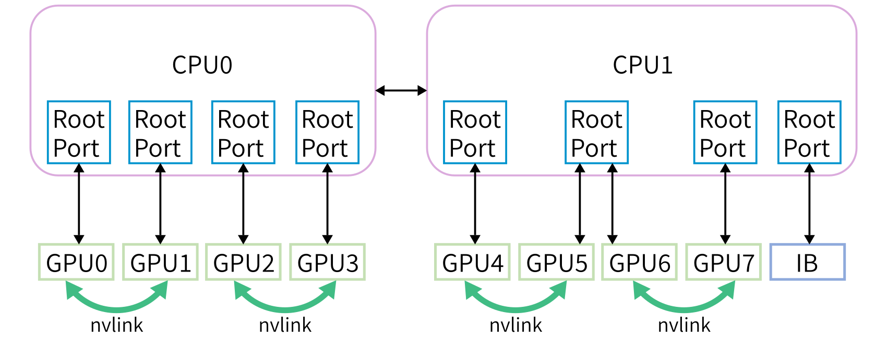
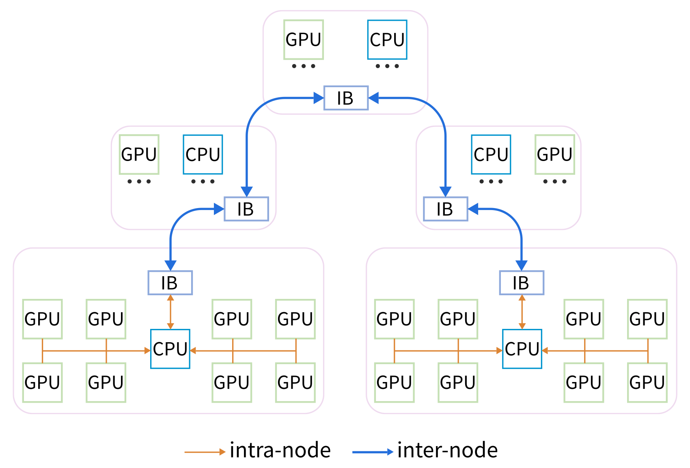

# Fire-Flyer AI-HPC：面向成本的万卡训练集群软硬件协同

> 💡 Fire-Flyer 2 以PCIe A100、分区两层网络和CPU参与的HFReduce控制成本，再用训练框架、3FS、调度与容错把较弱单节点互联组织成可用集群。
>
> [论文 v2](https://arxiv.org/abs/2408.14158v2) · [补充解读](Fire-Flyer-AI-HPC解读.md)

AI集群的成本不只由GPU计算决定，服务器互联、交换机、存储、供电和故障恢复都影响有效训练产出。本文介绍约万张A100规模的Fire-Flyer 2，选择PCIe卡与相对少的网络接口，通过硬件与通信算法共同设计减少投入。报告从节点、拓扑、HFReduce、HaiScale、共享存储到运行维护逐层解释取舍。它并不声称便宜硬件在所有负载都等价于DGX，而是展示如何围绕特定训练模式和成本约束，减少不必要的带宽配置，再用系统机制弥补限制。

## 节点与分区网络

每节点八张PCIe A100、双AMD CPU、一个200Gbps CX6 IB NIC，GPU直接接CPU而非额外PCIe switch，NIC位于独立root complex。保留成对NVLink Bridge的安装能力，后续LLM训练用它支持小范围TP。

|  | Our PCIe Arch | DGX-A100 |
| --- | --- | --- |
| CPU | 2 * AMD 32 Cores EPYC Rome/Milan CPU | 2 * AMD 64 Cores EPYC 7742 CPU |
| Memory | 512GB 16-Channels DDR4-3200Mhz | 2048GB 16-Channels DDR4-3200Mhz |
| GPU | 8 * PCIe-A100-40GB | 8 * SXM-A100-40GB |
| NICs | 1 * Mellanox InfiniBand cx6 200Gbps NIC | 9 * Mellanox InfiniBand cx6 200Gbps NIC |
| NVLINK | 600 GB/s between each pair of GPUs | 600 GB/s interconnect among all 8 GPUs |

PCIe卡相对SXM的GEMM约83%，节点成本/功耗约60%是特定配置口径；“万卡集群总体约一半成本”的概述还包含网络等因素，不能互换。

单个两层Fat-Tree只容纳约800节点，整个集群约1250计算节点，因此分成两个zone，每区约600计算节点。存储双网口分别连两区；跨区计算链路有限，调度尽量让同一作业留在区内，并约束跨区任务并发。

|  | Our Arch | PCIe Arch with Three Layer Fat-Tree | DGX Arch |
| --- | --- | --- | --- |
| Number of Switches | 122 | 200 | 1320 |
| Network Price | 350 | 600 | 4000 |
| Server Price | 11250 | 11250 | 19000 |
| Total Price | 11600 | 11850 | 23000 |

减少高层交换机的代价是拓扑不再对任意跨区流量提供同样带宽。节约依赖作业放置、通信结构和存储共享方式，不是删除交换机后性能自动保持。

## HFReduce：把CPU内存和网络纳入归约

梯度先异步D2H到主存，CPU向量指令做节点内归约，再通过RDMA双二叉树做跨节点all-reduce，最后H2D回GPU。小数据使用GDRCopy，大数据结合异步copy，并在CPU cache中复用向同NUMA多个GPU写回的数据。

相对GPU端NCCL路线，CPU归约减少GPU kernel竞争和部分PCIe重复流量，也能与GPU反向计算重叠。但瓶颈转移到CPU内存带宽、NUMA和PCIe，因此实现需要切块流水化、线程放置和数据搬运协同。

NVLink Bridge进一步改善节点内组合。论文分别测不同数据量、节点数与互联配置，不应只摘某个通信峰值当作整个训练加速。

相应PCIe流量模型中，NCCL环每单位数据消耗约(2n−1)/n单位双向带宽，HFReduce只需一次D2H和一次H2D，对应一单位，解释为什么在PCIe受限节点更有利。186MiB归约测试中HFReduce跨节点带宽约6.3–8.1GB/s，NCCL约1.6–4.8GB/s，不能推广成其他数据量与拓扑的固定倍数。

NUMA放置进一步决定实际效果：D2H目标内存在两CPU节点交错，归约结果与接收缓冲靠近NIC的NUMA节点；EPYC Rome缺少chained-write的限制会拖慢GPU–NIC P2P，CPU主存路径可绕开部分问题。与此同时，CPU归约反复读写梯度，主存带宽会成为自己的上限。报告因此同时列出优势和新瓶颈，并非“CPU归约总比GPU归约好”。

## HaiScale：按硬件约束安排并行

DDP把梯度分桶并尽早启动HFReduce，重叠反向计算。成对NVLink支持TP，其他维度更多依靠PP/DP；PP重新平衡stage并处理激活与通信，FSDP降低参数、梯度和优化器状态驻留。

PCIe节点的优点是成本，限制是大规模节点内高带宽不如全互联SXM。因此并行策略不是在所有模型上使用同一个TP度数，而是根据模型、通信和显存选择。报告中的效果同时包含通信库、模型框架与调度，不能只归因于HFReduce一项。

## 计算—存储融合网络与3FS

HFReduce、NCCL、3FS及其他流量用IB Service Level/Virtual Lane隔离，减少HOL阻塞。存储incast下自适应路由曾使拥塞扩散，作者选静态路由并均匀放置节点；这与后续其他拓扑上的AR建议并不矛盾，条件不同。

3FS由manager、meta、storage与client组成，元数据持久化到分布式KV，数据按chunk映射到复制链。CRAQ实现write-all/read-any的一致性与读扩展。180个存储节点、每节点16块NVMe和两个200G口，约20PiB空间，聚合读取实测约8TB/s。

为控制incast，storage读盘后先请求client发送许可，client限制并发sender，再RDMA写入并通知。多一次协调增加延迟，换取持续高吞吐。3FS-KV在文件系统上提供KV、消息队列和对象接口，服务离线处理及磁盘KV缓存。

## HAI调度与运行可靠性

HAI做分时资源调度，通过暂停恢复和作业放置管理两区资源，既提高利用率又限制稀缺跨区流量。这里的“平台”包括实际调度与状态管理，不是单独一个训练算法。

checkpoint将参数与优化器状态切块，异步GPU→CPU，再批量写3FS；通常每五分钟一次，每节点批写可超过10GiB/s，减少故障回滚。保存频率带来的最大进度损失与恢复耗时需要分开计算。

validator定期检查链路、CPU/内存、GPU显存、满负载GEMM、节点内归约与存储，把异常节点移出调度。论文还分析Xid与网络闪断，说明万卡训练有效产出取决于故障发现、定位与恢复，而不仅是峰值FLOPs。

## 成本、结果与适用范围

|  | Our Arch | DGX Arch |
| --- | --- | --- |
| TF32 GEMM (TFLOPS/GPU) | 107 | 131 |
| FP16 GEMM (TFLOPS/GPU) | 220 | 263 |
| Relative Performance | 83% | 100% |
| Node Relative Price | 60% | 100% |
| Cost–Performance Ratio | 1.38 | 1 |
| Power Consumption (Watts) | 2500 | 4200 |

表中的GEMM、成本和功耗是相应节点配置；集群交换机数量和训练结果另有口径。论文整体支持约80%级性能、显著较低投入的成本路线，但没有证明每种训练、推理和all-to-all负载均如此。

未来部分讨论新GPU、网络升级及更大集群，意味着现有PCIe/单NIC选择与当时硬件和任务密切相关。本文可迁移的主线是先识别目标负载的真实瓶颈，再共同设计节点、通信、存储和容错；具体的NIC数量、网络分区与CPU归约不应脱离条件照搬。
