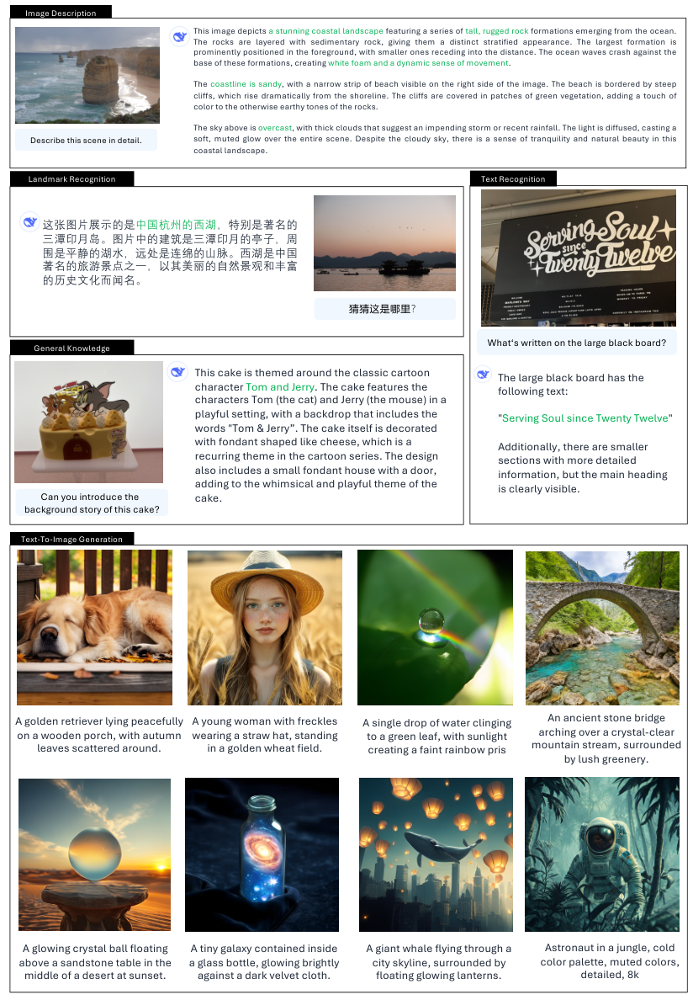

# Janus-Pro：通过训练重排、数据扩展与模型扩展增强统一多模态模型

> 💡 Janus-Pro 延续 Janus 的双视觉编码架构，把简单图像生成训练前移，扩充理解与高质量合成图像数据，并扩大共享模型，以改善理解和文生图提示遵循。
>
> [论文](https://arxiv.org/abs/2501.17811) · [官方仓库](https://github.com/deepseek-ai/Janus) · [补充解读](Janus-Pro解读.md)

初代 Janus 验证了理解—生成编码分离，但短提示生成、画面稳定性及模型容量仍有限。Janus-Pro 没有更换为新的生成范式，而是沿用 SigLIP 理解、VQ 图像 token 生成和共享自回归 LLM，系统调整训练顺序、数据质量及规模。报告的重点是把有限计算用在更合适的阶段，让 1B/7B 级模型更充分地学习开放域图像与指令。GenEval 和 DPG-Bench 的结果显示提示遵循明显改善；固定 384 分辨率与视觉 tokenizer 的重建损失，则仍限制细节和 OCR。它是一篇较短的技术报告，需区分公开结果与尚未提供的独立因素消融。

## 保留的架构

理解侧 SigLIP-Large-Patch16-384 提取高维语义特征，经两层 MLP 映射到 LLM。生成侧使用码本大小 16,384、下采样率 16 的 VQ tokenizer，将图像变为 576 个离散 token，经独立 adaptor 输入，由独立图像 head 预测。

因此 Janus-Pro 仍是离散 next-token generation，不是 JanusFlow 的速度场预测，也没有在共享 LLM 外调用完整文生图扩散模型。理解与生成的下层表示分离，上层 Transformer 统一。

|  | Janus-Pro-1B | Janus-Pro-7B |
| --- | --- | --- |
| Vocabulary size | 100K | 100K |
| Embedding size | 2048 | 4096 |
| Context Window | 4096 | 4096 |
| #Attention heads | 16 | 32 |
| #Layers | 24 | 30 |

系列名称为 1B/7B，正文对小模型的实际 LLM 规模也使用 1.5B 描述，记录时应保留命名与配置差别，不据此另造一个独立型号。上下文均为 4096。

## 调整一：重新分配训练阶段

Janus 第二阶段曾用约三分之二的图像生成 steps 学 ImageNet 类别名→图像，再转开放域文本。Pro 发现这种安排效率不佳：即使冻结 LLM，第一阶段也能学到基本像素依赖。

于是延长第一阶段，充分训练 adaptor 与 image head；第二阶段移除 ImageNet，直接学习普通文本—图像配对。第三阶段把“理解:文本:生成”从 7:3:10 调为 5:1:4，适当减少生成占比，改善理解，同时维持生成表现。

|  | Janus-Pro-1B | Janus-Pro-1B | Janus-Pro-1B | Janus-Pro-7B | Janus-Pro-7B | Janus-Pro-7B |
| --- | --- | --- | --- | --- | --- | --- |
| Hyperparameters | Stage 1 | Stage 2 | Stage 3 | Stage 1 | Stage 2 | Stage 3 |
| Learning rate | $1.0\times 10^{-3}$ | $1.0\times 10^{-4}$ | $4.0\times 10^{-5}$ | $1.0\times 10^{-3}$ | $1.0\times 10^{-4}$ | $4.0\times 10^{-5}$ |
| LR scheduler | Constant | Constant | Constant | Constant | Constant | Constant |
| Weight decay | 0.0 | 0.0 | 0.0 | 0.0 | 0.0 | 0.0 |
| Gradient clip | 1.0 | 1.0 | 1.0 | 1.0 | 1.0 | 1.0 |
| Optimizer | AdamW ( $\beta_{1}=0.9,\beta_{2}=0.95$ ) | AdamW ( $\beta_{1}=0.9,\beta_{2}=0.95$ ) | AdamW ( $\beta_{1}=0.9,\beta_{2}=0.95$ ) | AdamW ( $\beta_{1}=0.9,\beta_{2}=0.95$ ) | AdamW ( $\beta_{1}=0.9,\beta_{2}=0.95$ ) | AdamW ( $\beta_{1}=0.9,\beta_{2}=0.95$ ) |
| Warm-up steps | 600 | 5000 | 0 | 600 | 5000 | 0 |
| Training steps | 20K | 360K | 80K | 20K | 360K | 40K |
| Batch size | 256 | 512 | 128 | 256 | 512 | 128 |
| Data Ratio | 1:0:3 | 2:3:5 | 5:1:4 | 1:0:3 | 2:3:5 | 5:1:4 |

表中第二阶段计划 360k steps，正文说明实际使用 early stopping，在 270k 停止；不能直接以计划步数计算最终训练量。学习率依次 $10^{-3},10^{-4},4\times10^{-5}$，小/大模型最后阶段为 80k/40k steps。

## 调整二：理解与生成数据扩展

理解预训练增加约 9,000 万条样本，参考 VL2，补充 YFCC 描述、Docmatix 文档以及表格、图表。指令阶段增加 meme 理解、中文对话和改善交互体验的数据。这让模型不只从自然照片描述中获得监督。

生成侧发现原始真实图文存在噪声，导致画面不稳定和美学质量差。因此加入约 **7,200 万条合成美学数据**，统一预训练时真实:合成约 1:1。作者观察到收敛更快、生成更稳定；这里的 1:1 是来源混合比例，不是整个训练中理解与生成的比例。

这些调整同时改变样本数量与质量，公开报告没有提供能完全分离“数据更多”“描述更好”“合成画风分布”各自贡献的控制实验。因此应保留论文观察，不虚构单独增益数字。

## 调整三：扩大共享模型

从小规模验证扩大到 7B，作者观察理解和生成 loss 收敛更快。输入理解图像按长边缩放、补齐，生成图像按短边缩放再裁剪，统一 384。采用 packing 与 HAI-LLM；小/大模型分别约 9/14 天，16/32 个节点，每节点八张 A100-40G。

大模型仍需权重、KV cache 和生成开销，不能只凭同一视觉 token 数认为两款部署成本相同。

## 理解评测

| Type | Model | # LLM Params | POPE $\uparrow$ | MME-P $\uparrow$ | MMB $\uparrow$ | SEED $\uparrow$ | GQA $\uparrow$ | MMMU $\uparrow$ | MM-Vet $\uparrow$ |
| --- | --- | --- | --- | --- | --- | --- | --- | --- | --- |
| Und. Only | LLaVA-v $1.5$ -Phi- $1.5$ [ 50 ] | $1.3$ B | $84.1$ | $1128.0$ | - | - | $56.5$ | $30.7$ | - |
|  | MobileVLM [ 6 ] | $1.4$ B | $84.5$ | $1196.2$ | $53.2$ | - | $56.1$ | - | - |
|  | MobileVLM-V2 [ 7 ] | $1.4$ B | $84.3$ | $1302.8$ | $57.7$ | - | $59.3$ | - | - |
|  | MobileVLM [ 6 ] | $2.7$ B | $84.9$ | $1288.9$ | $59.6$ | - | $59.0$ | - | - |
|  | MobileVLM-V2 [ 7 ] | $2.7$ B | $84.7$ | $1440.5$ | $63.2$ | - | $61.1$ | - | - |
|  | LLaVA-Phi [ 56 ] | $2.7$ B | $85.0$ | $1335.1$ | $59.8$ | - | - | - | $28.9$ |
|  | LLaVA [ 27 ] | $7$ B | $76.3$ | $809.6$ | $38.7$ | $33.5$ | - | - | $25.5$ |
|  | LLaVA-v $1.5$ [ 26 ] | $7$ B | $85.9$ | $1510.7$ | $64.3$ | $58.6$ | $62.0$ | $35.4$ | $31.1$ |
|  | InstructBLIP [ 8 ] | $7$ B | - | - | $36.0$ | $53.4$ | $49.2$ | - | $26.2$ |
|  | Qwen-VL-Chat [ 1 ] | $7$ B | - | $1487.5$ | $60.6$ | $58.2$ | $57.5$ | - | - |
|  | IDEFICS- $9$ B [ 19 ] | $8$ B | - | - | $48.2$ | - | $38.4$ | - | - |
|  | Emu $3$ -Chat [ 45 ] | $8$ B | $85.2$ | $1244$ | $58.5$ | $68.2$ | $60.3$ | $31.6$ | $37.2$ |
|  | InstructBLIP [ 8 ] | $13$ B | $78.9$ | $1212.8$ | - | - | $49.5$ | - | $25.6$ |
| Und. and Gen. | DreamLLM † [ 10 ] | $7$ B | - | - | - | - | - | - | $36.6$ |
|  | LaVIT † [ 18 ] | $7$ B | - | - | - | - | $46.8$ | - | - |
|  | MetaMorph † [ 42 ] | $8$ B | - | - | $75.2$ | $71.8$ | - | - | - |
|  | Emu † [ 39 ] | $13$ B | - | - | - | - | - | - | - |
|  | NExT-GPT † [ 47 ] | $13$ B | - | - | - | - | - | - | - |
|  | Show-o-256 [ 50 ] | $1.3$ B | $73.8$ | $948.4$ | - | - | $48.7$ | $25.1$ | - |
|  | Show-o-512 [ 50 ] | $1.3$ B | $80.0$ | $1097.2$ | - | - | $58.0$ | $26.7$ | - |
|  | D-Dit [ 24 ] | $2.0$ B | $84.0$ | $1124.7$ | - | - | $59.2$ | - | - |
|  | Gemini-Nano-1 [ 41 ] | $1.8$ B | - | - | - | - | - | $26.3$ | - |
|  | ILLUME [ 44 ] | $7$ B | $88.5$ | $1445.3$ | $65.1$ | $72.9$ | $-$ | $38.2$ | $37.0$ |
|  | TokenFlow-XL [ 34 ] | $13$ B | $86.8$ | $1545.9$ | $68.9$ | $68.7$ | $62.7$ | $38.7$ | $40.7$ |
|  | LWM [ 28 ] | $7$ B | $75.2$ | - | - | - | $44.8$ | - | $9.6$ |
|  | VILA-U [ 48 ] | $7$ B | $85.8$ | $1401.8$ | - | $59.0$ | $60.8$ | - | $33.5$ |
|  | Chameleon [ 40 ] | $7$ B | - | - | - | - | - | $22.4$ | $8.3$ |
|  | Janus | $1.5$ B | $87.0$ | $1338.0$ | $69.4$ | $63.7$ | $59.1$ | $30.5$ | $34.3$ |
|  | Janus-Pro-1B | $1.5$ B | $86.2$ | $1444.0$ | $75.5$ | $68.3$ | $59.3$ | $36.3$ | $39.8$ |
|  | Janus-Pro-7B | $7$ B | $87.4$ | $1567.1$ | $79.2$ | $72.1$ | $62.0$ | $41.0$ | $50.0$ |

7B 的 MMBench 达 79.2，较 Janus 的 69.4 提升；表中与更大的统一模型相比也有竞争力，但 GQA 等并非全部领先。不同模型数据、规模、训练预算同时变化，所以这是最终系统的对比，不是单一新结构的纯消融。

## 文生图提示遵循

| Type | Method | Single Obj. | Two Obj. | Counting | Colors | Position | Color Attri. | Overall $\uparrow$ |
| --- | --- | --- | --- | --- | --- | --- | --- | --- |
| Gen. Only | LlamaGen [ 38 ] | $0.71$ | $0.34$ | $0.21$ | $0.58$ | $0.07$ | $0.04$ | $0.32$ |
| Gen. Only | LDM [ 37 ] | $0.92$ | $0.29$ | $0.23$ | $0.70$ | $0.02$ | $0.05$ | $0.37$ |
| Gen. Only | SDv $1.5$ [ 37 ] | $0.97$ | $0.38$ | $0.35$ | $0.76$ | $0.04$ | $0.06$ | $0.43$ |
| Gen. Only | PixArt- $\alpha$ [ 4 ] | $0.98$ | $0.50$ | $0.44$ | $0.80$ | $0.08$ | $0.07$ | $0.48$ |
| Gen. Only | SDv $2.1$ [ 37 ] | $0.98$ | $0.51$ | $0.44$ | $0.85$ | $0.07$ | $0.17$ | $0.50$ |
| Gen. Only | DALL-E $2$ [ 35 ] | $0.94$ | $0.66$ | $0.49$ | $0.77$ | $0.10$ | $0.19$ | $0.52$ |
| Gen. Only | Emu $3$ -Gen [ 45 ] | $0.98$ | $0.71$ | $0.34$ | $0.81$ | $0.17$ | $0.21$ | $0.54$ |
| Gen. Only | SDXL [ 32 ] | $0.98$ | $0.74$ | $0.39$ | $0.85$ | $0.15$ | $0.23$ | $0.55$ |
|  | DALL-E $3$ [ 2 ] | $0.96$ | $0.87$ | $0.47$ | $0.83$ | $0.43$ | $0.45$ | $0.67$ |
|  | SD3-Medium [ 11 ] | 0.99 | 0.94 | 0.72 | 0.89 | 0.33 | 0.60 | $0.74$ |
| Und. and Gen. | SEED-X † [ 13 ] | $0.97$ | $0.58$ | $0.26$ | $0.80$ | $0.19$ | $0.14$ | $0.49$ |
| Und. and Gen. | Show-o [ 50 ] | $0.95$ | $0.52$ | $0.49$ | $0.82$ | $0.11$ | $0.28$ | $0.53$ |
| Und. and Gen. | D-DiT [ 24 ] | $0.97$ | $0.80$ | $0.54$ | $0.76$ | $0.32$ | $0.50$ | $0.65$ |
| Und. and Gen. | LWM [ 28 ] | $0.93$ | $0.41$ | $0.46$ | $0.79$ | $0.09$ | $0.15$ | $0.47$ |
| Und. and Gen. | Transfusion [ 55 ] | - | - | - | - | - | - | $0.63$ |
|  | ILLUME [ 44 ] | $0.99$ | $0.86$ | $0.45$ | $0.71$ | $0.39$ | $0.28$ | $0.61$ |
|  | TokenFlow-XL [ 28 ] | $0.95$ | $0.60$ | $0.41$ | $0.81$ | $0.16$ | $0.24$ | $0.55$ |
|  | Chameleon [ 40 ] | - | - | - | - | - | - | $0.39$ |
|  | Janus [ 46 ] | $0.97$ | $0.68$ | $0.30$ | $0.84$ | $0.46$ | $0.42$ | $0.61$ |
|  | Janus-Pro-1B | $0.98$ | $0.82$ | $0.51$ | $0.89$ | $0.65$ | $0.56$ | $0.73$ |
|  | Janus-Pro-7B | $0.99$ | $0.89$ | $0.59$ | $0.90$ | $0.79$ | $0.66$ | $0.80$ |

GenEval 7B overall 0.80，高于表中 Janus 0.61、DALL-E 3 的 0.67 和 SD3-Medium 0.74。应继续看计数、位置、颜色属性分项，overall 不是审美质量分，也不代表所有视觉细节优于这些模型。

| Method | Global | Entity | Attribute | Relation | Other | Overall $\uparrow$ |
| --- | --- | --- | --- | --- | --- | --- |
| SDv1.5 [ 36 ] | 74.63 | 74.23 | 75.39 | 73.49 | 67.81 | 63.18 |
| PixArt- $\alpha$ [ 4 ] | 74.97 | 79.32 | 78.60 | 82.57 | 76.96 | 71.11 |
| Lumina-Next [ 57 ] | 82.82 | 88.65 | 86.44 | 80.53 | 81.82 | 74.63 |
| SDXL [ 33 ] | 83.27 | 82.43 | 80.91 | 86.76 | 80.41 | 74.65 |
| Playground v2.5 [ 22 ] | 83.06 | 82.59 | 81.20 | 84.08 | 83.50 | 75.47 |
| Hunyuan-DiT [ 25 ] | 84.59 | 80.59 | 88.01 | 74.36 | 86.41 | 78.87 |
| PixArt- $\Sigma$ [ 5 ] | 86.89 | 82.89 | 88.94 | 86.59 | 87.68 | 80.54 |
| Emu3-Gen [ 45 ] | 85.21 | 86.68 | 86.84 | 90.22 | 83.15 | 80.60 |
| DALL-E 3 [ 2 ] | 90.97 | 89.61 | 88.39 | 90.58 | 89.83 | 83.50 |
| SD3-Medium [ 11 ] | 87.90 | 91.01 | 88.83 | 80.70 | 88.68 | 84.08 |
| Janus | 82.33 | 87.38 | 87.70 | 85.46 | 86.41 | 79.68 |
| Janus-Pro-1B | 87.58 | 88.63 | 88.17 | 88.98 | 88.30 | 82.63 |
| Janus-Pro-7B | 86.90 | 88.90 | 89.40 | 89.32 | 89.48 | 84.19 |

DPG-Bench 有 1,065 条密集长提示，评估实体、属性和关系等，7B overall 84.19。它补充 GenEval 对较简单组合的评测，但依赖该评测的提示分布及判分方式。

案例展示中文和图像理解，以及复杂创意场景的生成。它用于说明输出形态；精选示例不能代替失败率或细节质量的统计。

## 报告的证据范围与局限

Pro 的主要证据是完整系统在两种任务上的进步、训练行为观察和不同规模结果；没有独立消融表逐一拆出三项修改的净贡献。不能把三项变动写成每一项都已严格验证的因果结论。

作者明确保留两类限制：384 输入影响 OCR 和细粒度理解；生成的低分辨率及 VQ 重建损失使小人脸等区域缺乏细节。提高 GenEval 说明文本约束满足得更好，并没有消除图像重建瓶颈。该报告的价值在于把 Janus 的结构想法落实为更成熟的训练与数据配方，而不是宣布一种全新统一架构。
