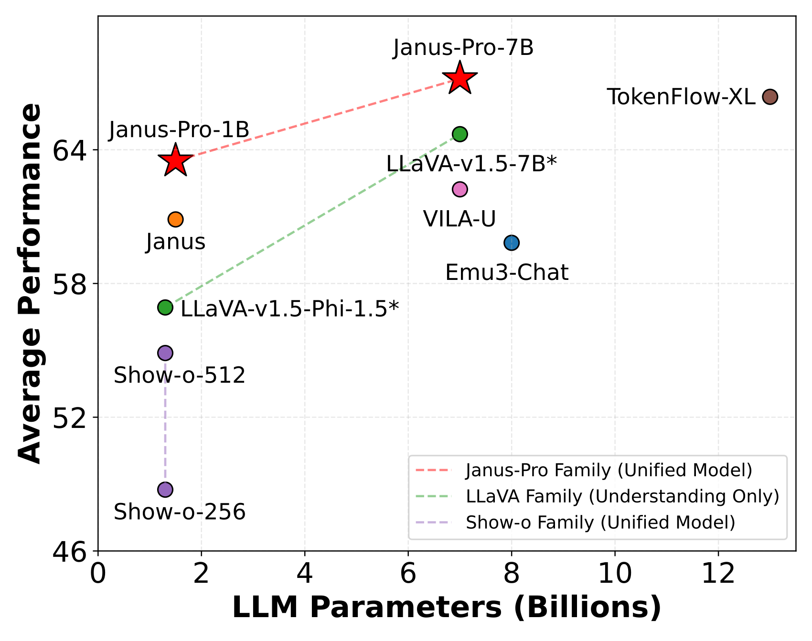
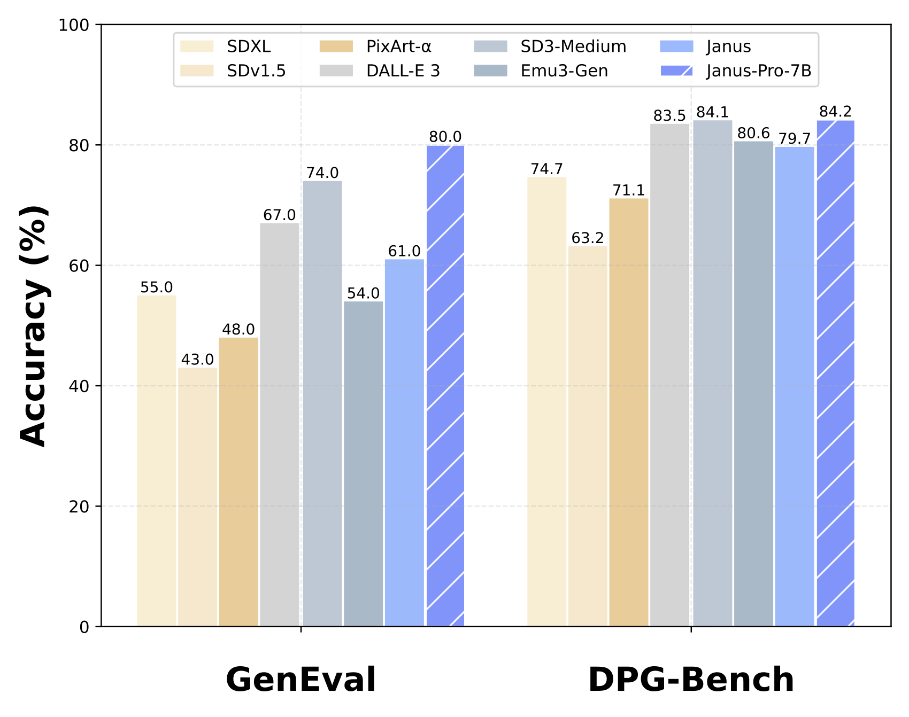
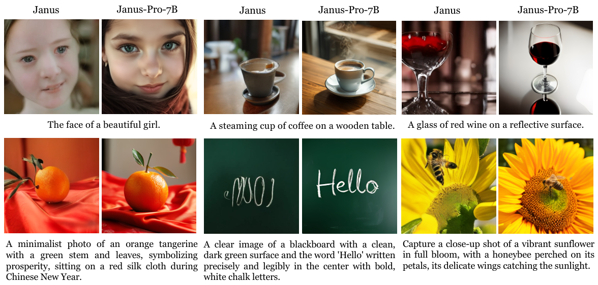

# Janus-Pro: Unified Multimodal Understanding and Generation with Data and Model Scaling / 全文中英对照

> 来源：[arXiv:2501.17811v1](https://arxiv.org/abs/2501.17811v1)。英文段落后紧接中文，覆盖所取 HTML 版本的主文、附录、图表、脚注与参考文献；公式、数字表和书目信息共用。中文以机器初译为底稿，进行了术语整理与结构核对，尚未逐句人工审定；遇到歧义请以紧邻英文和原论文为准。 原作版权归所列作者，许可见 [原作许可](http://creativecommons.org/licenses/by/4.0/)；中文译文与版式改写在该许可条件下提供（涉及 SA 时沿用相同许可，涉及 NC 时仅限非商业使用）。

## Authors and affiliations / 作者与机构

Xiaokang Chen, Zhiyu Wu, Xingchao Liu, Zizheng Pan, Wen Liu, Zhenda Xie, Xingkai Yu, Chong Ruan DeepSeek-AI Project Page: [https://github.com/deepseek-ai/Janus](https://github.com/deepseek-ai/Janus)

**EN.** \reportnumber

**中.** \报告编号

**EN.** 001

**中.** 001

## Abstract / 摘要

**EN.** In this work, we introduce Janus-Pro , an advanced version of the previous work Janus. Specifically, Janus-Pro incorporates (1) an optimized training strategy, (2) expanded training data, and (3) scaling to larger model size. With these improvements, Janus-Pro achieves significant advancements in both multimodal understanding and text-to-image instruction-following capabilities, while also enhancing the stability of text-to-image generation. We hope this work will inspire further exploration in the field. Code and models are publicly available.

**中.** 在这项工作中，我们介绍 Janus-Pro ，它是前一项工作 Janus 的高级版本。具体来说，Janus-Pro 整合了 (1) 优化的训练策略，(2) 扩展的训练数据，以及 (3) 扩展到更大的模型大小。通过这些改进，Janus-Pro 在多模态理解和文本到图像指令跟踪功能方面取得了显着进步，同时还增强了文本到图像生成的稳定性。我们希望这项工作能够激发该领域的进一步探索。代码和模型是公开的。

## Introduction / 简介

**EN.** Figure 1: Multimodal understanding and visual generation results from our Janus-Pro . For multimodal understand, we average the accuracy of POPE, MME-Perception, GQA, and MMMU. The scores of MME-Perception are divided by 20 to scale to $[0,100]$ . For visual generation, we evaluate the performance on two instruction-following benchamrks, GenEval and DPG-Bench. Overall, Janus-Pro outperforms the previous state-of-the-art unified multimodal models as well as some task-specific models. Best viewed on screen.

**中.** 图 1：我们的 Janus-Pro 的多模式理解和视觉生成结果。对于多模态理解，我们对 POPE、MME-Perception、GQA 和 MMMU 的准确性进行平均。 MME-Perception 的分数除以 20 以缩放至 $[0,100]$ 。对于视觉生成，我们在两个指令跟踪基准 GenEval 和 DPG-Bench 上评估性能。总体而言，Janus-Pro 的性能优于之前最先进的统一多模态模型以及一些特定于任务的模型。在屏幕上观看效果最佳。

**EN.** Figure 2: Comparison of text-to-image generation between Janus-Pro and its predecessor, Janus. Janus-Pro delivers more stable outputs for short prompts, with improved visual quality, richer details, and the ability to generate simple text. The image resolution is $384\times 384$ . Best viewed on screen.

**中.** 图 2：Janus-Pro 与其前身 Janus 之间的文本到图像生成比较。 Janus-Pro 为简短的提示提供更稳定的输出，具有改进的视觉质量、更丰富的细节以及生成简单文本的能力。图像分辨率为 $384\times 384$ 。在屏幕上观看效果最佳。

**EN.** Recent advancements in unified multimodal understanding and generation models have demonstrated significant progress [ 40 , 48 , 50 , 55 , 46 , 30 , 45 , 54 ] . These approaches have been proven to enhance the instruction-following capabilities in visual generation tasks while reducing model redundancy. Most of these methods utilize the same visual encoder to process inputs for both multimodal understanding and generation tasks. Since the representations required for these two tasks differ, this often results in suboptimal performance in multimodal understanding. To address this issue, Janus [ 46 ] proposes decoupling visual encoding, which alleviates the conflict between multimodal understanding and generation tasks, achieving excellent performance in both tasks.

**中.** 统一多模态理解和生成模型的最新进展已显示出重大进展[40,48,50,55,46,30,45,54]。这些方法已被证明可以增强视觉生成任务中的指令跟踪能力，同时减少模型冗余。这些方法大多数都利用相同的视觉编码器来处理多模态理解和生成任务的输入。由于这两个任务所需的表示不同，这通常会导致多模态理解的性能不佳。为了解决这个问题，Janus[46]提出了解耦视觉编码，缓解了多模态理解和生成任务之间的冲突，在两个任务中都取得了优异的性能。

**EN.** As a pioneering model, Janus is validated at the 1B parameter scale. However, due to the limited amount of training data and the relatively small model capacity, it exhibites certain shortcomings, such as suboptimal performance on short prompts image generation and unstable text-to-image generation quality. In this paper, we introduce Janus-Pro, an enhanced version of Janus that incorporates improvements across three dimensions: training strategies, data, and model size. The Janus-Pro series includes two model sizes: 1B and 7B, demonstrating scalability of the visual encoding decoding method.

**中.** 作为一个开创性的模型，Janus 在 1B 参数尺度上得到了验证。然而，由于训练数据量有限且模型容量相对较小，它表现出一定的缺点，例如短提示图像生成性能不佳、文本到图像生成质量不稳定等。在本文中，我们介绍了 Janus-Pro，这是 Janus 的增强版本，它融合了三个维度的改进：训练策略、数据和模型大小。 Janus-Pro系列包括两种型号尺寸：1B和7B，展示了视觉编码解码方法的可扩展性。

**EN.** We evaluate Janus-Pro on multiple benchmarks, and the results reveal its superior multimodal understanding capabilities and significantly improved text-to-image instruction-following performance. Specifically, Janus-Pro-7B achieved a score of 79.2 on the multimodal understanding benchmark MMBench [ 29 ] , surpassing state-of-the-art unified multimodal models such as Janus [ 46 ] (69.4), TokenFlow [ 34 ] (68.9) and MetaMorph [ 42 ] (75.2). Additionally, in the text-to-image instruction-following leaderboard GenEval [ 14 ] , Janus-Pro-7B scores 0.80, outperforming Janus [ 46 ] (0.61), DALL-E 3 (0.67), and Stable Diffusion 3 Medium [ 11 ] (0.74).

**中.** 我们在多个基准上评估 Janus-Pro，结果揭示了其卓越的多模态理解能力，并显着提高了文本到图像的指令跟踪性能。具体来说，Janus-Pro-7B 在多模态理解基准 MMBench [29] 上取得了 79.2 的分数，超越了最先进的统一多模态模型，如 Janus [46] (69.4)、TokenFlow [34] (68.9) 和 MetaMorph [42] (75.2)。此外，在文本到图像指令跟踪排行榜 GenEval [14] 中，Janus-Pro-7B 得分为 0.80，优于 Janus [46] (0.61)、DALL-E 3 (0.67) 和 Stable Diffusion 3 Medium [11] (0.74)。

**EN.** Figure 3: Architecture of our Janus-Pro. We decouple visual encoding for multimodal understanding and visual generation. “Und. Encoder” and “Gen. Encoder” are abbreviations for “Understanding Encoder” and “Generation Encoder”, respectively. Best viewed on screen.

**中.** 图 3：我们的 Janus-Pro 的架构。我们解耦视觉编码以实现多模式理解和视觉生成。 “Und.Encoder”和“Gen.Encoder”分别是“Understanding Encoder”和“Generation Encoder”的缩写。在屏幕上观看效果最佳。

## Method / 方法

### Architecture / 建筑

**EN.** The architecture of Janus-Pro is shown in Figure 3 , which is the same as Janus [ 46 ] . The core design principle of the overall architecture is to decouple visual encoding for multimodal understanding and generation. We apply independent encoding methods to convert the raw inputs into features, which are then processed by an unified autoregressive transformer. For multimodal understanding, we use the SigLIP [ 53 ] encoder to extract high-dimensional semantic features from images. These features are flattened from a $2$ -D grid into a $1$ -D sequence, and an understanding adaptor is used to map these image features into the input space of the LLM. For visual generation tasks, we use the VQ tokenizer from [ 38 ] to convert images into discrete IDs. After the ID sequence is flattened into $1$ -D, we use a generation adaptor to map the codebook embeddings corresponding to each ID into the input space of the LLM. We then concatenate these feature sequences to form a multimodal feature sequence, which is subsequently fed into the LLM for processing. Apart from the built-in prediction head in the LLM, we also utilize a randomly initialized prediction head for image predictions in the visual generation task. The entire model adheres to an autoregressive framework.

**中.** Janus-Pro的架构如图3所示，与Janus[46]相同。整体架构的核心设计原则是解耦视觉编码以实现多模态理解和生成。我们应用独立的编码方法将原始输入转换为特征，然后由统一的自回归Transformer处理。对于多模态理解，我们使用 SigLIP [53] 编码器从图像中提取高维语义特征。这些特征从 $2$ -D 网格扁平化为 $1$ -D 序列，并使用理解适配器将这些图像特征映射到 LLM 的输入空间。对于视觉生成任务，我们使用[38]中的VQ标记器将图像转换为离散ID。将ID序列展平为$1$ -D后，我们使用生成适配器将每个ID对应的码本嵌入映射到LLM的输入空间中。然后，我们将这些特征序列连接起来形成多模态特征序列，随后将其输入 LLM 进行处理。除了LLM中的内置预测头之外，我们还在视觉生成任务中利用随机初始化的预测头进行图像预测。整个模型遵循自回归框架。

### Optimized Training Strategy / 优化训练策略

**EN.** The previous version of Janus employs a three-stage training process. Stage I focuses on training the adaptors and the image head. Stage II handles unified pretraining, during which all components except the understanding encoder and the generation encoder has their parameters updated. Stage III is supervised fine-tuning, building upon Stage II by further unlocking the parameters of the understanding encoder during training. This training strategy has certain issues. In Stage II, Janus divides the training for text-to-image capabilities into two parts following PixArt [ 4 ] . The first part trains on ImageNet [ 9 ] data, using image category names as prompts for text-to-image generation, with the goal of modeling pixel dependence. The second part trains on normal text-to-image data. During implementation, 66.67% of the text-to-image training steps in Stage II are allocated to the first part. However, through further experimentation, we find that this strategy is suboptimal and lead to significant computational inefficiency.

**中.** Janus 的早期版本采用三阶段训练过程。第一阶段的重点是训练适配器和图像头。第二阶段处理统一预训练，在此期间，除了理解编码器和生成编码器之外的所有组件都更新其参数。第三阶段是有监督的微调，以第二阶段为基础，在训练期间进一步解锁理解编码器的参数。这种训练策略存在一定的问题。在第二阶段，Janus效仿PixArt[4]，将文本转图像能力的训练分为两个部分。第一部分在 ImageNet [9] 数据上进行训练，使用图像类别名称作为文本到图像生成的提示，目的是对像素依赖性进行建模。第二部分使用普通的文本到图像数据进行训练。在实现过程中，第二阶段66.67%的文本到图像训练步骤分配给第一部分。然而，通过进一步的实验，我们发现这种策略不是最优的，并且导致计算效率显着低下。

**EN.** To address this issue, we make two modifications.

**中.** 为了解决这个问题，我们做了两处修改。

**EN.** Longer Training in Stage I : We increase the training steps in Stage I, allowing sufficient training on the ImageNet dataset. Our findings reveals that even with the LLM parameters fixed, the model could effectively model pixel dependence and generate reasonable images based on category names.

**中.** 第一阶段更长的训练：我们增加了第一阶段的训练步骤，允许对 ImageNet 数据集进行充分的训练。我们的研究结果表明，即使 LLM 参数固定，该模型也可以有效地模拟像素依赖性并根据类别名称生成合理的图像。

**EN.** Focused Training in Stage II : In Stage II, we drop ImageNet data and directly utilize normal text-to-image data to train the model to generate images based on dense descriptions. This redesigned approach enables Stage II to utilize the text-to-image data more efficiently, resulting in improved training efficiency and overall performance.

**中.** 第二阶段的集中训练：在第二阶段，我们丢弃 ImageNet 数据并直接利用正常的文本到图像数据来训练模型以基于密集描述生成图像。这种重新设计的方法使 Stage II 能够更有效地利用文本到图像数据，从而提高训练效率和整体性能。

**EN.** We also adjust the data ratio in Stage III supervised fine-tuning process across different types of datasets, changing the proportion of multimodal data, pure text data, and text-to-image data from 7:3:10 to 5:1:4. By slightly reducing the proportion of text-to-image data, we observe that this adjustment allows us to maintain strong visual generation capabilities while achieving improved multimodal understanding performance.

**中.** 我们还调整了第三阶段监督微调过程中不同类型数据集的数据比例，将多模态数据、纯文本数据和文本到图像数据的比例从 7:3:10 更改为 5:1:4。通过稍微减少文本到图像数据的比例，我们观察到这种调整使我们能够保持强大的视觉生成能力，同时实现改进的多模态理解性能。

### Data Scaling / 数据缩放

**EN.** We scale up the training data used for Janus in both multimodal understanding and visual generation aspects.

**中.** 我们在多模态理解和视觉生成方面扩大了 Janus 所使用的训练数据。

**EN.** Multimodal Understanding . For the Stage II pretraining data, we refer to DeepSeek-VL2 [ 49 ] and add approximately 90 million samples. These include image caption datasets (e.g., YFCC [ 31 ] ), as well as data for table, chart, and document understanding (e.g., Docmatix [ 20 ] ). For the Stage III supervised fine-tuning data, we also incorporate additional datasets from DeepSeek-VL2, such as MEME understanding, Chinese conversational data, and datasets aimed at enhancing dialogue experiences. These additions significantly expanded the model’s capabilities, enriching its ability to handle diverse tasks while improving the overall conversational experience.

**中.** 多模式理解。对于Stage II预训练数据，我们参考DeepSeek-VL2[49]并添加了大约9000万个样本。其中包括图像标题数据集（例如，YFCC [31]），以及表格、图表和文档理解的数据（例如，Docmatix [20]）。对于第三阶段的监督微调数据，我们还纳入了来自 DeepSeek-VL2 的其他数据集，例如 MEME 理解、中文对话数据和旨在增强对话体验的数据集。这些新增内容显着扩展了模型的功能，丰富了其处理不同任务的能力，同时改善了整体对话体验。

**EN.** Visual Generation . We observe that the real-world data used in the previous version of Janus lacks quality and contains significant noise, which often leads to instability in text-to-image generation, resulting in aesthetically poor outputs. In Janus-Pro, we incorporate approximately 72 million samples of synthetic aesthetic data, bringing the ratio of real to synthetic data to 1:1 during the unified pretraining stage. The prompts for these synthetic data samples are publicly available, such as those in [ 43 ] . Experiments demonstrat that the model converges faster when trained on synthetic data, and the resulting text-to-image outputs are not only more stable but also exhibit significantly improved aesthetic quality.

**中.** 视觉一代。我们观察到，Janus 之前版本中使用的现实世界数据缺乏质量并且包含显着的噪声，这通常会导致文本到图像生成的不稳定，从而导致输出的美观度较差。在 Janus-Pro 中，我们整合了大约 7200 万个合成美学数据样本，在统一预训练阶段使真实数据与合成数据的比例达到 1:1。这些合成数据样本的提示是公开的，例如[43]中的提示。实验表明，在合成数据上进行训练时，模型收敛速度更快，并且生成的文本到图像输出不仅更加稳定，而且美学质量也显着提高。

### Model Scaling / 模型缩放

**EN.** The previous version of Janus validates the effectiveness of visual encoding decoupling using a 1.5B LLM. In Janus-Pro, we scaled the model up to 7B, with the hyperparameters of both the 1.5B and 7B LLMs detailed in Table 1 . We observe that when utilizing a larger-scale LLM, the convergence speed of losses for both multimodal understanding and visual generation improved significantly compared to the smaller model. This finding further validates the strong scalability of this approach.

**中.** Janus 的先前版本使用 1.5B LLM 验证了视觉编码解耦的有效性。在 Janus-Pro 中，我们将模型扩展到 7B，1.5B 和 7B LLM 的超参数详见表 1。我们观察到，与较小的模型相比，当使用更大规模的 LLM 时，多模态理解和视觉生成的损失收敛速度显着提高。这一发现进一步验证了该方法强大的可扩展性。

|  | Janus-Pro-1B 杰纳斯-Pro-1B | Janus-Pro-7B 杰纳斯-Pro-7B |
| --- | --- | --- |
| Vocabulary size 词汇量 | 100K | 100K |
| Embedding size 嵌入尺寸 | 2048 | 4096 |
| Context Window 上下文窗口 | 4096 | 4096 |
| #Attention heads #注意头 | 16 | 32 |
| #Layers #层数 | 24 | 30 |

**EN.** Table 1: Architectural configuration for Janus-Pro . We list the hyperparameters of the architecture.

**中.** 表 1：Janus-Pro 的架构配置。我们列出了该架构的超参数。

|  | Janus-Pro-1B 杰纳斯-Pro-1B | Janus-Pro-1B 杰纳斯-Pro-1B | Janus-Pro-1B 杰纳斯-Pro-1B | Janus-Pro-7B 杰纳斯-Pro-7B | Janus-Pro-7B 杰纳斯-Pro-7B | Janus-Pro-7B 杰纳斯-Pro-7B |
| --- | --- | --- | --- | --- | --- | --- |
| Hyperparameters 超参数 | Stage 1 第一阶段 | Stage 2 第二阶段 | Stage 3 第三阶段 | Stage 1 第一阶段 | Stage 2 第二阶段 | Stage 3 第三阶段 |
| Learning rate 学习率 | $1.0\times 10^{-3}$ | $1.0\times 10^{-4}$ | $4.0\times 10^{-5}$ | $1.0\times 10^{-3}$ | $1.0\times 10^{-4}$ | $4.0\times 10^{-5}$ |
| LR scheduler LR调度器 | Constant 常数 | Constant 常数 | Constant 常数 | Constant 常数 | Constant 常数 | Constant 常数 |
| Weight decay 重量衰减 | 0.0 | 0.0 | 0.0 | 0.0 | 0.0 | 0.0 |
| Gradient clip 渐变剪辑 | 1.0 | 1.0 | 1.0 | 1.0 | 1.0 | 1.0 |
| Optimizer 优化器 | AdamW ( $\beta_{1}=0.9,\beta_{2}=0.95$ ) 亚当W ( $\beta_{1}=0.9,\beta_{2}=0.95$ ) | AdamW ( $\beta_{1}=0.9,\beta_{2}=0.95$ ) 亚当W ( $\beta_{1}=0.9,\beta_{2}=0.95$ ) | AdamW ( $\beta_{1}=0.9,\beta_{2}=0.95$ ) 亚当W ( $\beta_{1}=0.9,\beta_{2}=0.95$ ) | AdamW ( $\beta_{1}=0.9,\beta_{2}=0.95$ ) 亚当W ( $\beta_{1}=0.9,\beta_{2}=0.95$ ) | AdamW ( $\beta_{1}=0.9,\beta_{2}=0.95$ ) 亚当W ( $\beta_{1}=0.9,\beta_{2}=0.95$ ) | AdamW ( $\beta_{1}=0.9,\beta_{2}=0.95$ ) 亚当W ( $\beta_{1}=0.9,\beta_{2}=0.95$ ) |
| Warm-up steps 热身步骤 | 600 | 5000 | 0 | 600 | 5000 | 0 |
| Training steps 训练步骤 | 20K | 360K | 80K | 20K | 360K | 40K |
| Batch size 批量大小 | 256 | 512 | 128 | 256 | 512 | 128 |
| Data Ratio 数据比率 | 1:0:3 | 2:3:5 | 5:1:4 | 1:0:3 | 2:3:5 | 5:1:4 |

**EN.** Table 2: Detailed hyperparameters for training Janus-Pro . Data ratio refers to the ratio of multimodal understanding data, pure text data, and visual generation data.

**中.** 表 2：训练 Janus-Pro 的详细超参数。数据比例是指多模态理解数据、纯文本数据、视觉生成数据的比例。

## Experiments / 实验

### Implementation Details / 实施细节

**EN.** In our experiments, we utilize DeepSeek-LLM ( $1.5$ B and $7$ B) [ 3 ] with a maximum supported sequence length of $4096$ as the base language model. For the vision encoder used in understanding tasks, we select SigLIP-Large-Patch $16$ - $384$ [ 53 ] . The generation encoder has a codebook of size $16,384$ and downsamples images by a factor of $16$ . Both the understanding adaptor and the generation adaptor are two-layer MLPs. The detailed hyperparameters for each stage are provided in Table 2 . Please note that for Stage II, we employ an early stopping strategy, halting at 270K steps. All images are resized to $384\times 384$ pixels. For multimodal understanding data, we resize the long side of the image and pad the short side with the background color (RGB: $127$ , $127$ , $127$ ) to reach $384$ . For visual generation data, the short side is resized to $384$ , and the long side is cropped to $384$ . We use sequence packing during training to improve training efficiency. We mix all data types according to the specified ratios in a single training step. Our Janus-Pro is trained and evaluated using HAI-LLM [ 15 ] , which is a lightweight and efficient distributed training framework built on top of PyTorch. The whole training process took about $9$ / $14$ days on a cluster of $16$ / $32$ nodes for $1.5$ B/ $7$ B model, each equipped with $8$ Nvidia A $100$ ( $40$ GB) GPUs.

**中.** 在我们的实验中，我们利用 DeepSeek-LLM（$1.5$ B 和 $7$ B）[3]，最大支持序列长度为 $4096$ 作为基本语言模型。对于理解任务中使用的视觉编码器，我们选择SigLIP-Large-Patch $16$ - $384$ [53]。生成编码器具有大小为 $16,384$ 的码本，并将图像下采样为 $16$ 倍。理解适配器和生成适配器都是两层 MLP。表 2 提供了每个阶段的详细超参数。请注意，对于第二阶段，我们采用提前停止策略，在 270K 步处停止。所有图像的大小均调整为 $384\times 384$ 像素。对于多模态理解数据，我们调整图像长边的大小并用背景颜色（RGB： $127$ 、 $127$ 、 $127$ ）填充短边以达到 $384$ 。对于视觉生成数据，短边调整为 $384$ ，长边裁剪为 $384$ 。我们在训练过程中使用序列打包来提高训练效率。我们在单个训练步骤中根据指定的比率混合所有数据类型。我们的 Janus-Pro 使用 HAI-LLM [15] 进行训练和评估，HAI-LLM 是一个构建在 PyTorch 之上的轻量级且高效的分布式训练框架。整个训练过程在 $1.5$ B/ $7$ B 模型的 $16$ / $32$ 节点集群上花费了大约 $9$ / $14$ 天，每个节点都配备了 $8$ Nvidia A $100$ ( $40$ GB）GPU。

| Type 类型 | Model 型号 | # LLM Params # LLM 参数 | POPE $\uparrow$ 波普 $\uparrow$ | MME-P $\uparrow$ | MMB $\uparrow$ | SEED $\uparrow$ 种子 $\uparrow$ | GQA $\uparrow$ | MMMU $\uparrow$ | MM-Vet $\uparrow$ MM-兽医 $\uparrow$ |
| --- | --- | --- | --- | --- | --- | --- | --- | --- | --- |
| Und. Only 和。仅 | LLaVA-v $1.5$ -Phi- $1.5$ [ 50 ] | $1.3$ B | $84.1$ | $1128.0$ | - | - | $56.5$ | $30.7$ | - |
|  | MobileVLM [ 6 ] 移动VLM [ 6 ] | $1.4$ B | $84.5$ | $1196.2$ | $53.2$ | - | $56.1$ | - | - |
|  | MobileVLM-V2 [ 7 ] | $1.4$ B | $84.3$ | $1302.8$ | $57.7$ | - | $59.3$ | - | - |
|  | MobileVLM [ 6 ] 移动VLM [ 6 ] | $2.7$ B | $84.9$ | $1288.9$ | $59.6$ | - | $59.0$ | - | - |
|  | MobileVLM-V2 [ 7 ] | $2.7$ B | $84.7$ | $1440.5$ | $63.2$ | - | $61.1$ | - | - |
|  | LLaVA-Phi [ 56 ] | $2.7$ B | $85.0$ | $1335.1$ | $59.8$ | - | - | - | $28.9$ |
|  | LLaVA [ 27 ] 拉瓦 [ 27 ] | $7$ B | $76.3$ | $809.6$ | $38.7$ | $33.5$ | - | - | $25.5$ |
|  | LLaVA-v $1.5$ [ 26 ] | $7$ B | $85.9$ | $1510.7$ | $64.3$ | $58.6$ | $62.0$ | $35.4$ | $31.1$ |
|  | InstructBLIP [ 8 ] 指导BLIP [8] | $7$ B | - | - | $36.0$ | $53.4$ | $49.2$ | - | $26.2$ |
|  | Qwen-VL-Chat [ 1 ] Qwen-VL-聊天 [ 1 ] | $7$ B | - | $1487.5$ | $60.6$ | $58.2$ | $57.5$ | - | - |
|  | IDEFICS- $9$ B [ 19 ] IDEFICS-$9$ B [ 19 ] | $8$ B | - | - | $48.2$ | - | $38.4$ | - | - |
|  | Emu $3$ -Chat [ 45 ] 鸸鹋 $3$ -聊天 [ 45 ] | $8$ B | $85.2$ | $1244$ | $58.5$ | $68.2$ | $60.3$ | $31.6$ | $37.2$ |
|  | InstructBLIP [ 8 ] 指导BLIP [8] | $13$ B | $78.9$ | $1212.8$ | - | - | $49.5$ | - | $25.6$ |
| Und. and Gen. 和。和将军。 | DreamLLM † [ 10 ] 梦想LLM † [ 10 ] | $7$ B | - | - | - | - | - | - | $36.6$ |
|  | LaVIT † [ 18 ] 拉维特 † [ 18 ] | $7$ B | - | - | - | - | $46.8$ | - | - |
|  | MetaMorph † [ 42 ] 变形 † [ 42 ] | $8$ B | - | - | $75.2$ | $71.8$ | - | - | - |
|  | Emu † [ 39 ] 鸸鹋 † [ 39 ] | $13$ B | - | - | - | - | - | - | - |
|  | NExT-GPT † [ 47 ] | $13$ B | - | - | - | - | - | - | - |
|  | Show-o-256 [ 50 ] 显示-o-256 [ 50 ] | $1.3$ B | $73.8$ | $948.4$ | - | - | $48.7$ | $25.1$ | - |
|  | Show-o-512 [ 50 ] 显示-o-512 [ 50 ] | $1.3$ B | $80.0$ | $1097.2$ | - | - | $58.0$ | $26.7$ | - |
|  | D-Dit [ 24 ] D-迪特 [24] | $2.0$ B | $84.0$ | $1124.7$ | - | - | $59.2$ | - | - |
|  | Gemini-Nano-1 [ 41 ] | $1.8$ B | - | - | - | - | - | $26.3$ | - |
|  | ILLUME [ 44 ] 照明 [ 44 ] | $7$ B | $88.5$ | $1445.3$ | $65.1$ | $72.9$ | $-$ | $38.2$ | $37.0$ |
|  | TokenFlow-XL [ 34 ] | $13$ B | $86.8$ | $1545.9$ | $68.9$ | $68.7$ | $62.7$ | $38.7$ | $40.7$ |
|  | LWM [ 28 ] 长波M [ 28 ] | $7$ B | $75.2$ | - | - | - | $44.8$ | - | $9.6$ |
|  | VILA-U [ 48 ] 维拉-U [ 48 ] | $7$ B | $85.8$ | $1401.8$ | - | $59.0$ | $60.8$ | - | $33.5$ |
|  | Chameleon [ 40 ] 变色龙 [ 40 ] | $7$ B | - | - | - | - | - | $22.4$ | $8.3$ |
|  | Janus 雅努斯 | $1.5$ B | $87.0$ | $1338.0$ | $69.4$ | $63.7$ | $59.1$ | $30.5$ | $34.3$ |
|  | Janus-Pro-1B 杰纳斯-Pro-1B | $1.5$ B | $86.2$ | $1444.0$ | $75.5$ | $68.3$ | $59.3$ | $36.3$ | $39.8$ |
|  | Janus-Pro-7B 杰纳斯-Pro-7B | $7$ B | $87.4$ | $1567.1$ | $79.2$ | $72.1$ | $62.0$ | $41.0$ | $50.0$ |

**EN.** Table 3: Comparison with state-of-the-arts on multimodal understanding benchmarks . “Und.” and “Gen.” denote “understanding” and “generation”, respectively. Models using external pretrained diffusion model are marked with † .

**中.** 表 3：与多模态理解基准上最先进的技术进行比较。 “嗯。”和“将军”。分别表示“理解”和“生成”。使用外部预训练扩散模型的模型用 † 标记。

### Evaluation Setup / 评估设置

**EN.** Multimodal Understanding. To assess multimodal understanding capabilities, we evaluate our model on widely recognized image-based vision-language benchmarks, which include GQA [ 17 ] , POPE [ 23 ] , MME [ 12 ] , SEED [ 21 ] , MMB [ 29 ] , MM-Vet [ 51 ] , and MMMU [ 52 ] .

**中.** 多模式理解。为了评估多模态理解能力，我们在广泛认可的基于图像的视觉语言基准上评估我们的模型，其中包括 GQA [17]、POPE [23]、MME [12]、SEED [21]、MMB [29]、MM-Vet [51] 和 MMMU [52]。

**EN.** Visual Generation. For evaluating visual generation capabilities, we use GenEval [ 14 ] and DPG-Bench [ 16 ] . GenEval is a challenging benchmark for text-to-image generation, designed to reflect the comprehensive generative abilities of visual generation models by offering a detailed instance-level analysis of their compositional capabilities. DPG-Bench (Dense Prompt Graph Benchmark) is a comprehensive dataset consisting of 1065 lengthy, dense prompts, designed to assess the intricate semantic alignment capabilities of text-to-image models.

**中.** 视觉生成。为了评估视觉生成能力，我们使用 GenEval [14] 和 DPG-Bench [16]。 GenEval 是文本到图像生成的一个具有挑战性的基准，旨在通过提供其组合能力的详细实例级分析来反映视觉生成模型的综合生成能力。 DPG-Bench（密集提示图基准）是一个综合数据集，由 1065 个冗长、密集的提示组成，旨在评估文本到图像模型复杂的语义对齐能力。

### Comparison with State-of-the-arts / 与最先进技术的比较

**EN.** Multimodal Understanding Performance. We compare the proposed method with state-of-the-art unified models and understanding-only models in Table 3 . Janus-Pro achieves the overall best results. This can be attributed to decoupling the visual encoding for multimodal understanding and generation, mitigating the conflict between these two tasks. When compared to models with significantly larger sizes, Janus-Pro remains highly competitive. For instance, Janus-Pro-7B outperforms TokenFlow-XL ( $13$ B) on all benchmarks except GQA.

**中.** 多模式理解性能。我们将所提出的方法与表 3 中最先进的统一模型和仅理解模型进行了比较。 Janus-Pro 取得了总体最佳结果。这可以归因于多模态理解和生成的视觉编码的解耦，减轻了这两个任务之间的冲突。与尺寸明显更大的型号相比，Janus-Pro 仍然具有很强的竞争力。例如，Janus-Pro-7B 在除 GQA 之外的所有基准测试中均优于 TokenFlow-XL ($13$ B)。

| Type 类型 | Method 方法 | Single Obj. 单一对象。 | Two Obj. 两个对象。 | Counting 计数 | Colors 颜色 | Position 职位 | Color Attri. 颜色属性。 | Overall $\uparrow$ 整体 $\uparrow$ |
| --- | --- | --- | --- | --- | --- | --- | --- | --- |
| Gen. Only 仅将军 | LlamaGen [ 38 ] 骆驼根 [ 38 ] | $0.71$ | $0.34$ | $0.21$ | $0.58$ | $0.07$ | $0.04$ | $0.32$ |
| Gen. Only 仅将军 | LDM [ 37 ] | $0.92$ | $0.29$ | $0.23$ | $0.70$ | $0.02$ | $0.05$ | $0.37$ |
| Gen. Only 仅将军 | SDv $1.5$ [ 37 ] | $0.97$ | $0.38$ | $0.35$ | $0.76$ | $0.04$ | $0.06$ | $0.43$ |
| Gen. Only 仅将军 | PixArt- $\alpha$ [ 4 ] 原相- $\alpha$ [ 4 ] | $0.98$ | $0.50$ | $0.44$ | $0.80$ | $0.08$ | $0.07$ | $0.48$ |
| Gen. Only 仅将军 | SDv $2.1$ [ 37 ] | $0.98$ | $0.51$ | $0.44$ | $0.85$ | $0.07$ | $0.17$ | $0.50$ |
| Gen. Only 仅将军 | DALL-E $2$ [ 35 ] | $0.94$ | $0.66$ | $0.49$ | $0.77$ | $0.10$ | $0.19$ | $0.52$ |
| Gen. Only 仅将军 | Emu $3$ -Gen [ 45 ] 鸸鹋 $3$ -Gen [ 45 ] | $0.98$ | $0.71$ | $0.34$ | $0.81$ | $0.17$ | $0.21$ | $0.54$ |
| Gen. Only 仅将军 | SDXL [ 32 ] | $0.98$ | $0.74$ | $0.39$ | $0.85$ | $0.15$ | $0.23$ | $0.55$ |
|  | DALL-E $3$ [ 2 ] | $0.96$ | $0.87$ | $0.47$ | $0.83$ | $0.43$ | $0.45$ | $0.67$ |
|  | SD3-Medium [ 11 ] SD3-中型 [ 11 ] | 0.99 | 0.94 | 0.72 | 0.89 | 0.33 | 0.60 | $0.74$ |
| Und. and Gen. 和。和将军。 | SEED-X † [ 13 ] 种子-X † [ 13 ] | $0.97$ | $0.58$ | $0.26$ | $0.80$ | $0.19$ | $0.14$ | $0.49$ |
| Und. and Gen. 和。和将军。 | Show-o [ 50 ] 显示-o [ 50 ] | $0.95$ | $0.52$ | $0.49$ | $0.82$ | $0.11$ | $0.28$ | $0.53$ |
| Und. and Gen. 和。和将军。 | D-DiT [ 24 ] D-DiT [24] | $0.97$ | $0.80$ | $0.54$ | $0.76$ | $0.32$ | $0.50$ | $0.65$ |
| Und. and Gen. 和。和将军。 | LWM [ 28 ] 长波M [ 28 ] | $0.93$ | $0.41$ | $0.46$ | $0.79$ | $0.09$ | $0.15$ | $0.47$ |
| Und. and Gen. 和。和将军。 | Transfusion [ 55 ] 输血 [ 55 ] | - | - | - | - | - | - | $0.63$ |
|  | ILLUME [ 44 ] 照明 [ 44 ] | $0.99$ | $0.86$ | $0.45$ | $0.71$ | $0.39$ | $0.28$ | $0.61$ |
|  | TokenFlow-XL [ 28 ] | $0.95$ | $0.60$ | $0.41$ | $0.81$ | $0.16$ | $0.24$ | $0.55$ |
|  | Chameleon [ 40 ] 变色龙 [ 40 ] | - | - | - | - | - | - | $0.39$ |
|  | Janus [ 46 ] 两面神 [ 46 ] | $0.97$ | $0.68$ | $0.30$ | $0.84$ | $0.46$ | $0.42$ | $0.61$ |
|  | Janus-Pro-1B 杰纳斯-Pro-1B | $0.98$ | $0.82$ | $0.51$ | $0.89$ | $0.65$ | $0.56$ | $0.73$ |
|  | Janus-Pro-7B 杰纳斯-Pro-7B | $0.99$ | $0.89$ | $0.59$ | $0.90$ | $0.79$ | $0.66$ | $0.80$ |

**EN.** Table 4: Evaluation of text-to-image generation ability on GenEval benchmark . “Und.” and “Gen.” denote “understanding” and “generation”, respectively. Models using external pretrained diffusion model are marked with † .

**中.** 表 4：GenEval 基准上文本到图像生成能力的评估。 “嗯。”和“将军”。分别表示“理解”和“生成”。使用外部预训练扩散模型的模型用 † 标记。

| Method 方法 | Global 全球 | Entity 实体 | Attribute 属性 | Relation 关系 | Other 其他 | Overall $\uparrow$ 整体 $\uparrow$ |
| --- | --- | --- | --- | --- | --- | --- |
| SDv1.5 [ 36 ] | 74.63 | 74.23 | 75.39 | 73.49 | 67.81 | 63.18 |
| PixArt- $\alpha$ [ 4 ] 原相- $\alpha$ [ 4 ] | 74.97 | 79.32 | 78.60 | 82.57 | 76.96 | 71.11 |
| Lumina-Next [ 57 ] | 82.82 | 88.65 | 86.44 | 80.53 | 81.82 | 74.63 |
| SDXL [ 33 ] | 83.27 | 82.43 | 80.91 | 86.76 | 80.41 | 74.65 |
| Playground v2.5 [ 22 ] 游乐场 v2.5 [ 22 ] | 83.06 | 82.59 | 81.20 | 84.08 | 83.50 | 75.47 |
| Hunyuan-DiT [ 25 ] 浑源-DiT [ 25 ] | 84.59 | 80.59 | 88.01 | 74.36 | 86.41 | 78.87 |
| PixArt- $\Sigma$ [ 5 ] 原相- $\Sigma$ [ 5 ] | 86.89 | 82.89 | 88.94 | 86.59 | 87.68 | 80.54 |
| Emu3-Gen [ 45 ] | 85.21 | 86.68 | 86.84 | 90.22 | 83.15 | 80.60 |
| DALL-E 3 [ 2 ] 达尔-E 3 [ 2 ] | 90.97 | 89.61 | 88.39 | 90.58 | 89.83 | 83.50 |
| SD3-Medium [ 11 ] SD3-中型 [ 11 ] | 87.90 | 91.01 | 88.83 | 80.70 | 88.68 | 84.08 |
| Janus 雅努斯 | 82.33 | 87.38 | 87.70 | 85.46 | 86.41 | 79.68 |
| Janus-Pro-1B 杰纳斯-Pro-1B | 87.58 | 88.63 | 88.17 | 88.98 | 88.30 | 82.63 |
| Janus-Pro-7B 杰纳斯-Pro-7B | 86.90 | 88.90 | 89.40 | 89.32 | 89.48 | 84.19 |

**EN.** Table 5: Performances on DPG-Bench. The methods in this table are all generation-specific models except Janus and Janus-Pro.

**中.** 表 5：DPG-Bench 上的性能。此表中的方法都是除 Janus 和 Janus-Pro 之外的特定代模型。

**EN.** Visual Generation Performance. We report visual generation performance on GenEval and DPG-Bench. As shown in Table 4 , our Janus-Pro-7B obtains $80$ % overall accuracy on GenEval, which outperforms all the other unified or generation-only methods, e.g., Transfusion [ 55 ] ( $63$ %) SD3-Medium ( $74$ %) and DALL-E $3$ ( $67$ %). This demonstrates that our approach has better instruction-following capabilities. As shown in Table 5 , Janus-Pro achieves a score of $84.19$ on DPG-Bench, surpassing all other methods. This demonstrates that Janus-Pro excels in following dense instructions for text-to-image generation.

**中.** 视觉生成性能。我们报告了 GenEval 和 DPG-Bench 上的视觉生成性能。如表 4 所示，我们的 Janus-Pro-7B 在 GenEval 上获得了 $80$ % 总体准确率，这优于所有其他统一或仅生成方法，例如 Transfusion [55] ( $63$ %) SD3-Medium ( $74$ %) 和 DALL-E $3$ ( $67$%）。这表明我们的方法具有更好的指令跟踪能力。如表5所示，Janus-Pro在DPG-Bench上获得了$84.19$的分数，超越了所有其他方法。这表明 Janus-Pro 擅长遵循密集的指令来生成文本到图像。

### Qualitative Results / 定性结果

**EN.** We present results on multimodal understanding in Figure 4 . Janus-Pro exhibits impressive comprehension abilities when handling inputs from various contexts, showcasing its powerful capabilities. We also present some text-to-image generation results in the lower part of Figure 4 . The images generated by Janus-Pro-7B are highly realistic, and despite having a resolution of only $384\times 384$ , they still contain a lot of details. For imaginative and creative scenes, Janus-Pro-7B accurately captures the semantic information from the prompts, producing well-reasoned and coherent images.

**中.** 我们在图 4 中展示了多模态理解的结果。 Janus-Pro 在处理来自各种上下文的输入时表现出令人印象深刻的理解能力，展示了其强大的功能。我们还在图 4 的下半部分展示了一些文本到图像的生成结果。 Janus-Pro-7B生成的图像非常逼真，尽管分辨率仅为$384\times 384$，但仍然包含大量细节。对于富有想象力和创造力的场景，Janus-Pro-7B 可以准确捕捉提示中的语义信息，生成逻辑清晰、连贯的图像。

**EN.** Figure 4: Qualitative results of multimodal understanding and visual generation capability . The model is Janus-Pro-7B and the image output resolution of visual generation is $384\times 384$ . Best viewed on screen.

**中.** 图 4：多模态理解和视觉生成能力的定性结果。型号为Janus-Pro-7B，视觉生成的图像输出分辨率为$384\times 384$。在屏幕上观看效果最佳。

## Conclusion / 结论

**EN.** This paper introduces improvements to Janus from three aspects: training strategy, data, and model size. These enhancements have led to significant advancements in both multimodal understanding and text-to-image instruction-following capabilities. However, Janus-Pro still has certain limitations. In terms of multimodal understanding, the input resolution is limited to 384 $\times$ 384, which affects its performance in fine-grained tasks such as OCR. For text-to-image generation, the low resolution, combined with reconstruction losses introduced by the vision tokenizer, results in images that, while rich in semantic content, still lack fine details. For example, small facial regions occupying limited image space may appear under-detailed. Increasing the image resolution could mitigate these issues.

**中.** 本文从训练策略、数据、模型大小三个方面介绍了Janus的改进。这些增强功能在多模式理解和文本到图像指令跟踪能力方面取得了显着进步。然而，Janus-Pro仍然有一定的局限性。在多模态理解方面，输入分辨率限制为384 $\times$ 384，这影响了其在OCR等细粒度任务中的性能。对于文本到图像的生成，低分辨率加上视觉分词器引入的重建损失，导致图像虽然语义内容丰富，但仍然缺乏精细的细节。例如，占据有限图像空间的小面部区域可能显得细节不足。提高图像分辨率可以缓解这些问题。

## References / 参考文献

- [1] J. Bai, S. Bai, S. Yang, S. Wang, S. Tan, P. Wang, J. Lin, C. Zhou, and J. Zhou. Qwen-vl: A frontier large vision-language model with versatile abilities. arXiv preprint arXiv:2308.12966 , 2023.

- [2] J. Betker, G. Goh, L. Jing, T. Brooks, J. Wang, L. Li, L. Ouyang, J. Zhuang, J. Lee, Y. Guo, et al. Improving image generation with better captions. Computer Science. https://cdn. openai. com/papers/dall-e-3. pdf , 2(3):8, 2023.

- [3] X. Bi, D. Chen, G. Chen, S. Chen, D. Dai, C. Deng, H. Ding, K. Dong, Q. Du, Z. Fu, et al. Deepseek llm: Scaling open-source language models with longtermism. arXiv preprint arXiv:2401.02954 , 2024.

- [4] J. Chen, J. Yu, C. Ge, L. Yao, E. Xie, Y. Wu, Z. Wang, J. Kwok, P. Luo, H. Lu, et al. Pixart- $alpha$ : Fast training of diffusion transformer for photorealistic text-to-image synthesis. arXiv preprint arXiv:2310.00426 , 2023.

- [5] J. Chen, C. Ge, E. Xie, Y. Wu, L. Yao, X. Ren, Z. Wang, P. Luo, H. Lu, and Z. Li. PixArt-Sigma: Weak-to-strong training of diffusion transformer for 4K text-to-image generation. arXiv preprint arXiv:2403.04692 , 2024.

- [6] X. Chu, L. Qiao, X. Lin, S. Xu, Y. Yang, Y. Hu, F. Wei, X. Zhang, B. Zhang, X. Wei, et al. Mobilevlm: A fast, reproducible and strong vision language assistant for mobile devices. arXiv preprint arXiv:2312.16886 , 2023.

- [7] X. Chu, L. Qiao, X. Zhang, S. Xu, F. Wei, Y. Yang, X. Sun, Y. Hu, X. Lin, B. Zhang, et al. Mobilevlm v2: Faster and stronger baseline for vision language model. arXiv preprint arXiv:2402.03766 , 2024.

- [8] W. Dai, J. Li, D. Li, A. M. H. Tiong, J. Zhao, W. Wang, B. Li, P. Fung, and S. Hoi. Instructblip: Towards general-purpose vision-language models with instruction tuning, 2023.

- [9] J. Deng, W. Dong, R. Socher, L.-J. Li, K. Li, and L. Fei-Fei. Imagenet: A large-scale hierarchical image database. In 2009 IEEE conference on computer vision and pattern recognition , pages 248–255. Ieee, 2009.

- [10] R. Dong, C. Han, Y. Peng, Z. Qi, Z. Ge, J. Yang, L. Zhao, J. Sun, H. Zhou, H. Wei, et al. Dreamllm: Synergistic multimodal comprehension and creation. arXiv preprint arXiv:2309.11499 , 2023.

- [11] P. Esser, S. Kulal, A. Blattmann, R. Entezari, J. Müller, H. Saini, Y. Levi, D. Lorenz, A. Sauer, F. Boesel, D. Podell, T. Dockhorn, Z. English, K. Lacey, A. Goodwin, Y. Marek, and R. Rombach. Scaling rectified flow transformers for high-resolution image synthesis, 2024. URL [https://arxiv.org/abs/2403.03206](https://arxiv.org/abs/2403.03206) .

- [12] C. Fu, P. Chen, Y. Shen, Y. Qin, M. Zhang, X. Lin, J. Yang, X. Zheng, K. Li, X. Sun, et al. Mme: A comprehensive evaluation benchmark for multimodal large language models. arXiv preprint arXiv:2306.13394 , 2023.

- [13] Y. Ge, S. Zhao, J. Zhu, Y. Ge, K. Yi, L. Song, C. Li, X. Ding, and Y. Shan. Seed-x: Multimodal models with unified multi-granularity comprehension and generation. arXiv preprint arXiv:2404.14396 , 2024.

- [14] D. Ghosh, H. Hajishirzi, and L. Schmidt. Geneval: An object-focused framework for evaluating text-to-image alignment. Advances in Neural Information Processing Systems , 36, 2024.

- [15] High-flyer. Hai-llm: Efficient and lightweight training tool for large models, 2023. URL [https://www.high-flyer.cn/en/blog/hai-llm](https://www.high-flyer.cn/en/blog/hai-llm) .

- [16] X. Hu, R. Wang, Y. Fang, B. Fu, P. Cheng, and G. Yu. Ella: Equip diffusion models with llm for enhanced semantic alignment. arXiv preprint arXiv:2403.05135 , 2024.

- [17] D. A. Hudson and C. D. Manning. Gqa: A new dataset for real-world visual reasoning and compositional question answering. In Proceedings of the IEEE/CVF conference on computer vision and pattern recognition , pages 6700–6709, 2019.

- [18] Y. Jin, K. Xu, L. Chen, C. Liao, J. Tan, B. Chen, C. Lei, A. Liu, C. Song, X. Lei, et al. Unified language-vision pretraining with dynamic discrete visual tokenization. arXiv preprint arXiv:2309.04669 , 2023.

- [19] H. Laurençon, D. van Strien, S. Bekman, L. Tronchon, L. Saulnier, T. Wang, S. Karamcheti, A. Singh, G. Pistilli, Y. Jernite, and et al. Introducing idefics: An open reproduction of state-of-the-art visual language model, 2023. URL [https://huggingface.co/blog/idefics](https://huggingface.co/blog/idefics) .

- [20] H. Laurençon, A. Marafioti, V. Sanh, and L. Tronchon. Building and better understanding vision-language models: insights and future directions., 2024.

- [21] B. Li, R. Wang, G. Wang, Y. Ge, Y. Ge, and Y. Shan. Seed-bench: Benchmarking multimodal llms with generative comprehension. arXiv preprint arXiv:2307.16125 , 2023a.

- [22] D. Li, A. Kamko, E. Akhgari, A. Sabet, L. Xu, and S. Doshi. Playground v2.5: Three insights towards enhancing aesthetic quality in text-to-image generation. arXiv preprint arXiv:2402.17245 , 2024a.

- [23] Y. Li, Y. Du, K. Zhou, J. Wang, W. X. Zhao, and J.-R. Wen. Evaluating object hallucination in large vision-language models. arXiv preprint arXiv:2305.10355 , 2023b.

- [24] Z. Li, H. Li, Y. Shi, A. B. Farimani, Y. Kluger, L. Yang, and P. Wang. Dual diffusion for unified image generation and understanding. arXiv preprint arXiv:2501.00289 , 2024b.

- [25] Z. Li, J. Zhang, Q. Lin, J. Xiong, Y. Long, X. Deng, Y. Zhang, X. Liu, M. Huang, Z. Xiao, et al. Hunyuan-DiT: A powerful multi-resolution diffusion transformer with fine-grained chinese understanding. arXiv preprint arXiv:2405.08748 , 2024c.

- [26] H. Liu, C. Li, Y. Li, and Y. J. Lee. Improved baselines with visual instruction tuning. In Proceedings of the IEEE/CVF Conference on Computer Vision and Pattern Recognition , pages 26296–26306, 2024a.

- [27] H. Liu, C. Li, Q. Wu, and Y. J. Lee. Visual instruction tuning. Advances in neural information processing systems , 36, 2024b.

- [28] H. Liu, W. Yan, M. Zaharia, and P. Abbeel. World model on million-length video and language with ringattention. arXiv preprint arXiv:2402.08268 , 2024c.

- [29] Y. Liu, H. Duan, Y. Zhang, B. Li, S. Zhang, W. Zhao, Y. Yuan, J. Wang, C. He, Z. Liu, et al. Mmbench: Is your multi-modal model an all-around player? arXiv preprint arXiv:2307.06281 , 2023.

- [30] Y. Ma, X. Liu, X. Chen, W. Liu, C. Wu, Z. Wu, Z. Pan, Z. Xie, H. Zhang, X. yu, L. Zhao, Y. Wang, J. Liu, and C. Ruan. Janusflow: Harmonizing autoregression and rectified flow for unified multimodal understanding and generation, 2024.

- [31] mehdidc. Yfcc-huggingface. [https://huggingface.co/datasets/mehdidc/yfcc15m](https://huggingface.co/datasets/mehdidc/yfcc15m) , 2024.

- [32] D. Podell, Z. English, K. Lacey, A. Blattmann, T. Dockhorn, J. Müller, J. Penna, and R. Rombach. Sdxl: Improving latent diffusion models for high-resolution image synthesis. arXiv preprint arXiv:2307.01952 , 2023.

- [33] D. Podell, Z. English, K. Lacey, A. Blattmann, T. Dockhorn, J. Müller, J. Penna, and R. Rombach. SDXL: Improving latent diffusion models for high-resolution image synthesis. 2024.

- [34] L. Qu, H. Zhang, Y. Liu, X. Wang, Y. Jiang, Y. Gao, H. Ye, D. K. Du, Z. Yuan, and X. Wu. Tokenflow: Unified image tokenizer for multimodal understanding and generation. arXiv preprint arXiv:2412.03069 , 2024.

- [35] A. Ramesh, P. Dhariwal, A. Nichol, C. Chu, and M. Chen. Hierarchical text-conditional image generation with clip latents. arXiv preprint arXiv:2204.06125 , 1(2):3, 2022.

- [36] R. Rombach, A. Blattmann, D. Lorenz, P. Esser, and B. Ommer. High-resolution image synthesis with latent diffusion models. 2022a.

- [37] R. Rombach, A. Blattmann, D. Lorenz, P. Esser, and B. Ommer. High-resolution image synthesis with latent diffusion models. In Proceedings of the IEEE/CVF conference on computer vision and pattern recognition , pages 10684–10695, 2022b.

- [38] P. Sun, Y. Jiang, S. Chen, S. Zhang, B. Peng, P. Luo, and Z. Yuan. Autoregressive model beats diffusion: Llama for scalable image generation. arXiv preprint arXiv:2406.06525 , 2024.

- [39] Q. Sun, Q. Yu, Y. Cui, F. Zhang, X. Zhang, Y. Wang, H. Gao, J. Liu, T. Huang, and X. Wang. Generative pretraining in multimodality. arXiv preprint arXiv:2307.05222 , 2023.

- [40] C. Team. Chameleon: Mixed-modal early-fusion foundation models. arXiv preprint arXiv:2405.09818 , 2024.

- [41] G. Team, R. Anil, S. Borgeaud, Y. Wu, J.-B. Alayrac, J. Yu, R. Soricut, J. Schalkwyk, A. M. Dai, A. Hauth, et al. Gemini: a family of highly capable multimodal models. arXiv preprint arXiv:2312.11805 , 2023.

- [42] S. Tong, D. Fan, J. Zhu, Y. Xiong, X. Chen, K. Sinha, M. Rabbat, Y. LeCun, S. Xie, and Z. Liu. Metamorph: Multimodal understanding and generation via instruction tuning. arXiv preprint arXiv:2412.14164 , 2024.

- [43] Vivym. Midjourney prompts dataset. [https://huggingface.co/datasets/vivym/midjourney-prompts](https://huggingface.co/datasets/vivym/midjourney-prompts) , 2023. Accessed: [Insert Date of Access, e.g., 2023-10-15].

- [44] C. Wang, G. Lu, J. Yang, R. Huang, J. Han, L. Hou, W. Zhang, and H. Xu. Illume: Illuminating your llms to see, draw, and self-enhance. arXiv preprint arXiv:2412.06673 , 2024a.

- [45] X. Wang, X. Zhang, Z. Luo, Q. Sun, Y. Cui, J. Wang, F. Zhang, Y. Wang, Z. Li, Q. Yu, et al. Emu3: Next-token prediction is all you need. arXiv preprint arXiv:2409.18869 , 2024b.

- [46] C. Wu, X. Chen, Z. Wu, Y. Ma, X. Liu, Z. Pan, W. Liu, Z. Xie, X. Yu, C. Ruan, et al. Janus: Decoupling visual encoding for unified multimodal understanding and generation. arXiv preprint arXiv:2410.13848 , 2024a.

- [47] S. Wu, H. Fei, L. Qu, W. Ji, and T.-S. Chua. Next-gpt: Any-to-any multimodal llm. arXiv preprint arXiv:2309.05519 , 2023.

- [48] Y. Wu, Z. Zhang, J. Chen, H. Tang, D. Li, Y. Fang, L. Zhu, E. Xie, H. Yin, L. Yi, et al. Vila-u: a unified foundation model integrating visual understanding and generation. arXiv preprint arXiv:2409.04429 , 2024b.

- [49] Z. Wu, X. Chen, Z. Pan, X. Liu, W. Liu, D. Dai, H. Gao, Y. Ma, C. Wu, B. Wang, et al. Deepseek-vl2: Mixture-of-experts vision-language models for advanced multimodal understanding. arXiv preprint arXiv:2412.10302 , 2024c.

- [50] J. Xie, W. Mao, Z. Bai, D. J. Zhang, W. Wang, K. Q. Lin, Y. Gu, Z. Chen, Z. Yang, and M. Z. Shou. Show-o: One single transformer to unify multimodal understanding and generation. arXiv preprint arXiv:2408.12528 , 2024.

- [51] W. Yu, Z. Yang, L. Li, J. Wang, K. Lin, Z. Liu, X. Wang, and L. Wang. Mm-vet: Evaluating large multimodal models for integrated capabilities. arXiv preprint arXiv:2308.02490 , 2023.

- [52] X. Yue, Y. Ni, K. Zhang, T. Zheng, R. Liu, G. Zhang, S. Stevens, D. Jiang, W. Ren, Y. Sun, et al. Mmmu: A massive multi-discipline multimodal understanding and reasoning benchmark for expert agi. In Proceedings of the IEEE/CVF Conference on Computer Vision and Pattern Recognition , pages 9556–9567, 2024.

- [53] X. Zhai, B. Mustafa, A. Kolesnikov, and L. Beyer. Sigmoid loss for language image pre-training. In Proceedings of the IEEE/CVF International Conference on Computer Vision , pages 11975–11986, 2023.

- [54] C. Zhao, Y. Song, W. Wang, H. Feng, E. Ding, Y. Sun, X. Xiao, and J. Wang. Monoformer: One transformer for both diffusion and autoregression. arXiv preprint arXiv:2409.16280 , 2024.

- [55] C. Zhou, L. Yu, A. Babu, K. Tirumala, M. Yasunaga, L. Shamis, J. Kahn, X. Ma, L. Zettlemoyer, and O. Levy. Transfusion: Predict the next token and diffuse images with one multi-modal model. arXiv preprint arXiv:2408.11039 , 2024.

- [56] Y. Zhu, M. Zhu, N. Liu, Z. Ou, X. Mou, and J. Tang. Llava-phi: Efficient multi-modal assistant with small language model. arXiv preprint arXiv:2401.02330 , 2024.

- [57] L. Zhuo, R. Du, H. Xiao, Y. Li, D. Liu, R. Huang, W. Liu, L. Zhao, F.-Y. Wang, Z. Ma, et al. Lumina-Next: Making Lumina-T2X stronger and faster with Next-DiT. arXiv preprint arXiv:2406.18583 , 2024.
