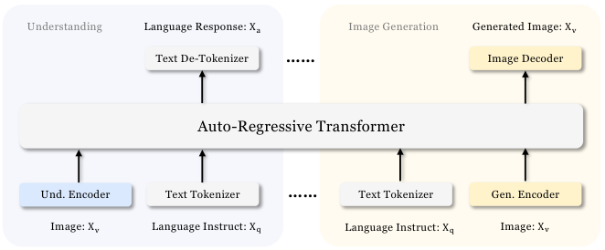

# Janus：补充解读

> 统一模型是否必须让所有模态共用表示？以下为直觉解释与应用延伸，论文内容见 [精炼主笔记](Janus详解.md)。

## 解耦的本质是解除一个不必要的约束

看懂一只猫，需要对毛色、视角和背景变化保持一定稳定；重建同一张猫图，却需要准确保存这些差异。用同一压缩表示同时满足两者，容易产生目标冲突。Janus 只在有收益的骨干层共享参数，让输入端保留任务差异。

图中两个编码器不意味着两个完整模型：大部分序列处理仍共享。模块化也让理解端替换 SigLIP、生成端替换 tokenizer 成为相对独立的实验。

## 与调用外部画图工具有什么区别

Janus 的 Transformer 自己预测图像 token，生成能力进入统一模型的训练目标。普通聊天模型调用图像工具时，图像生成主要由外部系统承担。前者利于跨任务表示共享，后者便于独立升级专用生成器，没有必要仅凭“统一”认定谁更好。

## 评测要同时看两条轴

理解分数提升不等于生成更真实；FID 更低也不等于对象数量正确。可以把理解、组合遵循、视觉质量、生成时延画成多轴结果，避免用一个数字替代统一模型所有能力。

## 用一个具体场景串起来

一个图像特征如果把背景纹理忽略掉，可能更适合识别主体；但重建图像需要那些纹理。强迫理解与生成共用同一量化码，相当于要求一个接口同时对两种损失最优。

Janus保留不同视觉入口，统一后面的Transformer，类似让不同传感器先适配再共享推理。它降低不必要约束，但共享主体仍可能有任务竞争；消融中单任务某些分数更好，是合理的剩余代价。
