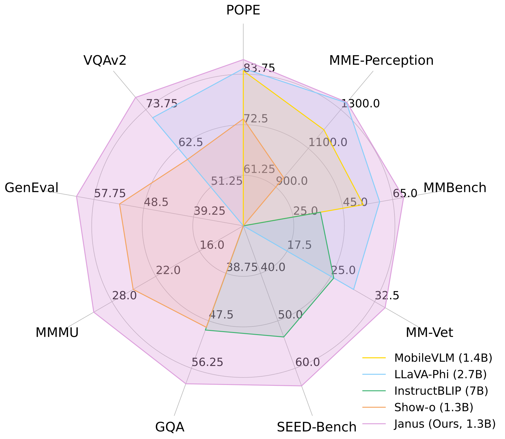
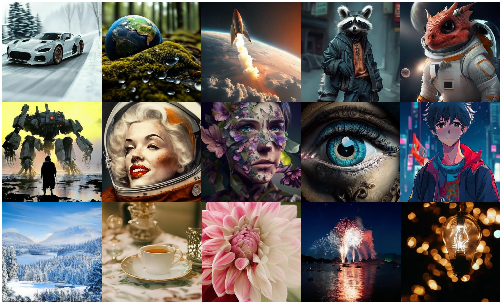
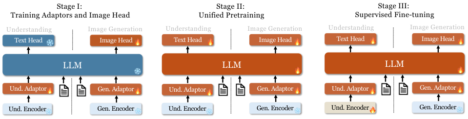
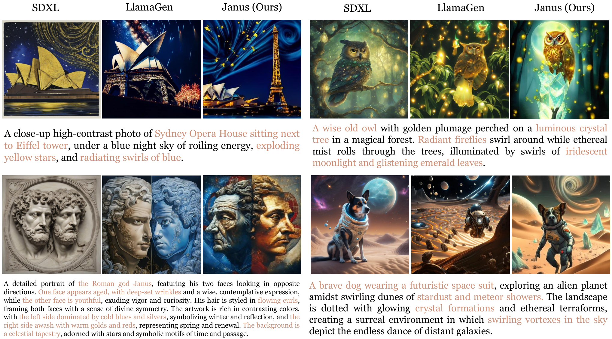
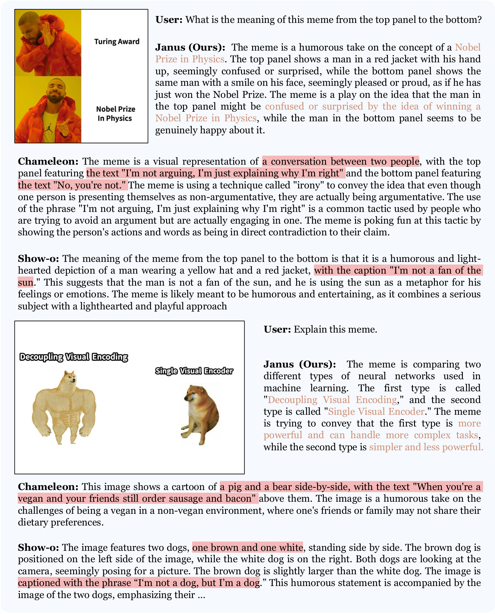
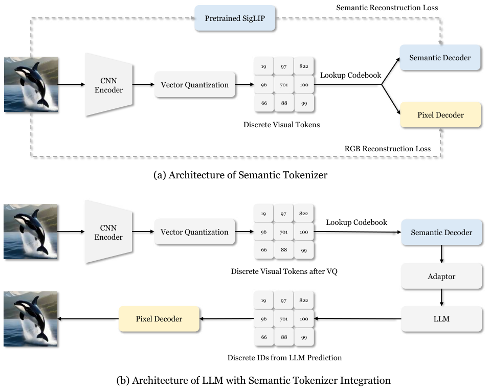
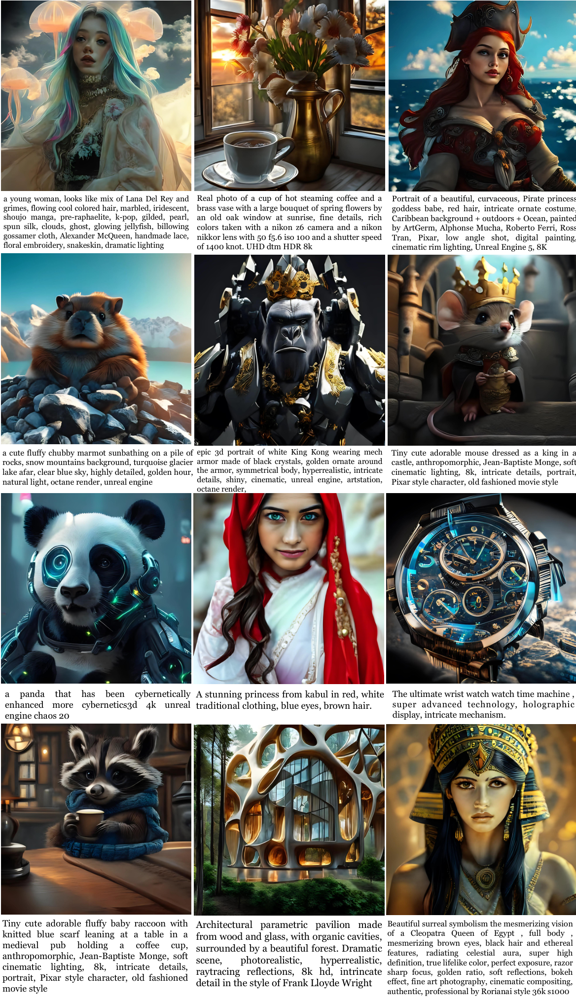
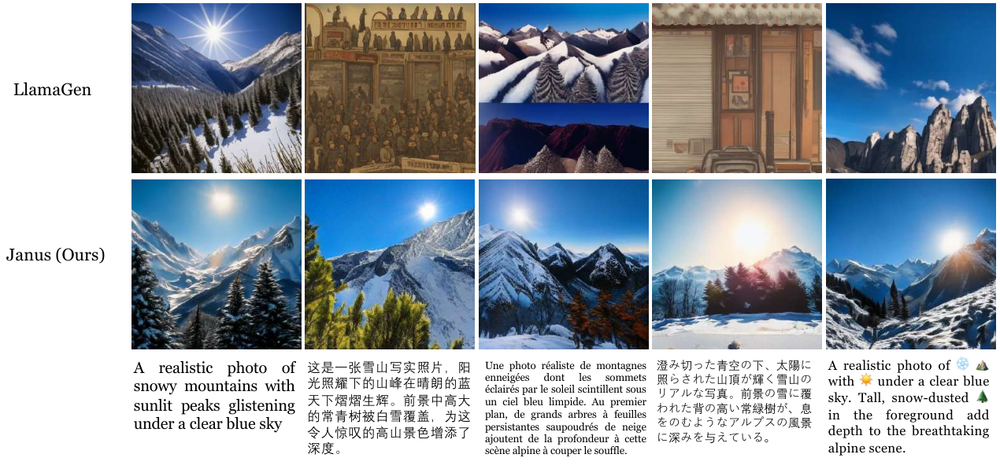
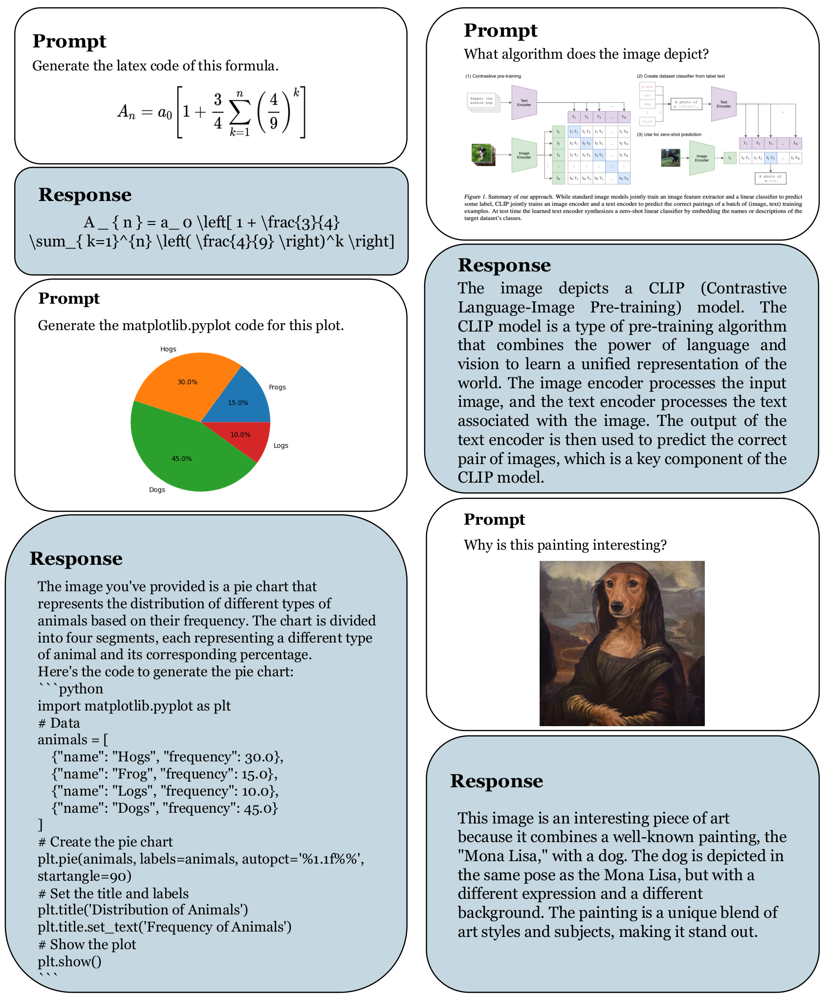

# Janus: Decoupling Visual Encoding for Unified Multimodal Understanding and Generation / 全文中英对照

> 来源：[arXiv:2410.13848v1](https://arxiv.org/abs/2410.13848v1)。英文段落后紧接中文，覆盖所取 HTML 版本的主文、附录、图表、脚注与参考文献；公式、数字表和书目信息共用。中文以机器初译为底稿，进行了术语整理与结构核对，尚未逐句人工审定；遇到歧义请以紧邻英文和原论文为准。 原作版权归所列作者，许可见 [原作许可](http://creativecommons.org/licenses/by/4.0/)；中文译文与版式改写在该许可条件下提供（涉及 SA 时沿用相同许可，涉及 NC 时仅限非商业使用）。

## Authors and affiliations / 作者与机构

Chengyue Wu 1,2 Xiaokang Chen 1,∗,† Zhiyu Wu 1,3 Yiyang Ma 1,3 Xingchao Liu 1 Zizheng Pan 1 Wen Liu 1 Zhenda Xie 1 Xingkai Yu 1 Chong Ruan 1 Ping Luo 2,∗ 1 DeepSeek-AI 2 The University of Hong Kong 3 Peking University † : Project lead ∗ : Corresponding authors Project Page: [https://github.com/deepseek-ai/Janus](https://github.com/deepseek-ai/Janus)

**EN.** \reportnumber

**中.** \报告编号

**EN.** 001

**中.** 001

## Abstract / 摘要

**EN.** In this paper, we introduce Janus , an autoregressive framework that unifies multimodal understanding and generation. Prior research often relies on a single visual encoder for both tasks, such as Chameleon. However, due to the differing levels of information granularity required by multimodal understanding and generation, this approach can lead to suboptimal performance, particularly in multimodal understanding. To address this issue, we decouple visual encoding into separate pathways, while still leveraging a single, unified transformer architecture for processing. The decoupling not only alleviates the conflict between the visual encoder’s roles in understanding and generation, but also enhances the framework’s flexibility. For instance, both the multimodal understanding and generation components can independently select their most suitable encoding methods. Experiments show that Janus surpasses previous unified model and matches or exceeds the performance of task-specific models. The simplicity, high flexibility, and effectiveness of Janus make it a strong candidate for next-generation unified multimodal models.

**中.** 在本文中，我们介绍了 Janus，一个统一多模态理解和生成的自回归框架。先前的研究通常依赖于单个视觉编码器来完成这两项任务，例如 Chameleon。然而，由于多模态理解和生成所需的信息粒度水平不同，这种方法可能会导致性能不佳，特别是在多模态理解方面。为了解决这个问题，我们将视觉编码解耦到单独的路径中，同时仍然利用单个统一的转换器架构进行处理。这种解耦不仅缓解了视觉编码器在理解和生成方面的角色之间的冲突，而且还增强了框架的灵活性。例如，多模态理解和生成组件都可以独立选择最合适的编码方法。实验表明，Janus 超越了之前的统一模型，并且达到或超过了特定任务模型的性能。 Janus 的简单性、高度灵活性和有效性使其成为下一代统一多模式模型的有力候选者。

## Introduction / 简介

**EN.** Figure 1: Multimodal understanding and vision generation results from our Janus . Janus outperforms the previous state-of-the-art unified multimodal models as well as some task-specific multimodal understanding models, while also demonstrating strong visual generation capabilities. The image resolution is $384\times 384$ . Best viewed on screen.

**中.** 图 1：我们的 Janus 的多模式理解和视觉生成结果。 Janus 优于之前最先进的统一多模态模型以及一些特定于任务的多模态理解模型，同时还展示了强大的视觉生成能力。图像分辨率为 $384\times 384$ 。在屏幕上观看效果最佳。

**EN.** In recent years, multimodal large models have made significant advancements in both understanding and generation domains [ 51 , 20 ] . In the field of multimodal understanding, researchers follow the design of LLaVA [ 51 ] by using a vision encoder as a bridge to enable large language models (LLMs) to understand images. In the field of visual generation, diffusion-based approaches [ 20 , 9 , 67 , 20 ] have seen notable success. More recently, some works have explored autoregressive methods for vision generation [ 73 , 79 ] , achieving performance comparable to diffusion models. To build more powerful and generalist multimodal models, researchers have sought to combine multimodal understanding and generation tasks [ 75 , 77 , 94 ] . For instance, some studies have attempted to connect multimodal understanding models with pretrained diffusion models [ 75 , 28 , 27 ] . For example, Emu [ 75 ] uses the output of the LLM as a condition for a pretrained diffusion model, and then relies on the diffusion model to generate images. However, strictly speaking, this approach cannot be considered a truly unified model, because the visual generation functionality is handled by the external diffusion model, while the multimodal LLM itself lacks the capability to directly generate images.

**中.** 近年来，多模态大型模型在理解和生成领域都取得了显着进步[51, 20]。在多模态理解领域，研究人员遵循LLaVA[51]的设计，使用视觉编码器作为桥梁，使大型语言模型（LLM）能够理解图像。在视觉生成领域，基于扩散的方法 [20,9,67,20] 取得了显着的成功。最近，一些作品探索了视觉生成的自回归方法 [73, 79]，实现了与扩散模型相当的性能。为了构建更强大、更通用的多模态模型，研究人员试图将多模态理解和生成任务结合起来[75,77,94]。例如，一些研究试图将多模态理解模型与预训练的扩散模型联系起来[75,28,27]。例如，Emu[75]使用LLM的输出作为预训练扩散模型的条件，然后依赖扩散模型生成图像。然而，严格来说，这种方法不能被认为是真正的统一模型，因为视觉生成功能是由外部扩散模型处理的，而多模态LLM本身缺乏直接生成图像的能力。

**EN.** Other approaches [ 77 , 85 , 86 , 94 ] employ a single transformer to unify both multimodal understanding and generation tasks, which improves instruction-following for visual generation, unlocks potential emergent abilities, and reduces model redundancy. Such methods typically use a single vision encoder to process inputs for both two tasks. However, the representations required by multimodal understanding and generation tasks differ significantly. In multimodal understanding tasks, the purpose of the vision encoder is to extract high-level semantic information (e.g., object categories or visual attributes within an image). The output of understanding task not only involves extracting information from images but also involves complex semantic reasoning. Therefore, the granularity of the vision encoder’s representation tends to mainly focus on high-dimensional semantic representation. By contrast, in visual generation tasks, the main focus is on generating local details and maintaining global consistency in the image. The representation in this context necessitates a low-dimensional encoding that is capable of fine-grained spatial structure and textural detail expression. Unifying the representations of these two tasks within the same space will lead to conflicts and trade-offs. Consequently, existing unified models for multimodal understanding and generation often compromise on multimodal understanding performance, falling markedly short of the state-of-the-arts multimodal understanding models. We explore this issue further in the ablation study.

**中.** 其他方法[77,85,86,94]采用单个Transformer来统一多模态理解和生成任务，这改进了视觉生成的指令遵循，释放了潜在的涌现能力，并减少了模型冗余。此类方法通常使用单个视觉编码器来处理两个任务的输入。然而，多模态理解和生成任务所需的表示有很大不同。在多模态理解任务中，视觉编码器的目的是提取高级语义信息（例如图像中的对象类别或视觉属性）。理解任务的输出不仅涉及从图像中提取信息，还涉及复杂的语义推理。因此，视觉编码器表示的粒度往往主要集中在高维语义表示上。相比之下，在视觉生成任务中，主要焦点是生成局部细节并保持图像的全局一致性。这种情况下的表示需要能够进行细粒度空间结构和纹理细节表达的低维编码。将这两个任务的表示统一在同一空间内将导致冲突和权衡。因此，现有的多模态理解和生成的统一模型常常会损害多模态理解性能，明显低于最先进的多模态理解模型。我们在消融研究中进一步探讨这个问题。

**EN.** To solve this problem, we propose Janus [^footnote1] , a unified multimodal framework that decouples visual encoding for multimodal understanding and generation. Specifically, we introduce two independent visual encoding pathways: one for multimodal understanding and one for multimodal generation, unified by the same transformer architecture. The proposed method offers two main benefits: (1) Janus alleviates the conflict stemming from the different granular needs of multimodal understanding and generation and eliminates the need to make trade-offs between two tasks when selecting visual encoders. (2) Janus is flexible and extensible. After decoupling, both the understanding and generation tasks can adopt state-of-the-art encoding techniques specific to their domain. Moreover, it is possible for Janus to accommodate additional input types in the future, such as point clouds, EEG signals, or audio data, where independent encoders can extract features and then use a unified transformer to process them.

**中.** 为了解决这个问题，我们提出了 Janus [^footnote1] ，一个统一的多模态框架，可以解耦视觉编码以实现多模态理解和生成。具体来说，我们引入了两种独立的视觉编码路径：一种用于多模态理解，一种用于多模态生成，由相同的Transformer 架构统一。所提出的方法有两个主要好处：（1）Janus 缓解了多模态理解和生成的不同粒度需求所产生的冲突，并且消除了在选择视觉编码器时在两个任务之间进行权衡的需要。 (2)Janus灵活、可扩展。解耦后，理解和生成任务都可以采用特定于其领域的最先进的编码技术。此外，Janus 未来有可能容纳额外的输入类型，例如点云、EEG 信号或音频数据，其中独立的编码器可以提取特征，然后使用统一的转换器来处理它们。

**EN.** To the best of our knowledge, we are the first to highlight the importance of decoupling visual encoding within the unified multimodal understanding and generation framework. Our experimental results show that Janus surpasses existing unified models with comparable parameter sizes on both multimodal understanding and generation benchmarks, achieving state-of-the-art results. Notably, Janus even outperforms some task-specific models which have significantly more parameters (Figure 1 ). Specifically, on multimodal understanding benchmarks MMBench [ 54 ] , SEED-Bench [ 42 ] , and POPE [ 48 ] , Janus ( $1.3$ B) achieved scores of $69.4$ , $63.7$ , and $87.0$ , respectively, outperforming LLaVA-v $1.5$ ( $7$ B) [ 50 ] and Qwen-VL-Chat ( $7$ B) [ 3 ] . On visual generation benchmarks MSCOCO- $30$ K [ 11 ] and GenEval [ 30 ] , Janus achieved an FID score of $8.53$ and an accuracy of $61$ %, surpassing text-to-image generative models such as DALL-E $2$ [ 66 ] and SDXL [ 62 ] . We believe that the strong performance, coupled with the high flexibility and extensibility of Janus, presents it as a strong candidate for next-generation unified multimodal models.

**中.** 据我们所知，我们是第一个强调在统一的多模态理解和生成框架内解耦视觉编码的重要性的人。我们的实验结果表明，Janus 在多模态理解和生成基准方面都超越了参数大小相当的现有统一模型，取得了最先进的结果。值得注意的是，Janus 甚至优于一些具有更多参数的特定任务模型（图 1）。具体来说，在多模态理解基准 MMBench [54]、SEED-Bench [42] 和 POPE [48] 上，Janus ($1.3$ B) 分别获得了 $69.4$、$63.7$ 和 $87.0$ 的分数，优于 LLaVA-v $1.5$（$7$ B）[50]和Qwen-VL-Chat（$7$ B）[3]。在视觉生成基准 MSCOCO-$30$ K [11] 和 GenEval [30] 上，Janus 获得了 $8.53$ 的 FID 分数和 $61$% 的准确率，超越了 DALL-E $2$ [66] 和 SDXL [62] 等文本到图像生成模型。我们相信，Janus 强大的性能加上高度的灵活性和可扩展性，使其成为下一代统一多模式模型的有力候选者。

## Related Work / 相关工作

### Visual Generation / 视觉生成

**EN.** Visual generation is a rapidly evolving field that combines concepts from natural language processing with advancements in transformer architectures. Autoregressive models, influenced by the success in language processing, leverage transformers to predict sequences of discrete visual tokens (codebook IDs) [ 24 , 65 , 75 ] . These models tokenize visual data and employ a prediction approach similar to GPT-style [ 64 ] techniques. Additionally, masked prediction models [ 7 , 8 ] draw upon BERT-style [ 19 ] masking methods, predicting masked sections of visual inputs to improve synthesis efficiency, and have been adapted for video generation [ 89 ] . Concurrently, continuous diffusion models have showcased impressive capabilities in visual generation [ 33 , 71 , 67 ] , complementing discrete methods by approaching generation through a probabilistic lens.

**中.** 视觉生成是一个快速发展的领域，它将自然语言处理的概念与Transformer 架构的进步相结合。受语言处理成功的影响，自回归模型利用 Transformer 来预测离散视觉标记（码本 ID）的序列 [24,65,75]。这些模型对视觉数据进行标记，并采用类似于 GPT 风格的预测方​​法 [64] 技术。此外，屏蔽预测模型 [7, 8] 利用 BERT 风格的 [19] 屏蔽方法，预测视觉输入的屏蔽部分以提高合成效率，并已适用于视频生成 [89]。同时，连续扩散模型在视觉生成方面展示了令人印象深刻的能力[33,71,67]，通过概率透镜接近生成来补充离散方法。

### Multimodal Understanding / 多模式理解

**EN.** Multimodal large language models (MLLMs) integrate both text and images [ 6 , 80 , 81 ] . By leveraging pretrained LLMs, MLLMs [ 55 , 51 , 95 , 82 , 12 , 2 , 1 ] demonstrate a robust ability to understand and process multimodal information. Recent advancements have explored extending MLLMs with pretrained diffusion models to facilitate image generation [ 27 , 36 , 75 , 76 , 29 ] . These methods fall under the category of tool utilization, where diffusion models are used to generate images based on the conditions output by the MLLM, while the MLLM itself does not have the ability to directly perform visual generation. Moreover, the generative ability of the entire system is often constrained by the external diffusion model, making its performance inferior to directly using the diffusion model on its own [ 27 , 75 ] .

**中.** 多模态大语言模型（MLLM）集成了文本和图像[6,80,81]。通过利用预训练的 LLM，MLLM [55、51、95、82、12、2、1] 展示了理解和处理多模式信息的强大能力。最近的进展探索了使用预训练扩散模型来扩展 MLLM，以促进图像生成 [27,36,75,76,29]。这些方法属于工具利用的范畴，其中扩散模型用于根据MLLM输出的条件生成图像，而MLLM本身不具备直接执行视觉生成的能力。而且，整个系统的生成能力往往受到外部扩散模型的限制，使其性能不如直接使用扩散模型本身[27, 75]。

### Unified Multimodal Understanding and Generation / 统一的多模态理解和生成

**EN.** Unified multimodal understanding and generation models are considered powerful for facilitating seamless reasoning and generation across different modalities [ 77 , 94 ] . Traditional approaches in these models typically use a single visual representation for both understanding and generation tasks, regardless of whether they are based on autoregressive (AR) models [ 77 , 85 ] or diffusion models [ 86 , 94 ] . For example, Chameleon [ 77 ] adopts a VQ Tokenizer to encode images for both multimodal understanding and generation. However, this practice may lead to suboptimal outcomes, as the vision encoder might face a trade-off between the demands of understanding and generation. In contrast, our Janus can explicitly decouple the visual representations for understanding and generation, recognizing that different tasks may require varying levels of information.

**中.** 统一的多模态理解和生成模型被认为对于促进跨不同模态的无缝推理和生成非常强大[77, 94]。这些模型中的传统方法通常使用单一视觉表示来执行理解和生成任务，无论它们是基于自回归 (AR) 模型 [77, 85] 还是扩散模型 [86, 94]。例如，Chameleon [77] 采用 VQ Tokenizer 对图像进行编码，以实现多模态理解和生成。然而，这种做法可能会导致次优结果，因为视觉编码器可能面临理解和生成需求之间的权衡。相比之下，我们的 Janus 可以明确地解耦视觉表示以进行理解和生成，认识到不同的任务可能需要不同级别的信息。

## Janus: A Simple, Unified and Flexible Multimodal Framework / Janus：简单、统一、灵活的多模式框架

**EN.** Figure 2: Architecture of our Janus. Different from previous approaches [ 77 , 85 ] that typically assume visual understanding and generation require the same visual encoder, our Janus decouples visual encoding for visual understanding and visual generation. “Und. Encoder” and “Gen. Encoder” are abbreviations for “Understanding Encoder” and “Generation Encoder”, respectively. Best viewed in color.

**中.** 图 2：Janus 的架构。与之前通常假设视觉理解和生成需要相同视觉编码器的方法[77, 85]不同，我们的Janus将视觉编码解耦以实现视觉理解和视觉生成。 “Und.Encoder”和“Gen.Encoder”分别是“Understanding Encoder”和“Generation Encoder”的缩写。最好以彩色形式观看。

### Architecture / 建筑

**EN.** The architecture of Janus is shown in Figure 2 . For pure text understanding, multimodal understanding, and visual generation, we apply independent encoding methods to convert the raw inputs into features, which are then processed by an unified autoregressive transformer. Specifically, for text understanding, we use the built-in tokenizer of the LLM to convert the text into discrete IDs and obtain the feature representations corresponding to each ID. For multimodal understanding, we use the SigLIP [ 92 ] encoder to extract high-dimensional semantic features from images. These features are flattened from a $2$ -D grid into a $1$ -D sequence, and an understanding adaptor is used to map these image features into the input space of the LLM. For visual generation tasks, we use the VQ tokenizer from [ 73 ] to convert images into discrete IDs. After the ID sequence is flattened into $1$ -D, we use a generation adaptor to map the codebook embeddings corresponding to each ID into the input space of the LLM. We then concatenate these feature sequences to form a multimodal feature sequence, which is subsequently fed into the LLM for processing. The built-in prediction head of the LLM is utilized for text predictions in both the pure text understanding and multimodal understanding tasks, while a randomly initialized prediction head is used for image predictions in the visual generation task. The entire model adheres to an autoregressive framework without the need for specially designed attention masks.

**中.** Janus的架构如图2所示。对于纯文本理解、多模态理解和视觉生成，我们应用独立的编码方法将原始输入转换为特征，然后由统一的自回归Transformer处理。具体来说，对于文本理解，我们使用LLM内置的分词器将文本转换为离散的ID，并获得每个ID对应的特征表示。对于多模态理解，我们使用 SigLIP [92] 编码器从图像中提取高维语义特征。这些特征从 $2$ -D 网格扁平化为 $1$ -D 序列，并使用理解适配器将这些图像特征映射到 LLM 的输入空间。对于视觉生成任务，我们使用[73]中的VQ标记器将图像转换为离散ID。将ID序列展平为$1$ -D后，我们使用生成适配器将每个ID对应的码本嵌入映射到LLM的输入空间中。然后，我们将这些特征序列连接起来形成多模态特征序列，随后将其输入 LLM 进行处理。 LLM的内置预测头用于纯文本理解和多模态理解任务中的文本预测，而随机初始化的预测头用于视觉生成任务中的图像预测。整个模型遵循自回归框架，不需要专门设计的注意力掩模。

### Training Procedure / 培训流程

**EN.** The training of Janus is divided into three stages, as illustrated in Figure 3 . Details are provided in the below.

**中.** Janus的训练分为三个阶段，如图3所示。详情如下。

**EN.** Stage I: Training Adaptors and Image Head. The main goal of this stage is to create a conceptual connection between visual and linguistic elements within the embedding space, enabling the LLM to understand the entities shown in images and have preliminary visual generation ability. We keep the visual encoders and the LLM frozen during this stage, allowing only the trainable parameters within the understanding adaptor, generation adaptor and image head to be updated.

**中.** 第一阶段：训练适配器和图像头。该阶段的主要目标是在嵌入空间内创建视觉和语言元素之间的概念联系，使LLM能够理解图像中显示的实体并具备初步的视觉生成能力。在此阶段，我们保持视觉编码器和 LLM 冻结，只允许更新理解适配器、生成适配器和图像头中的可训练参数。

**EN.** Figure 3: Our Janus adopts a three-stage training procedure. We use flame symbols/snowflake symbols in the diagram to indicate the module updates/does not update its parameters.

**中.** Figure 3: Our Janus adopts a three-stage training procedure. We use flame symbols/snowflake symbols in the diagram to indicate the module updates/does not update its parameters.

**EN.** Stage II: Unified Pretraining. In this stage, we perform unified pretraining with multimodal corpus to enable Janus to learn both multimodal understanding and generation. We unfreeze the LLM and utilize all types of training data: pure text data, multimodal understanding data, and visual generation data. Inspired by Pixart [ 9 ] , we begin by conducting simple visual generation training using ImageNet- $1$ k to help the model grasp basic pixel dependencies. Subsequently, we enhance the model’s open-domain visual generation capability with general text-to-image data.

**中.** 第二阶段：统一预训练。 In this stage, we perform unified pretraining with multimodal corpus to enable Janus to learn both multimodal understanding and generation. We unfreeze the LLM and utilize all types of training data: pure text data, multimodal understanding data, and visual generation data.受 Pixart [9] 的启发，我们首先使用 ImageNet-$1$ k 进行简单的视觉生成训练，以帮助模型掌握基本的像素依赖性。 Subsequently, we enhance the model’s open-domain visual generation capability with general text-to-image data.

**EN.** Stage III: Supervised Fine-tuning. During this stage, we fine-tune the pretrained model with instruction tuning data to enhance its instruction-following and dialogue capabilities. We fine-tune all parameters except the generation encoder. We focus on supervising the answers while masking system and user prompts. To ensure Janus’s proficiency in both multimodal understanding and generation, we don’t fine-tune separate models for a certain task. Instead, we use a blend of pure text dialogue data, multimodal understanding data and visual generation data, ensuring versatility across various scenarios.

**中.** 第三阶段：监督微调。在此阶段，我们使用指令调整数据对预训练模型进行微调，以增强其指令跟随和对话能力。 We fine-tune all parameters except the generation encoder. We focus on supervising the answers while masking system and user prompts. To ensure Janus’s proficiency in both multimodal understanding and generation, we don’t fine-tune separate models for a certain task.相反，我们混合使用纯文本对话数据、多模态理解数据和视觉生成数据，确保跨各种场景的多功能性。

### Training Objective / 培训目标

**EN.** Janus is an autoregressive model, and we simply adopt the cross-entropy loss during training:

**中.** Janus is an autoregressive model, and we simply adopt the cross-entropy loss during training:

$$
\displaystyle\mathcal{L}=-\sum_{i=1}\log P_{\theta}(x_{i}|x_{<i})\tag{1}
$$

**EN.** Here, $P(\cdot\mid\cdot)$ indicates the conditional probability modeled by the weights $\theta$ of Janus. For pure text understanding and multimodal understanding tasks, we compute the loss on the text sequence. For visual generation tasks, we compute the loss only on the image sequence. To keep the design simple, we have not assigned different loss weights to different tasks.

**中.** Here, $P(\cdot\mid\cdot)$ indicates the conditional probability modeled by the weights $\theta$ of Janus. For pure text understanding and multimodal understanding tasks, we compute the loss on the text sequence. For visual generation tasks, we compute the loss only on the image sequence. To keep the design simple, we have not assigned different loss weights to different tasks.

### Inference / 推理

**EN.** During inference, our model adopts a next-token prediction approach. For pure text understanding and multimodal understanding, we follow the standard practice of sampling tokens sequentially from the predicted distribution. For image generation, we utilize classifier-free guidance (CFG) [^footnote2] , similar to prior works [ 26 , 73 , 8 ] . Specifically, for each token, the logit $l_{g}$ is calculated as: $l_{g}=l_{u}+s(l_{c}-l_{u})$ , where $l_{c}$ is the conditional logit, $l_{u}$ is the unconditional logit, and $s$ is the scale for the classifier-free guidance. The default number of $s$ is $5$ for the following evaluation.

**中.** During inference, our model adopts a next-token prediction approach.对于纯文本理解和多模态理解，我们遵循从预测分布中顺序采样标记的标准做法。对于图像生成，我们利用无分类器引导（CFG）[^footnote2]，类似于之前的工作[26,73,8]。具体来说，对于每个标记，logit $l_{g}$ 计算如下： $l_{g}=l_{u}+s(l_{c}-l_{u})$ ，其中 $l_{c}$ 是条件 logit，$l_{u}$ 是无条件 logit，$s$ 是无分类器指导的尺度。 $s$默认编号为$5$，用于以下评估。

### Possible Extensions / 可能的扩展

**EN.** It is important to note that our design, which features separate encoders for understanding and generation, is straightforward and easy to extend.

**中.** 值得注意的是，我们的设计具有用于理解和生成的单独编码器，非常简单且易于扩展。

**EN.** Multimodal Understanding. (1) For the multimodal understanding component, a stronger vision encoder can be chosen without worrying about whether the encoder is capable of handling vision generation tasks, such as EVA-CLIP [ 74 ] , InternViT [ 13 ] , etc. (2) To handle high-resolution images, dynamic high-resolution techniques [ 50 ] can be used. This allows the model to scale to any resolution, without performing positional embedding interpolation for ViTs. Tokens can be further compressed to save computational cost, for instance, using pixel shuffle operation [ 12 ] .

**中.** 多模式理解。 （1）对于多模态理解组件，可以选择更强的视觉编码器，而不必担心编码器是否能够处理视觉生成任务，例如EVA-CLIP[74]，InternViT[13]等。（2）为了处理高分辨率图像，可以使用动态高分辨率技术[50]。这允许模型缩放到任何分辨率，而无需对 ViT 执行位置嵌入插值。可以进一步压缩令牌以节省计算成本，例如使用像素洗牌操作[12]。

**EN.** Visual Generation. (1) For visual generation, finer-grained encoders can be chosen in order to preserve more image details after encoding, such as MoVQGan [ 93 ] . (2) Loss functions specifically designed for visual generation can be employed, such as diffusion loss [ 46 ] . (3) A combination of AR (causal attention) and parallel (bidirectional attention) methods can be used in the visual generation process to reduce accumulated errors during visual generation [ 79 ] .

**中.** 视觉生成。 （1）对于视觉生成，可以选择更细粒度的编码器，以便在编码后保留更多的图像细节，例如MoVQGan [93]。 （2）可以采用专门为视觉生成设计的损失函数，例如扩散损失[46]。 （3）视觉生成过程中可以结合AR（因果注意力）和并行（双向注意力）方法，以减少视觉生成过程中的累积误差[79]。

**EN.** Support for Additional Modalities. The straightforward architecture of Janus allows for easy integration with additional encoders, accommodating various modalities such as 3D point cloud [ 53 ] , tactile [ 88 ] , and EEG [ 4 ] . This gives Janus the potential to become a more powerful multimodal generalist model.

**中.** 支持附加模式。 Janus 的简单架构允许轻松与其他编码器集成，适应各种模式，例如 3D 点云 [53]、触觉 [88] 和 EEG [4]。这使 Janus 有潜力成为更强大的多模式通才模型。

## Experiments / 实验

**EN.** In this section, we present a series of comprehensive experiments designed to assess the performance of our method across a range of visual understanding and generation tasks. We begin by detailing our experimental setup, which includes the model architecture, training datasets, and evaluation benchmarks. Next, we report the performance of Janus, followed by a comparison with other state-of-the-art models on various benchmarks for multimodal understanding and generation. We also conduct extensive ablation studies to verify the effectiveness of the proposed method. Lastly, we provide some qualitative results.

**中.** 在本节中，我们提出了一系列综合实验，旨在评估我们的方法在一系列视觉理解和生成任务中的性能。我们首先详细介绍我们的实验设置，其中包括模型架构、训练数据集和评估基准。接下来，我们报告 Janus 的性能，然后在多模态理解和生成的各种基准上与其他最先进的模型进行比较。我们还进行了广泛的消融研究以验证所提出方法的有效性。最后，我们提供了一些定性结果。

### Implementation Details / 实施细节

**EN.** In our experiments, we utilize DeepSeek-LLM ( $1.3$ B) [ 5 ] with a maximum supported sequence length of $4096$ as the base language model. For the vision encoder used in understanding tasks, we select SigLIP-Large-Patch $16$ - $384$ [ 92 ] . The generation encoder has a codebook of size $16,384$ and downsamples images by a factor of $16$ . Both the understanding adaptor and the generation adaptor are two-layer MLPs. The detailed hyperparameters for each stage are provided in Table 1 . All images are resized to $384\times 384$ pixels. For multimodal understanding data, we resize the long side of the image and pad the short side with the background color (RGB: $127$ , $127$ , $127$ ) to reach $384$ . For visual generation data, the short side is resized to $384$ , and the long side is cropped to $384$ . We use sequence packing during training to improve training efficiency. We mix all data types according to the specified ratios in a single training step. Our Janus is trained and evaluated using HAI-LLM [ 32 ] , which is a lightweight and efficient distributed training framework built on top of PyTorch. The whole training process took $7$ days on a cluster of $16$ nodes, each equipped with $8$ Nvidia A $100$ ( $40$ GB) GPUs.

**中.** 在我们的实验中，我们利用最大支持序列长度为 $4096$ 的 DeepSeek-LLM ( $1.3$ B) [5] 作为基本语言模型。对于理解任务中使用的视觉编码器，我们选择SigLIP-Large-Patch $16$ - $384$ [92]。生成编码器具有大小为 $16,384$ 的码本，并将图像下采样为 $16$ 倍。理解适配器和生成适配器都是两层 MLP。表1提供了每个阶段的详细超参数。所有图像的大小均调整为 $384\times 384$ 像素。对于多模态理解数据，我们调整图像长边的大小并用背景颜色（RGB： $127$ 、 $127$ 、 $127$ ）填充短边以达到 $384$ 。对于视觉生成数据，短边调整为 $384$ ，长边裁剪为 $384$ 。我们在训练过程中使用序列打包来提高训练效率。我们在单个训练步骤中根据指定的比率混合所有数据类型。我们的 Janus 使用 HAI-LLM [32] 进行训练和评估，这是一个构建在 PyTorch 之上的轻量级且高效的分布式训练框架。整个训练过程在 $16$ 节点集群上花费了 $7$ 天，每个节点都配备了 $8$ Nvidia A $100$ ($40$ GB) GPU。

| Hyperparameters 超参数 | Stage 1 第一阶段 | Stage 2 第二阶段 | Stage 3 第三阶段 |
| --- | --- | --- | --- |
| Learning rate 学习率 | $1.0\times 10^{-3}$ | $1\times 10^{-4}$ | $2.0\times 10^{-5}$ |
| LR scheduler LR调度器 | Cosine 余弦 | Constant 常数 | Constant 常数 |
| Weight decay 重量衰减 | $0.0$ | $0.0$ | $0.1$ |
| Gradient clip 渐变剪辑 | $1.0$ | $1.0$ | $1.0$ |
| Optimizer 优化器 | AdamW ( $\beta_{1}=0.9,\beta_{2}=0.95$ ) 亚当W ( $\beta_{1}=0.9,\beta_{2}=0.95$ ) | AdamW ( $\beta_{1}=0.9,\beta_{2}=0.95$ ) 亚当W ( $\beta_{1}=0.9,\beta_{2}=0.95$ ) | AdamW ( $\beta_{1}=0.9,\beta_{2}=0.95$ ) 亚当W ( $\beta_{1}=0.9,\beta_{2}=0.95$ ) |
| Warm-up steps 热身步骤 | $300$ | $5,000$ | $0$ |
| Training steps 训练步骤 | $10,000$ | $180,000$ | $24,000$ |
| Batch size 批量大小 | $256$ | $512$ | $256$ |
| Data Ratio 数据比率 | $1:0:1$ | $2:3:5$ | $7:3:10$ |

**EN.** Table 1: Detailed hyperparameters of our Janus . Data ratio refers to the ratio of multimodal understanding data, pure text data, and visual generation data.

**中.** 表 1：我们的 Janus 的详细超参数。数据比例是指多模态理解数据、纯文本数据、视觉生成数据的比例。

| Type 类型 | Model 型号 | # LLM Params # LLM 参数 | POPE $\uparrow$ 波普 $\uparrow$ | MME-P $\uparrow$ | MMB $\uparrow$ | SEED $\uparrow$ 种子 $\uparrow$ | VQAv2 (test) $\uparrow$ VQAv2（测试）$\uparrow$ | GQA $\uparrow$ | MMMU $\uparrow$ | MM-Vet $\uparrow$ MM-兽医 $\uparrow$ |
| --- | --- | --- | --- | --- | --- | --- | --- | --- | --- | --- |
| Und. Only 和。仅 | LLaVA-v $1.5$ -Phi- $1.5$ [ 86 ] | $1.3$ B | $84.1$ | $1128.0$ | - | - | $75.3$ | $56.5$ | $30.7$ | - |
|  | MobileVLM [ 14 ] 移动VLM [ 14 ] | $1.4$ B | $84.5$ | $1196.2$ | $53.2$ | - | - | $56.1$ | - | - |
|  | MobileVLM-V2 [ 15 ] | $1.4$ B | $84.3$ | $1302.8$ | $57.7$ | - | - | $59.3$ | - | - |
|  | MobileVLM [ 14 ] 移动VLM [ 14 ] | $2.7$ B | $84.9$ | $1288.9$ | $59.6$ | - | - | $59.0$ | - | - |
|  | MobileVLM-V2 [ 15 ] | $2.7$ B | $84.7$ | $1440.5$ | $63.2$ | - | - | $61.1$ | - | - |
|  | LLaVA-Phi [ 96 ] | $2.7$ B | $85.0$ | $1335.1$ | $59.8$ | - | $71.4$ | - | - | $28.9$ |
|  | LLaVA [ 51 ] 拉瓦 [ 51 ] | $7$ B | $76.3$ | $809.6$ | $38.7$ | $33.5$ | - | - | - | $25.5$ |
|  | LLaVA-v $1.5$ [ 50 ] | $7$ B | $85.9$ | $1510.7$ | $64.3$ | $58.6$ | $78.5$ | $62.0$ | $35.4$ | $31.1$ |
|  | InstructBLIP [ 16 ] 指导BLIP [ 16 ] | $7$ B | - | - | $36.0$ | $53.4$ | - | $49.2$ | - | $26.2$ |
|  | Qwen-VL-Chat [ 3 ] Qwen-VL-聊天 [ 3 ] | $7$ B | - | $1487.5$ | $60.6$ | $58.2$ | $78.2$ | $57.5$ | - | - |
|  | IDEFICS- $9$ B [ 41 ] IDEFICS-$9$ B [ 41 ] | $8$ B | - | - | $48.2$ | - | $50.9$ | $38.4$ | - | - |
|  | Emu $3$ -Chat [ 83 ] 鸸鹋 $3$ -聊天 [ 83 ] | $8$ B | $85.2$ | - | $58.5$ | $68.2$ | $75.1$ | $60.3$ | $31.6$ | - |
|  | InstructBLIP [ 16 ] 指导BLIP [ 16 ] | $13$ B | $78.9$ | $1212.8$ | - | - | - | $49.5$ | - | $25.6$ |
| Und. and Gen. 和。和将军。 | DreamLLM † [ 21 ] 梦想LLM † [ 21 ] | $7$ B | - | - | - | - | $72.9$ | - | - | $36.6$ |
|  | LaVIT † [ 36 ] 拉维特 † [ 36 ] | $7$ B | - | - | - | - | $66.0$ | $46.8$ | - | - |
|  | Emu † [ 75 ] 鸸鹋 † [ 75 ] | $13$ B | - | - | - | - | $52.0$ | - | - | - |
|  | NExT-GPT † [ 84 ] | $13$ B | - | - | - | - | $66.7$ | - | - | - |
|  | Show-o [ 86 ] 显示-o [ 86 ] | $1.3$ B | $73.8$ | $948.4$ | - | - | $59.3$ | $48.7$ | $25.1$ | - |
|  | Gemini-Nano-1 [ 78 ] | $1.8$ B | - | - | - | - | $62.7$ | - | $26.3$ | - |
|  | LWM [ 52 ] 长波管理 [ 52 ] | $7$ B | $75.2$ | - | - | - | $55.8$ | $44.8$ | - | $9.6$ |
|  | VILA-U [ 85 ] 维拉-U [ 85 ] | $7$ B | $85.8$ | $1401.8$ | - | $59.0$ | $79.4$ | $60.8$ | - | $33.5$ |
|  | Chameleon [ 77 ] 变色龙 [ 77 ] | $7$ B | - | - | - | - | - | - | $22.4$ | $8.3$ |
|  | Janus (Ours) 雅努斯（我们的） | $1.3$ B | $87.0$ | $1338.0$ | $69.4$ | $63.7$ | $77.3$ | $59.1$ | $30.5$ | $34.3$ |

**EN.** Table 2: Comparison with state-of-the-arts on multimodal understanding benchmarks . “Und.” and “Gen.” denote “understanding” and “generation”, respectively. Models using external pretrained diffusion model are marked with † .

**中.** 表 2：与多模态理解基准上最先进的技术进行比较。 “嗯。”和“将军”。分别表示“理解”和“生成”。使用外部预训练扩散模型的模型用 † 标记。

### Data Setup / 数据设置

**EN.** In this section, we provide details of the pretraining and supervised finetuning datasets.

**中.** 在本节中，我们提供预训练和监督微调数据集的详细信息。

**EN.** Stage I. We use a dataset that includes $1.25$ million image-text paired captions from ShareGPT $4$ V [ 10 ] for multimodal understanding and approximately $1.2$ million samples from ImageNet- $1$ k [ 18 ] for visual generation. The ShareGPT $4$ V data is formatted as “ <image> <text> ”. The ImageNet data is organized into a text-to-image data format using the category names: “ <category_name> <image> ”. Here, the “<>” symbols represent placeholders.

**中.** 第一阶段。我们使用一个数据集，其中包括来自 ShareGPT $4$ V [10] 的 $1.25$ 百万个图像文本配对字幕用于多模态理解，以及来自 ImageNet-$1$ k [18] 的大约 $1.2$ 百万个样本用于视觉生成。 ShareGPT $4$ V 数据的格式为“ <image> <text> ”。 ImageNet 数据使用类别名称组织为文本到图像数据格式：“ <category_name> <image> ”。这里，“<>”符号代表占位符。

**EN.** Stage II. We organize the data into the following categories. (1) Text-only data. We use pretraining text copus from DeepSeek-LLM [ 5 ] . (2) Interleaved image-text data. We use WikiHow [ 39 ] and WIT [ 72 ] dataset. (3) Image caption data. We use images from [ 18 , 38 , 17 , 40 , 23 , 47 , 49 , 45 , 70 ] . Among them, we employ open-source multimodal model to re-caption images in [ 17 , 40 ] . The image caption data is formatted into question-answer pairs, for example, “ <image> Describe the image in detail. <caption> ”. (4) Table and chart data. We use corresponding table and chart data from DeepSeek-VL [ 55 ] . The data is formatted as “ <question> <answer> ”. (5) Visual generation data. We utilize image-caption pairs from various datasets including [ 38 , 17 , 40 , 70 , 57 , 58 , 63 , 60 ] , along with $2$ M in-house data. For images from [ 38 , 70 ] , we filter based on aesthetic scores and image sizes, resulting in $20\%$ remaining. During training, we randomly use only the first sentence of a caption with a $25\%$ probability to encourage the model to develop strong generation capabilities for short descriptions. ImageNet samples [ 18 ] are presented only during the first $120$ K training steps, while images from other datasets appear in the later $60$ K steps. This approach helps the model first learn basic pixel dependencies before progressing to more complex scene understanding, as suggested by [ 9 ] . The visual generation data is provided in the format: “ <caption> <image> ”.

**中.** 第二阶段。我们将数据分为以下几类。 (1) 纯文本数据。我们使用来自 DeepSeek-LLM [5] 的预训练文本语料库。 (2) 交错的图像-文本数据。我们使用 WikiHow [39] 和 WIT [72] 数据集。 (3)图像标题数据。我们使用 [18, 38, 17, 40, 23, 47, 49, 45, 70] 中的图像。其中，我们采用开源多模态模型来重新捕获[17, 40]中的图像。图像标题数据被格式化为问答对，例如“<image>详细描述图像。<caption>”。 (4)表格和图表数据。我们使用来自 DeepSeek-VL [55] 的相应表格和图表数据。数据格式为“<问题><答案>”。 (5)视觉生成数据。我们利用来自各种数据集的图像标题对，包括 [38、17、40、70、57、58、63、60] 以及 $2$ M 内部数据。对于来自 [ 38 , 70 ] 的图像，我们根据美学分数和图像大小进行过滤，从而剩下 $20\%$。在训练过程中，我们以 $25\%$ 的概率仅随机使用标题的第一句话，以鼓励模型开发强大的简短描述生成能力。 ImageNet 样本 [18] 仅在第一个 $120$ K 训练步骤中呈现，而来自其他数据集的图像出现在后面的 $60$ K 步骤中。正如 [9] 所建议的，这种方法有助于模型首先学习基本的像素依赖性，然后再进行更复杂的场景理解。视觉生成数据以以下格式提供：“<caption><image>”。

**EN.** Stage III. For text understanding, we use data from [ 43 ] . For multimodal understanding, we use instruct tuning data from [ 43 , 31 , 35 , 69 , 34 , 56 ] . For visual generation, we use image-text pairs from [ 17 , 70 , 60 ] (a subset of that in stage II) and $4$ M in-house data. We utilize the following format for instruction tuning:“ User:<Input Message> \n Assistant: <Response> ”. For multi-turn dialogues, we repeat this format to structure the data.

**中.** 第三阶段。为了理解文本，我们使用[43]中的数据。为了多模态理解，我们使用来自 [43,31,35,69,34,56] 的指令调整数据。对于视觉生成，我们使用来自 [17,70,60]（第二阶段的子集）的图像文本对和 $4$ M 内部数据。我们使用以下格式进行指令调整：“ User:<Input Message> \n Assistant: <Response> ”。对于多轮对话，我们重复这种格式来构建数据。

### Evaluation Setup / 评估设置

**EN.** Multimodal Understanding. To assess multimodal understanding capabilities, we evaluate our model on widely recognized image-based vision-language benchmarks, which include VQAv2 [ 31 ] , GQA [ 35 ] , POPE [ 48 ] , MME [ 25 ] , SEED [ 42 ] , MMB [ 54 ] , MM-Vet [ 90 ] , and MMMU [ 91 ] .

**中.** 多模式理解。为了评估多模态理解能力，我们在广泛认可的基于图像的视觉语言基准上评估我们的模型，其中包括 VQAv2 [31]、GQA [35]、POPE [48]、MME [25]、SEED [42]、MMB [54]、MM-Vet [90] 和 MMMU [91]。

**EN.** Visual Generation. For evaluating visual generation capabilities, we use the MSCOCO- $30$ K [ 11 ] , MJHQ- $30$ K [ 44 ] , and GenEval [ 30 ] benchmarks. MSCOCO- $30$ K and MJHQ- $30$ K employ the Fréchet Inception Distance (FID) metric on generated images compared to $30$ K high-quality images, which indicates the overall efficacy of image generation. GenEval is a challenging benchmark for image-to-text generation, designed to reflect the comprehensive generative abilities of visual generation models by offering a detailed instance-level analysis of their compositional capabilities.

**中.** 视觉生成。为了评估视觉生成能力，我们使用 MSCOCO-$30$ K [11]、MJHQ-$30$ K [44] 和 GenEval [30] 基准。与 $30$ K 高质量图像相比，MSCOCO- $30$ K 和 MJHQ- $30$ K 在生成的图像上采用 Fréchet 起始距离 (FID) 度量，这表明了图像生成的整体效率。 GenEval 是图像到文本生成的一个具有挑战性的基准，旨在通过提供其组合能力的详细实例级分析来反映视觉生成模型的综合生成能力。

| Type 类型 | Method 方法 | # Params # 参数 | Single Obj. 单一对象。 | Two Obj. 两个对象。 | Counting 计数 | Colors 颜色 | Position 职位 | Color Attri. 颜色属性。 | Overall $\uparrow$ 整体 $\uparrow$ |
| --- | --- | --- | --- | --- | --- | --- | --- | --- | --- |
| Gen. Only 仅将军 | LlamaGen [ 73 ] 骆马根 [ 73 ] | $0.8$ B | $0.71$ | $0.34$ | $0.21$ | $0.58$ | $0.07$ | $0.04$ | $0.32$ |
| Gen. Only 仅将军 | LDM [ 67 ] | $1.4$ B | $0.92$ | $0.29$ | $0.23$ | $0.70$ | $0.02$ | $0.05$ | $0.37$ |
| Gen. Only 仅将军 | SDv $1.5$ [ 67 ] | $0.9$ B | $0.97$ | $0.38$ | $0.35$ | $0.76$ | $0.04$ | $0.06$ | $0.43$ |
| Gen. Only 仅将军 | PixArt- $\alpha$ [ 9 ] 原相- $\alpha$ [ 9 ] | $0.6$ B | $0.98$ | $0.50$ | $0.44$ | $0.80$ | $0.08$ | $0.07$ | $0.48$ |
| Gen. Only 仅将军 | SDv $2.1$ [ 67 ] | $0.9$ B | $0.98$ | $0.51$ | $0.44$ | $0.85$ | $0.07$ | $0.17$ | $0.50$ |
| Gen. Only 仅将军 | DALL-E $2$ [ 66 ] | $6.5$ B | $0.94$ | $0.66$ | $0.49$ | $0.77$ | $0.10$ | $0.19$ | $0.52$ |
| Gen. Only 仅将军 | Emu $3$ -Gen [ 83 ] 鸸鹋 $3$ -Gen [ 83 ] | $8$ B | $0.98$ | $0.71$ | $0.34$ | $0.81$ | $0.17$ | $0.21$ | $0.54$ |
| Gen. Only 仅将军 | SDXL [ 62 ] | $2.6$ B | $0.98$ | $0.74$ | $0.39$ | $0.85$ | $0.15$ | $0.23$ | $0.55$ |
| Und. and Gen. 和。和将军。 | SEED-X † [ 29 ] 种子-X † [ 29 ] | $17$ B | $0.97$ | $0.58$ | $0.26$ | $0.80$ | $0.19$ | $0.14$ | $0.49$ |
| Und. and Gen. 和。和将军。 | Show-o [ 86 ] 显示-o [ 86 ] | $1.3$ B | $0.95$ | $0.52$ | $0.49$ | $0.82$ | $0.11$ | $0.28$ | $0.53$ |
| Und. and Gen. 和。和将军。 | LWM [ 52 ] 长波管理 [ 52 ] | $7$ B | $0.93$ | $0.41$ | $0.46$ | $0.79$ | $0.09$ | $0.15$ | $0.47$ |
| Und. and Gen. 和。和将军。 | Chameleon [ 77 ] 变色龙 [ 77 ] | $34$ B | - | - | - | - | - | - | $0.39$ |
| Und. and Gen. 和。和将军。 | Janus (Ours) 雅努斯（我们的） | $1.3$ B | $0.97$ | $0.68$ | $0.30$ | $0.84$ | $0.46$ | $0.42$ | $0.61$ |

**EN.** Table 3: Evaluation of text-to-image generation ability on GenEval benchmark . “Und.” and “Gen.” denote “understanding” and “generation”, respectively. Models using external pretrained diffusion model are marked with † .

**中.** 表 3：GenEval 基准上文本到图像生成能力的评估。 “嗯。”和“将军”。分别表示“理解”和“生成”。使用外部预训练扩散模型的模型用 † 标记。

### Comparison with State-of-the-arts / 与最先进技术的比较

**EN.** Multimodal Understanding Performance. We compare the proposed method with state-of-the-art unified models and understanding-only models in Table 2 . Janus achieves the overall best results among models of similar scale. Specifically, compared to the previous best unified model, Show-o [ 86 ] , we achieve performance improvements of $41$ % ( $949\rightarrow 1338$ ) and $30$ % ( $48.7\rightarrow 59.1$ ) on the MME and GQA datasets, respectively. This can be attributed to Janus decoupling the visual encoding for multimodal understanding and generation, mitigating the conflict between these two tasks. When compared to models with significantly larger sizes, Janus remains highly competitive. For instance, Janus outperforms LLaVA-v $1.5$ ( $7$ B) on several datasets, including POPE, MMbench, SEED Bench, and MM-Vet.

**中.** 多模式理解性能。我们将所提出的方法与表 2 中最先进的统一模型和仅理解模型进行了比较。 Janus 在类似规模的模型中取得了总体最佳结果。具体来说，与之前最好的统一模型 Show-o [86] 相比，我们在 MME 和 GQA 数据集上分别实现了 $41$ % ( $949\rightarrow 1338$ ) 和 $30$ % ( $48.7\rightarrow 59.1$ ) 的性能提升。这可以归因于 Janus 解耦了多模态理解和生成的视觉编码，减轻了这两个任务之间的冲突。与尺寸明显更大的型号相比，Janus 仍然具有很强的竞争力。例如，Janus 在多个数据集上的性能优于 LLaVA-v $1.5$ ($7$ B)，包括 POPE、MMbench、SEED Bench 和 MM-Vet。

**EN.** Visual Generation Performance. We report visual generation performance on GenEval, COCO- $30$ K and MJHQ- $30$ K benchmarks. As shown in Table 3 , our Janus obtains $61$ % overall accuracy on GenEval, which outperforms the previous best unified model Show-o ( $53$ %) and some popular generation-only methods, e.g., SDXL ( $55$ %) and DALL-E $2$ ( $52$ %). This demonstrates that our approach has better instruction-following capabilities. As shown in Table 4 , Janus achieves FIDs of $8.53$ and $10.10$ on the COCO- $30$ K and MJHQ- $30$ K benchmarks, respectively, surpassing unified models Show-o and LWM, and demonstrating competitive performance compared to some well-known generation-only methods. This demonstrates that the images generated by Janus have good quality and highlights its potential in visual generation.

**中.** 视觉生成性能。我们报告了 GenEval、COCO- $30$ K 和 MJHQ- $30$ K 基准测试上的视觉生成性能。如表3所示，我们的Janus在GenEval上获得了$61$％的总体精度，这优于之前最好的统一模型Show-o（$53$％）和一些流行的仅生成方法，例如SDXL（$55$％）和DALL-E $2$（$52$） %）。这表明我们的方法具有更好的指令跟踪能力。如表4所示，Janus在COCO-$30$ K和MJHQ-$30$ K基准上分别实现了$8.53$和$10.10$的FID，超越了统一模型Show-o和LWM，并且与一些知名的仅生成方法相比表现出具有竞争力的性能。这表明 Janus 生成的图像具有良好的质量，并凸显了其在视觉生成方面的潜力。

| Type 类型 | Model 型号 | # Params # 参数 | COCO-30K $\downarrow$ | MJHQ-30K $\downarrow$ |
| --- | --- | --- | --- | --- |
| Gen. Only 仅将军 | DALL·E [ 65 ] 达尔·E [ 65 ] | $12$ B | $27.50$ | - |
| Gen. Only 仅将军 | GLIDE [ 59 ] 滑行 [ 59 ] | $5$ B | $12.24$ | - |
| Gen. Only 仅将军 | LDM [ 67 ] | $1.4$ B | $12.64$ | - |
| Gen. Only 仅将军 | DALL·E 2 [ 66 ] 达尔·E 2 [ 66 ] | $6.5$ B | $10.39$ | - |
| Gen. Only 仅将军 | SDv1.5 [ 67 ] | $0.9$ B | $9.62$ | - |
| Gen. Only 仅将军 | GigaGAN [ 37 ] 千兆GAN [ 37 ] | $0.9$ B | $9.09$ | - |
| Gen. Only 仅将军 | PixArt- $\alpha$ [ 9 ] 原相- $\alpha$ [ 9 ] | $0.6$ B | $7.32$ | - |
| Gen. Only 仅将军 | Imagen [ 68 ] 图像 [ 68 ] | $34$ B | $7.27$ | - |
| Gen. Only 仅将军 | RAPHAEL [ 87 ] 拉斐尔 [ 87 ] | $3$ B | $6.61$ | - |
| Und. and Gen. 和。和将军。 | Emu † [ 75 ] 鸸鹋 † [ 75 ] | $13$ B | $11.66$ | - |
| Und. and Gen. 和。和将军。 | NExT-GPT † [ 84 ] | $13$ B | $11.28$ | - |
| Und. and Gen. 和。和将军。 | SEED-X † [ 29 ] 种子-X † [ 29 ] | $17$ B | $14.99$ | - |
| Und. and Gen. 和。和将军。 | Show-o [ 86 ] 显示-o [ 86 ] | $1.3$ B | $9.24$ | $15.18$ |
|  | LWM [ 52 ] 长波管理 [ 52 ] | $7$ B | $12.68$ | $17.77$ |
|  | VILA-U ( $256$ ) [ 85 ] 维拉-U ( $256$ ) [ 85 ] | $7$ B | - | $12.81$ |
|  | VILA-U ( $384$ ) [ 85 ] 维拉-U ( $384$ ) [ 85 ] | $7$ B | - | $7.69$ |
|  | Janus (Ours) 雅努斯（我们的） | $1.3$ B | $8.53$ | $10.10$ |

**EN.** Table 4: Evaluation of text-to-image generation ability on MSCOCO- $30$ K and MJHQ- $30$ K benchmark . “Und.” and “Gen.” denote “understanding” and “generation”, respectively. Models using external pretrained diffusion model are marked with † .

**中.** 表 4：在 MSCOCO-$30$ K 和 MJHQ-$30$ K 基准上对文本到图像生成能力的评估。 “嗯。”和“将军”。分别表示“理解”和“生成”。使用外部预训练扩散模型的模型用 † 标记。

| Exp ID 经验编号 | Visual Encoder 视觉编码器 | Training Task 训练任务 | POPE $\uparrow$ 波普 $\uparrow$ | MMB $\uparrow$ | SEED $\uparrow$ 种子 $\uparrow$ | MMMU $\uparrow$ | COCO-FID $\downarrow$ |
| --- | --- | --- | --- | --- | --- | --- | --- |
| A | VQ Tokenizer VQ 分词器 | Und. + Gen. 和。 + 将军。 | $60.1$ | $35.0$ | $34.9$ | $24.7$ | $8.72$ |
| B | SE. Tokenizer SE。分词器 | Und. + Gen. 和。 + 将军。 | $82.4$ | $52.7$ | $54.9$ | $26.6$ | $7.11$ |
| C | SE. Tokenizer SE。分词器 | Und. 和。 | $83.9$ | $62.1$ | $60.8$ | $27.5$ | - |
| D | SigLIP + VQ (Ours) SigLIP + VQ（我们的） | Und. + Gen. 和。 + 将军。 | $87.0$ | $69.4$ | $63.7$ | $30.5$ | $8.53$ |
| E | SigLIP 西格利普 | Und. 和。 | $85.9$ | $70.6$ | $64.8$ | $28.8$ | - |
| F | VQ Tokenizer VQ 分词器 | Gen. 将军 | - | - | - | - | $8.92$ |

**EN.** Table 5: Ablation studies . We verify the effectiveness of decoupling visual encoding and compare unified training with task-specific training. “Und.”, “Gen.” and “SE. Tokenizer” denote “understanding”, “generation” and “semantic tokenizer”, respectively.

**中.** 表 5：消融研究。我们验证了解耦视觉编码的有效性，并将统一训练与特定任务训练进行比较。 “Un.”、“Gen.” “SE.Tokenizer”分别表示“理解”、“生成”和“语义标记器”。

### Ablation Studies / 消融研究

**EN.** We carefully design ablation studies to verify the effectiveness of Janus’s design concept. First, we design experiments to validate the importance and benefits of decoupling visual encoding. Second, we investigate the impact of unified training on individual tasks like multimodal understanding or visual generation. Results are listed in Table 5 .

**中.** 我们精心设计消融研究，以验证 Janus 设计理念的有效性。首先，我们设计实验来验证解耦视觉编码的重要性和好处。其次，我们研究统一训练对多模式理解或视觉生成等单个任务的影响。结果列于表5。

**EN.** Baseline Construction. Following previous work [ 77 ] , we select a VQ tokenizer [ 73 ] to encode images for both multimodal understanding and generation tasks, serving as the baseline (Exp-A). Considering that the VQ tokenizer in Exp-A might be weak in extract semantic information, making it less effective for multimodal understanding, we also construct a stronger baseline Exp-B. We adopt SigLIP to distill an enhanced semantic tokenizer [^footnote3] that can extract high-level semantic information from images while also have the ability to convert images into discrete IDs, which is similar to that in [ 85 ] . Details of the semantic tokenizer could be found in the Appendix A.1 .

**中.** 基线建设。继之前的工作[77]之后，我们选择一个VQ分词器[73]来编码图像以用于多模态理解和生成任务，作为基线（Exp-A）。考虑到Exp-A中的VQ分词器在提取语义信息方面可能较弱，从而使其对于多模态理解的效果较差，我们还构建了一个更强的基线Exp-B。我们采用SigLIP提炼出增强型语义标记器[^footnote3]，它可以从图像中提取高级语义信息，同时还能够将图像转换为离散ID，这与[85]中的类似。语义分词器的详细信息可以在附录 A.1 中找到。

**EN.** Impact of Decoupling Visual Encoding. (1) From the results of Exp-A, we find the model achieves satisfactory performance on visual generation benchmark ( $8.72$ FID on COCO). However, there is a significant gap on understanding benchmarks between Exp-A and our model (Exp-D). (2) When comparing Exp-B to Exp-A, the results show a clear improvement in multimodal understanding, although there is still a considerable gap compared to our method. In terms of visual generation, Exp-B outperforms Exp-D. We hypothesize two possible reasons for this. First, the semantic tokenizer produces discrete IDs that are more semantically coherent, providing more reasonable prediction targets for the LLM. Second, the visual encoder in Exp-B has significantly more parameters than the Gen. encoder in Exp-D. (3) To investigate whether using a single visual encoder leads to a trade-off between multimodal understanding and generation, we further design Exp-C based on Exp-B, which focuses solely on multimodal understanding training. The multimodal understanding ability of Exp-C is significantly better than that of Exp-B. This indicates that the visual encoder in Exp-B made trade-offs between multimodal understanding and generation, ultimately sacrificing its multimodal understanding capability. The above experiments illustrate the importance of decoupling visual encoding.

**中.** 解耦视觉编码的影响。 （1）从Exp-A的结果来看，我们发现该模型在视觉生成基准（COCO上的$8.72$ FID）上取得了令人满意的性能。然而，Exp-A 和我们的模型 (Exp-D) 之间在理解基准方面存在显着差距。 (2) 当比较 Exp-B 和 Exp-A 时，结果表明多模态理解有了明显的改善，尽管与我们的方法相比仍然存在相当大的差距。在视觉生成方面，Exp-B 优于 Exp-D。我们假设有两个可能的原因。首先，语义分词器生成语义上更加连贯的离散 ID，为 LLM 提供更合理的预测目标。其次，Exp-B 中的视觉编码器比 Exp-D 中的 Gen. 编码器具有更多的参数。 (3) 为了研究使用单一视觉编码器是否会导致多模态理解和生成之间的权衡，我们在 Exp-B 的基础上进一步设计了 Exp-C，Exp-C 只专注于多模态理解训练。 Exp-C的多模态理解能力明显优于Exp-B。这表明Exp-B中的视觉编码器在多模态理解和生成之间进行了权衡，最终牺牲了其多模态理解能力。上述实验说明了视觉编码解耦的重要性。

**EN.** Unified Model vs. Pure Understanding & Pure Generation. We compare the performance of unified training (Exp-D) against pure understanding (Exp-E) and pure generation (Exp-F) training. For pure understanding, we omit visual generation data. For pure generation, we exclude the understanding data. Please note that unified training and pure understanding training go through the same steps for the understanding part. Similarly, unified training and pure generation training go through the same steps for the visual generation part. Experimental results show that the performance of unified training is comparable to that of training solely for understanding or solely for visual generation. This demonstrates that our model, Janus, is capable of incorporating strong generative abilities while minimally affecting multimodal understanding performance.

**中.** 统一模型与纯粹理解和纯粹生成。我们将统一训练 (Exp-D) 与纯理解 (Exp-E) 和纯生成 (Exp-F) 训练的性能进行比较。为了纯粹的理解，我们省略了视觉生成数据。对于纯生成，我们排除了理解数据。请注意，统一训练和纯理解训练对于理解部分的步骤是相同的​​。同样，统一训练和纯生成训练对于视觉生成部分经历相同的步骤。实验结果表明，统一训练的性能与仅用于理解或仅用于视觉生成的训练的性能相当。这表明我们的模型 Janus 能够整合强大的生成能力，同时对多模式理解性能的影响最小。

**EN.** Figure 4: Qualitative comparisons of visual generation with LlamaGen and SDXL . The images generated by Janus show better consistency with the user’s prompts. The image resolutions for SDXL, LlamaGen, and ours are $1024\times 1024$ , $512\times 512$ , and $384\times 384$ , respectively. Best viewed on screen.

**中.** 图 4：使用 LlamaGen 和 SDXL 进行视觉生成的定性比较。 Janus生成的图像与用户的提示显示出更好的一致性。 SDXL、LlamaGen 和我们的图像分辨率分别为 $1024\times 1024$ 、 $512\times 512$ 和 $384\times 384$ 。在屏幕上观看效果最佳。

### Qualitative Results / 定性结果

**EN.** Figure 5: Qualitative results of multimodal understanding on humorous memes . We compare the response with Chameleon- $7$ B [ 77 ] and Show-o [ 86 ] . We emphasize the key-points in the response. Best viewed on screen.

**中.** 图 5：幽默模因多模态理解的定性结果。我们将响应与 Chameleon-$7$ B [77] 和 Show-o [86] 进行比较。我们强调回应中的要点。在屏幕上观看效果最佳。

**EN.** Visualizations of Visual Generation. Figure 4 provides qualitative comparisons between our model, diffusion-based models like SDXL [ 62 ] , and the autoregressive model LlamaGen [ 73 ] . The results show that our model demonstrates superior instruction-following capabilities in visual generation, accurately capturing most of details in the user’s prompt. This indicates the potential of the unified model in the realm of visual generation. More visualizations can be found in the Appendix B .

**中.** 视觉生成的可视化。图 4 提供了我们的模型、基于扩散的模型（如 SDXL [62]）和自回归模型 LlamaGen [73] 之间的定性比较。结果表明，我们的模型在视觉生成方面表现出卓越的指令跟踪能力，准确捕获用户提示中的大部分细节。这表明了统一模型在视觉生成领域的潜力。更多可视化效果可在附录 B 中找到。

**EN.** Multimodal Understanding on MEME Images. Figure 5 showcases the qualitative results of Janus’s multimodal understanding ability, compared with Chameleon [ 77 ] and Show-o [ 86 ] . Janus accurately interprets the text caption and captures the emotion conveyed in the meme. In contrast, both Chameleon and Show-o struggle with accurately recognizing the text in the image. Additionally, Chameleon fails to identify objects in the meme, while Show-o misinterprets the dog’s color. These examples highlight that the decoupled vision encoder significantly enhances Janus’s fine-grained multimodal understanding ability compared to the shared encoder used by Chameleon and Show-o. More multimodal understanding exmples can be found in the Appendix B .

**中.** MEME 图像的多模态理解。图 5 显示了 Janus 的多模态理解能力与 Chameleon [77] 和 Show-o [86] 相比的定性结果。 Janus 准确地解释了文本标题并捕捉了模因中传达的情感。相比之下，Chameleon 和 Show-o 都很难准确识别图像中的文本。此外，变色龙无法识别模因中的物体，而 Show-o 则误解了狗的颜色。这些例子强调，与 Chameleon 和 Show-o 使用的共享编码器相比，解耦视觉编码器显着增强了 Janus 的细粒度多模态理解能力。更多多模态理解示例可以在附录 B 中找到。

## Conclusion / 结论

**EN.** In this paper, we introduced Janus, a simple, unified and extensible multimodal understanding and generation model. The core idea of Janus is to decouple visual encoding for multimodal understanding and generation, which could alleviate the conflict arising from the differing demands that understanding and generation place on the visual encoder. Extensive experiments have demonstrated the effectiveness and leading performance of Janus. It is also worth noting that Janus is flexible and easy to extend. In addition to having significant potential for improvement in both multimodal understanding and generation, Janus is also easily extendable to incorporate more input modalities. The above advantages suggest that Janus may serve as an inspiration for the development of the next generation of multimodal general-purpose models.

**中.** 在本文中，我们介绍了 Janus，一个简单、统一且可扩展​​的多模态理解和生成模型。 Janus的核心思想是解耦视觉编码以实现多模态理解和生成，这可以缓解由于理解和生成对视觉编码器的不同需求而产生的冲突。大量的实验证明了Janus的有效性和领先性能。还值得注意的是，Janus 非常灵活且易于扩展。除了在多模式理解和生成方面具有巨大的改进潜力之外，Janus 还可以轻松扩展以纳入更多输入模式。上述优点表明，Janus 可以为下一代多模式通用模型的开发提供灵感。

## Appendix / 附录

## Details of Semantic Tokenizer Mentioned in Ablation Study / 消融研究中提到的语义标记器的详细信息

### Architecture of Semantic Tokenizer / 语义分词器的架构

**EN.** Figure 6: Architecture and usage of the semantic tokenizer. (a) Architecture used during training of the semantic tokenizer. We use pre-trained SigLIP [ 92 ] to supervise the reconstruction of semantic information, while using raw image to supervise the reconstruction of RGB values. (b) Integrating LLM with the semantic decoder. The semantic decoder outputs continuous features with high-level semantics, which are passed through an adaptor and then used as input for the LLM. Please note that the semantic tokenizer is only used in the ablation study, not in the main experiment.

**中.** 图 6：语义标记器的架构和使用。 (a) 语义标记器训练期间使用的架构。我们使用预训练的 SigLIP [92] 来监督语义信息的重建，同时使用原始图像来监督 RGB 值的重建。 (b) 将 LLM 与语义解码器集成。语义解码器输出具有高级语义的连续特征，这些特征通过适配器传递，然后用作LLM的输入。请注意，语义标记器仅用于消融研究，而不用于主实验。

**EN.** We build the semantic tokenizer based on the tokenizer architecture proposed in [ 73 ] , which has a downsample rate of $16$ . In addition to the original CNN pixel decoder, we add an additional semantic decoder branch after Vector Quantization, as shown in Figure 6 (a). The semantic decoder is a $12$ -layer ViT [ 22 ] , with $12$ attention heads and a hidden dimension of $768$ . For the semantic decoder, we use a causal attention mask to facilitate next token prediction when integrating it with an LLM.

**中.** 我们基于[73]中提出的分词器架构构建了语义分词器，其下采样率为$16$。除了原来的CNN像素解码器之外，我们在矢量量化之后添加了一个额外的语义解码器分支，如图6(a)所示。语义解码器是一个 $12$ 层 ViT [22]，具有 $12$ 注意力头和 $768$ 的隐藏维度。对于语义解码器，我们在与 LLM 集成时使用因果注意掩模来促进下一个标记预测。

### Training / 培训

**EN.** Training Procedure. The semantic tokenizer is trained from scratch in a two-stage manner. In the first stage, we train the model on the ImageNet- $1$ k [ 18 ] dataset for $40$ epochs. In the second stage, we fine-tune the model for $1$ epoch on $50$ million images. These images come from the visual generation data used during the Janus pretraining process. We use a constant learning rate of $1e-4$ and a batch size of $128$ .

**中.** 培训程序。语义标记器以两阶段方式从头开始训练。在第一阶段，我们在 ImageNet-$1$ k [18] 数据集上训练 $40$ 时期的模型。在第二阶段，我们在 $50$ 百万张图像上对 $1$ 纪元的模型进行微调。这些图像来自 Janus 预训练过程中使用的视觉生成数据。我们使用 $1e-4$ 的恒定学习率和 $128$ 的批量大小。

**EN.** Training Loss. The training loss of the semantic tokenizer consists of two parts. On one hand, we use the loss for RGB reconstruction as described in [ 73 ] . On the other hand, we use SigLIP-Large-Patch $16$ - $384$ as the teacher to supervise the semantic feature reconstruction results by the semantic decoder. We adopt the loss in BEiT-v2 [ 61 ] . Specifically, we maximize the cosine similarity between the semantic feature predicted by the semantic decoder and the SigLIP output. The weight for the semantic reconstruction loss is set to $0.25$ .

**中.** 训练损失。语义标记器的训练损失由两部分组成。一方面，我们使用[73]中描述的 RGB 重建损失。另一方面，我们使用 SigLIP-Large-Patch $16$ - $384$ 作为教师来监督语义解码器的语义特征重建结果。我们采用BEiT-v2[61]中的损失。具体来说，我们最大化语义解码器预测的语义特征与 SigLIP 输出之间的余弦相似度。语义重建损失的权重设置为 $0.25$ 。

### Integrating with LLM / 与 LLM 整合

**EN.** We present the integration of the semantic tokenizer and the LLM in Figure 6 (b). The image is first transformed into continuous features through the CNN encoder, vector quantization and the semantic decoder. Then, the LLM processes these features and generates predictions for the image IDs. Finally, the pixel decoder converts these discrete IDs into RGB values.

**中.** 我们在图 6 (b) 中展示了语义标记器和 LLM 的集成。图像首先通过CNN编码器、矢量量化和语义解码器转换为连续特征。然后，LLM 处理这些特征并生成图像 ID 的预测。最后，像素解码器将这些离散的 ID 转换为 RGB 值。

## Additional Qualitative Results / 其他定性结果

**EN.** More Visualizations of Text-to-Image Generation. We present more text-to-image generation results in Figure 7 . It is evident that Janus is capable of producing high-quality images that adhere closely to the given prompts. We further explore the multilingual text-to-image capabilities of our model, as shown in Figure 8 . We are pleasantly surprised to find that, despite our training data consisting solely of English text-to-image data, Janus can still process text-to-image tasks in other languages. We attribute this multilingual ability to the original large language model’s inherent traits. The LLM initially translates various languages into a unified semantic space, allowing Janus to perform text-to-image tasks naturally without additional training.

**中.** 文本到图像生成的更多可视化。我们在图 7 中展示了更多文本到图像的生成结果。显然，Janus 能够生成严格遵循给定提示的高质量图像。我们进一步探索模型的多语言文本到图像功能，如图 8 所示。我们惊喜地发现，尽管我们的训练数据仅由英语文本到图像数据组成，但 Janus 仍然可以处理其他语言的文本到图像任务。我们将这种多语言能力归因于原始大语言模型的固有特征。LLM最初将各种语言翻译成统一的语义空间，使 Janus 能够自然地执行文本到图像的任务，而无需额外的培训。

**EN.** More Multimodal Understanding Results. Additional results on multimodal understanding are shown in Figure 9 . Janus exhibits impressive comprehension abilities when handling inputs from various contexts, showcasing its powerful capabilities.

**中.** 更多多模态理解结果。多模式理解的其他结果如图 9 所示。 Janus 在处理来自不同上下文的输入时表现出令人印象深刻的理解能力，展示了其强大的功能。

**EN.** Figure 7: More text-to-image generation results. We upsample the images to $1024\times 1024$ for better visualization.

**中.** 图 7：更多文本到图像的生成结果。我们将图像上采样为 $1024\times 1024$ 以实现更好的可视化。

**EN.** Figure 8: Multilingual text-to-image generation samples compared to LlamaGen [ 73 ] . Note that we only use English text-to-image data in training, and this is an emergent capability of our model. The languages used in the prompt, from left to right, are: English, Chinese, French, Japanese, and English with emoji.

**中.** 图 8：与 LlamaGen [73] 相比的多语言文本到图像生成示例。请注意，我们在训练中仅使用英语文本到图像数据，这是我们模型的新兴功能。提示中使用的语言从左到右依次为：英语、中文、法语、日语、带表情符号的英语。

**EN.** Figure 9: More multimodal understanding results. Janus has a strong multimodal understanding capability and can handle inputs from various contexts, such as scientific charts, artwork images, LaTeX formula images, and more.

**中.** 图 9：更多多模态理解结果。 Janus 具有强大的多模态理解能力，可以处理来自各种上下文的输入，例如科学图表、艺术品图像、LaTeX 公式图像等。

## References / 参考文献

- [1] J. Achiam, S. Adler, S. Agarwal, L. Ahmad, I. Akkaya, F. L. Aleman, D. Almeida, J. Altenschmidt, S. Altman, S. Anadkat, et al. Gpt-4 technical report. arXiv preprint arXiv:2303.08774 , 2023.

- [2] Anthropic. The claude 3 model family: Opus, sonnet, haiku. [https://www.anthropic.com](https://www.anthropic.com) , 2024.

- [3] J. Bai, S. Bai, S. Yang, S. Wang, S. Tan, P. Wang, J. Lin, C. Zhou, and J. Zhou. Qwen-vl: A frontier large vision-language model with versatile abilities. arXiv preprint arXiv:2308.12966 , 2023a.

- [4] Y. Bai, X. Wang, Y.-p. Cao, Y. Ge, C. Yuan, and Y. Shan. Dreamdiffusion: Generating high-quality images from brain eeg signals. arXiv preprint arXiv:2306.16934 , 2023b.

- [5] X. Bi, D. Chen, G. Chen, S. Chen, D. Dai, C. Deng, H. Ding, K. Dong, Q. Du, Z. Fu, et al. Deepseek llm: Scaling open-source language models with longtermism. arXiv preprint arXiv:2401.02954 , 2024.

- [6] T. B. Brown. Language models are few-shot learners. arXiv preprint arXiv:2005.14165 , 2020.

- [7] H. Chang, H. Zhang, L. Jiang, C. Liu, and W. T. Freeman. Maskgit: Masked generative image transformer. In Proceedings of the IEEE/CVF Conference on Computer Vision and Pattern Recognition , pages 11315–11325, 2022.

- [8] H. Chang, H. Zhang, J. Barber, A. Maschinot, J. Lezama, L. Jiang, M.-H. Yang, K. Murphy, W. T. Freeman, M. Rubinstein, et al. Muse: Text-to-image generation via masked generative transformers. arXiv preprint arXiv:2301.00704 , 2023.

- [9] J. Chen, J. Yu, C. Ge, L. Yao, E. Xie, Y. Wu, Z. Wang, J. Kwok, P. Luo, H. Lu, et al. Pixart- $alpha$ : Fast training of diffusion transformer for photorealistic text-to-image synthesis. arXiv preprint arXiv:2310.00426 , 2023a.

- [10] L. Chen, J. Li, X. Dong, P. Zhang, C. He, J. Wang, F. Zhao, and D. Lin. Sharegpt4v: Improving large multi-modal models with better captions. arXiv preprint arXiv:2311.12793 , 2023b.

- [11] X. Chen, H. Fang, T.-Y. Lin, R. Vedantam, S. Gupta, P. Dollár, and C. L. Zitnick. Microsoft coco captions: Data collection and evaluation server. arXiv preprint arXiv:1504.00325 , 2015.

- [12] Z. Chen, W. Wang, H. Tian, S. Ye, Z. Gao, E. Cui, W. Tong, K. Hu, J. Luo, Z. Ma, et al. How far are we to gpt-4v? closing the gap to commercial multimodal models with open-source suites. arXiv preprint arXiv:2404.16821 , 2024a.

- [13] Z. Chen, J. Wu, W. Wang, W. Su, G. Chen, S. Xing, M. Zhong, Q. Zhang, X. Zhu, L. Lu, et al. Internvl: Scaling up vision foundation models and aligning for generic visual-linguistic tasks. In Proceedings of the IEEE/CVF Conference on Computer Vision and Pattern Recognition , pages 24185–24198, 2024b.

- [14] X. Chu, L. Qiao, X. Lin, S. Xu, Y. Yang, Y. Hu, F. Wei, X. Zhang, B. Zhang, X. Wei, et al. Mobilevlm: A fast, reproducible and strong vision language assistant for mobile devices. arXiv preprint arXiv:2312.16886 , 2023.

- [15] X. Chu, L. Qiao, X. Zhang, S. Xu, F. Wei, Y. Yang, X. Sun, Y. Hu, X. Lin, B. Zhang, et al. Mobilevlm v2: Faster and stronger baseline for vision language model. arXiv preprint arXiv:2402.03766 , 2024.

- [16] W. Dai, J. Li, D. Li, A. M. H. Tiong, J. Zhao, W. Wang, B. Li, P. Fung, and S. Hoi. Instructblip: Towards general-purpose vision-language models with instruction tuning, 2023.

- [17] dclure. Laion-aesthetics-umap. [https://huggingface.co/datasets/dclure/laion-aesthetics-12m-umap](https://huggingface.co/datasets/dclure/laion-aesthetics-12m-umap) , 2022.

- [18] J. Deng, W. Dong, R. Socher, L.-J. Li, K. Li, and L. Fei-Fei. Imagenet: A large-scale hierarchical image database. In 2009 IEEE conference on computer vision and pattern recognition , pages 248–255. Ieee, 2009.

- [19] J. Devlin. Bert: Pre-training of deep bidirectional transformers for language understanding. arXiv preprint arXiv:1810.04805 , 2018.

- [20] P. Dhariwal and A. Nichol. Diffusion models beat gans on image synthesis. Advances in neural information processing systems , 34:8780–8794, 2021.

- [21] R. Dong, C. Han, Y. Peng, Z. Qi, Z. Ge, J. Yang, L. Zhao, J. Sun, H. Zhou, H. Wei, et al. Dreamllm: Synergistic multimodal comprehension and creation. arXiv preprint arXiv:2309.11499 , 2023.

- [22] A. Dosovitskiy. An image is worth 16x16 words: Transformers for image recognition at scale. arXiv preprint arXiv:2010.11929 , 2020.

- [23] Echo840. Detailed caption dataset. [https://huggingface.co/datasets/echo840/Detailed_Caption](https://huggingface.co/datasets/echo840/Detailed_Caption) , 2023.

- [24] P. Esser, R. Rombach, and B. Ommer. Taming transformers for high-resolution image synthesis. In Proceedings of the IEEE/CVF conference on computer vision and pattern recognition , pages 12873–12883, 2021.

- [25] C. Fu, P. Chen, Y. Shen, Y. Qin, M. Zhang, X. Lin, J. Yang, X. Zheng, K. Li, X. Sun, et al. Mme: A comprehensive evaluation benchmark for multimodal large language models. arXiv preprint arXiv:2306.13394 , 2023.

- [26] O. Gafni, A. Polyak, O. Ashual, S. Sheynin, D. Parikh, and Y. Taigman. Make-a-scene: Scene-based text-to-image generation with human priors. In European Conference on Computer Vision , pages 89–106. Springer, 2022.

- [27] Y. Ge, Y. Ge, Z. Zeng, X. Wang, and Y. Shan. Planting a seed of vision in large language model. arXiv preprint arXiv:2307.08041 , 2023a.

- [28] Y. Ge, S. Zhao, Z. Zeng, Y. Ge, C. Li, X. Wang, and Y. Shan. Making llama see and draw with seed tokenizer. arXiv preprint arXiv:2310.01218 , 2023b.

- [29] Y. Ge, S. Zhao, J. Zhu, Y. Ge, K. Yi, L. Song, C. Li, X. Ding, and Y. Shan. Seed-x: Multimodal models with unified multi-granularity comprehension and generation. arXiv preprint arXiv:2404.14396 , 2024.

- [30] D. Ghosh, H. Hajishirzi, and L. Schmidt. Geneval: An object-focused framework for evaluating text-to-image alignment. Advances in Neural Information Processing Systems , 36, 2024.

- [31] Y. Goyal, T. Khot, D. Summers-Stay, D. Batra, and D. Parikh. Making the v in vqa matter: Elevating the role of image understanding in visual question answering. In Proceedings of the IEEE conference on computer vision and pattern recognition , pages 6904–6913, 2017.

- [32] High-flyer. Hai-llm: Efficient and lightweight training tool for large models, 2023. URL [https://www.high-flyer.cn/en/blog/hai-llm](https://www.high-flyer.cn/en/blog/hai-llm) .

- [33] J. Ho, A. Jain, and P. Abbeel. Denoising diffusion probabilistic models. Advances in neural information processing systems , 33:6840–6851, 2020.

- [34] Y.-C. Hsiao, F. Zubach, M. Wang, et al. Screenqa: Large-scale question-answer pairs over mobile app screenshots. arXiv preprint arXiv:2209.08199 , 2022.

- [35] D. A. Hudson and C. D. Manning. Gqa: A new dataset for real-world visual reasoning and compositional question answering. In Proceedings of the IEEE/CVF conference on computer vision and pattern recognition , pages 6700–6709, 2019.

- [36] Y. Jin, K. Xu, L. Chen, C. Liao, J. Tan, B. Chen, C. Lei, A. Liu, C. Song, X. Lei, et al. Unified language-vision pretraining with dynamic discrete visual tokenization. arXiv preprint arXiv:2309.04669 , 2023.

- [37] M. Kang, J.-Y. Zhu, R. Zhang, J. Park, E. Shechtman, S. Paris, and T. Park. Scaling up gans for text-to-image synthesis. In Proceedings of the IEEE/CVF Conference on Computer Vision and Pattern Recognition , pages 10124–10134, 2023.

- [38] A. Kirillov, E. Mintun, N. Ravi, H. Mao, C. Rolland, L. Gustafson, T. Xiao, S. Whitehead, A. C. Berg, W.-Y. Lo, et al. Segment anything. In Proceedings of the IEEE/CVF International Conference on Computer Vision , pages 4015–4026, 2023.

- [39] M. Koupaee and W. Y. Wang. Wikihow: A large scale text summarization dataset. arXiv preprint arXiv:1810.09305 , 2018.

- [40] A. Kuznetsova, H. Rom, N. Alldrin, J. Uijlings, I. Krasin, J. Pont-Tuset, S. Kamali, S. Popov, M. Malloci, A. Kolesnikov, T. Duerig, and V. Ferrari. The open images dataset v4: Unified image classification, object detection, and visual relationship detection at scale. IJCV , 2020.

- [41] H. Laurençon, D. van Strien, S. Bekman, L. Tronchon, L. Saulnier, T. Wang, S. Karamcheti, A. Singh, G. Pistilli, Y. Jernite, and et al. Introducing idefics: An open reproduction of state-of-the-art visual language model, 2023. URL [https://huggingface.co/blog/idefics](https://huggingface.co/blog/idefics) .

- [42] B. Li, R. Wang, G. Wang, Y. Ge, Y. Ge, and Y. Shan. Seed-bench: Benchmarking multimodal llms with generative comprehension. arXiv preprint arXiv:2307.16125 , 2023a.

- [43] B. Li, Y. Zhang, D. Guo, R. Zhang, F. Li, H. Zhang, K. Zhang, Y. Li, Z. Liu, and C. Li. Llava-onevision: Easy visual task transfer. arXiv preprint arXiv:2408.03326 , 2024a.

- [44] D. Li, A. Kamko, E. Akhgari, A. Sabet, L. Xu, and S. Doshi. Playground v2. 5: Three insights towards enhancing aesthetic quality in text-to-image generation. arXiv preprint arXiv:2402.17245 , 2024b.

- [45] L. Li, Y. Wang, R. Xu, P. Wang, X. Feng, L. Kong, and Q. Liu. Multimodal arxiv: A dataset for improving scientific comprehension of large vision-language models. arXiv preprint arXiv:2403.00231 , 2024c.

- [46] T. Li, Y. Tian, H. Li, M. Deng, and K. He. Autoregressive image generation without vector quantization. arXiv preprint arXiv:2406.11838 , 2024d.

- [47] X. Li, F. Zhang, H. Diao, Y. Wang, X. Wang, and L.-Y. Duan. Densefusion-1m: Merging vision experts for comprehensive multimodal perception. arXiv preprint arXiv:2407.08303 , 2024e.

- [48] Y. Li, Y. Du, K. Zhou, J. Wang, W. X. Zhao, and J.-R. Wen. Evaluating object hallucination in large vision-language models. arXiv preprint arXiv:2305.10355 , 2023b.

- [49] Z. Li, X. Yang, K. Choi, W. Zhu, R. Hsieh, H. Kim, J. H. Lim, S. Ji, B. Lee, X. Yan, et al. Mmsci: A multimodal multi-discipline dataset for phd-level scientific comprehension. arXiv preprint arXiv:2407.04903 , 2024f.

- [50] H. Liu, C. Li, Y. Li, and Y. J. Lee. Improved baselines with visual instruction tuning. In Proceedings of the IEEE/CVF Conference on Computer Vision and Pattern Recognition , pages 26296–26306, 2024a.

- [51] H. Liu, C. Li, Q. Wu, and Y. J. Lee. Visual instruction tuning. Advances in neural information processing systems , 36, 2024b.

- [52] H. Liu, W. Yan, M. Zaharia, and P. Abbeel. World model on million-length video and language with ringattention. arXiv preprint arXiv:2402.08268 , 2024c.

- [53] M. Liu, R. Shi, K. Kuang, Y. Zhu, X. Li, S. Han, H. Cai, F. Porikli, and H. Su. Openshape: Scaling up 3d shape representation towards open-world understanding. Advances in neural information processing systems , 36, 2024d.

- [54] Y. Liu, H. Duan, Y. Zhang, B. Li, S. Zhang, W. Zhao, Y. Yuan, J. Wang, C. He, Z. Liu, et al. Mmbench: Is your multi-modal model an all-around player? arXiv preprint arXiv:2307.06281 , 2023.

- [55] H. Lu, W. Liu, B. Zhang, B. Wang, K. Dong, B. Liu, J. Sun, T. Ren, Z. Li, Y. Sun, et al. Deepseek-vl: towards real-world vision-language understanding. arXiv preprint arXiv:2403.05525 , 2024.

- [56] P. Lu, L. Qiu, J. Chen, T. Xia, Y. Zhao, W. Zhang, Z. Yu, X. Liang, and S.-C. Zhu. Iconqa: A new benchmark for abstract diagram understanding and visual language reasoning. arXiv preprint arXiv:2110.13214 , 2021.

- [57] madebyollin. Megalith-huggingface. [https://huggingface.co/datasets/madebyollin/megalith-10m](https://huggingface.co/datasets/madebyollin/megalith-10m) , 2024.

- [58] mehdidc. Yfcc-huggingface. [https://huggingface.co/datasets/mehdidc/yfcc15m](https://huggingface.co/datasets/mehdidc/yfcc15m) , 2024.

- [59] A. Nichol, P. Dhariwal, A. Ramesh, P. Shyam, P. Mishkin, B. McGrew, I. Sutskever, and M. Chen. Glide: Towards photorealistic image generation and editing with text-guided diffusion models. arXiv preprint arXiv:2112.10741 , 2021.

- [60] J. Pan, K. Sun, Y. Ge, H. Li, H. Duan, X. Wu, R. Zhang, A. Zhou, Z. Qin, Y. Wang, J. Dai, Y. Qiao, and H. Li. Journeydb: A benchmark for generative image understanding, 2023.

- [61] Z. Peng, L. Dong, H. Bao, Q. Ye, and F. Wei. Beit v2: Masked image modeling with vector-quantized visual tokenizers. arXiv preprint arXiv:2208.06366 , 2022.

- [62] D. Podell, Z. English, K. Lacey, A. Blattmann, T. Dockhorn, J. Müller, J. Penna, and R. Rombach. Sdxl: Improving latent diffusion models for high-resolution image synthesis. arXiv preprint arXiv:2307.01952 , 2023.

- [63] ProGamerGov. Dalle3-high-quality-captions. [https://huggingface.co/datasets/ProGamerGov/synthetic-dataset-1m-dalle3-high-quality-captions](https://huggingface.co/datasets/ProGamerGov/synthetic-dataset-1m-dalle3-high-quality-captions) , 2024.

- [64] A. Radford. Improving language understanding by generative pre-training. 2018.

- [65] A. Ramesh, M. Pavlov, G. Goh, S. Gray, C. Voss, A. Radford, M. Chen, and I. Sutskever. Zero-shot text-to-image generation. In International conference on machine learning , pages 8821–8831. Pmlr, 2021.

- [66] A. Ramesh, P. Dhariwal, A. Nichol, C. Chu, and M. Chen. Hierarchical text-conditional image generation with clip latents. arXiv preprint arXiv:2204.06125 , 1(2):3, 2022.

- [67] R. Rombach, A. Blattmann, D. Lorenz, P. Esser, and B. Ommer. High-resolution image synthesis with latent diffusion models. In Proceedings of the IEEE/CVF conference on computer vision and pattern recognition , pages 10684–10695, 2022.

- [68] C. Saharia, W. Chan, S. Saxena, L. Li, J. Whang, E. L. Denton, K. Ghasemipour, R. Gontijo Lopes, B. Karagol Ayan, T. Salimans, et al. Photorealistic text-to-image diffusion models with deep language understanding. Advances in neural information processing systems , 35:36479–36494, 2022.

- [69] S. Shah, A. Mishra, N. Yadati, and P. P. Talukdar. Kvqa: Knowledge-aware visual question answering. In Proceedings of the AAAI conference on artificial intelligence , volume 33, pages 8876–8884, 2019.

- [70] V. Singla, K. Yue, S. Paul, R. Shirkavand, M. Jayawardhana, A. Ganjdanesh, H. Huang, A. Bhatele, G. Somepalli, and T. Goldstein. From pixels to prose: A large dataset of dense image captions. arXiv preprint arXiv:2406.10328 , 2024.

- [71] J. Song, C. Meng, and S. Ermon. Denoising diffusion implicit models. arXiv preprint arXiv:2010.02502 , 2020.

- [72] K. Srinivasan, K. Raman, J. Chen, M. Bendersky, and M. Najork. Wit: Wikipedia-based image text dataset for multimodal multilingual machine learning. In Proceedings of the 44th international ACM SIGIR conference on research and development in information retrieval , pages 2443–2449, 2021.

- [73] P. Sun, Y. Jiang, S. Chen, S. Zhang, B. Peng, P. Luo, and Z. Yuan. Autoregressive model beats diffusion: Llama for scalable image generation. arXiv preprint arXiv:2406.06525 , 2024a.

- [74] Q. Sun, Y. Fang, L. Wu, X. Wang, and Y. Cao. Eva-clip: Improved training techniques for clip at scale. arXiv preprint arXiv:2303.15389 , 2023a.

- [75] Q. Sun, Q. Yu, Y. Cui, F. Zhang, X. Zhang, Y. Wang, H. Gao, J. Liu, T. Huang, and X. Wang. Generative pretraining in multimodality. arXiv preprint arXiv:2307.05222 , 2023b.

- [76] Q. Sun, Y. Cui, X. Zhang, F. Zhang, Q. Yu, Y. Wang, Y. Rao, J. Liu, T. Huang, and X. Wang. Generative multimodal models are in-context learners. In Proceedings of the IEEE/CVF Conference on Computer Vision and Pattern Recognition , pages 14398–14409, 2024b.

- [77] C. Team. Chameleon: Mixed-modal early-fusion foundation models. arXiv preprint arXiv:2405.09818 , 2024.

- [78] G. Team, R. Anil, S. Borgeaud, Y. Wu, J.-B. Alayrac, J. Yu, R. Soricut, J. Schalkwyk, A. M. Dai, A. Hauth, et al. Gemini: a family of highly capable multimodal models. arXiv preprint arXiv:2312.11805 , 2023.

- [79] K. Tian, Y. Jiang, Z. Yuan, B. Peng, and L. Wang. Visual autoregressive modeling: Scalable image generation via next-scale prediction. arXiv preprint arXiv:2404.02905 , 2024.

- [80] H. Touvron, T. Lavril, G. Izacard, X. Martinet, M.-A. Lachaux, T. Lacroix, B. Rozière, N. Goyal, E. Hambro, F. Azhar, et al. Llama: Open and efficient foundation language models. arXiv preprint arXiv:2302.13971 , 2023a.

- [81] H. Touvron, L. Martin, K. Stone, P. Albert, A. Almahairi, Y. Babaei, N. Bashlykov, S. Batra, P. Bhargava, S. Bhosale, et al. Llama 2: Open foundation and fine-tuned chat models. arXiv preprint arXiv:2307.09288 , 2023b.

- [82] W. Wang, Z. Chen, X. Chen, J. Wu, X. Zhu, G. Zeng, P. Luo, T. Lu, J. Zhou, Y. Qiao, et al. Visionllm: Large language model is also an open-ended decoder for vision-centric tasks. Advances in Neural Information Processing Systems , 36, 2024a.

- [83] X. Wang, X. Zhang, Z. Luo, Q. Sun, Y. Cui, J. Wang, F. Zhang, Y. Wang, Z. Li, Q. Yu, et al. Emu3: Next-token prediction is all you need. arXiv preprint arXiv:2409.18869 , 2024b.

- [84] S. Wu, H. Fei, L. Qu, W. Ji, and T.-S. Chua. Next-gpt: Any-to-any multimodal llm. arXiv preprint arXiv:2309.05519 , 2023.

- [85] Y. Wu, Z. Zhang, J. Chen, H. Tang, D. Li, Y. Fang, L. Zhu, E. Xie, H. Yin, L. Yi, et al. Vila-u: a unified foundation model integrating visual understanding and generation. arXiv preprint arXiv:2409.04429 , 2024.

- [86] J. Xie, W. Mao, Z. Bai, D. J. Zhang, W. Wang, K. Q. Lin, Y. Gu, Z. Chen, Z. Yang, and M. Z. Shou. Show-o: One single transformer to unify multimodal understanding and generation. arXiv preprint arXiv:2408.12528 , 2024.

- [87] Z. Xue, G. Song, Q. Guo, B. Liu, Z. Zong, Y. Liu, and P. Luo. Raphael: Text-to-image generation via large mixture of diffusion paths. Advances in Neural Information Processing Systems , 36, 2024.

- [88] F. Yang, C. Ma, J. Zhang, J. Zhu, W. Yuan, and A. Owens. Touch and go: Learning from human-collected vision and touch. arXiv preprint arXiv:2211.12498 , 2022.

- [89] L. Yu, Y. Cheng, K. Sohn, J. Lezama, H. Zhang, H. Chang, A. G. Hauptmann, M.-H. Yang, Y. Hao, I. Essa, et al. Magvit: Masked generative video transformer. In Proceedings of the IEEE/CVF Conference on Computer Vision and Pattern Recognition , pages 10459–10469, 2023a.

- [90] W. Yu, Z. Yang, L. Li, J. Wang, K. Lin, Z. Liu, X. Wang, and L. Wang. Mm-vet: Evaluating large multimodal models for integrated capabilities. arXiv preprint arXiv:2308.02490 , 2023b.

- [91] X. Yue, Y. Ni, K. Zhang, T. Zheng, R. Liu, G. Zhang, S. Stevens, D. Jiang, W. Ren, Y. Sun, et al. Mmmu: A massive multi-discipline multimodal understanding and reasoning benchmark for expert agi. In Proceedings of the IEEE/CVF Conference on Computer Vision and Pattern Recognition , pages 9556–9567, 2024.

- [92] X. Zhai, B. Mustafa, A. Kolesnikov, and L. Beyer. Sigmoid loss for language image pre-training. In Proceedings of the IEEE/CVF International Conference on Computer Vision , pages 11975–11986, 2023.

- [93] C. Zheng, T.-L. Vuong, J. Cai, and D. Phung. Movq: Modulating quantized vectors for high-fidelity image generation. Advances in Neural Information Processing Systems , 35:23412–23425, 2022.

- [94] C. Zhou, L. Yu, A. Babu, K. Tirumala, M. Yasunaga, L. Shamis, J. Kahn, X. Ma, L. Zettlemoyer, and O. Levy. Transfusion: Predict the next token and diffuse images with one multi-modal model. arXiv preprint arXiv:2408.11039 , 2024.

- [95] D. Zhu, J. Chen, X. Shen, X. Li, and M. Elhoseiny. Minigpt-4: Enhancing vision-language understanding with advanced large language models. arXiv preprint arXiv:2304.10592 , 2023.

- [96] Y. Zhu, M. Zhu, N. Liu, Z. Ou, X. Mou, and J. Tang. Llava-phi: Efficient multi-modal assistant with small language model. arXiv preprint arXiv:2401.02330 , 2024.

## Footnotes / 脚注

[^footnote1]: **EN.** In Roman mythology, Janus is the god of duality and transitions, symbolizing the coexistence of contradictory forces by having two faces, each looking in opposite directions. Similarly, our model captures the inherent tension between vision tasks: understanding demands abstract, high-level semantic representations, while generation requires concrete, detailed information. By decoupling these processes into specialized encoders, our system mirrors Janus’s dual nature, resolving this tension within a unified architecture. **中.** 在罗马神话中，雅努斯是二元性和过渡之神，拥有两张面朝相反方向的脸，象征着矛盾力量的共存。同样，我们的模型捕捉了视觉任务之间的内在张力：理解需要抽象的、高级的语义表示，而生成需要具体的、详细的信息。通过将这些过程解耦到专门的编码器中，我们的系统反映了 Janus 的双重性质，在统一的架构中解决了这种紧张关系。

[^footnote2]: **EN.** During training, we replace the text condition in the text-to-image data with a pad token at a probability of $10$ %, enabling the model to have unconditional visual generation capability. **中.** 在训练过程中，我们以 $10$ % 的概率将文本转图像数据中的文本条件替换为 pad token，使模型具有无条件视觉生成能力。

[^footnote3]: **EN.** The semantic tokenizer is only used in the ablation study as a stronger baseline. For simplicity, we use the ordinary VQ tokenizer [ 73 ] in the main experiment. **中.** 语义标记器仅在消融研究中用作更强的基线。为了简单起见，我们在主要实验中使用普通的 VQ 分词器 [73]。
