# JanusFlow: Harmonizing Autoregression and Rectified Flow for Unified Multimodal Understanding and Generation / 全文中英对照

> 来源：[arXiv:2411.07975v2](https://arxiv.org/abs/2411.07975v2)。英文段落后紧接中文，覆盖所取 HTML 版本的主文、附录、图表、脚注与参考文献；公式、数字表和书目信息共用。中文以机器初译为底稿，进行了术语整理与结构核对，尚未逐句人工审定；遇到歧义请以紧邻英文和原论文为准。 原作版权归所列作者，许可见 [原作许可](http://creativecommons.org/licenses/by/4.0/)；中文译文与版式改写在该许可条件下提供（涉及 SA 时沿用相同许可，涉及 NC 时仅限非商业使用）。

## Authors and affiliations / 作者与机构

Yiyang Ma 1,2 Xingchao Liu 1,† Xiaokang Chen 1,† Wen Liu 1,† Chengyue Wu 1,3 Zhiyu Wu 1,2 Zizheng Pan 1 Zhenda Xie 1 Haowei Zhang 1 Xingkai Yu 1 Liang Zhao 1 Yisong Wang 1,4 Jiaying Liu 2 Chong Ruan 1,‡ 1 DeepSeek-AI 2 Peking University 3 The University of Hong Kong 4 Tsinghua University † Equal contribution, ‡ Corresponding author Project Page: [https://github.com/deepseek-ai/Janus](https://github.com/deepseek-ai/Janus)

**EN.** \reportnumber

**中.** \报告编号

**EN.** 001

**中.** 001

## Abstract / 摘要

**EN.** We present JanusFlow , a powerful framework that unifies image understanding and generation in a single model. JanusFlow introduces a minimalist architecture that integrates autoregressive language models with rectified flow, a state-of-the-art method in generative modeling. Our key finding demonstrates that rectified flow can be straightforwardly trained within the large language model framework, eliminating the need for complex architectural modifications. To further improve the performance of our unified model, we adopt two key strategies: (i) decoupling the understanding and generation encoders, and (ii) aligning their representations during unified training. Extensive experiments show that JanusFlow achieves comparable or superior performance to specialized models in their respective domains, while significantly outperforming existing unified approaches across standard benchmarks. This work represents a step toward more efficient and versatile vision-language models.

**中.** 我们提出了 JanusFlow，一个强大的框架，它将图像理解和生成统一在一个模型中。 JanusFlow 引入了一种极简架构，将自回归语言模型与修正流集成在一起，这是生成建模中最先进的方法。我们的主要发现表明，可以在大型语言模型框架内直接训练纠正后的流程，从而无需进行复杂的架构修改。为了进一步提高统一模型的性能，我们采用了两个关键策略：（i）解耦理解编码器和生成编码器，以及（ii）在统一训练期间对齐它们的表示。大量实验表明，JanusFlow 在各自领域中实现了与专用模型相当或更好的性能，同时在标准基准测试中显着优于现有的统一方法。这项工作代表着向更高效、更通用的视觉语言模型迈出了一步。

## Introduction / 简介

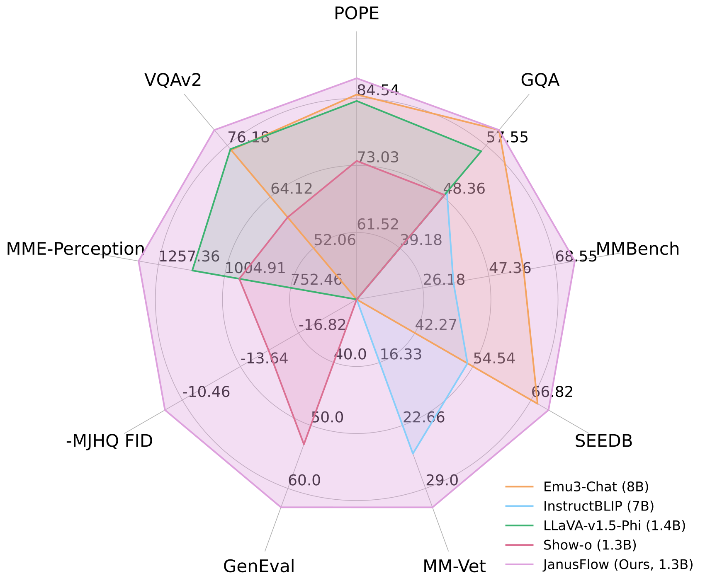

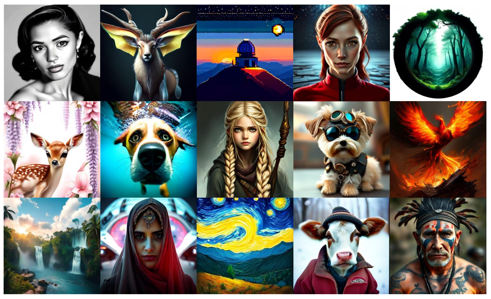

**EN.** Figure 1: Multimodal understanding and image generation with JanusFlow . JanusFlow surpasses the state-of-the-art unified multimodal models and several task-specific understanding models on visual understanding benchmarks. It is also capable of generating high-quality images. The resolution of the images is $384\times 384$ .

**中.** 图 1：使用 JanusFlow 进行多模态理解和图像生成。 JanusFlow 在视觉理解基准上超越了最先进的统一多模态模型和多个特定于任务的理解模型。它还能够生成高质量的图像。图像的分辨率为 $384\times 384$ 。

**EN.** Large language models (LLMs) have demonstrated remarkable capabilities in learning diverse knowledge and generalizing to new scenarios [ 91 , 69 , 1 , 8 , 7 ] . Leveraging these capabilities, researchers have developed sophisticated models specialized in image comprehension [ 58 , 56 , 47 , 2 , 15 , 49 ] and text-to-image generation [ 79 , 76 , 73 , 23 ] .

**中.** 大型语言模型（LLM）在学习多样化知识和推广到新场景方面表现出了卓越的能力[91,69,1,8,7]。利用这些功能，研究人员开发了专门用于图像理解 [58, 56, 47, 2, 15, 49] 和文本到图像生成 [79, 76, 73, 23] 的复杂模型。

**EN.** The field has recently shifted toward creating unified systems capable of handling both tasks simultaneously. One prominent direction involves utilizing pre-trained text-to-image models for high-quality generation while training LLMs to generate conditions for these models [ 25 , 26 , 87 , 27 , 19 ] . However, this approach introduces architectural complexity and potentially constrains the model’s capabilities through maintaining separate LLM and generative components. Alternative approaches [ 88 , 99 , 100 , 108 , 97 ] propose training a single LLM for both tasks, typically incorporating either diffusion models [ 32 , 83 ] or vector-quantized autoregressive models [ 22 , 86 ] .

**中.** 该领域最近转向创建能够同时处理这两项任务的统一系统。一个突出的方向涉及利用预先训练的文本到图像模型进行高质量生成，同时训练LLM为这些模型生成条件[25,26,87,27,19]。然而，这种方法引入了架构复杂性，并可能通过维护单独的 LLM 和生成组件来限制模型的功能。替代方法 [88, 99, 100, 108, 97] 建议为这两项任务训练单个 LLM，通常结合扩散模型 [32, 83] 或矢量量化自回归模型 [22, 86]。

**EN.** Our approach builds upon recent breakthroughs in rectified flow models [ 61 , 55 , 3 , 23 , 62 ] , which provide a simple framework for generative modeling while delivering exceptional empirical performance [ 23 , 45 , 36 ] . Building on these advances, we propose JanusFlow , a powerful unified multimodal model that seamlessly integrates rectified flow with LLM architecture. Following a minimalist design principle, our architecture requires only a lightweight encoder and decoder to adapt the LLM for rectified flow operations. To optimize JanusFlow’s performance, we implement two key strategies: First, we maintain separate vision encoders for understanding and generation tasks, preventing task interference and thus enhancing comprehension capabilities. Second, we align the intermediate representations between generation and understanding modules during training, strengthening semantic coherence in the generation process.

**中.** 我们的方法建立在最近的修正流模型突破之上[61,55,3,23,62]，它为生成模型提供了一个简单的框架，同时提供了卓越的经验性能[23,45,36]。基于这些进步，我们提出了 JanusFlow，这是一个强大的统一多模式模型，可将修正流与 LLM 架构无缝集成。遵循极简设计原则，我们的架构仅需要轻量级编码器和解码器来使 LLM 适应整流流操作。为了优化JanusFlow的性能，我们实施了两个关键策略：首先，我们维护单独的视觉编码器来理解和生成任务，防止任务干扰，从而增强理解能力。其次，我们在训练过程中对齐生成模块和理解模块之间的中间表示，加强生成过程中的语义连贯性。

**EN.** JanusFlow shows state-of-the-art performances in both multimodal comprehension and text-to-image generation compared to existing unified approaches, and even outperforms several specialized methods. Specifically, on text-to-image generation benchmarks, MJHQ FID- $30$ k [ 48 ] , GenEval [ 28 ] and DPG-Bench [ 34 ] , JanusFlow achieves scores of $9.51$ , $0.63$ and $80.09\%$ , surpassing established text-to-image models including SDv1.5 [ 77 ] and SDXL [ 73 ] . In multimodal comprehension benchmarks, JanusFlow attains scores of $74.9$ , $70.5$ and $60.3$ on MMBench [ 63 ] , SeedBench [ 46 ] , and GQA [ 35 ] , respectively, exceeding specialized models such as LLaVA-v1.5 [ 56 ] and Qwen-VL-Chat [ 4 ] . Notably, these results are achieved with a compact LLM architecture with only 1.3B parameters.

**中.** 与现有的统一方法相比，JanusFlow 在多模态理解和文本到图像生成方面都表现出了最先进的性能，甚至优于几种专门的方法。具体来说，在文本到图像生成基准 MJHQ FID-$30$ k [48]、GenEval [28] 和 DPG-Bench [34] 上，JanusFlow 取得了 $9.51$、$0.63$ 和 $80.09\%$ 的分数，超越了现有的文本到图像模型，包括SDv1.5 [77] 和 SDXL [73]。在多模态理解基准中，JanusFlow 在 MMBench [ 63 ] 、 SeedBench [ 46 ] 和 GQA [ 35 ] 上分别获得了 $74.9$ 、 $70.5$ 和 $60.3$ 的分数，超过了 LLaVA-v1.5 [ 56 ] 和 Qwen-VL-Chat [ 4]。值得注意的是，这些结果是通过仅具有 1.3B 参数的紧凑 LLM 架构实现的。

## Related Work / 相关工作

#### Visual Generation with Flow-based Generative Models. / 使用基于流程的生成模型进行视觉生成。

**EN.** Recent years have witnessed remarkable progress in visual generation through diffusion models [ 32 , 83 ] , leading to impressive models like [ 77 , 73 , 78 , 79 , 76 , 67 ] . Building on these advances, flow-based generative models [ 61 , 55 , 3 ] emerged as a simplified alternative framework. These approaches have recently enabled advanced visual generation models [ 23 , 36 ] that achieve superior empirical performance with faster sampling. Our work demonstrates that rectified flow [ 61 , 60 , 62 ] can be effectively integrated into LLMs, creating unified models that excel in both understanding and generation tasks.

**中.** 近年来，通过扩散模型[32,83]在视觉生成方面取得了显着的进展，产生了像[77,73,78,79,76,67]这样令人印象深刻的模型。在这些进步的基础上，基于流程的生成模型 [61,55,3] 作为一种简化的替代框架出现。这些方法最近启用了先进的视觉生成模型 [23, 36]，通过更快的采样实现了卓越的经验性能。我们的工作表明，修正流程[61、60、62]可以有效地集成到LLM中，创建在理解和生成任务方面都表现出色的统一模型。

#### Unified Models For Understanding and Generation. / 用于理解和生成的统一模型。

**EN.** The development of multimodal large language models (MLLMs) has enabled effective integration of text and visual information. Building upon powerful LLMs [ 91 , 92 , 7 ] , recent MLLMs [ 64 , 58 , 56 , 2 , 15 , 49 ] have demonstrated exceptional multimodal understanding capabilities. Current research increasingly focuses on architectures that can simultaneously handle visual understanding and generation tasks. One approach extends MLLMs with pre-trained diffusion models [ 25 , 26 , 87 , 27 , 19 , 101 ] . However, these systems essentially utilize diffusion models as external tools, where the MLLM generates conditions for image generation without possessing direct generative capabilities. This separation often results in suboptimal performance compared to standalone diffusion models [ 25 , 87 ] . Another line of work [ 88 , 99 , 100 , 108 , 97 ] aim to train a single LLM for both tasks. Many of these methods employ vector-quantization [ 22 , 86 ] to convert images into discrete tokens, enabling unified autoregressive processing [ 88 , 97 ] . While straightforward to implement, these approaches are inherently limited by their image tokenization quality.

**中.** 多模态大语言模型（MLLM）的发展使得文本和视觉信息的有效集成成为可能。在强大的LLM [91, 92, 7] 的基础上，最近的 MLLM [64, 58, 56, 2, 15, 49] 表现出了卓越的多模式理解能力。当前的研究越来越关注能够同时处理视觉理解和生成任务的架构。一种方法使用预先训练的扩散模型来扩展 MLLM [25,26,87,27,19,101]。然而，这些系统本质上利用扩散模型作为外部工具，其中 MLLM 生成图像生成条件，但不具备直接生成能力。与独立扩散模型相比，这种分离通常会导致性能欠佳[25, 87]。另一项工作 [88、99、100、108、97] 旨在为这两项任务培训一名LLM。其中许多方法采用矢量量化 [22, 86] 将图像转换为离散标记，从而实现统一的自回归处理 [88, 97]。虽然实施起来很简单，但这些方法本质上受到图像标记化质量的限制。

**EN.** Our work focuses on developing unified models that combine autoregressive capabilities with flow/diffusion models, leveraging their proven effectiveness in visual generation. Compared to similar approaches [ 100 , 108 , 107 ] , JanusFlow offers three key advantages: (i) a simple yet effective generation process using rectified flow, (ii) enhanced performance through decoupled vision encoders that resolve inter-task conflicts, and (iii) improved generation quality through representation alignment regularization, enabled by our decoupled encoder design.

**中.** 我们的工作重点是开发统一模型，将自回归功能与流动/扩散模型相结合，利用其在视觉生成方面经过验证的有效性。与类似的方法[100、108、107]相比，JanusFlow 提供了三个关键优势：（i）使用修正流的简单而有效的生成过程，（ii）通过解决任务间冲突的解耦视觉编码器增强性能，以及（iii）通过我们的解耦编码器设计实现的表示对齐正则化提高生成质量。

## JanusFlow / 剑锋流

**EN.** In this section, we introduce the architecture of JanusFlow and our training strategies.

**中.** 在本节中，我们介绍 JanusFlow 的架构和我们的训练策略。

### Background / 背景

#### Multimodal LLMs. / 多模式LLM。

**EN.** Given a dataset $\mathcal{D}$ containing discrete token sequences, each of which can be formulated as $x=(x_{1},\cdots,x_{\ell})$ , large language models (LLMs) are trained to model the sequence distribution in an autoregressive manner,

**中.** 给定一个包含离散标记序列的数据集 $\mathcal{D}$ ，每个序列都可以表示为 $x=(x_{1},\cdots,x_{\ell})$ ，训练大型语言模型（LLM）以自回归方式对序列分布进行建模，

$$
\log{{\rm{P}}}_{\theta_{LLM}}(x)=\sum_{i=0}^{\ell-1}\log{{\rm{P}}}_{\theta_{LLM}}(x_{i+1}|x_{1},\dots,x_{i}),\tag{1}
$$

**EN.** where $\theta_{LLM}$ denotes the parameters of the LLM and $\ell$ is the sequence length. After being trained on large-scale datasets, LLMs exhibit the ability to generalize across various tasks and follow diverse instructions [ 8 , 1 , 69 ] . To extend these models to handle visual inputs, LLMs are augmented with vision encoders [ 58 , 56 , 2 ] . For instance, LLaVA [ 58 ] integrates an LLM with a pre-trained CLIP [ 75 ] image encoder via a projection layer, transforming the extracted image features into a joint embedding space that the LLM can process as word embeddings. By leveraging large-scale multimodal datasets and increasingly powerful LLMs, this architecture has facilitated the development of advanced multimodal models capable of addressing a wide range of vision-language tasks [ 4 , 56 , 47 , 64 ] .

**中.** 其中$\theta_{LLM}$表示LLM的参数，$\ell$是序列长度。经过大规模数据集的培训后，LLM表现出泛化各种任务并遵循不同指令的能力[8,1,69]。为了扩展这些模型以处理视觉输入，LLM通过视觉编码器进行了增强[58,56,2]。例如，LLaVA [58]通过投影层将LLM与预训练的CLIP[75]图像编码器集成，将提取的图像特征转换为LLM可以作为词嵌入处理的联合嵌入空间。通过利用大规模多模态数据集和日益强大的LLM，该架构促进了能够解决各种视觉语言任务的先进多模态模型的开发[4,56,47,64]。

#### Rectified Flow. / 整流流。

**EN.** For a dataset $\mathcal{D}$ consisting of continuous $d$ -dimensional data points $x=(x_{1},\cdots,x_{d})$ drawn from an unknown data distribution $\pi_{1}$ , rectified flow [ 61 , 55 ] models the data distribution by learning an ordinary differential equation (ODE) defined over time $t\in[0,1]$ :

**中.** 对于由从未知数据分布 $\pi_{1}$ 提取的连续 $d$ 维数据点 $x=(x_{1},\cdots,x_{d})$ 组成的数据集 $\mathcal{D}$ ，修正流 [ 61 , 55 ] 通过学习随时间定义的常微分方程 (ODE) $t\in[0,1]$ 来对数据分布进行建模：

$$
\frac{{\rm{d}}z_{t}}{{\rm{d}}t}=v_{\theta_{NN}}(z_{t},t),\penalty\ \penalty\ \penalty\ \penalty\ \penalty\ z_{0}\sim\pi_{0},\tag{2}
$$

**EN.** where $\theta_{NN}$ represents the parameters of the velocity neural network and $\pi_{0}$ is a simple distribution, typically standard Gaussian noise $\mathcal{N}(0,I)$ . The network is trained by minimizing the Euclidean distance between the neural velocity and the directions of linear paths connecting random points from $\pi_{0}$ and $\pi_{1}$ ,

**中.** 其中 $\theta_{NN}$ 表示速度神经网络的参数， $\pi_{0}$ 是简单分布，通常是标准高斯噪声 $\mathcal{N}(0,I)$ 。通过最小化神经速度与连接 $\pi_{0}$ 和 $\pi_{1}$ 随机点的线性路径方向之间的欧几里德距离来训练网络，

$$
\min_{\theta}{{\mathbb{E}}}_{t\sim{{\rm{P}}}(t),z_{0}\sim\pi_{0},x\sim\pi_{1}}\left[\left|\left|v_{\theta_{NN}}(z_{t},t)-(x-z_{0})\right|\right|^{2}\right],\penalty\ \penalty\ \text{where}\penalty\ \penalty\ z_{t}=tx+(1-t)z_{0}.\tag{3}
$$

**EN.** Here, ${\rm{P}}(t)$ is a distribution over time $t\in[0,1]$ . When the network has sufficient capacity and the objective is perfectly minimized, the optimal velocity field $v_{\theta^{*}_{NN}}$ maps the elementary distribution $\pi_{0}$ to the true data distribution $\pi_{1}$ . More precisely, the distribution of $z_{1}=\int_{0}^{1}v_{\theta^{*}_{NN}}(z_{t},t){{\rm{d}}}t$ , with $z_{0}\sim\pi_{0}$ , follows $\pi_{1}$ . Despite its conceptual simplicity, rectified flow has shown superior performance in various generative modeling tasks, including text-to-image generation [ 23 ] , audio generation [ 40 ] and biological structure generation [ 38 ] .

**中.** 这里， ${\rm{P}}(t)$ 是随时间变化的分布 $t\in[0,1]$ 。当网络具有足够的容量并且目标完美最小化时，最优速度场 $v_{\theta^{*}_{NN}}$ 将基本分布 $\pi_{0}$ 映射到真实数据分布 $\pi_{1}$ 。更准确地说， $z_{1}=\int_{0}^{1}v_{\theta^{*}_{NN}}(z_{t},t){{\rm{d}}}t$ 和 $z_{0}\sim\pi_{0}$ 的分布遵循 $\pi_{1}$ 。尽管概念简单，修正流在各种生成建模任务中表现出了卓越的性能，包括文本到图像生成[23]、音频生成[40]和生物结构生成[38]。

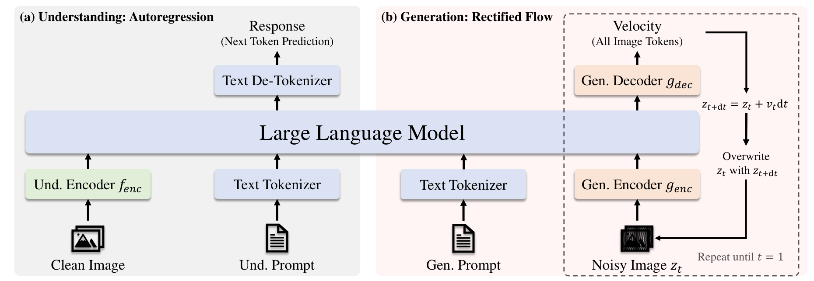

**EN.** Figure 2: Architecture of the proposed JanusFlow. For visual understanding, the LLM performs autoregressive next-token prediction to generate responses. For image generation, the LLM employs images with rectified flow. Starting from Gaussian noise at $t=0$ , the LLM iteratively updates $z_{t}$ by predicting velocity vectors until reaching $t=1$ . We omit the VAE encoder, the skip connection leveraged in generation and the linear layer after $f_{enc}$ for simplicity.

**中.** 图 2：提议的 JanusFlow 的架构。为了视觉理解，LLM 执行自回归下一个标记预测以生成响应。对于图像生成，LLM采用具有校正流的图像。从 $t=0$ 处的高斯噪声开始，LLM 通过预测速度向量迭代更新 $z_{t}$ ，直到达到 $t=1$ 。为了简单起见，我们省略了 VAE 编码器、生成中利用的跳跃连接以及 $f_{enc}$ 之后的线性层。

### Unified Framework for Multimodal Understanding and Generation / 多模态理解和生成的统一框架

**EN.** JanusFlow presents a unified framework designed to address both vision understanding and image generation tasks. Next we outline how JanusFlow handles these two tasks within a single LLM architecture.

**中.** JanusFlow 提出了一个统一的框架，旨在解决视觉理解和图像生成任务。接下来，我们概述 JanusFlow 如何在单个 LLM 架构中处理这两项任务。

#### Multimodal Understanding. / 多模式理解。

**EN.** In multimodal understanding tasks, the LLM processes an input sequence consisting of interleaved text and image data. The text is tokenized into discrete tokens, each of which is transformed into an embedding of dimension $D_{emb}$ . For the images, an image encoder $f_{enc}$ encodes each image $x_{im}$ into a feature map of shape $H_{im}\times W_{im}\times D_{enc}$ . This feature map is flattened and projected through a linear transformation layer into a sequence of embeddings with shape $H_{im}W_{im}\times D_{emb}$ . $H_{im}$ and $W_{im}$ are determined by the image encoder. The text and image embeddings are concatenated to form the input sequence to the LLM, which then autoregressively predicts the next tokens based on the input sequence of embeddings. According to common practice [ 97 , 88 , 100 ] , we add special token |BOI| before the image and |EOI| after the image to help the model locate the image embeddings in the sequence.

**中.** 在多模态理解任务中，LLM处理由交错的文本和图像数据组成的输入序列。文本被标记为离散标记，每个标记都转换为维度 $D_{emb}$ 的嵌入。对于图像，图像编码器 $f_{enc}$ 将每个图像 $x_{im}$ 编码为形状 $H_{im}\times W_{im}\times D_{enc}$ 的特征图。该特征图被展平并通过线性转换层投影为形状为 $H_{im}W_{im}\times D_{emb}$ 的嵌入序列。 $H_{im}$和$W_{im}$由图像编码器确定。文本和图像嵌入被连接起来形成 LLM 的输入序列，然后 LLM 根据嵌入的输入序列自回归预测下一个标记。根据惯例[97,88,100]，我们添加特殊代币|BOI|在图像和 |EOI| 之前在图像之后帮助模型定位序列中的图像嵌入。

#### Image Generation. / 图像生成。

**EN.** For image generation, our LLM takes a text sequence $x^{con}$ as condition and generates a corresponding image using rectified flow. To improve computational efficiency, generation occurs in the latent space using a pre-trained SDXL-VAE [ 73 ] .

**中.** 对于图像生成，我们的 LLM 以文本序列 $x^{con}$ 作为条件，并使用校正流生成相应的图像。为了提高计算效率，使用预先训练的 SDXL-VAE [73] 在潜在空间中进行生成。

**EN.** The generation process begins by sampling Gaussian noise $z_{0}$ of shape $H_{latent}\times W_{latent}\times D_{latent}$ in the latent space, which is then processed by a generation encoder $g_{enc}$ into a sequence of embeddings $H_{gen}W_{gen}\times D_{emb}$ . This sequence is concatenated with a time embedding representing the current time step $t$ ( $t=0$ at the beginning), resulting in a sequence of length $H_{gen}W_{gen}+1$ . Unlike previous approaches that employ various attention masking strategies [ 100 , 108 ] , we found that causal attention suffices, as our preliminary experiments showed no performance benefits from alternative masking schemes. The LLM’s output corresponding to $z_{0}$ is transformed back into the latent space by a generation decoder $g_{dec}$ , producing a velocity vector of shape $H_{latent}\times W_{latent}\times D_{latent}$ . The state is updated by a standard Euler solver,

**中.** 生成过程首先对潜在空间中形状为 $H_{latent}\times W_{latent}\times D_{latent}$ 的高斯噪声 $z_{0}$ 进行采样，然后由生成编码器 $g_{enc}$ 将其处理为嵌入序列 $H_{gen}W_{gen}\times D_{emb}$ 。该序列与表示当前时间步长 $t$ （开头为 $t=0$ ）的时间嵌入连接，产生长度为 $H_{gen}W_{gen}+1$ 的序列。与之前采用各种注意力掩蔽策略的方法不同[100, 108]，我们发现因果注意力就足够了，因为我们的初步实验表明替代掩蔽方案没有性能优势。对应于 $z_{0}$ 的 LLM 输出由生成解码器 $g_{dec}$ 变换回潜在空间，产生形状为 $H_{latent}\times W_{latent}\times D_{latent}$ 的速度矢量。状态由标准欧拉求解器更新，

$$
z_{t+{\rm{d}}t}=z_{t}+v(z_{t},t){\rm{d}}t,\tag{4}
$$

**EN.** where ${\rm{d}}t$ is a user-defined step size. We replace $z_{0}$ with $z_{{\rm{d}}t}$ on the input and iterate the process until we get $z_{1}$ , which is then decoded into the final image by the VAE decoder. To enhance generation quality, we employ classifier-free guidance (CFG) when computing the velocity:

**中.** 其中 ${\rm{d}}t$ 是用户定义的步长。我们在输入上将 $z_{0}$ 替换为 $z_{{\rm{d}}t}$ 并迭代该过程，直到得到 $z_{1}$ ，然后由 VAE 解码器将其解码为最终图像。为了提高生成质量，我们在计算速度时采用无分类器引导（CFG）：

$$
v(z_{t},t)=wv(z_{t},t\penalty\ |\penalty\ x^{con})+(1-w)v(z_{t},t\penalty\ |\penalty\ \varnothing),\tag{5}
$$

**EN.** where $v(z_{t},t\penalty\ |\penalty\ \varnothing)$ denotes the velocity inferred without text conditioning and $w\geqslant 1$ controls the magnitute of CFG. Empirically, increasing $w$ yields higher semantic alignment [ 77 , 62 , 73 , 23 ] . Analogous to multimodal understanding, we prepend the special token |BOI| to indicate the start of image generation in the sequence.

**中.** 其中 $v(z_{t},t\penalty\ |\penalty\ \varnothing)$ 表示在没有文本条件的情况下推断的速度，$w\geqslant 1$ 控制 CFG 的大小。根据经验，增加 $w$ 会产生更高的语义对齐[77,62,73,23]。与多模态理解类似，我们在前面添加特殊标记 |BOI|指示序列中图像生成的开始。

#### Decoupling Encoders for the Two Tasks. / 两个任务的解耦编码器。

**EN.** Previous approaches that unify autoregressive generation and diffusion models within a joint LLM training framework [ 108 , 100 ] employ identical encoders ( $f_{enc}$ and $g_{enc}$ ) for both understanding and generation tasks. For instance, Zhou et al. [108] performs both tasks in the same VAE latent space using a shared U-Net or linear encoder, while Xie et al. [100] leverages MAGVIT-v2 [ 102 ] to encode image patches into discrete tokens for both tasks.

**中.** 先前在联合 LLM 训练框架 [108, 100] 中统一自回归生成和扩散模型的方法采用相同的编码器（ $f_{enc}$ 和 $g_{enc}$ ）来执行理解和生成任务。例如，周等人。 [108]使用共享的 U-Net 或线性编码器在同一 VAE 潜在空间中执行这两项任务，而 Xie 等人。 [100]利用 MAGVIT-v2 [102] 将图像块编码为两个任务的离散标记。

**EN.** However, recent work on unified autoregressive models has shown this shared encoder design to be suboptimal [ 97 ] , particularly in models that generate images through autoregression on vector-quantized tokens. Drawing from these insights, JanusFlow adopts a decoupled encoder design. Specifically, we employ a pre-trained SigLIP-Large-Patch/16 [ 106 ] model as $f_{enc}$ to extract semantic continuous features for multimodal understanding, while using separate ConvNeXt blocks [ 96 ] initialized from scratch as $g_{enc}$ and $g_{dec}$ for generation, chosen for its effectiveness. Following established practices [ 5 , 14 , 93 ] , we incorporate a long skip connection between $g_{enc}$ and $g_{dec}$ . Our controlled experiments in Sec. 4.5 demonstrate that this decoupled encoder design significantly improves the performance of our unified model. The complete architecture of JanusFlow is illustrated in Fig. 2 .

**中.** 然而，最近关于统一自回归模型的工作表明，这种共享编码器设计并不是最优的[97]，特别是在通过矢量量化标记的自回归生成图像的模型中。根据这些见解，JanusFlow 采用了解耦编码器设计。具体来说，我们采用预训练的 SigLIP-Large-Patch/16 [106] 模型作为 $f_{enc}$ 来提取语义连续特征以进行多模态理解，同时使用从头开始初始化为 $g_{enc}$ 和 $g_{dec}$ 的单独 ConvNeXt 块 [96] 进行生成，选择其有效性。遵循既定做法[5,14,93]，我们在$g_{enc}$ 和$g_{dec}$ 之间采用长跳跃连接。我们在第二节的对照实验。 4.5 证明这种解耦编码器设计显着提高了我们统一模型的性能。 JanusFlow的完整架构如图2所示。

### Training Schemes / 培训计划

**EN.** As illustrated in Fig. 3 , we train our model in three sequential stages, detailed below.

**中.** 如图 3 所示，我们分三个连续阶段训练模型，详情如下。

#### Stage 1: Adaptation of Randomly Initialized Components. / 第一阶段：随机初始化组件的适应。

**EN.** In the first stage, we focus on training only the randomly initialized components: the linear layers, generation encoder, and generation decoder. This stage serves to adapt these new modules to work effectively with the pre-trained LLM and SigLIP encoder, essentially functioning as an initialization phase for the newly introduced components.

**中.** 在第一阶段，我们只专注于训练随机初始化的组件：线性层、生成编码器和生成解码器。此阶段用于调整这些新模块，以便与预先训练的 LLM 和 SigLIP 编码器有效地配合使用，本质上充当新引入组件的初始化阶段。

#### Stage 2: Unified Pre-Training. / 第二阶段：统一预训练。

**EN.** Following the adaptation stage, we train the entire model except for the visual encoder, consistent with previous approaches [ 58 , 64 ] . The training incorporates three data types: multimodal understanding, image generation, and text-only data. We initially allocate a higher proportion of multimodal understanding data to establish the model’s understanding capabilities. Subsequently, we increase the ratio of image generation data to accommodate the convergence requirements of diffusion-based models [ 18 , 72 ] .

**中.** 在适应阶段之后，我们训练除视觉编码器之外的整个模型，与之前的方法一致[58, 64]。训练包含三种数据类型：多模态理解、图像生成和纯文本数据。我们最初分配较高比例的多模态理解数据来建立模型的理解能力。随后，我们增加图像生成数据的比例，以适应基于扩散的模型的收敛要求[18, 72]。

#### Stage 3: Supervised Fine-Tuning (SFT). / 第 3 阶段：监督微调 (SFT)。

**EN.** In the final stage, we fine-tune the pre-trained model using instruction tuning data, which comprises dialogues, task-specific conversations, and high-quality text-conditioned image generation examples. During this stage, we also unfreeze the SigLIP encoder parameters [ 64 , 90 , 97 ] . This fine-tuning process enables the model to effectively respond to user instructions for both multimodal understanding and image generation tasks.

**中.** 在最后阶段，我们使用指令调整数据对预训练模型进行微调，其中包括对话、特定于任务的对话和高质量的文本条件图像生成示例。在此阶段，我们还解冻 SigLIP 编码器参数 [64,90,97]。这种微调过程使模型能够有效地响应用户指令以进行多模态理解和图像生成任务。

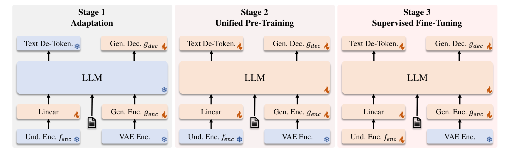

**EN.** Figure 3: Three training stages of JanusFlow. The trainable modules are marked with flame and the frozen modules are marked with snowflakes.

**中.** 图 3：JanusFlow 的三个训练阶段。可训练模块标有火焰，冷冻模块标有雪花。

### Training Objective / 培训目标

**EN.** Training JanusFlow involves two types of data, multimodal understanding data and image generation data. Both types of data contain two parts: “condition” and “response”. “Condition” refers to the prompting of the tasks ( e . g ., text prompts in the task of generation and images in the task of understanding) while “response” refers to the corresponding responses of the two tasks. The data can be formatted as $x=(x^{con},x^{res})$ , where the superscript $con$ denotes “condition” and $res$ denotes “response”. We denote the length of the whole sequence $x$ as $\ell$ , the length of $x^{con}$ as $\ell_{con}$ and the length of $x^{res}$ as $\ell_{res}$ . We use $\theta$ to represent the collection of all the trainable parameters in JanusFlow, including the LLM, $f_{enc}$ , $g_{enc}$ , $g_{dec}$ and the linear transformation layers.

**中.** 训练JanusFlow涉及两类数据，多模态理解数据和图像生成数据。两种类型的数据都包含两部分：“条件”和“响应”。 “条件”是指任务的提示（例如生成任务中的文字提示，理解任务中的图像提示），“响应”是指两个任务对应的响应。数据可以格式化为 $x=(x^{con},x^{res})$ ，其中上标 $con$ 表示“条件”，$res$ 表示“响应”。我们将整个序列 $x$ 的长度表示为 $\ell$ ，将 $x^{con}$ 的长度表示为 $\ell_{con}$ ，将 $x^{res}$ 的长度表示为 $\ell_{res}$ 。我们使用 $\theta$ 来表示 JanusFlow 中所有可训练参数的集合，包括 LLM、$f_{enc}$、$g_{enc}$、$g_{dec}$ 和线性变换层。

#### Autoregression Objective. / 自回归目标。

**EN.** For mutimodal understanding tasks, $x^{res}$ contains only text tokens. JanusFlow is trained using the maximum likelihood principle,

**中.** 对于多模式理解任务，$x^{res}$ 仅包含文本标记。 JanusFlow 使用最大似然原理进行训练，

$$
\mathcal{L}_{AR}(\theta)=-{\mathbb{E}}_{x\sim\mathcal{D}_{und}}\left[\sum_{i=\ell_{con}}^{\ell-1}\log{{\rm{P}}}_{\theta}\left(x_{i+1}|x_{1},\dots,x_{i}\right)\right],\tag{6}
$$

**EN.** where the expectation is taken over all $(x^{con},x^{res})$ pairs in our multimodal understanding dataset $\mathcal{D}_{und}$ , computing loss only over tokens in $x^{res}$ .

**中.** 其中期望涵盖多模态理解数据集 $\mathcal{D}_{und}$ 中的所有 $(x^{con},x^{res})$ 对，仅计算 $x^{res}$ 中标记的损失。

#### Rectified Flow Objective. / 修正的流量目标。

**EN.** For image generation tasks, $x^{con}$ consists of text tokens and $x^{res}$ is the corresponding image. JanusFlow is trained with the rectified flow objective,

**中.** 对于图像生成任务，$x^{con}$ 由文本标记组成，$x^{res}$ 是相应的图像。 JanusFlow 使用修正的流量目标进行训练，

$$
\mathcal{L}_{RF}(\theta)={{\mathbb{E}}}_{x\sim\mathcal{D}_{gen},t\sim{{\rm{P}}}(t),z_{0}\sim\mathcal{N}(0,I)}\left[\left|\left|v_{\theta}(z_{t},t\penalty\ |\penalty\ x^{con})-(x^{res}-z_{0})\right|\right|^{2}\right],\tag{7}
$$

**EN.** where $z_{t}=tx^{res}+(1-t)z_{0}$ . Following Stable Diffusion 3 [ 23 ] , we set the time distribution ${\rm{P}}(t)$ to the logit-normal distribution. To enable CFG inference, we randomly drop 10% of the text prompts in training.

**中.** 其中 $z_{t}=tx^{res}+(1-t)z_{0}$ 。遵循稳定扩散 3 [23]，我们将时间分布 ${\rm{P}}(t)$ 设置为 logit 正态分布。为了启用 CFG 推理，我们在训练中随机丢弃 10% 的文本提示。

#### Representation Alignment Regularization. / 表示对齐正则化。

**EN.** Recent work [ 103 ] has shown that aligning intermediate representations between diffusion transformers and semantic vision encoders enhances diffusion model generalization. Our decoupled vision encoder design enables efficient implementation of this alignment as a regularization term. Specifically, for generation tasks, we align features from the understanding encoder $f_{enc}$ with the LLM’s intermediate features,

**中.** 最近的工作[103]表明，对齐扩散变换器和语义视觉编码器之间的中间表示可以增强扩散模型的泛化。我们的解耦视觉编码器设计可以有效地实现这种对齐作为正则化项。具体来说，对于生成任务，我们将理解编码器 $f_{enc}$ 的特征与 LLM 的中间特征对齐，

$$
\mathcal{L}_{REPA}(\theta,\varphi)=-{\mathbb{E}}_{x\sim\mathcal{D}_{gen}}\left[\text{sim}\left(\text{{stop\_grad}}(f_{enc}(x^{res})),h_{\varphi}(q_{\theta}(z_{t}))\right)\right],\tag{8}
$$

**EN.** where $q_{\theta}(z_{t})$ denotes an intermediate LLM representation given input $z_{t}$ , and $h_{\varphi}$ is a small trainable MLP that projects $q_{\theta}(z_{t})$ to dimension $D_{enc}$ . The function $\text{sim}(\cdot,\cdot)$ computes the mean of element-wise cosine similarity between embeddings. Before computing the loss, we reshape $h_{\varphi}(q_{\theta}(z_{t}))$ to $H_{gen}\times W_{gen}\times D_{enc}$ . To simplify the implementation, we intentionally adjust the configuration of $g_{enc}$ and $g_{dec}$ to ensure $H_{gen}=H_{im}$ and $W_{gen}=W_{im}$ . The gradient of $\mathcal{L}_{REPA}$ is not back-propagated through the understanding encoder. This alignment loss helps the LLM’s internal feature space (given noisy input $z_{t}$ ) align with the understanding encoder’s semantic feature space, thereby improving generation quality when producing images from new random noise and text conditions during inference.

**中.** 其中 $q_{\theta}(z_{t})$ 表示给定输入 $z_{t}$ 的中间 LLM 表示，而 $h_{\varphi}$ 是一个小型可训练 MLP，它将 $q_{\theta}(z_{t})$ 投影到维度 $D_{enc}$ 。函数 $\text{sim}(\cdot,\cdot)$ 计算嵌入之间逐元素余弦相似度的平均值。在计算损失之前，我们将 $h_{\varphi}(q_{\theta}(z_{t}))$ 重塑为 $H_{gen}\times W_{gen}\times D_{enc}$ 。为了简化实现，我们特意调整了$g_{enc}$和$g_{dec}$的配置，以确保$H_{gen}=H_{im}$和$W_{gen}=W_{im}$。 $\mathcal{L}_{REPA}$的梯度不是通过理解编码器反向传播的。这种对齐损失有助于 LLM 的内部特征空间（给定噪声输入 $z_{t}$ ）与理解编码器的语义特征空间对齐，从而在推理过程中从新的随机噪声和文本条件生成图像时提高生成质量。

#### Summary. / 总结。

**EN.** All three objectives are applied across all training stages. Multimodal understanding tasks use $\mathcal{L}_{AR}$ , while image generation tasks employ the combined loss $\mathcal{L}_{RF}+\mathcal{L}_{REPA}$ . Detailed experimental settings are provided in Sec. 4.1 .

**中.** 所有三个目标都适用于所有培训阶段。多模态理解任务使用 $\mathcal{L}_{AR}$，而图像生成任务则使用组合损失 $\mathcal{L}_{RF}+\mathcal{L}_{REPA}$。详细的实验设置在第 2 节中提供。 4.1.

|  | Stage 1 第一阶段 | Stage 2 第二阶段 | Stage 3 第三阶段 |
| --- | --- | --- | --- |
| Learning Rate 学习率 | $1.0\times 10^{-4}$ | $1\times 10^{-4}$ | $2.0\times 10^{-5}$ |
| LR Scheduler LR调度器 | Constant 常数 | Constant 常数 | Constant 常数 |
| Weight Decay 体重衰减 | $0.0$ | $0.0$ | $0.0$ |
| Gradient Clip 渐变剪辑 | $1.0$ | $1.0$ | $1.0$ |
| Optimizer 优化器 | AdamW ( $\beta_{1}=0.9,\beta_{2}=0.95$ ) 亚当W ( $\beta_{1}=0.9,\beta_{2}=0.95$ ) | AdamW ( $\beta_{1}=0.9,\beta_{2}=0.95$ ) 亚当W ( $\beta_{1}=0.9,\beta_{2}=0.95$ ) | AdamW ( $\beta_{1}=0.9,\beta_{2}=0.95$ ) 亚当W ( $\beta_{1}=0.9,\beta_{2}=0.95$ ) |
| Warm-up Steps 热身步骤 | $2,000$ | $2,000$ | $1,000$ |
| Training Steps 训练步骤 | $10,000$ | $390,000$ | $26,000$ |
| Batch Size 批量大小 | $512$ | $512$ | $256$ |
| Data Ratio 数据比率 | $50:50:0$ | $14:80:6$ | $21:70:9$ |

**EN.** Table 1: Hyper-parameters of the proposed JanusFlow . Data ratio denotes the proportion of multimodal understanding data, image generation data and text-only data. In the initial $10,000$ steps of Stage 2, we apply a data ratio of $30:50:20$ to boost the understanding ability.

**中.** 表 1：建议的 JanusFlow 的超参数。数据比例表示多模态理解数据、图像生成数据和纯文本数据的比例。在第 2 阶段的初始 $10,000$ 步骤中，我们应用 $30:50:20$ 的数据比率来提高理解能力。

## Experiments / 实验

**EN.** We conduct extensive experiments to evaluate the capabilities of JanusFlow in both multimodal understanding and generation tasks. First, we describe our experimental setup and implementation details. Then, we present results on standard benchmarks for multimodal understanding and image generation. Finally, we perform ablation studies to validate our key design choices.

**中.** 我们进行了大量的实验来评估 JanusFlow 在多模态理解和生成任务方面的能力。首先，我们描述我们的实验设置和实施细节。然后，我们展示多模态理解和图像生成的标准基准的结果。最后，我们进行消融研究以验证我们的关键设计选择。

### Experiment Setup and Implementation Details / 实验设置和实施细节

**EN.** Our framework builds upon an enhanced version [^footnote1] of DeepSeek-LLM (1.3B) [ 7 , 64 ] . The LLM consists of 24 transformer blocks and supports a sequence length of $4,096$ . In our model, both understanding and generation exploits images of resolution 384.

**中.** 我们的框架建立在 DeepSeek-LLM (1.3B) [7, 64] 的增强版本 [^footnote1] 的基础上。 LLM 由 24 个Transformer块组成，支持 $4,096$ 的序列长度。在我们的模型中，理解和生成都利用分辨率 384 的图像。

**EN.** For multimodal understanding, we leverage SigLIP-Large-Patch/16 [ 106 ] as $f_{enc}$ . For image generation, we utilize the pre-trained SDXL-VAE [ 73 ] for its latent space. The generation encoder $g_{enc}$ comprises a $2\times 2$ patchify layer followed by two ConvNeXt [ 96 ] blocks and a linear layer. The generation decoder $g_{dec}$ combines two ConvNeXt blocks, a pixel-shuffle layer to upsample the feature map, and a linear layer. Our SigLIP encoder contains $\sim 300$ M parameters. $g_{enc}$ and $g_{dec}$ are light-weight modules, containing $\sim 70$ M parameters in total. Table 1 details the hyperparameters for each training stage. In the alignment regularization, we use the LLM features after the 6th block as $q_{\theta}(z_{t})$ and a three-layer MLP as $h_{\varphi}$ . We employ an exponential moving average (EMA) with a ratio of 0.99 to ensure training stability.

**中.** 对于多模态理解，我们利用 SigLIP-Large-Patch/16 [106] 作为 $f_{enc}$ 。对于图像生成，我们利用预训练的 SDXL-VAE [73] 作为其潜在空间。生成编码器 $g_{enc}$ 包含一个 $2\times 2$ patchify 层，后面跟着两个 ConvNeXt [96] 块和一个线性层。生成解码器 $g_{dec}$ 组合了两个 ConvNeXt 块、一个对特征图进行上采样的像素洗牌层和一个线性层。我们的 SigLIP 编码器包含 $\sim 300$ M 参数。 $g_{enc}$和$g_{dec}$为轻量级模块，共包含$\sim 70$ M参数。表 1 详细列出了每个训练阶段的超参数。在对齐正则化中，我们使用第6个块之后的LLM特征作为$q_{\theta}(z_{t})$，使用三层MLP作为$h_{\varphi}$。我们采用比率为 0.99 的指数移动平均线（EMA）来确保训练稳定性。

**EN.** For data preprocessing, we deal with understanding and generation data differently. For understanding tasks, we maintain all image information by resizing the long side to the target size and padding the image to squares. For generation tasks, we resize the short side to the target size and apply random square cropping to avoid padding artifacts. During training, multiple sequences are packed to form a single sequence of length $4,096$ for training efficiency. Our implementation is based on the HAI-LLM platform [ 31 ] using PyTorch [ 74 ] . Training was conducted on NVIDIA A100 GPUs, with each model requiring $\sim 1,600$ A100 GPU days.

**中.** 对于数据预处理，我们以不同的方式处理理解和生成数据。为了理解任务，我们通过将长边调整为目标大小并将图像填充为正方形来维护所有图像信息。对于生成任务，我们将短边的大小调整为目标大小并应用随机方形裁剪以避免填充伪影。在训练过程中，多个序列被打包形成长度为 $4,096$ 的单个序列，以提高训练效率。我们的实现基于使用 PyTorch [74] 的 HAI-LLM 平台 [31]。训练在 NVIDIA A100 GPU 上进行，每个模型都需要 $\sim 1,600$ A100 GPU 天。

### Training Data Settings / 训练数据设置

**EN.** We follow Janus [ 97 ] to construct the training data. The data configuration for each training stage is listed below.

**中.** 我们按照 Janus [97] 构建训练数据。下面列出了每个训练阶段的数据配置。

#### Data for Stage 1 and Stage 2. / 第一阶段和第二阶段的数据。

**EN.** The first two stages of our framework uses three types of data: multimodal understanding data, image generation data and text-only data.

**中.** 我们框架的前两个阶段使用三种类型的数据：多模态理解数据、图像生成数据和纯文本数据。

**EN.** 1.

**中.** 1.

**EN.** Multimodal Understanding Data. This type of data contains several sub-categories: (a) Image caption data. We incorporate caption datasets from [ 20 , 41 , 50 , 51 , 53 , 82 ] and generate additional captions for images from [ 16 , 43 ] using open-source multimodal understanding models. The names of the datasets are provided in the supplementary materials. The data follows template formats, e . g ., “ <image>Generate the caption of this picture. <caption> ”. (b) Charts and tables. We directly adopt the chart and table data from the training data of DeepSeek-VL [ 64 ] . (c) Task data. ShareGPT4V [ 11 ] data is utilized to facilitate basic question-answering capabilities during pre-training, structured as “ <image><question><answer> ”. (d) Interleaved text-image data. This sub-category is sourced from [ 84 , 42 ] .

**中.** 多模式理解数据。此类数据包含几个子类别： (a) 图像标题数据。我们合并来自 [20, 41, 50, 51, 53, 82] 的字幕数据集，并使用开源多模态理解模型为来自 [16, 43] 的图像生成附加字幕。补充材料中提供了数据集的名称。数据遵循模板格式，例如 . g ., “ <image>生成该图片的标题。<caption> ”。 (b) 图表和表格。我们直接采用DeepSeek-VL[64]训练数据中的图表和表格数据。 (c) 任务数据。 ShareGPT4V [11]数据用于在预训练期间促进基本的问答能力，结构为“<image><question><answer>”。 (d) 交错的文本图像数据。该子类别源自 [84, 42]。

**EN.** 2.

**中.** 2.

**EN.** Image Generation Data. Our image generation dataset combines high-quality images from [ 16 , 41 , 43 , 68 , 71 , 85 , 21 , 82 ] and $2$ million in-house data. We enhance them with machine-generated captions using multimodal understanding models. We filter the images in [ 16 , 82 ] with aspect ratios and aesthetic scores, retaining approximately $20\%$ of the original datasets. $25\%$ of the data contains single-sentence captions. These kind of data assist the model to be able to process short prompts. All the data points are formatted as “ <prompt><image> ”.

**中.** 图像生成数据。我们的图像生成数据集结合了来自[16,41,43,68,71,85,21,82]的高质量图像和$2$百万内部数据。我们使用多模态理解模型通过机器生成的字幕来增强它们。我们使用长宽比和美学分数过滤[16,82]中的图像，保留大约$20\%$的原始数据集。数据的 $25\%$ 包含单句标题。这些类型的数据帮助模型能够处理简短的提示。所有数据点的格式为“ <prompt><image> ”。

**EN.** 3.

**中.** 3.

**EN.** Text-Only Data. We directly use the text corpus of DeepSeek-LLM [ 7 ] .

**中.** 纯文本数据。我们直接使用DeepSeek-LLM[7]的文本语料库。

**EN.** Data for Stage 3. The SFT stage also uses three types of data:

**中.** 第 3 阶段的数据。SFT 阶段还使用三种类型的数据：

**EN.** 1.

**中.** 1.

**EN.** Multimodal Instruction Data. We leverage the instruction tuning datasets from [ 29 , 33 , 35 , 47 , 65 , 80 ] .

**中.** 多模式指令数据。我们利用[29,33,35,47,65,80]中的指令调整数据集。

**EN.** 2.

**中.** 2.

**EN.** Image Generation Data. We reformat the high-quality text-image pairs from [ 16 , 85 , 82 ] into an instruction format: “ User:<user prompt>\n\n Assistant:<image> ”.

**中.** 图像生成数据。我们将[16,85,82]中的高质量文本图像对重新格式化为指令格式：“User:<user提示>\n\n Assistant:<image>”。

**EN.** 3.

**中.** 3.

**EN.** Text-Only Data. We directly incorporate the text-only data from [ 47 ] .

**中.** 纯文本数据。我们直接合并来自[47]的纯文本数据。

| Type 类型 | Method 方法 | Params 参数 | Single Obj. 单一对象。 | Two Obj. 两个对象。 | Count. 计数。 | Colors 颜色 | Pos. 位置。 | Color Attri. 颜色属性。 | Overall $\uparrow$ 整体 $\uparrow$ |
| --- | --- | --- | --- | --- | --- | --- | --- | --- | --- |
| Gen. Only 仅将军 | LlamaGen [ 86 ] 骆马根 [ 86 ] | $0.8$ B | $0.71$ | $0.34$ | $0.21$ | $0.58$ | $0.07$ | $0.04$ | $0.32$ |
| Gen. Only 仅将军 | LDM [ 77 ] | $1.4$ B | $0.92$ | $0.29$ | $0.23$ | $0.70$ | $0.02$ | $0.05$ | $0.37$ |
| Gen. Only 仅将军 | SDv $1.5$ [ 77 ] | $0.9$ B | $0.97$ | $0.38$ | $0.35$ | $0.76$ | $0.04$ | $0.06$ | $0.43$ |
| Gen. Only 仅将军 | PixArt- $\alpha$ [ 9 ] 原相- $\alpha$ [ 9 ] | $0.6$ B | $0.98$ | $0.50$ | $0.44$ | $0.80$ | $0.08$ | $0.07$ | $0.48$ |
| Gen. Only 仅将军 | SDv $2.1$ [ 77 ] | $0.9$ B | $0.98$ | $0.51$ | $0.44$ | $0.85$ | $0.07$ | $0.17$ | $0.50$ |
| Gen. Only 仅将军 | DALL-E $2$ [ 76 ] | $6.5$ B | $0.94$ | $0.66$ | $0.49$ | $0.77$ | $0.10$ | $0.19$ | $0.52$ |
| Gen. Only 仅将军 | Emu $3$ -Gen [ 95 ] 鸸鹋 $3$ -Gen [ 95 ] | $8$ B | $0.98$ | $0.71$ | $0.34$ | $0.81$ | $0.17$ | $0.21$ | $0.54$ |
| Gen. Only 仅将军 | SDXL [ 73 ] | $2.6$ B | $0.98$ | $0.74$ | $0.39$ | $0.85$ | $0.15$ | $0.23$ | $0.55$ |
| Gen. Only 仅将军 | IF-XL [ 17 ] | $4.3$ B | $0.97$ | $0.74$ | $0.66$ | $0.81$ | $0.13$ | $0.35$ | $0.61$ |
| Gen. Only 仅将军 | DALL-E $3$ [ 6 ] | - | $0.96$ | $0.87$ | $0.47$ | $0.83$ | $0.43$ | $0.45$ | $0.67$ |
| Unified 统一 | Chameleon [ 88 ] 变色龙 [ 88 ] | $34$ B | - | - | - | - | - | - | $0.39$ |
| Unified 统一 | LWM [ 59 ] 长波管理 [ 59 ] | $7$ B | $0.93$ | $0.41$ | $0.46$ | $0.79$ | $0.09$ | $0.15$ | $0.47$ |
| Unified 统一 | SEED-X † [ 27 ] 种子-X † [ 27 ] | $17$ B | $0.97$ | $0.58$ | $0.26$ | $0.80$ | $0.19$ | $0.14$ | $0.49$ |
| Unified 统一 | Show-o [ 100 ] 显示-o [ 100 ] | $1.3$ B | $0.95$ | $0.52$ | $0.49$ | $0.82$ | $0.11$ | $0.28$ | $0.53$ |
| Unified 统一 | Janus [ 97 ] 两面神 [ 97 ] | $1.3$ B | $0.97$ | $0.68$ | $0.30$ | $0.84$ | $0.46$ | $0.42$ | $0.61$ |
| Unified 统一 | Transfusion [ 108 ] 输血 [108] | $7.3$ B | - | - | - | - | - | - | 0.63 |
| Unified 统一 | JanusFlow (Ours) JanusFlow（我们的） | 1.3B | 0.97 | 0.59 | 0.45 | 0.83 | 0.53 | 0.42 | 0.63 |

**EN.** Table 2: Performances on GenEval benchmark. “Gen.” denotes “generation” and “Unified” denotes unified understanding and generation models. Models using external pre-trained generative models are signed with † .

**中.** 表 2：GenEval 基准测试的性能。 “将军。”表示“生成”，“统一”表示统一理解和生成模型。使用外部预训练生成模型的模型用 † 进行签名。

| Method 方法 | Global 全球 | Entity 实体 | Attribute 属性 | Relation 关系 | Other 其他 | Overall $\uparrow$ 整体 $\uparrow$ |
| --- | --- | --- | --- | --- | --- | --- |
| SDv1.5 [ 77 ] | 74.63 | 74.23 | 75.39 | 73.49 | 67.81 | 63.18 |
| PixArt- $\alpha$ [ 9 ] 原相- $\alpha$ [ 9 ] | 74.97 | 79.32 | 78.60 | 82.57 | 76.96 | 71.11 |
| Lumina-Next [ 110 ] | 82.82 | 88.65 | 86.44 | 80.53 | 81.82 | 74.63 |
| SDXL [ 73 ] | 83.27 | 82.43 | 80.91 | 86.76 | 80.41 | 74.65 |
| Playground v2.5 [ 48 ] 游乐场 v2.5 [ 48 ] | 83.06 | 82.59 | 81.20 | 84.08 | 83.50 | 75.47 |
| Hunyuan-DiT [ 54 ] 浑源-DiT [ 54 ] | 84.59 | 80.59 | 88.01 | 74.36 | 86.41 | 78.87 |
| PixArt- $\Sigma$ [ 10 ] 原相- $\Sigma$ [ 10 ] | 86.89 | 82.89 | 88.94 | 86.59 | 87.68 | 80.54 |
| Emu3-Gen [ 95 ] | 85.21 | 86.68 | 86.84 | 90.22 | 83.15 | 80.60 |
| JanusFlow (Ours) JanusFlow（我们的） | 87.03 | 87.31 | 87.39 | 89.79 | 88.10 | 80.09 |

**EN.** Table 3: Performances on DPG-Bench. The methods in this table are all generation-specific models except our method.

**中.** 表 3：DPG-Bench 上的性能。除了我们的方法之外，该表中的方法都是特定于世代的模型。

### Evaluation Settings / 评估设置

#### Image Generation. / 图像生成。

**EN.** We evaluate the generated images using both visual quality and semantic accuracy metrics. For visual quality assessment, we employ the Fréchet Inception Distance [ 30 ] (FID) metric and compute FID between 30,000 generated images and their corresponding reference images from the MJHQ dataset [ 48 ] . The FID computation follows the implementation from GigaGAN [ 39 ] . To evaluate semantic accuracy, we utilize two specialized frameworks: GenEval [ 28 ] and DPG-Bench [ 34 ] . These frameworks are designed to assess whether the generated images accurately contain the objects and relationships specified in the input prompts, providing a broad evaluation of the generation capabilities.

**中.** 我们使用视觉质量和语义准确性指标来评估生成的图像。对于视觉质量评估，我们采用 Fréchet Inception Distance [30] (FID) 度量并计算 30,000 个生成图像及其来自 MJHQ 数据集 [48] 的相应参考图像之间的 FID。 FID 计算遵循 GigaGAN [39] 的实现。为了评估语义准确性，我们利用两个专门的框架：GenEval [28] 和 DPG-Bench [34]。这些框架旨在评估生成的图像是否准确包含输入提示中指定的对象和关系，从而提供对生成能力的广泛评估。

#### Multimodal Understanding. / 多模式理解。

**EN.** We evaluate JanusFlow’s multimodal understanding abilities across a diverse set of vision-language benchmarks for general understanding capabilities, including POPE [ 52 ] , MME [ 24 ] , MMBench [ 63 ] , SEEDBench [ 46 ] , VQAv2 [ 29 ] , GQA [ 35 ] , MM-Vet [ 104 ] , MMMU [ 105 ] , ChartQA [ 70 ] and TextVQA [ 81 ]

**中.** 我们通过一系列不同的视觉语言基准来评估 JanusFlow 的多模态理解能力，以获取一般理解能力，包括 POPE [52]、MME [24]、MMBench [63]、SEEDBench [46]、VQAv2 [29]、GQA [35]、MM-Vet [104]、MMMU [105] 、ChartQA [70] 和 TextVQA [81]

### Quantitative Results / 定量结果

| Method 方法 | Params 参数 | FID $\downarrow$ |
| --- | --- | --- |
| LWM [ 59 ] 长波管理 [ 59 ] | 7B | 17.77 |
| VILA-U 256 [ 99 ] 维拉-U 256 [ 99 ] | 7B | 12.81 |
| VILA-U 384 [ 99 ] 维拉-U 384 [ 99 ] | 7B | 7.69 |
| Show-o [ 100 ] 显示-o [ 100 ] | 1.3B | 15.18 |
| Janus [ 97 ] 两面神 [ 97 ] | 1.3B | 10.10 |
| JanusFlow (Ours) JanusFlow（我们的） | 1.3B | 9.51 |

**EN.** Table 4: Results of MJHQ FID-30k. The models which have similar scales to our model are marked with blue background. JanusFlow achieves the best FID among 1.3B models.

**中.** 表 4：MJHQ FID-30k 的结果。与我们的模型具有相似比例的模型用蓝色背景标记。 JanusFlow 在 1.3B 模型中实现了最佳的 FID。

**EN.** Image Generation Performances. We report the performances on GenEval, DPG-Bench and MJHQ FID-30k. In Tab. 2 , we give comparisons on GenEval including the scores of all the sub-tasks and the overall score. JanusFlow achieves an overall score of 0.63, surpassing the previous unified framework and several generation specific models including SDXL [ 73 ] and DALL-E 2 [ 76 ] . In Tab. 3 , We show results on DPG-Bench and the corresponding comparisons. It is noted that all the methods in Tab. 3 are generation-specific models except our model. The results on GenEval and DPG-Bench demonstrate the ability of instruction following of our model. We give the comparisons on MJHQ FID-30k in Tab. 4 . The images which are sampled to calculate FID are generated with a CFG factor $w=2$ and a number of sampling steps $30$ . We sweep the CFG factor and the sampling steps and provide the results in the appendix. Our method achieves the best performance among all the models with 1.3B LLM. The results prove that the rectified flow is able to improve the quality of generated images over autoregressive models such as Janus [ 97 ] .

**中.** 图像生成性能。我们报告了 GenEval、DPG-Bench 和 MJHQ FID-30k 上的性能。在选项卡中。如图2所示，我们对GenEval进行了比较，包括所有子任务的得分和总体得分。 JanusFlow 的总体得分为 0.63，超过了之前的统一框架和包括 SDXL [73] 和 DALL-E 2 [76] 在内的几代特定模型。在选项卡中。 3、我们展示了 DPG-Bench 上的结果以及相应的比较。值得注意的是，Tab 中的所有方法。 3 是除我们的型号之外的特定世代型号。 GenEval 和 DPG-Bench 上的结果证明了我们的模型的指令跟踪能力。我们在表 1 中给出了 MJHQ FID-30k 的比较。 4.被采样以计算FID的图像是利用CFG因子$w=2$和多个采样步长$30$生成的。我们扫描 CFG 因子和采样步骤，并在附录中提供结果。我们的方法在具有 1.3B LLM 的所有模型中实现了最佳性能。结果证明，与 Janus [97] 等自回归模型相比，校正流能够提高生成图像的质量。

**EN.** Multimodal Understanding Performances. We show comparisons of our method and other methods including understanding-specific models and unified understanding and generation models in Tab. 5 . Our model reaches the best performances among all the models with similar number of parameters and even surpasses multiple understanding-specific methods with larger scales. Our results demonstrate that our method harmonizes autoregressive LLM and rectified flow, achieving satisfying performance in both understanding and generation.

**中.** 多模态理解性能。我们在表中展示了我们的方法和其他方法的比较，包括特定理解模型和统一理解和生成模型。 5.我们的模型在具有相似参数数量的所有模型中达到了最好的性能，甚至超越了更大规模的多种特定于理解的方法。我们的结果表明，我们的方法协调了自回归 LLM 和修正流程，在理解和生成方面实现了令人满意的性能。

| Type 类型 | Model 型号 | LLM Param LLM参数 | POPE 教皇 | MME-P | MMB dev MMB开发 | SEED 种子 | VQAv2 test VQAv2测试 | GQA 质量保证局 | MMMU | MM-Vet MM-兽医 | ChartQA 图表质量保证 | TextVQA 文本VQA |
| --- | --- | --- | --- | --- | --- | --- | --- | --- | --- | --- | --- | --- |
| Und. Only 和。仅 | MobileVLM [ 12 ] 移动VLM [ 12 ] | $2.7$ B | $84.9$ | $1288.9$ | $59.6$ | - | - | $59.0$ | - | - | - | $47.5$ |
| Und. Only 和。仅 | MobileVLM-V2 [ 13 ] | $2.7$ B | $84.7$ | $1440.5$ | $63.2$ | - | - | $61.1$ | - | - | - | $57.5$ |
| Und. Only 和。仅 | LLaVA-Phi [ 109 ] | $2.7$ B | $85.0$ | $1335.1$ | $59.8$ | - | $71.4$ | - | - | $28.9$ | - | $48.6$ |
| Und. Only 和。仅 | LLaVA [ 58 ] 拉瓦 [ 58 ] | $7$ B | $76.3$ | $809.6$ | $38.7$ | $33.5$ | - | - | - | $25.5$ | - | - |
| Und. Only 和。仅 | LLaVA-v1.5 [ 56 ] | $7$ B | $85.9$ | $1510.7$ | $64.3$ | $58.6$ | $78.5$ | $62.0$ | $35.4$ | $31.1$ | - | $58.2$ |
| Und. Only 和。仅 | InstructBLIP [ 15 ] 指导BLIP [ 15 ] | $7$ B | - | - | $36.0$ | $53.4$ | - | $49.2$ | - | $26.2$ | - | $50.1$ |
| Und. Only 和。仅 | Qwen-VL-Chat [ 4 ] Qwen-VL-聊天 [ 4 ] | $7$ B | - | $1487.5$ | $60.6$ | $58.2$ | $78.2$ | $57.5$ | - | - | $66.3$ | $61.5$ |
| Und. Only 和。仅 | LLaVA-NeXT [ 57 ] | $7$ B | - | $1519.3$ | - | - | - | - | $35.1$ | - | $54.8$ | - |
| Und. Only 和。仅 | Qwen2-VL [ 94 ] Qwen2-VL [94] | $7$ B | - | - | - | - | - | - | $54.1$ | $62.0$ | $83.0$ | $84.3$ |
| Und. Only 和。仅 | IDEFICS- $9$ B [ 44 ] IDEFICS-$9$ B [ 44 ] | $8$ B | - | - | $48.2$ | - | $50.9$ | $38.4$ | - | - | - | $25.9$ |
| Und. Only 和。仅 | Emu $3$ -Chat [ 95 ] 鸸鹋 $3$ -聊天 [ 95 ] | $8$ B | $85.2$ | - | $58.5$ | $68.2$ | $75.1$ | $60.3$ | $31.6$ | - | $68.6$ | $64.7$ |
| Und. Only 和。仅 | InstructBLIP [ 15 ] 指导BLIP [ 15 ] | $13$ B | $78.9$ | $1212.8$ | - | - | - | $49.5$ | - | $25.6$ | - | $50.7$ |
| Und. Only 和。仅 | LLaVA-v1.5-Phi-1.5 [ 100 ] | $1.3$ B | $84.1$ | $1128.0$ | - | - | $75.3$ | $56.5$ | $30.7$ | - | - | - |
| Und. Only 和。仅 | MobileVLM [ 12 ] 移动VLM [ 12 ] | $1.4$ B | $84.5$ | $1196.2$ | $53.2$ | - | - | $56.1$ | - | - | - | $41.5$ |
|  | MobileVLM-V2 [ 13 ] | $1.4$ B | $84.3$ | $1302.8$ | $57.7$ | - | - | $59.3$ | - | - | - | $52.1$ |
| Unified 统一 | Gemini-Nano-1 [ 89 ] | $1.8$ B | - | - | - | - | $62.7$ | - | $26.3$ | - | $53.6$ | $62.5$ |
| Unified 统一 | LWM [ 59 ] 长波管理 [ 59 ] | $7$ B | $75.2$ | - | - | - | $55.8$ | $44.8$ | - | $9.6$ | - | - |
| Unified 统一 | VILA-U [ 99 ] 维拉-U [ 99 ] | $7$ B | $85.8$ | $1401.8$ | - | $59.0$ | $79.4$ | $60.8$ | - | $33.5$ | - | $60.8$ |
| Unified 统一 | Chameleon [ 88 ] 变色龙 [ 88 ] | $7$ B | - | - | - | - | - | - | $22.4$ | $8.3$ | - | - |
| Unified 统一 | DreamLLM † [ 19 ] 梦想LLM † [ 19 ] | $7$ B | - | - | - | - | $72.9$ | - | - | $36.6$ | - | $41.8$ |
| Unified 统一 | LaVIT † [ 37 ] 拉维特 † [ 37 ] | $7$ B | - | - | - | - | $66.0$ | $46.8$ | - | - | - | - |
| Unified 统一 | Emu † [ 87 ] 鸸鹋 † [ 87 ] | $13$ B | - | - | - | - | $52.0$ | - | - | - | - | - |
| Unified 统一 | NExT-GPT † [ 98 ] | $13$ B | - | - | - | - | $66.7$ | - | - | - | - | - |
| Unified 统一 | Show-o [ 100 ] 显示-o [ 100 ] | $1.3$ B | $73.8$ | $948.4$ | - | - | $59.3$ | $48.7$ | $25.1$ | - | - | - |
| Unified 统一 | Janus [ 97 ] 两面神 [ 97 ] | $1.3$ B | $87.0$ | $1338.0$ | $69.4$ | $63.7$ | $77.3$ | $59.1$ | $30.5$ | $34.3$ | - | - |
|  | JanusFlow (Ours) JanusFlow（我们的） | $1.3$ B | $88.0$ | $1333.1$ | $74.9$ | $70.5$ | $79.8$ | $60.3$ | $29.3$ | $30.9$ | $64.6$ | $55.5$ |

**EN.** Table 5: Comparison with other methods on multimodal understanding benchmarks . “Und.” denotes “understanding” and “Unified” denotes unified understanding and generation models. The models employing external pre-trained generative models are marked with † . The models with LLMs which have similar number of parameters to us are marked with blue background under the line of dashes.

**中.** 表 5：与其他方法在多模态理解基准上的比较。 “嗯。”表示“理解”，“统一”表示统一理解和生成模型。采用外部预训练生成模型的模型用 † 标记。参数数量与我们相似的LLM模型在虚线下方用蓝色背景标记。

### Ablation Studies / 消融研究

| Exp. ID 过期。身份证号 | Model Setting 型号设定 | Model Setting 型号设定 | Model Setting 型号设定 | Model Setting 型号设定 | Train. Iter. 火车。迭代。 | Evaluation Benchmarks 评估基准 | Evaluation Benchmarks 评估基准 | Evaluation Benchmarks 评估基准 | Evaluation Benchmarks 评估基准 | Evaluation Benchmarks 评估基准 |
| --- | --- | --- | --- | --- | --- | --- | --- | --- | --- | --- |
| Exp. ID 过期。身份证号 | REPA 雷帕 | Und. Modules 和。模块 | Gen. Modules 通用模块 | Type 类型 | Train. Iter. 火车。迭代。 | POPE $\uparrow$ 波普 $\uparrow$ | VQAv2 ${}_{val}\uparrow$ | GQA $\uparrow$ | FID $\downarrow$ | CLIP $\uparrow$ 夹 $\uparrow$ |
| A | $\times$ | SigLIP 西格利普 | VAE † +ConvNeXt | Unified 统一 | 50,000 | 82.40 | 69.62 | 54.43 | 19.84 | 24.94 |
| B | $\checkmark$ | Shared VAE † +ConvNeXt 共享 VAE † +ConvNeXt | Shared VAE † +ConvNeXt 共享 VAE † +ConvNeXt | Unified 统一 | 50,000 | 78.13 | 53.94 | 44.04 | 18.05 | 26.38 |
| C | $\checkmark$ | VAE+ConvNeXt | VAE † +ConvNeXt | Unified 统一 | 50,000 | 75.30 | 55.41 | 44.44 | 17.53 | 26.32 |
| D | $\checkmark$ | SigLIP 西格利普 | - | Und. Only 和。仅 | 13,000 | 85.03 | 69.10 | 54.23 | - | - |
| E | $\checkmark$ | - | VAE † +ConvNeXt | Gen. Only 仅将军 | 37,000 | - | - | - | 16.69 | 26.89 |
| F | $\checkmark$ | SigLIP 西格利普 | VAE † +ConvNeXt | Unified 统一 | 50,000 | 84.73 | 69.20 | 54.83 | 17.61 | 26.40 |

**EN.** Table 6: Ablation studies. The weights of the modules with † are frozen during training. “Exp.” denotes “experiment”. “FID” in this table is MJHQ FID-10k with CFG factor $w=7.5$ and 30 steps. “CLIP” denotes CLIP similarity with the backbone of CLIP-ViT-Large-Patch/14. Exp. F is the final configuration for training JanusFlow.

**中.** 表 6：消融研究。带有 † 的模块的权重在训练期间被冻结。 “经验。”表示“实验”。此表中的“FID”为 MJHQ FID-10k，CFG 系数为 $w=7.5$，步长为 30。 “CLIP”表示与 CLIP-ViT-Large-Patch/14 的主干的 CLIP 相似性。过期。 F是训练JanusFlow的最终配置。

**EN.** We conduct comprehensive ablation studies to validate the effectiveness of our key design choices. For computational efficiency, all ablation experiments are performed on $256\times 256$ resolution images [^footnote2] . All models are trained on our unified pre-training dataset for $50,000$ iterations, except for the understanding-only and generation-only variants, which are trained for proportionally fewer iterations based on their respective data ratios in the pre-training phase. The quantitative results of these ablation studies are presented in Tab. 6 .

**中.** 我们进行全面的消融研究，以验证我们关键设计选择的有效性。为了计算效率，所有消融实验均在 $256\times 256$ 分辨率图像 [^footnote2] 上进行。所有模型都在我们的 $50,000$ 迭代的统一预训练数据集上进行训练，但仅理解和仅生成变体除外，这些变体根据预训练阶段各自的数据比率按比例减少迭代次数。这些消融研究的定量结果显示在表中。 6.

**EN.** Impact of Representation Alignment. The comparison between Exp. A and F demonstrates the significant benefits of incorporating representation alignment regularization [ 103 ] during training. Specifically, models trained with representation alignment show notably lower FID scores on MJHQ dataset and higher CLIP scores, indicating simultaneous improvements in both image quality and semantic alignment. Importantly, our architecture differs from previous studies [ 72 , 66 ] examined in [ 103 ] due to our incorporation of LLM and an additional skip connection between $g_{enc}$ and $g_{dec}$ . The effectiveness of representation alignment in our modified architecture suggests its broad applicability and generalization capability across different network structures.

**中.** 表示对齐的影响。实验之间的比较。 A 和 F 展示了在训练期间结合表示对齐正则化 [103] 的显着好处。具体来说，经过表示对齐训练的模型在 MJHQ 数据集上显示出明显较低的 FID 分数和较高的 CLIP 分数，表明图像质量和语义对齐同时得到改善。重要的是，我们的架构与 [103] 中检查的先前研究 [72, 66] 不同，因为我们结合了 LLM 以及 $g_{enc}$ 和 $g_{dec}$ 之间的额外跳跃连接。我们修改后的架构中表示对齐的有效性表明其在不同网络结构中的广泛适用性和泛化能力。

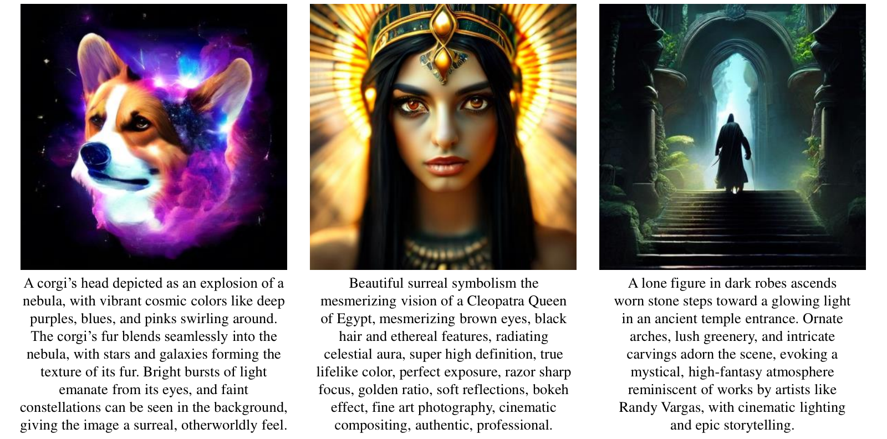

**EN.** Figure 4: Image generation results of JanusFlow. Our model can generate high-quality images that are semantically consistent with text prompts.

**中.** 图 4：JanusFlow 的图像生成结果。我们的模型可以生成在语义上与文本提示一致的高质量图像。

**EN.** Impact of Decoupling Visual Encoders. e efficacy of using powerful pre-trained visual encoders in multimodal understanding. The comparison among Exp. B, C, and F demonstrates the advantages of using separate visual encoders for understanding and generation tasks. In Exp. B, following a design similar to Transfusion [ 108 ] , we implement shared ConvNeXt blocks in the SDXL-VAE latent space for both understanding and generation encoders. Exp. C employs separate encoders with identical architectures and initialization parameters, but trained independently. The performance differences between these configurations validate the necessity of decoupled visual encoders in improving our unified model’s capabilities. Moreover, the superior results in Exp. C and F highlight the benefits of leveraging pre-trained semantic visual encoders for multimodal understanding tasks.

**中.** 解耦视觉编码器的影响。在多模式理解中使用强大的预训练视觉编码器的功效。实验之间的比较。 B、C 和 F 展示了使用单独的视觉编码器来理解和生成任务的优势。在Exp。 B，遵循类似于 Transfusion [108] 的设计，我们在 SDXL-VAE 潜在空间中实现共享 ConvNeXt 块，用于理解和生成编码器。过期。 C 采用具有相同架构和初始化参数的单独编码器，但独立训练。这些配置之间的性能差异验证了解耦视觉编码器在提高我们的统一模型功能方面的必要性。此外，Exp 中的优异结果。 C 和 F 强调了利用预先训练的语义视觉编码器执行多模态理解任务的好处。

**EN.** Fair Comparison with Understanding / Generation-Only Models. To establish meaningful benchmarks, we evaluate task-specific models trained under identical conditions - using the same pre-training dataset, infrastructure, and hyperparameters. Exp. D and E represent these specialized models, trained with data volumes matching the unified models in Tab. 6 . The minimal performance gap between Exp. F and these task-specific baselines demonstrates that our unified framework successfully integrates understanding and generation capabilities without significant compromise in either task’s performance.

**中.** 与理解/仅生成模型进行公平比较。为了建立有意义的基准，我们评估在相同条件下训练的特定任务模型 - 使用相同的预训练数据集、基础设施和超参数。过期。 D 和 E 代表这些专用模型，使用与表 1 中的统一模型相匹配的数据量进行训练。 6. Exp 之间的最小性能差距。 F 和这些特定于任务的基线表明，我们的统一框架成功地集成了理解和生成功能，而没有对任一任务的性能造成重大影响。

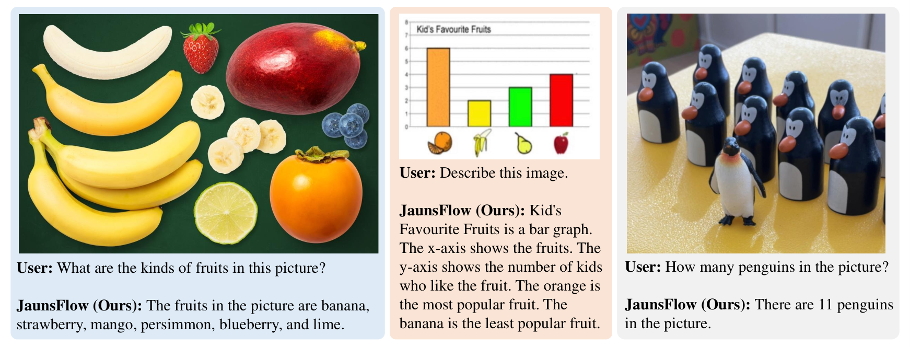

**EN.** Figure 5: Visual Understanding with JanusFlow. Our model effectively handles various visual understanding tasks, such as question answering, plot interpretation and object counting.

**中.** 图 5：使用 JanusFlow 进行视觉理解。我们的模型有效地处理各种视觉理解任务，例如问题回答、情节解释和对象计数。

### Qualitative Results / 定性结果

**EN.** We present qualitative evaluations of our method for both image generation and understanding tasks. Fig. 1(b) and Fig. 4 showcases the image generation capabilities of JanusFlow. These results demonstrate both the high visual quality of our generated images and our framework’s ability to faithfully follow diverse instructions. For multimodal understanding, Fig. 5 presents example conversations that show our model’s understanding capabilities across various scenarios. These interactions demonstrate the model’s ability to understand and reason about visual content in natural language dialogues. Additional qualitative examples showcasing the versatility and effectiveness of JanusFlow are provided in the appendix.

**中.** 我们对图像生成和理解任务的方法进行了定性评估。图1(b)和图4展示了JanusFlow的图像生成能力。这些结果证明了我们生成的图像的高视觉质量以及我们的框架忠实遵循不同指令的能力。对于多模式理解，图 5 提供了示例对话，显示了我们的模型在各种场景下的理解能力。这些交互展示了模型理解和推理自然语言对话中的视觉内容的能力。附录中提供了其他定性示例，展示了 JanusFlow 的多功能性和有效性。

## Conclusion / 结论

**EN.** We present JanusFlow, a unified framework that successfully harmonizes autoregressive and rectified flow models for multimodal understanding and generation tasks. Our extensive experiments demonstrate that this unification achieves comparable performance to task-specific models. The successful integration of these fundamentally different model architectures not only addresses current challenges in multimodal learning but also opens new possibilities for future research in training unified models.

**中.** 我们提出了 JanusFlow，一个统一的框架，它成功地协调了多模态理解和生成任务的自回归和修正流模型。我们广泛的实验表明，这种统一实现了与特定任务模型相当的性能。这些根本不同的模型架构的成功集成不仅解决了当前多模态学习的挑战，而且为未来训练统一模型的研究开辟了新的可能性。

## References / 参考文献

- [1] J. Achiam, S. Adler, S. Agarwal, L. Ahmad, I. Akkaya, F. L. Aleman, D. Almeida, J. Altenschmidt, S. Altman, S. Anadkat, et al. GPT-4 technical report. arXiv preprint arXiv:2303.08774 , 2023.

- [2] J.-B. Alayrac, J. Donahue, P. Luc, A. Miech, I. Barr, Y. Hasson, K. Lenc, A. Mensch, K. Millican, M. Reynolds, et al. Flamingo: a visual language model for few-shot learning. In Proc. Annu. Conf. Neural Inf. Process. Systems , 2022.

- [3] M. Albergo and E. Vanden-Eijnden. Building normalizing flows with stochastic interpolants. In Proc. Int’l Conf. Learning Representations , 2023.

- [4] J. Bai, S. Bai, S. Yang, S. Wang, S. Tan, P. Wang, J. Lin, C. Zhou, and J. Zhou. Qwen-VL: A frontier large vision-language model with versatile abilities. arXiv preprint arXiv:2308.12966 , 2023.

- [5] F. Bao, S. Nie, K. Xue, Y. Cao, C. Li, H. Su, and J. Zhu. All are worth words: A ViT backbone for diffusion models. In Proc. IEEE Int’l Conf. Computer Vision and Pattern Recognition , 2023.

- [6] J. Betker, G. Goh, L. Jing, T. Brooks, J. Wang, L. Li, L. Ouyang, J. Zhuang, J. Lee, Y. Guo, et al. Improving image generation with better captions. Computer Science , 2023.

- [7] X. Bi, D. Chen, G. Chen, S. Chen, D. Dai, C. Deng, H. Ding, K. Dong, Q. Du, Z. Fu, et al. DeepSeek LLM: Scaling open-source language models with longtermism. arXiv preprint arXiv:2401.02954 , 2024.

- [8] S. Bubeck, V. Chandrasekaran, R. Eldan, J. Gehrke, E. Horvitz, E. Kamar, P. Lee, Y. T. Lee, Y. Li, S. Lundberg, et al. Sparks of artificial general intelligence: Early experiments with GPT-4. arXiv preprint arXiv:2303.12712 , 2023.

- [9] J. Chen, J. Yu, C. Ge, L. Yao, E. Xie, Y. Wu, Z. Wang, J. Kwok, P. Luo, H. Lu, et al. PixArt-alpha: Fast training of diffusion transformer for photorealistic text-to-image synthesis. arXiv preprint arXiv:2310.00426 , 2023a.

- [10] J. Chen, C. Ge, E. Xie, Y. Wu, L. Yao, X. Ren, Z. Wang, P. Luo, H. Lu, and Z. Li. PixArt-Sigma: Weak-to-strong training of diffusion transformer for 4K text-to-image generation. arXiv preprint arXiv:2403.04692 , 2024.

- [11] L. Chen, J. Li, X. Dong, P. Zhang, C. He, J. Wang, F. Zhao, and D. Lin. ShareGPT4V: Improving large multi-modal models with better captions. arXiv preprint arXiv:2311.12793 , 2023b.

- [12] X. Chu, L. Qiao, X. Lin, S. Xu, Y. Yang, Y. Hu, F. Wei, X. Zhang, B. Zhang, X. Wei, et al. MobileVLM: A fast, reproducible and strong vision language assistant for mobile devices. arXiv preprint arXiv:2312.16886 , 2023.

- [13] X. Chu, L. Qiao, X. Zhang, S. Xu, F. Wei, Y. Yang, X. Sun, Y. Hu, X. Lin, B. Zhang, et al. MobileVLM V2: Faster and stronger baseline for vision language model. arXiv preprint arXiv:2402.03766 , 2024.

- [14] K. Crowson, S. A. Baumann, A. Birch, T. M. Abraham, D. Z. Kaplan, and E. Shippole. Scalable high-resolution pixel-space image synthesis with hourglass diffusion transformers. In Proc. Int’l Conf. Machine Learning , 2024.

- [15] W. Dai, J. Li, D. Li, A. M. H. Tiong, J. Zhao, W. Wang, B. Li, P. Fung, and S. Hoi. InstructBLIP: Towards general-purpose vision-language models with instruction tuning. In Proc. Annu. Conf. Neural Inf. Process. Systems , 2023.

- [16] dclure. LAION-Aesthetics-UMAP, 2022. URL [https://huggingface.co/datasets/dclure/laion-aesthetics-12m-umap](https://huggingface.co/datasets/dclure/laion-aesthetics-12m-umap) .

- [17] DeepFloyd. DeepFloyd IF, 2023. URL [https://huggingface.co/DeepFloyd/IF-I-XL-v1.0](https://huggingface.co/DeepFloyd/IF-I-XL-v1.0) .

- [18] P. Dhariwal and A. Nichol. Diffusion models beat GANs on image synthesis. In Proc. Annu. Conf. Neural Inf. Process. Systems , 2021.

- [19] R. Dong, C. Han, Y. Peng, Z. Qi, Z. Ge, J. Yang, L. Zhao, J. Sun, H. Zhou, H. Wei, et al. DreamLLM: Synergistic multimodal comprehension and creation. In Proc. Int’l Conf. Learning Representations , 2024.

- [20] echo840. Detailed caption, 2023. URL [https://huggingface.co/datasets/echo840/Detailed_Caption](https://huggingface.co/datasets/echo840/Detailed_Caption) .

- [21] B. Egan, A. Redden, XWAVE, and SilentAntagonist. DALLE-3 1 million+ high quality captions, 2024. URL [https://huggingface.co/datasets/ProGamerGov/synthetic-dataset-1m-dalle3-high-quality-captions](https://huggingface.co/datasets/ProGamerGov/synthetic-dataset-1m-dalle3-high-quality-captions) .

- [22] P. Esser, R. Rombach, and B. Ommer. Taming transformers for high-resolution image synthesis. In Proc. IEEE Int’l Conf. Computer Vision and Pattern Recognition , 2021.

- [23] P. Esser, S. Kulal, A. Blattmann, R. Entezari, J. Müller, H. Saini, Y. Levi, D. Lorenz, A. Sauer, F. Boesel, et al. Scaling rectified flow transformers for high-resolution image synthesis. In Proc. Int’l Conf. Machine Learning , 2024.

- [24] C. Fu, P. Chen, Y. Shen, Y. Qin, M. Zhang, X. Lin, J. Yang, X. Zheng, K. Li, X. Sun, Y. Wu, and R. Ji. MME: A comprehensive evaluation benchmark for multimodal large language models. arXiv preprint arXiv:2306.13394 , 2024.

- [25] Y. Ge, Y. Ge, Z. Zeng, X. Wang, and Y. Shan. Planting a SEED of vision in large language model. arXiv preprint arXiv:2307.08041 , 2023a.

- [26] Y. Ge, S. Zhao, Z. Zeng, Y. Ge, C. Li, X. Wang, and Y. Shan. Making LLaMA SEE and draw with SEED tokenizer. arXiv preprint arXiv:2310.01218 , 2023b.

- [27] Y. Ge, S. Zhao, J. Zhu, Y. Ge, K. Yi, L. Song, C. Li, X. Ding, and Y. Shan. SEED-X: Multimodal models with unified multi-granularity comprehension and generation. arXiv preprint arXiv:2404.14396 , 2024.

- [28] D. Ghosh, H. Hajishirzi, and L. Schmidt. GenEval: An object-focused framework for evaluating text-to-image alignment. In Proc. Annu. Conf. Neural Inf. Process. Systems , 2024.

- [29] Y. Goyal, T. Khot, D. Summers-Stay, D. Batra, and D. Parikh. Making the v in VQA matter: Elevating the role of image understanding in visual question answering. In Proc. IEEE Int’l Conf. Computer Vision and Pattern Recognition , 2017.

- [30] M. Heusel, H. Ramsauer, T. Unterthiner, B. Nessler, and S. Hochreiter. GANs trained by a two time-scale update rule converge to a local nash equilibrium. Proc. Annu. Conf. Neural Inf. Process. Systems , 2017.

- [31] High-flyer. HAI-LLM: Efficient and lightweight training tool for large models, 2023. URL [https://www.high-flyer.cn/en/blog/hai-llm](https://www.high-flyer.cn/en/blog/hai-llm) .

- [32] J. Ho, A. Jain, and P. Abbeel. Denoising diffusion probabilistic models. In Proc. Annu. Conf. Neural Inf. Process. Systems , 2020.

- [33] Y.-C. Hsiao, F. Zubach, G. Baechler, V. Carbune, J. Lin, M. Wang, S. Sunkara, Y. Zhu, and J. Chen. ScreenQA: Large-scale question-answer pairs over mobile app screenshots. arXiv preprint arXiv:2209.08199 , 2022.

- [34] X. Hu, R. Wang, Y. Fang, B. Fu, P. Cheng, and G. Yu. ELLA: Equip diffusion models with llm for enhanced semantic alignment. arXiv preprint arXiv:2403.05135 , 2024.

- [35] D. A. Hudson and C. D. Manning. GQA: A new dataset for real-world visual reasoning and compositional question answering. In Proc. IEEE Int’l Conf. Computer Vision and Pattern Recognition , 2019.

- [36] Y. Jin, Z. Sun, N. Li, K. Xu, H. Jiang, N. Zhuang, Q. Huang, Y. Song, Y. Mu, and Z. Lin. Pyramidal flow matching for efficient video generative modeling. arXiv preprint arXiv:2410.05954 , 2024a.

- [37] Y. Jin, K. Xu, L. Chen, C. Liao, J. Tan, Q. Huang, C. Bin, C. Song, D. ZHANG, W. Ou, et al. Unified language-vision pretraining in llm with dynamic discrete visual tokenization. In Proc. Int’l Conf. Learning Representations , 2024b.

- [38] B. Jing, B. Berger, and T. Jaakkola. AlphaFold meets flow matching for generating protein ensembles. In Proc. Int’l Conf. Machine Learning , 2024.

- [39] M. Kang, J.-Y. Zhu, R. Zhang, J. Park, E. Shechtman, S. Paris, and T. Park. Scaling up GANs for text-to-image synthesis. In Proc. IEEE Int’l Conf. Computer Vision and Pattern Recognition , 2023.

- [40] S. Kim, K. Shih, J. F. Santos, E. Bakhturina, M. Desta, R. Valle, S. Yoon, B. Catanzaro, et al. P-Flow: a fast and data-efficient zero-shot tts through speech prompting. In Proc. Annu. Conf. Neural Inf. Process. Systems , 2024.

- [41] A. Kirillov, E. Mintun, N. Ravi, H. Mao, C. Rolland, L. Gustafson, T. Xiao, S. Whitehead, A. C. Berg, W.-Y. Lo, et al. Segment anything. In Proc. IEEE Int. Conf. Comput. Vision , 2023.

- [42] M. Koupaee and W. Y. Wang. WikiHow: A large scale text summarization dataset. arXiv preprint arXiv:1810.09305 , 2018.

- [43] A. Kuznetsova, H. Rom, N. Alldrin, J. Uijlings, I. Krasin, J. Pont-Tuset, S. Kamali, S. Popov, M. Malloci, A. Kolesnikov, et al. The Open Images Dataset V4: Unified image classification, object detection, and visual relationship detection at scale. Int’l Journal of Computer Vision , 2020.

- [44] H. Laurençon, D. van Strien, S. Bekman, L. Tronchon, L. Saulnier, T. Wang, S. Karamcheti, A. Singh, G. Pistilli, Y. Jernite, et al. Introducing IDEFICS: An open reproduction of state-of-the-art visual language model, 2023, 2023. URL [https://huggingface.co/blog/idefics](https://huggingface.co/blog/idefics) .

- [45] M. Le, A. Vyas, B. Shi, B. Karrer, L. Sari, R. Moritz, M. Williamson, V. Manohar, Y. Adi, J. Mahadeokar, et al. VoiceBox: Text-guided multilingual universal speech generation at scale. In Proc. Annu. Conf. Neural Inf. Process. Systems , 2024.

- [46] B. Li, R. Wang, G. Wang, Y. Ge, Y. Ge, and Y. Shan. SEED-Bench: Benchmarking multimodal llms with generative comprehension. arXiv preprint arXiv:2307.16125 , 2023a.

- [47] B. Li, Y. Zhang, D. Guo, R. Zhang, F. Li, H. Zhang, K. Zhang, Y. Li, Z. Liu, and C. Li. LLaVA-OneVision: Easy visual task transfer. arXiv preprint arXiv:2408.03326 , 2024a.

- [48] D. Li, A. Kamko, E. Akhgari, A. Sabet, L. Xu, and S. Doshi. Playground v2.5: Three insights towards enhancing aesthetic quality in text-to-image generation. arXiv preprint arXiv:2402.17245 , 2024b.

- [49] J. Li, D. Li, S. Savarese, and S. Hoi. BLIP-2: Bootstrapping language-image pre-training with frozen image encoders and large language models. In Proc. Int’l Conf. Machine Learning , 2023b.

- [50] L. Li, Y. Wang, R. Xu, P. Wang, X. Feng, L. Kong, and Q. Liu. Multimodal arXiv: A dataset for improving scientific comprehension of large vision-language models. In Annual Meeting of the Association for Computational Linguistics , 2024c.

- [51] X. Li, F. Zhang, H. Diao, Y. Wang, X. Wang, and L.-Y. Duan. DenseFusion-1M: Merging vision experts for comprehensive multimodal perception. In Proc. Annu. Conf. Neural Inf. Process. Systems , 2024d.

- [52] Y. Li, Y. Du, K. Zhou, J. Wang, X. Zhao, and J.-R. Wen. Evaluating object hallucination in large vision-language models. In Proc. Conf. on Empirical Methods in Natural Language Process. , 2023c.

- [53] Z. Li, X. Yang, K. Choi, W. Zhu, R. Hsieh, H. Kim, J. H. Lim, S. Ji, B. Lee, X. Yan, et al. MMSci: A multimodal multi-discipline dataset for phd-level scientific comprehension. In AI for Accelerated Materials Design , 2024e.

- [54] Z. Li, J. Zhang, Q. Lin, J. Xiong, Y. Long, X. Deng, Y. Zhang, X. Liu, M. Huang, Z. Xiao, et al. Hunyuan-DiT: A powerful multi-resolution diffusion transformer with fine-grained chinese understanding. arXiv preprint arXiv:2405.08748 , 2024f.

- [55] Y. Lipman, R. T. Chen, H. Ben-Hamu, M. Nickel, and M. Le. Flow matching for generative modeling. In Proc. Int’l Conf. Learning Representations , 2023.

- [56] H. Liu, C. Li, Y. Li, and Y. J. Lee. Improved baselines with visual instruction tuning. In Proc. IEEE Int’l Conf. Computer Vision and Pattern Recognition , 2024a.

- [57] H. Liu, C. Li, Y. Li, B. Li, Y. Zhang, S. Shen, and Y. J. Lee. LLaVA-NeXT: Improved reasoning, OCR, and world knowledge, 2024b. URL [https://llava-vl.github.io/blog/2024-01-30-llava-next/](https://llava-vl.github.io/blog/2024-01-30-llava-next/) .

- [58] H. Liu, C. Li, Q. Wu, and Y. J. Lee. Visual instruction tuning. In Proc. Annu. Conf. Neural Inf. Process. Systems , 2024c.

- [59] H. Liu, W. Yan, M. Zaharia, and P. Abbeel. World model on million-length video and language with ringattention. arXiv preprint arXiv:2402.08268 , 2024d.

- [60] Q. Liu. Rectified flow: A marginal preserving approach to optimal transport. arXiv preprint arXiv:2209.14577 , 2022.

- [61] X. Liu, C. Gong, and Q. Liu. Flow straight and fast: Learning to generate and transfer data with rectified flow. In Proc. Int’l Conf. Learning Representations , 2023.

- [62] X. Liu, X. Zhang, J. Ma, J. Peng, et al. InstaFlow: One step is enough for high-quality diffusion-based text-to-image generation. In Proc. Int’l Conf. Learning Representations , 2024e.

- [63] Y. Liu, H. Duan, Y. Zhang, B. Li, S. Zhang, W. Zhao, Y. Yuan, J. Wang, C. He, Z. Liu, et al. MMBench: Is your multi-modal model an all-around player? In Proc. European Conf. Computer Vision , 2024f.

- [64] H. Lu, W. Liu, B. Zhang, B. Wang, K. Dong, B. Liu, J. Sun, T. Ren, Z. Li, H. Yang, et al. DeepSeek-VL: towards real-world vision-language understanding. arXiv preprint arXiv:2403.05525 , 2024.

- [65] P. Lu, L. Qiu, J. Chen, T. Xia, Y. Zhao, W. Zhang, Z. Yu, X. Liang, and S.-C. Zhu. IconQA: A new benchmark for abstract diagram understanding and visual language reasoning. In Proc. Annu. Conf. Neural Inf. Process. Systems , 2021.

- [66] N. Ma, M. Goldstein, M. S. Albergo, N. M. Boffi, E. Vanden-Eijnden, and S. Xie. SiT: Exploring flow and diffusion-based generative models with scalable interpolant transformers. arXiv preprint arXiv:2401.08740 , 2024.

- [67] Y. Ma, H. Yang, W. Wang, J. Fu, and J. Liu. Unified multi-modal latent diffusion for joint subject and text conditional image generation. arXiv preprint arXiv:2303.09319 , 2023.

- [68] madebyollin. Megalith-10M, 2024. URL [https://huggingface.co/datasets/madebyollin/megalith-10m](https://huggingface.co/datasets/madebyollin/megalith-10m) .

- [69] B. Mann, N. Ryder, M. Subbiah, J. Kaplan, P. Dhariwal, A. Neelakantan, P. Shyam, G. Sastry, A. Askell, S. Agarwal, et al. Language models are few-shot learners. arXiv preprint arXiv:2005.14165 , 2020.

- [70] A. Masry, X. L. Do, J. Q. Tan, S. Joty, and E. Hoque. ChartQA: A benchmark for question answering about charts with visual and logical reasoning. In Annual Meeting of the Association for Computational Linguistics , 2022.

- [71] mehdidc. YFCC-15M, 2024. URL [https://huggingface.co/datasets/mehdidc/yfcc15m](https://huggingface.co/datasets/mehdidc/yfcc15m) .

- [72] W. Peebles and S. Xie. Scalable diffusion models with transformers. In Proc. IEEE Int. Conf. Comput. Vision , 2023.

- [73] D. Podell, Z. English, K. Lacey, A. Blattmann, T. Dockhorn, J. Müller, J. Penna, and R. Rombach. SDXL: Improving latent diffusion models for high-resolution image synthesis. In Proc. Int’l Conf. Learning Representations , 2024.

- [74] PyTorch-Contributors. PyTorch, 2024. URL [https://pytorch.org](https://pytorch.org) .

- [75] A. Radford, J. W. Kim, C. Hallacy, A. Ramesh, G. Goh, S. Agarwal, G. Sastry, A. Askell, P. Mishkin, J. Clark, et al. Learning transferable visual models from natural language supervision. In Proc. Int’l Conf. Machine Learning , 2021.

- [76] A. Ramesh, P. Dhariwal, A. Nichol, C. Chu, and M. Chen. Hierarchical text-conditional image generation with CLIP latents. arXiv preprint arXiv:2204.06125 , 2022.

- [77] R. Rombach, A. Blattmann, D. Lorenz, P. Esser, and B. Ommer. High-resolution image synthesis with latent diffusion models. In Proc. IEEE Int’l Conf. Computer Vision and Pattern Recognition , 2022.

- [78] L. Ruan, Y. Ma, H. Yang, H. He, B. Liu, J. Fu, N. J. Yuan, Q. Jin, and B. Guo. MM-Diffusion: Learning multi-modal diffusion models for joint audio and video generation. In Proc. IEEE Int’l Conf. Computer Vision and Pattern Recognition , 2022.

- [79] C. Saharia, W. Chan, S. Saxena, L. Li, J. Whang, E. L. Denton, K. Ghasemipour, R. Gontijo Lopes, B. Karagol Ayan, T. Salimans, et al. Photorealistic text-to-image diffusion models with deep language understanding. In Proc. Annu. Conf. Neural Inf. Process. Systems , 2022.

- [80] S. Shah, A. Mishra, N. Yadati, and P. P. Talukdar. KVQA: Knowledge-aware visual question answering. In Proc. AAAI Conf. on Artificial Intelligence , 2019.

- [81] A. Singh, V. Natarajan, M. Shah, Y. Jiang, X. Chen, D. Batra, D. Parikh, and M. Rohrbach. Towards VQA models that can read. In Proc. IEEE Int’l Conf. Computer Vision and Pattern Recognition , 2019.

- [82] V. Singla, K. Yue, S. Paul, R. Shirkavand, M. Jayawardhana, A. Ganjdanesh, H. Huang, A. Bhatele, G. Somepalli, and T. Goldstein. From pixels to prose: A large dataset of dense image captions. arXiv preprint arXiv:2406.10328 , 2024.

- [83] Y. Song, J. Sohl-Dickstein, D. P. Kingma, A. Kumar, S. Ermon, and B. Poole. Score-based generative modeling through stochastic differential equations. In Proc. Int’l Conf. Learning Representations , 2021.

- [84] K. Srinivasan, K. Raman, J. Chen, M. Bendersky, and M. Najork. WIT: Wikipedia-based image text dataset for multimodal multilingual machine learning. In Proc. ACM SIGIR Conf. Research and Develop. in Info. Retrieval , 2021.

- [85] K. Sun, J. Pan, Y. Ge, H. Li, H. Duan, X. Wu, R. Zhang, A. Zhou, Z. Qin, Y. Wang, et al. JourneyDB: A benchmark for generative image understanding. In Proc. Annu. Conf. Neural Inf. Process. Systems , 2024a.

- [86] P. Sun, Y. Jiang, S. Chen, S. Zhang, B. Peng, P. Luo, and Z. Yuan. Autoregressive model beats diffusion: LLaMA for scalable image generation. arXiv preprint arXiv:2406.06525 , 2024b.

- [87] Q. Sun, Q. Yu, Y. Cui, F. Zhang, X. Zhang, Y. Wang, H. Gao, J. Liu, T. Huang, and X. Wang. Generative pretraining in multimodality. In Proc. Int’l Conf. Learning Representations , 2024c.

- [88] C. Team. Chameleon: Mixed-modal early-fusion foundation models. arXiv preprint arXiv:2405.09818 , 2024.

- [89] G. Team. Gemini: a family of highly capable multimodal models. arXiv preprint arXiv:2312.11805 , 2023.

- [90] S. Tong, E. Brown, P. Wu, S. Woo, M. Middepogu, S. C. Akula, J. Yang, S. Yang, A. Iyer, X. Pan, et al. Cambrian-1: A fully open, vision-centric exploration of multimodal llms. arXiv preprint arXiv:2406.16860 , 2024.

- [91] H. Touvron, T. Lavril, G. Izacard, X. Martinet, M.-A. Lachaux, T. Lacroix, B. Rozière, N. Goyal, E. Hambro, F. Azhar, et al. LLaMA: Open and efficient foundation language models. arXiv preprint arXiv:2302.13971 , 2023a.

- [92] H. Touvron, L. Martin, K. Stone, P. Albert, A. Almahairi, Y. Babaei, N. Bashlykov, S. Batra, P. Bhargava, S. Bhosale, et al. LLaMA 2: Open foundation and fine-tuned chat models. arXiv preprint arXiv:2307.09288 , 2023b.

- [93] C. N. Vasconcelos, A. Rashwan, A. Waters, T. Walker, K. Xu, J. Yan, R. Qian, Y. Li, S. LUO, Y. Onoe, et al. Greedy growing enables high-resolution pixel-based diffusion models. Transactions on Machine Learning Research , 2024.

- [94] P. Wang, S. Bai, S. Tan, S. Wang, Z. Fan, J. Bai, K. Chen, X. Liu, J. Wang, W. Ge, et al. Qwen2-VL: Enhancing vision-language model’s perception of the world at any resolution. arXiv preprint arXiv:2409.12191 , 2024a.

- [95] X. Wang, X. Zhang, Z. Luo, Q. Sun, Y. Cui, J. Wang, F. Zhang, Y. Wang, Z. Li, Q. Yu, et al. Emu3: Next-token prediction is all you need. arXiv preprint arXiv:2409.18869 , 2024b.

- [96] S. Woo, S. Debnath, R. Hu, X. Chen, Z. Liu, I. S. Kweon, and S. Xie. ConvNeXt v2: Co-designing and scaling ConvNets with masked autoencoders. In Proc. IEEE Int’l Conf. Computer Vision and Pattern Recognition , 2023.

- [97] C. Wu, X. Chen, Z. Wu, Y. Ma, X. Liu, Z. Pan, W. Liu, Z. Xie, X. Yu, C. Ruan, et al. Janus: Decoupling visual encoding for unified multimodal understanding and generation. arXiv preprint arXiv:2410.13848 , 2024a.

- [98] S. Wu, H. Fei, L. Qu, W. Ji, and T.-S. Chua. NExT-GPT: Any-to-any multimodal LLM. In Proc. Int’l Conf. Machine Learning , 2024b.

- [99] Y. Wu, Z. Zhang, J. Chen, H. Tang, D. Li, Y. Fang, L. Zhu, E. Xie, H. Yin, L. Yi, et al. VILA-U: A unified foundation model integrating visual understanding and generation. arXiv preprint arXiv:2409.04429 , 2024c.

- [100] J. Xie, W. Mao, Z. Bai, D. J. Zhang, W. Wang, K. Q. Lin, Y. Gu, Z. Chen, Z. Yang, and M. Z. Shou. Show-o: One single transformer to unify multimodal understanding and generation. arXiv preprint arXiv:2408.12528 , 2024.

- [101] H. Ye, D.-A. Huang, Y. Lu, Z. Yu, W. Ping, A. Tao, J. Kautz, S. Han, D. Xu, P. Molchanov, et al. X-VILA: Cross-modality alignment for large language model. arXiv preprint arXiv:2405.19335 , 2024.

- [102] L. Yu, J. Lezama, N. B. Gundavarapu, L. Versari, K. Sohn, D. Minnen, Y. Cheng, A. Gupta, X. Gu, A. G. Hauptmann, et al. Language model beats diffusion-tokenizer is key to visual generation. In Proc. Int’l Conf. Learning Representations , 2024a.

- [103] S. Yu, S. Kwak, H. Jang, J. Jeong, J. Huang, J. Shin, and S. Xie. Representation alignment for generation: Training diffusion transformers is easier than you think. arXiv preprint arXiv:2410.06940 , 2024b.

- [104] W. Yu, Z. Yang, L. Li, J. Wang, K. Lin, Z. Liu, X. Wang, and L. Wang. MM-Vet: Evaluating large multimodal models for integrated capabilities. In Proc. Int’l Conf. Machine Learning , 2024c.

- [105] X. Yue, Y. Ni, K. Zhang, T. Zheng, R. Liu, G. Zhang, S. Stevens, D. Jiang, W. Ren, Y. Sun, et al. MMMU: A massive multi-discipline multimodal understanding and reasoning benchmark for expert AGI. In Proc. IEEE Int’l Conf. Computer Vision and Pattern Recognition , 2024.

- [106] X. Zhai, B. Mustafa, A. Kolesnikov, and L. Beyer. Sigmoid loss for language image pre-training. In Proc. IEEE Int. Conf. Comput. Vision , 2023.

- [107] C. Zhao, Y. Song, W. Wang, H. Feng, E. Ding, Y. Sun, X. Xiao, and J. Wang. MonoFormer: One transformer for both diffusion and autoregression. arXiv preprint arXiv:2409.16280 , 2024.

- [108] C. Zhou, L. Yu, A. Babu, K. Tirumala, M. Yasunaga, L. Shamis, J. Kahn, X. Ma, L. Zettlemoyer, and O. Levy. Transfusion: Predict the next token and diffuse images with one multi-modal model. arXiv preprint arXiv:2408.11039 , 2024.

- [109] Y. Zhu, M. Zhu, N. Liu, Z. Ou, X. Mou, and J. Tang. LLaVA-Phi: Efficient multi-modal assistant with small language model. arXiv preprint arXiv:2401.02330 , 2024.

- [110] L. Zhuo, R. Du, H. Xiao, Y. Li, D. Liu, R. Huang, W. Liu, L. Zhao, F.-Y. Wang, Z. Ma, et al. Lumina-Next: Making Lumina-T2X stronger and faster with Next-DiT. arXiv preprint arXiv:2406.18583 , 2024.

## Appendix / 附录

## Performance Analysis of 256 Resolution Model / 256分辨率模型性能分析

**EN.** We trained our model at two resolutions: $256\times 256$ and $384\times 384$ . The main paper presents results from the $384\times 384$ model as our primary results. Here, we provide a comprehensive evaluation of the $256\times 256$ model’s performance. The visual understanding performances are presented in Tab. 1 . The generation capabilities are evaluated using GenEval [ 28 ] , DPG-Benchmark [ 34 ] , and MJHQ FID-30k [ 48 ] , with results shown in Tab. 2 and 3 .

**中.** 我们以两种分辨率训练模型： $256\times 256$ 和 $384\times 384$ 。主要论文介绍了 $384\times 384$ 模型的结果作为我们的主要结果。在此，我们对$256\times 256$型号的性能进行全面评测。视觉理解表现如表所示。 1.使用 GenEval [28]、DPG-Benchmark [34] 和 MJHQ FID-30k [48] 评估生成能力，结果如表 1 所示。 2和3。

| Model 型号 | LLM Params LLM参数 | POPE $\uparrow$ 波普 $\uparrow$ | MME-P $\uparrow$ | MMB ${}_{dev}\uparrow$ | SEED $\uparrow$ 种子 $\uparrow$ | VQAv2 test $\uparrow$ VQAv2测试$\uparrow$ | GQA $\uparrow$ | MM-Vet $\uparrow$ MM-兽医 $\uparrow$ |
| --- | --- | --- | --- | --- | --- | --- | --- | --- |
| JanusFlow 256 剑锋流量 256 | 1.3B | 85.3 | 1203.0 | 71.9 | 67.6 | 76.3 | 58.4 | 27.4 |
| JanusFlow 384 剑锋流量 384 | 1.3B | 88.0 | 1333.1 | 74.9 | 70.5 | 79.8 | 60.3 | 30.9 |

**EN.** Table 1: Results on visual understanding tasks.

**中.** 表 1：视觉理解任务的结果。

| Method 方法 | LLM Params LLM参数 | Single Obj. 单一对象。 | Two Obj. 两个对象。 | Count. 计数。 | Colors 颜色 | Pos. 位置。 | Color Attri. 颜色属性。 | Overall $\uparrow$ 整体 $\uparrow$ |
| --- | --- | --- | --- | --- | --- | --- | --- | --- |
| JanusFlow 256 剑锋流量 256 | 1.3B | 0.98 | 0.73 | 0.54 | 0.83 | 0.63 | 0.53 | 0.70 |
| JanusFlow 384 剑锋流量 384 | 1.3B | 0.97 | 0.59 | 0.45 | 0.83 | 0.53 | 0.42 | 0.63 |

**EN.** Table 2: Results on GenEval [ 28 ] .

**中.** 表 2：GenEval 结果 [28]。

| Method 方法 | DPG-Bench $\uparrow$ DPG 工作台 $\uparrow$ | DPG-Bench $\uparrow$ DPG 工作台 $\uparrow$ | DPG-Bench $\uparrow$ DPG 工作台 $\uparrow$ | DPG-Bench $\uparrow$ DPG 工作台 $\uparrow$ | DPG-Bench $\uparrow$ DPG 工作台 $\uparrow$ | DPG-Bench $\uparrow$ DPG 工作台 $\uparrow$ | MJHQ FID-30k $\downarrow$ |
| --- | --- | --- | --- | --- | --- | --- | --- |
| Method 方法 | Global 全球 | Entity 实体 | Attribute 属性 | Relation 关系 | Other 其他 | Overall 整体 | MJHQ FID-30k $\downarrow$ |
| JanusFlow 256 剑锋流量 256 | 91.20 | 88.83 | 88.00 | 87.60 | 89.53 | 81.23 | 12.70 |
| JanusFlow 384 剑锋流量 384 | 87.03 | 87.31 | 87.39 | 89.79 | 88.10 | 80.09 | 9.51 |

**EN.** Table 3: Results on DPG-Bench [ 34 ] and MJHQ FID-30k [ 48 ] .

**中.** 表 3：DPG-Bench [34] 和 MJHQ FID-30k [48] 的结果。

**EN.** As expected, the $256\times 256$ model shows slightly lower performance compared to the $384\times 384$ model on visual understanding metrics due to its reduced resolution. Interestingly, however, the $256\times 256$ model outperforms its higher-resolution counterpart on GenEval and DPG-Bench - benchmarks specifically designed to evaluate instruction following capabilities and semantic accuracy. This superior performance on semantic tasks can be attributed to the model’s better control over lower-resolution images, where reduced visual complexity allows for more precise semantic manipulation.

**中.** 正如预期的那样，由于分辨率降低，$256\times 256$ 模型在视觉理解指标方面的性能略低于 $384\times 384$ 模型。然而有趣的是，$256\times 256$ 模型在 GenEval 和 DPG-Bench 上的表现优于其更高分辨率的模型，这两个基准是专门为评估指令跟踪能力和语义准确性而设计的基准。这种在语义任务上的卓越性能可归因于模型对低分辨率图像的更好控制，其中视觉复杂性的降低允许更精确的语义操作。

## Details of the Datasets / 数据集的详细信息

**EN.** The datasets used in the pre-training stage for understanding include DetailedCaption [ 20 ] , SAM [ 41 ] , arXivQA [ 50 ] , DenseFusion-1M [ 51 ] , MMSci [ 53 ] , PixelProse [ 82 ] , re-captioned LAION-Aesthetics [ 16 ] , re-captioned Open Images V4 [ 43 ] , ShareGPT4V [ 11 ] , WikiHow [ 42 ] and WIT [ 84 ] . The datasets used in the pre-training stage for generation include re-captioned LAION-Aesthetics [ 16 ] , DALL-E 3 1M [ 21 ] , SAM [ 41 ] , Open Images V4 [ 43 ] , Megalith-10M [ 68 ] , YFCC-15M [ 71 ] , PixelProse [ 82 ] and JourneyDB [ 85 ] .

**中.** 预训练阶段用于理解的数据集包括DetailedCaption [20]、SAM[41]、arXivQA[50]、DenseFusion-1M[51]、MMSci[53]、PixelProse[82]、re-captioned LAION-Aesthetics[16]、re-captioned Open Images V4[ 43]、ShareGPT4V [11]、WikiHow [42] 和 WIT [84]。预训练阶段使用的数据集包括 re-captioned LAION-Aesthetics [16]、DALL-E 3 1M [21]、SAM [41]、Open Images V4 [43]、Megalith-10M [68]、YFCC-15M [71]、PixelProse [82] 和 JourneyDB [ 85]。

## Analysis of CFG Factor and Sampling Steps / CFG因子和采样步骤分析

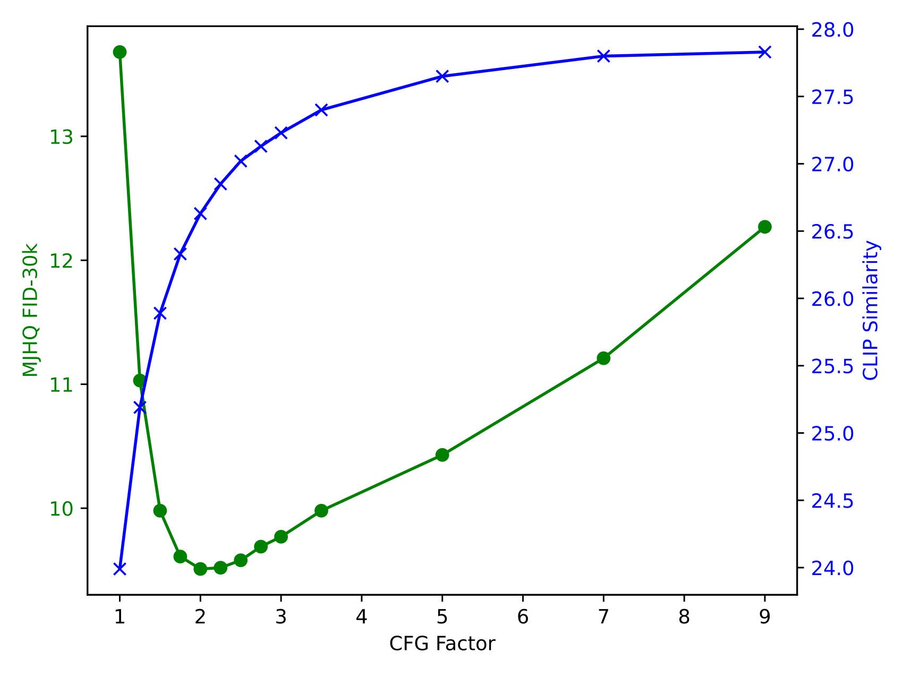

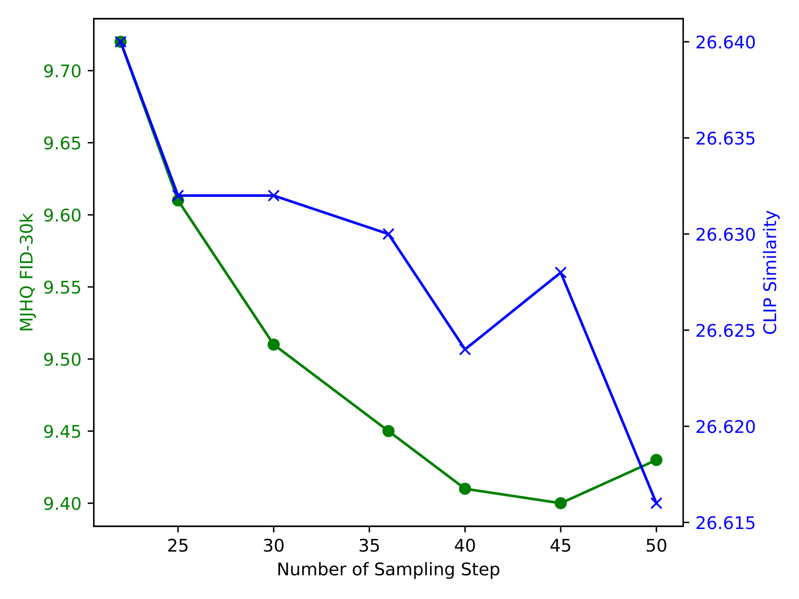

**EN.** Figure 1: Results of varying CFG factors and numbers of sampling steps . In Fig. (a), the number of sampling steps is set to 30. In Fig. (b), the CFG factor is set to 2.

**中.** 图 1：不同 CFG 因子和采样步骤数的结果。在图(a)中，采样步数设置为30。在图(b)中，CFG因子设置为2。

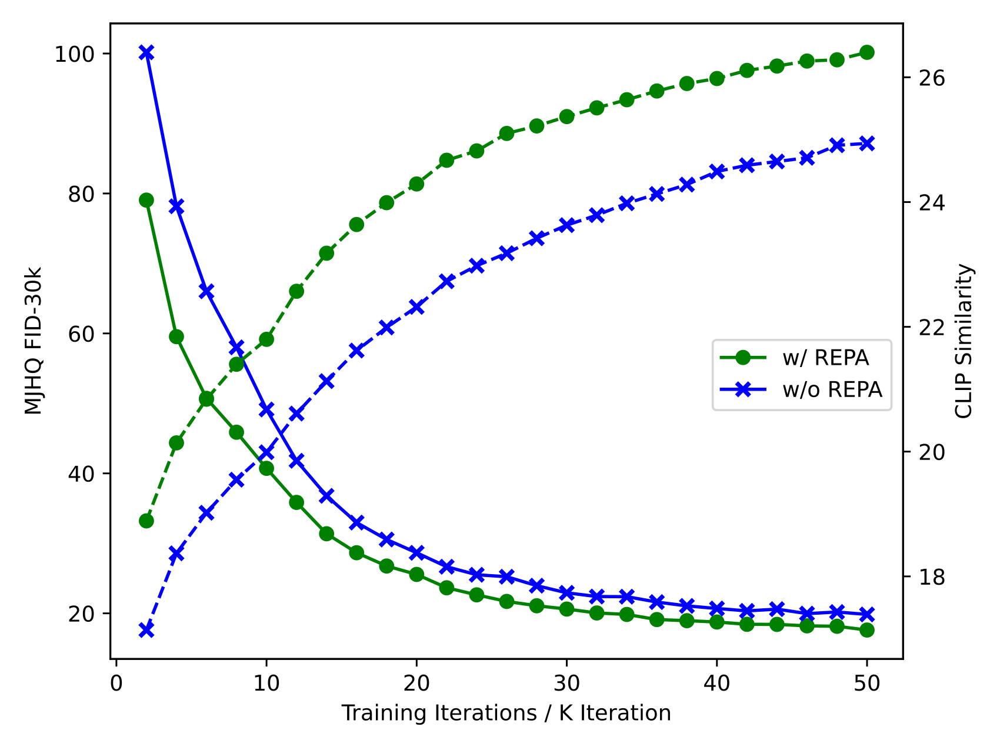

**EN.** Figure 2: The FID and CLIP similarity during the first 50,000 iterations.

**中.** 图 2：前 50,000 次迭代期间的 FID 和 CLIP 相似性。

**EN.** We investigate the impact of two key generation parameters: the Classifier-Free Guidance (CFG) factor and the number of sampling steps. While our main results use $w=2$ for CFG and 30 sampling steps to calculate FID, here we present a comprehensive analysis of these hyperparameters. Fig. 1(a) shows the effect of varying CFG factors while maintaining 30 sampling steps. The results reveal an optimal CFG value for FID scores, while CLIP [ 75 ] similarity continues to improve with increasing CFG values, consistent with findings from previous work [ 73 ] . Fig. 1(b) demonstrates the impact of different sampling steps while maintaining a CFG factor of 2. The number of sampling steps shows relatively minor influence on performance. Our choice of 30 steps in the main paper represents a balance between generation quality and computational efficiency.

**中.** 我们研究了两个关键生成参数的影响：无分类器指导（CFG）因子和采样步骤数。虽然我们的主要结果使用 $w=2$ 进行 CFG 和 30 个采样步骤来计算 FID，但在这里我们对这些超参数进行了全面分析。图 1(a) 显示了在保持 30 个采样步骤的情况下改变 CFG 因子的效果。结果揭示了 FID 分数的最佳 CFG 值，而 CLIP [75] 相似性随着 CFG 值的增加而继续提高，这与之前的工作 [73] 的发现一致。图 1（b）展示了在保持 CFG 因子为 2 的情况下不同采样步骤的影响。采样步骤的数量对性能的影响相对较小。我们在主论文中选择的 30 个步骤代表了生成质量和计算效率之间的平衡。

## Details of REPA Ablation / REPA 消融的详细信息

**EN.** We provide the FID and CLIP similarity of the first 50,000 training iterations of the pre-train stage in Fig. 2 with and without representation alignment regularization. The gap between the two models demonstrates the benefits of using representation alignment regularization.

**中.** 我们提供了图 2 中预训练阶段的前 50,000 次训练迭代的 FID 和 CLIP 相似性，其中有和没有表示对齐正则化。两个模型之间的差距证明了使用表示对齐正则化的好处。

## Additional Qualitative Results / 其他定性结果

**EN.** Additional qualitative examples for both understanding and generation tasks are presented in Fig. 3 and Fig. 4 , respectively. The understanding examples demonstrate JanusFlow’s diverse capabilities, including code generation, person identification, character recognition, and visual reasoning. For image generation, our model exhibits strong performance in both visual quality and semantic alignment with input prompts.

**中.** 理解和生成任务的其他定性示例分别如图 3 和图 4 所示。这些理解示例展示了 JanusFlow 的多种功能，包括代码生成、人员识别、字符识别和视觉推理。对于图像生成，我们的模型在视觉质量和与输入提示的语义对齐方面都表现出了强大的性能。

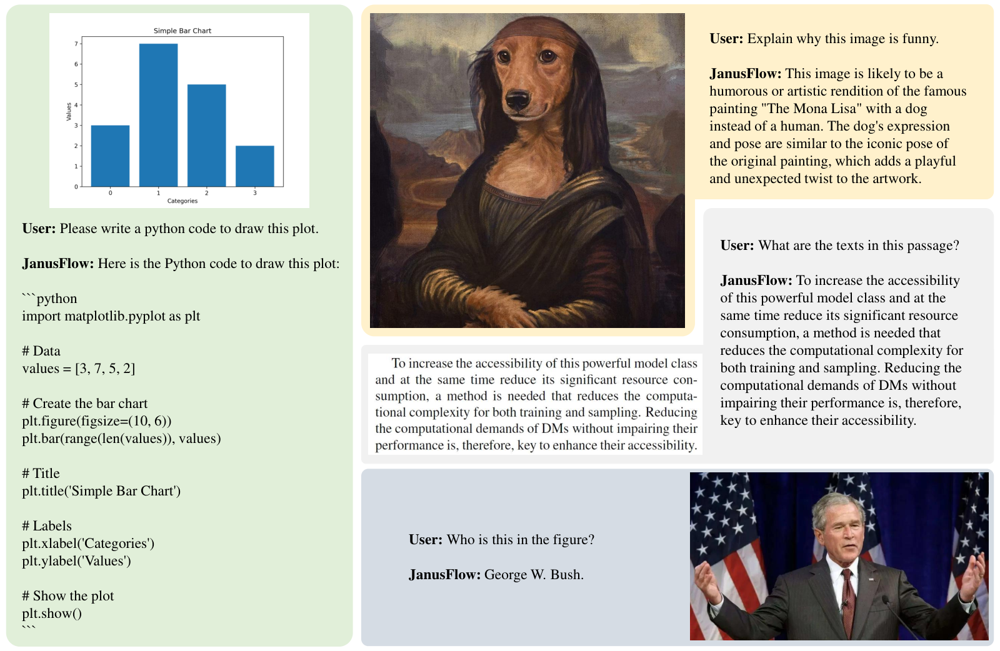

**EN.** Figure 3: More multimodal understanding cases.

**中.** 图 3：更多多模态理解案例。

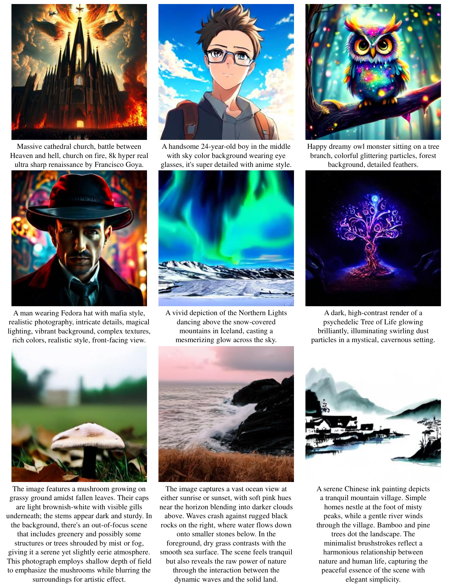

**EN.** Figure 4: More text-to-image generation results.

**中.** 图 4：更多文本到图像的生成结果。

## Footnotes / 脚注

[^footnote1]: **EN.** This version, trained on an expanded text corpus compared to the one in Janus [ 97 ] , has been demonstrated to possess better performance on multiple-choice benchmarks (e.g., MMBench [ 63 ] and SEED Bench [ 46 ] ). Our preliminary experiments suggest that it has minimal impact on the quality of visual generation. **中.** 与 Janus [97] 中的版本相比，该版本在扩展文本语料库上进行训练，已被证明在多项选择基准（例如 MMBench [63] 和 SEED Bench [46]）上具有更好的性能。我们的初步实验表明它对视觉生成的质量影响很小。

[^footnote2]: **EN.** The understanding encoders in the $256\times 256$ -based ablation studies is also SigLIP-Large-Patch/16 which is pre-trained on $256\times 256$ images. **中.** 基于 $256\times 256$ 的消融研究中的理解编码器也是 SigLIP-Large-Patch/16，它是在 $256\times 256$ 图像上预先训练的。
