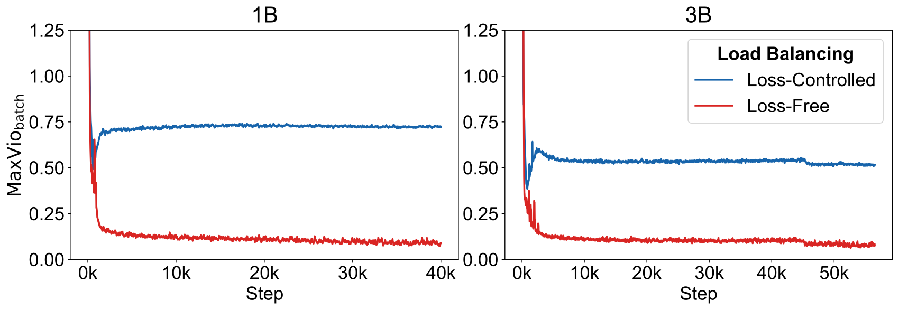
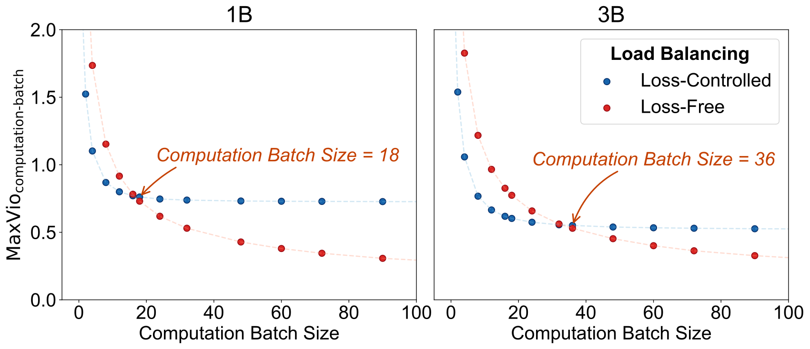

# Loss-Free Balancing：不通过辅助损失梯度实现 MoE 负载均衡

> 💡 Loss-Free Balancing 为每个专家维护一个根据历史负载更新的路由偏置，只改变 Top-K 的选择，不把均衡辅助损失的梯度加入语言建模训练。
>
> [论文](https://arxiv.org/abs/2408.15664) · [补充解读](Loss-Free-Balancing解读.md)。本文讨论该独立研究；V3 采用它并另保留弱序列级辅助约束，是后续模型设计。

MoE 需要让 token 按内容选择专家，但自由路由往往导致少数专家过载、其余专家训练不足。传统均衡辅助损失能缓解问题，却会产生与语言建模目标竞争的梯度：约束弱了不均衡，约束强了困惑度变差。本文把均衡改成路由器外部的反馈控制，用专家偏置修正选择机会，以免直接把这项控制变成模型参数的优化目标。1B 和 3B 实验同时改善困惑度与负载指标；论文还专门分析因果语言模型中的未来 token 泄漏，解释为什么不能通过看整批 token 的竞争结果随意“完美均衡”。

## 标准 MoE 与辅助损失的冲突

输入 token 向量为 $u_t$，专家原始亲和分为 $s_{i,t}=G(u_t^Te_i)$。普通 Top-K 选择最大的 $K$ 个分数，再组合专家输出：

$$
h_t=u_t+\sum_i g_{i,t}\operatorname{FFN}_i(u_t),\qquad g_{i,t}=s_{i,t}\mathbb1[i\in\operatorname{TopK}(s_{\cdot,t})].
$$

传统辅助项为 $\mathcal L_{bal}=\alpha\sum_i f_iP_i$，其中 $f_i$ 是归一化的专家调用比例，$P_i$ 是平均路由分数。虽然离散选择本身不可导，$P_i$ 仍把均衡梯度传到路由参数。

系数 $\alpha$ 小容易路由坍塌；大则迫使任务本来偏好的路由也去追求均匀，影响主损失。本文要去掉的是这部分**直接干扰梯度**，不是去掉全部训练损失，也不是让专家永远完全相同负载。

## 核心机制：选择分数与混合权重分开

为专家 $i$ 维护标量偏置 $b_i$，选择时使用 $s_{i,t}+b_i$，计算输出时仍使用未加偏置的亲和分：

$$
g_{i,t}=s_{i,t}\mathbb1[i\in\operatorname{TopK}(s_{\cdot,t}+b)].
$$

这一分离很关键。低负载专家通过正偏置获得更多被选择机会，但不意味着其 FFN 输出同时被人为放大；高负载专家相反。偏置是均衡控制量，不通过语言建模梯度学习。

## 历史反馈更新与因果约束

初始化 $b_i=0$。每完成一批数据，统计专家调用数 $c_i$，计算目标均值 $\bar c$ 与误差 $e_i=\bar c-c_i$，更新：

$$
b_i\leftarrow b_i+u\operatorname{sign}(e_i).
$$

$u$ 是更新速率。过载专家的误差为负，偏置降低；不足专家的偏置升高。这个反馈在下一批路由中生效。

必须使用**已经处理过的历史批次**。若计算当前序列全部 token 的负载后，再反过来决定较早 token 的专家，较早表示就可能包含后续 token 的信息，破坏自回归训练的因果性。历史统计避免同一序列内用未来位置调整过去。

## 实验规模、指标与结果

架构采用细粒度 DeepSeekMoE，两个共享专家、64 个路由专家，每 token 激活六个路由专家。主要实验使用 sigmoid gate，附录另测试 softmax。1B 训练 100B token，3B 训练 200B token；这里按实验设置正文记录，结论段出现的 300B 与之不一致。

对照均衡辅助系数 $\alpha=0.001$，偏置更新率先在 1B 调优，再用于 3B。验证困惑度衡量语言建模，最大负载偏差定义为：

$$
\operatorname{MaxVio}=\frac{\max_i\operatorname{Load}_i-\overline{\operatorname{Load}}}{\overline{\operatorname{Load}}}.
$$

0 表示均衡，0.72 表示最忙专家比平均负载高 72%。global 在整个验证集统计，batch 在每批统计；全局均衡并不自动保证小批次均衡。报告对各层取平均。

| Model Size | Load Balancing Methods | Validation Perplexity | $\textbf{MaxVio}_{\textbf{global}}$ |
| --- | --- | --- | --- |
| 1B | Loss-Controlled | 9.56 | 0.72 |
| 1B | Loss-Free | 9.50 | 0.04 |
| 3B | Loss-Controlled | 7.97 | 0.52 |
| 3B | Loss-Free | 7.92 | 0.04 |

1B 的 PPL 从 9.56 改为 9.50，3B 从 7.97 改为 7.92；全局 MaxVio 都接近 0.04。语言指标的绝对变化不大，但在不损害主任务的同时显著改善负载，是本实验的重点。

图说明优势不仅是验证集最终汇总，训练中的 batch 负载也更稳定。这里的负载改善没有直接转换成所有硬件配置的端到端加速倍数。

## 更新规则消融

更新率过小（$10^{-4}$）会跟不上负载变化；过大（$10^{-2}$）会在后期振荡。$10^{-3}$ 在论文规模下较合适。它控制反馈系统的响应速度，与语言模型学习率不是同一个量。

| Method | Perplexity | $\textbf{MaxVio}_{\textbf{global}}$ |
| --- | --- | --- |
| $b_{i}=b_{i}+u*\text{sign}(e_{i})$ , $u=0.001$ | 9.50 | 0.044 |
| $b_{i}=b_{i}+u*e_{i}$ , $u=0.01$ | 9.53 | 0.028 |
| $b_{i}=b_{i}+u*e_{i}$ , $u=0.001$ | 9.51 | 0.036 |
| $b_{i}=b_{i}+u*e_{i}$ , $u=0.0001$ | 9.51 | 0.040 |

把 sign 更新改为按误差大小更新，可以略改善 MaxVio，却没有更好 PPL，说明把负载数字压得更低并非唯一目标。

| Method | Perplexity | $\textbf{MaxVio}_{\textbf{global}}$ |
| --- | --- | --- |
| Addative Bias, $u=0.001$ | 9.50 | 0.044 |
| Multiplicative Bias, $u=0.01$ | 9.52 | 0.041 |
| Multiplicative Bias, $u=0.001$ | 9.52 | 0.036 |
| Multiplicative Bias, $u=0.0001$ | 9.54 | 0.048 |

乘法偏置也能改变排序，但其初始化需为 1；主试验中不比加法偏置更好。作者最终保留简单加法和 sign 更新。附录 softmax 实验中，PPL 增益较小但均衡仍明显改善，说明方法不只适用于 sigmoid，效果大小却依赖门控设置。

## 专家并行与计算批次

专家并行把专家分散到不同设备，最忙设备决定部分流水线或通信阶段的完成时间。实际计算批次近似为 micro-batch size 乘以 EP data-parallel size。

Loss-Free 的全局分配较均匀，因此扩大计算批次会让局部统计更接近全局，MaxVio 继续下降；辅助损失对照在大批次仍残留更明显偏差。这解释它与大规模专家并行的兼容性，但并不是对任意小 batch 提供严格均衡保证。

## Expert Choice 为何会泄漏未来信息

Expert Choice 让每个专家从整批 token 中挑固定数量，而不是每个 token 独立挑专家。若同一序列未来 token 加入竞争，较早 token 是否被专家选中就会改变；模型可以通过这种选择差异间接获得未来信息，即使注意力层本身使用 causal mask 也不能解决。

论文给出稀疏率 $R=K/N$ 下的信息容量分析，指出路由分配具有可承载未来信息的通道；它不是说每个训练模型必然充分利用该理论容量。实证中缩小选择 chunk 出现异常约 10% 的 loss 下降，跨 chunk 打乱 token 后异常缓解，支持泄漏确实影响训练的解释。

因此 EC 的“完美均衡”不能在本文自回归条件下直接作为无代价上界。本文的最终贡献是通过因果、历史驱动的路由控制改善均衡，同时避免显式均衡梯度；它仍需要选择更新速率、观察局部负载，并接受任务路由与硬件吞吐之间的实际约束。
