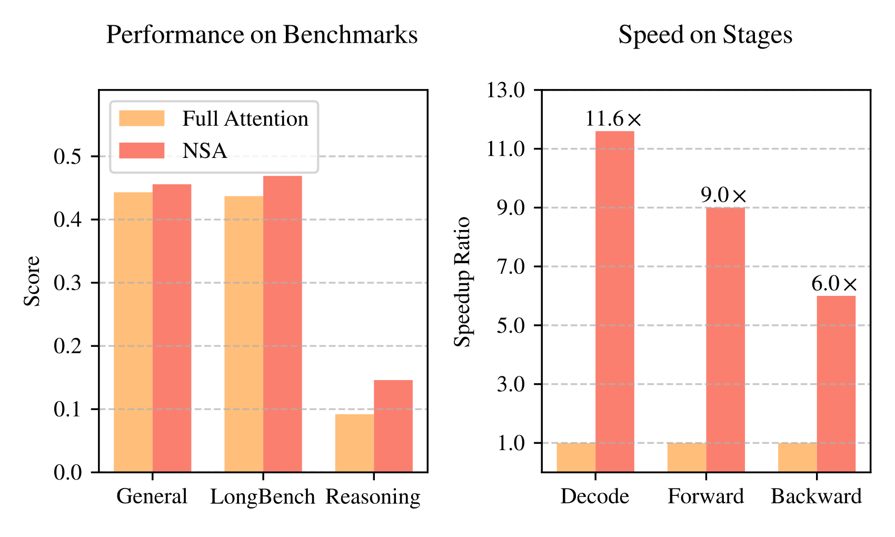
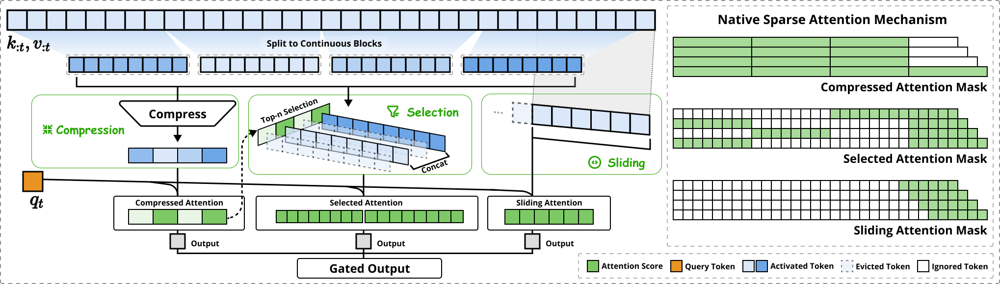
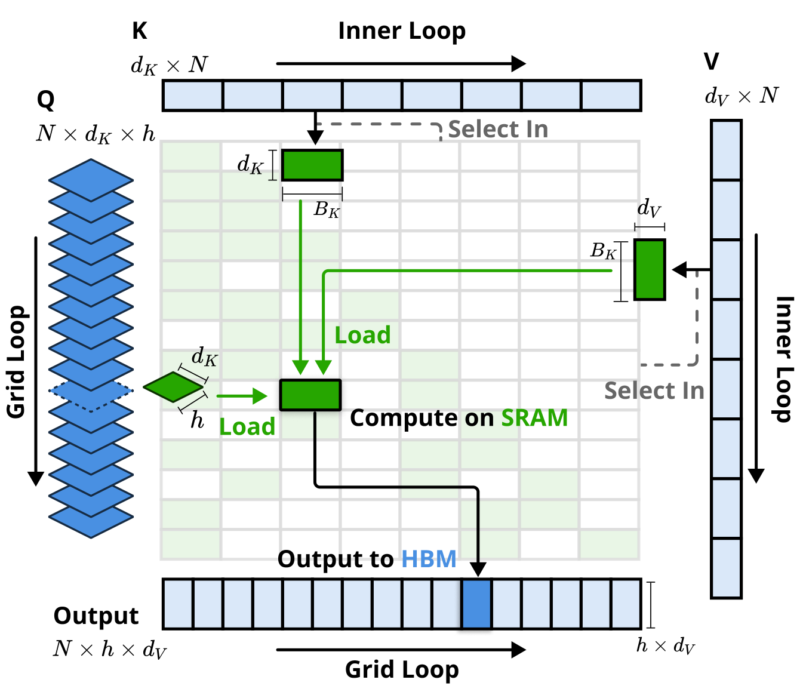
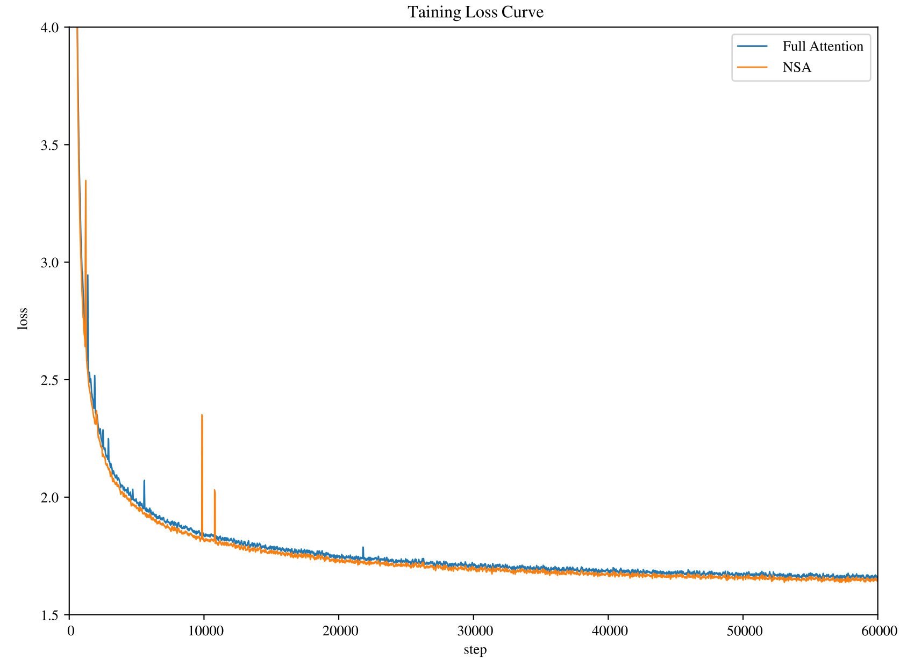
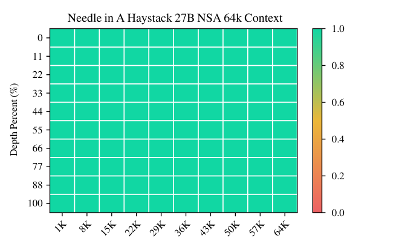
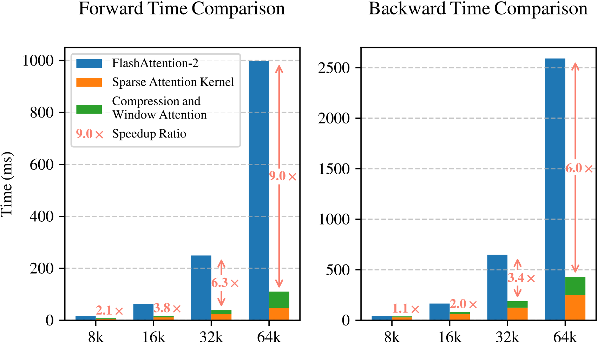
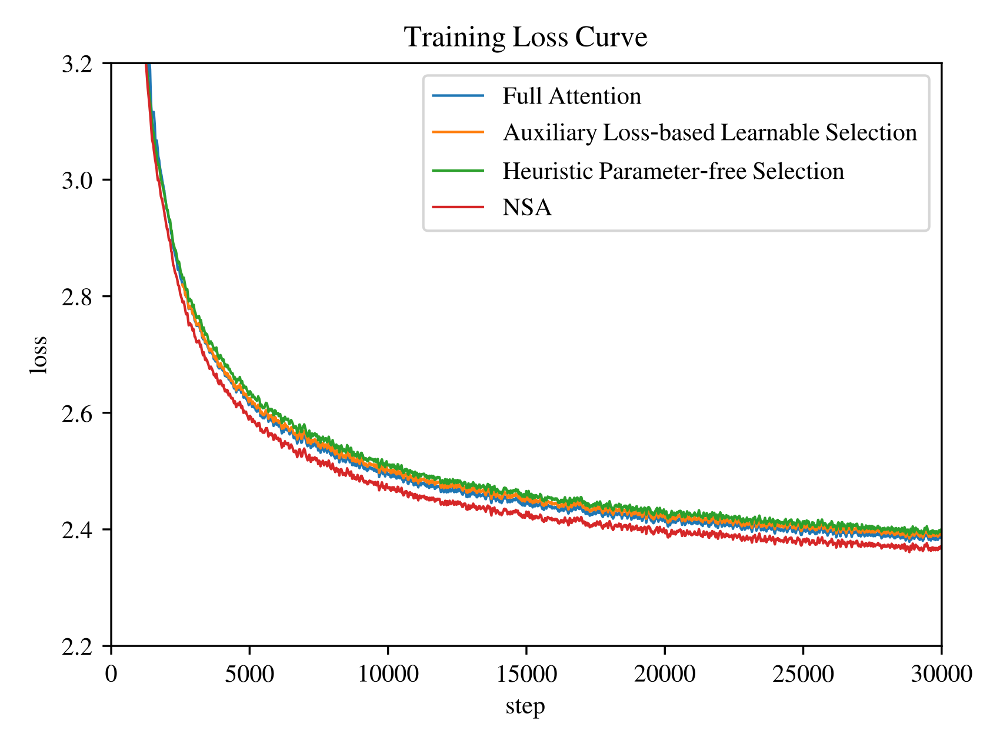
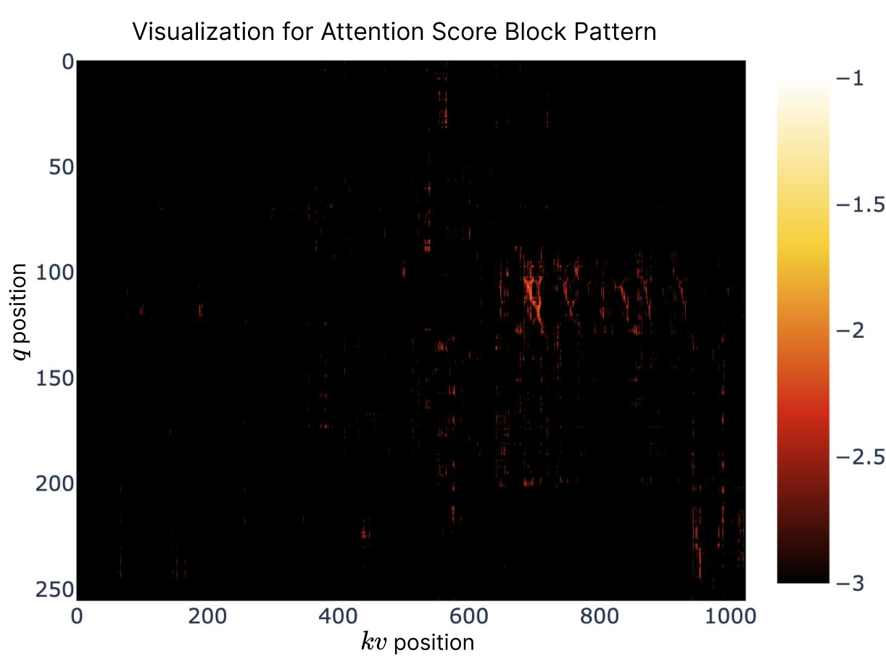

# Native Sparse Attention: Hardware-Aligned and Natively Trainable Sparse Attention / 全文中英对照

> 来源：[arXiv:2502.11089v2](https://arxiv.org/abs/2502.11089v2)。英文段落后紧接中文，覆盖所取 HTML 版本的主文、附录、图表、脚注与参考文献；公式、数字表和书目信息共用。中文以机器初译为底稿，进行了术语整理与结构核对，尚未逐句人工审定；遇到歧义请以紧邻英文和原论文为准。 原作版权归所列作者，许可见 [原作许可](https://creativecommons.org/licenses/by/4.0/)；中文译文与版式改写在该许可条件下提供（涉及 SA 时沿用相同许可，涉及 NC 时仅限非商业使用）。

## Authors and affiliations / 作者与机构

Jingyang Yuan ∗1,2 , Huazuo Gao 1 , Damai Dai 1 , Junyu Luo 2 , Liang Zhao 1 , Zhengyan Zhang 1 , Zhenda Xie 1 , Y. X. Wei 1 , Lean Wang 1 , Zhiping Xiao 3 , Yuqing Wang 1 , Chong Ruan 1 , Ming Zhang 2 , Wenfeng Liang 1 , Wangding Zeng 1 1 DeepSeek-AI 2 Key Laboratory for Multimedia Information Processing, School of Computer Science, Peking University, PKU-Anker LLM Lab 3 University of Washington {yuanjy, mzhang_cs}@pku.edu.cn , {zengwangding, wenfeng.liang}@deepseek.com Corresponding author: Contribution during internship at DeepSeek-AI.

**EN.** \reportnumber

**中.** \报告编号

**EN.** 001

**中.** 001

## Abstract / 摘要

**EN.** Long-context modeling is crucial for next-generation language models, yet the high computational cost of standard attention mechanisms poses significant computational challenges. Sparse attention offers a promising direction for improving efficiency while maintaining model capabilities. We present NSA, a N atively trainable S parse A ttention mechanism that integrates algorithmic innovations with hardware-aligned optimizations to achieve efficient long-context modeling. NSA employs a dynamic hierarchical sparse strategy, combining coarse-grained token compression with fine-grained token selection to preserve both global context awareness and local precision. Our approach advances sparse attention design with two key innovations: (1) We achieve substantial speedups through arithmetic intensity-balanced algorithm design, with implementation optimizations for modern hardware. (2) We enable end-to-end training, reducing pretraining computation without sacrificing model performance. As shown in Figure 1 , experiments show the model pretrained with NSA maintains or exceeds Full Attention models across general benchmarks, long-context tasks, and instruction-based reasoning. Meanwhile, NSA achieves substantial speedups over Full Attention on 64k-length sequences across decoding, forward propagation, and backward propagation, validating its efficiency throughout the model lifecycle.

**中.** 长上下文建模对于下一代语言模型至关重要，但标准注意机制的高计算成本带来了巨大的计算挑战。稀疏注意力为在保持模型能力的同时提高效率提供了一个有前途的方向。我们提出了 NSA，一种本地可训练的 S parse Attention 机制，它将算法创新与硬件优化相结合，以实现高效的长上下文建模。 NSA 采用动态分层稀疏策略，将粗粒度令牌压缩与细粒度令牌选择相结合，以保持全局上下文感知和局部精度。我们的方法通过两项关键创新推进了稀疏注意力设计：（1）我们通过算术强度平衡算法设计以及针对现代硬件的实现优化实现了显着的加速。 (2)我们实现端到端训练，在不牺牲模型性能的情况下减少预训练计算。如图 1 所示，实验表明，使用 NSA 预训练的模型在一般基准、长上下文任务和基于指令的推理方面保持或超过了 Full Attention 模型。与此同时，NSA 在解码、前向传播和后向传播方面比 Full Attention 在 64k 长度序列上实现了大幅加速，验证了其在整个模型生命周期中的效率。

## Introduction / 简介

**EN.** Figure 1: Comparison of performance and efficiency between Full Attention model and our NSA. Left: Despite being sparse, NSA surpasses Full Attention baseline on average across general benchmarks, long-context tasks, and reasoning evaluation. Right: For 64k-length sequence processing, NSA achieves substantial computational speedup compared to Full Attention in all stages: decoding, forward propagation, and backward propagation.

**中.** 图 1：Full Attention 模型与我们的 NSA 的性能和效率比较。左图：尽管数量较少，但 NSA 在一般基准、长上下文任务和推理评估方面平均超过了完全注意力基线。右图：对于 64k 长度的序列处理，与 Full Attention 相比，NSA 在所有阶段（解码、前向传播和后向传播）都实现了显着的计算加速。

**EN.** The research community increasingly recognizes long-context modeling as a crucial capability for next-generation large language models, driven by diverse real-world applications ranging from in-depth reasoning ( Zelikman et al., 2022 ; DeepSeek-AI, 2025 ) , repository-level code generation ( Zhang et al., 2023a ; Zhang et al., ) and multi-turn autonomous agent systems ( Park et al., 2023 ) . Recent breakthroughs, including OpenAI’s o-series models, DeepSeek-R1 ( DeepSeek-AI, 2025 ) , and Gemini 1.5 Pro ( Google et al., 2024 ) , enabling models to process entire codebases, lengthy documents, maintain coherent multi-turn conversations over thousands of tokens, and perform complex reasoning across long-range dependencies. However, the high complexity ( Zaheer et al., 2020 ) of vanilla Attention ( Vaswani et al., 2017 ) mechanisms emerges as a critical latency bottleneck as sequence length increases. Theoretical estimates indicate that attention computation with softmax architectures accounts for 70–80% of total latency when decoding 64k-length contexts, underscoring the urgent need for more efficient attention mechanisms.

**中.** 研究界越来越认识到长上下文建模是下一代大型语言模型的关键功能，由深度推理（Zelikman 等人，2022；DeepSeek-AI，2025）、存储库级代码生成（Zhang 等人，2023a；Zhang 等人）和多轮自主代理系统（Park 等人，2023）等各种现实应用程序驱动。最近的突破，包括 OpenAI 的 o 系列模型 DeepSeek-R1（DeepSeek-AI，2025）和 Gemini 1.5 Pro（Google 等人，2024），使模型能够处理整个代码库、冗长的文档，在数千个令牌上保持连贯的多轮对话，并跨远程依赖关系执行复杂的推理。然而，随着序列长度的增加，普通注意力（Vaswani 等人，2017）机制的高复杂性（Zaheer 等人，2020）成为关键的延迟瓶颈。理论估计表明，在解码 64k 长度的上下文时，使用 softmax 架构的注意力计算占总延迟的 70-80%，这凸显了对更有效的注意力机制的迫切需要。

**EN.** A natural approach to efficient long-context modeling is to take advantage of the inherent sparsity of softmax attention ( Ge et al., 2023 ; Jiang et al., 2023 ) , where selectively computing critical query-key pairs can significantly reduce computational overhead while preserving performance. Recent advances demonstrate this potential through diverse strategies: KV-cache eviction methods ( Zhang et al., 2023b ; Li et al., 2024 ; Zhou et al., 2024 ) , blockwise KV-cache selection methods ( Tang et al., 2024 ; Xiao et al., 2024a ; Gao et al., 2024 ) , and sampling, clustering or hashing-based selection methods ( Chen et al., 2024b ; Liu et al., 2024 ; Desai et al., 2024 ) . Despite these promising strategies, existing sparse attention methods often fall short in practical deployments. Many approaches fail to achieve speedups comparable to their theoretical gains; moreover, most methods lack effective training-time support to fully exploit the sparsity patterns of attention.

**中.** 高效长上下文建模的一种自然方法是利用 softmax 注意力固有的稀疏性（Ge et al., 2023；Jiang et al., 2023），其中有选择地计算关键查询密钥对可以在保持性能的同时显着减少计算开销。最近的进展通过多种策略证明了这种潜力：KV 缓存驱逐方法（Zhang 等人，2023b；Li 等人，2024；Zhou 等人，2024）、分块 KV 缓存选择方法（Tang 等人，2024；Xiao 等人，2024a；Gao 等人，2024）以及基于采样、聚类或哈希的选择方法（Chen 等人，2024b；Liu 等人，2024；Desai 等人，2024）。尽管有这些有前景的策略，但现有的稀疏注意力方法在实际部署中往往达不到要求。许多方法未能实现与其理论收益相当的加速；此外，大多数方法缺乏有效的训练时间支持来充分利用注意力的稀疏模式。

**EN.** To address these limitations, the deployment of effective sparse attention must tackle two key challenges: (1) Hardware-aligned inference speedup : Converting theoretical computation reductions into actual speed improvements requires hardware-friendly algorithm design during both prefilling and decoding stages to mitigate memory access and hardware scheduling bottlenecks; (2) Training-aware algorithm design : Enabling end-to-end computation with trainable operators to reduce training costs while maintaining model performance. These requirements are crucial for real-world applications to achieve fast long-context inference or training. When considering both aspects, existing methods still exhibit a noticeable gap.

**中.** 为了解决这些限制，部署有效的稀疏注意力必须解决两个关键挑战：（1）硬件对齐的推理加速：将理论计算量的减少转化为实际速度的提高需要在预填充和解码阶段进行硬件友好的算法设计，以减轻内存访问和硬件调度瓶颈； (2) 训练感知算法设计：使用可训练算子实现端到端计算，在保持模型性能的同时降低训练成本。这些要求对于现实应用程序实现快速长上下文推理或训练至关重要。当考虑这两个方面时，现有方法仍然表现出明显的差距。

**EN.** To achieve more effective and efficient sparse attention, we present NSA, a Natively trainable Sparse Attention architecture that integrates hierarchical token modeling. As shown in Figure 2 , NSA reduces per-query computation by organizing keys and values into temporal blocks and processing them through three attention paths: compressed coarse-grained tokens, selectively retained fine-grained tokens, and sliding windows for local contextual information. Then we implement specialized kernels to maximize its practical efficiency. NSA introduces two core innovations corresponding to the key requirements above: (1) Hardware-aligned system: Optimize blockwise sparse attention for Tensor Core utilization and memory access, ensuring balanced arithmetic intensity. (2) Training-aware design: Enable stable end-to-end training through efficient algorithms and backward operators. This optimization enables NSA to support both efficient deployment and end-to-end training.

**中.** 为了实现更有效和高效的稀疏注意力，我们提出了 NSA，一种集成了分层令牌建模的原生可训练稀疏注意力架构。如图 2 所示，NSA 通过将键和值组织到时间块中并通过三个注意路径进行处理来减少每次查询的计算：压缩的粗粒度令牌、选择性保留的细粒度令牌以及局部上下文信息的滑动窗口。然后我们实现专门的内核以最大化其实际效率。 NSA针对上述关键需求引入了两项核心创新：（1）硬件对齐系统：优化Tensor Core利用率和内存访问的块式稀疏注意力，确保平衡的算术强度。 （2）训练感知设计：通过高效的算法和后向算子实现稳定的端到端训练。这种优化使 NSA 能够支持高效部署和端到端训练。

**EN.** We evaluate NSA through comprehensive experiments on real-world language corpora. Pretraining on a 27B-parameter transformer backbone with 260B tokens, we assess NSA’s performance across general language evaluations, long-context evaluations, and chain-of-thought reasoning evaluation. We further compare the kernel speed on A100 GPUs with optimized Triton ( Tillet et al., 2019 ) implementations. Experimental results demonstrate that NSA achieves comparable or superior performance to full attention baseline, while outperforming existing sparse attention approaches. Additionally, NSA delivers substantial speedups across decoding, forward, and backward stages compared to Full Attention, with the speedup ratio increasing for longer sequences. These results validate that our hierarchical sparse attention design effectively balances model capability and computational efficiency.

**中.** 我们通过对现实世界语言语料库的综合实验来评估 NSA。我们在具有 260B 代币的 27B 参数 Transformer 主干上进行预训练，评估 NSA 在通用语言评估、长上下文评估和思想链推理评估方面的表现。我们进一步将 A100 GPU 上的内核速度与优化的 Triton（Tillet 等人，2019）实现进行比较。实验结果表明，NSA 实现了与完全注意力基线相当或更好的性能，同时优于现有的稀疏注意力方法。此外，与 Full Attention 相比，NSA 在解码、前向和后向阶段都提供了显着的加速，并且对于较长的序列，加速比会增加。这些结果验证了我们的分层稀疏注意力设计有效地平衡了模型能力和计算效率。

## Rethinking Sparse Attention Methods / 重新思考稀疏注意力方法

**EN.** Modern sparse attention methods have made significant strides in reducing the theoretical computational complexity of transformer models. However, most approaches predominantly apply sparsity during inference while retaining a pretrained Full Attention backbone, potentially introducing architectural bias that limits their ability to fully exploit sparse attention’s advantages. Before introducing our native sparse architecture, we systematically analyze these limitations through two critical lenses.

**中.** 现代稀疏注意力方法在降低Transformer模型的理论计算复杂性方面取得了重大进展。然而，大多数方法主要在推理过程中应用稀疏性，同时保留预先训练的完全注意主干，这可能会引入架构偏差，限制它们充分利用稀疏注意优势的能力。在介绍我们的原生稀疏架构之前，我们通过两个关键镜头系统地分析了这些限制。

**EN.** Figure 2: Overview of NSA’s architecture. Left: The framework processes input sequences through three parallel attention branches: For a given query, preceding keys and values are processed into compressed attention for coarse-grained patterns, selected attention for important token blocks, and sliding attention for local context. Right: Visualization of different attention patterns produced by each branch. Green areas indicate regions where attention scores need to be computed, while white areas represent regions that can be skipped.

**中.** 图 2：NSA 架构概述。左图：框架通过三个并行注意力分支处理输入序列：对于给定的查询，前面的键和值被处理为粗粒度模式的压缩注意力、重要令牌块的选定注意力以及局部上下文的滑动注意力。右图：每个分支产生的不同注意力模式的可视化。绿色区域表示需要计算注意力分数的区域，而白色区域表示可以跳过的区域。

### The Illusion of Efficient Inference / 有效推理的错觉

**EN.** Despite achieving sparsity in attention computation, many methods fail to achieve corresponding reductions in inference latency, primarily due to two challenges:

**中.** 尽管在注意力计算中实现了稀疏性，但许多方法未能实现推理延迟的相应减少，这主要是由于两个挑战：

**EN.** Phase-Restricted Sparsity. Methods such as H2O ( Zhang et al., 2023b ) apply sparsity during autoregressive decoding while requiring computationally intensive pre-processing (e.g. attention map calculation, index building) during prefilling. In contrast, approaches like MInference ( Jiang et al., 2024 ) focus solely on prefilling sparsity. These methods fail to achieve acceleration across all inference stages, as at least one phase remains computational costs comparable to Full Attention. The phase specialization reduces the speedup ability of these methods in prefilling-dominated workloads like book summarization and code completion, or decoding-dominated workloads like long chain-of-thought ( Wei et al., 2022 ) reasoning.

**中.** 相位限制稀疏性。 H2O（Zhang et al., 2023b）等方法在自回归解码期间应用稀疏性，同时在预填充期间需要计算密集型预处理（例如注意图计算、索引构建）。相比之下，MInference（Jiang et al., 2024）等方法仅关注预填充稀疏性。这些方法无法在所有推理阶段实现加速，因为至少一个阶段的计算成本仍然与完全注意力相当。阶段专门化降低了这些方法在预填充主导的工作负载（如书籍摘要和代码完成）或解码主导的工作负载（如长思想链（Wei et al., 2022）推理）中的加速能力。

**EN.** Incompatibility with Advanced Attention Architecture. Some sparse attention methods fail to adapt to modern decoding efficient architectures like Mulitiple-Query Attention (MQA) ( Shazeer, 2019 ) and Grouped-Query Attention (GQA) ( Ainslie et al., 2023 ) , which significantly reduced the memory access bottleneck during decoding by sharing KV across multiple query heads. For instance, in approaches like Quest ( Tang et al., 2024 ) , each attention head independently selects its KV-cache subset. Although it demonstrates consistent computation sparsity and memory access sparsity in Multi-Head Attention (MHA) models, it presents a different scenario in models based on architectures like GQA, where the memory access volume of KV-cache corresponds to the union of selections from all query heads within the same GQA group. This architectural characteristic means that while these methods can reduce computation operations, the required KV-cache memory access remains relatively high. This limitation forces a critical choice: while some sparse attention methods reduce computation, their scattered memory access pattern conflicts with efficient memory access design from advanced architectures.

**中.** 与高级注意力架构不兼容。一些稀疏注意力方法无法适应现代解码高效架构，例如多查询注意力机制（MQA）（Shazeer，2019）和分组查询注意力机制（GQA）（Ainslie et al.，2023），它们通过在多个查询头之间共享 KV 来显着减少解码过程中的内存访问瓶颈。例如，在 Quest (Tang et al., 2024) 等方法中，每个注意力头独立选择其 KV 缓存子集。尽管它在多头注意力（MHA）模型中展示了一致的计算稀疏性和内存访问稀疏性，但它在基于 GQA 等架构的模型中呈现了不同的场景，其中 KV-cache 的内存访问量对应于同一 GQA 组内所有查询头的选择的并集。这种架构特征意味着，虽然这些方法可以减少计算操作，但所需的 KV 缓存内存访问仍然相对较高。这种限制迫使我们做出一个关键的选择：虽然一些稀疏注意力方法减少了计算量，但它们分散的内存访问模式与先进架构的高效内存访问设计相冲突。

**EN.** These limitations arise because many existing sparse attention methods focus on KV-cache reduction or theoretical computation reduction, but struggle to achieve significant latency reduction in advanced frameworks or backends. This motivates us to develop algorithms that combine both advanced architectural and hardware-efficient implementation to fully leverage sparsity for improving model efficiency.

**中.** 出现这些限制是因为许多现有的稀疏注意力方法专注于减少 KV 缓存或减少理论计算量，但很难在高级框架或后端中实现显着的延迟减少。这促使我们开发结合先进架构和硬件高效实现的算法，以充分利用稀疏性来提高模型效率。

### The Myth of Trainable Sparsity / 可训练稀疏性的神话

**EN.** Our pursuit of native trainable sparse attention is motivated by two key insights from analyzing inference-only approaches: (1) Performance Degradation : Applying sparsity post-hoc forces models to deviate from their pretrained optimization trajectory. As demonstrated by Chen et al. (2024b) , top 20% attention can only cover 70% of the total attention scores, rendering structures like retrieval heads in pretrained models vulnerable to pruning during inference. (2) Training Efficiency Demands : Efficient handling of long-sequence training is crucial for modern LLM development. This includes both pretraining on longer documents to enhance model capacity, and subsequent adaptation phases such as long-context fine-tuning and reinforcement learning. However, existing sparse attention methods primarily target inference, leaving the computational challenges in training largely unaddressed. This limitation hinders the development of more capable long-context models through efficient training. Additionally, efforts to adapt existing sparse attention for training also expose challenges:

**中.** 我们对本地可训练稀疏注意力的追求是由分析纯推理方法的两个关键见解推动的：（1）性能下降：应用稀疏事后力模型来偏离其预训练的优化轨迹。正如陈等人所证明的那样。 (2024b)，前 20% 的注意力只能覆盖总注意力分数的 70%，使得预训练模型中的检索头等结构在推理过程中容易受到修剪。 (2) 培训效率要求：高效处理长序列培训对于现代LLM的发展至关重要。这包括对较长文档进行预训练以增强模型能力，以及后续的适应阶段，例如长上下文微调和强化学习。然而，现有的稀疏注意力方法主要针对推理，而训练中的计算挑战在很大程度上没有得到解决。这种限制阻碍了通过有效训练开发更强大的长上下文模型。此外，调整现有稀疏注意力进行训练的努力也暴露了挑战：

**EN.** Non-Trainable Components. Discrete operations in methods like ClusterKV ( Liu et al., 2024 ) (includes k-means clustering) and MagicPIG ( Chen et al., 2024b ) (includes SimHash-based selecting) create discontinuities in the computational graph. These non-trainable components prevent gradient flow through the token selection process, limiting the model’s ability to learn optimal sparse patterns.

**中.** 不可训练的组件。 ClusterKV（Liu et al., 2024）（包括 k-means 聚类）和 MagicPIG（Chen et al., 2024b）（包括基于 SimHash 的选择）等方法中的离散操作会在计算图中产生不连续性。这些不可训练的组件阻止梯度流过令牌选择过程，限制了模型学习最佳稀疏模式的能力。

**EN.** Inefficient Back-propagation. Some theoretically trainable sparse attention methods suffer from practical training inefficiencies. Token-granular selection strategy used in approaches like HashAttention ( Desai et al., 2024 ) leads to the need to load a large number of individual tokens from the KV cache during attention computation. This non-contiguous memory access prevents efficient adaptation of fast attention techniques like FlashAttention, which rely on contiguous memory access and blockwise computation to achieve high throughput. As a result, implementations are forced to fall back to low hardware utilization, significantly degrading training efficiency.

**中.** 低效的反向传播。一些理论上可训练的稀疏注意力方法存在实际训练效率低下的问题。 HashAttention（Desai et al., 2024）等方法中使用的令牌粒度选择策略导致在注意力计算期间需要从 KV 缓存加载大量单独的令牌。这种非连续内存访问阻碍了 FlashAttention 等快速注意力技术的有效适应，这些技术依赖连续内存访问和分块计算来实现高吞吐量。结果，实施被迫退回到低硬件利用率，从而显着降低了训练效率。

### Native Sparsity as an Imperative / 原生稀疏性势在必行

**EN.** These limitations in inference efficiency and training viability motivate our fundamental redesign of sparse attention mechanisms. We propose NSA, a natively sparse attention framework that addresses both computational efficiency and training requirements. In the following sections, we detail the algorithmic design and operator implementation of NSA.

**中.** 推理效率和训练可行性方面的这些限制促使我们从根本上重新设计稀疏注意力机制。我们提出 NSA，一种原生稀疏注意力框架，可以满足计算效率和训练要求。在接下来的章节中，我们将详细介绍 NSA 的算法设计和算子实现。

## Methodology / 方法论

**EN.** Our technical approach spans algorithm design and kernel optimization. In the following subsections, we first introduce the background of our methodology. Then we present the overall framework of NSA, followed by its key algorithmic components. Finally, we detail our hardware-optimized kernel design that maximizes practical efficiency.

**中.** 我们的技术方法涵盖算法设计和内核优化。在以下小节中，我们首先介绍我们方法的背景。然后我们介绍 NSA 的总体框架，然后是其关键算法组件。最后，我们详细介绍了可最大限度提高实际效率的硬件优化内核设计。

### Background / 背景

**EN.** Attention Mechanism is widely used in language modeling where each query token $\mathbf{q}_{t}$ computes relevance scores against all preceding keys $\mathbf{k}_{:t}$ to generate a weighted sum of values $\mathbf{v}_{:t}$ . Formally, for an input sequence of length $t$ , the attention operation is defined as:

**中.** 注意力机制广泛用于语言建模中，其中每个查询标记 $\mathbf{q}_{t}$ 计算所有前面的键 $\mathbf{k}_{:t}$ 的相关性分数，以生成值的加权和 $\mathbf{v}_{:t}$ 。形式上，对于长度为 $t$ 的输入序列，注意力操作定义为：

$$
\mathbf{o}_{t}=\operatorname{Attn}\left(\mathbf{q}_{t},\mathbf{k}_{:t},\mathbf{v}_{:t}\right)\tag{1}
$$

**EN.** where $\operatorname{Attn}$ denotes the attention function:

**中.** 其中 $\operatorname{Attn}$ 表示注意力函数：

$$
\operatorname{Attn}\left(\mathbf{q}_{t},\mathbf{k}_{:t},\mathbf{v}_{:t}\right)=\sum_{i=1}^{t}\frac{\alpha_{t,i}\mathbf{v}_{i}}{\sum_{j=1}^{t}\alpha_{t,j}},\quad\alpha_{t,i}=e^{\frac{\mathbf{q}_{t}^{\top}\mathbf{k}_{i}}{\sqrt{d_{k}}}}\,.\tag{2}
$$

**EN.** Here, $\alpha_{t,i}$ represents the attention weight between $\mathbf{q}_{t}$ and $\mathbf{k}_{i}$ , and $d_{k}$ is the feature dimension of keys. As sequence length increases, attention computation becomes increasingly dominant in the overall computational cost, presenting significant challenges for long-context processing.

**中.** 这里， $\alpha_{t,i}$ 表示 $\mathbf{q}_{t}$ 和 $\mathbf{k}_{i}$ 之间的注意力权重， $d_{k}$ 是键的特征维度。随着序列长度的增加，注意力计算在整体计算成本中变得越来越占主导地位，这给长上下文处理带来了重大挑战。

**EN.** Arithmetic Intensity is the ratio of compute operations to memory accesses. It intrinsically shapes algorithm optimization on hardware. Each GPU has a critical arithmetic intensity determined by its peak compute capability and memory bandwidth, calculated as the ratio of these two hardware limits. For computation tasks, arithmetic intensity above this critical threshold becomes compute-bound (limited by GPU FLOPS), while below it becomes memory-bound (limited by memory bandwidth).

**中.** 算术强度是计算操作与内存访问的比率。它本质上塑造了硬件上的算法优化。每个 GPU 都有一个由其峰值计算能力和内存带宽决定的关键算术强度，计算为这两个硬件限制的比率。对于计算任务，高于此临界阈值的算术强度将受到计算限制（受 GPU FLOPS 限制），而低于此阈值的算术强度将受内存限制（受内存带宽限制）。

**EN.** Specifically for causal self-attention mechanism, during training and prefilling phases, batched matrix multiplications and attention computations exhibit high arithmetic intensity, making these stages compute-bound on modern accelerators. In contrast, auto-regressive decoding becomes memory-bandwidth constrained because it generates one token per forward pass while requiring loading the entire key-value cache, resulting in low arithmetic intensity. This leads to different optimization goals — reducing computation cost during training and prefilling, while reducing memory access during decoding.

**中.** 特别是对于因果自注意力机制，在训练和预填充阶段，批量矩阵乘法和注意力计算表现出高算术强度，使得这些阶段在现代加速器上受到计算限制。相比之下，自回归解码会受到内存带宽的限制，因为它每次前向传递都会生成一个令牌，同时需要加载整个键值缓存，从而导致算术强度较低。这导致了不同的优化目标——减少训练和预填充期间的计算成本，同时减少解码期间的内存访问。

### Overall Framework / 总体框架

**EN.** To leverage the potential of attention with natural sparse pattern, we propose replacing the original key-value pairs $\mathbf{k}_{:t},\mathbf{v}_{:t}$ in Equation 1 with a more compact and information-dense set of representation key-value pairs $\tilde{K}_{t},\tilde{V}_{t}$ given each query $\mathbf{q}_{t}$ . Specifically, we formally define the optimized attention output as follows:

**中.** 为了利用自然稀疏模式的注意力潜力，我们建议在给定每个查询 $\mathbf{q}_{t}$ 的情况下，用一组更紧凑且信息密集的表示键值对 $\tilde{K}_{t},\tilde{V}_{t}$ 替换等式 1 中的原始键值对 $\mathbf{k}_{:t},\mathbf{v}_{:t}$ 。具体来说，我们正式定义优化的注意力输出如下：

$$
\tilde{K}_{t}=f_{K}(\mathbf{q}_{t},\mathbf{k}_{:t},\mathbf{v}_{:t}),\quad\tilde{V}_{t}=f_{V}(\mathbf{q}_{t},\mathbf{k}_{:t},\mathbf{v}_{:t})\tag{3}
$$

$$
\mathbf{o}^{*}_{t}=\operatorname{Attn}\left(\mathbf{q}_{t},\tilde{K}_{t},\tilde{V}_{t}\right)\tag{4}
$$

**EN.** where $\tilde{K}_{t},\tilde{V}_{t}$ are dynamically constructed based on the current query $\mathbf{q}_{t}$ and the contextual memory $\mathbf{k}_{:t},\mathbf{v}_{:t}$ . We can design various mapping strategies to get different categories of $\tilde{K}_{t}^{c},\tilde{V}_{t}^{c}$ , and combine them as follows:

**中.** 其中 $\tilde{K}_{t},\tilde{V}_{t}$ 是根据当前查询 $\mathbf{q}_{t}$ 和上下文内存 $\mathbf{k}_{:t},\mathbf{v}_{:t}$ 动态构造的。我们可以设计各种映射策略来获得 $\tilde{K}_{t}^{c},\tilde{V}_{t}^{c}$ 的不同类别，并将它们组合如下：

$$
\mathbf{o}^{*}_{t}=\sum_{c\in\mathcal{C}}g_{t}^{c}\cdot\text{Attn}(\mathbf{q}_{t},\tilde{K}_{t}^{c},\tilde{V}_{t}^{c}).\tag{5}
$$

**EN.** As illustrated in Figure 2 , NSA have three mapping strategies $\mathcal{C}=\{\text{cmp},\text{slc},\text{win}\}$ , representing compression, selection, and sliding window for keys and values. $g_{t}^{c}\in[0,1]$ is the gate score for corresponding strategy $c$ , derived from input features via an MLP and sigmoid activation. Let $N_{t}$ denote the total number of remapped keys/values:

**中.** 如图2所示，NSA有三种映射策略 $\mathcal{C}=\{\text{cmp},\text{slc},\text{win}\}$ ，分别代表键和值的压缩、选择和滑动窗口。 $g_{t}^{c}\in[0,1]$ 是相应策略 $c$ 的门得分，通过 MLP 和 sigmoid 激活从输入特征导出。让 $N_{t}$ 表示重新映射的键/值的总数：

$$
N_{t}=\sum_{c\in\mathcal{C}}\text{size}[\tilde{K}^{c}_{t}].\tag{6}
$$

**EN.** We maintain a high sparsity ratio by ensuring ${N_{t}}{}\ll t$ .

**中.** 我们通过确保 ${N_{t}}{}\ll t$ 来保持高稀疏率。

### Algorithm Design / 算法设计

**EN.** In this subsection, we introduce the design of our remapping strategies $f_{K}$ and $f_{V}$ : token compression, token selection, and sliding window.

**中.** 在本小节中，我们介绍重映射策略 $f_{K}$ 和 $f_{V}$ 的设计：令牌压缩、令牌选择和滑动窗口。

#### Token Compression / 令牌压缩

**EN.** By aggregating sequential blocks of keys or values into block-level representations, we obtain compressed keys and values that capture the information of the entire block. Formally, the compressed key representation is defined as:

**中.** 通过将键或值的顺序块聚合成块级表示，我们获得捕获整个块信息的压缩键和值。正式地，压缩密钥表示形式定义为：

$$
\tilde{K}^{\text{cmp}}_{t}=f_{K}^{\text{cmp}}(\mathbf{k}_{:t})=\left\{\varphi(\mathbf{k}_{id+1:id+l})\middle|0\leqslant i\leqslant\left\lfloor\frac{t-l}{d}\right\rfloor\right\}\tag{7}
$$

**EN.** where $l$ is the block length, $d$ is the sliding stride between adjacent blocks, and $\varphi$ is a learnable MLP with intra-block position encoding to map keys in a block to a single compressed key. $\tilde{K}_{t}^{\text{cmp}}\in\mathbb{R}^{d_{k}\times\left\lfloor\frac{t-l}{d}\right\rfloor}$ is tensor composed by compresion keys. Usually, we adopt $d<l$ to mitigate information fragmentation. An analogous formulation holds for the compressed value representation $\tilde{V}_{t}^{\text{cmp}}$ . Compressed representations capture coarser-grained higher-level semantic information and reduce computational burden of attention.

**中.** 其中 $l$ 是块长度，$d$ 是相邻块之间的滑动步长，$\varphi$ 是具有块内位置编码的可学习 MLP，用于将块中的密钥映射到单个压缩密钥。 $\tilde{K}_{t}^{\text{cmp}}\in\mathbb{R}^{d_{k}\times\left\lfloor\frac{t-l}{d}\right\rfloor}$ 是由压缩键组成的张量。通常，我们采用$d<l$来减轻信息碎片。类似的公式适用于压缩值表示 $\tilde{V}_{t}^{\text{cmp}}$ 。压缩表示捕获粗粒度的高级语义信息并减少注意力的计算负担。

#### Token Selection / 代币选择

**EN.** Using only compressed keys, values might lose important fine-grained information, motivating us to selectively preserve individual keys, values. Below we describe our efficient token selection mechanism that identifies and preserves the most relevant tokens with low computational overhead.

**中.** 仅使用压缩的键，值可能会丢失重要的细粒度信息，从而促使我们有选择地保留各个键、值。下面我们描述了我们有效的令牌选择机制，该机制以较低的计算开销识别并保留最相关的令牌。

**EN.** Blockwise Selection. Our selection strategy processes key and value sequences in spacial continuous blocks, motivated by two key factors: hardware efficiency considerations and inherent distribution patterns of attention scores. Blockwise selection is crucial to achieve efficient computation on modern GPUs. That is because modern GPU architectures exhibit significantly higher throughput for continuous block accesses compared to random index-based reads. Also, blockwise computation enables optimal utilization of Tensor Cores. This architectural characteristic has established blockwise memory access and computation as a fundamental principle in high-performance attention implementations, as exemplified by FlashAttention’s block-based design. Blockwise selection follows the inherent distribution patterns of attention scores. Prior works ( Jiang et al., 2024 ) have shown that attention scores often exhibit spatial continuity, suggesting that neighboring keys tend to share similar importance levels. Our visualization in Section 6.2 also shows this spatial continuous pattern.

**中.** 逐块选择。我们的选择策略在两个关键因素的推动下处理空间连续块中的键和值序列：硬件效率考虑和注意力分数的固有分布模式。块选择对于在现代 GPU 上实现高效计算至关重要。这是因为与基于索引的随机读取相比，现代 GPU 架构在连续块访问方面表现出明显更高的吞吐量。此外，分块计算可以实现张量核心的最佳利用。这种架构特征已将分块内存访问和计算确立为高性能注意力实现的基本原则，FlashAttention 的基于块的设计就是例证。分块选择遵循注意力分数的固有分布模式。先前的研究（Jiang et al., 2024）表明，注意力分数通常表现出空间连续性，这表明相邻的键往往具有相似的重要性级别。我们在第 6.2 节中的可视化也显示了这种空间连续模式。

**EN.** To implement blockwise selection, we first divide key, value sequences into selection blocks. To identify the most important blocks for attention computation, we need to assign importance scores to each block. Below we present our method for computing these block-level importance scores.

**中.** 为了实现按块选择，我们首先将键、值序列划分为选择块。为了确定注意力计算最重要的块，我们需要为每个块分配重要性分数。下面我们介绍计算这些块级重要性分数的方法。

**EN.** Importance Score Computation. Computing block importance scores could introduce significant overhead. Fortunately, the attention computation of compression tokens produces intermediate attention scores that we can leverage to induce selection block importance scores, formulated as:

**中.** 重要性分数计算。计算块重要性分数可能会带来巨大的开销。幸运的是，压缩标记的注意力计算会产生中间注意力分数，我们可以利用它来诱导选择块重要性分数，公式为：

$$
\mathbf{p}_{t}^{\text{cmp}}=\operatorname{Softmax}\left(\mathbf{q}_{t}^{T}\tilde{K}_{t}^{\text{cmp}}\right),\tag{8}
$$

**EN.** where $\mathbf{p}_{t}^{\text{cmp}}\in\mathbb{R}^{\left\lfloor\frac{t-l}{d}\right\rfloor+1}$ is the attention scores between $q_{t}$ and compression keys $\tilde{K}_{t}^{\text{cmp}}$ . Let $l^{\prime}$ denote the selection block size. When compression blocks and selection blocks share the same blocking scheme, i.e., $l^{\prime}=l=d$ , we can directly obtain the selection block importance scores $\mathbf{p}_{t}^{\text{slc}}$ by $\mathbf{p}_{t}^{\text{slc}}=\mathbf{p}_{t}^{\text{cmp}}$ straightforwardly. For cases where the blocking schemes differ, we derive the importance scores for selection blocks according to their spatial relationship. Given $l\leqslant l^{\prime},$ $d\mid l$ and $d\mid l^{\prime}$ , we have:

**中.** 其中 $\mathbf{p}_{t}^{\text{cmp}}\in\mathbb{R}^{\left\lfloor\frac{t-l}{d}\right\rfloor+1}$ 是 $q_{t}$ 和压缩键 $\tilde{K}_{t}^{\text{cmp}}$ 之间的注意力分数。让 $l^{\prime}$ 表示选择块大小。当压缩块和选择块共享相同的分块方案，即 $l^{\prime}=l=d$ 时，我们可以直接通过 $\mathbf{p}_{t}^{\text{slc}}=\mathbf{p}_{t}^{\text{cmp}}$ 获得选择块重要性得分 $\mathbf{p}_{t}^{\text{slc}}$ 。对于分块方案不同的情况，我们根据选择块的空间关系得出其重要性得分。给定 $l\leqslant l^{\prime},$ $d\mid l$ 和 $d\mid l^{\prime}$ ，我们有：

$$
\mathbf{p}_{t}^{\text{slc}}[j]=\sum_{m=0}^{\frac{l^{\prime}}{d}-1}\sum_{n=0}^{\frac{l}{d}-1}\mathbf{p}_{t}^{\text{cmp}}\left[\frac{l^{\prime}}{d}j-m-n\right],\tag{9}
$$

**EN.** where $[\cdot]$ denotes the indexing operator for accessing vector element. For models employing GQA or MQA where key-value caches are shared across query heads, consistent block selection across these heads has to be ensured to minimize KV cache loading during decoding. The shared importance scores across heads in a group are formally defined as:

**中.** 其中$[\cdot]$表示用于访问向量元素的索引运算符。对于采用 GQA 或 MQA 的模型，其中键值缓存在查询头之间共享，必须确保这些头之间的块选择一致，以最大限度地减少解码期间的 KV 缓存负载。小组中各负责人的共享重要性分数正式定义为：

$$
{\mathbf{p}_{t}^{\text{slc}}}^{\prime}=\sum_{h=1}^{H}\mathbf{p}_{t}^{\text{slc},(h)},\tag{10}
$$

**EN.** where $(h)$ in the superscript denotes the head index, and $H$ is the number of query heads in each group. This aggregation ensures consistent block selection across heads within the same group.

**中.** 其中上标中的$(h)$表示头索引，$H$是每组中查询头的数量。这种聚合确保同一组内不同头之间的块选择一致。

**EN.** Top- $\boldsymbol{n}$ Block Selection. After obtaining the selection block importance scores, We retain tokens within the top- $n$ sparse blocks ranked by block importance scores, formulated as:

**中.** 顶部 - $\boldsymbol{n}$ 块选择。获得选择块重要性分数后，我们将令牌保留在按块重要性分数排名的顶部 $n$ 稀疏块中，公式为：

$$
\mathcal{I}_{t}=\{i\mid\text{rank}({\mathbf{p}_{t}^{\text{slc}}}^{\prime}[i])\leqslant n\}\tag{11}
$$

$$
\tilde{K}^{\text{slc}}_{t}=\operatorname{Cat}\left[\{\mathbf{k}_{il^{\prime}+1:(i+1)l^{\prime}}|i\in\mathcal{I}_{t}\}\right],\tag{12}
$$

**EN.** where rank $(\cdot)$ denotes the ranking position in descending order, with rank = 1 corresponding to the highest score, $\mathcal{I}_{t}$ is the set of selected blocks’ indices, $\operatorname{Cat}$ denotes the concatenation operation. $\tilde{K}_{t}^{\text{slc}}\in\mathbb{R}^{d_{k}\times nl^{\prime}}$ is tensor composed by compresion keys. An analogous formulation applies to the fine-grained value $\tilde{V}^{\text{slc}}_{t}$ . The selected keys and values then participate in the attention computation with $\mathbf{q}_{t}$ as defined in Equation 5 .

**中.** 其中，rank $(\cdot)$ 表示按降序排列的排名位置，rank = 1 对应最高分，$\mathcal{I}_{t}$ 是所选块索引的集合，$\operatorname{Cat}$ 表示串联操作。 $\tilde{K}_{t}^{\text{slc}}\in\mathbb{R}^{d_{k}\times nl^{\prime}}$ 是由压缩键组成的张量。类似的公式适用于细粒度值 $\tilde{V}^{\text{slc}}_{t}$ 。然后，所选键和值将参与 $\mathbf{q}_{t}$ 的注意力计算，如公式 5 中所定义。

#### Sliding Window / 滑动窗口

**EN.** In attention mechanisms, local patterns typically adapt faster and can dominate the learning process, potentially preventing the model from effectively learning from compression and selection tokens. To address this issue, we introduce a dedicated sliding window branch that explicitly handles local context, allowing other branches (compression and selection) to focus on learning their respective features without being shortcutted by local patterns. Specifically, we maintain recent tokens $\tilde{K}_{t}^{\text{win}}=\mathbf{k}_{t-w:t},\tilde{V}_{t}^{\text{win}}=\mathbf{v}_{t-w:t}$ in a window $w$ , and isolate attention computations of different information sources (compression tokens, and selected tokens, sliding window) into separate branches. These branch outputs are then aggregated through a learned gating mechanism. To further prevent shortcut learning across attention branches with marginal computational overhead, we provide independent keys and values for three branches. This architectural design enables stable learning by preventing gradient interference between local and long-range pattern recognition, while introducing minimal overhead.

**中.** 在注意力机制中，局部模式通常适应得更快，并且可以主导学习过程，可能会阻止模型有效地从压缩和选择标记中学习。为了解决这个问题，我们引入了一个专用的滑动窗口分支，它显式地处理本地上下文，允许其他分支（压缩和选择）专注于学习各自的特征，而不会被本地模式捷径化。具体来说，我们在窗口 $w$ 中维护最近的令牌 $\tilde{K}_{t}^{\text{win}}=\mathbf{k}_{t-w:t},\tilde{V}_{t}^{\text{win}}=\mathbf{v}_{t-w:t}$ ，并将不同信息源（压缩令牌、选定令牌、滑动窗口）的注意力计算隔离到单独的分支中。然后，这些分支输出通过学习的门控机制进行聚合。为了进一步防止以边际计算开销跨注意力分支进行捷径学习，我们为三个分支提供独立的键和值。这种架构设计通过防止本地和远程模式识别之间的梯度干扰来实现稳定的学习，同时引入最小的开销。

**EN.** After obtaining all three categories of keys and values ( $\tilde{K}_{t}^{\text{cmp}},\tilde{V}_{t}^{\text{cmp}}$ ; $\tilde{K}_{t}^{\text{slc}},\tilde{V}_{t}^{\text{slc}}$ ; and $\tilde{K}_{t}^{\text{win}},\tilde{V}_{t}^{\text{win}}$ ), we compute the final attention output following Equation 5 . Together with the compression, selection, and sliding window mechanisms described above, this forms the complete algorithmic framework of NSA.

**中.** 获得所有三类键和值（$\tilde{K}_{t}^{\text{cmp}},\tilde{V}_{t}^{\text{cmp}}$；$\tilde{K}_{t}^{\text{slc}},\tilde{V}_{t}^{\text{slc}}$；和 $\tilde{K}_{t}^{\text{win}},\tilde{V}_{t}^{\text{win}}$）后，我们按照公式 5 计算最终的注意力输出。与上面描述的压缩、选择和滑动窗口机制一起，构成了 NSA 完整的算法框架。

### Kernel Design / 内核设计

**EN.** To achieve FlashAttention-level speedup during the training and prefilling, we implement hardware-aligned sparse attention kernels upon Triton. Given MHA is memory-intensive and inefficient for decoding, we focus on architectures with shared KV caches like GQA and MQA following the current state-of-the-art LLMs. While compression and sliding window attention computations are readily compatible with existing FlashAttention-2 kernels, we introduce the specialized kernel design for sparse selection attention. If we were to follow FlashAttention’s strategy of loading temporally continuous query blocks into SRAM, it would result in inefficient memory access since queries within a block may require disjoint KV blocks. To address this, our key optimization lies in a different query grouping strategy: for each position on the query sequence, we load all query heads within a GQA group (they share the same sparse KV blocks) into SRAM. Figure 3 illustrates our forward pass implementation. The proposed kernel architecture is characterized by the following key features:

**中.** 为了在训练和预填充期间实现 FlashAttention 级别的加速，我们在 Triton 上实现了硬件对齐的稀疏注意力内核。鉴于 MHA 是内存密集型且解码效率低下，我们专注于具有共享 KV 缓存的架构，例如遵循当前最先进的 LLM 的 GQA 和 MQA。虽然压缩和滑动窗口注意力计算很容易与现有的 FlashAttention-2 内核兼容，但我们引入了用于稀疏选择注意力的专门内核设计。如果我们遵循 FlashAttention 将时间连续的查询块加载到 SRAM 中的策略，则会导致内存访问效率低下，因为块内的查询可能需要不相交的 KV 块。为了解决这个问题，我们的关键优化在于不同的查询分组策略：对于查询序列上的每个位置，我们将 GQA 组内的所有查询头（它们共享相同的稀疏 KV 块）加载到 SRAM 中。图 3 说明了我们的前向传播实现。所提出的内核架构具有以下主要特征：

**EN.** 1.

**中.** 1.

**EN.** Group-Centric Data Loading . For each inner loop, load all heads’ queries $Q\in\mathbb{R}^{[h,d_{k}]}$ in the group at position $t$ and their shared sparse key/value block indices $\mathcal{I}_{t}$ .

**中.** 以组为中心的数据加载。对于每个内部循环，加载组中位置 $t$ 处的所有头查询 $Q\in\mathbb{R}^{[h,d_{k}]}$ 及其共享的稀疏键/值块索引 $\mathcal{I}_{t}$ 。

**EN.** 2.

**中.** 2.

**EN.** Shared KV Fetching . In the inner loop, Sequentially load continuous key/value blocks indexed by $\mathcal{I}_{t}$ into SRAM as $K\in\mathbb{R}^{[B_{k},d_{k}]},V\in\mathbb{R}^{[B_{k},d_{v}]}$ to minimize memory loading, where $B_{k}$ is the kernel block size satisfying $B_{k}|l^{\prime}$ .

**中.** 共享KV获取。在内循环中，将 $\mathcal{I}_{t}$ 索引的连续键/值块作为 $K\in\mathbb{R}^{[B_{k},d_{k}]},V\in\mathbb{R}^{[B_{k},d_{v}]}$ 顺序加载到 SRAM 中，以最小化内存负载，其中 $B_{k}$ 是满足 $B_{k}|l^{\prime}$ 的内核块大小。

**EN.** 3.

**中.** 3.

**EN.** Outer Loop on Grid . Since the inner-loop length (proportional to the selected block count $n$ ) remains nearly identical for different query blocks, we put query/output loops in Triton’s grid scheduler to simplify and optimize the kernel.

**中.** 网格上的外环。由于不同查询块的内循环长度（与所选块计数 $n$ 成比例）几乎相同，因此我们将查询/输出循环放入 Triton 的网格调度程序中以简化和优化内核。

**EN.** This design achieves near-optimal arithmetic intensity by (1) eliminating redundant KV transfers through group-wise sharing, and (2) balancing compute workloads across GPU streaming multiprocessors.

**中.** 该设计通过以下方式实现了接近最佳的算术强度：(1) 通过分组共享消除冗余 KV 传输，以及 (2) 平衡 GPU 流式多处理器之间的计算工作负载。

**EN.** Figure 3: Kernel design for NSA. The kernel loads queries by GQA groups (Grid Loop), fetches corresponding sparse KV blocks (Inner Loop), and performs attention computation on SRAM. Green blocks indicate data on SRAM, while blue indicates data on HBM.

**中.** 图 3：NSA 的内核设计。内核通过 GQA 组加载查询（网格循环），获取相应的稀疏 KV 块（内循环），并在 SRAM 上执行注意力计算。绿色块表示 SRAM 上的数据，而蓝色块表示 HBM 上的数据。

## Experiments / 实验

**EN.** We evaluate NSA through three lenses: (1) general benchmarks performance, (2) long-context benchmarks performance, and (3) chain-of-thought reasoning performance, comparing against Full Attention baseline and state-of-the-art sparse attention methods. We defer the efficiency analysis of our sparse computation paradigm to Section 5 , where we provide detailed discussions on training and inference speed.

**中.** 我们通过三个角度评估 NSA：（1）一般基准性能，（2）长上下文基准性能，（3）思想链推理性能，与完全注意基线和最先进的稀疏注意方法进行比较。我们将稀疏计算范式的效率分析推迟到第 5 节，其中我们提供了有关训练和推理速度的详细讨论。

### Pretraining Setup / 预训练设置

**EN.** Following the common practice in state-of-the-art LLMs, our experiments adopt a backbone combining Grouped-Query Attention (GQA) and Mixture-of-Experts (MoE), featuring $27\text{B}$ total parameters with $3\text{B}$ active parameters. The model consists of 30 layers with a hidden dimension of 2560. For GQA, we set the number of groups to 4, with a total of 64 attention heads. For each head, the hidden dimensions of the query, key, and value are configured as $d_{q}=d_{k}=192$ and $d_{v}=128$ , respectively. For MoE, we utilize the DeepSeekMoE ( Dai et al., 2024 ; DeepSeek-AI, 2024 ) structure, with 72 routed experts and 2 shared experts, and set the top-k experts to 6. To ensure training stability, the MoE in the first layer is replaced by an MLP in the form of SwiGLU. The proposed architecture achieves an effective trade-off between computation cost and model performance. For NSA, we set compression block size $l=32$ , sliding stride $d=16$ , selected block size $l^{\prime}=64$ , selected block count $n=16$ (including fixed activating the 1 initial block and 2 local blocks), and sliding window size $w=512$ . Both Full Attention and sparse attention models are pretrained on $270\text{B}$ tokens of $8\text{k}$ -length texts, followed by continued training and supervised fine-tuning on $32\text{k}$ -length texts with YaRN ( Peng et al., 2024 ) to achieve long-context adaptation. Both models are trained to full convergence to ensure fair comparison. As shown in Figure 4 , the pretraining loss curve of our NSA and Full Attention baseline demonstrates stable and smooth decline, with NSA consistently outperforming the Full Attention model.

**中.** 遵循最先进的LLM的常见做法，我们的实验采用了结合分组查询注意（GQA）和专家混合（MoE）的骨干网，具有 $27\text{B}$ 总参数和 $3\text{B}$ 主动参数。该模型由 30 层组成，隐藏维度为 2560。对于 GQA，我们将组数设置为 4，总共 64 个注意力头。对于每个头，查询、键和值的隐藏维度分别配置为 $d_{q}=d_{k}=192$ 和 $d_{v}=128$ 。对于MoE，我们采用DeepSeekMoE（Dai et al., 2024；DeepSeek-AI, 2024）结构，有72个路由专家和2个共享专家，并将top-k专家设置为6。为了保证训练稳定性，第一层的MoE被SwiGLU形式的MLP取代。所提出的架构实现了计算成本和模型性能之间的有效权衡。对于 NSA，我们设置压缩块大小 $l=32$ 、滑动步长 $d=16$ 、选定块大小 $l^{\prime}=64$ 、选定块计数 $n=16$ （包括固定激活 1 个初始块和 2 个本地块）以及滑动窗口大小 $w=512$ 。全注意力模型和稀疏注意力模型都是在 $8\text{k}$ 长度文本的 $270\text{B}$ 标记上进行预训练，然后使用 YaRN 对 $32\text{k}$ 长度文本进行持续训练和监督微调（Peng et al., 2024）以实现长上下文适应。两个模型都经过训练以完全收敛，以确保公平比较。如图 4 所示，我们的 NSA 和 Full Attention 基线的训练前损失曲线显示出稳定且平滑的下降，其中 NSA 始终优于 Full Attention 模型。

**EN.** Figure 4: Pretraining loss comparison between Full Attention and our NSA on 27B-parameter model. Both models exhibit stable convergence, with NSA achieving lower loss values.

**中.** 图 4：Full Attention 和我们的 NSA 在 27B 参数模型上的预训练损失比较。两种模型都表现出稳定的收敛性，NSA 实现了更低的损耗值。

| Model 型号 | MMLU | MMLU-PRO | CMMLU CMLU | BBH | GSM8K | MATH 数学 | DROP 丢弃 | MBPP | HumanEval 人类评估 | Avg. 平均。 |
| --- | --- | --- | --- | --- | --- | --- | --- | --- | --- | --- |
| Model 型号 | Acc. 5-shot 附件。 5发 | Acc. 5-shot 附件。 5发 | Acc. 5-shot 附件。 5发 | Acc. 3-shot 附件。 3发 | Acc. 8-shot 附件。 8发 | Acc. 4-shot 附件。 4发 | F1 1-shot F1 1发 | Pass@1 3-shot 传球@1 3次射门 | Pass@1 0-shot 传球@1 0次射门 | Avg. 平均。 |
| Full Attn 全面注意 | 0.567 | 0.279 | 0.576 | 0.497 | 0.486 | 0.263 | 0.503 | 0.482 | 0.335 | 0.443 |
| NSA 美国国家安全局 | 0.565 | 0.286 | 0.587 | 0.521 | 0.520 | 0.264 | 0.545 | 0.466 | 0.348 | 0.456 |

**EN.** Table 1: Pretraining performance comparison between the full attention baseline and NSA on general benchmarks, across knowledge (MMLU, MMLU-PRO, CMMLU), reasoning (BBH, GSM8K, MATH, DROP), and coding (MBPP, HumanEval) tasks. NSA achieves superior average performance on most benchmarks despite high sparsity.

**中.** 表 1：全面注意力基线与 NSA 在一般基准上的预训练性能比较，涵盖知识（MMLU、MMLU-PRO、CMMLU）、推理（BBH、GSM8K、MATH、DROP）和编码（MBPP、HumanEval）任务。尽管稀疏性很高，但 NSA 在大多数基准测试中仍实现了卓越的平均性能。

### Baselines Methods / 基线方法

**EN.** In addition to comparing with Full Attention, we evaluate several state-of-the-art inference-stage sparse attention methods: H2O ( Zhang et al., 2023b ) , infLLM ( Xiao et al., 2024a ) , Quest ( Tang et al., 2024 ) , and Exact-Top, which first computes full attention score and select the top- $n$ scores keys corresponding to each query and then calculates attention on these positions. These methods span diverse sparse attention paradigms, including KV-cache eviction, query-aware selection, and exact top- $n$ sparse selection.

**中.** 除了与 Full Attention 进行比较之外，我们还评估了几种最先进的推理阶段稀疏注意力方法：H2O (Zhang et al., 2023b)、infLLM (Xiao et al., 2024a)、Quest (Tang et al., 2024) 和 Exact-Top，它首先计算完整注意力分数并选择与每个注意力对应的最高 $n$ 分数键查询，然后计算这些位置的注意力。这些方法涵盖了不同的稀疏注意力范例，包括 KV 缓存驱逐、查询感知选择和精确的 top-$n$ 稀疏选择。

**EN.** For general evaluation, where most samples have lengths within the local context window of sparse attention baselines, these methods are effectively equivalent to Full Attention. Therefore, we present only the comparison results between NSA and Full Attention baseline in this setting. In the long-context evaluation, we conduct comparisons across all baseline methods, with the sparsity of all sparse attention methods set to the same to ensure a fair comparison. For chain-of-thought reasoning evaluation, which requires long-text supervised fine-tuning, we limit our comparison to Full Attention, as sparse attention baselines do not support training.

**中.** 对于一般评估，大多数样本的长度都在稀疏注意力基线的局部上下文窗口内，这些方法实际上相当于完全注意力。因此，我们仅展示在此设置下 NSA 和 Full Attention 基线之间的比较结果。在长上下文评估中，我们对所有基线方法进行比较，所有稀疏注意力方法的稀疏度设置为相同，以确保公平比较。对于需要长文本监督微调的思想链推理评估，我们限制与完全注意的比较，因为稀疏注意基线不支持训练。

### Performance Comparison / 性能比较

| Model 型号 | SQA 质量保证局 | SQA 质量保证局 | SQA 质量保证局 | MQA 质量保证 | MQA 质量保证 | MQA 质量保证 | MQA 质量保证 | Synthetic 合成的 | Synthetic 合成的 | Code 代码 | Avg. 平均。 |
| --- | --- | --- | --- | --- | --- | --- | --- | --- | --- | --- | --- |
| Model 型号 | MFQA-en | MFQA-zh | Qasper 卡斯珀 | HPQ | 2Wiki 2维基百科 | GovRpt 政府报告 | Dur 杜尔 | PassR-en 通行证 | PassR-zh | LCC 低成本航司 | Avg. 平均。 |
| H2O | 0.428 | 0.429 | 0.308 | 0.112 | 0.101 | 0.231 | 0.208 | 0.704 | 0.421 | 0.092 | 0.303 |
| InfLLM LLM | 0.474 | 0.517 | 0.356 | 0.306 | 0.250 | 0.277 | 0.257 | 0.766 | 0.486 | 0.143 | 0.383 |
| Quest 任务 | 0.495 | 0.561 | 0.365 | 0.295 | 0.245 | 0.293 | 0.257 | 0.792 | 0.478 | 0.135 | 0.392 |
| Exact-Top 精确顶部 | 0.502 | 0.605 | 0.397 | 0.321 | 0.288 | 0.316 | 0.291 | 0.810 | 0.548 | 0.156 | 0.423 |
| Full Attn 全面注意 | 0.512 | 0.623 | 0.409 | 0.350 | 0.305 | 0.324 | 0.294 | 0.830 | 0.560 | 0.163 | 0.437 |
| NSA 美国国家安全局 | 0.503 | 0.624 | 0.432 | 0.437 | 0.356 | 0.307 | 0.341 | 0.905 | 0.550 | 0.232 | 0.469 |

**EN.** Table 2: Performance comparison between our NSA and baselines on LongBench, including subsets in single document QA, multi-document QA, synthetic and code task categories. NSA outperformed most of the baselines including Full Attention.

**中.** 表 2：我们的 NSA 与 LongBench 基准之间的性能比较，包括单文档 QA、多文档 QA、合成和代码任务类别中的子集。 NSA 的表现优于大多数基线，包括 Full Attention。

**EN.** General Evaluation. We evaluated the pretrained NSA and Full Attention baseline, on a comprehensive suite of benchmarks spanning knowledge, reasoning, and coding capabilities, including MMLU ( Hendrycks et al., 2020 ) , MMLU-PRO ( Wang et al., 2024 ) , CMMLU ( Li et al., 2023 ) , BBH ( Suzgun et al., 2022 ) , GSM8K ( Cobbe et al., 2021 ) , MATH ( Hendrycks et al., 2020 ) , DROP ( Dua et al., 2019 ) , MBPP ( Austin et al., 2021 ) , and HumanEval ( Chen et al., 2021 ) . The results are shown in Table 1 . Despite its sparsity, NSA achieves superior overall performance, outperforming all baselines including Full Attention on 7 out of 9 metrics. This indicates that although NSA may not fully leverage its efficiency advantages on shorter sequences, it shows strong performance. Notably, NSA demonstrates significant gains in reasoning-related benchmarks (DROP: +0.042, GSM8K: +0.034), suggesting that our pretraining helps models to develop specialized attention mechanisms. This sparse attention pretraining mechanism forces model to focus on the most important information, potentially enhancing performance by filtering out noise from irrelevant attention pathways. The consistent performance across diverse evaluations also validates NSA’s robustness as a general-purpose architecture.

**中.** 一般评价。我们在涵盖知识、推理和编码能力的一套综合基准上评估了预训练的 NSA 和 Full Attention 基线，包括 MMLU (Hendrycks et al., 2020)、MMLU-PRO (Wang et al., 2024)、CMMLU (Li et al., 2023)、BBH (Suzgun et al., 2022)、GSM8K (Cobbe 等人，2021)、MATH (Hendrycks 等人，2020)、DROP (Dua 等人，2019)、MBPP (Austin 等人，2021) 和 HumanEval (Chen 等人，2021)。结果如表1所示。尽管稀疏，NSA 仍实现了卓越的整体性能，在 9 个指标中的 7 个指标上优于所有基线，包括完全注意力。这表明，尽管 NSA 可能无法充分利用其在较短序列上的效率优势，但它表现出了强大的性能。值得注意的是，NSA 在推理相关基准方面表现出了显着的进步（DROP：+0.042，GSM8K：+0.034），这表明我们的预训练有助于模型开发专门的注意力机制。这种稀疏注意力预训练机制迫使模型专注于最重要的信息，通过过滤掉不相关注意力路径中的噪声来潜在地提高性能。不同评估中的一致性能也验证了 NSA 作为通用架构的稳健性。

**EN.** Long-Context Evaluation. As shown in Figure 5 , NSA achieves perfect retrieval accuracy across all positions in 64k-context needle-in-a-haystack ( Kamradt, 2023 ) test. This performance stems from our hierarchical sparse attention design, which combines compression tokens for efficient global context scanning, and selection tokens for precise local information retrieval. The coarse-grained compression identifies relevant context blocks at low computational cost, while the token-level attention on selected tokens ensures the preservation of critical fine-grained information. This design enables NSA to maintain both global awareness and local precision.

**中.** 长情境评估。如图 5 所示，NSA 在 64k 上下文大海捞针（Kamradt，2023）测试中在所有位置上实现了完美的检索精度。这种性能源于我们的分层稀疏注意力设计，它结合了用于高效全局上下文扫描的压缩令牌和用于精确本地信息检索的选择令牌。粗粒度压缩以低计算成本识别相关上下文块，而对所选令牌的令牌级关注确保了关键细粒度信息的保存。这种设计使 NSA 能够保持全球意识和本地精度。

**EN.** Figure 5: Needle-in-a-Haystack retrieval accuracy across context positions with 64k context length. NSA achieves perfect accuracy through its hierarchical sparse attention design.

**中.** 图 5：具有 64k 上下文长度的上下文位置的大海捞针检索精度。 NSA 通过其分层稀疏注意力设计实现了完美的准确性。

**EN.** We also evaluate NSA on LongBench ( Bai et al., 2023 ) against state-of-the-art sparse attention methods and Full Attention baseline. To ensure consistent sparsity, we set the token activated by each query in all sparse attention baselines to 2560 tokens, which corresponds to the average number of tokens activated in NSA when handling 32k sequence lengths. Following StreamLLM ( Xiao et al., 2023 ) , this token budget includes the leading 128 tokens and 512 local tokens. We exclude certain subsets from LongBench due to their low scores across all models, which may not provide meaningful comparisons. As shown in Table 2 , NSA achieves the highest average score 0.469, outperforming all baselines (+0.032 over Full Attention and +0.046 over Exact-Top). This improvement arises from two key innovations: (1) our native sparse attention design, which enables end-to-end optimization of sparse patterns during pretraining, facilitates synchronized adaptation between the sparse attention module and other model components; and (2) the hierarchical sparse attention mechanism achieves a balance between local and global information processing.

**中.** 我们还在 LongBench（Bai 等人，2023）上针对最先进的稀疏注意力方法和完全注意力基线评估 NSA。为了确保一致的稀疏性，我们将所有稀疏注意力基线中每个查询激活的令牌设置为 2560 个令牌，这对应于 NSA 处理 32k 序列长度时激活的平均令牌数。继 StreamLLM（Xiao 等，2023）之后，该代币预算包括领先的 128 个代币和 512 个本地代币。我们从 LongBench 中排除了某些子集，因为它们在所有模型中得分较低，这可能无法提供有意义的比较。如表 2 所示，NSA 获得了最高平均分 0.469，优于所有基线（比 Full Attention +0.032，比 Exact-Top +0.046）。这一改进源于两个关键创新：（1）我们的原生稀疏注意力设计，可以在预训练期间实现稀疏模式的端到端优化，促进稀疏注意力模块和其他模型组件之间的同步适应； （2）分层稀疏注意力机制实现了局部和全局信息处理之间的平衡。

**EN.** Notably, NSA demonstrates exceptional performance on tasks requiring complex reasoning over long contexts, achieving +0.087 and +0.051 improvements over Full Attention on multi-hop QA tasks (HPQ and 2Wiki), exceeding the performance of baselines on code understanding (LCC: +0.069), and outperforming other methods on passage retrieval (PassR-en: +0.075). These results validate NSA’s capability to handle diverse long-context challenges, with its natively pretrained sparse attention providing additional benefits in learning task-optimal patterns.

**中.** 值得注意的是，NSA 在需要长上下文复杂推理的任务上表现出了卓越的性能，在多跳 QA 任务（HPQ 和 2Wiki）上比 Full Attention 实现了 +0.087 和 +0.051 的改进，超过了代码理解基线的性能（LCC：+0.069），并且在段落检索方面优于其他方法（PassR-en：+0.075）。这些结果验证了 NSA 处理各种长上下文挑战的能力，其原生预训练的稀疏注意力为学习任务最佳模式提供了额外的好处。

**EN.** Chain-of-Thought Reasoning Evaluation. To evaluate NSA’s compatibility with advanced downstream training paradigms, we investigate its capacity to acquire chain-of-thought mathematical reasoning abilities via post-training. Given the limited effectiveness of reinforcement learning on smaller-scale models, we employ knowledge distillation from DeepSeek-R1, conducting supervised fine-tuning (SFT) with 10B tokens of 32k-length mathematical reasoning traces. This produces two comparable models: Full Attention-R (Full Attention baseline) and NSA-R (our sparse variant). We assess both models on the challenging American Invitational Mathematics Examination (AIME 24) benchmark. We use a sampling temperature of 0.7 and a top- $p$ value of 0.95 to generate 16 responses for each question and obtain the average score. To validate the impact of reasoning depth, we conduct experiments with two generation context limits: 8k and 16k tokens, measuring whether extended reasoning chains improve accuracy. Example comparisons of model predictions are provided in Appendix A .

**中.** 思维链推理评估。为了评估 NSA 与高级下游训练范例的兼容性，我们研究了其通过后期训练获得思想链数学推理能力的能力。鉴于强化学习在较小规模模型上的有效性有限，我们采用 DeepSeek-R1 的知识蒸馏，用 32k 长度的数学推理轨迹的 10B 个令牌进行监督微调（SFT）。这会产生两个可比较的模型：Full Attention-R（Full Attention 基线）和 NSA-R（我们的稀疏变体）。我们根据具有挑战性的美国数学邀请赛 (AIME 24) 基准评估这两种模型。我们使用 0.7 的采样温度和 0.95 的 top-$p$ 值，为每个问题生成 16 个答案并获得平均分。为了验证推理深度的影响，我们使用两个生成上下文限制进行实验：8k 和 16k 令牌，衡量扩展推理链是否提高准确性。附录 A 提供了模型预测的比较示例。

| Generation Token Limit 代币限制 | 8192 | 16384 |
| --- | --- | --- |
| Full Attention-R 充分注意-R | 0.046 | 0.092 |
| NSA-R | 0.121 | 0.146 |

**EN.** Table 3: AIME Instruction-based Evaluating after supervised fine-tuning. Our NSA-R demonstrates better performance than Full Attention-R at both 8k and 16k sequence lengths

**中.** 表 3：监督微调后基于 AIME 指令的评估。我们的 NSA-R 在 8k 和 16k 序列长度上都表现出比 Full Attention-R 更好的性能

**EN.** As shown in Table 3 , NSA-R achieves significantly higher accuracy than Full Attention-R under the 8k context setting (+0.075), with this advantage persisting at 16k contexts (+0.054). These results validate two key benefits of native sparse attention: (1) The pretrained sparse attention patterns enable efficient capture of long-range logical dependencies critical for complex mathematical derivations; (2) Our architecture’s hardware-aligned design maintains sufficient context density to support growing reasoning depth without catastrophic forgetting. The consistent outperformance across context lengths confirms sparse attention’s viability for advanced reasoning tasks when natively integrated into the training pipeline.

**中.** 如表 3 所示，NSA-R 在 8k 上下文设置下比 Full Attention-R 实现了显着更高的准确度（+0.075），并且这一优势在 16k 上下文设置下仍然存在（+0.054）。这些结果验证了原生稀疏注意力的两个关键优势：（1）预训练的稀疏注意力模式能够有效捕获对复杂数学推导至关重要的远程逻辑依赖关系； (2) 我们的架构的硬件对齐设计保持了足够的上下文密度，以支持不断增长的推理深度，而不会发生灾难性的遗忘。跨上下文长度的一致优异表现证实了稀疏注意力在本地集成到训练管道中时对于高级推理任务的可行性。

## Efficiency Analysis / 效率分析

**EN.** We evaluate the computational efficiency of NSA against Full Attention on an 8-GPU A100 system. In efficiency analysis, we also configure the model with GQA group $g=4$ , heads per group $h=16$ , query/key dimension $d_{k}=192$ , and value dimension $d_{v}=128$ . Following the same settings in Section 4 , we set NSA compression block size $l=32$ , sliding stride $d=16$ , selected block size $l^{\prime}=64$ , selected block count $n=16$ , and sliding window size $w=512$ .

**中.** 我们在 8-GPU A100 系统上评估 NSA 与 Full Attention 的计算效率。在效率分析中，我们还为模型配置了 GQA 组 $g=4$ 、每组头 $h=16$ 、查询/键维度 $d_{k}=192$ 和值维度 $d_{v}=128$ 。按照第 4 节中的相同设置，我们设置 NSA 压缩块大小 $l=32$、滑动步长 $d=16$、选定块大小 $l^{\prime}=64$、选定块计数 $n=16$ 和滑动窗口大小 $w=512$。

**EN.** Figure 6: Comparison of Triton-based NSA kernel with Triton-based FlashAttention-2 kernel. Our implementation significantly reduces latency across all context lengths, with the improvement becoming more pronounced as input length increases.

**中.** 图 6：基于 Triton 的 NSA 内核与基于 Triton 的 FlashAttention-2 内核的比较。我们的实现显着减少了所有上下文长度的延迟，随着输入长度的增加，这种改进变得更加明显。

### Training Speed / 训练速度

**EN.** We compare the Triton-based implementations of our NSA attention and Full Attention with Triton-based FlashAttention-2 to ensure fair speed comparison across the same backend. As shown in Figure 6 , our NSA achieves progressively greater speedups as context length increases, up to 9.0 $\times$ forward and 6.0 $\times$ backward speedup at 64k context-length. Notably, the speed advantage becomes more pronounced with longer sequences. This speedup stems from our hardware-aligned algorithm design to maximize the efficiency of sparse attention architecture: (1) The Blockwise memory access pattern maximizes Tensor Core utilization through coalesced loads, (2) The delicate loop scheduling in the kernel eliminates redundant KV transfers.

**中.** 我们将 NSA Attention 和 Full Attention 的基于 Triton 的实现与基于 Triton 的 FlashAttention-2 进行比较，以确保在同一后端进行公平的速度比较。如图 6 所示，随着上下文长度的增加，我们的 NSA 实现了逐渐更大的加速，在 64k 上下文长度下，前向加速高达 9.0 $\times$，后向加速高达 6.0 $\times$。值得注意的是，序列较长时，速度优势变得更加明显。这种加速源于我们的硬件对齐算法设计，旨在最大限度地提高稀疏注意力架构的效率：（1）分块内存访问模式通过合并负载最大限度地提高 Tensor Core 利用率，（2）内核中精致的循环调度消除了冗余的 KV 传输。

| Context Length 上下文长度 | 8192 | 16384 | 32768 | 65536 |
| --- | --- | --- | --- | --- |
| Full Attention 全神贯注 | 8192 | 16384 | 32768 | 65536 |
| NSA 美国国家安全局 | 2048 | 2560 | 3584 | 5632 |
| Expected Speedup 预期加速 | 4 $\times$ | 6.4 $\times$ | 9.1 $\times$ | 11.6 $\times$ |

**EN.** Table 4: Memory access volume (in equivalent number of tokens) per attention operation during decoding. Due to the low arithmetic intensity and memory-bound nature of decoding, the expected speedup is approximately linear with the volume of memory access.

**中.** 表 4：解码期间每个注意力操作的内存访问量（以等效令牌数表示）。由于解码的算术强度较低且受内存限制，预期加速与内存访问量大致呈线性关系。

### Decoding Speed / 解码速度

**EN.** The decoding speed of Attention is primarily determined by the memory access bottleneck, which is closely tied to the amount of KV cache loading. In each decoding step, Our NSA just needs to load at most $\left\lfloor\frac{s-l}{d}\right\rfloor$ compression tokens, $nl^{\prime}$ selected tokens, and $w$ neighbor tokens, where $s$ is the cached sequence length. As shown in Table 4 , our method exhibits a significant reduction in latency as the decoding length increases, achieving up to 11.6 $\times$ speedup at 64k context-length. This advantage in memory access efficiency also amplifies with longer sequences.

**中.** Attention的解码速度主要由内存访问瓶颈决定，这与KV缓存加载量密切相关。在每个解码步骤中，我们的 NSA 仅需要加载最多 $\left\lfloor\frac{s-l}{d}\right\rfloor$ 压缩令牌、$nl^{\prime}$ 选择的令牌和 $w$ 邻居令牌，其中 $s$ 是缓存的序列长度。如表 4 所示，随着解码长度的增加，我们的方法表现出显着的延迟减少，在 64k 上下文长度下实现了高达 11.6 $\times$ 的加速。这种内存访问效率的优势也会随着序列的延长而放大。

## Discussion / 讨论

**EN.** In this section, we reflect on the development process of NSA and discuss key insights gained from our exploration of different sparse attention strategies. While our approach demonstrates promising results, understanding the challenges encountered with alternative strategies and analyzing attention patterns provides valuable context for future research directions. We first examine challenges with alternative token selection strategies that motivated our design choices, followed by visualizations that offer insights into attention distribution patterns.

**中.** 在本节中，我们回顾 NSA 的发展过程，并讨论从探索不同的稀疏注意力策略中获得的关键见解。虽然我们的方法显示出有希望的结果，但了解替代策略遇到的挑战并分析注意力模式为未来的研究方向提供了宝贵的背景。我们首先检查激发我们设计选择的替代令牌选择策略的挑战，然后通过可视化提供对注意力分布模式的见解。

### Challenges with Alternative Token Selection Strategies / 替代代币选择策略的挑战

**EN.** Before designing NSA, we explored adapting existing sparse attention methods to the training stage. However, these attempts encountered various challenges, prompting us to design a different sparse attention architecture:

**中.** 在设计 NSA 之前，我们探索了将现有的稀疏注意力方法应用于训练阶段。然而，这些尝试遇到了各种挑战，促使我们设计了不同的稀疏注意力架构：

**EN.** Key-Clustering Based Strategies. We examined clustering-based strategies like ClusterKV ( Liu et al., 2024 ) . These methods store Keys and Values from the same cluster in contiguous memory regions. While theoretically feasible for training and inference, they face three significant challenges: (1) Non-trivial computational overhead introduced by dynamic clustering mechanisms; (2) Operator optimization difficulties exacerbated by inter-cluster imbalances, especially in Mixture-of-Experts (MoE) systems, where skewed Expert Parallelism (EP) group execution times lead to persistent load imbalances; (3) Implementation constraints arising from the need for mandatory periodic reclustering and chunk-sequential training protocols. These combined factors create substantial bottlenecks, significantly limiting their effectiveness for real-world deployment.

**中.** 基于键聚类的策略。我们研究了基于集群的策略，例如 ClusterKV（Liu 等人，2024）。这些方法将来自同一集群的键和值存储在连续的内存区域中。虽然理论上对于训练和推理来说是可行的，但它们面临三个重大挑战：（1）动态聚类机制引入的巨大计算开销； (2) 集群间不平衡加剧了算子优化困难，特别是在专家混合 (MoE) 系统中，专家并行 (EP) 组执行时间的倾斜导致持续的负载不平衡； (3) 由于需要强制定期重新聚类和块顺序训练协议而产生的实施限制。这些综合因素造成了巨大的瓶颈，极大地限制了它们在实际部署中的有效性。

**EN.** Other Blockwise Selection Strategies. We also considered blockwise key, value selection strategies different from NSA, such as Quest ( Tang et al., 2024 ) and InfLLM ( Xiao et al., 2024a ) . These methods rely on computing an importance score for each KV block and selecting the top- $n$ blocks based on their similarity with $q_{t}$ . However, existing methods face two critical issues: (1) Since the selection operation is non-differentiable, importance score computation based on neural networks relies on auxiliary loss, which increases operator overhead and often degrades model performance; (2) Heuristic parameter-free importance score computation strategy suffer from low recall rates, leading to suboptimal performance. We evaluate both approaches on a 3B-parameter model with similar architecture and compare their loss curve with NSA and Full Attention. For the auxiliary loss-based selection method, we introduce additional queries for each token and representative keys for each block to estimate the block importance scores. We compute block-level supervision signals by mean-pooling attention scores within each key block, and use KL divergence to supervise block importance prediction. We maintain individual query granularity instead of block-averaged queries to accommodate efficient decoding. This auxiliary loss-based importance estimation shares conceptual similarity with SeerAttention ( Gao et al., 2024 ) . For the heuristic parameter-free selection method, following the strategy of Quest, we implement direct selection using the product between queries and coordinate-wise min-max of the key chunks, without introducing additional parameters. We also explore a cold-start training approach where Full Attention is applied for the initial 1000 steps before transitioning to the heuristic blockwise selection. As shown in Figure 8 , both methods exhibited inferior loss.

**中.** 其他分块选择策略。我们还考虑了与 NSA 不同的块式键、值选择策略，例如 Quest (Tang et al., 2024) 和 InfLLM (Xiao et al., 2024a)。这些方法依赖于计算每个 KV 块的重要性得分，并根据其与 $q_{t}$ 的相似性来选择顶部 $n$ 块。然而，现有方法面临两个关键问题：（1）由于选择操作是不可微的，基于神经网络的重要性得分计算依赖于辅助损失，这增加了算子开销并常常降低模型性能； (2)启发式无参数重要性得分计算策略召回率较低，导致性能不佳。我们在具有相似架构的 3B 参数模型上评估这两种方法，并将它们的损失曲线与 NSA 和 Full Attention 进行比较。对于基于损失的辅助选择方法，我们为每个令牌和每个块的代表键引入额外的查询，以估计块重要性分数。我们通过每个关键块内的均值池注意力分数来计算块级监督信号，并使用 KL 散度来监督块重要性预测。我们保持单独的查询粒度而不是块平均查询以适应高效的解码。这种基于损失的辅助重要性估计与 SeerAttention (Gao et al., 2024) 具有概念相似性。对于启发式无参数选择方法，遵循 Quest 的策略，我们使用查询和关键块的坐标最小-最大之间的乘积来实现直接选择，而不引入额外的参数。我们还探索了一种冷启动训练方法，在过渡到启发式块选择之前，对最初的 1000 个步骤应用充分注意。如图8所示，两种方法都表现出较差的损失。

### Visualization / 可视化

**EN.** To explore potential patterns in transformer attention distributions and seek inspiration for our design, we visualize the attention map from our pretrained 27B Full Attention model in Figure 8 . The visualization reveals interesting patterns where attention scores tend to exhibit blockwise clustering characteristics, with nearby keys often showing similar attention scores. This observation inspired our design of NSA, suggesting that selecting key blocks based on spatial continuity might be a promising approach. The blockwise clustering phenomenon indicates that tokens adjacent in the sequence may share certain semantic relationships with query tokens, though the exact nature of these relationships requires further investigation. This observation motivated us to explore a sparse attention mechanism that operates on continuous token blocks rather than individual tokens, aiming to enhance computational efficiency and preserve high-attention patterns.

**中.** 为了探索 Transformer 注意力分布的潜在模式并为我们的设计寻找灵感，我们将预训练的 27B Full Attention 模型中的注意力图可视化，如图 8 所示。可视化揭示了有趣的模式，其中注意力分数往往表现出块状聚类特征，附近的键通常显示相似的注意力分数。这一观察启发了我们 NSA 的设计，表明基于空间连续性选择关键块可能是一种有前途的方法。块状聚类现象表明序列中相邻的标记可能与查询标记共享某些语义关系，尽管这些关系的确切性质需要进一步研究。这一观察促使我们探索一种稀疏注意力机制，该机制在连续令牌块而不是单个令牌上运行，旨在提高计算效率并保留高注意力模式。

## Related Works / 相关作品

**EN.** We review existing approaches that improve the efficiency of attention computation through sparse attention. These methods can be broadly categorized into three groups based on their core strategies: (1) fixed sparse pattern, (2) dynamic token pruning, and (3) query-aware selection. We introduce several representative works from each category.

**中.** 我们回顾了通过稀疏注意力提高注意力计算效率的现有方法。这些方法可以根据其核心策略大致分为三组：（1）固定稀疏模式，（2）动态标记修剪，以及（3）查询感知选择。我们介绍每个类别的几件代表性作品。

### Fixed Sparse Pattern / 固定稀疏模式

**EN.** SlidingWindow is a commonly used approach that allows the query to compute attention only within a fixed window. StreamingLLM ( Xiao et al., 2023 ) combines attention sinks with local windows to process continuous text streams. MoA ( Fu et al., 2024a ) and DuoAttention ( Xiao et al., 2024b ) also adopt similar local and sink information for long sequence modeling. Longformer ( Beltagy et al., 2020 ) interleaves local windowed attention with global tokens to process long sequences. Compared with them, our NSA does not rely on pre-defined sparse patterns, but learns the patterns automatically, unlocking the potential to utilize full context.

**中.** SlidingWindow 是一种常用的方法，它允许查询仅在固定窗口内计算注意力。 StreamingLLM（Xiao et al., 2023）将注意力接收器与本地窗口相结合来处理连续文本流。 MoA (Fu et al., 2024a) 和 DuoAttention (Xiao et al., 2024b) 也采用类似的本地和汇信息进行长序列建模。 Longformer（Beltagy 等人，2020）将局部窗口注意力与全局标记交织在一起来处理长序列。与它们相比，我们的 NSA 不依赖于预定义的稀疏模式，而是自动学习模式，释放了利用完整上下文的潜力。

### Dynamic Token Pruning / 动态令牌修剪

**EN.** Some methods are designed to reduce memory and computation costs during inference through dynamic KV-cache pruning. H2O ( Zhang et al., 2023b ) , BUZZ ( Zhao et al., 2024 ) , and SepLLM ( Chen et al., 2024a ) implement adaptive approaches to reduce KV-cache memory usage during decoding. These methods dynamically evict tokens deemed less important for future predictions. FastGen Ge et al. (2023) and HeadKV ( Fu et al., 2024b ) optimize computation by assigning different strategies to individual attention heads. SnapKV ( Li et al., 2024 ) introduces a token pruning strategy that reduces the KV-cache by selectively retaining only the most crucial features, enabling efficient memory usage. Unlike these inference-focused approaches, our NSA incorporates sparsity natively during the training phase.

**中.** 一些方法旨在通过动态 KV 缓存修剪来减少推理过程中的内存和计算成本。 H2O (Zhang et al., 2023b)、BUZZ (Zhao et al., 2024) 和 SepLLM (Chen et al., 2024a) 实施自适应方法来减少解码期间 KV 缓存的使用。这些方法动态地驱逐被认为对未来预测不太重要的令牌。 FastGen 葛等人。 (2023) 和 HeadKV (Fu et al., 2024b) 通过为各个注意力头分配不同的策略来优化计算。 SnapKV（Li et al., 2024）引入了一种令牌修剪策略，通过有选择地仅保留最关键的特征来减少 KV 缓存，从而实现高效的内存使用。与这些以推理为中心的方法不同，我们的 NSA 在训练阶段本身就融入了稀疏性。

### Query-Aware Selection / 查询感知选择

**EN.** Other works focus on query-dependent token selection methods to reduce attention computation while preserving attention quality. Quest ( Tang et al., 2024 ) employs a blockwise selection strategy where each chunk’s importance is estimated by product between query and coordinate-wise min-max of the key chunks. InfLLM ( Xiao et al., 2024a ) combines fixed patterns with retrieval by maintaining attention sinks, local context, and retrievable chunks. This method selects representative keys from each chunk to estimate chunk importance. HashAttention ( Desai et al., 2024 ) formulates pivotal token identification as a recommendation problem by mapping queries and keys to Hamming space using learned functions. ClusterKV ( Liu et al., 2024 ) achieves sparsity by firstly clustering keys and then selecting the most relevant clusters for attention computation based on query-cluster similarity. MInference ( Jiang et al., 2024 ) and TokenSelect ( Wu et al., 2024 ) select KV pairs for computation based on token-level importance scoring. SeerAttention ( Gao et al., 2024 ) separates queries and keys into spatial blocks and performs blockwise selection for efficient computation. Compared to these methods, our NSA achieves hardware-aligned sparse attention computation throughout the full model lifecycle, including training, prefilling, and decoding.

**中.** 其他工作侧重于依赖于查询的标记选择方法，以减少注意力计算，同时保持注意力质量。 Quest（Tang et al., 2024）采用了按块选择策略，其中每个块的重要性是通过查询和关键块的坐标最小-最大之间的乘积来估计的。 InfLLM（Xiao et al., 2024a）通过维护注意力池、局部上下文和可检索块将固定模式与检索相结合。该方法从每个块中选择代表性键来估计块重要性。 HashAttention（Desai 等人，2024）通过使用学习函数将查询和键映射到汉明空间，将关键令牌识别制定为推荐问题。 ClusterKV（Liu et al., 2024）通过首先对键进行聚类，然后根据查询簇相似性选择最相关的簇进行注意力计算，从而实现稀疏性。 MInference (Jiang et al., 2024) 和 TokenSelect (Wu et al., 2024) 根据 token 级别重要性评分选择 KV 对进行计算。 SeerAttention（Gao et al., 2024）将查询和键分成空间块，并执行块式选择以实现高效计算。与这些方法相比，我们的 NSA 在整个模型生命周期（包括训练、预填充和解码）中实现了硬件对齐的稀疏注意力计算。

## Conclusion / 结论

**EN.** We present NSA, a hardware-aligned sparse attention architecture for efficient long-context modeling. By integrating hierarchical token compression with blockwise token selection within a trainable architecture, our architecture achieves accelerated training and inference while maintaining Full Attention performance. NSA advances the state-of-the-art by demonstrating general benchmark performance matches full-attention baselines, exceeding modeling capability in long-context evaluations, and enhanced reasoning ability, all accompanied by measurable reductions in computational latency and achieving significant speedup.

**中.** 我们提出 NSA，一种硬件对齐的稀疏注意力架构，用于高效的长上下文建模。通过将分层令牌压缩与可训练架构中的分块令牌选择相集成，我们的架构实现了加速训练和推理，同时保持充分注意性能。 NSA 通过展示与全注意力基线相匹配的一般基准性能、超越长上下文评估中的建模能力以及增强的推理能力来推进最先进的技术，所有这些都伴随着计算延迟的可测量减少并实现显着的加速。

## References / 参考文献

- Ainslie et al. (2023) J. Ainslie, J. Lee-Thorp, M. de Jong, Y. Zemlyanskiy, F. Lebrón, and S. Sanghai. Gqa: Training generalized multi-query transformer models from multi-head checkpoints. arXiv preprint arXiv:2305.13245 , 2023.

- Austin et al. (2021) J. Austin, A. Odena, M. Nye, M. Bosma, H. Michalewski, D. Dohan, E. Jiang, C. Cai, M. Terry, Q. Le, et al. Program synthesis with large language models. arXiv preprint arXiv:2108.07732 , 2021.

- Bai et al. (2023) Y. Bai, X. Lv, J. Zhang, H. Lyu, J. Tang, Z. Huang, Z. Du, X. Liu, A. Zeng, L. Hou, et al. Longbench: A bilingual, multitask benchmark for long context understanding. arXiv preprint arXiv:2308.14508 , 2023.

- Beltagy et al. (2020) I. Beltagy, M. E. Peters, and A. Cohan. Longformer: The long-document transformer. arXiv preprint arXiv:2004.05150 , 2020.

- Chen et al. (2024a) G. Chen, H. Shi, J. Li, Y. Gao, X. Ren, Y. Chen, X. Jiang, Z. Li, W. Liu, and C. Huang. Sepllm: Accelerate large language models by compressing one segment into one separator. arXiv preprint arXiv:2412.12094 , 2024a.

- Chen et al. (2021) M. Chen, J. Tworek, H. Jun, Q. Yuan, H. P. D. O. Pinto, J. Kaplan, H. Edwards, Y. Burda, N. Joseph, G. Brockman, et al. Evaluating large language models trained on code. arXiv preprint arXiv:2107.03374 , 2021.

- Chen et al. (2024b) Z. Chen, R. Sadhukhan, Z. Ye, Y. Zhou, J. Zhang, N. Nolte, Y. Tian, M. Douze, L. Bottou, Z. Jia, et al. Magicpig: Lsh sampling for efficient llm generation. arXiv preprint arXiv:2410.16179 , 2024b.

- Cobbe et al. (2021) K. Cobbe, V. Kosaraju, M. Bavarian, M. Chen, H. Jun, L. Kaiser, M. Plappert, J. Tworek, J. Hilton, R. Nakano, et al. Training verifiers to solve math word problems, 2021. URL https://arxiv. org/abs/2110.14168 , 2021.

- Dai et al. (2024) D. Dai, C. Deng, C. Zhao, R. Xu, H. Gao, D. Chen, J. Li, W. Zeng, X. Yu, Y. Wu, et al. Deepseekmoe: Towards ultimate expert specialization in mixture-of-experts language models. arXiv preprint arXiv:2401.06066 , 2024.

- DeepSeek-AI (2024) DeepSeek-AI. Deepseek-v2: A strong, economical, and efficient mixture-of-experts language model. 2024. URL [https://arxiv.org/abs/2405.04434](https://arxiv.org/abs/2405.04434) .

- DeepSeek-AI (2025) DeepSeek-AI. Deepseek-r1: Incentivizing reasoning capability in llms via reinforcement learning, 2025. URL [https://arxiv.org/abs/2501.12948](https://arxiv.org/abs/2501.12948) .

- Desai et al. (2024) A. Desai, S. Yang, A. Cuadron, A. Klimovic, M. Zaharia, J. E. Gonzalez, and I. Stoica. Hashattention: Semantic sparsity for faster inference. arXiv preprint arXiv:2412.14468 , 2024.

- Dua et al. (2019) D. Dua, Y. Wang, P. Dasigi, G. Stanovsky, S. Singh, and M. Gardner. Drop: A reading comprehension benchmark requiring discrete reasoning over paragraphs. arXiv preprint arXiv:1903.00161 , 2019.

- Fu et al. (2024a) T. Fu, H. Huang, X. Ning, G. Zhang, B. Chen, T. Wu, H. Wang, Z. Huang, S. Li, S. Yan, et al. Moa: Mixture of sparse attention for automatic large language model compression. arXiv preprint arXiv:2406.14909 , 2024a.

- Fu et al. (2024b) Y. Fu, Z. Cai, A. Asi, W. Xiong, Y. Dong, and W. Xiao. Not all heads matter: A head-level kv cache compression method with integrated retrieval and reasoning. arXiv preprint arXiv:2410.19258 , 2024b.

- Gao et al. (2024) Y. Gao, Z. Zeng, D. Du, S. Cao, H. K.-H. So, T. Cao, F. Yang, and M. Yang. Seerattention: Learning intrinsic sparse attention in your llms. arXiv preprint arXiv:2410.13276 , 2024.

- Ge et al. (2023) S. Ge, Y. Zhang, L. Liu, M. Zhang, J. Han, and J. Gao. Model tells you what to discard: Adaptive kv cache compression for llms. arXiv preprint arXiv:2310.01801 , 2023.

- Google et al. (2024) G. T. Google, P. Georgiev, V. I. Lei, R. Burnell, L. Bai, A. Gulati, G. Tanzer, D. Vincent, Z. Pan, S. Wang, et al. Gemini 1.5: Unlocking multimodal understanding across millions of tokens of context. arXiv preprint arXiv:2403.05530 , 2024.

- Hendrycks et al. (2020) D. Hendrycks, C. Burns, S. Basart, A. Zou, M. Mazeika, D. Song, and J. Steinhardt. Measuring massive multitask language understanding. arXiv preprint arXiv:2009.03300 , 2020.

- Jiang et al. (2023) H. Jiang, Q. Wu, C.-Y. Lin, Y. Yang, and L. Qiu. Llmlingua: Compressing prompts for accelerated inference of large language models. arXiv preprint arXiv:2310.05736 , 2023.

- Jiang et al. (2024) H. Jiang, Y. Li, C. Zhang, Q. Wu, X. Luo, S. Ahn, Z. Han, A. H. Abdi, D. Li, C.-Y. Lin, et al. Minference 1.0: Accelerating pre-filling for long-context llms via dynamic sparse attention. arXiv preprint arXiv:2407.02490 , 2024.

- Kamradt (2023) G. Kamradt. LLMTest NeedleInAHaystack. GitHub repository, 2023. URL [https://github.com/gkamradt/LLMTest_NeedleInAHaystack](https://github.com/gkamradt/LLMTest_NeedleInAHaystack) . Accessed: [Insert Access Date Here].

- Li et al. (2023) H. Li, Y. Zhang, F. Koto, Y. Yang, H. Zhao, Y. Gong, N. Duan, and T. Baldwin. Cmmlu: Measuring massive multitask language understanding in chinese. arXiv preprint arXiv:2306.09212 , 2023.

- Li et al. (2024) Y. Li, Y. Huang, B. Yang, B. Venkitesh, A. Locatelli, H. Ye, T. Cai, P. Lewis, and D. Chen. Snapkv: Llm knows what you are looking for before generation. arXiv preprint arXiv:2404.14469 , 2024.

- Liu et al. (2024) G. Liu, C. Li, J. Zhao, C. Zhang, and M. Guo. Clusterkv: Manipulating llm kv cache in semantic space for recallable compression. arXiv preprint arXiv:2412.03213 , 2024.

- Park et al. (2023) J. S. Park, J. C. O’Brien, C. J. Cai, M. R. Morris, P. Liang, and M. S. Bernstein. Generative agents: Interactive simulacra of human behavior. In S. Follmer, J. Han, J. Steimle, and N. H. Riche, editors, Proceedings of the 36th Annual ACM Symposium on User Interface Software and Technology, UIST 2023, San Francisco, CA, USA, 29 October 2023– 1 November 2023 , pages 2:1–2:22. ACM, 2023.

- Peng et al. (2024) B. Peng, J. Quesnelle, H. Fan, and E. Shippole. Yarn: Efficient context window extension of large language models. In ICLR . OpenReview.net, 2024.

- Shazeer (2019) N. Shazeer. Fast transformer decoding: One write-head is all you need. CoRR , abs/1911.02150, 2019.

- Suzgun et al. (2022) M. Suzgun, N. Scales, N. Schärli, S. Gehrmann, Y. Tay, H. W. Chung, A. Chowdhery, Q. V. Le, E. H. Chi, D. Zhou, et al. Challenging big-bench tasks and whether chain-of-thought can solve them. arXiv preprint arXiv:2210.09261 , 2022.

- Tang et al. (2024) J. Tang, Y. Zhao, K. Zhu, G. Xiao, B. Kasikci, and S. Han. Quest: Query-aware sparsity for efficient long-context llm inference. arXiv preprint arXiv:2406.10774 , 2024.

- Tillet et al. (2019) P. Tillet, H.-T. Kung, and D. Cox. Triton: an intermediate language and compiler for tiled neural network computations. In Proceedings of the 3rd ACM SIGPLAN International Workshop on Machine Learning and Programming Languages , pages 10–19, 2019.

- Vaswani et al. (2017) A. Vaswani, N. Shazeer, N. Parmar, J. Uszkoreit, L. Jones, A. N. Gomez, L. u. Kaiser, and I. Polosukhin. Attention is all you need. Advances in Neural Information Processing Systems , 2017.

- Wang et al. (2024) Y. Wang, X. Ma, G. Zhang, Y. Ni, A. Chandra, S. Guo, W. Ren, A. Arulraj, X. He, Z. Jiang, et al. Mmlu-pro: A more robust and challenging multi-task language understanding benchmark. arXiv preprint arXiv:2406.01574 , 2024.

- Wei et al. (2022) J. Wei, X. Wang, D. Schuurmans, M. Bosma, F. Xia, E. Chi, Q. V. Le, D. Zhou, et al. Chain-of-thought prompting elicits reasoning in large language models. Advances in neural information processing systems , 35:24824–24837, 2022.

- Wu et al. (2024) W. Wu, Z. Pan, C. Wang, L. Chen, Y. Bai, K. Fu, Z. Wang, and H. Xiong. Tokenselect: Efficient long-context inference and length extrapolation for llms via dynamic token-level kv cache selection. arXiv preprint arXiv:2411.02886 , 2024.

- Xiao et al. (2024a) C. Xiao, P. Zhang, X. Han, G. Xiao, Y. Lin, Z. Zhang, Z. Liu, and M. Sun. Infllm: Training-free long-context extrapolation for llms with an efficient context memory. In The Thirty-eighth Annual Conference on Neural Information Processing Systems , 2024a.

- Xiao et al. (2023) G. Xiao, Y. Tian, B. Chen, S. Han, and M. Lewis. Efficient streaming language models with attention sinks. arXiv preprint arXiv:2309.17453 , 2023.

- Xiao et al. (2024b) G. Xiao, J. Tang, J. Zuo, J. Guo, S. Yang, H. Tang, Y. Fu, and S. Han. Duoattention: Efficient long-context llm inference with retrieval and streaming heads. arXiv preprint arXiv:2410.10819 , 2024b.

- Zaheer et al. (2020) M. Zaheer, G. Guruganesh, K. A. Dubey, J. Ainslie, C. Alberti, S. Ontanon, P. Pham, A. Ravula, Q. Wang, L. Yang, et al. Big bird: Transformers for longer sequences. Advances in neural information processing systems , 33:17283–17297, 2020.

- Zelikman et al. (2022) E. Zelikman, Y. Wu, J. Mu, and N. D. Goodman. Star: Bootstrapping reasoning with reasoning. In S. Koyejo, S. Mohamed, A. Agarwal, D. Belgrave, K. Cho, and A. Oh, editors, Advances in Neural Information Processing Systems 35: Annual Conference on Neural Information Processing Systems 2022, NeurIPS 2022, New Orleans, LA, USA, November 28 – December 9, 2022 , 2022.

- Zhang et al. (2023a) F. Zhang, B. Chen, Y. Zhang, J. Keung, J. Liu, D. Zan, Y. Mao, J. Lou, and W. Chen. Repocoder: Repository-level code completion through iterative retrieval and generation. In H. Bouamor, J. Pino, and K. Bali, editors, Proceedings of the 2023 Conference on Empirical Methods in Natural Language Processing, EMNLP 2023, Singapore, December 6–10, 2023 , pages 2471–2484. Association for Computational Linguistics, 2023a.

- (42) K. Zhang, J. Li, G. Li, X. Shi, and Z. Jin. Codeagent: Enhancing code generation with tool-integrated agent systems for real-world repo-level coding challenges. In L. Ku, A. Martins, and V. Srikumar, editors, Proceedings of the 62nd Annual Meeting of the Association for Computational Linguistics (Volume 1: Long Papers), ACL 2024, Bangkok, Thailand, August 11–16, 2024 , pages 13643–13658.

- Zhang et al. (2023b) Z. Zhang, Y. Sheng, T. Zhou, T. Chen, L. Zheng, R. Cai, Z. Song, Y. Tian, C. Ré, C. Barrett, et al. H2o: Heavy-hitter oracle for efficient generative inference of large language models. Advances in Neural Information Processing Systems , 36:34661–34710, 2023b.

- Zhao et al. (2024) J. Zhao, Z. Fang, S. Li, S. Yang, and S. He. Buzz: Beehive-structured sparse kv cache with segmented heavy hitters for efficient llm inference. arXiv preprint arXiv:2410.23079 , 2024.

- Zhou et al. (2024) Z. Zhou, C. Li, X. Chen, S. Wang, Y. Chao, Z. Li, H. Wang, R. An, Q. Shi, Z. Tan, et al. Llm $\times$ mapreduce: Simplified long-sequence processing using large language models. arXiv preprint arXiv:2410.09342 , 2024.

## Example of AIME Results / AIME 结果示例

**EN.** Prompt:

**中.** 提示：

**EN.** “|User|Let $x,y$ and $z$ be positive real numbers that satisfy the following system of equations:

**中.** “|User|设 $x,y$ 和 $z$ 为满足以下方程组的正实数：

$$
\log_{2}\left(\frac{x}{yz}\right)=\frac{1}{2}
$$

$$
\log_{2}\left(\frac{y}{xz}\right)=\frac{1}{3}
$$

$$
\log_{2}\left(\frac{z}{xy}\right)=\frac{1}{4}
$$

**EN.** Then the value of $\left|\log_{2}(x^{4}y^{3}z^{2})\right|$ is $\frac{m}{n}$ where $m$ and $n$ are relatively prime positive integers. Find $m+n$ . Please reason step by step, and put your final answer within $\boxed{}$ .|Assistant|”

**中.** 那么$\left|\log_{2}(x^{4}y^{3}z^{2})\right|$的值为$\frac{m}{n}$，其中$m$和$n$是互质正整数。找到$m+n$。请逐步推理，并将最终答案写在$\boxed{}$内。|助理|”

**EN.** Our Result:

**中.** 我们的结果：

**EN.** $\langle$ think $\rangle$ … $\langle$ /think $\rangle$ (2275 tokens)

**中.** $\langle$ 认为 $\rangle$ … $\langle$ /认为 $\rangle$ （2275 个代币）

**EN.** Given the system of equations:

**中.** 给定方程组：

**EN.** 1. $\log_{2}\left(\frac{x}{yz}\right)=\frac{1}{2}$ 2. $\log_{2}\left(\frac{y}{xz}\right)=\frac{1}{3}$ 3. $\log_{2}\left(\frac{z}{xy}\right)=\frac{1}{4}$

**中.** 1. $\log_{2}\left(\frac{x}{yz}\right)=\frac{1}{2}$ 2. $\log_{2}\left(\frac{y}{xz}\right)=\frac{1}{3}$ 3. $\log_{2}\left(\frac{z}{xy}\right)=\frac{1}{4}$

**EN.** We convert these logarithmic equations to their exponential forms:

**中.** 我们将这些对数方程转换为指数形式：

**EN.** 1. $\frac{x}{yz}=\sqrt{2}$ 2. $\frac{y}{xz}=2^{1/3}$ 3. $\frac{z}{xy}=2^{1/4}$

**中.** 1. $\frac{x}{yz}=\sqrt{2}$ 2. $\frac{y}{xz}=2^{1/3}$ 3. $\frac{z}{xy}=2^{1/4}$

**EN.** Expressing each variable in terms of $x$ , $y$ , and $z$ :

**中.** 用 $x$ 、 $y$ 和 $z$ 表示每个变量：

**EN.** 1. $x=\sqrt{2}\cdot yz$ 2. $y=2^{1/3}\cdot xz$ 3. $z=2^{1/4}\cdot xy$

**中.** 1. $x=\sqrt{2}\cdot yz$ 2. $y=2^{1/3}\cdot xz$ 3. $z=2^{1/4}\cdot xy$

**EN.** Substituting these expressions into each other, we find:

**中.** 将这些表达式相互替换，我们发现：

**EN.** - From $x=\sqrt{2}\cdot yz$ and $y=2^{1/3}\cdot xz$ , we get $x=\sqrt{2}\cdot(2^{1/3}\cdot xz)\cdot z$ , leading to $z=2^{-5/12}$ . - Substituting $z$ into the equation for $y$ , we get $y=2^{-3/8}$ . - Substituting $z$ and $y$ into the equation for $x$ , we get $x=2^{-7/24}$ .

**中.** - 从$x=\sqrt{2}\cdot yz$和$y=2^{1/3}\cdot xz$，我们得到$x=\sqrt{2}\cdot(2^{1/3}\cdot xz)\cdot z$，导致$z=2^{-5/12}$。 - 将$z$代入$y$的方程中，我们得到$y=2^{-3/8}$。 - 将 $z$ 和 $y$ 代入 $x$ 的方程中，我们得到 $x=2^{-7/24}$ 。

**EN.** Next, we compute $x^{4}y^{3}z^{2}$ :

**中.** 接下来，我们计算 $x^{4}y^{3}z^{2}$ ：

**EN.** - $x^{4}=(2^{-7/24})^{4}=2^{-7/6}$ - $y^{3}=(2^{-3/8})^{3}=2^{-9/8}$ - $z^{2}=(2^{-5/12})^{2}=2^{-5/6}$

**中.** - $x^{4}=(2^{-7/24})^{4}=2^{-7/6}$ - $y^{3}=(2^{-3/8})^{3}=2^{-9/8}$ - $z^{2}=(2^{-5/12})^{2}=2^{-5/6}$

**EN.** Multiplying these together:

**中.** 将它们相乘：

$$
x^{4}y^{3}z^{2}=2^{-7/6}\cdot 2^{-9/8}\cdot 2^{-5/6}=2^{-75/24}=2^{-25/8}
$$

**EN.** Taking the logarithm base 2:

**中.** 取以 2 为底的对数：

$$
\log_{2}(x^{4}y^{3}z^{2})=-25/8
$$

**EN.** The absolute value is:

**中.** 绝对值为：

$$
|\log_{2}(x^{4}y^{3}z^{2})|=25/8
$$

**EN.** Thus, $m=25$ and $n=8$ , giving $m+n=33$ .

**中.** 因此， $m=25$ 和 $n=8$ ，给出 $m+n=33$ 。

$$
\boxed{33}
$$

**EN.** Baseline Result:

**中.** 基线结果：

**EN.** $\langle$ think $\rangle$ … $\langle$ /think $\rangle$ (9392 tokens)

**中.** $\langle$ 认为 $\rangle$ … $\langle$ /认为 $\rangle$ （9392 个代币）

**EN.** Given the system of logarithmic equations:

**中.** 给定对数方程组：

$$
\log_{2}\left(\frac{x}{yz}\right)=\frac{1}{2}
$$

$$
\log_{2}\left(\frac{y}{xz}\right)=\frac{1}{3}
$$

$$
\log_{2}\left(\frac{z}{xy}\right)=\frac{1}{4}
$$

**EN.** We convert these equations to exponential form:

**中.** 我们将这些方程转换为指数形式：

$$
\sqrt{2}=\frac{x}{yz}\implies x=\sqrt{2}\cdot yz
$$

$$
2^{\frac{1}{3}}=\frac{y}{xz}\implies y=2^{\frac{1}{3}}\cdot xz
$$

$$
2^{\frac{1}{4}}=\frac{z}{xy}\implies z=2^{\frac{1}{4}}\cdot xy
$$

**EN.** Substituting these into each other, we find:

**中.** 将它们相互替换，我们发现：

**EN.** 1. $x=\sqrt{2}\cdot yz$ 2. $y=2^{\frac{1}{3}}\cdot xz$ 3. $z=2^{\frac{1}{4}}\cdot xy$

**中.** 1. $x=\sqrt{2}\cdot yz$ 2. $y=2^{\frac{1}{3}}\cdot xz$ 3. $z=2^{\frac{1}{4}}\cdot xy$

**EN.** By solving these equations step-by-step, we find:

**中.** 通过逐步求解这些方程，我们发现：

**EN.** - $z=2^{-5/12}$ - $xy=2^{-2/3}$ - $y=2^{-1/24}$ - $x=2^{1/24}$

**中.** - $z=2^{-5/12}$ - $xy=2^{-2/3}$ - $y=2^{-1/24}$ - $x=2^{1/24}$

**EN.** However, upon verifying the third equation, we realize the system might not have a solution. Therefore, we use matrix inversion to solve the system:

**中.** 然而，在验证第三个方程后，我们意识到系统可能没有解。因此，我们使用矩阵求逆来求解该系统：

$$
\begin{cases}\log_{2}(x)-\log_{2}(y)-\log_{2}(z)=\frac{1}{2}\\
\log_{2}(y)-\log_{2}(x)-\log_{2}(z)=\frac{1}{3}\\
\log_{2}(z)-\log_{2}(x)-\log_{2}(y)=\frac{1}{4}\end{cases}
$$

**EN.** Let $A=\log_{2}(x)$ , $B=\log_{2}(y)$ , $C=\log_{2}(z)$ . The system becomes:

**中.** 设$A=\log_{2}(x)$、$B=\log_{2}(y)$、$C=\log_{2}(z)$。系统变成：

$$
\begin{cases}A-B-C=\frac{1}{2}\\
B-A-C=\frac{1}{3}\\
C-A-B=\frac{1}{4}\end{cases}
$$

**EN.** We solve this system using Cramer’s rule and matrix inversion. The determinant of the matrix is -2, and the solutions are:

**中.** 我们使用克莱默规则和矩阵求逆来求解该系统。矩阵的行列式为-2，解为：

$$
A=\frac{61}{48},\quad B=\frac{13}{16},\quad C=-\frac{1}{6}
$$

**EN.** Thus, we have:

**中.** 因此，我们有：

$$
x=2^{61/48},\quad y=2^{13/16},\quad z=2^{-1/6}
$$

**EN.** We need to find $\left|\log_{2}(x^{4}y^{3}z^{2})\right|$ :

**中.** 我们需要找到 $\left|\log_{2}(x^{4}y^{3}z^{2})\right|$ ：

$$
4\log_{2}x+3\log_{2}y+2\log_{2}z=4\cdot\frac{61}{48}+3\cdot\frac{13}{16}+2\cdot\left(-\frac{1}{6}\right)
$$

**EN.** Converting to a common denominator (48):

**中.** 转换为公分母 (48)：

$$
4\cdot\frac{61}{48}=\frac{244}{48},\quad 3\cdot\frac{13}{16}=\frac{117}{48},\quad 2\cdot\left(-\frac{1}{6}\right)=-\frac{16}{48}
$$

**EN.** Summing these:

**中.** 总结这些：

$$
\frac{244}{48}+\frac{117}{48}-\frac{16}{48}=\frac{345}{48}=\frac{115}{16}
$$

**EN.** The fraction $\frac{115}{16}$ is in simplest form, so $m=115$ and $n=16$ . Therefore, $m+n=115+16=131$ .

**中.** 分数 $\frac{115}{16}$ 是最简单的形式，因此 $m=115$ 和 $n=16$ 。因此，$m+n=115+16=131$ 。

$$
\boxed{131}
$$

**EN.** Prompt:

**中.** 提示：

**EN.** “|User |Real numbers $x$ and $y$ with $x,y>1$ satisfy $\log_{x}(y^{x})=\log_{y}(x^{4y})=10.$ What is the value of $xy$ ? Please reason step by step, and put your final answer within $\boxed{}$ . |Assistant|”

**中.** “|用户|实数$x$和$y$与$x,y>1$满足$\log_{x}(y^{x})=\log_{y}(x^{4y})=10.$ $xy$的值是多少？请逐步推理，并将最终答案放入$\boxed{}$中。|助理|”

**EN.** Our Result:

**中.** 我们的结果：

**EN.** $\langle$ think $\rangle$ … $\langle$ /think $\rangle$ (15147 tokens)

**中.** $\langle$ 认为 $\rangle$ … $\langle$ /认为 $\rangle$ （15147 个代币）

**EN.** Given the equations:

**中.** 给定方程：

**EN.** 1. $\log_{x}(y^{x})=10$ 2. $\log_{y}(x^{4y})=10$

**中.** 1. $\log_{x}(y^{x})=10$ 2. $\log_{y}(x^{4y})=10$

**EN.** We start by applying the logarithm power rule to both equations.

**中.** 我们首先将对数幂法则应用于两个方程。

**EN.** For the first equation:

**中.** 对于第一个方程：

$$
\log_{x}(y^{x})=x\cdot\log_{x}(y)=10
$$

**EN.** Let $z=\log_{y}(x)$ . Then, $\log_{x}(y)=\frac{1}{z}$ . Substituting this into the equation, we get:

**中.** 让 $z=\log_{y}(x)$ 。然后，$\log_{x}(y)=\frac{1}{z}$。将其代入方程，我们得到：

$$
x\cdot\frac{1}{z}=10\implies x=10z
$$

**EN.** For the second equation:

**中.** 对于第二个方程：

$$
\log_{y}(x^{4y})=y\cdot\log_{y}(x^{4})=10
$$

**EN.** Using the power rule, we get:

**中.** 利用幂律，我们得到：

$$
y\cdot 4\log_{y}(x)=10\implies 4y\log_{y}(x)=10
$$

**EN.** Since $\log_{y}(x)=z$ , this simplifies to:

**中.** 从 $\log_{y}(x)=z$ 开始，这简化为：

$$
4yz=10\implies yz=\frac{5}{2}
$$

**EN.** We now have two expressions: 1. $x=10z$ 2. $y=\frac{5/2}{z}$

**中.** 现在我们有两个表达式： 1. $x=10z$ 2. $y=\frac{5/2}{z}$

**EN.** Substituting $x=10z$ and $y=\frac{5/2}{z}$ into the product $xy$ , we get:

**中.** 将 $x=10z$ 和 $y=\frac{5/2}{z}$ 代入乘积 $xy$ ，我们得到：

$$
xy=(10z)\cdot\left(\frac{5/2}{z}\right)=10z\cdot\frac{5}{2z}=10\cdot\frac{5}{2}=25
$$

**EN.** Thus, the value of $xy$ is $\boxed{25}$ .

**中.** 因此， $xy$ 的值为 $\boxed{25}$ 。

**EN.** Baseline Result:

**中.** 基线结果：

**EN.** $\langle$ think $\rangle$ … $\langle$ /think $\rangle$ (16223 tokens)

**中.** $\langle$ 认为 $\rangle$ … $\langle$ /认为 $\rangle$ （16223 个代币）

**EN.** Given the problem where real numbers $x$ and $y$ with $x,y>1$ satisfy the equations $\log_{x}(y^{x})=10$ and $\log_{y}(x^{4}y)=10$ , we need to find the value of $xy$ .

**中.** 考虑到实数 $x$ 和 $y$ 与 $x,y>1$ 满足方程 $\log_{x}(y^{x})=10$ 和 $\log_{y}(x^{4}y)=10$ 的问题，我们需要找到 $xy$ 的值。

**EN.** First, we convert the logarithmic equations to their exponential forms using the change of base formula.

**中.** 首先，我们使用基本公式的变化将对数方程转换为其指数形式。

**EN.** 1. $\log_{x}(y^{x})=10$

**中.** 1. $\log_{x}(y^{x})=10$

$$
x\log_{x}(y)=10
$$

**EN.** Using the change of base formula, $\log_{x}(y)=\frac{\ln y}{\ln x}$ . Since $\log_{y}x=\frac{9}{4}$ , we have $\log_{x}y=\frac{4}{9}$ . Thus,

**中.** 使用基础公式的变化，$\log_{x}(y)=\frac{\ln y}{\ln x}$。从$\log_{y}x=\frac{9}{4}$开始，我们有了$\log_{x}y=\frac{4}{9}$。因此，

$$
x\cdot\frac{4}{9}=10\implies x=\frac{10\cdot 9}{4}=\frac{90}{4}=\frac{45}{2}
$$

**EN.** 2. $\log_{y}(x^{4}y)=10$

**中.** 2. $\log_{y}(x^{4}y)=10$

$$
4\log_{y}x+1=10\implies 4\log_{y}x=9\implies\log_{y}x=\frac{9}{4}
$$

**EN.** Again, using the change of base formula, $\log_{x}y=\frac{4}{9}$ .

**中.** 再次使用基本公式的更改 $\log_{x}y=\frac{4}{9}$ 。

**EN.** Next, we express $x$ and $y$ in terms of each other:

**中.** 接下来，我们用彼此来表示 $x$ 和 $y$：

$$
x=\frac{45}{2}\quad\text{and}\quad y=\left(\frac{45}{2}\right)^{4/9}
$$

**EN.** We then compute the product $xy$ :

**中.** 然后我们计算乘积 $xy$ ：

$$
xy=\left(\frac{45}{2}\right)\cdot\left(\frac{45}{2}\right)^{4/9}=\left(\frac{45}{2}\right)^{1+4/9}=\left(\frac{45}{2}\right)^{13/9}
$$

**EN.** However, upon re-evaluating and using another approach by setting $x=2^{a}$ and $y=2^{b}$ , we find:

**中.** 然而，通过设置 $x=2^{a}$ 和 $y=2^{b}$ 重新评估并使用另一种方法，我们发现：

$$
\log_{x}(y^{x})=10\implies\frac{x\log_{x}y}{\log_{x}y}=10\implies x\cdot\frac{4}{9}=10\implies x=\frac{45}{2}
$$

$$
\log_{y}(x^{4}y)=10\implies\frac{4\log_{y}x+1}{\log_{y}x}=10\implies 4\cdot\frac{9}{4}+1=10\implies 9+1=10\quad\text{consistent}
$$

**EN.** Finally, we find that the product $xy$ simplifies to:

**中.** 最后，我们发现乘积 $xy$ 简化为：

$$
xy=\left(\frac{45}{2}\right)
$$
