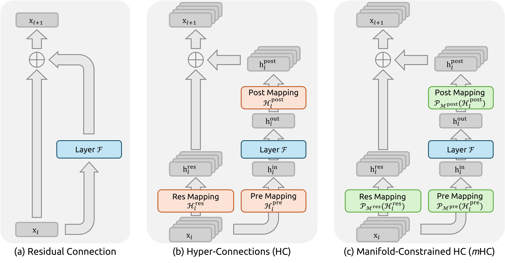

# mHC：补充解读

> 双随机混合保留什么，又可能丢掉什么？以下为直觉解释与应用延伸，论文内容见 [精炼主笔记](mHC详解.md)。

## 双随机不是“什么都不改变”

例如两条流完全取平均，对应矩阵每个元素都是 1/2，满足双随机，却会消除两条流的差异。约束保证某些传播性质，而非信息完全可逆。阅读“保留 identity 性质”时要把数学条件与宣传性简称分开。

图中扩宽的是残差状态，主要计算块仍可保持原宽度。因此它有机会在不按同倍率增加 FFN 算量的前提下增加表达能力，但激活搬运成本会真实上升。

## 算子优化是方法的一部分

如果每个小映射和归一化都单独启动 kernel，多流结构可能被带宽和启动延迟主导。6.7% 开销背后是融合与重计算，不是只由参数量推算出来的结论。

## 与 MoE、MLA 的位置不同

MoE 改 FFN 的条件计算，MLA 改注意力及 KV 表示，mHC 改层间连接。三个方向可以组合，但各自改变不同的资源与优化性质，不应把它们都笼统理解成“稀疏化”。

## 用一个具体场景串起来

两条流分别为a、b，取平均得到两条(a+b)/2，不会放大整体范数，却可能抹掉a−b方向。双随机不等于恒等，也不保证每个方向信息无损。

mHC需要的是控制跨层旁路的放大，同时允许交换；主模块仍能学习新的变化。有限次Sinkhorn还有近似误差，因此实测增益与loss稳定比一句“数学保证稳定”更有解释力。
