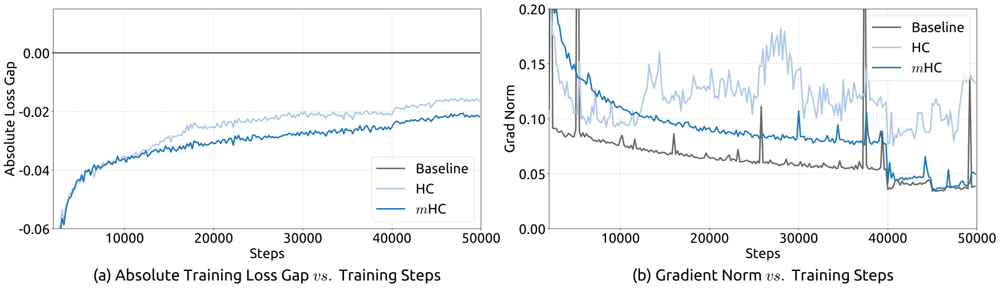
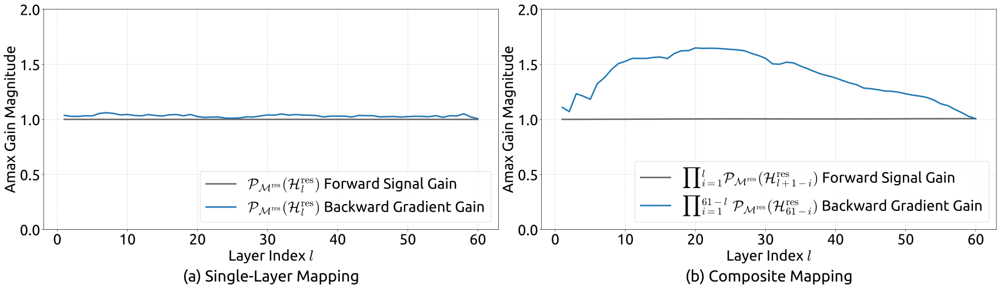

# mHC：用双随机约束稳定多流残差连接

> 💡 mHC 把多流残差的混合矩阵约束到近似双随机集合，使残差流能够交换信息，同时控制跨层连乘的放大，并配套融合算子与重计算降低开销。
>
> [论文](https://arxiv.org/abs/2512.24880) · [补充解读](mHC解读.md)

标准残差把恒等旁路与层变换相加，易于稳定传播，但单条流的表达形式有限。Hyper-Connections 扩展为多条残差流并学习读入、写回和流间混合，却在更深、更大的训练中出现信号放大与梯度不稳。mHC 的问题是如何保留流间交互而避免自由矩阵跨层相乘的失控。它用双随机残差混合、非负读写和 Sinkhorn-Knopp 近似投影完成结构约束，再通过 kernel fusion、重计算和 DualPipe 调度使设计可用于大规模训练。这里的稳定性主要约束残差混合路径，不应夸大为整个非线性网络的全局稳定证明。

## 多流残差的三个映射

令输入 $X_l\in\mathbb R^{n\times C}$，一层写为：

$$
X_{l+1}=H_l^{res}X_l+(H_l^{post})^T F(H_l^{pre}X_l;W_l).
$$

$H^{pre}\in\mathbb R^{1\times n}$ 将多流读入原有宽度 $C$ 的主模块；$H^{post}$ 把输出写回多流；$H^{res}\in\mathbb R^{n\times n}$ 让残差流互相混合。因此主模块不必增宽到 $nC$，但残差激活、搬运和通信会增加。

| $\mathcal{H}^{\mathrm{res}}_{l}$ | $\mathcal{H}^{\mathrm{pre}}_{l}$ | $\mathcal{H}^{\mathrm{post}}_{l}$ | Absolute Loss Gap |
| --- | --- | --- | --- |
|  |  |  | $\phantom{-\ }0.0\phantom{00}$ |
| ✓ |  |  | $-\ 0.022$ |
| ✓ | ✓ |  | $-\ 0.025$ |
| ✓ | ✓ | ✓ | $-\ 0.027$ |

逐项引入映射的结果表明，残差混合贡献最大。问题也来自它：跨层传播含 $\prod_l H_l^{res}$，自由矩阵连乘可能放大或衰减，HC 实验中最大增益可接近 3000，并伴随 loss/梯度尖峰。

## 双随机约束与性质

限制残差矩阵非负、各行各列和为 1：

$$
H^{res}\mathbf1=\mathbf1,\qquad \mathbf1^TH^{res}=\mathbf1^T,\qquad H^{res}_{ij}\ge0.
$$

双随机矩阵的谱范数不超过 1，乘积仍双随机；它还可视为置换矩阵的凸组合。因此能保留流间混合而不让这条线性旁路任意放大。它**不是恒等矩阵**，也不能保证每个方向范数保持不变；部分差异会因混合收缩。

当 $n=1$ 时退化为恒等旁路。Birkhoff polytope 的约束适用于残差映射本身，不包含主模块 $F$ 的 Jacobian，所以不意味着整个模型严格非扩张。

## 参数化与有限次投影

将所有流展平为 $nC$，做 RMSNorm 与投影，结合可学习静态偏置和小初始化的动态缩放，得到三个原始映射。最终：

$$
H^{pre}=\sigma(\widetilde H^{pre}),\quad H^{post}=2\sigma(\widetilde H^{post}),\quad H^{res}=\operatorname{SK}(\widetilde H^{res}).
$$

SK 先逐元素取 exp 保证正值，再交替做列和行归一化。实验只迭代 20 次，因此满足的是数值上的近似双随机，而非数学上的无限迭代精确投影。pre/post 非负减少正负系数抵消，但其范围也影响主分支的读写方式。

## 将结构落实为高效实现

RMSNorm 的除法移到矩阵乘之后，并把归一化权重吸收进投影；共享扫描与小系数操作融合，SK 的 20 次迭代放进单一 kernel，反向在片上重算。

残差合并与 post/res 映射合并，使相关 kernel 读取从 $(3n+1)C$ 降到 $(n+1)C$、写入从 $3nC$ 降到 $nC$。这些是该算子的元素读写量，不是整个模型显存缩减比例。

对连续 $L_r$ 层只保留块首输入，反向重算轻量连接，不重算昂贵 $F$。内存近似为 $nC\lceil L/L_r\rceil+(n+2)CL_r$，最优块长约 $\sqrt{nL/(n+2)}$，并受流水线 stage 边界限制。

多流增加 PP 通信，系统进一步扩展 DualPipe，在 stage 边界重叠计算、通信与连接重算。优化后 $n=4$ 的相应大模型训练开销约 6.7%，不能把它归因于矩阵参数少就自然免费。

## 训练、下游结果与 scaling

主要为 V3 风格 MoE，$n=4$，比较 baseline、HC、mHC；主实验 27B，另用 3B/9B 观察 compute scaling，以及 3B、1T token 观察 token scaling。

| Benchmark | BBH | DROP | GSM8K | HellaSwag | MATH | MMLU | PIQA | TriviaQA |
| --- | --- | --- | --- | --- | --- | --- | --- | --- |
| (Metric) | (EM) | (F1) | (EM) | (Acc.) | (EM) | (Acc.) | (Acc.) | (EM) |
| # Shots | 3-shot | 3-shot | 8-shot | 10-shot | 4-shot | 5-shot | 0-shot | 5-shot |
| 27B Baseline | 43.8 | 47.0 | 46.7 | 73.7 | 22.0 | 59.0 | 78.5 | 54.3 |
| 27B w/ HC | 48.9 | 51.6 | 53.2 | 74.3 | 26.4 | 63.0 | 79.9 | 56.3 |
| 27B w/ m HC | 51.0 | 53.9 | 53.8 | 74.7 | 26.0 | 63.4 | 80.5 | 57.6 |

27B 的 BBH 从 baseline 43.8→HC 48.9→mHC 51.0，DROP 从 47.0→51.6→53.9；MATH 则 mHC 26.0 略低于 HC 26.4。结论是总体改善且训练更稳，不是所有任务均达到最佳。

mHC 相对 baseline 最终 loss 约降低 0.021；HC 的不稳定在相应曲线中可见。不同尺度实验保持收益，但公开验证范围仍有限，不能据此断言任意深度无需担心数值问题。

20 次 SK 带来小误差，复合增益最高约 1.6，明显低于 HC 近 3000，但不是精确恒为 1。这个结果同时解释了近似实现的有效性和理论条件与实际数值之间的差别。

## 结论与未解决问题

mHC 将多流信息交互与受控传播结合，收益依赖约束、参数化和系统实现共同作用。它不替代注意力或 MoE，也不是通过简单复制四份完整网络获得提升。残差存储、投影、SK 迭代和通信仍有成本，流间持续混合也会改变表示的差异性。论文为扩大残差表达容量提供了可训练路线，但对所有非线性路径的稳定性与更大范围的 scaling 仍需进一步证据。
