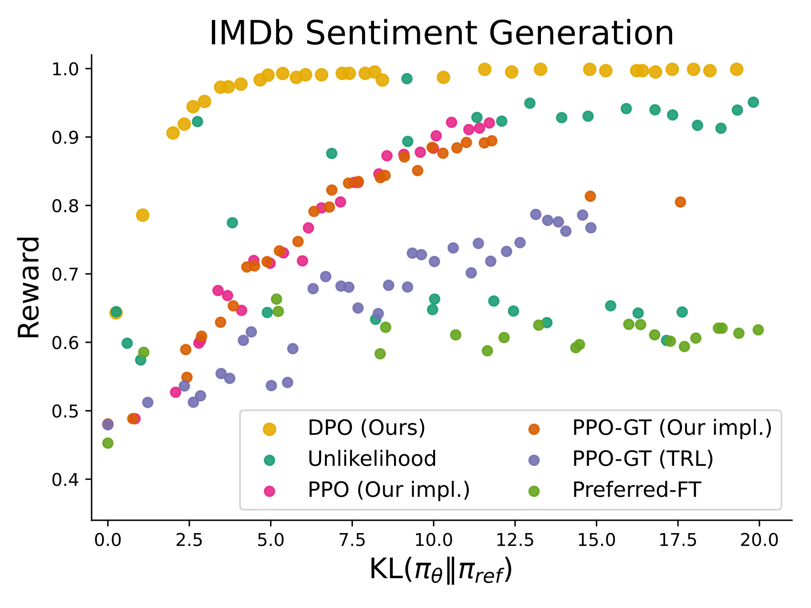
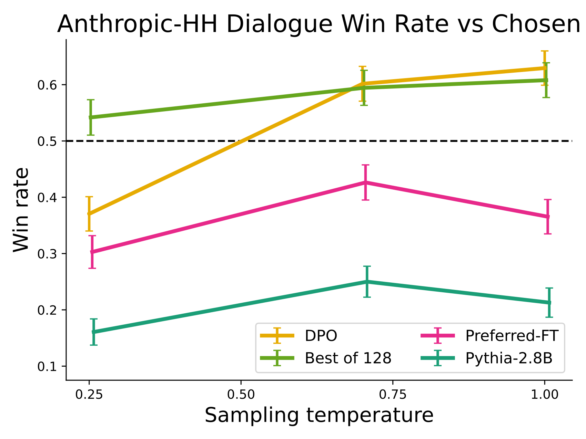

# DPO：用策略重参数化直接学习偏好

> DPO 把带 KL 正则的奖励最大化改写为回答对上的分类损失，让语言模型直接学习偏好，省去单独的奖励模型训练和在线 RL 采样。
>
> Rafael Rafailov 等，Stanford／CZ Biohub；NeurIPS 2023。[论文](https://arxiv.org/abs/2305.18290v3) · [作者实现](https://github.com/eric-mitchell/direct-preference-optimization)。

语言模型能生成多种回答，却不一定优先选择人类想要的那一种。传统 RLHF 先用偏好训练奖励模型，再通过 PPO 改进策略，训练中涉及多个模型、在线生成和价值估计。DPO 利用 KL 正则目标的闭式最优解，把奖励表示成策略与参考策略的对数概率比；同一问题下两段回答的奖励作差后，难以计算的归一化项恰好消失。这样只需离线的“问题、较好回答、较差回答”就能训练。原论文在情感控制、摘要和单轮对话上验证了效果及计算简化，但其理论等价依赖偏好模型等假设，实验也没有证明离线 DPO 能替代一切在线强化学习。

## 问题与已有方法

SFT 学习示范回答，偏好学习进一步区分同一问题下不同回答的质量。标注者通常更容易比较两个候选，而不是从零写出理想答案。论文采用 Bradley–Terry 假设：

$$
p(y_w\succ y_l\mid x)=\sigma(r(x,y_w)-r(x,y_l)).
$$

$x$ 是问题，$y_w$、$y_l$ 是偏好与非偏好回答；$r$ 是潜在奖励。传统路线先用二元交叉熵拟合 $r_\phi$，再优化

$$
\max_\pi\;\mathbb E_{y\sim\pi(\cdot\mid x)}r_\phi(x,y)
-\beta D_{\mathrm{KL}}(\pi(\cdot\mid x)\Vert\pi_{\mathrm{ref}}(\cdot\mid x)).
$$

参考策略通常是 SFT 模型。KL 项约束分布漂移，避免策略过度利用奖励模型的误差，也帮助保留原有语言行为。PPO 则需要生成样本、计算奖励和估计优势。相关研究还包括指令微调、偏好强化学习、上下文决斗赌博机，以及由 AI 生成偏好标签的 RLAIF；DPO 的变化发生在偏好到策略的优化环节。

图中传统路径分为奖励建模与 RL 优化两步，DPO 将二者连接为一次对策略参数的偏好拟合。图所省去的是显式训练环节，并不意味着学习过程中不存在奖励含义。

## 从最优策略推导偏好损失

固定 $x$，带 KL 正则的最优策略满足

$$
\pi_r(y\mid x)=\frac{\pi_{\mathrm{ref}}(y\mid x)\exp(r(x,y)/\beta)}{Z(x)},
\qquad Z(x)=\sum_y\pi_{\mathrm{ref}}(y\mid x)\exp(r(x,y)/\beta).
$$

把它反解为奖励：

$$
r(x,y)=\beta\log\frac{\pi_r(y\mid x)}{\pi_{\mathrm{ref}}(y\mid x)}+\beta\log Z(x).
$$

$Z(x)$ 对所有回答相同，所以代入 Bradley–Terry 的奖励差时会相消。以可训练的 $\pi_\theta$ 参数化最优策略，得到原文核心目标：

$$
\mathcal L_{\mathrm{DPO}}=-\mathbb E_{(x,y_w,y_l)\sim\mathcal D}
\log\sigma\!\left[\beta\left(
\log\frac{\pi_\theta(y_w\mid x)}{\pi_{\mathrm{ref}}(y_w\mid x)}-
\log\frac{\pi_\theta(y_l\mid x)}{\pi_{\mathrm{ref}}(y_l\mid x)}
\right)\right].
$$

这里的概率是**完整回答在问题条件下的概率**。实现时将回答 token 的 log-prob 求和，问题和 padding 不进入求和。策略与参考策略必须使用同样的分词、模板及回答边界。

定义隐式奖励 $\hat r_\theta(x,y)=\beta\log[\pi_\theta(y\mid x)/\pi_{\mathrm{ref}}(y\mid x)]$。对单个偏好对，梯度为

$$
\nabla_\theta\ell=-\beta\sigma(\hat r_l-\hat r_w)
\left[\nabla_\theta\log\pi_\theta(y_w\mid x)-\nabla_\theta\log\pi_\theta(y_l\mid x)\right].
$$

模型越是把次优回答排在前面，权重越大；已正确区分的样本逐渐减弱。论文通过简单 unlikelihood 基线说明，仅提高正例概率、降低负例概率而缺少这一动态权重，可能导致生成退化。

## 理论解释与适用假设

若两个奖励仅相差一个依赖问题的函数 $f(x)$，它们会产生相同的偏好分布，也产生相同的 KL 正则最优策略。论文把这些奖励视为一个等价类。策略对数概率比选择的是该等价类的一种规范化表达，并非凭空增加了奖励表示限制。

附录给出最优策略、Bradley–Terry 与多回答 Plackett–Luce 形式的推导，以及奖励等价类的证明。结论要求相关回答处的参考策略有支持，并以指定的偏好生成模型为前提；在有限数据、有限模型容量和不充分优化下，不能把理论最优解直接当成训练结果保证。

论文还用这一表达分析 actor–critic 的方差问题：传统策略梯度需要处理奖励与基线，价值函数估计本身会增加训练难度。DPO 通过回答对作差避开显式基线学习，但没有解决偏好标签错误或离线分布覆盖不足。

## 训练流程与数据

先准备 $(x,y_w,y_l)$。如果产生候选回答的 SFT 模型可用，就把它作为参考策略和策略初始化；若不可用，论文先在 chosen 回答上做 SFT，以减小数据与参考模型的分布差异。随后固定参考模型，只更新策略模型。原文通用配置为 Adam、学习率 $10^{-6}$、150 步线性 warmup、batch size 64、通常 $\beta=0.1$；摘要实验使用 $\beta=0.5$。这些是该文实验配方，不是各种模型的通用最优值。

| 任务 | 数据与模型 | 标签及评估目的 |
| --- | --- | --- |
| 情感控制 | IMDb，GPT-2-large | 用情感分类器产生偏好；可直接观察奖励与参考策略 KL 的折中 |
| 摘要 | Reddit TL;DR，GPT-J 6B | 人工摘要及人工回答比较；主要用 GPT-4 判断相对参考摘要的胜率 |
| 单轮对话 | Anthropic HH，Pythia-2.8B | 约 170k 对话的偏好数据；评测使用单轮子集 |
| 分布外摘要 | CNN/DailyMail | 将 TL;DR 上训练的策略迁移到新闻摘要，不在该测试分布继续训练 |

对比包括 SFT、chosen-only 的 Preferred-FT、unlikelihood、PPO、可使用真实奖励的 PPO-GT，以及采样多个候选后由奖励模型选择的 Best-of-N。Best-of-N 把奖励质量与 PPO 的优化能力分开考察，但额外消耗推理预算。

## 主要结果与结果的口径

图左比较的是**奖励—KL 前沿**，不能仅用最高奖励判断优劣；DPO 在作者的受控设置中获得更好的折中。图右显示摘要胜率随采样温度变化，DPO 在该实验里比 PPO 更稳健。

| 实验 | DPO | 对照 | 解释 |
| --- | --- | --- | --- |
| TL;DR，GPT-4 评判，与人工参考摘要比较 | 约 61% | PPO 最优约 57% | 两者均取其合适采样温度；不是所有摘要任务的固定优势 |
| TL;DR，人工直接比较 DPO 与 PPO | 58% 选择 DPO | PPO 温度 0，DPO 温度 0.25 | 人工比较结果与自动评判方向一致 |
| CNN/DailyMail，温度 0 | 36% | PPO 26% | 相对数据集参考摘要的胜率，二者都未超过 50% |
| CNN/DailyMail，温度 0.25 | 31% | PPO 23% | 支持一定迁移能力，不能解释为超越人工新闻摘要 |

图左显示 DPO 能改善相对 chosen 回答的偏好表现，并达到昂贵 Best-of-128 的竞争水平；图右展示随训练推进的变化。作者未能得到表现可靠的公开 PPO 对话基线，因此该部分使用 Best-of-128 作为辅助参照，不能把它写成一次严格同条件的 DPO–PPO 胜负。

## 消融、人工评判与附录信息

情感实验扫描 DPO 的 $\beta\in\{0.05,0.1,1,5\}$、PPO 的目标 KL 和 unlikelihood 的系数，共比较 22 次训练；这支持的是受控实验中的优化差异。摘要与对话的 Best-of-N 在约 64–128 个候选时趋于饱和。

人工实验还检查 GPT-4 的评判提示：增加“简洁”要求后，评判更接近人类；只要求概括重要内容时，GPT-4 有偏好更长、更重复摘要的倾向。不同比较的 GPT-4—人工一致率约 67%–86%，并非完全可靠。附录列出失败样例，其中甚至出现评判器将“7+2=11”判为正确的情况，说明自动胜率不能替代事实正确性测量。

附录同时给出实际 PyTorch 损失、推导、训练配置、评判 prompt、生成样例和人工调查设计。原文生成样例包含事实错误和冗长内容，不能因为通过偏好学习就视为事实能力已经解决。

## 结论与局限

DPO 的贡献是提供一个简洁、有理论依据的离线偏好优化目标：模型无需在每次更新时生成回答，也不必单独维护奖励网络和价值网络。它的原始证据来自最多 6B 的模型与三类任务。开放问题包括离线数据之外的泛化、如何利用未标注问题、奖励过优化，以及评判器提示造成的结论波动。

跨论文的 β、长度、数据选择与实现细节见 [DPO 技术精讲](../DPO精讲.md)；本文之外的直观解释见 [补充解读](DPO解读.md)。
