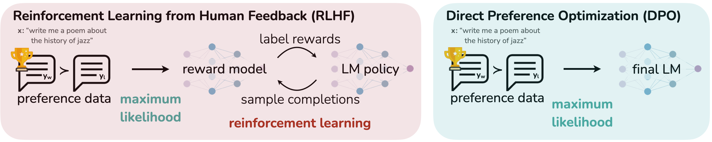

# DPO 精讲：从偏好数据到策略更新

> DPO 用“策略相对参考模型的概率变化”解释奖励，再直接拟合回答之间的偏好。先理解它比较的四个 log-prob，往往比记住损失函数更有用。
>
> 原始论文：[Direct Preference Optimization](https://arxiv.org/abs/2305.18290)；这里是跨论文的技术讲解，原论文研读见 [DPO 详解](DPO/DPO详解.md)。

DPO 适合已经有一批可靠回答对、希望改进模型回答风格与质量的场景。它将固定偏好数据变成一个监督式训练问题，工程复杂度接近 SFT，但监督信号同时包含“更喜欢什么”与“相对不喜欢什么”。其效果既取决于损失，也取决于候选回答是否覆盖当前模型、标注标准是否一致、回答长度是否形成捷径。训练损失降低不自动意味着真实任务变好；理解参考模型、β 和序列 log-prob 的关系，才能判断一次 DPO 更新究竟在改变什么。

## 它与 SFT、奖励模型和 PPO 的关系

SFT 说“在这个问题下模仿这个回答”；DPO 说“相对参考模型，让这个回答比另一个回答更占优势”。传统 RLHF 先把偏好训练成显式奖励，再让策略采样并追求奖励。DPO 使用同一个偏好统计模型，但把奖励参数化为策略概率比，直接训练策略。



从这张图看，DPO 减少了奖励建模与 RL 之间的接口，也失去了标准在线 RL 在训练期间主动探索新回答的环节。可以迭代采集新偏好再训练 DPO，但这已是在离线损失外增加一个在线数据循环。

| 方法 | 主要数据 | 更新期间生成回答 | 主要学习信号 |
| --- | --- | --- | --- |
| SFT | 示范回答 | 通常不需要 | chosen token 的似然 |
| 原始离线 DPO | 同一问题的 chosen／rejected 对 | 不需要 | 策略相对参考模型的偏好差 |
| PPO 式 RLHF | 问题与奖励函数 | 需要 | 奖励、价值基线与 KL |
| GRPO | 问题与奖励函数 | 需要，同题多个回答 | 组内相对奖励、重要性比率与可选 KL |

## 损失中四个 log-prob 分别是什么

记

$$
s_w=\log\pi_\theta(y_w\mid x),\quad s_l=\log\pi_\theta(y_l\mid x),\quad
b_w=\log\pi_{\mathrm{ref}}(y_w\mid x),\quad b_l=\log\pi_{\mathrm{ref}}(y_l\mid x).
$$

DPO margin 是 $m=\beta[(s_w-b_w)-(s_l-b_l)]$，损失为 $-\log\sigma(m)$。

例如参考模型的两个回答 log-prob 为 $(-12,-10)$，当前模型变成 $(-11,-12)$。chosen 增加 1，rejected 减少 2，总相对差为 3；取 $\beta=0.1$，margin 为 0.3，模型对该偏好的预测概率约 0.574。它不要求 chosen 的绝对 log-prob 为正，长序列的 log-prob 本来就通常很负。

还有一种情形：chosen 从 −12 变成 −13，rejected 从 −10 变成 −15。虽然 chosen 概率也降低了，但相对差仍增加 4，DPO 仍认为偏好拟合得到改善。**DPO 不保证每个 chosen 的绝对概率单调增加。**神经网络参数共享、其他候选分走概率质量以及样本之间的干扰，都使“提高 chosen、降低 rejected”只能作为局部梯度直觉。

## 为什么要有参考模型

从固定奖励的 KL 正则目标出发：

$$
\max_\pi\mathbb E_\pi[r]-\beta D_{\mathrm{KL}}(\pi\Vert\pi_{\mathrm{ref}}),
\qquad
\pi^*(y\mid x)\propto\pi_{\mathrm{ref}}(y\mid x)e^{r(x,y)/\beta}.
$$

反解得到 $r=\beta\log(\pi^*/\pi_{\mathrm{ref}})+\beta\log Z(x)$；同题回答的奖励差抵消 $Z(x)$，形成 DPO 的四项差值。参考策略表达一个已有的行为分布，避免把“数据集中较好”直接理解成“要任意提高到概率 1”。

原始 DPO 的参考模型固定，不是上一轮策略快照。若每个 step 都复制当前策略去做参考，改变了优化问题。训练时可以预计算参考 log-prob 来节约显存与前向计算，但缓存必须对应相同的分词、模板、截断和 token 边界；更改其中任何一项就必须重新计算。

参考模型的支持也有意义：理论上参考概率为零的回答，不能通过有限的 KL 代价获得正概率。实际 softmax 通常非零，但非常小的概率与严重分布偏移仍会带来优化和数值困难。

## β 为什么容易被讲反

在**固定奖励函数**的原始目标中，β 越大，偏离参考策略的代价越大；最优策略更保守。这一结论来自 $e^{r/\beta}$。

然而实际 DPO 是在拟合一个**随策略变化的隐式奖励**。β 又乘在偏好 margin 外面。初始化策略等于参考时，$m=0$，单样本梯度的系数是 $\beta/2$：更大的 β 在该点反而产生更大的梯度系数。因此不能把“β 大更保守”机械翻译成“同学习率下每一步梯度一定更小”。最终 KL、模型容量、训练时长与数据可分性共同影响结果。

合理做法是固定评测口径，用一小组 β 与学习率组合观察真实胜率、参考 KL、输出长度和能力保持情况。原论文对不同任务使用 0.1 或 0.5；这些数字可作为理解实验的起点，不能当成所有模型的默认最优值。

## 序列 log-prob 与长度问题

$$
\log\pi(y\mid x)=\sum_{t=1}^{|y|}\log\pi(y_t\mid x,y_{<t}).
$$

必须把 logits 与标签错开一位，只累计回答 token；padding 和 prompt 的 mask 均为 0。多轮对话还需明确哪些 assistant 轮次参与训练。EOS 是否参与求和要在策略、参考模型与数据处理之间一致。

将上式改为 token 平均，会改变目标与隐式奖励的含义，并不是无害的数值稳定技巧。若 chosen 系统性更长，模型可能学习“更长更好”的统计捷径；相反，截断又可能把原本正确的长回答裁成不完整样本。先看按长度分桶后的偏好准确率与人工质量，再判断是否需要长度控制或其他目标。

## 最小损失实现与核对方法

下面只展示已经计算好回答 log-prob 后的损失，不是完整训练脚本。四个输入均为 `[batch]`，参考项来自冻结模型。

```python
import torch
import torch.nn.functional as F

def dpo_loss(policy_chosen, policy_rejected,
             reference_chosen, reference_rejected, beta=0.1):
    chosen_ratio = policy_chosen - reference_chosen.detach()
    rejected_ratio = policy_rejected - reference_rejected.detach()
    margin = beta * (chosen_ratio - rejected_ratio)
    return -F.logsigmoid(margin).mean()
```

使用 `logsigmoid` 而非先 `sigmoid` 再 `log`，可避免极端 margin 的数值下溢。初始策略与参考完全相同时，未做 label smoothing 的单样本损失应为 $\log 2$；这能发现模板或 mask 不一致。交换 chosen／rejected 应使 margin 变号。冻结参考只意味着不求其参数梯度，策略分支仍需正常反向传播。

Hugging Face [TRL DPOTrainer](https://huggingface.co/docs/trl/main/en/dpo_trainer) 已实现分布式训练、PEFT、参考 log-prob 缓存和多种损失。参数名与默认值会随版本变化；复现实验应固定 TRL／Transformers 版本，并明确使用原始 sigmoid DPO 还是其变体。

## 数据质量比“有没有 rejected”更重要

一个有价值的偏好对需要相同问题与可比较的目标。若 chosen 只是更长、格式更像模板，或者 rejected 被人为制造得极其糟糕，训练容易得到不符合实际需要的区分规则。难例可以有用，但不能把有争议的两个正确答案强行标成确定胜负。

数据与当前策略的距离也很重要。来自远强模型的 chosen 可以提供方向，但如果当前模型连其基本任务都无法完成，直接 DPO 未必比先进行针对性 SFT 有效。来自另一种 chat template 或另一种问题分布的 rejected，也可能让模型只学习来源区别。建议同时检查少量原始样本、冻结基线生成结果与训练后真实回答，而不是只看 reward accuracy。

偏好由人标注时属于 RLHF／人类偏好学习；由模型评判时通常称 RLAIF；用执行测试产生 chosen／rejected 也能训练 DPO。算法本身不要求奖励一定来自人。

## 怎么判断训练真的有用

隐式 reward margin 和 preference accuracy 衡量的是训练目标拟合，不能单独证明生成质量。至少同时观察目标任务的正确性或盲评胜率、回答长度、拒答模式、旧任务能力，以及分布外问题。自动评判时随机交换回答顺序，并检查长度与模型偏好；如果任务可执行，单元测试通常比“看起来正确”的评价更可靠。

常见失败是训练集偏好准确率上升，但输出越来越冗长、模板化或事实错误增多。此时应回到数据与评测定义，判断是否存在偏好噪声、分布漂移或过训练；不能仅靠继续增加训练步数解决。

## 与 GRPO 的选择

有高质量静态比较数据、需要低成本改进偏好行为时，DPO 是自然起点。有可靠的可计算奖励、模型已能偶尔生成成功解、需要探索新的解题轨迹时，可以考虑 GRPO。二者可以串联：SFT 或 DPO 建立可用行为，再用在线 RL 改进目标任务。没有可靠奖励时，GRPO 的更复杂训练循环不会自动补出正确监督。

继续阅读：[GRPO 精讲](GRPO精讲.md)、[原始 DPO 论文](https://arxiv.org/abs/2305.18290)、[作者实现](https://github.com/eric-mitchell/direct-preference-optimization)、Nathan Lambert 的 [RLHF Book：Direct Alignment](https://rlhfbook.com/c/12-direct-alignment)。后两者用于解释实现和后续研究，原论文的实验结论以对应研读页为准。
