# Learning Transferable Visual Models From Natural Language Supervision / 全文中英对照

> 来源：[arXiv:2103.00020v1](https://arxiv.org/abs/2103.00020v1)。英文段落后紧接中文，覆盖所取 HTML 版本的主文、附录、图表、脚注与参考文献；公式、数字表和书目信息共用。中文以机器初译为底稿，进行了术语整理与结构核对，尚未逐句人工审定；遇到歧义请以紧邻英文和原论文为准。 本文对照整理基于仓库原有论文副本，原作版权归所列作者。

## Authors and affiliations / 作者与机构

Alec Radford Affiliation: OpenAI, San Francisco, CA 94110, USA Jong Wook Kim Affiliation: OpenAI, San Francisco, CA 94110, USA Chris Hallacy Affiliation: OpenAI, San Francisco, CA 94110, USA Aditya Ramesh Affiliation: OpenAI, San Francisco, CA 94110, USA Gabriel Goh Affiliation: OpenAI, San Francisco, CA 94110, USA Sandhini Agarwal Affiliation: OpenAI, San Francisco, CA 94110, USA Girish Sastry Affiliation: OpenAI, San Francisco, CA 94110, USA Amanda Askell Affiliation: OpenAI, San Francisco, CA 94110, USA Pamela Mishkin Affiliation: OpenAI, San Francisco, CA 94110, USA Jack Clark Affiliation: OpenAI, San Francisco, CA 94110, USA Gretchen Krueger Affiliation: OpenAI, San Francisco, CA 94110, USA Ilya Sutskever Correspondence to: {alec, jongwook}@openai.com Affiliation: OpenAI, San Francisco, CA 94110, USA

## Abstract / 摘要

**EN.** State-of-the-art computer vision systems are trained to predict a fixed set of predetermined object categories. This restricted form of supervision limits their generality and usability since additional labeled data is needed to specify any other visual concept. Learning directly from raw text about images is a promising alternative which leverages a much broader source of supervision. We demonstrate that the simple pre-training task of predicting which caption goes with which image is an efficient and scalable way to learn SOTA image representations from scratch on a dataset of 400 million (image, text) pairs collected from the internet. After pre-training, natural language is used to reference learned visual concepts (or describe new ones) enabling zero-shot transfer of the model to downstream tasks. We study the performance of this approach by benchmarking on over 30 different existing computer vision datasets, spanning tasks such as OCR, action recognition in videos, geo-localization, and many types of fine-grained object classification. The model transfers non-trivially to most tasks and is often competitive with a fully supervised baseline without the need for any dataset specific training. For instance, we match the accuracy of the original ResNet-50 on ImageNet zero-shot without needing to use any of the 1.28 million training examples it was trained on. We release our code and pre-trained model weights at [https://github.com/OpenAI/CLIP](https://github.com/OpenAI/CLIP) .

**中.** 最先进的计算机视觉系统经过训练可以预测一组固定的预定对象类别。这种受限的监督形式限制了它们的通用性和可用性，因为需要额外的标记数据来指定任何其他视觉概念。直接从原始文本中学习图像是一种很有前途的替代方案，它利用了更广泛的监督来源。我们证明，预测哪个标题与哪个图像对应的简单预训练任务是一种有效且可扩展的方法，可以在从互联网收集的 4 亿（图像、文本）对的数据集上从头开始学习 SOTA 图像表示。预训练后，使用自然语言来引用学习的视觉概念（或描述新的视觉概念），从而实现模型零样本传输到下游任务。我们通过对 30 多个不同的现有计算机视觉数据集进行基准测试来研究这种方法的性能，涵盖 OCR、视频中的动作识别、地理定位和多种类型的细粒度对象分类等任务。该模型可以轻松地迁移到大多数任务，并且通常可以与完全监督的基线竞争，而无需任何数据集特定的训练。例如，我们在 ImageNet 零样本上匹配原始 ResNet-50 的准确性，而无需使用其所训练的 128 万个训练样本中的任何一个。我们在 [https://github.com/OpenAI/CLIP](https://github.com/OpenAI/CLIP) 发布了我们的代码和预训练模型权重。

## Introduction and Motivating Work / 介绍和激励工作

**EN.** Pre-training methods which learn directly from raw text have revolutionized NLP over the last few years ( Dai & Le, 2015 ; Peters et al., 2018 ; Howard & Ruder, 2018 ; Radford et al., 2018 ; Devlin et al., 2018 ; Raffel et al., 2019 ) . Task-agnostic objectives such as autoregressive and masked language modeling have scaled across many orders of magnitude in compute, model capacity, and data, steadily improving capabilities. The development of “text-to-text” as a standardized input-output interface ( McCann et al., 2018 ; Radford et al., 2019 ; Raffel et al., 2019 ) has enabled task-agnostic architectures to zero-shot transfer to downstream datasets removing the need for specialized output heads or dataset specific customization. Flagship systems like GPT-3 ( Brown et al., 2020 ) are now competitive across many tasks with bespoke models while requiring little to no dataset specific training data.

**中.** 直接从原始文本中学习的预训练方法在过去几年中彻底改变了 NLP (Dai & Le, 2015; Peters et al., 2018; Howard & Ruder, 2018; Radford et al., 2018; Devlin et al., 2018; Raffel et al., 2019)。与任务无关的目标（例如自回归和掩码语言建模）已在计算、模型容量和数据方面扩展了多个数量级，从而稳步提高了能力。 “文本到文本”作为标准化输入输出接口的发展（McCann 等人，2018；Radford 等人，2019；Raffel 等人，2019）使任务无关架构能够零样本传输到下游数据集，从而无需专门的输出头或数据集特定的定制。像 GPT-3（Brown 等人，2020）这样的旗舰系统现在在许多具有定制模型的任务中具有竞争力，同时几乎不需要或不需要特定于数据集的训练数据。

**EN.** These results suggest that the aggregate supervision accessible to modern pre-training methods within web-scale collections of text surpasses that of high-quality crowd-labeled NLP datasets. However, in other fields such as computer vision it is still standard practice to pre-train models on crowd-labeled datasets such as ImageNet ( Deng et al., 2009 ) . Could scalable pre-training methods which learn directly from web text result in a similar breakthrough in computer vision? Prior work is encouraging.

**中.** 这些结果表明，现代预训练方法在网络规模文本集合中可实现的总体监督超过了高质量的人群标记 NLP 数据集。然而，在计算机视觉等其他领域，在 ImageNet 等人群标记数据集上预训练模型仍然是标准做法（Deng 等人，2009）。直接从网络文本中学习的可扩展预训练方法能否在计算机视觉领域带来类似的突破？之前的工作令人鼓舞。

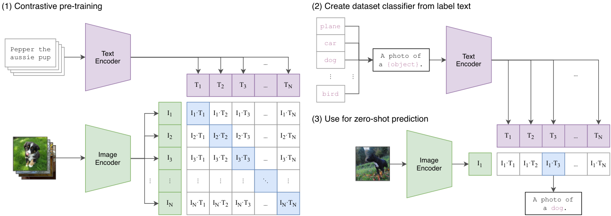

**EN.** Figure 1: Summary of our approach. While standard image models jointly train an image feature extractor and a linear classifier to predict some label, CLIP jointly trains an image encoder and a text encoder to predict the correct pairings of a batch of (image, text) training examples. At test time the learned text encoder synthesizes a zero-shot linear classifier by embedding the names or descriptions of the target dataset’s classes.

**中.** 图 1：我们的方法摘要。标准图像模型联合训练图像特征提取器和线性分类器来预测某些标签，而 CLIP 联合训练图像编码器和文本编码器来预测一批（图像、文本）训练示例的正确配对。在测试时，学习的文本编码器通过嵌入目标数据集类的名称或描述来合成零样本线性分类器。

**EN.** Over 20 years ago Mori et al. (1999) explored improving content based image retrieval by training a model to predict the nouns and adjectives in text documents paired with images. Quattoni et al. (2007) demonstrated it was possible to learn more data efficient image representations via manifold learning in the weight space of classifiers trained to predict words in captions associated with images. Srivastava & Salakhutdinov (2012) explored deep representation learning by training multimodal Deep Boltzmann Machines on top of low-level image and text tag features. Joulin et al. (2016) modernized this line of work and demonstrated that CNNs trained to predict words in image captions learn useful image representations. They converted the title, description, and hashtag metadata of images in the YFCC100M dataset ( Thomee et al., 2016 ) into a bag-of-words multi-label classification task and showed that pre-training AlexNet ( Krizhevsky et al., 2012 ) to predict these labels learned representations which preformed similarly to ImageNet-based pre-training on transfer tasks. Li et al. (2017) then extended this approach to predicting phrase n-grams in addition to individual words and demonstrated the ability of their system to zero-shot transfer to other image classification datasets by scoring target classes based on their dictionary of learned visual n-grams and predicting the one with the highest score. Adopting more recent architectures and pre-training approaches, VirTex ( Desai & Johnson, 2020 ) , ICMLM ( Bulent Sariyildiz et al., 2020 ) , and ConVIRT ( Zhang et al., 2020 ) have recently demonstrated the potential of transformer-based language modeling, masked language modeling, and contrastive objectives to learn image representations from text.

**中.** 20 多年前，Mori 等人。 (1999) 通过训练模型来预测与图像配对的文本文档中的名词和形容词，探索改进基于内容的图像检索。夸托尼等人。 （2007）证明，通过训练预测与图像相关的标题中的单词的分类器的权重空间中的流形学习，可以学习更多数据有效的图像表示。 Srivastava 和 Salakhutdinov（2012）通过在低级图像和文本标签特征之上训练多模态深度玻尔兹曼机来探索深度表示学习。乔林等人。 (2016) 对这一工作进行了现代化改造，并证明经过训练来预测图像字幕中的单词的 CNN 可以学习有用的图像表示。他们将 YFCC100M 数据集中图像的标题、描述和主题标签元数据（Thomee 等人，2016）转换为词袋多标签分类任务，并表明预训练 AlexNet（Krizhevsky 等人，2012）来预测这些标签学习到的表示形式与基于 ImageNet 的传输任务预训练类似。李等人。 （2017）随后将这种方法扩展到预测短语 n-grams 以及单个单词，并证明了他们的系统通过基于学习的视觉 n-grams 字典对目标类别进行评分并预测得分最高的类别，来零样本迁移到其他图像分类数据集的能力。 VirTex (Desai & Johnson, 2020)、ICMLM (Bulent Sariyildiz et al., 2020) 和 ConVIRT (Zhang et al., 2020) 采用更新的架构和预训练方法，最近展示了基于 Transformer 的语言建模、掩码语言建模和对比目标从文本学习图像表示的潜力。

**EN.** While exciting as proofs of concept, using natural language supervision for image representation learning is still rare. This is likely because demonstrated performance on common benchmarks is much lower than alternative approaches. For example, Li et al. (2017) reach only 11.5% accuracy on ImageNet in a zero-shot setting. This is well below the 88.4% accuracy of the current state of the art ( Xie et al., 2020 ) . It is even below the 50% accuracy of classic computer vision approaches ( Deng et al., 2012 ) . Instead, more narrowly scoped but well-targeted uses of weak supervision have improved performance. Mahajan et al. (2018) showed that predicting ImageNet-related hashtags on Instagram images is an effective pre-training task. When fine-tuned to ImageNet these pre-trained models increased accuracy by over 5% and improved the overall state of the art at the time. Kolesnikov et al. (2019) and Dosovitskiy et al. (2020) have also demonstrated large gains on a broader set of transfer benchmarks by pre-training models to predict the classes of the noisily labeled JFT-300M dataset.

**中.** 虽然作为概念证明令人兴奋，但使用自然语言监督进行图像表示学习仍然很少见。这可能是因为在常见基准测试中所展示的性能远低于替代方法。例如，李等人。 (2017) 在 ImageNet 上零样本设置下仅达到 11.5% 的准确率。这远低于当前技术水平 88.4% 的准确率（Xie 等人，2020）。它甚至低于经典计算机视觉方法 50% 的准确度（Deng et al., 2012）。相反，范围更窄但更有针对性的弱监督使用提高了绩效。马哈詹等人。 (2018) 表明，预测 Instagram 图像上与 ImageNet 相关的主题标签是一项有效的预训练任务。当针对 ImageNet 进行微调时，这些预训练模型的准确性提高了 5% 以上，并提高了当时的整体技术水平。科列斯尼科夫等人。 (2019) 和 Dosovitskiy 等人。 (2020) 还证明了通过预训练模型来预测带有噪声标签的 JFT-300M 数据集的类别，在更广泛的传输基准上取得了巨大的进步。

**EN.** This line of work represents the current pragmatic middle ground between learning from a limited amount of supervised “gold-labels” and learning from practically unlimited amounts of raw text. However, it is not without compromises. Both works carefully design, and in the process limit, their supervision to 1000 and 18291 classes respectively. Natural language is able to express, and therefore supervise, a much wider set of visual concepts through its generality. Both approaches also use static softmax classifiers to perform prediction and lack a mechanism for dynamic outputs. This severely curtails their flexibility and limits their “zero-shot” capabilities.

**中.** 这一工作代表了当前从有限数量的监督“黄金标签”中学习和从几乎无限量的原始文本中学习之间的务实中间立场。然而，这并非没有妥协。两个作品都经过精心设计，并在过程中将它们的监督分别限制在1000和18291类。自然语言能够通过其通用性来表达并因此监督更广泛的视觉概念。这两种方法都使用静态 softmax 分类器来执行预测，并且缺乏动态输出的机制。这严重削弱了它们的灵活性并限制了它们的“零射击”能力。

**EN.** A crucial difference between these weakly supervised models and recent explorations of learning image representations directly from natural language is scale. While Mahajan et al. (2018) and Kolesnikov et al. (2019) trained their models for accelerator years on millions to billions of images, VirTex, ICMLM, and ConVIRT trained for accelerator days on one to two hundred thousand images. In this work, we close this gap and study the behaviors of image classifiers trained with natural language supervision at large scale. Enabled by the large amounts of publicly available data of this form on the internet, we create a new dataset of 400 million (image, text) pairs and demonstrate that a simplified version of ConVIRT trained from scratch, which we call CLIP, for Contrastive Language-Image Pre-training, is an efficient method of learning from natural language supervision. We study the scalability of CLIP by training a series of eight models spanning almost 2 orders of magnitude of compute and observe that transfer performance is a smoothly predictable function of compute ( Hestness et al., 2017 ; Kaplan et al., 2020 ) . We find that CLIP, similar to the GPT family, learns to perform a wide set of tasks during pre-training including OCR, geo-localization, action recognition, and many others. We measure this by benchmarking the zero-shot transfer performance of CLIP on over 30 existing datasets and find it can be competitive with prior task-specific supervised models. We also confirm these findings with linear-probe representation learning analysis and show that CLIP outperforms the best publicly available ImageNet model while also being more computationally efficient. We additionally find that zero-shot CLIP models are much more robust than equivalent accuracy supervised ImageNet models which suggests that zero-shot evaluation of task-agnostic models is much more representative of a model’s capability. These results have significant policy and ethical implications, which we consider in Section 7 .

**中.** 这些弱监督模型与最近直接从自然语言学习图像表示的探索之间的一个关键区别是规模。而 Mahajan 等人。 （2018）和科列斯尼科夫等人。 （2019）在加速器年对数百万至数十亿张图像进行了训练，VirTex、ICMLM 和 ConVIRT 在加速器日对一到二十万张图像进行了训练。在这项工作中，我们缩小了这一差距，并研究了大规模自然语言监督训练的图像分类器的行为。借助互联网上这种形式的大量公开数据，我们创建了一个包含 4 亿对（图像、文本）的新数据集，并证明了从头开始训练的 ConVIRT 的简化版本（我们称之为 CLIP，即对比语言-图像预训练）是一种从自然语言监督中学习的有效方法。我们通过训练一系列涵盖近 2 个数量级的计算的八个模型来研究 CLIP 的可扩展性，并观察到传输性能是计算的平滑可预测函数（Hestness 等人，2017 年；Kaplan 等人，2020 年）。我们发现 CLIP 与 GPT 系列类似，在预训练期间学习执行一系列广泛的任务，包括 OCR、地理定位、动作识别等。我们通过在 30 多个现有数据集上对 CLIP 的零样本传输性能进行基准测试来衡量这一点，并发现它可以与之前的特定任务监督模型相媲美。我们还通过线性探针表示学习分析证实了这些发现，并表明 CLIP 优于最好的公开可用的 ImageNet 模型，同时计算效率也更高。我们还发现零样本 CLIP 模型比同等精度的监督 ImageNet 模型更加稳健，这表明任务无关模型的零样本评估更能代表模型的能力。这些结果具有重大的政策和道德影响，我们将在第 7 节中对此进行考虑。

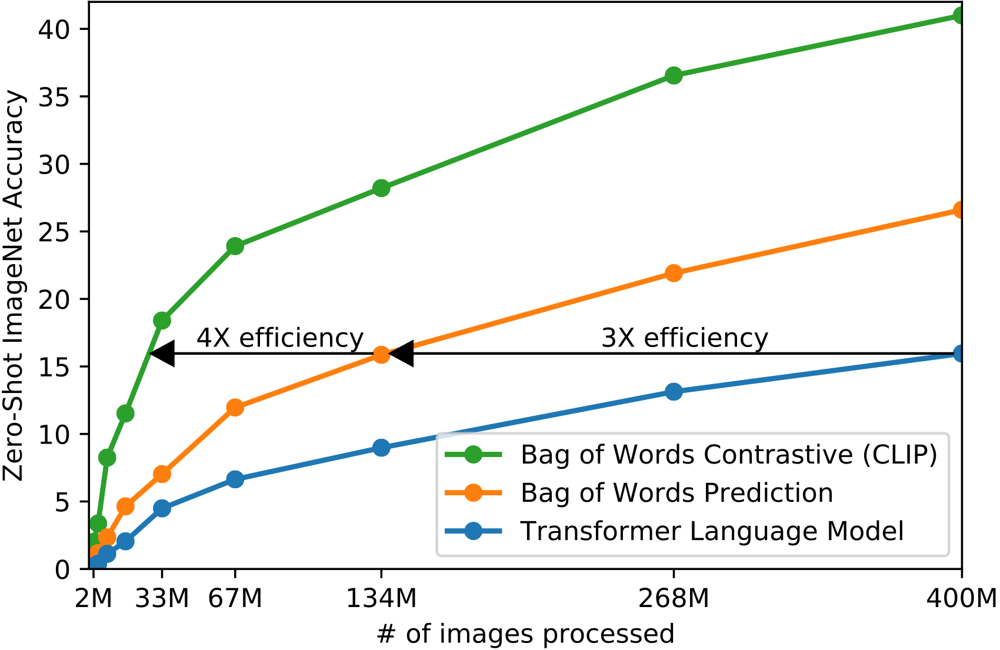

**EN.** Figure 2: CLIP is much more efficient at zero-shot transfer than our image caption baseline. Although highly expressive, we found that transformer-based language models are relatively weak at zero-shot ImageNet classification. Here, we see that it learns 3x slower than a baseline which predicts a bag-of-words (BoW) encoding of the text ( Joulin et al., 2016 ) . Swapping the prediction objective for the contrastive objective of CLIP further improves efficiency another 4x.

**中.** 图 2：CLIP 在零样本传输方面比我们的图像标题基线要高效得多。尽管表达能力很强，但我们发现基于 Transformer 的语言模型在零样本 ImageNet 分类方面相对较弱。在这里，我们看到它的学习速度比预测文本的词袋 (BoW) 编码的基线慢 3 倍（Joulin 等人，2016）。将预测目标替换为 CLIP 的对比目标，效率进一步提高了 4 倍。

## Approach / 方法

### Natural Language Supervision / 自然语言监督

**EN.** At the core of our approach is the idea of learning perception from supervision contained in natural language. As discussed in the introduction, this is not at all a new idea, however terminology used to describe work in this space is varied, even seemingly contradictory, and stated motivations are diverse. Zhang et al. (2020) , Gomez et al. (2017) , Joulin et al. (2016) , and Desai & Johnson (2020) all introduce methods which learn visual representations from text paired with images but describe their approaches as unsupervised, self-supervised, weakly supervised, and supervised respectively.

**中.** 我们方法的核心是从自然语言中包含的监督中学习感知的想法。正如引言中所讨论的，这根本不是一个新想法，但是用于描述该领域工作的术语多种多样，甚至看似矛盾，并且陈述的动机也多种多样。张等人。 （2020），戈麦斯等人。 （2017），乔林等人。 (2016) 和 Desai & Johnson (2020) 都介绍了从文本与图像配对中学习视觉表示的方法，但分别将他们的方法描述为无监督、自监督、弱监督和监督。

**EN.** We emphasize that what is common across this line of work is not any of the details of the particular methods used but the appreciation of natural language as a training signal. All these approaches are learning from natural language supervision . Although early work wrestled with the complexity of natural language when using topic model and n-gram representations, improvements in deep contextual representation learning suggest we now have the tools to effectively leverage this abundant source of supervision ( McCann et al., 2017 ) .

**中.** 我们强调，这一工作的共同点不是所使用的特定方法的任何细节，而是将自然语言作为训练信号的欣赏。所有这些方法都是从自然语言监督中学习的。尽管早期的工作在使用主题模型和 n-gram 表示时遇到了自然语言的复杂性，但深度上下文表示学习的改进表明我们现在拥有有效利用这种丰富的监督源的工具（McCann 等人，2017）。

**EN.** Learning from natural language has several potential strengths over other training methods. It’s much easier to scale natural language supervision compared to standard crowd-sourced labeling for image classification since it does not require annotations to be in a classic “machine learning compatible format” such as the canonical 1-of-N majority vote “gold label”. Instead, methods which work on natural language can learn passively from the supervision contained in the vast amount of text on the internet. Learning from natural language also has an important advantage over most unsupervised or self-supervised learning approaches in that it doesn’t “just” learn a representation but also connects that representation to language which enables flexible zero-shot transfer. In the following subsections, we detail the specific approach we settled on.

**中.** 与其他训练方法相比，自然语言学习有几个潜在的优势。与用于图像分类的标准众包标签相比，扩展自然语言监督要容易得多，因为它不需要采用经典的“机器学习兼容格式”（例如规范的 1-of-N 多数投票“黄金标签”）进行注释。相反，适用于自然语言的方法可以从互联网上大量文本中包含的监督中被动地学习。与大多数无监督或自监督学习方法相比，从自然语言学习还具有重要优势，因为它不仅“仅仅”学习表示，而且还将该表示与语言连接起来，从而实现灵活的零样本迁移。在以下小节中，我们将详细介绍我们确定的具体方法。

### Creating a Sufficiently Large Dataset / 创建足够大的数据集

**EN.** Existing work has mainly used three datasets, MS-COCO ( Lin et al., 2014 ) , Visual Genome ( Krishna et al., 2017 ) , and YFCC100M ( Thomee et al., 2016 ) . While MS-COCO and Visual Genome are high quality crowd-labeled datasets, they are small by modern standards with approximately 100,000 training photos each. By comparison, other computer vision systems are trained on up to 3.5 billion Instagram photos ( Mahajan et al., 2018 ) . YFCC100M, at 100 million photos, is a possible alternative, but the metadata for each image is sparse and of varying quality. Many images use automatically generated filenames like 20160716_113957.JPG as “titles” or contain “descriptions” of camera exposure settings. After filtering to keep only images with natural language titles and/or descriptions in English, the dataset shrunk by a factor of 6 to only 15 million photos. This is approximately the same size as ImageNet.

**中.** 现有工作主要使用三个数据集，MS-COCO（Lin et al., 2014）、Visual Genome（Krishna et al., 2017）和YFCC100M（Thomee et al., 2016）。虽然 MS-COCO 和 Visual Genome 是高质量的人群标记数据集，但按照现代标准来看，它们很小，每个数据集大约有 100,000 张训练照片。相比之下，其他计算机视觉系统需要接受多达 35 亿张 Instagram 照片的训练（Mahajan 等人，2018 年）。 YFCC100M（可容纳 1 亿张照片）是一种可能的替代方案，但每张图像的元数据稀疏且质量参差不齐。许多图像使用自动生成的文件名（例如 20160716_113957.JPG）作为“标题”或包含相机曝光设置的“描述”。经过过滤仅保留带有自然语言标题和/或英文描述的图像后，数据集缩小了 6 倍，只剩下 1500 万张照片。这与 ImageNet 的大小大致相同。

**EN.** A major motivation for natural language supervision is the large quantities of data of this form available publicly on the internet. Since existing datasets do not adequately reflect this possibility, considering results only on them would underestimate the potential of this line of research. To address this, we constructed a new dataset of 400 million (image, text) pairs collected form a variety of publicly available sources on the Internet. To attempt to cover as broad a set of visual concepts as possible, we search for (image, text) pairs as part of the construction process whose text includes one of a set of 500,000 queries. [^footnote1] We approximately class balance the results by including up to 20,000 (image, text) pairs per query. The resulting dataset has a similar total word count as the WebText dataset used to train GPT-2. We refer to this dataset as WIT for WebImageText.

**中.** 自然语言监督的一个主要动机是互联网上公开提供的大量这种形式的数据。由于现有数据集没有充分反映这种可能性，因此仅考虑这些数据集的结果会低估这方面研究的潜力。为了解决这个问题，我们构建了一个包含 4 亿对（图像、文本）的新数据集，这些数据集是从互联网上的各种公开来源收集的。为了尝试尽可能广泛地涵盖一组视觉概念，我们在构建过程中搜索（图像、文本）对，其文本包括一组 500,000 个查询中的一个。 [^footnote1] 我们通过每个查询最多包含 20,000 个（图像、文本）对来近似类平衡结果。生成的数据集的总字数与用于训练 GPT-2 的 WebText 数据集相似。我们将此数据集称为 WebImageText 的 WIT。

### Selecting an Efficient Pre-Training Method / 选择有效的预训练方法

**EN.** State-of-the-art computer vision systems use very large amounts of compute. Mahajan et al. (2018) required 19 GPU years to train their ResNeXt101-32x48d and Xie et al. (2020) required 33 TPUv3 core-years to train their Noisy Student EfficientNet-L2. When considering that both these systems were trained to predict only 1000 ImageNet classes, the task of learning an open set of visual concepts from natural language seems daunting. In the course of our efforts, we found training efficiency was key to successfully scaling natural language supervision and we selected our final pre-training method based on this metric.

**中.** 最先进的计算机视觉系统使用大量的计算。马哈詹等人。 Xie 等人 (2018) 需要 19 个 GPU 年来训练他们的 ResNeXt101-32x48d。 (2020) 需要 33 个 TPUv3 核心年来训练他们的 Noisy Student EfficientNet-L2。考虑到这两个系统都经过训练只能预测 1000 个 ImageNet 类别，从自然语言中学习一组开放的视觉概念的任务似乎令人畏惧。在我们的努力过程中，我们发现训练效率是成功扩展自然语言监督的关键，并且我们根据该指标选择了最终的预训练方法。

**EN.** Our initial approach, similar to VirTex, jointly trained an image CNN and text transformer from scratch to predict the caption of an image. However, we encountered difficulties efficiently scaling this method. In Figure 2 we show that a 63 million parameter transformer language model, which already uses twice the compute of its ResNet-50 image encoder, learns to recognize ImageNet classes three times slower than a much simpler baseline that predicts a bag-of-words encoding of the same text.

**中.** 我们最初的方法与 VirTex 类似，从头开始联合训练图像 CNN 和文本转换器来预测图像的标题。然而，我们在有效扩展该方法时遇到了困难。在图 2 中，我们展示了一个 6300 万参数的 Transformer 语言模型，该模型使用的计算量是其 ResNet-50 图像编码器的两倍，它学习识别 ImageNet 类的速度比预测同一文本的词袋编码的简单得多的基线慢三倍。

**EN.** Both these approaches share a key similarity. They try to predict the exact words of the text accompanying each image. This is a difficult task due to the wide variety of descriptions, comments, and related text that co-occur with images. Recent work in contrastive representation learning for images has found that contrastive objectives can learn better representations than their equivalent predictive objective ( Tian et al., 2019 ) . Other work has found that although generative models of images can learn high quality image representations, they require over an order of magnitude more compute than contrastive models with the same performance ( Chen et al., 2020a ) . Noting these findings, we explored training a system to solve the potentially easier proxy task of predicting only which text as a whole is paired with which image and not the exact words of that text. Starting with the same bag-of-words encoding baseline, we swapped the predictive objective for a contrastive objective in Figure 2 and observed a further 4x efficiency improvement in the rate of zero-shot transfer to ImageNet.

**中.** 这两种方法有一个关键的相似之处。他们试图预测每张图像附带的文本的确切单词。这是一项艰巨的任务，因为与图像同时出现的描述、评论和相关文本种类繁多。最近在图像对比表示学习方面的工作发现，对比目标可以比同等的预测目标学习更好的表示（Tian et al., 2019）。其他工作发现，虽然图像的生成模型可以学习高质量的图像表示，但它们比具有相同性能的对比模型需要更多的计算量（Chen 等人，2020a）。注意到这些发现，我们探索训练一个系统来解决可能更容易的代理任务，即仅预测哪个文本作为一个整体与哪个图像配对，而不是该文本的确切单词。从相同的词袋编码基线开始，我们将图 2 中的预测目标替换为对比目标，并观察到零样本传输到 ImageNet 的效率进一步提高了 4 倍。

**EN.** Given a batch of $N$ (image, text) pairs, CLIP is trained to predict which of the $N\times N$ possible (image, text) pairings across a batch actually occurred. To do this, CLIP learns a multi-modal embedding space by jointly training an image encoder and text encoder to maximize the cosine similarity of the image and text embeddings of the $N$ real pairs in the batch while minimizing the cosine similarity of the embeddings of the $N^{2}-N$ incorrect pairings. We optimize a symmetric cross entropy loss over these similarity scores. In Figure 3 we include pseudocode of the core of an implementation of CLIP. To our knowledge this batch construction technique and objective was first introduced in the area of deep metric learning as the multi-class N-pair loss Sohn (2016) , was popularized for contrastive representation learning by Oord et al. (2018) as the InfoNCE loss, and was recently adapted for contrastive (text, image) representation learning in the domain of medical imaging by Zhang et al. (2020) .

**中.** 给定一批 $N$（图像、文本）对，CLIP 经过训练来预测批次中实际发生的 $N\times N$ 可能（图像、文本）配对中的哪些。为此，CLIP 通过联合训练图像编码器和文本编码器来学习多模态嵌入空间，以最大化批次中 $N$ 真实对的图像和文本嵌入的余弦相似度，同时最小化 $N^{2}-N$ 错误配对的嵌入的余弦相似度。我们针对这些相似性分数优化对称交叉熵损失。在图 3 中，我们包含了 CLIP 实现核心的伪代码。据我们所知，这种批量构建技术和目标首先被引入深度度量学习领域，作为多类 N 对损失 Sohn (2016)，并被 Oord 等人推广用于对比表示学习。 （2018）作为 InfoNCE 损失，最近被Zhang等人应用于医学成像领域的对比（文本，图像）表示学习。 （2020）。

**EN.** Due to the large size of our pre-training dataset, over-fitting is not a major concern and the details of training CLIP are simplified compared to the implementation of Zhang et al. (2020) . We train CLIP from scratch without initializing the image encoder with ImageNet weights or the text encoder with pre-trained weights. We do not use the non-linear projection between the representation and the contrastive embedding space, a change which was introduced by Bachman et al. (2019) and popularized by Chen et al. (2020b) . We instead use only a linear projection to map from each encoder’s representation to the multi-modal embedding space. We did not notice a difference in training efficiency between the two versions and speculate that non-linear projections may be co-adapted with details of current image only in self-supervised representation learning methods. We also remove the text transformation function $t_{u}$ from Zhang et al. (2020) which samples a single sentence at uniform from the text since many of the (image, text) pairs in CLIP’s pre-training dataset are only a single sentence. We also simplify the image transformation function $t_{v}$ . A random square crop from resized images is the only data augmentation used during training. Finally, the temperature parameter which controls the range of the logits in the softmax, $\tau$ , is directly optimized during training as a log-parameterized multiplicative scalar to avoid turning as a hyper-parameter.

**中.** 由于我们的预训练数据集很大，过度拟合并不是主要问题，并且与Zhang等人的实现相比，训练CLIP的细节得到了简化。 （2020）。我们从头开始训练 CLIP，而无需使用 ImageNet 权重初始化图像编码器或使用预训练权重初始化文本编码器。我们不使用表示和对比嵌入空间之间的非线性投影，这是 Bachman 等人引入的更改。 （2019）并由 Chen 等人推广。 （2020b）。相反，我们仅使用线性投影将每个编码器的表示映射到多模态嵌入空间。我们没有注意到两个版本之间训练效率的差异，并推测非线性投影可能仅在自监督表示学习方法中与当前图像的细节共同适应。我们还删除了Zhang等人的文本转换函数$t_{u}$。 （2020）从文本中统一采样单个句子，因为 CLIP 预训练数据集中的许多（图像，文本）对只是单个句子。我们还简化了图像变换函数 $t_{v}$ 。调整大小图像中的随机方形裁剪是训练期间使用的唯一数据增强。最后，控制 softmax 中 logits 范围的温度参数 $\tau$ 在训练期间直接优化为对数参数化乘法标量，以避免转变为超参数。

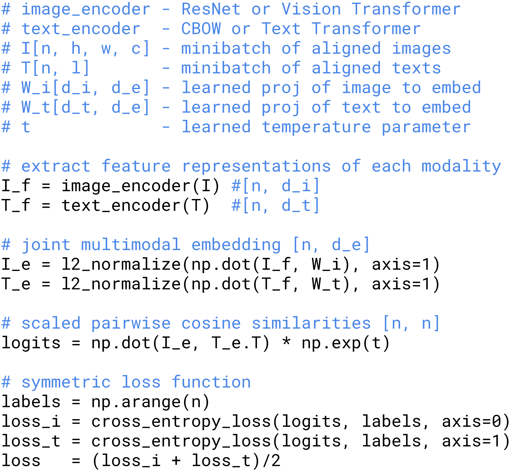

**EN.** Figure 3: Numpy-like pseudocode for the core of an implementation of CLIP.

**中.** 图 3：CLIP 实现核心的类似 Numpy 的伪代码。

### Choosing and Scaling a Model / 选择和扩展模型

**EN.** We consider two different architectures for the image encoder. For the first, we use ResNet-50 ( He et al., 2016a ) as the base architecture for the image encoder due to its widespread adoption and proven performance. We make several modifications to the original version using the ResNet-D improvements from He et al. (2019) and the antialiased rect-2 blur pooling from Zhang (2019) . We also replace the global average pooling layer with an attention pooling mechanism. The attention pooling is implemented as a single layer of “transformer-style” multi-head QKV attention where the query is conditioned on the global average-pooled representation of the image. For the second architecture, we experiment with the recently introduced Vision Transformer (ViT) ( Dosovitskiy et al., 2020 ) . We closely follow their implementation with only the minor modification of adding an additional layer normalization to the combined patch and position embeddings before the transformer and use a slightly different initialization scheme.

**中.** 我们考虑两种不同的图像编码器架构。首先，我们使用 ResNet-50（He et al., 2016a）作为图像编码器的基础架构，因为它的广泛采用和经过验证的性能。我们使用 He 等人的 ResNet-D 改进对原始版本进行了一些修改。 (2019) 和来自Zhang (2019) 的抗锯齿 rect-2 模糊池。我们还用注意力池机制取代了全局平均池层。注意力池被实现为单层“Transformer式”多头 QKV 注意力，其中查询以图像的全局平均池表示为条件。对于第二种架构，我们使用最近推出的 Vision Transformer (ViT) 进行实验（Dosovitskiy et al., 2020）。我们密切关注他们的实现，只进行了微小的修改，即在变换器之前向组合补丁和位置嵌入添加额外的层归一化，并使用略有不同的初始化方案。

**EN.** The text encoder is a Transformer ( Vaswani et al., 2017 ) with the architecture modifications described in Radford et al. (2019) . As a base size we use a 63M-parameter 12-layer 512-wide model with 8 attention heads. The transformer operates on a lower-cased byte pair encoding (BPE) representation of the text with a 49,152 vocab size ( Sennrich et al., 2015 ) . For computational efficiency, the max sequence length was capped at 76. The text sequence is bracketed with [SOS] and [EOS] tokens and the activations of the highest layer of the transformer at the [EOS] token are treated as the feature representation of the text which is layer normalized and then linearly projected into the multi-modal embedding space. Masked self-attention was used in the text encoder to preserve the ability to initialize with a pre-trained language model or add language modeling as an auxiliary objective, though exploration of this is left as future work.

**中.** 文本编码器是一个 Transformer（Vaswani 等人，2017），具有 Radford 等人中描述的架构修改。 （2019）。作为基本尺寸，我们使用 63M 参数、12 层、512 宽的模型，具有 8 个注意力头。该转换器对具有 49,152 个词汇大小的文本的小写字节对编码 (BPE) 表示进行操作（Sennrich 等人，2015）。为了计算效率，最大序列长度上限为 76。文本序列用 [SOS] 和 [EOS] 标记括起来，Transformer最高层在 [EOS] 标记处的激活被视为文本的特征表示，该特征表示经过层归一化，然后线性投影到多模态嵌入空间中。文本编码器中使用了屏蔽自注意力，以保留使用预先训练的语言模型进行初始化或添加语言建模作为辅助目标的能力，尽管对此的探索留待未来的工作。

**EN.** While previous computer vision research has often scaled models by increasing the width ( Mahajan et al., 2018 ) or depth ( He et al., 2016a ) in isolation, for the ResNet image encoders we adapt the approach of Tan & Le (2019) which found that allocating additional compute across all of width, depth, and resolution outperforms only allocating it to only one dimension of the model. While Tan & Le (2019) tune the ratio of compute allocated to each dimension for their EfficientNet architecture, we use a simple baseline of allocating additional compute equally to increasing the width, depth, and resolution of the model. For the text encoder, we only scale the width of the model to be proportional to the calculated increase in width of the ResNet and do not scale the depth at all, as we found CLIP’s performance to be less sensitive to the capacity of the text encoder.

**中.** 虽然之前的计算机视觉研究通常通过单独增加宽度（Mahajan et al., 2018）或深度（He et al., 2016a）来缩放模型，但对于 ResNet 图像编码器，我们采用 Tan & Le (2019) 的方法，该方法发现在所有宽度、深度和分辨率上分配额外的计算效果优于仅将其分配给模型的一个维度。虽然 Tan & Le (2019) 调整了分配给 EfficientNet 架构每个维度的计算比率，但我们使用了一个简单的基线，即平均分配额外计算以增加模型的宽度、深度和分辨率。对于文本编码器，我们仅将模型的宽度缩放为与计算出的 ResNet 宽度增加成正比，而根本不缩放深度，因为我们发现 CLIP 的性能对文本编码器的容量不太敏感。

### Training / 培训

**EN.** We train a series of 5 ResNets and 3 Vision Transformers. For the ResNets we train a ResNet-50, a ResNet-101, and then 3 more which follow EfficientNet-style model scaling and use approximately 4x, 16x, and 64x the compute of a ResNet-50. They are denoted as RN50x4, RN50x16, and RN50x64 respectively. For the Vision Transformers we train a ViT-B/32, a ViT-B/16, and a ViT-L/14. We train all models for 32 epochs. We use the Adam optimizer ( Kingma & Ba, 2014 ) with decoupled weight decay regularization ( Loshchilov & Hutter, 2017 ) applied to all weights that are not gains or biases, and decay the learning rate using a cosine schedule ( Loshchilov & Hutter, 2016 ) . Initial hyper-parameters were set using a combination of grid searches, random search, and manual tuning on the baseline ResNet-50 model when trained for 1 epoch. Hyper-parameters were then adapted heuristically for larger models due to computational constraints. The learnable temperature parameter $\tau$ was initialized to the equivalent of 0.07 from ( Wu et al., 2018 ) and clipped to prevent scaling the logits by more than 100 which we found necessary to prevent training instability. We use a very large minibatch size of 32,768. Mixed-precision ( Micikevicius et al., 2017 ) was used to accelerate training and save memory. To save additional memory, gradient checkpointing ( Griewank & Walther, 2000 ; Chen et al., 2016 ) , half-precision Adam statistics ( Dhariwal et al., 2020 ) , and half-precision stochastically rounded text encoder weights were used. The calculation of embedding similarities was also sharded with individual GPUs computing only the subset of the pairwise similarities necessary for their local batch of embeddings. The largest ResNet model, RN50x64, took 18 days to train on 592 V100 GPUs while the largest Vision Transformer took 12 days on 256 V100 GPUs. For the ViT-L/14 we also pre-train at a higher 336 pixel resolution for one additional epoch to boost performance similar to FixRes ( Touvron et al., 2019 ) . We denote this model as ViT-L/14@336px. Unless otherwise specified, all results reported in this paper as “CLIP” use this model which we found to perform best.

**中.** 我们训练了一系列 5 个 ResNet 和 3 个 Vision Transformer。对于 ResNet，我们训练一个 ResNet-50、一个 ResNet-101，然后再训练 3 个，它们遵循 EfficientNet 风格的模型缩放，并使用 ResNet-50 的大约 4 倍、16 倍和 64 倍的计算量。它们分别表示为 RN50x4、RN50x16 和 RN50x64。对于 Vision Transformer，我们训练了 ViT-B/32、ViT-B/16 和 ViT-L/14。我们将所有模型训练 32 个 epoch。我们使用 Adam 优化器（Kingma & Ba，2014），将解耦权重衰减正则化（Losechilov & Hutter，2017）应用于所有非增益或偏差的权重，并使用余弦时间表衰减学习率（Leshchilov & Hutter，2016）。在训练 1 个周期时，在基线 ResNet-50 模型上结合使用网格搜索、随机搜索和手动调整来设置初始超参数。然后，由于计算限制，超参数被启发式地调整为更大的模型。可学习的温度参数 $\tau$ 被初始化为相当于 (Wu et al., 2018) 中的 0.07，并进行剪裁以防止 logits 缩放超过 100，我们发现这对于防止训练不稳定是必要的。我们使用非常大的小批量大小 32,768。混合精度（Micikevicius et al., 2017）用于加速训练并节省内存。为了节省额外的内存，使用了梯度检查点（Griewank & Walther，2000；Chen et al.，2016）、半精度 Adam 统计（Dhariwal et al.，2020）和半精度随机舍入文本编码器权重。嵌入相似度的计算也被分片为单独的 GPU，仅计算其本地批量嵌入所需的成对相似度的子集。最大的 ResNet 模型 RN50x64 在 592 个 V100 GPU 上训练需要 18 天，而最大的 Vision Transformer 在 256 个 V100 GPU 上训练需要 12 天。对于 ViT-L/14，我们还以更高的 336 像素分辨率预训练一个额外的 epoch，以提高类似于 FixRes 的性能（Touvron 等人，2019）。我们将此模型表示为 ViT-L/14@336px。除非另有说明，本文中报告为“CLIP”的所有结果都使用我们发现性能最佳的模型。

## Experiments / 实验

### Zero-Shot Transfer / 零次传输

#### Motivation / 动机

**EN.** In computer vision, zero-shot learning usually refers to the study of generalizing to unseen object categories in image classification ( Lampert et al., 2009 ) . We instead use the term in a broader sense and study generalization to unseen datasets. We motivate this as a proxy for performing unseen tasks, as aspired to in the zero-data learning paper of Larochelle et al. (2008) . While much research in the field of unsupervised learning focuses on the representation learning capabilities of machine learning systems, we motivate studying zero-shot transfer as a way of measuring the task-learning capabilities of machine learning systems. In this view, a dataset evaluates performance on a task on a specific distribution. However, many popular computer vision datasets were created by the research community primarily as benchmarks to guide the development of generic image classification methods rather than measuring performance on a specific task. While it is reasonable to say that the SVHN dataset measures the task of street number transcription on the distribution of Google Street View photos, it is unclear what “real” task the CIFAR-10 dataset measures. It is clear, however, what distribution CIFAR-10 is drawn from - TinyImages ( Torralba et al., 2008 ) . On these kinds of datasets, zero-shot transfer is more an evaluation of CLIP’s robustness to distribution shift and domain generalization rather than task generalization. Please see Section 3.3 for analysis focused on this.

**中.** 在计算机视觉中，零样本学习通常指的是在图像分类中泛化到未见过的对象类别的研究（Lampert et al., 2009）。相反，我们在更广泛的意义上使用该术语，并研究对未见过的数据集的概括。我们将其作为执行看不见的任务的代理，正如 Larochelle 等人的零数据学习论文中所期望的那样。 （2008）。虽然无监督学习领域的许多研究都集中在机器学习系统的表示学习能力上，但我们激励研究零样本迁移作为衡量机器学习系统任务学习能力的一种方式。在此视图中，数据集评估特定分布上任务的性能。然而，许多流行的计算机视觉数据集是由研究社区创建的，主要作为基准来指导通用图像分类方法的开发，而不是衡量特定任务的性能。虽然可以合理地说 SVHN 数据集衡量的是 Google 街景照片分布上的街道号码转录任务，但尚不清楚 CIFAR-10 数据集衡量的“真正”任务是什么。然而，很清楚 CIFAR-10 是从什么分布中提取的 - TinyImages (Torralba et al., 2008)。在这类数据集上，零样本迁移更多地是对 CLIP 对分布偏移和域泛化而不是任务泛化的鲁棒性的评估。对此的分析请参见3.3节。

**EN.** To our knowledge, Visual N-Grams ( Li et al., 2017 ) first studied zero-shot transfer to existing image classification datasets in the manner described above. It is also the only other work we are aware of that has studied zero-shot transfer to standard image classification datasets using a generically pre-trained model and serves as the best reference point for contextualizing CLIP. Their approach learns the parameters of a dictionary of 142,806 visual n-grams (spanning 1- to 5- grams) and optimizes these n-grams using a differential version of Jelinek-Mercer smoothing to maximize the probability of all text n-grams for a given image. In order to perform zero-shot transfer, they first convert the text of each of the dataset’s class names into its n-gram representation and then compute its probability according to their model, predicting the one with the highest score.

**中.** 据我们所知，Visual N-Grams（Li et al., 2017）首先以上述方式研究了向现有图像分类数据集的零样本迁移。这也是我们所知道的唯一一项使用通用预训练模型研究零样本迁移到标准图像分类数据集的工作，并作为上下文化 CLIP 的最佳参考点。他们的方法学习 142,806 个视觉 n-gram（涵盖 1 到 5-gram）的字典参数，并使用 Jelinek-Mercer 平滑的差分版本来优化这些 n-gram，以最大化给定图像的所有文本 n-gram 的概率。为了执行零样本迁移，他们首先将每个数据集的类名称的文本转换为其 n 元语法表示，然后根据模型计算其概率，预测得分最高的那个。

**EN.** Our focus on studying zero-shot transfer as an evaluation of task learning is inspired by work demonstrating task learning in the field of NLP. To our knowledge Liu et al. (2018) first identified task learning as an “unexpected side-effect” when a language model trained to generate Wikipedia articles learned to reliably transliterate names between languages. While GPT-1 ( Radford et al., 2018 ) focused on pre-training as a transfer learning method to improve supervised fine-tuning, it also included an ablation study demonstrating that the performance of four heuristic zero-shot transfer methods improved steadily over the course of pre-training, without any supervised adaption. This analysis served as the basis for GPT-2 ( Radford et al., 2019 ) which focused exclusively on studying the task-learning capabilities of language models via zero-shot transfer.

**中.** 我们专注于研究零样本迁移作为任务学习的评估，其灵感来自于 NLP 领域演示任务学习的工作。据我们所知，刘等人。 （2018）首先将任务学习确定为一种“意外的副作用”，即当经过训练生成维基百科文章的语言模型学会了在语言之间可靠地音译名称时。虽然 GPT-1（Radford 等人，2018）专注于将预训练作为一种迁移学习方法来改进监督微调，但它还包括一项消融研究，证明四种启发式零样本迁移方法的性能在预训练过程中稳步提高，无需任何监督适应。该分析是 GPT-2（Radford 等人，2019）的基础，GPT-2 专门专注于通过零样本迁移研究语言模型的任务学习能力。

#### Using CLIP for Zero-Shot Transfer / 使用 CLIP 进行零次传输

**EN.** CLIP is pre-trained to predict if an image and a text snippet are paired together in its dataset. To perform zero-shot classification, we reuse this capability. For each dataset, we use the names of all the classes in the dataset as the set of potential text pairings and predict the most probable (image, text) pair according to CLIP. In a bit more detail, we first compute the feature embedding of the image and the feature embedding of the set of possible texts by their respective encoders. The cosine similarity of these embeddings is then calculated, scaled by a temperature parameter $\tau$ , and normalized into a probability distribution via a softmax. Note that this prediction layer is a multinomial logistic regression classifier with L2-normalized inputs, L2-normalized weights, no bias, and temperature scaling. When interpreted this way, the image encoder is the computer vision backbone which computes a feature representation for the image and the text encoder is a hypernetwork ( Ha et al., 2016 ) which generates the weights of a linear classifier based on the text specifying the visual concepts that the classes represent. Lei Ba et al. (2015) first introduced a zero-shot image classifier of this form while the idea of generating a classifier from natural language dates back to at least Elhoseiny et al. (2013) . Continuing with this interpretation, every step of CLIP pre-training can be viewed as optimizing the performance of a randomly created proxy to a computer vision dataset which contains 1 example per class and has 32,768 total classes defined via natural language descriptions. For zero-shot evaluation, we cache the zero-shot classifier once it has been computed by the text encoder and reuse it for all subsequent predictions. This allows the cost of generating it to be amortized across all the predictions in a dataset.

**中.** CLIP 经过预先训练，可以预测图像和文本片段在其数据集中是否配对。为了执行零样本分类，我们重用此功能。对于每个数据集，我们使用数据集中所有类的名称作为潜在文本配对的集合，并根据 CLIP 预测最可能的（图像，文本）对。更详细地说，我们首先通过各自的编码器计算图像的特征嵌入和可能文本集的特征嵌入。然后计算这些嵌入的余弦相似度，通过温度参数 $\tau$ 进行缩放，并通过 softmax 归一化为概率分布。请注意，该预测层是一个多项式逻辑回归分类器，具有 L2 归一化输入、L2 归一化权重、无偏差和温度缩放。当以这种方式解释时，图像编码器是计算机视觉主干，它计算图像的特征表示，而文本编码器是超网络（Ha et al., 2016），它根据指定类表示的视觉概念的文本生成线性分类器的权重。雷霸等人。 (2015) 首先引入了这种形式的零样本图像分类器，而从自然语言生成分类器的想法至少可以追溯到 Elhoseiny 等人。 （2013）。继续这种解释，CLIP 预训练的每一步都可以被视为优化随机创建的计算机视觉数据集代理的性能，该数据集每个类包含 1 个示例，总共有 32,768 个通过自然语言描述定义的类。对于零样本评估，我们在文本编码器计算出零样本分类器后对其进行缓存，并将其重新用于所有后续预测。这使得生成它的成本可以在数据集中的所有预测中摊销。

#### Initial Comparison to Visual N-Grams / 与视觉 N 元语法的初步比较

|  | aYahoo 雅虎 | ImageNet 图像网 | SUN 太阳 |
| --- | --- | --- | --- |
| Visual N-Grams 视觉 N 元语法 | 72.4 | 11.5 | 23.0 |
| CLIP 剪辑 | 98.4 | 76.2 | 58.5 |

**EN.** Table 1: Comparing CLIP to prior zero-shot transfer image classification results. CLIP improves performance on all three datasets by a large amount. This improvement reflects many differences in the 4 years since the development of Visual N-Grams ( Li et al., 2017 ) .

**中.** 表 1：将 CLIP 与之前的零样本传输图像分类结果进行比较。 CLIP 极大地提高了所有三个数据集的性能。这一改进反映了 Visual N-Grams 开发 4 年来的许多差异（Li et al., 2017）。

**EN.** In Table 1 we compare Visual N-Grams to CLIP. The best CLIP model improves accuracy on ImageNet from a proof of concept 11.5% to 76.2% and matches the performance of the original ResNet-50 despite using none of the 1.28 million crowd-labeled training examples available for this dataset. Additionally, the top-5 accuracy of CLIP models are noticeably higher than their top-1, and this model has a 95% top-5 accuracy, matching Inception-V4 ( Szegedy et al., 2016 ) . The ability to match the performance of a strong, fully supervised baselines in a zero-shot setting suggests CLIP is a significant step towards flexible and practical zero-shot computer vision classifiers. As mentioned above, the comparison to Visual N-Grams is meant for contextualizing the performance of CLIP and should not be interpreted as a direct methods comparison between CLIP and Visual N-Grams as many performance relevant differences between the two systems were not controlled for. For instance, we train on a dataset that is 10x larger, use a vision model that requires nearly 100x more compute per prediction, likely used over 1000x their training compute, and use a transformer-based model which did not exist when Visual N-Grams was published. As a closer comparison, we trained a CLIP ResNet-50 on the same YFCC100M dataset that Visual N-Grams was trained on and found it matched their reported ImageNet performance within a V100 GPU day. This baseline was also trained from scratch instead of being initialized from pre-trained ImageNet weights as in Visual N-Grams.

**中.** 在表 1 中，我们将 Visual N-Grams 与 CLIP 进行了比较。最佳 CLIP 模型将 ImageNet 上的准确率从概念验证的 11.5% 提高到 76.2%，并且与原始 ResNet-50 的性能相匹配，尽管没有使用该数据集可用的 128 万个人群标记训练示例。此外，CLIP 模型的 top-5 准确率明显高于其 top-1，并且该模型具有 95% 的 top-5 准确率，与 Inception-V4 相匹配（Szegedy 等人，2016）。在零样本设置中匹配强大的、完全监督基线的性能的能力表明 CLIP 是迈向灵活实用的零样本计算机视觉分类器的重要一步。如上所述，与 Visual N-Grams 的比较旨在将 CLIP 的性能置于上下文中，不应被解释为 CLIP 和 Visual N-Grams 之间的直接方法比较，因为两个系统之间的许多与性能相关的差异并未得到控制。例如，我们在大 10 倍的数据集上进行训练，使用每个预测需要近 100 倍计算量的视觉模型，可能使用超过 1000 倍的训练计算量，并使用基于 Transformer 的模型，而该模型在 Visual N-Grams 发布时还不存在。作为更仔细的比较，我们在 Visual N-Grams 训练的同一 YFCC100M 数据集上训练了 CLIP ResNet-50，发现它在 V100 GPU 一天内与他们报告的 ImageNet 性能相匹配。该基线也是从头开始训练的，而不是像 Visual N-Grams 那样从预先训练的 ImageNet 权重初始化。

**EN.** CLIP also outperforms Visual N-Grams on the other 2 reported datasets. On aYahoo, CLIP achieves a 95% reduction in the number of errors, and on SUN, CLIP more than doubles the accuracy of Visual N-Grams. To conduct a more comprehensive analysis and stress test, we implement a much larger evaluation suite detailed in Appendix A . In total we expand from the 3 datasets reported in Visual N-Grams to include over 30 datasets and compare to over 50 existing computer vision systems to contextualize results.

**中.** CLIP 在其他 2 个报告数据集上的表现也优于 Visual N-Grams。在 aYahoo 上，CLIP 实现了错误数量减少 95%，而在 SUN 上，CLIP 使 Visual N-Grams 的准确性提高了一倍多。为了进行更全面的分析和压力测试，我们实施了一个更大的评估套件，详见附录 A。总的来说，我们从 Visual N-Grams 中报告的 3 个数据集扩展到包括 30 多个数据集，并与 50 多个现有计算机视觉系统进行比较，以将结果置于上下文中。

#### Prompt Engineering and Ensembling / 快速工程和集成

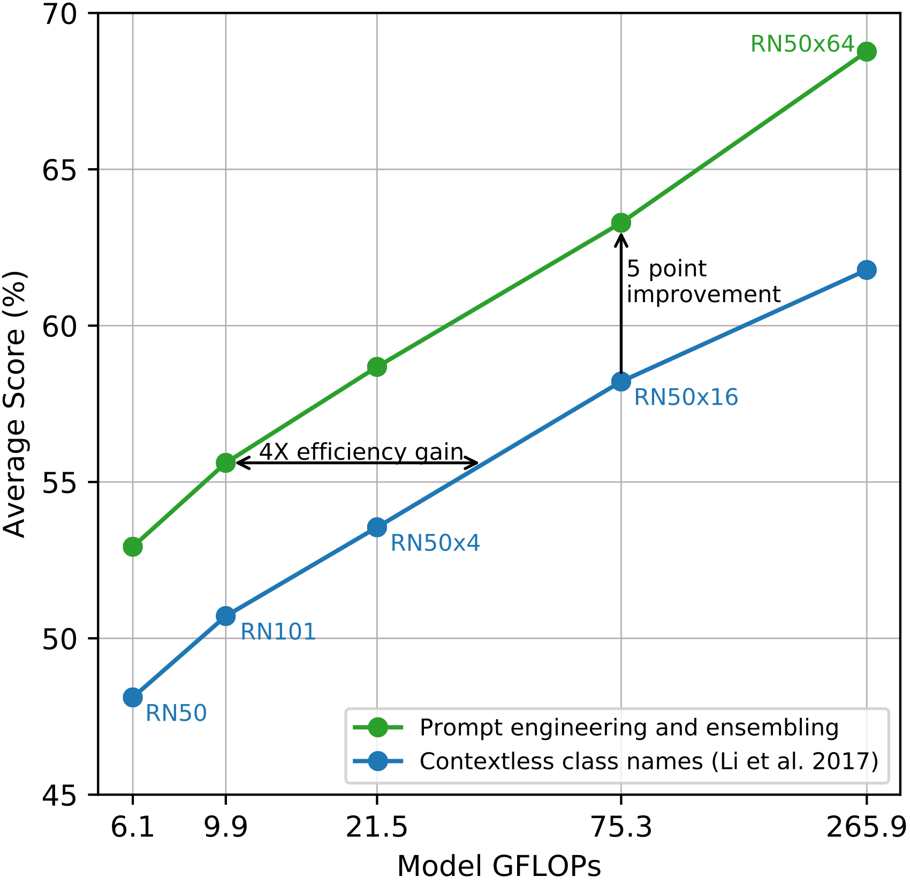

**EN.** Figure 4: Prompt engineering and ensembling improve zero-shot performance. Compared to the baseline of using contextless class names, prompt engineering and ensembling boost zero-shot classification performance by almost 5 points on average across 36 datasets. This improvement is similar to the gain from using 4 times more compute with the baseline zero-shot method but is “free” when amortized over many predictions.

**中.** 图 4：快速工程和集成可提高零样本性能。与使用无上下文类名称的基线相比，即时工程和集成在 36 个数据集上将零样本分类性能平均提高了近 5 个点。这种改进类似于使用基线零样本方法使用 4 倍以上的计算量所获得的收益，但在分摊到许多预测时是“免费的”。

**EN.** Most standard image classification datasets treat the information naming or describing classes which enables natural language based zero-shot transfer as an afterthought. The vast majority of datasets annotate images with just a numeric id of the label and contain a file mapping these ids back to their names in English. Some datasets, such as Flowers102 and GTSRB, don’t appear to include this mapping at all in their released versions preventing zero-shot transfer entirely. [^footnote2] For many datasets, we observed these labels may be chosen somewhat haphazardly and do not anticipate issues related to zero-shot transfer which relies on task description in order to transfer successfully.

**中.** 大多数标准图像分类数据集将信息命名或描述类视为事后的想法，这使得基于自然语言的零样本传输成为可能。绝大多数数据集仅使用标签的数字 ID 来注释图像，并包含将这些 ID 映射回其英文名称的文件。某些数据集，例如 Flowers102 和 GTSRB，在其发布的版本中似乎根本不包含此映射，从而完全防止了零样本传输。 [^footnote2] 对于许多数据集，我们观察到这些标签的选择可能有些随意，并且没有预见到与零样本传输相关的问题，零样本传输依赖于任务描述才能成功传输。

**EN.** A common issue is polysemy. When the name of a class is the only information provided to CLIP’s text encoder it is unable to differentiate which word sense is meant due to the lack of context. In some cases multiple meanings of the same word might be included as different classes in the same dataset! This happens in ImageNet which contains both construction cranes and cranes that fly. Another example is found in classes of the Oxford-IIIT Pet dataset where the word boxer is, from context, clearly referring to a breed of dog, but to a text encoder lacking context could just as likely refer to a type of athlete.

**中.** 一个常见的问题是一词多义。当类的名称是提供给 CLIP 文本编码器的唯一信息时，由于缺乏上下文，它无法区分哪个词义。在某些情况下，同一个单词的多种含义可能会作为不同的类包含在同一数据集中！这种情况发生在 ImageNet 中，其中包含建筑起重机和飞行起重机。另一个例子是在 Oxford-IIIT Pet 数据集的类中发现的，其中单词“boxer”从上下文中清楚地指的是一种狗，但对于缺乏上下文的文本编码器来说也可能指的是一种运动员。

**EN.** Another issue we encountered is that it’s relatively rare in our pre-training dataset for the text paired with the image to be just a single word. Usually the text is a full sentence describing the image in some way. To help bridge this distribution gap, we found that using the prompt template “ A photo of a {label}. ” to be a good default that helps specify the text is about the content of the image. This often improves performance over the baseline of using only the label text. For instance, just using this prompt improves accuracy on ImageNet by 1.3%.

**中.** 我们遇到的另一个问题是，在我们的预训练数据集中，与图像配对的文本只是单个单词的情况相对较少。通常，文本是以某种方式描述图像的完整句子。为了帮助弥合这种分布差距，我们发现使用提示模板“A photo of a {label}.”是一个很好的默认值，有助于指定有关图像内容的文本。与仅使用标签文本的基线相比，这通常会提高性能。例如，仅使用此提示即可将 ImageNet 上的准确率提高 1.3%。

**EN.** Similar to the “prompt engineering” discussion around GPT-3 ( Brown et al., 2020 ; Gao et al., 2020 ) , we have also observed that zero-shot performance can be significantly improved by customizing the prompt text to each task. A few, non exhaustive, examples follow. We found on several fine-grained image classification datasets that it helped to specify the category. For example on Oxford-IIIT Pets, using “ A photo of a {label}, a type of pet. ” to help provide context worked well. Likewise, on Food101 specifying a type of food and on FGVC Aircraft a type of aircraft helped too. For OCR datasets, we found that putting quotes around the text or number to be recognized improved performance. Finally, we found that on satellite image classification datasets it helped to specify that the images were of this form and we use variants of “ a satellite photo of a {label}. ”.

**中.** 与围绕 GPT-3 的“提示工程”讨论类似（Brown et al., 2020；Gao et al., 2020），我们也观察到通过为每个任务定制提示文本可以显着提高零样本性能。下面是一些非详尽的示例。我们在几个细粒度图像分类数据集上发现它有助于指定类别。例如，在 Oxford-IIIT Pets 中，使用“{label} 的照片，一种宠物。”来帮助提供上下文效果很好。同样，在 Food101 上指定一种食物，在 FGVC Aircraft 上指定一种飞机也有帮助。对于 OCR 数据集，我们发现在要识别的文本或数字周围加上引号可以提高性能。最后，我们发现在卫星图像分类数据集上，它有助于指定图像具有这种形式，并且我们使用“{label} 的卫星照片”的变体。

**EN.** We also experimented with ensembling over multiple zero-shot classifiers as another way of improving performance. These classifiers are computed by using different context prompts such as ‘ A photo of a big {label} ” and “ A photo of a small {label} ”. We construct the ensemble over the embedding space instead of probability space. This allows us to cache a single set of averaged text embeddings so that the compute cost of the ensemble is the same as using a single classifier when amortized over many predictions. We’ve observed ensembling across many generated zero-shot classifiers to reliably improve performance and use it for the majority of datasets. On ImageNet, we ensemble 80 different context prompts and this improves performance by an additional 3.5% over the single default prompt discussed above. When considered together, prompt engineering and ensembling improve ImageNet accuracy by almost 5%. In Figure 4 we visualize how prompt engineering and ensembling change the performance of a set of CLIP models compared to the contextless baseline approach of directly embedding the class name as done in Li et al. (2017) .

**中.** 我们还尝试了多个零样本分类器的集成，作为提高性能的另一种方法。这些分类器是通过使用不同的上下文提示来计算的，例如“大{标签}的照片”和“小{标签}的照片”。我们在嵌入空间而不是概率空间上构建集成。这使我们能够缓存一组平均文本嵌入，以便在分摊到许多预测时，集成的计算成本与使用单个分类器相同。我们已经观察到许多生成的零样本的集成在 ImageNet 上，我们集成了 80 个不同的上下文提示，这比上面讨论的单个默认提示的性能提高了 3.5%。当综合考虑时，提示工程和集成将 ImageNet 的准确性提高了近 5%，与 Li 等人中直接嵌入类名称的无上下文基线方法相比，我们可视化了提示工程和集成如何改变一组 CLIP 模型的性能。等（2017）。

#### Analysis of Zero-Shot CLIP Performance / 零样本 CLIP 性能分析

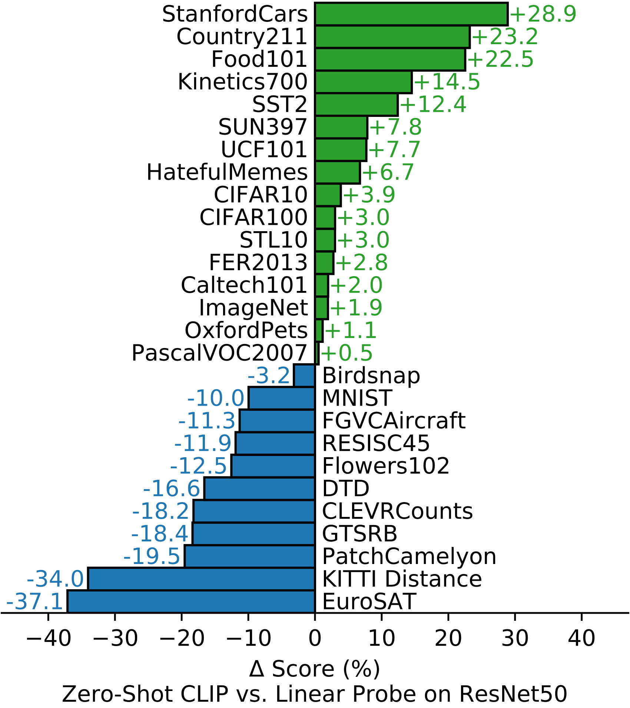

**EN.** Figure 5: Zero-shot CLIP is competitive with a fully supervised baseline. Across a 27 dataset eval suite, a zero-shot CLIP classifier outperforms a fully supervised linear classifier fitted on ResNet-50 features on 16 datasets, including ImageNet.

**中.** 图 5：零样本 CLIP 与完全监督的基线具有竞争力。在 27 个数据集评估套件中，零样本 CLIP 分类器的性能优于在 16 个数据集（包括 ImageNet）上安装 ResNet-50 特征的完全监督线性分类器。

**EN.** Since task-agnostic zero-shot classifiers for computer vision have been understudied, CLIP provides a promising opportunity to gain a better understanding of this type of model. In this section, we conduct a study of various properties of CLIP’s zero-shot classifiers. As a first question, we look simply at how well zero-shot classifiers perform. To contextualize this, we compare to the performance of a simple off-the-shelf baseline: fitting a fully supervised, regularized, logistic regression classifier on the features of the canonical ResNet-50. In Figure 5 we show this comparison across 27 datasets. Please see Appendix A for details of datasets and setup.

**中.** 由于计算机视觉的任务无关零样本分类器尚未得到充分研究，CLIP 提供了一个有希望的机会来更好地理解此类模型。在本节中，我们对 CLIP 零样本分类器的各种属性进行研究。作为第一个问题，我们简单地看看零样本分类器的表现如何。为了具体化这一点，我们与一个简单的现成基线的性能进行比较：在规范的 ResNet-50 的特征上拟合完全监督的、正则化的逻辑回归分类器。在图 5 中，我们展示了 27 个数据集的比较。有关数据集和设置的详细信息，请参阅附录 A。

**EN.** Zero-shot CLIP outperforms this baseline slightly more often than not and wins on 16 of the 27 datasets. Looking at individual datasets reveals some interesting behavior. On fine-grained classification tasks, we observe a wide spread in performance. On two of these datasets, Stanford Cars and Food101, zero-shot CLIP outperforms logistic regression on ResNet-50 features by over 20% while on two others, Flowers102 and FGVCAircraft, zero-shot CLIP underperforms by over 10%. On OxfordPets and Birdsnap, performance is much closer. We suspect these difference are primarily due to varying amounts of per-task supervision between WIT and ImageNet. On “general” object classification datasets such as ImageNet, CIFAR10/100, STL10, and PascalVOC2007 performance is relatively similar with a slight advantage for zero-shot CLIP in all cases. On STL10, CLIP achieves 99.3% overall which appears to be a new state of the art despite not using any training examples. Zero-shot CLIP significantly outperforms a ResNet-50 on two datasets measuring action recognition in videos. On Kinetics700, CLIP outperforms a ResNet-50 by 14.5%. Zero-shot CLIP also outperforms a ResNet-50’s features by 7.7% on UCF101. We speculate this is due to natural language providing wider supervision for visual concepts involving verbs, compared to the noun-centric object supervision in ImageNet.

**中.** 零样本 CLIP 的表现往往略优于此基线，并且在 27 个数据集中的 16 个数据集上获胜。查看各个数据集会发现一些有趣的行为。在细粒度分类任务中，我们观察到性能差异很大。在其中两个数据集（Stanford Cars 和 Food101）上，零样本 CLIP 在 ResNet-50 特征上的表现优于逻辑回归 20% 以上，而在另外两个数据集（Flowers102 和 FGVCAircraft）上，零样本 CLIP 的表现低于 10% 以上。在 OxfordPets 和 Birdsnap 上，性能更加接近。我们怀疑这些差异主要是由于 WIT 和 ImageNet 之间每个任务的监督量不同造成的。在 ImageNet、CIFAR10/100、STL10 和 PascalVOC2007 等“通用”对象分类数据集上，性能相对相似，但在所有情况下零样本 CLIP 都略有优势。在 STL10 上，CLIP 总体达到了 99.3%，尽管没有使用任何训练示例，但这似乎是一种新的技术水平。在测量视频中动作识别的两个数据集上，零样本 CLIP 的性能显着优于 ResNet-50。在 Kinetics700 上，CLIP 的性能优于 ResNet-50 14.5%。零样本 CLIP 在 UCF101 上的性能也比 ResNet-50 的功能高出 7.7%。我们推测这是因为与 ImageNet 中以名词为中心的对象监督相比，自然语言为涉及动词的视觉概念提供了更广泛的监督。

**EN.** Looking at where zero-shot CLIP notably underperforms, we see that zero-shot CLIP is quite weak on several specialized, complex, or abstract tasks such as satellite image classification (EuroSAT and RESISC45), lymph node tumor detection (PatchCamelyon), counting objects in synthetic scenes (CLEVRCounts), self-driving related tasks such as German traffic sign recognition (GTSRB), recognizing distance to the nearest car (KITTI Distance). These results highlight the poor capability of zero-shot CLIP on more complex tasks. By contrast, non-expert humans can robustly perform several of these tasks, such as counting, satellite image classification, and traffic sign recognition, suggesting significant room for improvement. However, we caution that it is unclear whether measuring zero-shot transfer, as opposed to few-shot transfer, is a meaningful evaluation for difficult tasks that a learner has no prior experience with, such as lymph node tumor classification for almost all humans (and possibly CLIP).

**中.** 看看零样本 CLIP 明显表现不佳的地方，我们发现零样本 CLIP 在一些专门的、复杂的或抽象的任务上相当薄弱，例如卫星图像分类（EuroSAT 和 RESISC45）、淋巴结肿瘤检测（PatchCamelyon）、计算合成场景中的对象（CLEVRCounts）、自动驾驶相关任务，例如德国交通标志识别（GTSRB）、识别到最近汽车的距离（KITTI 距离）。这些结果凸显了零样本 CLIP 在更复杂的任务上的较差能力。相比之下，非专业人士可以稳健地执行其中多项任务，例如计数、卫星图像分类和交通标志识别，这表明还有很大的改进空间。然而，我们警告说，目前尚不清楚测量零样本转移（相对于少样本转移）对于学习者之前没有经验的困难任务是否是有意义的评估，例如几乎所有人类的淋巴结肿瘤分类（可能还有 CLIP）。

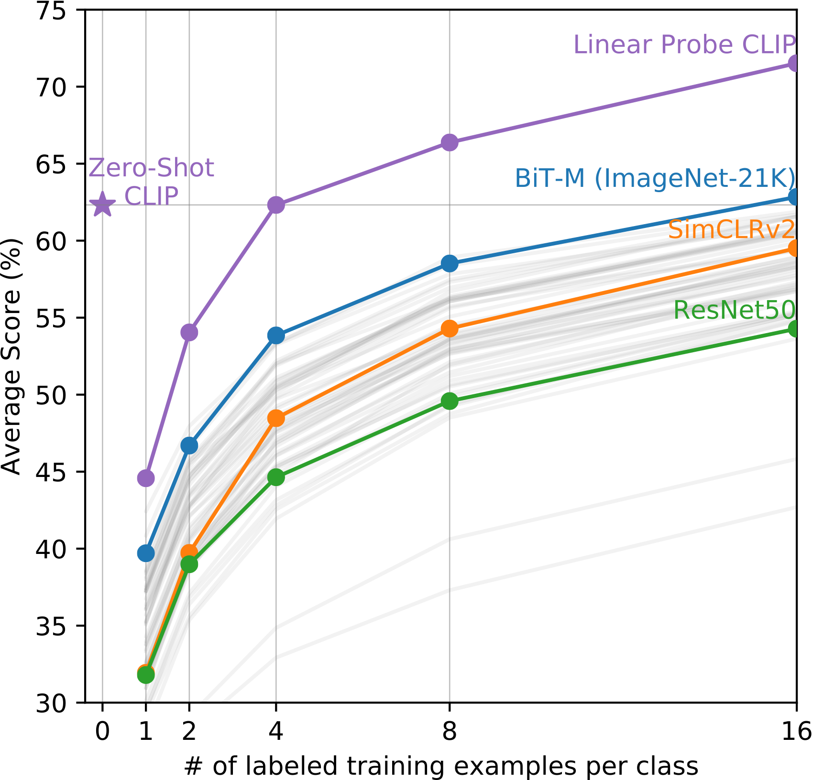

**EN.** Figure 6: Zero-shot CLIP outperforms few-shot linear probes. Zero-shot CLIP matches the average performance of a 4-shot linear classifier trained on the same feature space and nearly matches the best results of a 16-shot linear classifier across publicly available models. For both BiT-M and SimCLRv2, the best performing model is highlighted. Light gray lines are other models in the eval suite. The 20 datasets with at least 16 examples per class were used in this analysis.

**中.** 图 6：零样本 CLIP 的性能优于少样本线性探头。零样本 CLIP 与在相同特征空间上训练的 4 样本线性分类器的平均性能相匹配，并且几乎与公共可用模型中 16 样本线性分类器的最佳结果相匹配。对于 BiT-M 和 SimCLRv2，突出显示了性能最佳的模型。浅灰色线是评估套件中的其他模型。此分析中使用了 20 个数据集，每类至少有 16 个示例。

**EN.** While comparing zero-shot performance to fully supervised models contextualizes the task-learning capabilities of CLIP, comparing to few-shot methods is a more direct comparison, since zero-shot is its limit. In Figure 6 , we visualize how zero-shot CLIP compares to few-shot logistic regression on the features of many image models including the best publicly available ImageNet models, self-supervised learning methods, and CLIP itself. While it is intuitive to expect zero-shot to underperform one-shot, we instead find that zero-shot CLIP matches the performance of 4-shot logistic regression on the same feature space. This is likely due to an important difference between the zero-shot and few-shot approach. First, CLIP’s zero-shot classifier is generated via natural language which allows for visual concepts to be directly specified (“communicated”). By contrast, “normal” supervised learning must infer concepts indirectly from training examples. Context-less example-based learning has the drawback that many different hypotheses can be consistent with the data, especially in the one-shot case. A single image often contains many different visual concepts. Although a capable learner is able to exploit visual cues and heuristics, such as assuming that the concept being demonstrated is the primary object in an image, there is no guarantee.

**中.** 虽然将零样本性能与完全监督模型进行比较可以体现 CLIP 的任务学习能力，但与少样本方法进行比较是更直接的比较，因为零样本是其极限。在图 6 中，我们直观地展示了零样本 CLIP 与少样本逻辑回归在许多图像模型特征上的比较，包括最佳的公开可用的 ImageNet 模型、自监督学习方法和 CLIP 本身。虽然直觉上认为零样本的性能低于单样本，但我们反而发现零样本 CLIP 与相同特征空间上的 4 样本逻辑回归的性能相匹配。这可能是由于零样本和少样本方法之间的重要差异。首先，CLIP 的零样本分类器是通过自然语言生成的，允许直接指定（“交流”）视觉概念。相比之下，“正常”的监督学习必须从训练示例中间接推断概念。基于上下文的示例学习的缺点是许多不同的假设可以与数据保持一致，尤其是在一次性情况下。单个图像通常包含许多不同的视觉概念。尽管有能力的学习者能够利用视觉线索和启发法，例如假设所演示的概念是图像中的主要对象，但这并不能保证。

**EN.** A potential resolution of this discrepancy between zero-shot and few-shot performance is to use CLIP’s zero-shot classifier as a prior for the weights of the few-shot classifier. While adding an L2 penalty towards the generated weights is a straightforward implementation of this idea, we found that hyperparameter optimization would often select for such a large value of this regularizer that the resulting few-shot classifier was “just” the zero-shot classifier. Research into better methods of combining the strength of zero-shot transfer with flexibility of few-shot learning is a promising direction for future work.

**中.** 零样本和少样本性能之间差异的潜在解决方案是使用 CLIP 的零样本分类器作为少样本分类器权重的先验。虽然对生成的权重添加 L2 惩罚是这个想法的直接实现，但我们发现超参数优化通常会选择此正则化器的较大值，以致生成的少样本分类器“只是”零样本分类器。研究将零样本迁移的优势与少样本学习的灵活性相结合的更好方法是未来工作的一个有希望的方向。

**EN.** When comparing zero-shot CLIP to few-shot logistic regression on the features of other models, zero-shot CLIP roughly matches the performance of the best performing 16-shot classifier in our evaluation suite, which uses the features of a BiT-M ResNet-152x2 trained on ImageNet-21K. We are certain that a BiT-L model trained on JFT-300M would perform even better but these models have not been publicly released. That a BiT-M ResNet-152x2 performs best in a 16-shot setting is somewhat surprising since, as analyzed in Section 3.2 , the Noisy Student EfficientNet-L2 outperforms it in a fully supervised setting by almost 5% on average across 27 datasets.

**中.** 在将零样本 CLIP 与少样本逻辑回归对其他模型的特征进行比较时，零样本 CLIP 与我们的评估套件中性能最佳的 16 样本分类器的性能大致匹配，该分类器使用在 ImageNet-21K 上训练的 BiT-M ResNet-152x2 的特征。我们确信在 JFT-300M 上训练的 BiT-L 模型会表现得更好，但这些模型尚未公开发布。 BiT-M ResNet-152x2 在 16 个镜头的设置中表现最佳有点令人惊讶，因为正如第 3.2 节中分析的那样，Noisy Student EfficientNet-L2 在完全监督的设置中在 27 个数据集上的表现平均比它高出近 5%。

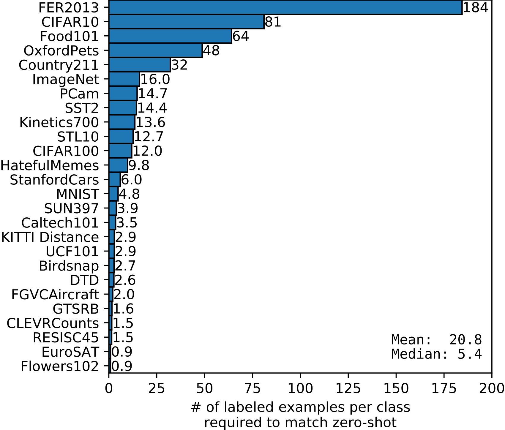

**EN.** Figure 7: The data efficiency of zero-shot transfer varies widely. Calculating the number of labeled examples per class a linear classifier on the same CLIP feature space requires to match the performance of the zero-shot classifier contextualizes the effectiveness of zero-shot transfer. Values are estimated based on log-linear interpolation of 1, 2, 4, 8, 16-shot and fully supervised results. Performance varies widely from still underperforming a one-shot classifier on two datasets to matching an estimated 184 labeled examples per class.

**中.** 图 7：零次传输的数据效率差异很大。计算同一 CLIP 特征空间上的线性分类器每个类的标记示例数量，需要匹配零样本分类器的性能，以体现零样本迁移的有效性。值是根据 1、2、4、8、16 次拍摄和完全监督结果的对数线性插值来估计的。性能差异很大，从在两个数据集上仍然表现不佳的一次性分类器到匹配每个类估计的 184 个标记示例。

**EN.** In addition to studying the average performance of zero-shot CLIP and few-shot logistic regression, we also examine performance on individual datasets. In Figure 7 , we show estimates for the number of labeled examples per class that a logistic regression classifier on the same feature space requires to match the performance of zero-shot CLIP. Since zero-shot CLIP is also a linear classifier, this estimates the effective data efficiency of zero-shot transfer in this setting. In order to avoid training thousands of linear classifiers, we estimate the effective data efficiency based on a log-linear interpolation of the performance of a 1, 2, 4, 8, 16-shot (when possible), and a fully supervised linear classifier trained on each dataset. We find that zero-shot transfer can have widely varying efficiency per dataset from less than 1 labeled example per class to 184. Two datasets, Flowers102 and EuroSAT underperform one-shot models. Half of the datasets require less than 5 examples per class with a median of 5.4. However, the mean estimated data efficiency is 20.8 examples per class. This is due to the 20% of datasets where supervised classifiers require many labeled examples per class in order to match performance. On ImageNet, zero-shot CLIP matches the performance of a 16-shot linear classifier trained on the same feature space.

**中.** 除了研究零样本 CLIP 和少样本逻辑回归的平均性能之外，我们还检查了单个数据集的性能。在图 7 中，我们显示了同一特征空间上的逻辑回归分类器为匹配零样本 CLIP 性能所需的每个类的标记示例数量的估计。由于零样本 CLIP 也是一个线性分类器，因此可以估计在此设置下零样本传输的有效数据效率。为了避免训练数千个线性分类器，我们根据 1、2、4、8、16 个镜头（如果可能）的性能的对数线性插值以及在每个数据集上训练的完全监督的线性分类器来估计有效数据效率。我们发现，每个数据集的零样本传输效率差异很大，从每类不到 1 个标记示例到 184 个。Flowers102 和 EuroSAT 两个数据集的性能低于单样本模型。一半的数据集每类需要的示例少于 5 个，中位数为 5.4。然而，平均估计数据效率为每类 20.8 个示例。这是因为 20% 的数据集中，监督分类器需要每个类有许多标记示例才能匹配性能。在 ImageNet 上，零样本 CLIP 与在相同特征空间上训练的 16 样本线性分类器的性能相匹配。

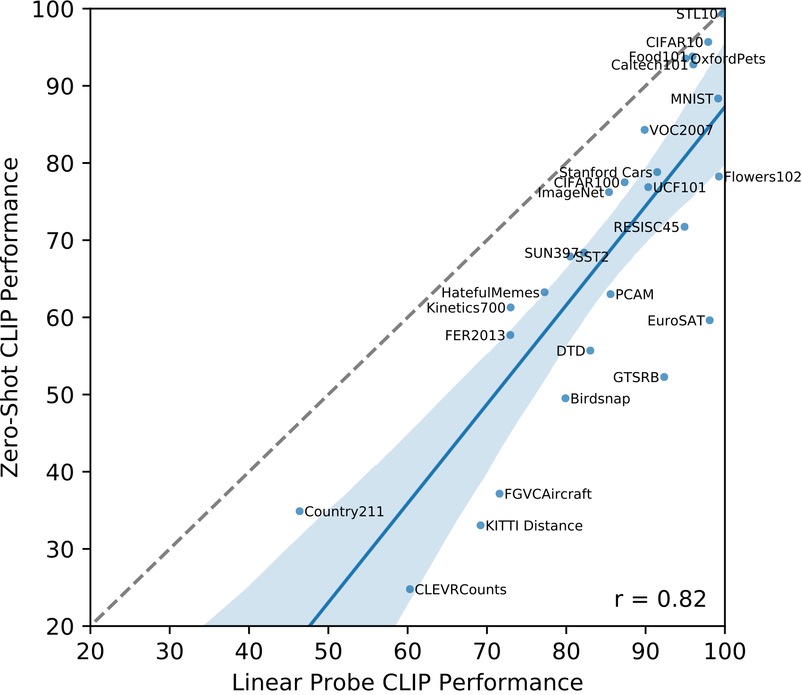

**EN.** Figure 8: Zero-shot performance is correlated with linear probe performance but still mostly sub-optimal. Comparing zero-shot and linear probe performance across datasets shows a strong correlation with zero-shot performance mostly shifted 10 to 25 points lower. On only 5 datasets does zero-shot performance approach linear probe performance ( $\leq$ 3 point difference).

**中.** 图 8：零样本性能与线性探头性能相关，但大部分仍不是最佳。比较跨数据集的零样本和线性探针性能显示出与零样本性能的强相关性，大部分都降低了 10 到 25 个点。仅在 5 个数据集上，零样本性能接近线性探针性能（$\leq$ 3 点差异）。

**EN.** If we assume that evaluation datasets are large enough that the parameters of linear classifiers trained on them are well estimated, then, because CLIP’s zero-shot classifier is also a linear classifier, the performance of the fully supervised classifiers roughly sets an upper bound for what zero-shot transfer can achieve. In Figure 8 we compare CLIP’s zero-shot performance with fully supervised linear classifiers across datasets. The dashed, $y=x$ line represents an “optimal” zero-shot classifier that matches the performance of its fully supervised equivalent. For most datasets, the performance of zero-shot classifiers still underperform fully supervised classifiers by 10% to 25%, suggesting that there is still plenty of headroom for improving CLIP’s task-learning and zero-shot transfer capabilities.

**中.** 如果我们假设评估数据集足够大，可以很好地估计在其上训练的线性分类器的参数，那么，由于 CLIP 的零样本分类器也是线性分类器，因此完全监督分类器的性能大致设定了零样本迁移可以实现的上限。在图 8 中，我们将 CLIP 的零样本性能与跨数据集的完全监督线性分类器进行了比较。虚线 $y=x$ 代表“最佳”零样本分类器，与其完全监督的等效分类器的性能相匹配。对于大多数数据集，零样本分类器的性能仍然比完全监督分类器低 10% 到 25%，这表明 CLIP 的任务学习和零样本迁移能力仍有很大的提升空间。

**EN.** There is a positive correlation of 0.82 (p-value $<10^{-6}$ ) between zero-shot performance and fully supervised performance, suggesting that CLIP is relatively consistent at connecting underlying representation and task learning to zero-shot transfer. However, zero-shot CLIP only approaches fully supervised performance on 5 datasets: STL10, CIFAR10, Food101, OxfordPets, and Caltech101. On all 5 datasets, both zero-shot accuracy and fully supervised accuracy are over 90%. This suggests that CLIP may be more effective at zero-shot transfer for tasks where its underlying representations are also high quality. The slope of a linear regression model predicting zero-shot performance as a function of fully supervised performance estimates that for every 1% improvement in fully supervised performance, zero-shot performance improves by 1.28%. However, the 95th-percentile confidence intervals still include values of less than 1 (0.93-1.79).

**中.** 零样本性能和完全监督性能之间存在 0.82（p 值 $<10^{-6}$ ）的正相关性，这表明 CLIP 在将底层表示和任务学习与零样本迁移连接起来方面相对一致。然而，零样本 CLIP 仅在 5 个数据集上达到完全监督的性能：STL10、CIFAR10、Food101、OxfordPets 和 Caltech101。在所有 5 个数据集上，零样本准确率和完全监督准确率均超过 90%。这表明，对于其底层表示也是高质量的任务，CLIP 在零样本传输方面可能更有效。预测零样本性能作为完全监督性能函数的线性回归模型的斜率估计，完全监督性能每提高 1%，零样本性能就会提高 1.28%。但是，95% 置信区间仍包含小于 1 (0.93-1.79) 的值。

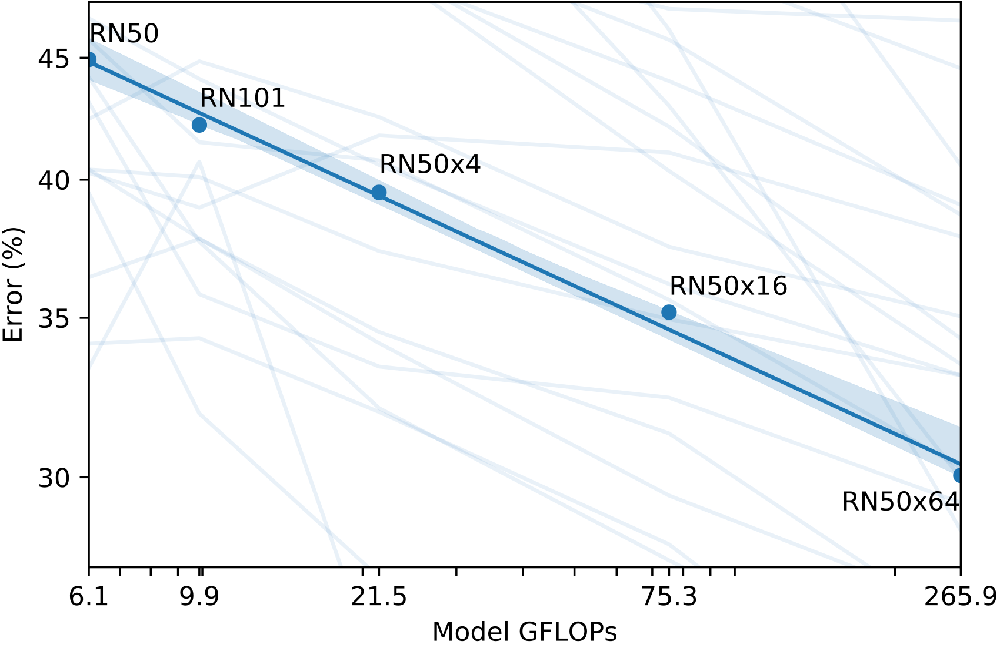

**EN.** Figure 9: Zero-shot CLIP performance scales smoothly as a function of model compute. Across 39 evals on 36 different datasets, average zero-shot error is well modeled by a log-log linear trend across a 44x range of compute spanning 5 different CLIP models. Lightly shaded lines are performance on individual evals, showing that performance is much more varied despite the smooth overall trend.

**中.** 图 9：零样本 CLIP 性能随着模型计算的函数平滑扩展。在 36 个不同数据集上的 39 次评估中，平均零样本误差通过跨 5 个不同 CLIP 模型的 44 倍计算范围的双对数线性趋势很好地建模。浅色阴影线是各个评估的表现，表明尽管整体趋势平稳，但表现却更加多样化。

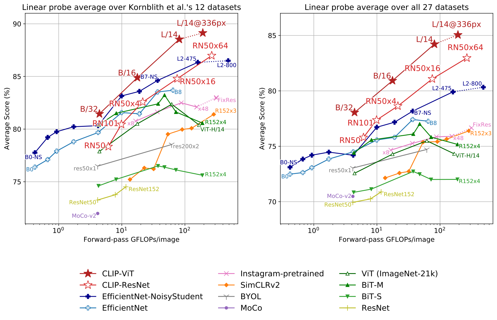

**EN.** Figure 10: Linear probe performance of CLIP models in comparison with state-of-the-art computer vision models , including EfficientNet ( Tan & Le, 2019 ; Xie et al., 2020 ) , MoCo ( Chen et al., 2020d ) , Instagram-pretrained ResNeXt models ( Mahajan et al., 2018 ; Touvron et al., 2019 ) , BiT ( Kolesnikov et al., 2019 ) , ViT ( Dosovitskiy et al., 2020 ) , SimCLRv2 ( Chen et al., 2020c ) , BYOL ( Grill et al., 2020 ) , and the original ResNet models ( He et al., 2016b ) . (Left) Scores are averaged over 12 datasets studied by Kornblith et al. (2019) . (Right) Scores are averaged over 27 datasets that contain a wider variety of distributions. Dotted lines indicate models fine-tuned or evaluated on images at a higher-resolution than pre-training. See Table 10 for individual scores and Figure 20 for plots for each dataset.

**中.** 图 10：CLIP 模型的线性探测性能与最先进的计算机视觉模型的比较，包括 EfficientNet（Tan & Le，2019；Xie 等人，2020）、MoCo（Chen 等人，2020d）、Instagram 预训练的 ResNeXt 模型（Mahajan 等人，2018；Touvron 等人，2019） 、BiT（Kolesnikov 等人，2019）、ViT（Dosovitskiy 等人，2020）、SimCLRv2（Chen 等人，2020c）、BYOL（Grill 等人，2020）和原始 ResNet 模型（He 等人，2016b）。 （左）分数是 Kornblith 等人研究的 12 个数据集的平均值。 （2019）。 （右）分数是对包含更广泛分布的 27 个数据集进行平均的。虚线表示模型在比预训练更高分辨率的图像上进行了微调或评估。有关各个分数，请参阅表 10；有关每个数据集的图，请参阅图 20。

**EN.** Over the past few years, empirical studies of deep learning systems have documented that performance is predictable as a function of important quantities such as training compute and dataset size ( Hestness et al., 2017 ; Kaplan et al., 2020 ) . The GPT family of models has so far demonstrated consistent improvements in zero-shot performance across a 1000x increase in training compute. In Figure 9 , we check whether the zero-shot performance of CLIP follows a similar scaling pattern. We plot the average error rate of the 5 ResNet CLIP models across 39 evaluations on 36 different datasets and find that a similar log-log linear scaling trend holds for CLIP across a 44x increase in model compute. While the overall trend is smooth, we found that performance on individual evaluations can be much noisier. We are unsure whether this is caused by high variance between individual training runs on sub-tasks (as documented in D’Amour et al. (2020) ) masking a steadily improving trend or whether performance is actually non-monotonic as a function of compute on some tasks.

**中.** 在过去的几年里，深度学习系统的实证研究证明，性能是可以预测的，它是训练计算和数据集大小等重要量的函数（Hestness 等人，2017 年；Kaplan 等人，2020 年）。迄今为止，GPT 系列模型在训练计算量增加 1000 倍的情况下，证明了零样本性能的持续改进。在图 9 中，我们检查 CLIP 的零样本性能是否遵循类似的缩放模式。我们绘制了 5 个 ResNet CLIP 模型在 36 个不同数据集上进行 39 次评估的平均错误率，发现在模型计算量增加 44 倍的情况下，CLIP 也存在类似的对数线性缩放趋势。虽然总体趋势平稳，但我们发现个人评估的表现可能会更加嘈杂。我们不确定这是否是由于子任务上的各个训练运行之间的高差异引起的（如 D'Amour 等人（2020）中所述）掩盖了稳步改善的趋势，或者性能是否实际上作为某些任务的计算函数是非单调的。

### Representation Learning / 表征学习

**EN.** While we have extensively analyzed the task-learning capabilities of CLIP through zero-shot transfer in the previous section, it is more common to study the representation learning capabilities of a model. There exist many ways to evaluate the quality of representations as well as disagreements over what properties an “ideal” representation should have ( Locatello et al., 2020 ) . Fitting a linear classifier on a representation extracted from the model and measuring its performance on various datasets is a common approach. An alternative is measuring the performance of end-to-end fine-tuning of the model. This increases flexibility, and prior work has convincingly demonstrated that fine-tuning outperforms linear classification on most image classification datasets ( Kornblith et al., 2019 ; Zhai et al., 2019 ) . While the high performance of fine-tuning motivates its study for practical reasons, we still opt for linear classifier based evaluation for several reasons. Our work is focused on developing a high-performing task and dataset-agnostic pre-training approach. Fine-tuning, because it adapts representations to each dataset during the fine-tuning phase, can compensate for and potentially mask failures to learn general and robust representations during the pre-training phase. Linear classifiers, because of their limited flexibility, instead highlight these failures and provide clear feedback during development. For CLIP, training supervised linear classifiers has the added benefit of being very similar to the approach used for its zero-shot classifiers which enables extensive comparisons and analysis in Section 3.1 . Finally, we aim to compare CLIP to a comprehensive set of existing models across many tasks. Studying 66 different models on 27 different datasets requires tuning 1782 different evaluations. Fine-tuning opens up a much larger design and hyper-parameter space, which makes it difficult to fairly evaluate and computationally expensive to compare a diverse set of techniques as discussed in other large scale empirical studies ( Lucic et al., 2018 ; Choi et al., 2019 ) . By comparison, linear classifiers require minimal hyper-parameter tuning and have standardized implementations and evaluation procedures. Please see Appendix A for further details on evaluation.

**中.** 虽然我们在上一节中通过零样本迁移广泛分析了 CLIP 的任务学习能力，但更常见的是研究模型的表示学习能力。有很多方法可以评估表示的质量，并且对于“理想”表示应具有哪些属性存在分歧（Locatello 等人，2020）。在从模型中提取的表示上拟合线性分类器并测量其在各种数据集上的性能是一种常见的方法。另一种方法是测量模型端到端微调的性能。这提高了灵活性，之前的工作已经令人信服地证明，在大多数图像分类数据集上，微调于线性分类（Kornblith 等人，2019；Zhai 等人，2019）。虽然微调的高性能出于实际原因激发了其研究，但出于多种原因，我们仍然选择基于线性分类器的评估。我们的工作重点是开发高性能任务和与数据集无关的预训练方法。微调，因为它在微调阶段使表示适应每个数据集，可以补偿并潜在地掩盖在预训练阶段学习通用和鲁棒表示的失败。线性分类器由于灵活性有限，反而会突出这些失败并在开发过程中提供清晰的反馈。对于 CLIP，训练监督线性分类器具有与其零样本分类器所使用的方法非常相似的额外好处，这使得第 3.1 节中可以进行广泛的比较和分析。最后，我们的目标是将 CLIP 与跨许多任务的一组全面的现有模型进行比较。在 27 个不同数据集上研究 66 个不同模型需要调整 1782 种不同的评估。微调开辟了更大的设计和超参数空间，这使得公平评估变得困难，并且比较其他大规模实证研究中讨论的各种技术的计算成本高昂（Lucic 等人，2018 年；Choi 等人，2019 年）。相比之下，线性分类器需要最少的超参数调整，并且具有标准化的实现和评估程序。有关评估的更多详细信息，请参阅附录 A。

**EN.** Figure 10 summarizes our findings. To minimize selection effects that could raise concerns of confirmation or reporting bias, we first study performance on the 12 dataset evaluation suite from Kornblith et al. (2019) . While small CLIP models such as a ResNet-50 and ResNet-101 outperform other ResNets trained on ImageNet-1K (BiT-S and the originals), they underperform ResNets trained on ImageNet-21K (BiT-M). These small CLIP models also underperform models in the EfficientNet family with similar compute requirements. However, models trained with CLIP scale very well and the largest model we trained (ResNet-50x64) slightly outperforms the best performing existing model (a Noisy Student EfficientNet-L2) on both overall score and compute efficiency. We also find that CLIP vision transformers are about 3x more compute efficient than CLIP ResNets, which allows us to reach higher overall performance within our compute budget. These results qualitatively replicate the findings of Dosovitskiy et al. (2020) which reported that vision transformers are more compute efficient than convnets when trained on sufficiently large datasets. Our best overall model is a ViT-L/14 that is fine-tuned at a higher resolution of 336 pixels on our dataset for 1 additional epoch. This model outperforms the best existing model across this evaluation suite by an average of 2.6%.

**中.** 图 10 总结了我们的发现。为了尽量减少可能引起确认或报告偏差问题的选择效应，我们首先研究 Kornblith 等人的 12 个数据集评估套件的性能。 （2019）。虽然 ResNet-50 和 ResNet-101 等小型 CLIP 模型的性能优于在 ImageNet-1K（BiT-S 和原始版本）上训练的其他 ResNet，但它们的性能低于在 ImageNet-21K (BiT-M) 上训练的 ResNet。这些小型 CLIP 模型的性能也低于具有类似计算要求的 EfficientNet 系列中的模型。然而，使用 CLIP 训练的模型规模非常好，我们训练的最大模型 (ResNet-50x64) 在总体得分和计算效率方面略优于性能最好的现有模型 (Noisy Student EfficientNet-L2)。我们还发现 CLIP 视觉转换器的计算效率比 CLIP ResNet 高出大约 3 倍，这使我们能够在计算预算内达到更高的整体性能。这些结果定性地重复了 Dosovitskiy 等人的发现。 （2020）报告称，当在足够大的数据集上进行训练时，视觉变换器比卷积网络具有更高的计算效率。我们最好的整体模型是 ViT-L/14，它在我们的数据集上以 336 像素的更高分辨率进行了 1 个额外 epoch 的微调。该模型的性能比整个评估套件中现有的最佳模型平均高出 2.6%。

**EN.** As Figure 21 qualitatively shows, CLIP models learn a wider set of tasks than has previously been demonstrated in a single computer vision model trained end-to-end from random initialization. These tasks include geo-localization, optical character recognition, facial emotion recognition, and action recognition. None of these tasks are measured in the evaluation suite of Kornblith et al. (2019) . This could be argued to be a form of selection bias in Kornblith et al. (2019) ’s study towards tasks that overlap with ImageNet. To address this, we also measure performance on a broader 27 dataset evaluation suite. This evaluation suite, detailed in Appendix A includes datasets representing the aforementioned tasks, German Traffic Signs Recognition Benchmark ( Stallkamp et al., 2011 ) , as well as several other datasets adapted from VTAB ( Zhai et al., 2019 ) .

**中.** 如图 21 定性所示，与之前通过随机初始化进行端到端训练的单个计算机视觉模型相比，CLIP 模型可以学习更广泛的任务集。这些任务包括地理定位、光学字符识别、面部情绪识别和动作识别。 Kornblith 等人的评估套件中没有对这些任务进行测量。 （2019）。 Kornblith 等人认为这可能是选择偏差的一种形式。 (2019) 针对与 ImageNet 重叠的任务的研究。为了解决这个问题，我们还测量了更广泛的 27 个数据集评估套件的性能。附录 A 中详细介绍了该评估套件，包括代表上述任务的数据集、德国交通标志识别基准（Stallkamp 等人，2011 年）以及改编自 VTAB 的其他几个数据集（Zhai 等人，2019 年）。

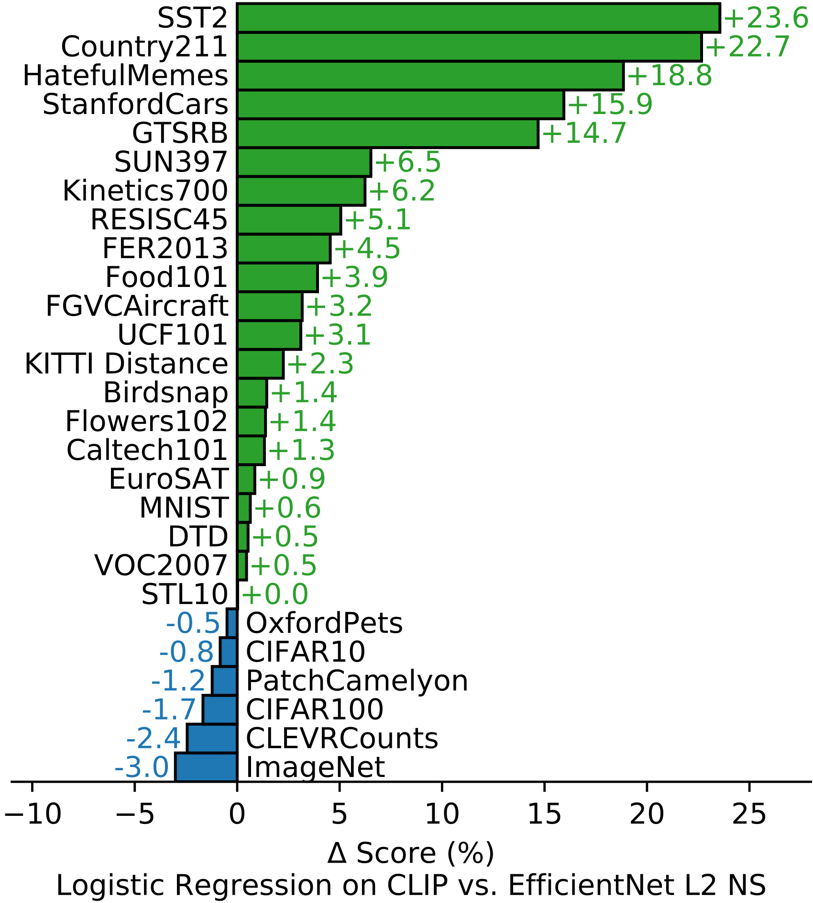

**EN.** Figure 11: CLIP’s features outperform the features of the best ImageNet model on a wide variety of datasets. Fitting a linear classifier on CLIP’s features outperforms using the Noisy Student EfficientNet-L2 on 21 out of 27 datasets.

**中.** 图 11：CLIP 的特征在各种数据集上都优于最佳 ImageNet 模型的特征。在 27 个数据集中的 21 个数据集上，在 CLIP 的特征上拟合线性分类器优于使用 Noisy Student EfficientNet-L2。

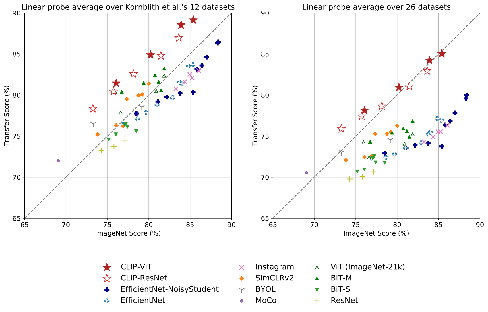

**EN.** Figure 12: CLIP’s features are more robust to task shift when compared to models pre-trained on ImageNet. For both dataset splits, the transfer scores of linear probes trained on the representations of CLIP models are higher than other models with similar ImageNet performance. This suggests that the representations of models trained on ImageNet are somewhat overfit to their task.

**中.** 图 12：与 ImageNet 上预训练的模型相比，CLIP 的功能对于任务转移更加稳健。对于这两个数据集分割，在 CLIP 模型表示上训练的线性探针的传输分数高于具有类似 ImageNet 性能的其他模型。这表明在 ImageNet 上训练的模型的表示在某种程度上过于适合他们的任务。

**EN.** On this broader evaluation suite, the benefits of CLIP are more clear. All CLIP models, regardless of scale, outperform all evaluated systems in terms of compute efficiency. The improvement in average score of the best model over previous systems increases from 2.6% to 5%. We also find that self-supervised systems do noticeably better on our broader evaluation suite. For instance, while SimCLRv2 still underperforms BiT-M on average on the 12 datasets of Kornblith et al. (2019) , SimCLRv2 outperforms BiT-M on our 27 dataset evaluation suite. These findings suggest continuing to expand task diversity and coverage in order to better understand the “general” performance of systems. We suspect additional evaluation efforts along the lines of VTAB to be valuable.

**中.** 在这个更广泛的评估套件上，CLIP 的优势更加明显。所有 CLIP 模型，无论规模如何，在计算效率方面都优于所有评估的系统。最佳模型的平均得分比之前的系统提高了 2.6% 到 5%。我们还发现，自我监督系统在我们更广泛的评估套件上表现明显更好。例如，虽然 SimCLRv2 在 Kornblith 等人的 12 个数据集上平均表现仍低于 BiT-M。 (2019)，SimCLRv2 在我们的 27 个数据集评估套件上优于 BiT-M。这些发现表明继续扩大任务多样性和覆盖范围，以便更好地了解系统的“一般”性能。我们怀疑 VTAB 方面的额外评估工作是有价值的。

**EN.** In addition to the aggregate analysis above, we visualize per-dataset differences in the performance of the best CLIP model and the best model in our evaluation suite across all 27 datasets in Figure 11 . CLIP outperforms the Noisy Student EfficientNet-L2 on 21 of the 27 datasets. CLIP improves the most on tasks which require OCR (SST2 and HatefulMemes), geo-localization and scene recognition (Country211, SUN397), and activity recognition in videos (Kinetics700 and UCF101). In addition CLIP also does much better on fine-grained car and traffic sign recognition (Stanford Cars and GTSRB). This may reflect a problem with overly narrow supervision in ImageNet. A result such as the 14.7% improvement on GTSRB could be indicative of an issue with ImageNet-1K, which has only a single label for all traffic and street signs. This could encourage a supervised representation to collapse intra-class details and hurt accuracy on a fine-grained downstream task. As mentioned, CLIP still underperforms the EfficientNet on several datasets. Unsurprisingly, the dataset that the EfficientNet does best relative to CLIP on is the one it was trained on: ImageNet. The EffcientNet also slightly outperforms CLIP on low-resolution datasets such as CIFAR10 and CIFAR100. We suspect this is at least partly due to the lack of scale-based data augmentation in CLIP. The EfficientNet also does slightly better on PatchCamelyon and CLEVRCounts, datasets where overall performance is still low for both approaches.

**中.** 除了上面的聚合分析之外，我们还可视化了图 11 中所有 27 个数据集的最佳 CLIP 模型和评估套件中最佳模型的每个数据集的性能差异。 CLIP 在 27 个数据集中的 21 个上优于 Noisy Student EfficientNet-L2。 CLIP 在需要 OCR（SST2 和 HatefulMemes）、地理定位和场景识别（Country211、SUN397）以及视频中的活动识别（Kinetics700 和 UCF101）的任务上改进最多。此外，CLIP 在细粒度汽车和交通标志识别方面也做得更好（Stanford Cars 和 GTSRB）。这可能反映了 ImageNet 中监督过于狭窄的问题。 GTSRB 提高 14.7% 之类的结果可能表明 ImageNet-1K 存在问题，它对所有交通和街道标志只有一个标签。这可能会鼓励监督表示破坏类内细节并损害细粒度下游任务的准确性。如前所述，CLIP 在多个数据集上的表现仍然低于 EfficientNet。不出所料，EfficientNet 相对于 CLIP 表现最好的数据集是它训练的数据集：ImageNet。 EffcientNet 在 CIFAR10 和 CIFAR100 等低分辨率数据集上的表现也略优于 CLIP。我们怀疑这至少部分是由于 CLIP 中缺乏基于规模的数据增强。 EfficientNet 在 PatchCamelyon 和 CLEVRCounts 上的表现也稍好一些，这两种方法的整体性能仍然较低。

### Robustness to Natural Distribution Shift / 对自然分布变化的稳健性

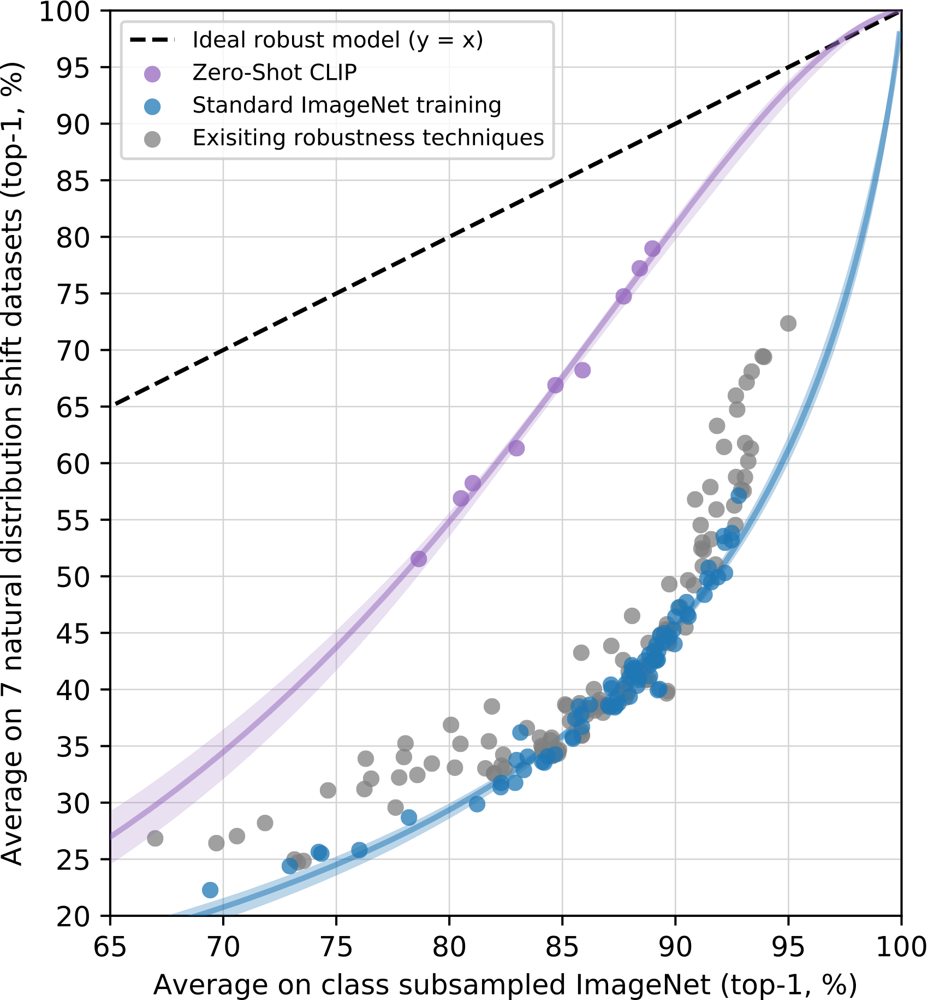

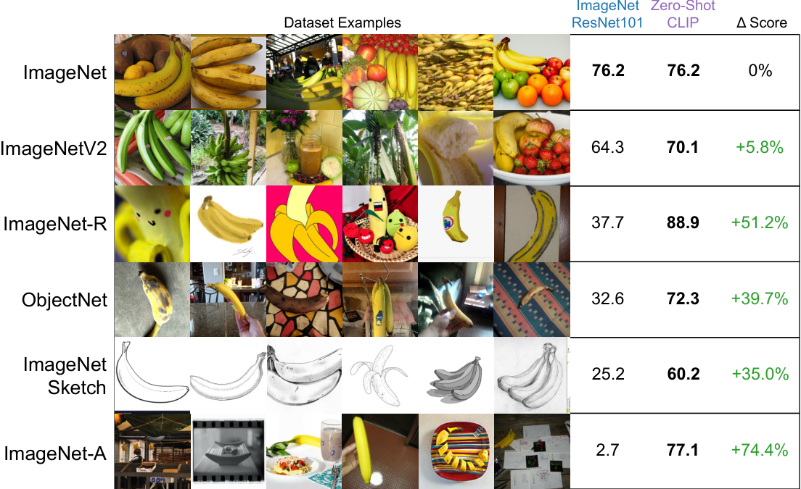

**EN.** Figure 13: Zero-shot CLIP is much more robust to distribution shift than standard ImageNet models. (Left) An ideal robust model (dashed line) performs equally well on the ImageNet distribution and on other natural image distributions. Zero-shot CLIP models shrink this “robustness gap” by up to 75%. Linear fits on logit transformed values are shown with bootstrap estimated 95% confidence intervals. (Right) Visualizing distribution shift for bananas, a class shared across 5 of the 7 natural distribution shift datasets. The performance of the best zero-shot CLIP model, ViT-L/14@336px, is compared with a model that has the same performance on the ImageNet validation set, ResNet-101.

**中.** 图 13：零样本 CLIP 对分布偏移的鲁棒性比标准 ImageNet 模型强得多。 （左）理想的鲁棒模型（虚线）在 ImageNet 分布和其他自然图像分布上表现同样出色。零样本 CLIP 模型将这种“鲁棒性差距”缩小了 75%。 Logit 转换值的线性拟合显示为 bootstrap 估计的 95% 置信区间。 （右）可视化香蕉的分布变化，该类在 7 个自然分布变化数据集中的 5 个数据集中共享。将最佳零样本 CLIP 模型 ViT-L/14@336px 的性能与在 ImageNet 验证集 ResNet-101 上具有相同性能的模型进行了比较。

**EN.** In 2015, it was announced that a deep learning model exceeded human performance on the ImageNet test set ( He et al., 2015 ) . However, research in the subsequent years has repeatedly found that these models still make many simple mistakes ( Dodge & Karam, 2017 ; Geirhos et al., 2018 ; Alcorn et al., 2019 ) , and new benchmarks testing these systems has often found their performance to be much lower than both their ImageNet accuracy and human accuracy ( Recht et al., 2019 ; Barbu et al., 2019 ) . What explains this discrepancy? Various ideas have been suggested and studied ( Ilyas et al., 2019 ; Geirhos et al., 2020 ) . A common theme of proposed explanations is that deep learning models are exceedingly adept at finding correlations and patterns which hold across their training dataset and thus improve in-distribution performance. However many of these correlations and patterns are actually spurious and do not hold for other distributions and result in large drops in performance on other datasets.

**中.** 2015年，宣布深度学习模型在ImageNet测试集上超越了人类的表现（He et al., 2015）。然而，随后几年的研究一再发现这些模型仍然会犯许多简单的错误（Dodge＆Karam，2017；Geirhos等人，2018；Alcorn等人，2019），并且测试这些系统的新基准经常发现它们的性能远低于ImageNet准确性和人类准确性（Recht等人，2019；Barbu等人，2019）。如何解释这种差异？人们提出并研究了各种想法（Ilyas 等人，2019；Geirhos 等人，2020）。所提出的解释的一个共同主题是深度学习模型非常擅长寻找训练数据集中的相关性和模式，从而提高分布内的性能。然而，许多这些相关性和模式实际上是虚假的，并且不适用于其他分布，并导致其他数据集上的性能大幅下降。

**EN.** We caution that, to date, most of these studies limit their evaluation to models trained on ImageNet. Recalling the topic of discussion, it may be a mistake to generalize too far from these initial findings. To what degree are these failures attributable to deep learning, ImageNet, or some combination of the two? CLIP models, which are trained via natural language supervision on a very large dataset and are capable of high zero-shot performance, are an opportunity to investigate this question from a different angle.

**中.** 我们警告说，迄今为止，大多数研究都将其评估限制在 ImageNet 上训练的模型上。回想一下讨论的主题，与这些最初的发现相去甚远的概括可能是错误的。这些失败在多大程度上归因于深度学习、ImageNet 或两者的某种组合？ CLIP 模型通过自然语言监督在非常大的数据集上进行训练，并且具有较高的零样本性能，是从不同角度研究这个问题的机会。

**EN.** Taori et al. (2020) is a recent comprehensive study moving towards quantifying and understanding these behaviors for ImageNet models. Taori et al. (2020) study how the performance of ImageNet models change when evaluated on natural distribution shifts . They measure performance on a set of 7 distribution shifts: ImageNetV2 ( Recht et al., 2019 ) , ImageNet Sketch ( Wang et al., 2019 ) , Youtube-BB and ImageNet-Vid ( Shankar et al., 2019 ) , ObjectNet ( Barbu et al., 2019 ) , ImageNet Adversarial ( Hendrycks et al., 2019 ) , and ImageNet Rendition ( Hendrycks et al., 2020a ) . They distinguish these datasets, which all consist of novel images collected from a variety of sources, from synthetic distribution shifts such as ImageNet-C ( Hendrycks & Dietterich, 2019 ) , Stylized ImageNet ( Geirhos et al., 2018 ) , or adversarial attacks ( Goodfellow et al., 2014 ) which are created by perturbing existing images in various ways. They propose this distinction because in part because they find that while several techniques have been demonstrated to improve performance on synthetic distribution shifts, they often fail to yield consistent improvements on natural distributions. [^footnote3]

**中.** 陶里等人。 (2020) 是一项最近的综合研究，旨在量化和理解 ImageNet 模型的这些行为。陶里等人。 (2020) 研究在评估自然分布变化时 ImageNet 模型的性能如何变化。他们测量了一组 7 个分布变化的性能：ImageNetV2 (Recht et al., 2019)、ImageNet Sketch (Wang et al., 2019)、Youtube-BB 和 ImageNet-Vid (Shankar et al., 2019)、ObjectNet (Barbu et al., 2019)、ImageNet Adversarial (Hendrycks et al., 2019) ）和 ImageNet Rendition（Hendrycks 等人，2020a）。他们将这些数据集与合成分布变化区分开来，这些数据集均由从各种来源收集的新颖图像组成，例如 ImageNet-C (Hendrycks & Dietterich, 2019)、Stylized ImageNet (Geirhos et al., 2018) 或通过以各种方式干扰现有图像​​而创建的对抗性攻击 (Goodfellow et al., 2014)。他们提出这种区别，部分原因是他们发现，虽然几种技术已被证明可以提高综合分布变化的性能，但它们往往无法对自然分布产生一致的改进。 [^footnote3]

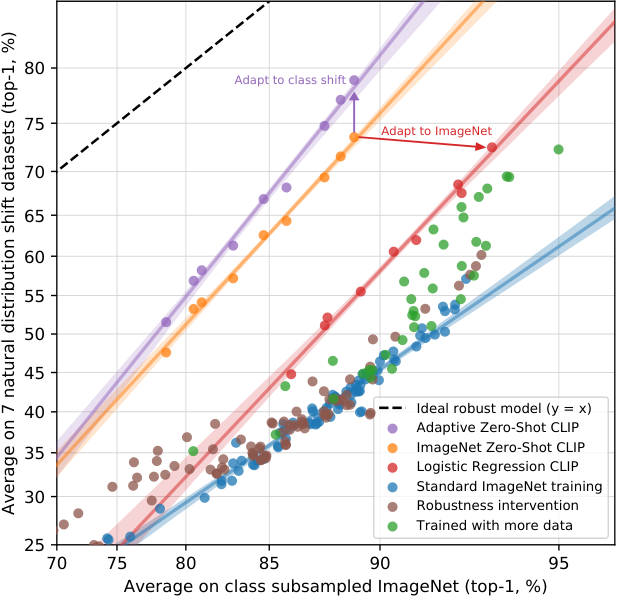

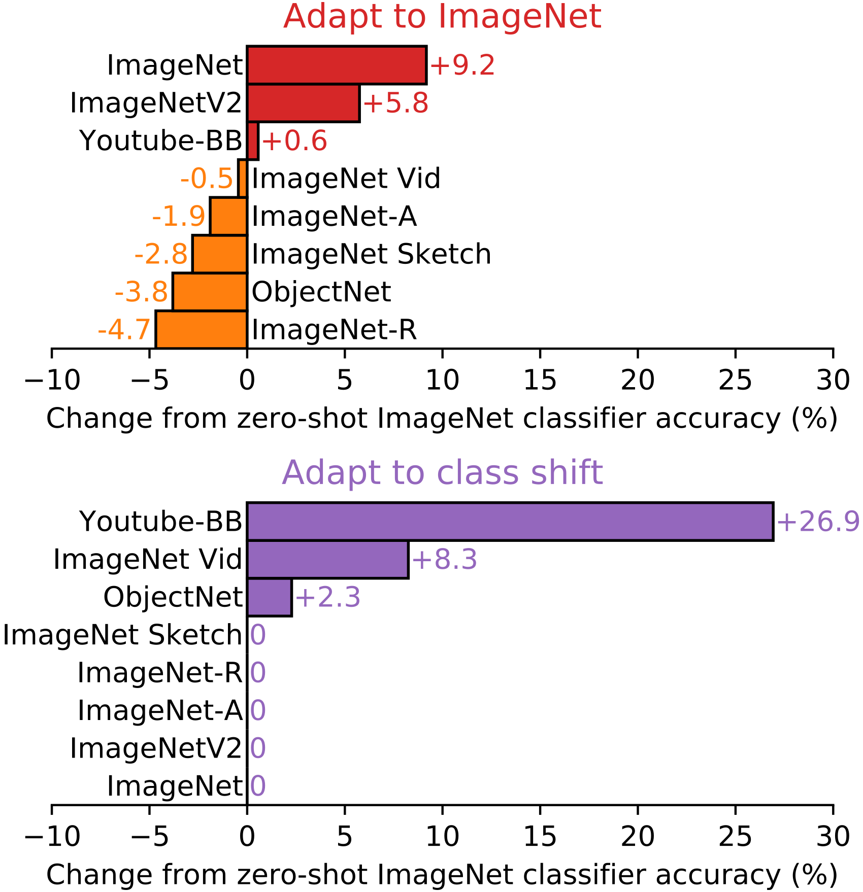

**EN.** Figure 14: While supervised adaptation to ImageNet increases ImageNet accuracy by 9.2%, it slightly reduces average robustness. (Left) Customizing zero-shot CLIP to each dataset improves robustness compared to using a single static zero-shot ImageNet classifier and pooling predictions across similar classes as in Taori et al. (2020) . CLIP models adapted to ImageNet have similar effective robustness as the best prior ImageNet models. (Right) Details of per dataset changes in accuracy for the two robustness interventions. Adapting to ImageNet increases accuracy on ImageNetV2 noticeably but trades off accuracy on several other distributions. Dataset specific zero-shot classifiers can improve accuracy by a large amount but are limited to only a few datasets that include classes which don’t perfectly align with ImageNet categories.

**中.** 图 14：虽然 ImageNet 的监督适应将 ImageNet 准确率提高了 9.2%，但它略微降低了平均鲁棒性。 （左）与使用单个静态零样本 ImageNet 分类器和跨相似类的池化预测（如 Taori 等人中所示）相比，为每个数据集定制零样本 CLIP 提高了鲁棒性。 （2020）。适应 ImageNet 的 CLIP 模型具有与先前最好的 ImageNet 模型类似的有效鲁棒性。 （右）两个鲁棒性干预措施的每个数据集的准确性变化的详细信息。适应 ImageNet 显着提高了 ImageNetV2 的准确性，但牺牲了其他几个分布的准确性。数据集特定的零样本分类器可以大量提高准确性，但仅限于少数数据集，其中包含与 ImageNet 类别不完全一致的类。

**EN.** Across these collected datasets, the accuracy of ImageNet models drop well below the expectation set by the ImageNet validation set. For the following summary discussion we report average accuracy across all 7 natural distribution shift datasets and average accuracy across the corresponding class subsets of ImageNet unless otherwise specified. Additionally, for Youtube-BB and ImageNet-Vid, which have two different evaluation settings, we use the average of pm-0 and pm-10 accuracy.

**中.** 在这些收集的数据集中，ImageNet 模型的准确性远低于 ImageNet 验证集设定的期望。在下面的总结讨论中，除非另有说明，我们报告所有 7 个自然分布偏移数据集的平均准确度以及 ImageNet 相应类子集的平均准确度。此外，对于具有两种不同评估设置的 Youtube-BB 和 ImageNet-Vid，我们使用 pm-0 和 pm-10 准确率的平均值。

**EN.** A ResNet-101 makes 5 times as many mistakes when evaluated on these natural distribution shifts compared to the ImageNet validation set. Encouragingly however, Taori et al. (2020) find that accuracy under distribution shift increases predictably with ImageNet accuracy and is well modeled as a linear function of logit-transformed accuracy. Taori et al. (2020) use this finding to propose that robustness analysis should distinguish between effective and relative robustness. Effective robustness measures improvements in accuracy under distribution shift above what is predicted by the documented relationship between in-distribution and out-of-distribution accuracy. Relative robustness captures any improvement in out-of-distribution accuracy. Taori et al. (2020) argue that robustness techniques should aim to improve both effective robustness and relative robustness.

**中.** 与 ImageNet 验证集相比，在对这些自然分布变化进行评估时，ResNet-101 犯的错误是 ImageNet 验证集的 5 倍。然而令人鼓舞的是，Taori 等人。 (2020) 发现分布偏移下的准确度可预测地随着 ImageNet 准确度的增加而增加，并且可以很好地建模为 logit 转换准确度的线性函数。陶里等人。 （2020）利用这一发现提出稳健性分析应区分有效稳健性和相对稳健性。有效稳健性衡量的是分布偏移情况下准确性的提高，高于分布内和分布外准确性之间记录的关系所预测的结果。相对鲁棒性体现了分布外精度的任何改进。陶里等人。 (2020) 认为稳健性技术应该旨在提高有效稳健性和相对稳健性。

**EN.** Almost all models studied in Taori et al. (2020) are trained or fine-tuned on the ImageNet dataset. Returning to the discussion in the introduction to this section - is training or adapting to the ImageNet dataset distribution the cause of the observed robustness gap? Intuitively, a zero-shot model should not be able to exploit spurious correlations or patterns that hold only on a specific distribution, since it is not trained on that distribution. [^footnote4] Thus it is reasonable to expect zero-shot models to have much higher effective robustness. In Figure 13 , we compare the performance of zero-shot CLIP with existing ImageNet models on natural distribution shifts. All zero-shot CLIP models improve effective robustness by a large amount and reduce the size of the gap between ImageNet accuracy and accuracy under distribution shift by up to 75%.

**中.** Taori 等人研究的几乎所有模型。 (2020) 在 ImageNet 数据集上进行训练或微调。回到本节简介中的讨论 - 训练或适应 ImageNet 数据集分布是观察到的鲁棒性差距的原因吗？直观上，零样本模型不应该能够利用仅在特定分布上成立的虚假相关性或模式，因为它没有接受过该分布的训练。 [^footnote4] 因此，零样本模型具有更高的有效鲁棒性是合理的。在图 13 中，我们将零样本 CLIP 与现有 ImageNet 模型在自然分布变化方面的性能进行了比较。所有零样本 CLIP 模型都大幅提高了有效鲁棒性，并将 ImageNet 准确率与分布偏移下准确率之间的差距缩小了 75%。

**EN.** While these results show that zero-shot models can be much more robust, they do not necessarily mean that supervised learning on ImageNet causes a robustness gap. Other details of CLIP, such as its large and diverse pre-training dataset or use of natural language supervision could also result in much more robust models regardless of whether they are zero-shot or fine-tuned. As an initial experiment to potentially begin narrowing this down, we also measure how the performance of CLIP models change after adapting to the ImageNet distribution via a L2 regularized logistic regression classifier fit to CLIP features on the ImageNet training set. We visualize how performance changes from the zero-shot classifier in Figure 14 . Although adapting CLIP to the ImageNet distribution increases its ImageNet accuracy by 9.2% to 85.4% overall, and ties the accuracy of the 2018 SOTA from Mahajan et al. (2018) , average accuracy under distribution shift slightly decreases .

**中.** 虽然这些结果表明零样本模型可以更加鲁棒，但它们并不一定意味着 ImageNet 上的监督学习会导致鲁棒性差距。 CLIP 的其他细节，例如其庞大且多样化的预训练数据集或自然语言监督的使用，也可能会产生更稳健的模型，无论它们是零样本还是微调。作为可能开始缩小范围的初步实验，我们还测量了 CLIP 模型的性能在通过 L2 正则化逻辑回归分类器适应 ImageNet 分布后如何变化，该分类器适合 ImageNet 训练集上的 CLIP 特征。我们在图 14 中可视化了零样本分类器的性能变化。尽管使 CLIP 适应 ImageNet 分布，其 ImageNet 准确率整体提高了 9.2% 至 85.4%，并且与 Mahajan 等人的 2018 SOTA 准确率持平。 (2018)，分布偏移下的平均准确度略有下降。

**EN.** It is surprising to see a 9.2% increase in accuracy, which corresponds to roughly 3 years of improvement in SOTA, fail to translate into any improvement in average performance under distribution shift. We also break down the differences between zero-shot accuracy and linear classifier accuracy per dataset in Figure 14 and find performance still increases significantly on one dataset, ImageNetV2. ImageNetV2 closely followed the creation process of the original ImageNet dataset which suggests that gains in accuracy from supervised adaptation are closely concentrated around the ImageNet distribution. Performance decreases by 4.7% on ImageNet-R, 3.8% on ObjectNet, 2.8% on ImageNet Sketch, and 1.9% on ImageNet-A. The change in accuracy on the two other datasets, Youtube-BB and ImageNet Vid, is insignificant.

**中.** 令人惊讶的是，准确率提高了 9.2%，相当于 SOTA 大约 3 年的改进，但在分布转移下却未能转化为平均性能的任何改进。我们还详细分析了图 14 中每个数据集的零样本精度和线性分类器精度之间的差异，发现在一个数据集 ImageNetV2 上性能仍然显着提高。 ImageNetV2 紧密遵循原始 ImageNet 数据集的创建过程，这表明监督适应所带来的准确度增益紧密集中在 ImageNet 分布周围。 ImageNet-R 上的性能下降了 4.7%，ObjectNet 上的性能下降了 3.8%，ImageNet Sketch 上的性能下降了 2.8%，ImageNet-A 上的性能下降了 1.9%。其他两个数据集 Youtube-BB 和 ImageNet Vid 的准确性变化微不足道。

**EN.** How is it possible to improve accuracy by 9.2% on the ImageNet dataset with little to no increase in accuracy under distribution shift? Is the gain primarily from “exploiting spurious correlations”? Is this behavior unique to some combination of CLIP, the ImageNet datatset, and the distribution shifts studied, or a more general phenomena? Does it hold for end-to-end finetuning as well as linear classifiers? We do not have confident answers to these questions at this time. Prior work has also pre-trained models on distributions other than ImageNet, but it is common to study and release models only after they have been fine-tuned to ImageNet. As a step towards understanding whether pre-trained zero-shot models consistently have higher effective robustness than fine-tuned models, we encourage the authors of Mahajan et al. (2018) , Kolesnikov et al. (2019) , and Dosovitskiy et al. (2020) to, if possible, study these questions on their models as well.

**中.** 如何将 ImageNet 数据集上的准确率提高 9.2%，而在分布偏移下准确率几乎没有提高？收益主要来自“利用虚假相关性”吗？这种行为是 CLIP、ImageNet 数据集和所研究的分布变化的某种组合所特有的，还是更普遍的现象？它是否适用于端到端微调以及线性分类器？目前我们对这些问题还没有确定的答案。之前的工作也在 ImageNet 以外的分布上预训练了模型，但通常只有在对 ImageNet 进行微调后才研究和发布模型。作为了解预训练零样本模型是否始终比微调模型具有更高有效鲁棒性的一步，我们鼓励 Mahajan 等人的作者。 （2018），科列斯尼科夫等人。 (2019) 和 Dosovitskiy 等人。 （2020）如果可能的话，也在他们的模型上研究这些问题。

**EN.** We also investigate another robustness intervention enabled by flexible zero-shot natural-language-based image classifiers. The target classes across the 7 transfer datasets are not always perfectly aligned with those of ImageNet. Two datasets, Youtube-BB and ImageNet-Vid, consist of super-classes of ImageNet. This presents a problem when trying to use the fixed 1000-way classifier of an ImageNet model to make predictions. Taori et al. (2020) handle this by max-pooling predictions across all sub-classes according to the ImageNet class hierarchy. Sometimes this mapping is much less than perfect. For the person class in Youtube-BB, predictions are made by pooling over the ImageNet classes for a baseball player, a bridegroom, and a scuba diver. With CLIP we can instead generate a custom zero-shot classifier for each dataset directly based on its class names. In Figure 14 we see that this improves average effective robustness by 5% but is concentrated in large improvements on only a few datasets. Curiously, accuracy on ObjectNet also increases by 2.3%. Although the dataset was designed to closely overlap with ImageNet classes, using the names provided for each class by ObjectNet’s creators still helps a small amount compared to using ImageNet class names and pooling predictions when necessary.

**中.** 我们还研究了另一种由灵活的基于自然语言的零样本图像分类器实现的鲁棒性干预。 7 个传输数据集的目标类别并不总是与 ImageNet 的目标类别完全一致。 Youtube-BB 和 ImageNet-Vid 两个数据集由 ImageNet 的超类组成。当尝试使用 ImageNet 模型的固定 1000 路分类器进行预测时，这会出现问题。陶里等人。 （2020）根据 ImageNet 类层次结构，通过所有子类的最大池化预测来处理这个问题。有时这种映射并不完美。对于 Youtube-BB 中的人员类别，通过汇集棒球运动员、新郎和水肺潜水员的 ImageNet 类别来进行预测。通过 CLIP，我们可以直接根据类名称为每个数据集生成自定义零样本分类器。在图 14 中，我们看到这将平均有效稳健性提高了 5%，但主要集中在少数数据集上的大幅改进。奇怪的是，ObjectNet 上的准确率也提高了 2.3%。尽管数据集的设计与 ImageNet 类紧密重叠，但与使用 ImageNet 类名称和必要时的池化预测相比，使用 ObjectNet 创建者为每个类提供的名称仍然有一定帮助。

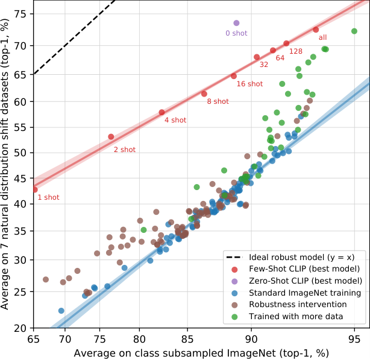

**EN.** Figure 15: Few-shot CLIP also increases effective robustness compared to existing ImageNet models but is less robust than zero-shot CLIP. Minimizing the amount of ImageNet training data used for adaption increases effective robustness at the cost of decreasing relative robustness. 16-shot logistic regression CLIP matches zero-shot CLIP on ImageNet, as previously reported in Figure 7 , but is less robust.

**中.** 图 15：与现有 ImageNet 模型相比，少样本 CLIP 还提高了有效稳健性，但不如零样本 CLIP 稳健。最大限度地减少用于适应的 ImageNet 训练数据量可以提高有效鲁棒性，但代价是降低相对鲁棒性。 16 样本逻辑回归 CLIP 与 ImageNet 上的零样本 CLIP 相匹配，如图 7 中先前报告的那样，但鲁棒性较差。

**EN.** While zero-shot CLIP improves effective robustness, Figure 14 shows that the benefit is almost entirely gone in a fully supervised setting. To better understand this difference, we investigate how effective robustness changes on the continuum from zero-shot to fully supervised. In Figure 15 we visualize the performance of 0-shot, 1-shot, 2-shot, 4-shot …, 128-shot, and fully supervised logistic regression classifiers on the best CLIP model’s features. We see that while few-shot models also show higher effective robustness than existing models, this benefit fades as in-distribution performance increases with more training data and is mostly, though not entirely, gone for the fully supervised model. Additionally, zero-shot CLIP is notably more robust than a few-shot model with equivalent ImageNet performance. Across our experiments, high effective robustness seems to result from minimizing the amount of distribution specific training data a model has access to, but this comes at a cost of reducing dataset-specific performance.

**中.** 虽然零样本 CLIP 提高了有效的鲁棒性，但图 14 显示，在完全监督的环境中，这种优势几乎完全消失。为了更好地理解这种差异，我们研究了从零样本到完全监督的连续体上有效鲁棒性如何变化。在图 15 中，我们可视化了 0-shot、1-shot、2-shot、4-shot…、128-shot 和完全监督逻辑回归分类器在最佳 CLIP 模型特征上的性能。我们看到，虽然少样本模型也比现有模型表现出更高的有效鲁棒性，但随着分布内性能随着训练数据的增加而增加，这种优势逐渐消失，并且对于完全监督的模型来说，这种优势大部分（尽管不是完全）消失了。此外，零样本 CLIP 明显比具有同等 ImageNet 性能的少样本模型更稳健。在我们的实验中，高效的鲁棒性似乎是通过最大限度地减少模型可以访问的特定于分布的训练数据量来实现的，但这是以降低特定于数据集的性能为代价的。

**EN.** Taken together, these results suggest that the recent shift towards large-scale task and dataset agnostic pre-training combined with a reorientation towards zero-shot and few-shot benchmarking on broad evaluation suites (as advocated by Yogatama et al. (2019) and Linzen (2020) ) promotes the development of more robust systems and provides a more accurate assessment of performance. We are curious to see if the same results hold for zero-shot models in the field of NLP such as the GPT family. While Hendrycks et al. (2020b) has reported that pre-training improves relative robustness on sentiment analysis, Miller et al. (2020) ’s study of the robustness of question answering models under natural distribution shift finds, similar to Taori et al. (2020) , little evidence of effective robustness improvements to date.

**中.** 总而言之，这些结果表明，最近向大规模任务和数据集无关的预训练的转变，加上对广泛评估套件的零样本和少样本基准测试的重新定位（如 Yogatama 等人（2019 年）和 Linzen（2020 年）所倡导的）促进了更强大的系统的开发，并提供了更准确的性能评估。我们很想知道同样的结果是否适用于 NLP 领域的零样本模型（例如 GPT 系列）。虽然亨德里克斯等人。 Miller 等人 (2020b) 报道称，预训练提高了情感分析的相对鲁棒性。 (2020) 对自然分布变化下问答模型稳健性的研究发现，与 Taori 等人类似。 (2020)，迄今为止，几乎没有证据表明有效的鲁棒性改进。

## Comparison to Human Performance / 与人类表现的比较

**EN.** How does CLIP compare to human performance and human learning? To get a better understanding of how well humans perform in similar evaluation settings to CLIP, we evaluated humans on one of our tasks. We wanted to get a sense of how strong human zero-shot performance is at these tasks, and how much human performance is improved if they are shown one or two image samples. This can help us to compare task difficulty for humans and CLIP, and identify correlations and differences between them.

**中.** CLIP 与人类表现和人类学习相比如何？为了更好地了解人类在与 CLIP 类似的评估环境中的表现，我们在其中一项任务上评估了人类。我们希望了解人类在这些任务中的零样本表现有多强，以及如果向他们展示一两个图像样本，人类的表现会提高多少。这可以帮助我们比较人类和 CLIP 的任务难度，并识别它们之间的相关性和差异。

**EN.** We had five different humans look at each of 3669 images in the test split of the Oxford IIT Pets dataset ( Parkhi et al., 2012 ) and select which of the 37 cat or dog breeds best matched the image (or ‘I don’t know’ if they were completely uncertain). In the zero-shot case the humans were given no examples of the breeds and asked to label them to the best of their ability without an internet search. In the one-shot experiment the humans were given one sample image of each breed and in the two-shot experiment they were given two sample images of each breed. [^footnote5]

**中.** 我们让 5 个不同的人查看了 Oxford IIT Pets 数据集测试部分中的 3669 张图像中的每一张（Parkhi 等人，2012），并选择 37 个猫或狗品种中哪一个与图像最匹配（如果完全不确定，则选择“我不知道”）。在零样本案例中，人类没有得到任何品种的例子，并被要求在不进行互联网搜索的情况下尽其所能地给它们贴上标签。在单次实验中，人类获得了每个品种的一张样本图像，而在双次实验中，人类获得了每个品种的两张样本图像。 [^footnote5]

|  | Accuracy 准确度 | Majority Vote on Full Dataset 对完整数据集进行多数投票 | Accuracy on Guesses 猜测的准确性 | Majority Vote Accuracy on Guesses 多数票猜测的准确性 |
| --- | --- | --- | --- | --- |
| Zero-shot human 零射击人类 | 53.7 | 57.0 | 69.7 | 63.9 |
| Zero-shot CLIP 零样本剪辑 | 93.5 | 93.5 | 93.5 | 93.5 |
| One-shot human 一击人类 | 75.7 | 80.3 | 78.5 | 81.2 |
| Two-shot human 两枪人类 | 75.7 | 85.0 | 79.2 | 86.1 |

**EN.** Table 2: Comparison of human performance on Oxford IIT Pets. As in Parkhi et al. (2012) , the metric is average per-class classification accuracy. Most of the gain in performance when going from the human zero shot case to the human one shot case is on images that participants were highly uncertain on. “Guesses” refers to restricting the dataset to where participants selected an answer other than “I don’t know”, the “majority vote” is taking the most frequent (exclusive of ties) answer per image.

**中.** 表 2：牛津 IIT 宠物的人类表现比较。正如 Parkhi 等人所言。 (2012)，衡量标准是平均每类分类精度。从人类零镜头案例到人类一镜头案例时，大部分性能提升都来自于参与者高度不确定的图像。 “猜测”是指将数据集限制为参与者选择除“我不知道”之外的答案，“多数投票”是指每张图像中最常见（不包括平局）的答案。

**EN.** One possible concern was that the human workers were not sufficiently motivated in the zero-shot task. High human accuracy of 94% on the STL-10 dataset ( Coates et al., 2011 ) and 97-100% accuracy on the subset of attention check images increased our trust in the human workers.

**中.** 一个可能的担忧是人类工作者在零样本任务中没有足够的积极性。 STL-10 数据集（Coates 等人，2011）的人类准确率高达 94%，注意力检查图像子集的准确率达到 97-100%，这增强了我们对人类工作者的信任。

**EN.** Interestingly, humans went from a performance average of 54% to 76% with just one training example per class, and the marginal gain from an additional training example is minimal. The gain in accuracy going from zero to one shot is almost entirely on images that humans were uncertain about. This suggests that humans “know what they don’t know” and are able to update their priors on the images they are most uncertain in based on a single example. Given this, it seems that while CLIP is a promising training strategy for zero-shot performance (Figure 5 ) and does well on tests of natural distribution shift (Figure 13 ), there is a large difference between how humans learn from a few examples and the few-shot methods in this paper.

**中.** 有趣的是，人类在每类仅使用一个训练样本的情况下，平均表现从 54% 上升到 76%，而额外训练样本的边际收益微乎其微。从零次拍摄到一次拍摄的准确度的提高几乎完全取决于人类不确定的图像。这表明人类“知道他们不知道什么”，并且能够根据单个示例更新他们最不确定的图像的先验知识。鉴于此，虽然 CLIP 是一种很有前景的零样本性能训练策略（图 5），并且在自然分布偏移测试中表现良好（图 13），但人类从几个示例中学习的方式与本文中的少数样本方法之间存在很大差异。

**EN.** This suggests that there are still algorithmic improvements waiting to be made to decrease the gap between machine and human sample efficiency, as noted by Lake et al. (2016) and others. Because these few-shot evaluations of CLIP don’t make effective use of prior knowledge and the humans do, we speculate that finding a method to properly integrate prior knowledge into few-shot learning is an important step in algorithmic improvements to CLIP. To our knowledge, using a linear classifier on top of the features of a high-quality pre-trained model is near state-of-the-art for few shot learning ( Tian et al., 2020 ) , which suggests that there is a gap between the best few-shot machine learning methods and human few-shot learning.

**中.** 正如 Lake 等人指出的，这表明仍然需要进行算法改进，以缩小机器和人类样本效率之间的差距。 （2016）等。由于 CLIP 的这些小样本评估并没有有效利用先验知识，而人类却这样做了，因此我们推测，找到一种将先验知识正确整合到小样本学习中的方法是 CLIP 算法改进的重要一步。据我们所知，在高质量预训练模型的特征之上使用线性分类器对于少样本学习来说几乎是最先进的（Tian et al., 2020），这表明最好的少样本机器学习方法和人类少样本学习之间存在差距。

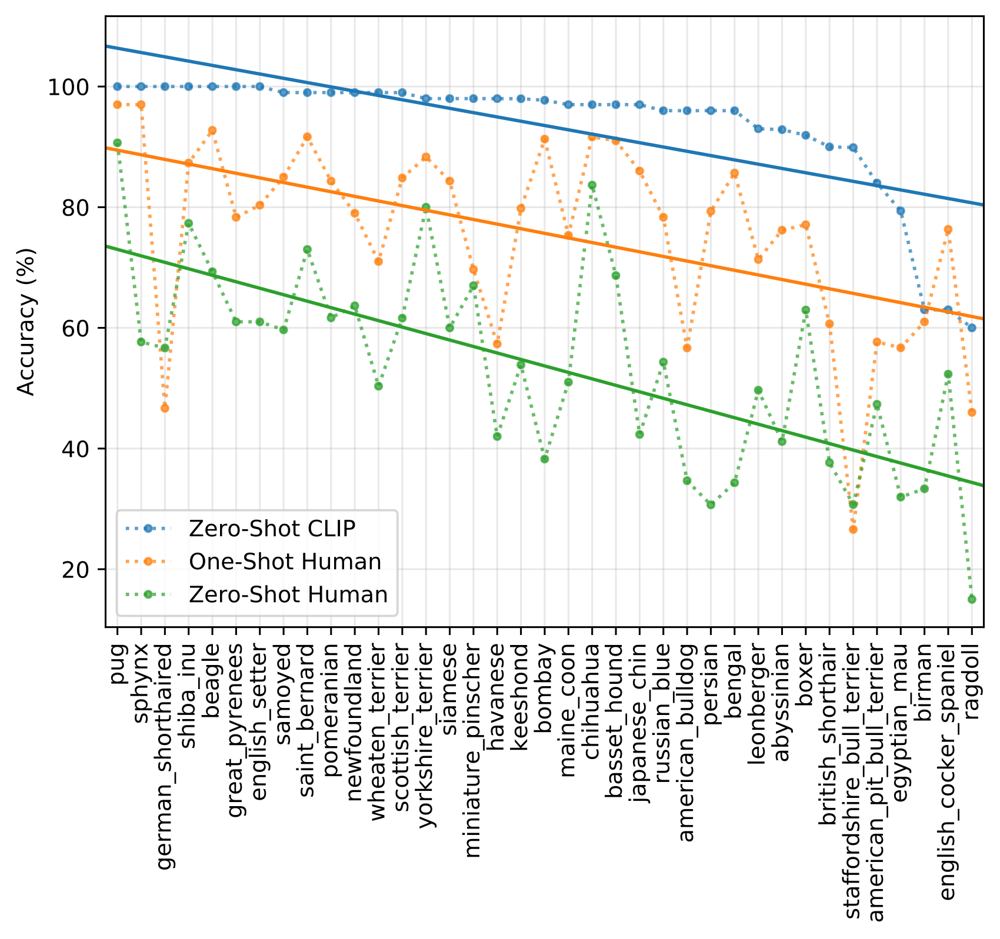

**EN.** Figure 16: The hardest problems for CLIP also tend to be the hardest problems for humans. Here we rank image categories by difficulty for CLIP as measured as probability of the correct label.

**中.** 图 16：CLIP 最难的问题往往也是人类最难的问题。在这里，我们按照 CLIP 的难度对图像类别进行排名，以正确标签的概率来衡量。

**EN.** If we plot human accuracy vs CLIP’s zero shot accuracy (Figure 16 ), we see that the hardest problems for CLIP are also hard for humans. To the extent that errors are consistent, our hypothesis is that this is due to at least a two factors: noise in the dataset (including mislabeled images) and out of distribution images being hard for both humans and models.

**中.** 如果我们绘制人类准确率与 CLIP 的零射击准确率的图（图 16），我们会发现 CLIP 遇到的最困难的问题对于人类来说也同样困难。就错误一致而言，我们的假设是，这至少是由于两个因素造成的：数据集中的噪声（包括错误标记的图像）和分布外的图像对人类和模型来说都很难。

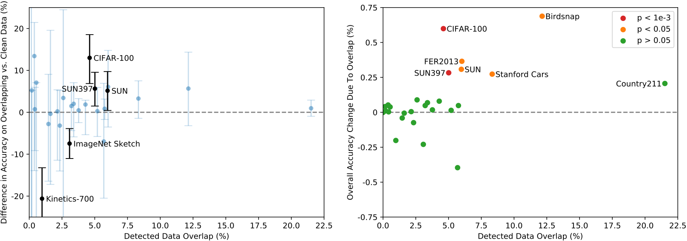

**EN.** Figure 17: Few statistically significant improvements in accuracy due to detected data overlap. (Left) While several datasets have up to $\pm$ 20% apparent differences in zero-shot accuracy on detected overlapping vs clean examples only 5 datasets out of 35 total have 99.5% Clopper-Pearson confidence intervals that exclude a 0% accuracy difference. 2 of these datasets do worse on overlapping data. (Right) Since the percentage of detected overlapping examples is almost always in the single digits, the overall test accuracy gain due to overlap is much smaller with the largest estimated increase being only 0.6% on Birdsnap. Similarly, for only 6 datasets are the accuracy improvements statistically significant when calculated using a one-sided binomial test.

**中.** 图 17：由于检测到的数据重叠，准确率在统计上几乎没有显着改善。 （左）虽然多个数据集在检测到的重叠示例与干净示例上的零样本精度有高达 $\pm$ 20% 的明显差异，但总共 35 个数据集中只有 5 个数据集具有 99.5% 的 Clopper-Pearson 置信区间，排除了 0% 的精度差异。其中 2 个数据集在重叠数据上表现较差。 （右）由于检测到的重叠示例的百分比几乎总是个位数，因此由于重叠而带来的整体测试精度增益要小得多，Birdsnap 上的最大估计增幅仅为 0.6%。同样，当使用单边二项式检验进行计算时，只有 6 个数据集的准确性提高具有统计显着性。

## Data Overlap Analysis / 数据重叠分析

**EN.** A concern with pre-training on a very large internet dataset is unintentional overlap with downstream evals. This is important to investigate since, in a worst-case scenario, a complete copy of an evaluation dataset could leak into the pre-training dataset and invalidate the evaluation as a meaningful test of generalization. One option to prevent this is to identify and remove all duplicates before training a model. While this guarantees reporting true hold-out performance, it requires knowing all possible data which a model might be evaluated on ahead of time. This has the downside of limiting the scope of benchmarking and analysis. Adding a new evaluation would require an expensive re-train or risk reporting an un-quantified benefit due to overlap.

**中.** 对非常大的互联网数据集进行预训练的一个问题是与下游评估的无意重叠。这对于调查很重要，因为在最坏的情况下，评估数据集的完整副本可能会泄漏到预训练数据集中，并使评估作为有意义的泛化测试无效。防止这种情况的一种选择是在训练模型之前识别并删除所有重复项。虽然这保证了报告真实的保留性能，但它需要提前了解模型可能评估的所有可能数据。这样做的缺点是限制了基准测试和分析的范围。添加新的评估将需要昂贵的重新培训，或者由于重叠而存在报告未量化收益的风险。

**EN.** Instead, we document how much overlap occurs and how performance changes due to these overlaps. To do this, we use the following procedure:

**中.** 相反，我们记录发生了多少重叠以及由于这些重叠而导致的性能如何变化。为此，我们使用以下过程：

**EN.** 1) For each evaluation dataset, we run a duplicate detector (see Appendix C ) on its examples. We then manually inspect the found nearest neighbors and set a per dataset threshold to keep high precision while maximizing recall. Using this threshold, we then create two new subsets, Overlap , which contains all examples which have a similarity to a training example above the threshold, and Clean , which contains all examples that are below this threshold. We denote the unaltered full dataset All for reference. From this we first record the degree of data contamination as the ratio of the number of examples in Overlap to the size of All .

**中.** 1) 对于每个评估数据集，我们在其示例上运行重复检测器（参见附录 C）。然后，我们手动检查找到的最近邻居，并设置每个数据集的阈值，以保持高精度，同时最大化召回率。然后，使用此阈值，我们创建两个新的子集： Overlap ，其中包含与高于阈值的训练示例相似的所有示例；以及 Clean ，其中包含低于此阈值的所有示例。我们将未更改的完整数据集 All 表示为参考。由此，我们首先将数据污染程度记录为 Overlap 中的示例数量与 All 的大小之比。

**EN.** 2) We then compute the zero-shot accuracy of CLIP RN50x64 on the three splits and report All - Clean as our main metric. This is the difference in accuracy due to contamination. When positive it is our estimate of how much the overall reported accuracy on the dataset was inflated by over-fitting to overlapping data.

**中.** 2) 然后我们计算 CLIP RN50x64 在三个分割上的零样本精度，并报告 All - Clean 作为我们的主要指标。这是由于污染而导致的精度差异。当为正值时，我们估计数据集的总体报告准确性因过度拟合重叠数据而夸大了多少。

**EN.** 3) The amount of overlap is often small so we also run a binomial significance test where we use the accuracy on Clean as the null hypothesis and compute the one-tailed (greater) p-value for the Overlap subset. We also calculate 99.5% Clopper-Pearson confidence intervals on Dirty as another check.

**中.** 3) 重叠量通常很小，因此我们还运行二项式显着性检验，其中我们使用 Clean 的准确性作为原假设，并计算重叠子集的单尾（较大）p 值。我们还计算 Dirty 的 99.5% Clopper-Pearson 置信区间作为另一项检查。

**EN.** A summary of this analysis is presented in Figure 17 . Out of 35 datasets studied, 9 datasets have no detected overlap at all. Most of these datasets are synthetic or specialized making them unlikely to be posted as normal images on the internet (for instance MNIST, CLEVR, and GTSRB) or are guaranteed to have no overlap due to containing novel data from after the date our dataset was created (ObjectNet and Hateful Memes). This demonstrates our detector has a low-false positive rate which is important as false positives would under-estimate the effect of contamination in our analysis. There is a median overlap of 2.2% and an average overlap of 3.2%. Due to this small amount of overlap, overall accuracy is rarely shifted by more than 0.1% with only 7 datasets above this threshold. Of these, only 2 are statistically significant after Bonferroni correction. The max detected improvement is only 0.6% on Birdsnap which has the second largest overlap at 12.1%. The largest overlap is for Country211 at 21.5%. This is due to it being constructed out of YFCC100M, which our pre-training dataset contains a filtered subset of. Despite this large overlap there is only a 0.2% increase in accuracy on Country211. This may be because the training text accompanying an example is often not related to the specific task a downstream eval measures. Country211 measures geo-localization ability, but inspecting the training text for these duplicates showed they often do not mention the location of the image.

**中.** 图 17 给出了该分析的摘要。在研究的 35 个数据集中，有 9 个数据集根本没有检测到重叠。这些数据集大多数是合成的或专门的，这使得它们不太可能作为普通图像发布在互联网上（例如 MNIST、CLEVR 和 GTSRB），或者由于包含我们的数据集创建之日之后的新数据（ObjectNet 和 Hateful Memes），因此保证不会有重叠。这表明我们的检测器具有较低的误报率，这一点很重要，因为误报会低估我们分析中污染的影响。中值重叠为 2.2%，平均重叠为 3.2%。由于重叠量很小，总体准确度的变化很少超过 0.1%，只有 7 个数据集高于此阈值。其中，只有 2 个在 Bonferroni 校正后具有统计显着性。 Birdsnap 检测到的最大改进仅为 0.6%，而 Birdsnap 的重叠率第二大，为 12.1%。 Country211 的重叠最大，为 21.5%。这是因为它是由 YFCC100M 构建的，我们的预训练数据集包含 YFCC100M 的过滤子集。尽管存在很大的重叠，但 Country211 的准确率仅提高了 0.2%。这可能是因为示例附带的训练文本通常与下游评估测量的特定任务无关。 Country211 衡量地理定位能力，但检查这些重复项的训练文本表明它们通常不会提及图像的位置。

**EN.** We are aware of two potential concerns with our analysis. First our detector is not perfect. While it achieves near 100% accuracy on its proxy training task and manual inspection + threshold tuning results in very high precision with good recall among the found nearest-neighbors, we can not tractably check its recall across 400 million examples. Another potential confounder of our analysis is that the underlying data distribution may shift between the Overlap and Clean subsets. For example, on Kinetics-700 many “overlaps” are in fact all black transition frames. This explains why Kinetics-700 has an apparent 20% accuracy drop on Overlap . We suspect more subtle distribution shifts likely exist. One possibility we noticed on CIFAR-100 is that, due to the very low resolution of its images, many duplicates were false positives of small objects such as birds or planes. Changes in accuracy could instead be due to changes in the class distribution or difficulty of the duplicates. Unfortunately, these distribution and difficulty shifts could also mask the effects of over-fitting.

**中.** 我们意识到我们的分析存在两个潜在问题。首先我们的探测器并不完美。虽然它在代理训练任务上实现了接近 100% 的准确率，并且手动检查 + 阈值调整导致非常高的精度，并且在找到的最近邻中具有良好的召回率，但我们无法在 4 亿个示例中轻松检查其召回率。我们分析的另一个潜在的混杂因素是底层数据分布可能在重叠子集和干净子集之间变化。例如，在 Kinetics-700 上，许多“重叠”实际上都是黑色过渡帧。这解释了为什么 Kinetics-700 在 Overlap 上的准确度明显下降了 20%。我们怀疑可能存在更微妙的分布变化。我们在 CIFAR-100 上注意到的一种可能性是，由于其图像分辨率非常低，许多重复图像是鸟类或飞机等小物体的误报。准确度的变化可能是由于类别分布或重复难度的变化造成的。不幸的是，这些分布和难度变化也可能掩盖过度拟合的影响。

**EN.** However, these results closely follow the findings of similar duplicate analysis in previous work on large scale pre-training. Mahajan et al. (2018) and Kolesnikov et al. (2019) detected similar overlap rates and found minimal changes in overall performance. Importantly, Kolesnikov et al. (2019) also compared the alternative de-duplication strategy discussed in the introduction to this section with the approach we settled on and observed little difference between the two approaches.

**中.** 然而，这些结果与之前大规模预训练工作中类似重复分析的结果密切相关。马哈詹等人。 （2018）和科列斯尼科夫等人。 (2019) 检测到类似的重叠率，并发现整体性能变化最小。重要的是，科列斯尼科夫等人。 (2019) 还将本节介绍中讨论的替代重复数据删除策略与我们选择的方法进行了比较，发现两种方法之间几乎没有差异。

## Limitations / 局限性

**EN.** There are still many limitations to CLIP. While several of these are discussed as part of analysis in various sections, we summarize and collect them here.

**中.** CLIP仍然有很多限制。虽然其中一些内容作为各个部分分析的一部分进行了讨论，但我们在这里总结并收集了它们。

**EN.** On datasets with training splits, the performance of zero-shot CLIP is on average competitive with the simple supervised baseline of a linear classifier on top of ResNet-50 features. On most of these datasets, the performance of this baseline is now well below the overall state of the art. Significant work is still needed to improve the task learning and transfer capabilities of CLIP. While scaling has so far steadily improved performance and suggests a route for continued improvement, we estimate around a 1000x increase in compute is required for zero-shot CLIP to reach overall state-of-the-art performance. This is infeasible to train with current hardware. Further research into improving upon the computational and data efficiency of CLIP will be necessary.

**中.** 在具有训练分割的数据集上，零样本 CLIP 的性能平均而言与基于 ResNet-50 特征的线性分类器的简单监督基线具有竞争力。在大多数数据集上，该基线的性能现在远低于整体现有技术水平。提高 CLIP 的任务学习和迁移能力仍需要做大量工作。虽然到目前为止，扩展已经稳步提高了性能，并提出了持续改进的途径，但我们估计零样本 CLIP 需要增加大约 1000 倍的计算量才能达到整体最先进的性能。使用当前的硬件进行训练是不可行的。有必要进一步研究提高 CLIP 的计算和数据效率。

**EN.** Analysis in Section 3.1 found that CLIP’s zero-shot performance is still quite weak on several kinds of tasks. When compared to task-specific models, the performance of CLIP is poor on several types of fine-grained classification such as differentiating models of cars, species of flowers, and variants of aircraft. CLIP also struggles with more abstract and systematic tasks such as counting the number of objects in an image. Finally for novel tasks which are unlikely to be included in CLIP’s pre-training dataset, such as classifying the distance to the nearest car in a photo, CLIP’s performance can be near random. We are confident that there are still many, many, tasks where CLIP’s zero-shot performance is near chance level.

**中.** 3.1节的分析发现，CLIP的零样本性能在几种任务上仍然相当薄弱。与特定任务模型相比，CLIP 在多种细粒度分类上的性能较差，例如区分汽车型号、花卉种类和飞机变体。 CLIP 还难以处理更抽象和系统的任务，例如计算图像中物体的数量。最后，对于不太可能包含在 CLIP 预训练数据集中的新任务，例如对照片中到最近汽车的距离进行分类，CLIP 的性能可能接近随机。我们相信，在许多任务中，CLIP 的零样本性能仍然接近偶然水平。

**EN.** While zero-shot CLIP generalizes well to many natural image distributions as investigated in Section 3.3 , we’ve observed that zero-shot CLIP still generalizes poorly to data that is truly out-of-distribution for it. An illustrative example occurs for the task of OCR as reported in Appendix E . CLIP learns a high quality semantic OCR representation that performs well on digitally rendered text, which is common in its pre-training dataset, as evidenced by performance on Rendered SST2. However, CLIP only achieves 88% accuracy on the handwritten digits of MNIST. An embarrassingly simple baseline of logistic regression on raw pixels outperforms zero-shot CLIP. Both semantic and near-duplicate nearest-neighbor retrieval verify that there are almost no images that resemble MNIST digits in our pre-training dataset. This suggests CLIP does little to address the underlying problem of brittle generalization of deep learning models. Instead CLIP tries to circumvent the problem and hopes that by training on such a large and varied dataset that all data will be effectively in-distribution. This is a naive assumption that, as MNIST demonstrates, is easy to violate.

**中.** 虽然零样本 CLIP 可以很好地推广到许多自然图像分布，如第 3.3 节中所研究的那样，但我们观察到零样本 CLIP 仍然很难推广到真正不符合分布的数据。附录 E 中报告的 OCR 任务有一个说明性示例。 CLIP 学习高质量的语义 OCR 表示，该表示在数字渲染文本上表现良好，这在其预训练数据集中很常见，渲染 SST2 上的性能证明了这一点。然而，CLIP 对 MNIST 手写数字的准确率仅达到 88%。原始像素上的逻辑回归的简单得令人尴尬的基线优于零样本 CLIP。语义和近重复最近邻检索都验证了我们的预训练数据集中几乎没有类似于 MNIST 数字的图像。这表明 CLIP 在解决深度学习模型泛化脆弱的根本问题上几乎没有什么作用。相反，CLIP 试图规避这个问题，并希望通过在如此庞大且多样化的数据集上进行训练，使所有数据都能有效地分布。这是一个天真的假设，正如 MNIST 所证明的那样，很容易被违反。

**EN.** Although CLIP can flexibly generate zero-shot classifiers for a wide variety of tasks and datasets, CLIP is still limited to choosing from only those concepts in a given zero-shot classifier. This is a significant restriction compared to a truly flexible approach like image captioning which could generate novel outputs. Unfortunately, as described in Section 2.3 we found the computational efficiency of the image caption baseline we tried to be much lower than CLIP. A simple idea worth trying is joint training of a contrastive and generative objective with the hope of combining the efficiency of CLIP with the flexibility of a caption model. As another alternative, search could be performed at inference time over many natural language explanations of a given image, similar to approach proposed in Learning with Latent Language Andreas et al. (2017) .

**中.** 尽管 CLIP 可以灵活地为各种任务和数据集生成零样本分类器，但 CLIP 仍然仅限于仅从给定零样本分类器中的那些概念中进行选择。与真正灵活的方法（例如可以生成新颖输出的图像字幕）相比，这是一个重大限制。不幸的是，正如2.3节中所描述的，我们发现我们尝试的图像标题基线的计算效率远低于CLIP。一个值得尝试的简单想法是联合训练对比目标和生成目标，希望将 CLIP 的效率与字幕模型的灵活性结合起来。作为另一种选择，可以在推理时对给定图像的许多自然语言解释进行搜索，类似于 Andreas 等人在 Learning with Latent Language 中提出的方法。 （2017）。

**EN.** CLIP also does not address the poor data efficiency of deep learning. Instead CLIP compensates by using a source of supervision that can be scaled to hundreds of millions of training examples. If every image seen during training of a CLIP model was presented at a rate of one per second, it would take 405 years to iterate through the 12.8 billion images seen over 32 training epochs. Combining CLIP with self-supervision ( Henaff, 2020 ; Chen et al., 2020c ) and self-training ( Lee, ; Xie et al., 2020 ) methods is a promising direction given their demonstrated ability to improve data efficiency over standard supervised learning.

**中.** CLIP 也没有解决深度学习数据效率低下的问题。相反，CLIP 通过使用可扩展到数亿个训练示例的监督源来进行补偿。如果 CLIP 模型训练期间看到的每张图像都以每秒一张的速度呈现，则需要 405 年才能迭代 32 个训练周期中看到的 128 亿张图像。将 CLIP 与自监督（Henaff，2020；Chen 等人，2020c）和自训练（Lee，；Xie 等人，2020）方法相结合是一个有前途的方向，因为它们已被证明能够比标准监督学习提高数据效率。

**EN.** Our methodology has several significant limitations. Despite our focus on zero-shot transfer, we repeatedly queried performance on full validation sets to guide the development of CLIP. These validation sets often have thousands of examples, which is unrealistic for true zero-shot scenarios. Similar concerns have been raised in the field of semi-supervised learning ( Oliver et al., 2018 ) . Another potential issue is our selection of evaluation datasets. While we have reported results on Kornblith et al. (2019) ’s 12 dataset evaluation suite as a standardized collection, our main results use a somewhat haphazardly assembled collection of 27 datasets that is undeniably co-adapted with the development and capabilities of CLIP. Creating a new benchmark of tasks designed explicitly to evaluate broad zero-shot transfer capabilities, rather than re-using existing supervised datasets, would help address these issues.

**中.** 我们的方法有几个明显的局限性。尽管我们专注于零样本传输，但我们还是反复询问完整验证集的性能，以指导 CLIP 的开发。这些验证集通常有数千个示例，这对于真正的零样本场景来说是不现实的。半监督学习领域也提出了类似的担忧（Oliver et al., 2018）。另一个潜在的问题是我们对评估数据集的选择。虽然我们已经报告了 Kornblith 等人的结果。 (2019) 的 12 个数据集评估套件作为标准化集合，我们的主要结果使用了 27 个数据集的有点随意组装的集合，这些数据集无疑与 CLIP 的开发和功能相适应。创建一个新的任务基准，明确设计用于评估广泛的零样本传输能力，而不是重新使用现有的监督数据集，将有助于解决这些问题。

**EN.** CLIP is trained on text paired with images on the internet. These image-text pairs are unfiltered and uncurated and result in CLIP models learning many social biases. This has been previously demonstrated for image caption models ( Bhargava & Forsyth, 2019 ) . We refer readers to Section 7 for detailed analysis and quantification of these behaviors for CLIP as well as discussion of potential mitigation strategies.

**中.** CLIP 接受了与互联网上的图像配对的文本训练。这些图像-文本对是未经过滤和未经策划的，导致 CLIP 模型学习许多社会偏见。这之前已经在图像标题模型中得到了证明（Bhargava & Forsyth，2019）。我们建议读者参阅第 7 节，详细分析和量化这些 CLIP 行为，并讨论潜在的缓解策略。

**EN.** While we have emphasized throughout this work that specifying image classifiers through natural language is a flexible and general interface, it has its own limitations. Many complex tasks and visual concepts can be difficult to specify just through text. Actual training examples are undeniably useful but CLIP does not optimize for few-shot performance directly. In our work, we fall back to fitting linear classifiers on top of CLIP’s features. This results in a counter-intuitive drop in performance when transitioning from a zero-shot to a few-shot setting. As discussed in Section 4 , this is notably different from human performance which shows a large increase from a zero to a one shot setting. Future work is needed to develop methods that combine CLIP’s strong zero-shot performance with efficient few-shot learning.

**中.** 虽然我们在整个工作中一直强调通过自然语言指定图像分类器是一个灵活且通用的接口，但它有其自身的局限性。许多复杂的任务和视觉概念可能很难仅通过文本来指定。不可否认，实际训练示例是有用的，但 CLIP 并不直接针对少样本性能进行优化。在我们的工作中，我们在 CLIP 的特征之上回归拟合线性分类器。当从零射击设置过渡到几次射击设置时，这会导致性能出现反直觉的下降。正如第 4 节中所讨论的，这与人类表现明显不同，人类表现显示从零到单次设置的大幅提高。未来需要开发将 CLIP 强大的零样本性能与高效的少样本学习相结合的方法。

## Broader Impacts / 更广泛的影响

**EN.** CLIP has a wide range of capabilities due to its ability to carry out arbitrary image classification tasks. One can give it images of cats and dogs and ask it to classify cats, or give it images taken in a department store and ask it to classify shoplifters–a task with significant social implications and for which AI may be unfit. Like any image classification system, CLIP’s performance and fitness for purpose need to be evaluated, and its broader impacts analyzed in context. CLIP also introduces a capability that will magnify and alter such issues: CLIP makes it possible to easily create your own classes for categorization (to ‘roll your own classifier’) without a need for re-training. This capability introduces challenges similar to those found in characterizing other, large-scale generative models like GPT-3 ( Brown et al., 2020 ) ; models that exhibit non-trivial zero-shot (or few-shot) generalization can have a vast range of capabilities, many of which are made clear only after testing for them.

**中.** CLIP 由于能够执行任意图像分类任务而具有广泛的功能。人们可以给它猫和狗的图像，并要求它对猫进行分类，或者给它在百货商店拍摄的图像，并要求它对商店扒手进行分类——这是一项具有重大社会影响的任务，人工智能可能不适合这项任务。与任何图像分类系统一样，需要评估 CLIP 的性能和适用性，并在上下文中分析其更广泛的影响。 CLIP 还引入了一项可以放大和改变此类问题的功能：CLIP 可以轻松创建您自己的分类类（“滚动您自己的分类器”），而无需重新训练。这种能力带来了类似于表征其他大规模生成模型（如 GPT-3）时所遇到的挑战（Brown 等人，2020）；表现出非平凡的零样本（或少样本）泛化的模型可以具有广泛的功能，其中许多功能只有在对其进行测试后才会变得清晰。

**EN.** Our studies of CLIP in a zero-shot setting show that the model displays significant promise for widely-applicable tasks like image retrieval or search. For example, it can find relevant images in a database given text, or relevant text given an image. Further, the relative ease of steering CLIP toward bespoke applications with little or no additional data or training could unlock a variety of novel applications that are hard for us to envision today, as has occurred with large language models over the past few years.

**中.** 我们在零样本设置下对 CLIP 的研究表明，该模型对于图像检索或搜索等广泛应用的任务显示出巨大的前景。例如，它可以在给定文本的数据库中查找相关图像，或者给定图像查找相关文本。此外，在很少或不需要额外数据或训练的情况下，相对容易地将 CLIP 转向定制应用程序，可以解锁我们今天很难想象的各种新颖应用程序，就像过去几年大型语言模型所发生的那样。

**EN.** In addition to the more than 30 datasets studied in earlier sections of this paper, we evaluate CLIP’s performance on the FairFace benchmark and undertake exploratory bias probes. We then characterize the model’s performance in a downstream task, surveillance, and discuss its usefulness as compared with other available systems. Many of CLIP’s capabilities are omni-use in nature (e.g. OCR can be used to make scanned documents searchable, to power screen reading technologies, or to read license plates). Several of the capabilities measured, from action recognition, object classification, and geo-localization, to facial emotion recognition, can be used in surveillance. Given its social implications, we address this domain of use specifically in the Surveillance section.

**中.** 除了本文前面部分研究的 30 多个数据集之外，我们还评估了 CLIP 在 FairFace 基准上的性能并进行了探索性偏差调查。然后，我们描述该模型在下游任务、监视中的性能，并讨论其与其他可用系统相比的有用性。 CLIP 的许多功能本质上是通用的（例如 OCR 可用于使扫描文档可搜索、为屏幕阅读技术提供支持或读取车牌）。从动作识别、物体分类、地理定位到面部情绪识别，所测量的几种功能都可以用于监视。鉴于其社会影响，我们在监视部分专门讨论了这一使用领域。

**EN.** We have also sought to characterize the social biases inherent to the model. Our bias tests represent our initial efforts to probe aspects of how the model responds in different scenarios, and are by nature limited in scope. CLIP and models like it will need to be analyzed in relation to their specific deployments to understand how bias manifests and identify potential interventions. Further community exploration will be required to develop broader, more contextual, and more robust testing schemes so that AI developers can better characterize biases in general purpose computer vision models.

**中.** 我们还试图描述该模型固有的社会偏见。我们的偏差测试代表了我们探索模型在不同场景中如何响应的初步努力，并且其范围本质上是有限的。 CLIP 和类似模型需要结合其具体部署进行分析，以了解偏见如何表现并确定潜在的干预措施。需要进一步的社区探索来开发更广泛、更具情境性和更强大的测试方案，以便人工智能开发人员能够更好地表征通用计算机视觉模型中的偏差。

| Model 型号 | Race 竞赛 | Gender 性别 | Age 年龄 |
| --- | --- | --- | --- |
| FairFace Model 公平脸模型 | 93.7 | 94.2 | 59.7 |
| Linear Probe CLIP 线性探针夹 | 93.4 | 96.5 | 63.8 |
| Zero-Shot CLIP 零射击剪辑 | 58.3 | 95.9 | 57.1 |
| Linear Probe Instagram 线性探针 Instagram | 90.8 | 93.2 | 54.2 |

| Model 型号 | Race 竞赛 | Gender 性别 | Age 年龄 |
| --- | --- | --- | --- |
| FairFace Model 公平脸模型 | 75.4 | 94.4 | 60.7 |
| Linear Probe CLIP 线性探针夹 | 92.8 | 97.7 | 63.1 |
| Zero-Shot CLIP 零射击剪辑 | 91.3 | 97.2 | 54.3 |
| Linear Probe Instagram 线性探针 Instagram | 87.2 | 93.9 | 54.1 |

|  |  |  |  |  |  | Middle 中 | Southeast 东南 | East 东 |  |
| --- | --- | --- | --- | --- | --- | --- | --- | --- | --- |
| Model 型号 | Gender 性别 | Black 黑色 | White 白色 | Indian 印度人 | Latino 拉丁裔 | Eastern 东方 | Asian 亚洲人 | Asian 亚洲人 | Average 平均 |
|  | Male 男 | 96.9 | 96.4 | 98.7 | 96.5 | 98.9 | 96.2 | 96.9 | 97.2 |
| Linear Probe CLIP 线性探针夹 | Female 女 | 97.9 | 96.7 | 97.9 | 99.2 | 97.2 | 98.5 | 97.3 | 97.8 |
|  |  | 97.4 | 96.5 | 98.3 | 97.8 | 98.4 | 97.3 | 97.1 | 97.5 |
|  | Male 男 | 96.3 | 96.4 | 97.7 | 97.2 | 98.3 | 95.5 | 96.8 | 96.9 |
| Zero-Shot CLIP 零射击剪辑 | Female 女 | 97.1 | 95.3 | 98.3 | 97.8 | 97.5 | 97.2 | 96.4 | 97.0 |
|  |  | 96.7 | 95.9 | 98.0 | 97.5 | 98.0 | 96.3 | 96.6 |  |
|  | Male 男 | 92.5 | 94.8 | 96.2 | 93.1 | 96.0 | 92.7 | 93.4 | 94.1 |
| Linear Probe Instagram 线性探针 Instagram | Female 女 | 90.1 | 91.4 | 95.0 | 94.8 | 95.0 | 94.1 | 94.3 | 93.4 |
|  |  | 91.3 | 93.2 | 95.6 | 94.0 | 95.6 | 93.4 | 93.9 |  |

**EN.** Table 5: Percent accuracy on gender classification of images by FairFace race category

**中.** 表 5：按 FairFace 种族类别对图像进行性别分类的准确率百分比

|  |  |  |  |  | Middle 中 | Southeast 东南 | East 东 |
| --- | --- | --- | --- | --- | --- | --- | --- |
| Category 类别 | Black 黑色 | White 白色 | Indian 印度人 | Latino 拉丁裔 | Eastern 东方 | Asian 亚洲人 | Asian 亚洲人 |
| Crime-related Categories 犯罪相关类别 | 16.4 | 24.9 | 24.4 | 10.8 | 19.7 | 4.4 | 1.3 |
| Non-human Categories 非人类类别 | 14.4 | 5.5 | 7.6 | 3.7 | 2.0 | 1.9 | 0.0 |

**EN.** Table 6: Percent of images classified into crime-related and non-human categories by FairFace Race category. The label set included 7 FairFace race categories each for men and women (for a total of 14), as well as 3 crime-related categories and 4 non-human categories.

**中.** 表 6：按 FairFace Race 类别划分为犯罪相关类别和非人类类别的图像百分比。标签集包括男性和女性各 7 个 FairFace 种族类别（总共 14 个），以及 3 个犯罪相关类别和 4 个非人类类别。

| Category Label Set 类别标签集 | 0-2 | 3-9 | 10-19 | 20-29 | 30-39 | 40-49 | 50-59 | 60-69 | over 70 超过70 |
| --- | --- | --- | --- | --- | --- | --- | --- | --- | --- |
| Default Label Set 默认标签集 | 30.3 | 35.0 | 29.5 | 16.3 | 13.9 | 18.5 | 19.1 | 16.2 | 10.4 |
| Default Label Set + ‘child’ category 默认标签集+“子”类别 | 2.3 | 4.3 | 14.7 | 15.0 | 13.4 | 18.2 | 18.6 | 15.5 | 9.4 |

**EN.** Table 7: Percent of images classified into crime-related and non-human categories by FairFace Age category, showing comparison between results obtained using a default label set and a label set to which the label ’child’ has been added. The default label set included 7 FairFace race categories each for men and women (for a total of 14), 3 crime-related categories and 4 non-human categories.

**中.** 表 7：按 FairFace Age 类别划分为犯罪相关类别和非人类类别的图像的百分比，显示了使用默认标签集和添加了标签“儿童”的标签集获得的结果之间的比较。默认标签集包括 7 个 FairFace 种族类别，分别针对男性和女性（总共 14 个）、3 个与犯罪相关的类别和 4 个非人类类别。

### Bias / 偏差

**EN.** Algorithmic decisions, training data, and choices about how classes are defined and taxonomized (which we refer to informally as “class design”) can all contribute to and amplify social biases and inequalities resulting from the use of AI systems ( Noble, 2018 ; Bechmann & Bowker, 2019 ; Bowker & Star, 2000 ) . Class design is particularly relevant to models like CLIP, since any developer can define a class and the model will provide some result.

**中.** 算法决策、训练数据以及关于如何定义和分类类别的选择（我们非正式地称为“类别设计”）都可能导致和放大因使用人工智能系统而产生的社会偏见和不平等（Noble，2018；Bechmann & Bowker，2019；Bowker & Star，2000）。类设计与 CLIP 等模型特别相关，因为任何开发人员都可以定义类，并且模型将提供一些结果。

**EN.** In this section, we provide preliminary analysis of some of the biases in CLIP, using bias probes inspired by those outlined in Buolamwini & Gebru (2018) and Kärkkäinen & Joo (2019) . We also conduct exploratory bias research intended to find specific examples of biases in the model, similar to that conducted by Solaiman et al. (2019) .

**中.** 在本节中，我们使用受 Buolamwini & Gebru (2018) 和 Kärkkäinen & Joo (2019) 中概述的偏差探针启发，对 CLIP 中的一些偏差进行初步分析。我们还进行探索性偏差研究，旨在找到模型中偏差的具体示例，类似于 Solaiman 等人进行的研究。 （2019）。

**EN.** We start by analyzing the performance of Zero-Shot CLIP on the face image dataset FairFace ( Kärkkäinen & Joo, 2019 ) [^footnote6] as an initial bias probe, then probe the model further to surface additional biases and sources of biases, including class design.

**中.** 我们首先分析零射击 CLIP 在人脸图像数据集 FairFace（Kärkkäinen & Joo，2019）[^footnote6] 上作为初始偏差探针的性能，然后进一步探测模型以显示其他偏差和偏差来源，包括类设计。

**EN.** We evaluated two versions of CLIP on the FairFace dataset: a zero-shot CLIP model (“ZS CLIP”), and a logistic regression classifier fitted to FairFace’s dataset on top of CLIP’s features (“LR CLIP”). We find that LR CLIP gets higher accuracy on the FairFace dataset than both the ResNext-101 32x48d Instagram model (“Linear Probe Instagram”) ( Mahajan et al., 2018 ) and FairFace’s own model on most of the classification tests we ran [^footnote7] . ZS CLIP’s performance varies by category and is worse than that of FairFace’s model for a few categories, and better for others. (See Table 4 and Table 4 ).

**中.** 我们在 FairFace 数据集上评估了两个版本的 CLIP：零样本 CLIP 模型（“ZS CLIP”）和基于 CLIP 特征拟合到 FairFace 数据集的逻辑回归分类器（“LR CLIP”）。我们发现，在我们运行 [^footnote7] 的大多数分类测试中，LR CLIP 在 FairFace 数据集上的准确度高于 ResNext-101 32x48d Instagram 模型（“Linear Probe Instagram”）（Mahajan 等人，2018）和 FairFace 自己的模型。 ZS CLIP 的性能因类别而异，在某些类别上比 FairFace 的模型差，而在其他类别上则更好。 （见表4和表4）。

**EN.** Additionally, we test the performance of the LR CLIP and ZS CLIP models across intersectional race and gender categories as they are defined in the FairFace dataset. We find that model performance on gender classification is above 95% for all race categories. Table 5 summarizes these results.

**中.** 此外，我们还测试了 FairFace 数据集中定义的 LR CLIP 和 ZS CLIP 模型在交叉种族和性别类别中的性能。我们发现所有种族类别的模型在性别分类上的表现均高于 95%。表 5 总结了这些结果。

**EN.** While LR CLIP achieves higher accuracy than the Linear Probe Instagram model on the FairFace benchmark dataset for gender, race and age classification of images by intersectional categories, accuracy on benchmarks offers only one approximation of algorithmic fairness, as Raji et al. (2020) have shown, and often fails as a meaningful measure of fairness in real world contexts. Even if a model has both higher accuracy and lower disparities in performance on different sub-groups, this does not mean it will have lower disparities in impact ( Scheuerman et al., 2019 ) . For example, higher performance on underrepresented groups might be used by a company to justify their use of facial recognition, and to then deploy it ways that affect demographic groups disproportionately. Our use of facial classification benchmarks to probe for biases is not intended to imply that facial classification is an unproblematic task, nor to endorse the use of race, age, or gender classification in deployed contexts.

**中.** 虽然 LR CLIP 在 FairFace 基准数据集上通过交叉类别对图像进行性别、种族和年龄分类，实现了比 Linear Probe Instagram 模型更高的准确度，但基准的准确度仅提供了算法公平性的一种近似值，正如 Raji 等人所言。 （2020）已经表明，作为现实世界中公平性的有意义的衡量标准，但常常失败。即使一个模型在不同子组上具有更高的准确性和更低的性能差异，但这并不意味着它的影响差异会更低（Scheuerman et al., 2019）。例如，公司可能会利用在代表性不足的群体中取得更高的绩效来证明其使用面部识别的合理性，然后以对人口群体产生不成比例影响的方式进行部署。我们使用面部分类基准来探究偏差并不意味着面部分类是一项没有问题的任务，也不是为了支持在部署的环境中使用种族、年龄或性别分类。

**EN.** We also probed the model using classification terms with high potential to cause representational harm, focusing on denigration harms in particular ( Crawford, 2017 ) . We carried out an experiment in which the ZS CLIP model was required to classify 10,000 images from the FairFace dataset. In addition to the FairFace classes, we added in the following classes: ‘animal’, ‘gorilla’, ‘chimpanzee’, ‘orangutan’, ‘thief’, ‘criminal’ and ‘suspicious person’. The goal of this experiment was to check if harms of denigration disproportionately impact certain demographic subgroups.

**中.** 我们还使用极有可能造成代表性伤害的分类术语来探讨该模型，特别关注诽谤伤害（Crawford，2017）。我们进行了一项实验，其中需要 ZS CLIP 模型对 FairFace 数据集中的 10,000 张图像进行分类。除了 FairFace 类之外，我们还添加了以下类：“动物”、“大猩猩”、“黑猩猩”、“猩猩”、“小偷”、“罪犯”和“可疑人员”。该实验的目的是检查诽谤的危害是否对某些人口亚群体产生不成比例的影响。

**EN.** We found that 4.9% (confidence intervals between 4.6% and 5.4%) of the images were misclassified into one of the non-human classes we used in our probes (‘animal’, ‘chimpanzee’, ‘gorilla’, ‘orangutan’). Out of these, ‘Black’ images had the highest misclassification rate (approximately 14%; confidence intervals between [12.6% and 16.4%]) while all other races had misclassification rates under 8%. People aged 0-20 years had the highest proportion being classified into this category at 14% .

**中.** 我们发现 4.9%（置信区间在 4.6% 到 5.4% 之间）的图像被错误分类为我们在探测中使用的非人类类别之一（“动物”、“黑猩猩”、“大猩猩”、“猩猩”）。其中，“黑人”图像的误分类率最高（约 14%；置信区间在 [12.6% 和 16.4%] 之间），而所有其他种族的误分类率均低于 8%。 0-20岁人群被归为这一类别的比例最高，为14%。

**EN.** We also found that 16.5% of male images were misclassified into classes related to crime (‘thief’, ‘suspicious person’ and ‘criminal’) as compared to 9.8% of female images. Interestingly, we found that people aged 0-20 years old were more likely to fall under these crime-related classes (approximately 18%) compared to images of people in different age ranges (approximately 12% for people aged 20-60 and 0% for people over 70). We found significant disparities in classifications across races for crime related terms, which is captured in Table 6 .

**中.** 我们还发现，16.5% 的男性图像被错误分类为与犯罪相关的类别（“小偷”、“可疑人员”和“罪犯”），而女性图像的这一比例为 9.8%。有趣的是，我们发现与不同年龄段的人的图像相比，0-20 岁的人更有可能属于这些与犯罪相关的类别（约 18%）（20-60 岁的人约为 12%，70 岁以上的人为 0%）。我们发现犯罪相关术语的不同种族分类存在显着差异，如表 6 所示。

**EN.** Given that we observed that people under 20 were the most likely to be classified in both the crime-related and non-human animal categories, we carried out classification for the images with the same classes but with an additional category ‘child’ added to the categories. Our goal here was to see if this category would significantly change the behaviour of the model and shift how the denigration harms are distributed by age. We found that this drastically reduced the number of images of people under 20 classified in either crime-related categories or non-human animal categories (Table 7 ). This points to how class design has the potential to be a key factor determining both the model performance and the unwanted biases or behaviour the model may exhibit while also asks overarching questions about the use of face images to automatically classify people along such lines ( y Arcas et al., 2017 ) .

**中.** 鉴于我们观察到 20 岁以下的人最有可能被分类为犯罪相关类别和非人类动物类别，因此我们对具有相同类别的图像进行了分类，但在类别中添加了一个附加类别“儿童”。我们的目标是看看这个类别是否会显着改变模型的行为，并改变诽谤伤害按年龄分布的方式。我们发现，这大大减少了分类为犯罪相关类别或非人类动物类别的 20 岁以下人群的图像数量（表 7）。这表明类设计如何有可能成为决定模型性能和模型可能表现出的不必要的偏差或行为的关键因素，同时还提出了有关使用面部图像自动对人进行分类的总体问题（y Arcas et al., 2017）。

**EN.** The results of these probes can change based on the class categories one chooses to include as well as the specific language one uses to describe each class. Poor class design can lead to poor real world performance; this concern is particularly relevant to a model like CLIP, given how easily developers can design their own classes.

**中.** 这些探测的结果可能会根据选择包含的类类别以及用于描述每个类的特定语言而变化。糟糕的类设计会导致现实世界的性能不佳；考虑到开发人员可以轻松地设计自己的类，这一问题与 CLIP 这样的模型尤其相关。

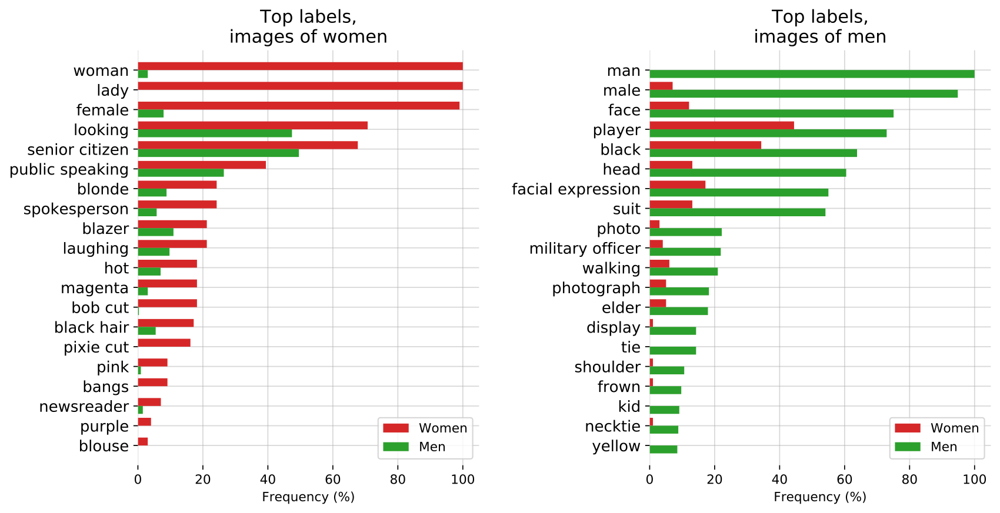

**EN.** Figure 18: CLIP performance on Member of Congress images when given the combined returned label set for the images from Google Cloud Vision, Amazon Rekognition and Microsoft Azure Computer Vision. The 20 most gendered labels for men and women were identified with $\chi^{2}$ tests with the threshold at 0.5%. Labels are sorted by absolute frequencies. Bars denote the percentage of images for a certain label by gender.

**中.** 图 18：当给定来自 Google Cloud Vision、Amazon Rekognition 和 Microsoft Azure Computer Vision 的图像的组合返回标签集时，国会议员图像的 CLIP 性能。通过 $\chi^{2}$ 测试确定了 20 个最性别化的男性和女性标签，阈值为 0.5%。标签按绝对频率排序。条形表示按性别划分的特定标签的图像百分比。

**EN.** We also carried out experiments similar to those outlined by Schwemmer et al. (2020) to test how CLIP treated images of men and women differently using images of Members of Congress. As part of these experiments, we studied how certain additional design decisions such as deciding thresholds for labels can impact the labels output by CLIP and how biases manifest.

**中.** 我们还进行了与 Schwemmer 等人概述的实验类似的实验。 （2020）测试 CLIP 如何使用国会议员的图像来不同地处理男性和女性的图像。作为这些实验的一部分，我们研究了某些额外的设计决策（例如确定标签阈值）如何影响 CLIP 的标签输出以及偏差如何表现。

**EN.** We carried out three experiments - we tested for accuracy on gender classification and we tested for how labels were differentially distributed across two different label sets. For our first label set, we used a label set of 300 occupations and for our second label set we used a combined set of labels that Google Cloud Vision, Amazon Rekognition and Microsoft Azure Computer Vision returned for all the images.

**中.** 我们进行了三个实验 - 我们测试了性别分类的准确性，并测试了标签在两个不同标签集中的差异分布。对于我们的第一个标签集，我们使用了包含 300 个职业的标签集，对于第二个标签集，我们使用了 Google Cloud Vision、Amazon Rekognition 和 Microsoft Azure Computer Vision 针对所有图像返回的标签组合集。

**EN.** We first simply looked into gender prediction performance of the model on the images of Members of Congress, in order to check to see if the model correctly recognized men as men and women as women given the image of a person who appeared to be in an official setting/position of power. We found that the model got 100% accuracy on the images. This is slightly better performance than the model’s performance on the FairFace dataset. We hypothesize that one of the reasons for this is that all the images in the Members of Congress dataset were high-quality and clear, with the people clearly centered, unlike those in the FairFace dataset.

**中.** 我们首先简单地研究了模型在国会议员图像上的性别预测表现，以检查模型是否正确地将男性识别为男性，将女性识别为女性，考虑到似乎处于官方环境/权力职位的人的图像。我们发现该模型对图像的准确率达到 100%。这比模型在 FairFace 数据集上的性能稍好一些。我们假设造成这种情况的原因之一是，与 FairFace 数据集中的图像不同，国会议员数据集中的所有图像都是高质量且清晰的，人物明显居中。

**EN.** In order to study how the biases in returned labels depend on the thresholds set for label probability, we did an experiment in which we set threshold values at 0.5% and 4.0%. We found that the lower threshold led to lower quality of labels. However, even the differing distributions of labels under this threshold can hold signals for bias. For example, we find that under the 0.5% threshold labels such as ‘nanny’ and ‘housekeeper’ start appearing for women whereas labels such as ‘prisoner’ and ‘mobster’ start appearing for men. This points to gendered associations similar to those that have previously been found for occupations ( Schwemmer et al., 2020 ) ( Nosek et al., 2002 ) ( Bolukbasi et al., 2016 ) .

**中.** 为了研究返回标签中的偏差如何取决于标签概率设置的阈值，我们做了一个实验，将阈值设置为 0.5% 和 4.0%。我们发现较低的阈值导致标签质量较低。然而，即使在此阈值下标签的不同分布也可能含有偏差信号。例如，我们发现，在 0.5% 的阈值下，女性开始出现“保姆”和“管家”等标签，而男性则开始出现“囚犯”和“流氓”等标签。这表明性别关联类似于之前发现的职业关联（Schwemmer 等，2020）（Nosek 等，2002）（Bolukbasi 等，2016）。

**EN.** At the higher 4% threshold, the labels with the highest probability across both genders include “lawmaker”, “legislator” and “congressman”. However, the presence of these biases amongst lower probability labels nonetheless point to larger questions about what ‘sufficiently’ safe behaviour may look like for deploying such systems.

**中.** 在 4% 的较高阈值下，男女中概率最高的标签包括“立法者”、“立法者”和“国会议员”。然而，较低概率标签中存在的这些偏差仍然引发了更大的问题，即部署此类系统的“足够”安全行为可能是什么样子。

**EN.** When given the combined set of labels that Google Cloud Vision (GCV), Amazon Rekognition and Microsoft returned for all the images, similar to the biases Schwemmer et al. (2020) found in GCV systems, we found our system also disproportionately attached labels to do with hair and appearance in general to women more than men. For example, labels such as ‘brown hair’, ‘blonde’ and ‘blond’ appeared significantly more often for women. Additionally, CLIP attached some labels that described high status occupations disproportionately more often to men such as ‘executive’ and ‘doctor’. Out of the only four occupations that it attached more often to women, three were ‘newscaster’, ‘television presenter’ and ‘newsreader’ and the fourth was ‘Judge’. This is again similar to the biases found in GCV and points to historical gendered differences ( Schwemmer et al., 2020 ) .

**中.** 当给定 Google Cloud Vision (GCV)、Amazon Rekognition 和 Microsoft 为所有图像返回的组合标签集时，类似于 Schwemmer 等人的偏差。 （2020）在 GCV 系统中发现，我们发现我们的系统还不成比例地为女性附加与头发和外表有关的标签，而不是男性。例如，“棕色头发”、“金发女郎”和“金发女郎”等标签在女性中出现的频率明显更高。此外，CLIP 还附加了一些标签，这些标签更多地描述了男性的高地位职业，例如“高管”和“医生”。在它最常赋予女性的四种职业中，三种是“新闻主播”、“电视主持人”和“新闻播音员”，第四种是“法官”。这再次类似于 GCV 中发现的偏差，并指出了历史上的性别差异（Schwemmer 等人，2020）。

**EN.** Interestingly, when we lowered the threshold to 0.5% for this set of labels, we found that the labels disproportionately describing men also shifted to appearance oriented words such as ‘suit’, ‘tie’ and ‘necktie’ (Figure 18 ). Many occupation oriented words such as ‘military person’ and ‘executive’ - which were not used to describe images of women at the higher 4% threshold - were used for both men and women at the lower 0.5% threshold, which could have caused the change in labels for men. The reverse was not true. Descriptive words used to describe women were still uncommon amongst men.

**中.** 有趣的是，当我们将这组标签的阈值降低到 0.5% 时，我们发现描述男性的标签不成比例地也转向了外观导向的词语，如“西装”、“领带”和“领带”（图 18）。许多职业导向的词语，如“军人”和“行政人员”——在 4% 的较高阈值下不用于描述女性形象——在 0.5% 的较低阈值下被用于男性和女性，这可能导致男性标签的变化。事实并非如此。用于描述女性的描述性词语在男性中仍然不常见。

**EN.** Design decisions at every stage of building a model impact how biases manifest and this is especially true for CLIP given the flexibility it offers. In addition to choices about training data and model architecture, decisions about things like class designs and thresholding values can alter the labels a model outputs and as a result heighten or lower certain kinds of harm, such as those described by Crawford (2017) . People designing and developing models and AI systems have considerable power. Decisions about things like class design are a key determiner not only of model performance, but also of how and in what contexts model biases manifest.

**中.** 构建模型的每个阶段的设计决策都会影响偏差的表现方式，鉴于 CLIP 提供的灵活性，这一点尤其如此。除了关于训练数据和模型架构的选择之外，关于类设计和阈值等的决策也可以改变模型输出的标签，从而提高或降低某些类型的伤害，例如 Crawford (2017) 所描述的那些。设计和开发模型和人工智能系统的人拥有相当大的权力。关于类设计之类的决策不仅是模型性能的关键决定因素，而且也是模型偏差如何以及在什么情况下表现出来的关键决定因素。

**EN.** These experiments are not comprehensive. They illustrate potential issues stemming from class design and other sources of bias, and are intended to spark inquiry.

**中.** 这些实验并不全面。它们说明了源自课程设计和其他偏见来源的潜在问题，旨在激发探究。

### Surveillance / 监控

**EN.** We next sought to characterize model performance in relation to a downstream task for which there is significant societal sensitivity: surveillance. Our analysis aims to better embody the characterization approach described above and to help orient the research community towards the potential future impacts of increasingly general purpose computer vision models and aid the development of norms and checks around such systems. Our inclusion of surveillance is not intended to indicate enthusiasm for this domain - rather, we think surveillance is an important domain to try to make predictions about given its societal implications ( Zuboff, 2015 ; Browne, 2015 ) .

**中.** 接下来，我们试图描述与具有显着社会敏感性的下游任务相关的模型性能：监视。我们的分析旨在更好地体现上述表征方法，并帮助研究界了解日益通用的计算机视觉模型对未来的潜在影响，并帮助围绕此类系统制定规范和检查。我们纳入监视并不是为了表明对该领域的热情 - 相反，我们认为监视是一个重要的领域，可以尝试对其社会影响进行预测（Zuboff，2015；Browne，2015）。

**EN.** We measure the model’s performance on classification of images from CCTV cameras and zero-shot celebrity identification. We first tested model performance on low-resolution images captured from surveillance cameras (e.g. CCTV cameras). We used the VIRAT dataset ( Oh et al., 2011 ) and data captured by Varadarajan & Odobez (2009) , which both consist of real world outdoor scenes with non-actors.

**中.** 我们衡量模型在闭路电视摄像机图像分类和零样本名人识别方面的性能。我们首先在监控摄像机（例如闭路电视摄像机）捕获的低分辨率图像上测试模型性能。我们使用了 VIRAT 数据集（Oh et al., 2011）和 Varadarajan & Odobez (2009) 捕获的数据，它们都由真实世界的非演员户外场景组成。

**EN.** Given CLIP’s flexible class construction, we tested 515 surveillance images captured from 12 different video sequences on self-constructed general classes for coarse and fine grained classification. Coarse classification required the model to correctly identify the main subject of the image (i.e. determine if the image was a picture of an empty parking lot, school campus, etc.). For fine-grained classification, the model had to choose between two options constructed to determine if the model could identify the presence/absence of smaller features in the image such as a person standing in the corner.

**中.** 鉴于 CLIP 灵活的类构建，我们在自构建的粗粒度和细粒度分类的通用类上测试了从 12 个不同视频序列捕获的 515 个监控图像。粗分类要求模型正确识别图像的主要主题（即确定图像是否是空停车场、学校校园等的图片）。对于细粒度分类，模型必须在两个选项之间进行选择，以确定模型是否可以识别图像中是否存在较小的特征，例如站在角落里的人。

**EN.** For coarse classification, we constructed the classes by hand-captioning the images ourselves to describe the contents of the image and there were always at least 6 options for the model to choose from. Additionally, we carried out a ‘stress test’ where the class set included at least one more caption for something that was ‘close’ to the image (for example, ‘parking lot with white car’ vs. ‘parking lot with red car’). We found that the model had a top-1 accuracy of 91.8% on the CCTV images for the initial evaluation. The accuracy dropped significantly to 51.1% for the second evaluation, with the model incorrectly choosing the ‘close’ answer 40.7% of the time.

**中.** 对于粗分类，我们通过自己为图像添加字幕来描述图像的内容来构建类别，并且始终有至少 6 个选项可供模型选择。此外，我们还进行了一项“压力测试”，其中课程集至少包含一个与图像“接近”的内容的标题（例如，“有白色汽车的停车场”与“有红色汽车的停车场”）。我们发现该模型在初步评估的 CCTV 图像上的 top-1 准确率为 91.8%。第二次评估的准确率显着下降至 51.1%，模型错误选择“接近”答案的概率为 40.7%。

**EN.** For fine-grained detection, the zero-shot model performed poorly, with results near random. Note that this experiment was targeted only towards detecting the presence or absence of small objects in image sequences.

**中.** 对于细粒度检测，零样本模型表现不佳，结果接近随机。请注意，该实验的目的仅在于检测图像序列中是否存在小物体。

**EN.** We also tested CLIP’s zero-shot performance for ‘in the wild’ identity detection using the CelebA dataset [^footnote8] . We did this to evaluate the model’s performance for identity detection using just the publicly available data it was pre-trained on. While we tested this on a dataset of celebrities who have a larger number of images on the internet, we hypothesize that the number of images in the pre-training data needed for the model to associate faces with names will keep decreasing as models get more powerful (see Table 8 ), which has significant societal implications ( Garvie, 2019 ) . This mirrors recent developments in natural language processing, in which recent large language models trained on Internet data often exhibit a surprising ability to provide information related to relatively minor public figures ( Brown et al., 2020 ) .

**中.** 我们还使用 CelebA 数据集 [^footnote8] 测试了 CLIP 在“野外”身份检测中的零样本性能。我们这样做是为了仅使用预训练的公开数据来评估模型的身份检测性能。虽然我们在互联网上拥有大量图像的名人数据集上对此进行了测试，但我们假设，随着模型变得更加强大，模型将面孔与姓名关联起来所需的预训练数据中的图像数量将不断减少（见表 8），这具有重大的社会影响（Garvie，2019）。这反映了自然语言处理的最新发展，其中最近在互联网数据上训练的大型语言模型经常表现出令人惊讶的能力，可以提供与相对较小的公众人物相关的信息（Brown et al., 2020）。

**EN.** We found that the model had 59.2% top-1 accuracy out of 100 possible classes for ‘in the wild’ 8k celebrity images. However, this performance dropped to 43.3% when we increased our class sizes to 1k celebrity names. This performance is not competitive when compared to production level models such as Google’s Celebrity Recognition ( Google, ) . However, what makes these results noteworthy is that this analysis was done using only zero-shot identification capabilities based on names inferred from pre-training data - we didn’t use any additional task-specific dataset, and so the (relatively) strong results further indicate that before deploying multimodal models, people will need to carefully study them for behaviors in a given context and domain.

**中.** 我们发现，对于“野外”8k 名人图像，该模型在 100 个可能的类别中具有 59.2% 的 top-1 准确率。然而，当我们将班级规模增加到 1000 名名人时，这一表现下降至 43.3%。与谷歌的名人识别（Google）等生产级模型相比，这种性能没有竞争力。然而，这些结果值得注意的是，该分析仅使用基于从预训练数据推断出的名称的零样本识别功能来完成 - 我们没有使用任何额外的特定于任务的数据集，因此（相对）强有力的结果进一步表明，在部署多模态模型之前，人们需要仔细研究它们在给定上下文和领域中的行为。

**EN.** CLIP offers significant benefit for tasks that have relatively little data given its zero-shot capabilities. However, large datasets and high performing supervised models exist for many in-demand surveillance tasks such as facial recognition. As a result, CLIP’s comparative appeal for such uses is low. Additionally, CLIP is not designed for common surveillance-relevant tasks like object detection and semantic segmentation. This means it has limited use for certain surveillance tasks when models that are designed with these uses in mind such as Detectron2 ( Wu et al., 2019 ) are widely available.

**中.** 鉴于其零样本功能，CLIP 为数据相对较少的任务提供了显着的优势。然而，对于许多按需监控任务（例如面部识别）来说，存在大型数据集和高性能监督模型。因此，CLIP 对此类用途的相对吸引力较低。此外，CLIP 不适用于常见的监视相关任务，例如对象检测和语义分割。这意味着当设计时考虑到这些用途的模型（例如 Detectron2（Wu et al., 2019））广泛使用时，它在某些监视任务中的用途有限。

**EN.** However, CLIP does unlock a certain aspect of usability given how it removes the need for training data. Thus, CLIP and similar models could enable bespoke, niche surveillance use cases for which no well-tailored models or datasets exist, and could lower the skill requirements to build such applications. As our experiments show, ZS CLIP displays non-trivial, but not exceptional, performance on a few surveillance relevant tasks today.

**中.** 然而，鉴于 CLIP 消除了对训练数据的需求，它确实解锁了可用性的某些方面。因此，CLIP 和类似的模型可以实现定制的利基监视用例，而这些用例不存在专门定制的模型或数据集，并且可以降低构建此类应用程序的技能要求。正如我们的实验所示，ZS CLIP 在当今的一些监视相关任务中显示出不平凡但并非卓越的性能。

| Model 型号 | 100 Classes 100 节课 | 1k Classes 1k 类 | 2k Classes 2k 类 |
| --- | --- | --- | --- |
| CLIP L/14 夹 L/14 | 59.2 | 43.3 | 42.2 |
| CLIP RN50x64 夹子 RN50x64 | 56.4 | 39.5 | 38.4 |
| CLIP RN50x16 夹子 RN50x16 | 52.7 | 37.4 | 36.3 |
| CLIP RN50x4 夹子 RN50x4 | 52.8 | 38.1 | 37.3 |

**EN.** Table 8: CelebA Zero-Shot Top-1 Identity Recognition Accuracy

**中.** 表 8：CelebA 零样本 Top-1 身份识别准确率

### Future Work / 未来的工作

**EN.** This preliminary analysis is intended to illustrate some of the challenges that general purpose computer vision models pose and to give a glimpse into their biases and impacts. We hope that this work motivates future research on the characterization of the capabilities, shortcomings, and biases of such models, and we are excited to engage with the research community on such questions.

**中.** 此初步分析旨在说明通用计算机视觉模型带来的一些挑战，并了解其偏差和影响。我们希望这项工作能够激发未来对此类模型的能力、缺点和偏差的表征的研究，并且我们很高兴与研究界就这些问题进行合作。

**EN.** We believe one good step forward is community exploration to further characterize the capabilities of models like CLIP and - crucially - identify application areas where they have promising performance and areas where they may have reduced performance [^footnote9] . This process of characterization can help researchers increase the likelihood models are used beneficially by:

**中.** 我们相信，社区探索是向前迈出的一大步，以进一步描述 CLIP 等模型的功能，并且最重要的是确定它们具有良好性能的应用领域以及它们可能会降低性能的领域 [^footnote9]。这一表征过程可以帮助研究人员提高模型在以下方面的使用可能性：

**EN.** Identifying potentially beneficial downstream uses of models early in the research process, enabling other researchers to think about applications.

**中.** 在研究过程的早期识别模型潜在有益的下游用途，使其他研究人员能够考虑应用。

**EN.** Surfacing tasks with significant sensitivity and a large set of societal stakeholders, which may call for intervention by policymakers.

**中.** 提出具有高度敏感性和大量社会利益相关者的任务，这可能需要政策制定者的干预。

**EN.** Better characterizing biases in models, alerting other researchers to areas of concern and areas for interventions.

**中.** 更好地描述模型中的偏差，提醒其他研究人员关注的领域和干预的领域。

**EN.** Creating suites of tests to evaluate systems like CLIP on, so we can better characterize model capabilities earlier in the development cycle.

**中.** 创建测试套件来评估 CLIP 等系统，以便我们可以在开发周期的早期更好地表征模型功能。

**EN.** Identifying potential failure modes and areas for further work.

**中.** 确定潜在的故障模式和进一步工作的领域。

**EN.** We plan to contribute to this work, and hope this analysis provides some motivating examples for subsequent research.

**中.** 我们计划为这项工作做出贡献，并希望这一分析为后续研究提供一些激励性的例子。

## Related Work / 相关工作

**EN.** Any model that leverages written, spoken, signed or any other form of human language as part of its training signal is arguably using natural language as a source of supervision. This is an admittedly extremely broad area and covers most work in the field of distributional semantics including topic models ( Blei et al., 2003 ) , word, sentence, and paragraph vectors ( Mikolov et al., 2013 ; Kiros et al., 2015 ; Le & Mikolov, 2014 ) , and language models ( Bengio et al., 2003 ) . It also includes much of the broader field of NLP that deals with predicting or modeling sequences of natural language in some way. Work in NLP intentionally leveraging natural language supervision in the form of explanations, feedback, instructions, and advice for tasks such as classification (as opposed to the commonly used representation of supervision as a set of arbitrarily encoded discrete category labels) has been explored in many creative and advanced ways. Dialog based learning ( Weston, 2016 ; Li et al., 2016 ; Hancock et al., 2019 ) develops techniques to learn from interactive natural language feedback in dialog. Several papers have leveraged semantic parsing to convert natural language explanations into features ( Srivastava et al., 2017 ) or additional training labels ( Hancock et al., 2018 ) . More recently, ExpBERT ( Murty et al., 2020 ) uses feature representations produced by conditioning a deep contextual language model on natural language explanations and descriptions of relations to improve performance on the task of relation extraction.

**中.** 任何利用书面、口头、手语或任何其他形式的人类语言作为其训练信号一部分的模型都可以说是使用自然语言作为监督来源。无可否认，这是一个极其广泛的领域，涵盖了分布语义学领域的大部分工作，包括主题模型（Blei et al., 2003）、单词、句子和段落向量（Mikolov et al., 2013；Kiros et al., 2015；Le & Mikolov, 2014）和语言模型（Bengio et al., 2003）。它还包括许多更广泛的 NLP 领域，以某种方式处理自然语言序列的预测或建模。 NLP 领域的工作有意利用自然语言监督，以解释、反馈、说明和建议的形式进行分类等任务（而不是常用的监督表示为一组任意编码的离散类别标签），并以许多创造性和先进的方式进行了探索。基于对话的学习（Weston，2016；Li et al.，2016；Hancock et al.，2019）开发了从对话中的交互式自然语言反馈中学习的技术。有几篇论文利用语义解析将自然语言解释转换为特征（Srivastava 等人，2017）或附加训练标签（Hancock 等人，2018）。最近，ExpBERT（Murty 等人，2020）使用通过在自然语言解释和关系描述上调节深层上下文语言模型而生成的特征表示来提高关系提取任务的性能。

**EN.** CLIP is an example of using natural language as a training signal for learning about a domain other than language. In this context, the earliest use of the term natural language supervision that we are aware of is the work of Ramanathan et al. (2013) which showed that natural language descriptions could be used along side other sources of supervision to improve performance on the task of video event understanding. However, as mentioned in the introduction and approach section, methods of leveraging natural language descriptions in computer vision well predate the use of this specific term, especially for image retrieval ( Mori et al., 1999 ) and object classification ( Wang et al., 2009 ) . Other early work leveraged tags (but not natural language) associated with images for the task of semantic segmentation ( Barnard et al., 2003 ) . More recently, He & Peng (2017) and Liang et al. (2020) demonstrated using natural language descriptions and explanations to improve fine-grained visual classification of birds. Others have investigated how grounded language can be used to improve visual representations and classifiers on the ShapeWorld dataset ( Kuhnle & Copestake, 2017 ; Andreas et al., 2017 ; Mu et al., 2019 ) . Finally, techniques which combine natural language with reinforcement learning environments ( Narasimhan et al., 2015 ) have demonstrated exciting emergent behaviors such as systematically accomplishing zero-shot tasks ( Hill et al., 2019 ) .

**中.** CLIP 是使用自然语言作为训练信号来学习语言以外领域的示例。在这种背景下，我们所知道的最早使用自然语言监督一词的是 Ramanathan 等人的工作。 （2013）表明，自然语言描述可以与其他监督来源一起使用，以提高视频事件理解任务的性能。然而，正如引言和方法部分所提到的，在计算机视觉中利用自然语言描述的方法远远早于这个特定术语的使用，特别是对于图像检索（Mori 等人，1999）和对象分类（Wang 等人，2009）。其他早期工作利用与图像相关的标签（但不是自然语言）来完成语义分割任务（Barnard 等，2003）。最近，He & Peng (2017) 和Liang 等人。 (2020) 演示了使用自然语言描述和解释来改进鸟类的细粒度视觉分类。其他人研究了如何使用扎根语言来改进 ShapeWorld 数据集上的视觉表示和分类器（Kuhnle & Copestake，2017；Andreas 等人，2017；Mu 等人，2019）。最后，将自然语言与强化学习环境相结合的技术（Narasimhan 等人，2015）已​​经展示了令人兴奋的新兴行为，例如系统地完成零样本任务（Hill 等人，2019）。

**EN.** CLIP’s pre-training task optimizes for text-image retrieval. This areas of research dates back to the mid-90s with the previously mentioned Mori et al. (1999) as representative of early work. While initial efforts focused primarily on predictive objectives over time research shifted towards learning joint multi-modal embedding spaces with techniques like kernel Canonical Correlation Analysis and various ranking objectives ( Weston et al., 2010 ; Socher & Fei-Fei, 2010 ; Hodosh et al., 2013 ) . Over time work explored many combinations of training objective, transfer, and more expressive models and steadily improved performance ( Frome et al., 2013 ; Socher et al., 2014 ; Karpathy et al., 2014 ; Kiros et al., 2014 ; Faghri et al., 2017 ) .

**中.** CLIP 的预训练任务针对文本图像检索进行了优化。该领域的研究可以追溯到 90 年代中期，前面提到的 Mori 等人。 (1999)作为早期工作的代表。虽然最初的努力主要集中在预测目标上，但随着时间的推移，研究转向使用内核规范相关分析和各种排名目标等技术来学习联合多模态嵌入空间（Weston 等人，2010 年；Socher 和 Fei-Fei，2010 年；Hodosh 等人，2013 年）。随着时间的推移，人们探索了训练目标、迁移和更具表现力的模型的多种组合，并稳步提高了性能（Frome et al., 2013; Socher et al., 2014; Karpathy et al., 2014; Kiros et al., 2014; Faghri et al., 2017）。

**EN.** Other work has leveraged natural language supervision for domains other than images. Stroud et al. (2020) explores large scale representation learning by training a system to pair descriptive text with videos instead of images. Several works have explored using dense spoken natural language supervision for videos ( Miech et al., 2019 ; Miech et al., 2020b ) . When considered together with CLIP, these works suggest that large scale natural language supervision is a promising way to learn high quality perceptual systems for many domains. Alayrac et al. (2020) extended this line of work to an additional modality by adding raw audio as an additional supervision source and demonstrated benefits from combining all three sources of supervision.

**中.** 其他工作利用自然语言监督来处理图像以外的领域。斯特劳德等人。 （2020）通过训练系统将描述性文本与视频而不是图像配对来探索大规模表示学习。一些作品探索了对视频使用密集的口语自然语言监督（Miech 等人，2019；Miech 等人，2020b）。当与 CLIP 一起考虑时，这些工作表明大规模自然语言监督是学习许多领域高质量感知系统的一种有前途的方法。阿莱拉克等人。 （2020）通过添加原始音频作为额外的监督源，将这一工作范围扩展到了另一种模式，并展示了结合所有三种监督源的好处。

**EN.** As part of our work on CLIP we also construct a new dataset of image-text pairs. Modern work on image-text retrieval has relied on a set of crowd-sourced sentence level image caption evaluation datasets like Pascal1K ( Rashtchian et al., 2010 ) , Flickr8K ( Hodosh et al., 2013 ) , and Flickr30K ( Young et al., 2014 ) . However, these datasets are still relatively small and limit achievable performance. Several methods have been proposed to create larger datasets automatically with Ordonez et al. (2011) as a notable early example. In the deep learning era, Mithun et al. (2018) demonstrated an additional set of (image, text) pairs collected from the internet could improve retrieval performance and several new automatically constructed datasets such as Conceptual Captions ( Sharma et al., 2018 ) , LAIT ( Qi et al., 2020 ) , and OCR-CC ( Yang et al., 2020 ) have been created. However, these datasets still use significantly more aggressive filtering or are designed for a specific task such as OCR and as a result are still much smaller than WIT with between 1 and 10 million training examples.

**中.** 作为 CLIP 工作的一部分，我们还构建了一个新的图像文本对数据集。现代图像文本检索工作依赖于一组众包的句子级图像标题评估数据集，例如 Pascal1K（Rashtchian 等人，2010）、Flickr8K（Hodosh 等人，2013）和 Flickr30K（Young 等人，2014）。然而，这些数据集仍然相对较小并且限制了可实现的性能。 Ordonez 等人提出了几种自动创建更大数据集的方法。 （2011）作为一个著名的早期例子。在深度学习时代，Mithun 等人。 （2018）证明从互联网收集的一组额外的（图像，文本）对可以提高检索性能，并且已经创建了几个新的自动构建的数据集，例如概念字幕（Sharma 等人，2018）、LAIT（Qi 等人，2020）和 OCR-CC（Yang 等人，2020）。然而，这些数据集仍然使用更加积极的过滤，或者是为特定任务（例如 OCR）而设计的，因此仍然比 WIT 小得多，训练示例在 1 到 1000 万之间。

**EN.** A related idea to CLIP is webly supervised learning. This line of work queries image search engines to build image datasets by querying for terms and uses the queries as the labels for the returned images ( Fergus et al., 2005 ) . Classifiers trained on these large but noisily labeled datasets can be competitive with those trained on smaller carefully labeled datasets. These image-query pairs are also often used to improve performance on standard datasets as additional training data ( Chen & Gupta, 2015 ) . CLIP also uses search queries as part of its dataset creation process. However CLIP only uses full text sequences co-occuring with images as supervision rather than just the queries, which are often only a single word or short n-gram. We also restrict this step in CLIP to text only querying for sub-string matches while most webly supervised work uses standard image search engines which have their own complex retrieval and filtering pipelines that often involve computer vision systems. Of this line of work, Learning Everything about Anything: Webly-Supervised Visual Concept Learning ( Divvala et al., 2014 ) has a notably similar ambition and goal as CLIP.

**中.** 与 CLIP 相关的一个想法是网络监督学习。这一系列工作通过查询术语来查询图像搜索引擎以构建图像数据集，并将查询用作返回图像的标签（Fergus 等，2005）。在这些大型但有噪声标记的数据集上训练的分类器可以与在较小的仔细标记的数据集上训练的分类器竞争。这些图像查询对也经常被用来作为额外的训练数据来提高标准数据集的性能（Chen & Gupta，2015）。 CLIP 还使用搜索查询作为其数据集创建过程的一部分。然而，CLIP 仅使用与图像同时出现的全文序列作为监督，而不仅仅是查询，查询通常只是单个单词或短 n 元语法。我们还将 CLIP 中的此步骤限制为仅查询子字符串匹配的文本，而大多数网络监督工作使用标准图像搜索引擎，这些引擎有自己复杂的检索和过滤管道，通常涉及计算机视觉系统。在这一领域的工作中，Learning Everything about Anything: Webly-Supervised Visual Concept Learning (Divvala et al., 2014) 与 CLIP 有着非常相似的雄心和目标。

**EN.** Finally, CLIP is related to a recent burst of activity on learning joint models of vision and language ( Lu et al., 2019 ; Tan & Bansal, 2019 ; Chen et al., 2019 ; Li et al., 2020b ; Yu et al., 2020 ) . This line of work focuses on richly connecting vision and language in order to solve complex downstream tasks such as visual question answering, visual commonsense reasoning, or multimodal entailment. These approaches leverage impressively engineered models which combine 3 (or more) pre-trained subsystems, typically an image feature model, a region proposal / object detection model, and a pre-trained masked language model such as BERT. These systems are then jointly fine-tuned via various training objectives on image-text pairs and applied to the aforementioned tasks and achieve impressive results. CLIP is instead focused on learning visual models from scratch via natural language supervision and does not densely connect the two domains with a joint attention model. The only interaction in a CLIP model between the image and text domain is a single dot product in a learned joint embedding space. We are excited to see CLIP hybridized with this line of work.

**中.** 最后，CLIP 与最近爆发的学习视觉和语言联合模型的活动有关（Lu et al., 2019; Tan & Bansal, 2019; Chen et al., 2019; Li et al., 2020b; Yu et al., 2020）。这一工作重点是丰富地连接视觉和语言，以解决复杂的下游任务，例如视觉问答、视觉常识推理或多模态蕴涵。这些方法利用了令人印象深刻的工程模型，这些模型结合了 3 个（或更多）预训练子系统，通常是图像特征模型、区域提议/对象检测模型和预训练掩码语言模型（例如 BERT）。然后，这些系统通过图像-文本对的各种训练目标进行联合微调，并应用于上述任务并取得令人印象深刻的结果。相反，CLIP 专注于通过自然语言监督从头开始学习视觉模型，并且没有通过联合注意力模型将这两个领域紧密连接起来。 CLIP 模型中图像和文本域之间的唯一交互是学习的联合嵌入空间中的单点积。我们很高兴看到 CLIP 与这方面的工作相结合。

## Conclusion / 结论

**EN.** We have investigated whether it is possible to transfer the success of task-agnostic web-scale pre-training in NLP to another domain. We find that adopting this formula results in similar behaviors emerging in the field of computer vision and discuss the social implications of this line of research. In order to optimize their training objective, CLIP models learn to perform a wide variety of tasks during pre-training. This task learning can then be leveraged via natural language prompting to enable zero-shot transfer to many existing datasets. At sufficient scale, the performance of this approach can be competitive with task-specific supervised models although there is still room for much improvement.

**中.** 我们研究了是否有可能将 NLP 中与任务无关的网络规模预训练的成功转移到另一个领域。我们发现采用这个公式会导致计算机视觉领域出现类似的行为，并讨论了这一研究领域的社会影响。为了优化其训练目标，CLIP 模型在预训练期间学习执行各种任务。然后可以通过自然语言提示来利用这种任务学习，以实现向许多现有数据集的零样本迁移。在足够的规模下，这种方法的性能可以与特定任务的监督模型相媲美，尽管仍有很大的改进空间。

#### Acknowledgments / 致谢

**EN.** We’d like to thank the millions of people involved in creating the data CLIP is trained on. We’d also like to thank Susan Zhang for her work on image conditional language models while at OpenAI, Ishaan Gulrajani for catching an error in the pseudocode, and Irene Solaiman, Miles Brundage, and Gillian Hadfield for their thoughtful feedback on the broader impacts section of the paper. We are also grateful to the Acceleration and Supercomputing teams at OpenAI for their critical work on software and hardware infrastructure this project used. Finally, we’d also like to thank the developers of the many software packages used throughout this project including, but not limited, to Numpy ( Harris et al., 2020 ) , SciPy ( Virtanen et al., 2020 ) , ftfy ( Speer, 2019 ) , TensorFlow ( Abadi et al., 2016 ) , PyTorch ( Paszke et al., 2019 ) , pandas ( pandas development team, 2020 ) , and scikit-learn ( Pedregosa et al., 2011 ) .

**中.** 我们要感谢参与创建 CLIP 培训数据的数百万人。我们还要感谢 Susan Zhang 在 OpenAI 期间在图像条件语言模型方面所做的工作，感谢 Ishaan Gulrajani 发现了伪代码中的错误，感谢 Irene Solaiman、Miles Brundage 和 Gillian Hadfield 对本文更广泛影响部分的深思熟虑的反馈。我们还感谢 OpenAI 的加速和超级计算团队在此项目使用的软件和硬件基础设施方面所做的关键工作。最后，我们还要感谢整个项目中使用的许多软件包的开发人员，包括但不限于 Numpy (Harris 等人，2020)、SciPy (Virtanen 等人，2020)、ftfy (Speer，2019)、TensorFlow (Abadi 等人，2016)、PyTorch (Paszke 等人， 2019）、pandas（pandas 开发团队，2020）和 scikit-learn（Pedregosa 等人，2011）。

## References / 参考文献

- Abadi et al. (2016) Abadi, M., Barham, P., Chen, J., Chen, Z., Davis, A., Dean, J., Devin, M., Ghemawat, S., Irving, G., Isard, M., et al. Tensorflow: A system for large-scale machine learning. In 12th $\{$ USENIX $\}$ symposium on operating systems design and implementation ( $\{$ OSDI $\}$ 16) , pp. 265–283, 2016.

- Alayrac et al. (2020) Alayrac, J.-B., Recasens, A., Schneider, R., Arandjelović, R., Ramapuram, J., De Fauw, J., Smaira, L., Dieleman, S., and Zisserman, A. Self-supervised multimodal versatile networks. arXiv preprint arXiv:2006.16228 , 2020.

- Alcorn et al. (2019) Alcorn, M. A., Li, Q., Gong, Z., Wang, C., Mai, L., Ku, W.-S., and Nguyen, A. Strike (with) a pose: Neural networks are easily fooled by strange poses of familiar objects. In Proceedings of the IEEE Conference on Computer Vision and Pattern Recognition , pp. 4845–4854, 2019.

- Andreas et al. (2017) Andreas, J., Klein, D., and Levine, S. Learning with latent language. arXiv preprint arXiv:1711.00482 , 2017.

- Assiri (2020) Assiri, Y. Stochastic optimization of plain convolutional neural networks with simple methods. arXiv preprint arXiv:2001.08856 , 2020.

- Bachman et al. (2019) Bachman, P., Hjelm, R. D., and Buchwalter, W. Learning representations by maximizing mutual information across views. In Advances in Neural Information Processing Systems , pp. 15535–15545, 2019.

- Barbu et al. (2019) Barbu, A., Mayo, D., Alverio, J., Luo, W., Wang, C., Gutfreund, D., Tenenbaum, J., and Katz, B. Objectnet: A large-scale bias-controlled dataset for pushing the limits of object recognition models. In Advances in Neural Information Processing Systems , pp. 9453–9463, 2019.

- Barnard et al. (2003) Barnard, K., Duygulu, P., Forsyth, D., Freitas, N. d., Blei, D. M., and Jordan, M. I. Matching words and pictures. Journal of machine learning research , 3(Feb):1107–1135, 2003.

- Bechmann & Bowker (2019) Bechmann, A. and Bowker, G. C. Unsupervised by any other name: Hidden layers of knowledge production in artificial intelligence on social media. Big Data & Society , 6(1):205395171881956, January 2019. doi: 10.1177/2053951718819569 . URL [https://doi.org/10.1177/2053951718819569](https://doi.org/10.1177/2053951718819569) .

- Bengio et al. (2003) Bengio, Y., Ducharme, R., Vincent, P., and Jauvin, C. A neural probabilistic language model. Journal of machine learning research , 3(Feb):1137–1155, 2003.

- Bhargava & Forsyth (2019) Bhargava, S. and Forsyth, D. Exposing and correcting the gender bias in image captioning datasets and models. arXiv preprint arXiv:1912.00578 , 2019.

- Blei et al. (2003) Blei, D. M., Ng, A. Y., and Jordan, M. I. Latent dirichlet allocation. Journal of machine Learning research , 3(Jan):993–1022, 2003.

- Bolukbasi et al. (2016) Bolukbasi, T., Chang, K.-W., Zou, J. Y., Saligrama, V., and Kalai, A. T. Man is to computer programmer as woman is to homemaker? debiasing word embeddings. Advances in neural information processing systems , 29:4349–4357, 2016.

- Bowker & Star (2000) Bowker, G. C. and Star, S. L. Sorting things out: Classification and its consequences . MIT press, 2000.

- Brown et al. (2020) Brown, T. B., Mann, B., Ryder, N., Subbiah, M., Kaplan, J., Dhariwal, P., Neelakantan, A., Shyam, P., Sastry, G., Askell, A., et al. Language models are few-shot learners. arXiv preprint arXiv:2005.14165 , 2020.

- Browne (2015) Browne, S. Dark Matters: Surveillance of Blackness . Duke University Press, 2015.

- Bulent Sariyildiz et al. (2020) Bulent Sariyildiz, M., Perez, J., and Larlus, D. Learning visual representations with caption annotations. arXiv e-prints , pp. arXiv–2008, 2020.

- Buolamwini & Gebru (2018) Buolamwini, J. and Gebru, T. Gender shades: Intersectional accuracy disparities in commercial gender classification. In Conference on fairness, accountability and transparency , pp. 77–91, 2018.

- Carreira et al. (2019) Carreira, J., Noland, E., Hillier, C., and Zisserman, A. A short note on the kinetics-700 human action dataset. arXiv preprint arXiv:1907.06987 , 2019.

- Chen et al. (2020a) Chen, M., Radford, A., Child, R., Wu, J., Jun, H., Luan, D., and Sutskever, I. Generative pretraining from pixels. In International Conference on Machine Learning , pp. 1691–1703. PMLR, 2020a.

- Chen et al. (2016) Chen, T., Xu, B., Zhang, C., and Guestrin, C. Training deep nets with sublinear memory cost. arXiv preprint arXiv:1604.06174 , 2016.

- Chen et al. (2020b) Chen, T., Kornblith, S., Norouzi, M., and Hinton, G. A simple framework for contrastive learning of visual representations. arXiv preprint arXiv:2002.05709 , 2020b.

- Chen et al. (2020c) Chen, T., Kornblith, S., Swersky, K., Norouzi, M., and Hinton, G. Big self-supervised models are strong semi-supervised learners. arXiv preprint arXiv:2006.10029 , 2020c.

- Chen & Gupta (2015) Chen, X. and Gupta, A. Webly supervised learning of convolutional networks. In Proceedings of the IEEE International Conference on Computer Vision , pp. 1431–1439, 2015.

- Chen et al. (2020d) Chen, X., Fan, H., Girshick, R., and He, K. Improved baselines with momentum contrastive learning. arXiv preprint arXiv:2003.04297 , 2020d.

- Chen et al. (2019) Chen, Y.-C., Li, L., Yu, L., Kholy, A. E., Ahmed, F., Gan, Z., Cheng, Y., and Liu, J. Uniter: Learning universal image-text representations. arXiv preprint arXiv:1909.11740 , 2019.

- Cheng et al. (2017) Cheng, G., Han, J., and Lu, X. Remote sensing image scene classification: Benchmark and state of the art. Proceedings of the IEEE , 105(10):1865–1883, 2017.

- Choi et al. (2019) Choi, D., Shallue, C. J., Nado, Z., Lee, J., Maddison, C. J., and Dahl, G. E. On empirical comparisons of optimizers for deep learning. arXiv preprint arXiv:1910.05446 , 2019.

- Coates et al. (2011) Coates, A., Ng, A., and Lee, H. An analysis of single-layer networks in unsupervised feature learning. In Proceedings of the fourteenth international conference on artificial intelligence and statistics , pp. 215–223, 2011.

- Crawford (2017) Crawford, K. The trouble with bias. NIPS 2017 Keynote , 2017. URL [https://www.youtube.com/watch?v=fMym_BKWQzk](https://www.youtube.com/watch?v=fMym_BKWQzk) .

- Dai & Le (2015) Dai, A. M. and Le, Q. V. Semi-supervised sequence learning. In Advances in neural information processing systems , pp. 3079–3087, 2015.

- D’Amour et al. (2020) D’Amour, A., Heller, K., Moldovan, D., Adlam, B., Alipanahi, B., Beutel, A., Chen, C., Deaton, J., Eisenstein, J., Hoffman, M. D., et al. Underspecification presents challenges for credibility in modern machine learning. arXiv preprint arXiv:2011.03395 , 2020.

- Deng et al. (2009) Deng, J., Dong, W., Socher, R., Li, L.-J., Li, K., and Fei-Fei, L. ImageNet: A Large-Scale Hierarchical Image Database. In CVPR09 , 2009.

- Deng et al. (2012) Deng, J., Berg, A. C., Satheesh, S., Su, H., Khosla, A., and Fei-Fei, L. Ilsvrc 2012, 2012. URL [http://www.image-net.org/challenges/LSVRC/2012/](http://www.image-net.org/challenges/LSVRC/2012/) .

- Desai & Johnson (2020) Desai, K. and Johnson, J. Virtex: Learning visual representations from textual annotations. arXiv preprint arXiv:2006.06666 , 2020.

- Devlin et al. (2018) Devlin, J., Chang, M.-W., Lee, K., and Toutanova, K. Bert: Pre-training of deep bidirectional transformers for language understanding. arXiv preprint arXiv:1810.04805 , 2018.

- Dhariwal et al. (2020) Dhariwal, P., Jun, H., Payne, C., Kim, J. W., Radford, A., and Sutskever, I. Jukebox: A generative model for music. arXiv preprint arXiv:2005.00341 , 2020.

- Divvala et al. (2014) Divvala, S. K., Farhadi, A., and Guestrin, C. Learning everything about anything: Webly-supervised visual concept learning. In Proceedings of the IEEE Conference on Computer Vision and Pattern Recognition , pp. 3270–3277, 2014.

- Dodge & Karam (2017) Dodge, S. and Karam, L. A study and comparison of human and deep learning recognition performance under visual distortions. In 2017 26th international conference on computer communication and networks (ICCCN) , pp. 1–7. IEEE, 2017.

- Dosovitskiy et al. (2020) Dosovitskiy, A., Beyer, L., Kolesnikov, A., Weissenborn, D., Zhai, X., Unterthiner, T., Dehghani, M., Minderer, M., Heigold, G., Gelly, S., et al. An image is worth 16x16 words: Transformers for image recognition at scale. arXiv preprint arXiv:2010.11929 , 2020.

- Elhoseiny et al. (2013) Elhoseiny, M., Saleh, B., and Elgammal, A. Write a classifier: Zero-shot learning using purely textual descriptions. In Proceedings of the IEEE International Conference on Computer Vision , pp. 2584–2591, 2013.

- Faghri et al. (2017) Faghri, F., Fleet, D. J., Kiros, J. R., and Fidler, S. Vse++: Improving visual-semantic embeddings with hard negatives. arXiv preprint arXiv:1707.05612 , 2017.

- Fergus et al. (2005) Fergus, R., Fei-Fei, L., Perona, P., and Zisserman, A. Learning object categories from google’s image search. In Tenth IEEE International Conference on Computer Vision (ICCV’05) Volume 1 , volume 2, pp. 1816–1823. IEEE, 2005.

- Frome et al. (2013) Frome, A., Corrado, G. S., Shlens, J., Bengio, S., Dean, J., Ranzato, M., and Mikolov, T. Devise: A deep visual-semantic embedding model. In Advances in neural information processing systems , pp. 2121–2129, 2013.

- Gan et al. (2020) Gan, Z., Chen, Y.-C., Li, L., Zhu, C., Cheng, Y., and Liu, J. Large-scale adversarial training for vision-and-language representation learning. arXiv preprint arXiv:2006.06195 , 2020.

- Gao et al. (2020) Gao, T., Fisch, A., and Chen, D. Making pre-trained language models better few-shot learners. arXiv preprint arXiv:2012.15723 , 2020.

- Garvie (2019) Garvie, C., May 2019. URL [https://www.flawedfacedata.com/](https://www.flawedfacedata.com/) .

- Geiger et al. (2012) Geiger, A., Lenz, P., and Urtasun, R. Are we ready for autonomous driving? the kitti vision benchmark suite. In Conference on Computer Vision and Pattern Recognition (CVPR) , 2012.

- Geirhos et al. (2018) Geirhos, R., Rubisch, P., Michaelis, C., Bethge, M., Wichmann, F. A., and Brendel, W. Imagenet-trained cnns are biased towards texture; increasing shape bias improves accuracy and robustness. arXiv preprint arXiv:1811.12231 , 2018.

- Geirhos et al. (2020) Geirhos, R., Jacobsen, J.-H., Michaelis, C., Zemel, R., Brendel, W., Bethge, M., and Wichmann, F. A. Shortcut learning in deep neural networks. arXiv preprint arXiv:2004.07780 , 2020.

- Gomez et al. (2017) Gomez, L., Patel, Y., Rusiñol, M., Karatzas, D., and Jawahar, C. Self-supervised learning of visual features through embedding images into text topic spaces. In Proceedings of the IEEE Conference on Computer Vision and Pattern Recognition , pp. 4230–4239, 2017.

- Goodfellow et al. (2014) Goodfellow, I. J., Shlens, J., and Szegedy, C. Explaining and harnessing adversarial examples. arXiv preprint arXiv:1412.6572 , 2014.

- Goodfellow et al. (2015) Goodfellow, I. J., Erhan, D., Carrier, P. L., Courville, A., Mirza, M., Hamner, B., Cukierski, W., Tang, Y., Thaler, D., Lee, D.-H., et al. Challenges in representation learning: A report on three machine learning contests. Neural Networks , 64:59–63, 2015.

- (54) Google. Google cloud api: Celebrity recognition. URL [https://cloud.google.com/vision/docs/celebrity-recognition](https://cloud.google.com/vision/docs/celebrity-recognition) .

- Griewank & Walther (2000) Griewank, A. and Walther, A. Algorithm 799: revolve: an implementation of checkpointing for the reverse or adjoint mode of computational differentiation. ACM Transactions on Mathematical Software (TOMS) , 26(1):19–45, 2000.

- Grill et al. (2020) Grill, J.-B., Strub, F., Altché, F., Tallec, C., Richemond, P. H., Buchatskaya, E., Doersch, C., Pires, B. A., Guo, Z. D., Azar, M. G., et al. Bootstrap your own latent: A new approach to self-supervised learning. arXiv preprint arXiv:2006.07733 , 2020.

- Ha et al. (2016) Ha, D., Dai, A., and Le, Q. V. Hypernetworks. arXiv preprint arXiv:1609.09106 , 2016.

- Hancock et al. (2018) Hancock, B., Bringmann, M., Varma, P., Liang, P., Wang, S., and Ré, C. Training classifiers with natural language explanations. In Proceedings of the conference. Association for Computational Linguistics. Meeting , volume 2018, pp. 1884. NIH Public Access, 2018.

- Hancock et al. (2019) Hancock, B., Bordes, A., Mazare, P.-E., and Weston, J. Learning from dialogue after deployment: Feed yourself, chatbot! arXiv preprint arXiv:1901.05415 , 2019.

- Harris et al. (2020) Harris, C. R., Millman, K. J., van der Walt, S. J., Gommers, R., Virtanen, P., Cournapeau, D., Wieser, E., Taylor, J., Berg, S., Smith, N. J., Kern, R., Picus, M., Hoyer, S., van Kerkwijk, M. H., Brett, M., Haldane, A., Fernández del Río, J., Wiebe, M., Peterson, P., Gérard-Marchant, P., Sheppard, K., Reddy, T., Weckesser, W., Abbasi, H., Gohlke, C., and Oliphant, T. E. Array programming with NumPy. Nature , 585:357–362, 2020. doi: 10.1038/s41586-020-2649-2 .

- Hays & Efros (2008) Hays, J. and Efros, A. A. Im2gps: estimating geographic information from a single image. In 2008 ieee conference on computer vision and pattern recognition , pp. 1–8. IEEE, 2008.

- He et al. (2015) He, K., Zhang, X., Ren, S., and Sun, J. Delving deep into rectifiers: Surpassing human-level performance on imagenet classification. In Proceedings of the IEEE international conference on computer vision , pp. 1026–1034, 2015.

- He et al. (2016a) He, K., Zhang, X., Ren, S., and Sun, J. Deep residual learning for image recognition. In Proceedings of the IEEE conference on computer vision and pattern recognition , pp. 770–778, 2016a.

- He et al. (2016b) He, K., Zhang, X., Ren, S., and Sun, J. Deep residual learning for image recognition. In Proceedings of the IEEE conference on computer vision and pattern recognition , pp. 770–778, 2016b.

- He et al. (2020) He, K., Fan, H., Wu, Y., Xie, S., and Girshick, R. Momentum contrast for unsupervised visual representation learning. In Proceedings of the IEEE/CVF Conference on Computer Vision and Pattern Recognition , pp. 9729–9738, 2020.

- He et al. (2019) He, T., Zhang, Z., Zhang, H., Zhang, Z., Xie, J., and Li, M. Bag of tricks for image classification with convolutional neural networks. In Proceedings of the IEEE Conference on Computer Vision and Pattern Recognition , pp. 558–567, 2019.

- He & Peng (2017) He, X. and Peng, Y. Fine-grained image classification via combining vision and language. In Proceedings of the IEEE Conference on Computer Vision and Pattern Recognition , pp. 5994–6002, 2017.

- Helber et al. (2019) Helber, P., Bischke, B., Dengel, A., and Borth, D. Eurosat: A novel dataset and deep learning benchmark for land use and land cover classification. IEEE Journal of Selected Topics in Applied Earth Observations and Remote Sensing , 12(7):2217–2226, 2019.

- Henaff (2020) Henaff, O. Data-efficient image recognition with contrastive predictive coding. In International Conference on Machine Learning , pp. 4182–4192. PMLR, 2020.

- Hendrycks & Dietterich (2019) Hendrycks, D. and Dietterich, T. Benchmarking neural network robustness to common corruptions and perturbations. arXiv preprint arXiv:1903.12261 , 2019.

- Hendrycks & Gimpel (2016) Hendrycks, D. and Gimpel, K. Gaussian error linear units (gelus). arXiv preprint arXiv:1606.08415 , 2016.

- Hendrycks et al. (2019) Hendrycks, D., Zhao, K., Basart, S., Steinhardt, J., and Song, D. Natural adversarial examples. arXiv preprint arXiv:1907.07174 , 2019.

- Hendrycks et al. (2020a) Hendrycks, D., Basart, S., Mu, N., Kadavath, S., Wang, F., Dorundo, E., Desai, R., Zhu, T., Parajuli, S., Guo, M., et al. The many faces of robustness: A critical analysis of out-of-distribution generalization. arXiv preprint arXiv:2006.16241 , 2020a.

- Hendrycks et al. (2020b) Hendrycks, D., Liu, X., Wallace, E., Dziedzic, A., Krishnan, R., and Song, D. Pretrained transformers improve out-of-distribution robustness. arXiv preprint arXiv:2004.06100 , 2020b.

- Hestness et al. (2017) Hestness, J., Narang, S., Ardalani, N., Diamos, G., Jun, H., Kianinejad, H., Patwary, M., Ali, M., Yang, Y., and Zhou, Y. Deep learning scaling is predictable, empirically. arXiv preprint arXiv:1712.00409 , 2017.

- Hill et al. (2019) Hill, F., Lampinen, A., Schneider, R., Clark, S., Botvinick, M., McClelland, J. L., and Santoro, A. Environmental drivers of systematicity and generalization in a situated agent. In International Conference on Learning Representations , 2019.

- Hodosh et al. (2013) Hodosh, M., Young, P., and Hockenmaier, J. Framing image description as a ranking task: Data, models and evaluation metrics. Journal of Artificial Intelligence Research , 47:853–899, 2013.

- Hongsuck Seo et al. (2018) Hongsuck Seo, P., Weyand, T., Sim, J., and Han, B. Cplanet: Enhancing image geolocalization by combinatorial partitioning of maps. In Proceedings of the European Conference on Computer Vision (ECCV) , pp. 536–551, 2018.

- Howard & Ruder (2018) Howard, J. and Ruder, S. Universal language model fine-tuning for text classification. arXiv preprint arXiv:1801.06146 , 2018.

- Ilyas et al. (2019) Ilyas, A., Santurkar, S., Tsipras, D., Engstrom, L., Tran, B., and Madry, A. Adversarial examples are not bugs, they are features. In Advances in Neural Information Processing Systems , pp. 125–136, 2019.

- Ioffe & Szegedy (2015) Ioffe, S. and Szegedy, C. Batch normalization: Accelerating deep network training by reducing internal covariate shift. arXiv preprint arXiv:1502.03167 , 2015.

- Jaderberg et al. (2014) Jaderberg, M., Simonyan, K., Vedaldi, A., and Zisserman, A. Deep structured output learning for unconstrained text recognition. arXiv preprint arXiv:1412.5903 , 2014.

- Jaderberg et al. (2015) Jaderberg, M., Simonyan, K., Zisserman, A., et al. Spatial transformer networks. Advances in neural information processing systems , 28:2017–2025, 2015.

- Johnson et al. (2017) Johnson, J., Hariharan, B., van der Maaten, L., Fei-Fei, L., Lawrence Zitnick, C., and Girshick, R. Clevr: A diagnostic dataset for compositional language and elementary visual reasoning. In Proceedings of the IEEE Conference on Computer Vision and Pattern Recognition , pp. 2901–2910, 2017.

- Joulin et al. (2016) Joulin, A., Van Der Maaten, L., Jabri, A., and Vasilache, N. Learning visual features from large weakly supervised data. In European Conference on Computer Vision , pp. 67–84. Springer, 2016.

- Kalfaoglu et al. (2020) Kalfaoglu, M., Kalkan, S., and Alatan, A. A. Late temporal modeling in 3d cnn architectures with bert for action recognition. arXiv preprint arXiv:2008.01232 , 2020.

- Kaplan et al. (2020) Kaplan, J., McCandlish, S., Henighan, T., Brown, T. B., Chess, B., Child, R., Gray, S., Radford, A., Wu, J., and Amodei, D. Scaling laws for neural language models. arXiv preprint arXiv:2001.08361 , 2020.

- Karpathy et al. (2014) Karpathy, A., Joulin, A., and Fei-Fei, L. F. Deep fragment embeddings for bidirectional image sentence mapping. In Advances in neural information processing systems , pp. 1889–1897, 2014.

- Keyes (2018) Keyes, O. The misgendering machines: Trans/hci implications of automatic gender recognition. Proceedings of the ACM on Human-Computer Interaction , 2(CSCW):1–22, 2018.

- Kiela et al. (2020) Kiela, D., Firooz, H., Mohan, A., Goswami, V., Singh, A., Ringshia, P., and Testuggine, D. The hateful memes challenge: Detecting hate speech in multimodal memes. arXiv preprint arXiv:2005.04790 , 2020.

- Kingma & Ba (2014) Kingma, D. P. and Ba, J. Adam: A method for stochastic optimization. arXiv preprint arXiv:1412.6980 , 2014.

- Kiros et al. (2014) Kiros, R., Salakhutdinov, R., and Zemel, R. S. Unifying visual-semantic embeddings with multimodal neural language models. arXiv preprint arXiv:1411.2539 , 2014.

- Kiros et al. (2015) Kiros, R., Zhu, Y., Salakhutdinov, R. R., Zemel, R., Urtasun, R., Torralba, A., and Fidler, S. Skip-thought vectors. Advances in neural information processing systems , 28:3294–3302, 2015.

- Kolesnikov et al. (2019) Kolesnikov, A., Beyer, L., Zhai, X., Puigcerver, J., Yung, J., Gelly, S., and Houlsby, N. Large scale learning of general visual representations for transfer. arXiv preprint arXiv:1912.11370 , 2019.

- Kornblith et al. (2019) Kornblith, S., Shlens, J., and Le, Q. V. Do better imagenet models transfer better? In Proceedings of the IEEE conference on computer vision and pattern recognition , pp. 2661–2671, 2019.

- Krishna et al. (2017) Krishna, R., Zhu, Y., Groth, O., Johnson, J., Hata, K., Kravitz, J., Chen, S., Kalantidis, Y., Li, L.-J., Shamma, D. A., et al. Visual genome: Connecting language and vision using crowdsourced dense image annotations. International journal of computer vision , 123(1):32–73, 2017.

- Krizhevsky et al. (2012) Krizhevsky, A., Sutskever, I., and Hinton, G. E. Imagenet classification with deep convolutional neural networks. In Advances in neural information processing systems , pp. 1097–1105, 2012.

- Kuhnle & Copestake (2017) Kuhnle, A. and Copestake, A. Shapeworld-a new test methodology for multimodal language understanding. arXiv preprint arXiv:1704.04517 , 2017.

- Kärkkäinen & Joo (2019) Kärkkäinen, K. and Joo, J. Fairface: Face attribute dataset for balanced race, gender, and age, 2019.

- Lake et al. (2016) Lake, B. M., Ullman, T. D., Tenenbaum, J. B., and Gershman, S. J. Building machines that learn and think like people, 2016.

- Lampert et al. (2009) Lampert, C. H., Nickisch, H., and Harmeling, S. Learning to detect unseen object classes by between-class attribute transfer. In 2009 IEEE Conference on Computer Vision and Pattern Recognition , pp. 951–958. IEEE, 2009.

- Larochelle et al. (2008) Larochelle, H., Erhan, D., and Bengio, Y. Zero-data learning of new tasks. 2008.

- Le & Mikolov (2014) Le, Q. and Mikolov, T. Distributed representations of sentences and documents. In International conference on machine learning , pp. 1188–1196, 2014.

- (104) LeCun, Y. The mnist database of handwritten digits. http://yann. lecun. com/exdb/mnist/ .

- (105) Lee, D.-H. Pseudo-label: The simple and efficient semi-supervised learning method for deep neural networks.

- Lei Ba et al. (2015) Lei Ba, J., Swersky, K., Fidler, S., et al. Predicting deep zero-shot convolutional neural networks using textual descriptions. In Proceedings of the IEEE International Conference on Computer Vision , pp. 4247–4255, 2015.

- Li et al. (2017) Li, A., Jabri, A., Joulin, A., and van der Maaten, L. Learning visual n-grams from web data. In Proceedings of the IEEE International Conference on Computer Vision , pp. 4183–4192, 2017.

- Li et al. (2020a) Li, G., Duan, N., Fang, Y., Gong, M., and Jiang, D. Unicoder-vl: A universal encoder for vision and language by cross-modal pre-training. 2020a.

- Li et al. (2016) Li, J., Miller, A. H., Chopra, S., Ranzato, M., and Weston, J. Learning through dialogue interactions by asking questions. arXiv preprint arXiv:1612.04936 , 2016.

- Li et al. (2020b) Li, X., Yin, X., Li, C., Hu, X., Zhang, P., Zhang, L., Wang, L., Hu, H., Dong, L., Wei, F., et al. Oscar: Object-semantics aligned pre-training for vision-language tasks. arXiv preprint arXiv:2004.06165 , 2020b.

- Liang et al. (2020) Liang, W., Zou, J., and Yu, Z. Alice: Active learning with contrastive natural language explanations. arXiv preprint arXiv:2009.10259 , 2020.

- Lin et al. (2014) Lin, T.-Y., Maire, M., Belongie, S., Hays, J., Perona, P., Ramanan, D., Dollár, P., and Zitnick, C. L. Microsoft coco: Common objects in context. In European conference on computer vision , pp. 740–755. Springer, 2014.

- Linzen (2020) Linzen, T. How can we accelerate progress towards human-like linguistic generalization? arXiv preprint arXiv:2005.00955 , 2020.

- Lippe et al. (2020) Lippe, P., Holla, N., Chandra, S., Rajamanickam, S., Antoniou, G., Shutova, E., and Yannakoudakis, H. A multimodal framework for the detection of hateful memes. arXiv preprint arXiv:2012.12871 , 2020.

- Liu et al. (2018) Liu, P. J., Saleh, M., Pot, E., Goodrich, B., Sepassi, R., Kaiser, L., and Shazeer, N. Generating wikipedia by summarizing long sequences. arXiv preprint arXiv:1801.10198 , 2018.

- Locatello et al. (2020) Locatello, F., Bauer, S., Lucic, M., Rätsch, G., Gelly, S., Schölkopf, B., and Bachem, O. A sober look at the unsupervised learning of disentangled representations and their evaluation. arXiv preprint arXiv:2010.14766 , 2020.

- Loshchilov & Hutter (2016) Loshchilov, I. and Hutter, F. Sgdr: Stochastic gradient descent with warm restarts. arXiv preprint arXiv:1608.03983 , 2016.

- Loshchilov & Hutter (2017) Loshchilov, I. and Hutter, F. Decoupled weight decay regularization. arXiv preprint arXiv:1711.05101 , 2017.

- Lu et al. (2019) Lu, J., Batra, D., Parikh, D., and Lee, S. Vilbert: Pretraining task-agnostic visiolinguistic representations for vision-and-language tasks. In Advances in Neural Information Processing Systems , pp. 13–23, 2019.

- Lu et al. (2020) Lu, Z., Xiong, X., Li, Y., Stroud, J., and Ross, D. Leveraging weakly supervised data and pose representation for action recognition, 2020. URL [https://www.youtube.com/watch?v=KOQFxbPPLOE&t=1390s](https://www.youtube.com/watch?v=KOQFxbPPLOE&t=1390s) .

- Lucic et al. (2018) Lucic, M., Kurach, K., Michalski, M., Gelly, S., and Bousquet, O. Are gans created equal? a large-scale study. Advances in neural information processing systems , 31:700–709, 2018.

- Mahajan et al. (2018) Mahajan, D., Girshick, R., Ramanathan, V., He, K., Paluri, M., Li, Y., Bharambe, A., and van der Maaten, L. Exploring the limits of weakly supervised pretraining. In Proceedings of the European Conference on Computer Vision (ECCV) , pp. 181–196, 2018.

- McCann et al. (2017) McCann, B., Bradbury, J., Xiong, C., and Socher, R. Learned in translation: Contextualized word vectors. In Advances in neural information processing systems , pp. 6294–6305, 2017.

- McCann et al. (2018) McCann, B., Keskar, N. S., Xiong, C., and Socher, R. The natural language decathlon: Multitask learning as question answering. arXiv preprint arXiv:1806.08730 , 2018.

- Micikevicius et al. (2017) Micikevicius, P., Narang, S., Alben, J., Diamos, G., Elsen, E., Garcia, D., Ginsburg, B., Houston, M., Kuchaiev, O., Venkatesh, G., et al. Mixed precision training. arXiv preprint arXiv:1710.03740 , 2017.

- Miech et al. (2019) Miech, A., Zhukov, D., Alayrac, J.-B., Tapaswi, M., Laptev, I., and Sivic, J. Howto100m: Learning a text-video embedding by watching hundred million narrated video clips. In Proceedings of the IEEE international conference on computer vision , pp. 2630–2640, 2019.

- Miech et al. (2020a) Miech, A., Alayrac, J.-B., Laptev, I., Sivic, J., and Zisserman, A. Rareact: A video dataset of unusual interactions. arXiv preprint arXiv:2008.01018 , 2020a.

- Miech et al. (2020b) Miech, A., Alayrac, J.-B., Smaira, L., Laptev, I., Sivic, J., and Zisserman, A. End-to-end learning of visual representations from uncurated instructional videos. In Proceedings of the IEEE/CVF Conference on Computer Vision and Pattern Recognition , pp. 9879–9889, 2020b.

- Mikolov et al. (2013) Mikolov, T., Sutskever, I., Chen, K., Corrado, G. S., and Dean, J. Distributed representations of words and phrases and their compositionality. Advances in neural information processing systems , 26:3111–3119, 2013.

- Miller et al. (2020) Miller, J., Krauth, K., Recht, B., and Schmidt, L. The effect of natural distribution shift on question answering models. arXiv preprint arXiv:2004.14444 , 2020.

- Mishra et al. (2012) Mishra, A., Alahari, K., and Jawahar, C. Scene text recognition using higher order language priors. 2012.

- Mithun et al. (2018) Mithun, N. C., Panda, R., Papalexakis, E. E., and Roy-Chowdhury, A. K. Webly supervised joint embedding for cross-modal image-text retrieval. In Proceedings of the 26th ACM international conference on Multimedia , pp. 1856–1864, 2018.

- Mori et al. (1999) Mori, Y., Takahashi, H., and Oka, R. Image-to-word transformation based on dividing and vector quantizing images with words. Citeseer, 1999.

- Mu et al. (2019) Mu, J., Liang, P., and Goodman, N. Shaping visual representations with language for few-shot classification. arXiv preprint arXiv:1911.02683 , 2019.

- Muller-Budack et al. (2018) Muller-Budack, E., Pustu-Iren, K., and Ewerth, R. Geolocation estimation of photos using a hierarchical model and scene classification. In Proceedings of the European Conference on Computer Vision (ECCV) , pp. 563–579, 2018.

- Murty et al. (2020) Murty, S., Koh, P. W., and Liang, P. Expbert: Representation engineering with natural language explanations. arXiv preprint arXiv:2005.01932 , 2020.

- Narasimhan et al. (2015) Narasimhan, K., Kulkarni, T., and Barzilay, R. Language understanding for text-based games using deep reinforcement learning. arXiv preprint arXiv:1506.08941 , 2015.

- Netzer et al. (2011) Netzer, Y., Wang, T., Coates, A., Bissacco, A., Wu, B., and Ng, A. Y. Reading digits in natural images with unsupervised feature learning. 2011.

- Noble (2018) Noble, S. U. Algorithms of oppression: How search engines reinforce racism. 2018.

- Nosek et al. (2002) Nosek, B. A., Banaji, M. R., and Greenwald, A. G. Harvesting implicit group attitudes and beliefs from a demonstration web site. Group Dynamics: Theory, Research, and Practice , 6(1):101, 2002.

- Oh et al. (2011) Oh, S., Hoogs, A., Perera, A., Cuntoor, N., Chen, C.-C., Lee, J. T., Mukherjee, S., Aggarwal, J., Lee, H., Davis, L., et al. A large-scale benchmark dataset for event recognition in surveillance video. In CVPR 2011 , pp. 3153–3160. IEEE, 2011.

- Oliver et al. (2018) Oliver, A., Odena, A., Raffel, C. A., Cubuk, E. D., and Goodfellow, I. Realistic evaluation of deep semi-supervised learning algorithms. Advances in neural information processing systems , 31:3235–3246, 2018.

- Oord et al. (2018) Oord, A. v. d., Li, Y., and Vinyals, O. Representation learning with contrastive predictive coding. arXiv preprint arXiv:1807.03748 , 2018.

- Ordonez et al. (2011) Ordonez, V., Kulkarni, G., and Berg, T. Im2text: Describing images using 1 million captioned photographs. Advances in neural information processing systems , 24:1143–1151, 2011.

- pandas development team (2020) pandas development team, T. pandas-dev/pandas: Pandas, February 2020. URL [https://doi.org/10.5281/zenodo.3509134](https://doi.org/10.5281/zenodo.3509134) .

- Parkhi et al. (2012) Parkhi, O. M., Vedaldi, A., Zisserman, A., and Jawahar, C. V. Cats and dogs. In IEEE Conference on Computer Vision and Pattern Recognition , 2012.

- Paszke et al. (2019) Paszke, A., Gross, S., Massa, F., Lerer, A., Bradbury, J., Chanan, G., Killeen, T., Lin, Z., Gimelshein, N., Antiga, L., Desmaison, A., Kopf, A., Yang, E., DeVito, Z., Raison, M., Tejani, A., Chilamkurthy, S., Steiner, B., Fang, L., Bai, J., and Chintala, S. Pytorch: An imperative style, high-performance deep learning library. In Advances in Neural Information Processing Systems 32 , pp. 8024–8035, 2019.

- Pedregosa et al. (2011) Pedregosa, F., Varoquaux, G., Gramfort, A., Michel, V., Thirion, B., Grisel, O., Blondel, M., Prettenhofer, P., Weiss, R., Dubourg, V., Vanderplas, J., Passos, A., Cournapeau, D., Brucher, M., Perrot, M., and Duchesnay, E. Scikit-learn: Machine learning in Python. Journal of Machine Learning Research , 12:2825–2830, 2011.

- Pennington et al. (2014) Pennington, J., Socher, R., and Manning, C. D. Glove: Global vectors for word representation. In Proceedings of the 2014 conference on empirical methods in natural language processing (EMNLP) , pp. 1532–1543, 2014.

- Peters et al. (2018) Peters, M. E., Neumann, M., Iyyer, M., Gardner, M., Clark, C., Lee, K., and Zettlemoyer, L. Deep contextualized word representations. arXiv preprint arXiv:1802.05365 , 2018.

- Qi et al. (2020) Qi, D., Su, L., Song, J., Cui, E., Bharti, T., and Sacheti, A. Imagebert: Cross-modal pre-training with large-scale weak-supervised image-text data. arXiv preprint arXiv:2001.07966 , 2020.

- Quattoni et al. (2007) Quattoni, A., Collins, M., and Darrell, T. Learning visual representations using images with captions. In 2007 IEEE Conference on Computer Vision and Pattern Recognition , pp. 1–8. IEEE, 2007.

- Radford et al. (2018) Radford, A., Narasimhan, K., Salimans, T., and Sutskever, I. Improving language understanding by generative pre-training, 2018.

- Radford et al. (2019) Radford, A., Wu, J., Child, R., Luan, D., Amodei, D., and Sutskever, I. Language models are unsupervised multitask learners. 2019.

- Raffel et al. (2019) Raffel, C., Shazeer, N., Roberts, A., Lee, K., Narang, S., Matena, M., Zhou, Y., Li, W., and Liu, P. J. Exploring the limits of transfer learning with a unified text-to-text transformer. arXiv preprint arXiv:1910.10683 , 2019.

- Raji et al. (2020) Raji, I. D., Gebru, T., Mitchell, M., Buolamwini, J., Lee, J., and Denton, E. Saving face: Investigating the ethical concerns of facial recognition auditing, 2020.

- Ramanathan et al. (2013) Ramanathan, V., Liang, P., and Fei-Fei, L. Video event understanding using natural language descriptions. In Proceedings of the IEEE International Conference on Computer Vision , pp. 905–912, 2013.

- Rashtchian et al. (2010) Rashtchian, C., Young, P., Hodosh, M., and Hockenmaier, J. Collecting image annotations using amazon’s mechanical turk. In Proceedings of the NAACL HLT 2010 Workshop on Creating Speech and Language Data with Amazon’s Mechanical Turk , pp. 139–147, 2010.

- Recht et al. (2019) Recht, B., Roelofs, R., Schmidt, L., and Shankar, V. Do imagenet classifiers generalize to imagenet? arXiv preprint arXiv:1902.10811 , 2019.

- Salimans & Kingma (2016) Salimans, T. and Kingma, D. P. Weight normalization: A simple reparameterization to accelerate training of deep neural networks. In Advances in neural information processing systems , pp. 901–909, 2016.

- Scheuerman et al. (2019) Scheuerman, M. K., Paul, J. M., and Brubaker, J. R. How computers see gender: An evaluation of gender classification in commercial facial analysis services. Proceedings of the ACM on Human-Computer Interaction , 3(CSCW):1–33, 2019.

- Schwemmer et al. (2020) Schwemmer, C., Knight, C., Bello-Pardo, E. D., Oklobdzija, S., Schoonvelde, M., and Lockhart, J. W. Diagnosing gender bias in image recognition systems. Socius , 6:2378023120967171, 2020.

- Sennrich et al. (2015) Sennrich, R., Haddow, B., and Birch, A. Neural machine translation of rare words with subword units. arXiv preprint arXiv:1508.07909 , 2015.

- Shankar et al. (2019) Shankar, V., Dave, A., Roelofs, R., Ramanan, D., Recht, B., and Schmidt, L. Do image classifiers generalize across time? arXiv preprint arXiv:1906.02168 , 2019.

- Sharma et al. (2018) Sharma, P., Ding, N., Goodman, S., and Soricut, R. Conceptual captions: A cleaned, hypernymed, image alt-text dataset for automatic image captioning. In Proceedings of the 56th Annual Meeting of the Association for Computational Linguistics (Volume 1: Long Papers) , pp. 2556–2565, 2018.

- Singh et al. (2019) Singh, A., Natarajan, V., Shah, M., Jiang, Y., Chen, X., Batra, D., Parikh, D., and Rohrbach, M. Towards vqa models that can read. In Proceedings of the IEEE Conference on Computer Vision and Pattern Recognition , pp. 8317–8326, 2019.

- Socher & Fei-Fei (2010) Socher, R. and Fei-Fei, L. Connecting modalities: Semi-supervised segmentation and annotation of images using unaligned text corpora. In 2010 IEEE Computer Society Conference on Computer Vision and Pattern Recognition , pp. 966–973. IEEE, 2010.

- Socher et al. (2013) Socher, R., Perelygin, A., Wu, J., Chuang, J., Manning, C. D., Ng, A. Y., and Potts, C. Recursive deep models for semantic compositionality over a sentiment treebank. In Proceedings of the 2013 conference on empirical methods in natural language processing , pp. 1631–1642, 2013.

- Socher et al. (2014) Socher, R., Karpathy, A., Le, Q. V., Manning, C. D., and Ng, A. Y. Grounded compositional semantics for finding and describing images with sentences. Transactions of the Association for Computational Linguistics , 2:207–218, 2014.

- Sohn (2016) Sohn, K. Improved deep metric learning with multi-class n-pair loss objective. In Advances in neural information processing systems , pp. 1857–1865, 2016.

- Solaiman et al. (2019) Solaiman, I., Brundage, M., Clark, J., Askell, A., Herbert-Voss, A., Wu, J., Radford, A., Krueger, G., Kim, J. W., Kreps, S., McCain, M., Newhouse, A., Blazakis, J., McGuffie, K., and Wang, J. Release strategies and the social impacts of language models, 2019.

- Soomro et al. (2012) Soomro, K., Zamir, A. R., and Shah, M. Ucf101: A dataset of 101 human actions classes from videos in the wild. arXiv preprint arXiv:1212.0402 , 2012.

- Speer (2019) Speer, R. ftfy. Zenodo, 2019. URL [https://doi.org/10.5281/zenodo.2591652](https://doi.org/10.5281/zenodo.2591652) . Version 5.5.

- Srivastava & Salakhutdinov (2012) Srivastava, N. and Salakhutdinov, R. Multimodal learning with deep boltzmann machines. In NIPS , 2012.

- Srivastava et al. (2017) Srivastava, S., Labutov, I., and Mitchell, T. Joint concept learning and semantic parsing from natural language explanations. In Proceedings of the 2017 conference on empirical methods in natural language processing , pp. 1527–1536, 2017.

- Stallkamp et al. (2011) Stallkamp, J., Schlipsing, M., Salmen, J., and Igel, C. The German Traffic Sign Recognition Benchmark: A multi-class classification competition. In IEEE International Joint Conference on Neural Networks , pp. 1453–1460, 2011.

- Stroud et al. (2020) Stroud, J. C., Ross, D. A., Sun, C., Deng, J., Sukthankar, R., and Schmid, C. Learning video representations from textual web supervision. arXiv preprint arXiv:2007.14937 , 2020.

- Szegedy et al. (2016) Szegedy, C., Ioffe, S., Vanhoucke, V., and Alemi, A. Inception-v4, inception-resnet and the impact of residual connections on learning. arXiv preprint arXiv:1602.07261 , 2016.

- Tan & Bansal (2019) Tan, H. and Bansal, M. Lxmert: Learning cross-modality encoder representations from transformers. arXiv preprint arXiv:1908.07490 , 2019.

- Tan & Le (2019) Tan, M. and Le, Q. V. Efficientnet: Rethinking model scaling for convolutional neural networks. arXiv preprint arXiv:1905.11946 , 2019.

- Taori et al. (2020) Taori, R., Dave, A., Shankar, V., Carlini, N., Recht, B., and Schmidt, L. Measuring robustness to natural distribution shifts in image classification. arXiv preprint arXiv:2007.00644 , 2020.

- Thomee et al. (2016) Thomee, B., Shamma, D. A., Friedland, G., Elizalde, B., Ni, K., Poland, D., Borth, D., and Li, L.-J. Yfcc100m: The new data in multimedia research. Communications of the ACM , 59(2):64–73, 2016.

- Tian et al. (2019) Tian, Y., Krishnan, D., and Isola, P. Contrastive multiview coding. arXiv preprint arXiv:1906.05849 , 2019.

- Tian et al. (2020) Tian, Y., Wang, Y., Krishnan, D., Tenenbaum, J. B., and Isola, P. Rethinking few-shot image classification: a good embedding is all you need? arXiv preprint arXiv:2003.11539 , 2020.

- Torralba et al. (2008) Torralba, A., Fergus, R., and Freeman, W. T. 80 million tiny images: A large data set for nonparametric object and scene recognition. IEEE transactions on pattern analysis and machine intelligence , 30(11):1958–1970, 2008.

- Touvron et al. (2019) Touvron, H., Vedaldi, A., Douze, M., and Jégou, H. Fixing the train-test resolution discrepancy. In Advances in neural information processing systems , pp. 8252–8262, 2019.

- Varadarajan & Odobez (2009) Varadarajan, J. and Odobez, J.-M. Topic models for scene analysis and abnormality detection. In 2009 IEEE 12th International Conference on Computer Vision Workshops, ICCV Workshops , pp. 1338–1345. IEEE, 2009.

- Vaswani et al. (2017) Vaswani, A., Shazeer, N., Parmar, N., Uszkoreit, J., Jones, L., Gomez, A. N., Kaiser, Ł., and Polosukhin, I. Attention is all you need. In Advances in neural information processing systems , pp. 5998–6008, 2017.

- Veeling et al. (2018) Veeling, B. S., Linmans, J., Winkens, J., Cohen, T., and Welling, M. Rotation equivariant CNNs for digital pathology. June 2018.

- Virtanen et al. (2020) Virtanen, P., Gommers, R., Oliphant, T. E., Haberland, M., Reddy, T., Cournapeau, D., Burovski, E., Peterson, P., Weckesser, W., Bright, J., van der Walt, S. J., Brett, M., Wilson, J., Millman, K. J., Mayorov, N., Nelson, A. R. J., Jones, E., Kern, R., Larson, E., Carey, C. J., Polat, İ., Feng, Y., Moore, E. W., VanderPlas, J., Laxalde, D., Perktold, J., Cimrman, R., Henriksen, I., Quintero, E. A., Harris, C. R., Archibald, A. M., Ribeiro, A. H., Pedregosa, F., van Mulbregt, P., and SciPy 1.0 Contributors. SciPy 1.0: Fundamental Algorithms for Scientific Computing in Python. Nature Methods , 17:261–272, 2020. doi: 10.1038/s41592-019-0686-2 .

- Vo et al. (2017) Vo, N., Jacobs, N., and Hays, J. Revisiting im2gps in the deep learning era. In Proceedings of the IEEE International Conference on Computer Vision , pp. 2621–2630, 2017.

- Wang et al. (2018) Wang, A., Singh, A., Michael, J., Hill, F., Levy, O., and Bowman, S. R. Glue: A multi-task benchmark and analysis platform for natural language understanding. arXiv preprint arXiv:1804.07461 , 2018.

- Wang et al. (2019) Wang, H., Ge, S., Lipton, Z., and Xing, E. P. Learning robust global representations by penalizing local predictive power. In Advances in Neural Information Processing Systems , pp. 10506–10518, 2019.

- Wang et al. (2020) Wang, H., Lu, P., Zhang, H., Yang, M., Bai, X., Xu, Y., He, M., Wang, Y., and Liu, W. All you need is boundary: Toward arbitrary-shaped text spotting. In Proceedings of the AAAI Conference on Artificial Intelligence , volume 34, pp. 12160–12167, 2020.

- Wang et al. (2009) Wang, J., Markert, K., and Everingham, M. Learning models for object recognition from natural language descriptions. In BMVC , volume 1, pp. 2, 2009.

- Weston et al. (2010) Weston, J., Bengio, S., and Usunier, N. Large scale image annotation: learning to rank with joint word-image embeddings. Machine learning , 81(1):21–35, 2010.

- Weston (2016) Weston, J. E. Dialog-based language learning. In Advances in Neural Information Processing Systems , pp. 829–837, 2016.

- Weyand et al. (2016) Weyand, T., Kostrikov, I., and Philbin, J. Planet-photo geolocation with convolutional neural networks. In European Conference on Computer Vision , pp. 37–55. Springer, 2016.

- Wu et al. (2019) Wu, Y., Kirillov, A., Massa, F., Lo, W.-Y., and Girshick, R. Detectron2. [https://github.com/facebookresearch/detectron2](https://github.com/facebookresearch/detectron2) , 2019.

- Wu et al. (2018) Wu, Z., Xiong, Y., Yu, S., and Lin, D. Unsupervised feature learning via non-parametric instance-level discrimination. arXiv preprint arXiv:1805.01978 , 2018.

- Xie et al. (2020) Xie, Q., Luong, M.-T., Hovy, E., and Le, Q. V. Self-training with noisy student improves imagenet classification. In Proceedings of the IEEE/CVF Conference on Computer Vision and Pattern Recognition , pp. 10687–10698, 2020.

- y Arcas et al. (2017) y Arcas, B. A., Mitchell, M., and Todorov, A. Physiognomy’s new clothes. 2017. URL [https://medium.com/@blaisea/physiognomys-new-clothes-f2d4b59fdd6a](https://medium.com/@blaisea/physiognomys-new-clothes-f2d4b59fdd6a) .

- Yang et al. (2020) Yang, Z., Lu, Y., Wang, J., Yin, X., Florencio, D., Wang, L., Zhang, C., Zhang, L., and Luo, J. Tap: Text-aware pre-training for text-vqa and text-caption. arXiv preprint arXiv:2012.04638 , 2020.

- Yogatama et al. (2019) Yogatama, D., d’Autume, C. d. M., Connor, J., Kocisky, T., Chrzanowski, M., Kong, L., Lazaridou, A., Ling, W., Yu, L., Dyer, C., et al. Learning and evaluating general linguistic intelligence. arXiv preprint arXiv:1901.11373 , 2019.

- Young et al. (2014) Young, P., Lai, A., Hodosh, M., and Hockenmaier, J. From image descriptions to visual denotations: New similarity metrics for semantic inference over event descriptions. Transactions of the Association for Computational Linguistics , 2:67–78, 2014.

- Yu et al. (2020) Yu, F., Tang, J., Yin, W., Sun, Y., Tian, H., Wu, H., and Wang, H. Ernie-vil: Knowledge enhanced vision-language representations through scene graph. arXiv preprint arXiv:2006.16934 , 2020.

- Zeiler & Fergus (2014) Zeiler, M. D. and Fergus, R. Visualizing and understanding convolutional networks. In European conference on computer vision , pp. 818–833. Springer, 2014.

- Zhai et al. (2019) Zhai, X., Puigcerver, J., Kolesnikov, A., Ruyssen, P., Riquelme, C., Lucic, M., Djolonga, J., Pinto, A. S., Neumann, M., Dosovitskiy, A., et al. A large-scale study of representation learning with the visual task adaptation benchmark. arXiv preprint arXiv:1910.04867 , 2019.

- Zhang (2019) Zhang, R. Making convolutional networks shift-invariant again. arXiv preprint arXiv:1904.11486 , 2019.

- Zhang et al. (2020) Zhang, Y., Jiang, H., Miura, Y., Manning, C. D., and Langlotz, C. P. Contrastive learning of medical visual representations from paired images and text. arXiv preprint arXiv:2010.00747 , 2020.

- Zuboff (2015) Zuboff, S. Big other: surveillance capitalism and the prospects of an information civilization. Journal of Information Technology , 30(1):75–89, 2015.

## Linear-probe evaluation / 线性探针评估

**EN.** We provide additional details for linear probe experiments presented in this paper, including the list of the datasets and models used for evaluation.

**中.** 我们提供了本文中提出的线性探针实验的更多详细信息，包括用于评估的数据集和模型的列表。

### Datasets / 数据集

**EN.** We use the 12 datasets from the well-studied evaluation suite introduced by ( Kornblith et al., 2019 ) and add 15 additional datasets in order to assess the performance of models on a wider variety of distributions and tasks. These datasets include MNIST, the Facial Expression Recognition 2013 dataset ( Goodfellow et al., 2015 ) , STL-10 ( Coates et al., 2011 ) , EuroSAT ( Helber et al., 2019 ) , the NWPU-RESISC45 dataset ( Cheng et al., 2017 ) , the German Traffic Sign Recognition Benchmark (GTSRB) dataset ( Stallkamp et al., 2011 ) , the KITTI dataset ( Geiger et al., 2012 ) , PatchCamelyon ( Veeling et al., 2018 ) , the UCF101 action recognition dataset ( Soomro et al., 2012 ) , Kinetics 700 ( Carreira et al., 2019 ) , 2,500 random samples of the CLEVR dataset ( Johnson et al., 2017 ) , the Hateful Memes dataset ( Kiela et al., 2020 ) , and the ImageNet-1k dataset ( Deng et al., 2012 ) . For the two video datasets (UCF101 and Kinetics700), we use the middle frame of each video clip as the input image. STL-10 and UCF101 have multiple pre-defined train/validation/test splits, 10 and 3 respectively, and we report the average over all splits. Details on each dataset and the corresponding evaluation metrics are provided in Table 9 .

**中.** 我们使用 (Kornblith et al., 2019) 引入的经过充分研究的评估套件中的 12 个数据集，并添加 15 个附加数据集，以便评估模型在更广泛的分布和任务上的性能。这些数据集包括 MNIST、面部表情识别 2013 数据集（Goodfellow 等人，2015）、STL-10（Coates 等人，2011）、EuroSAT（Helber 等人，2019）、NWPU-RESISC45 数据集（Cheng 等人，2017）、德国交通标志识别基准(GTSRB) 数据集 (Stallkamp et al., 2011)、KITTI 数据集 (Geiger et al., 2012)、PatchCamelyon (Veeling et al., 2018)、UCF101 动作识别数据集 (Soomro et al., 2012)、Kinetics 700 (Carreira et al., 2019)、 CLEVR 数据集（Johnson 等人，2017）、Hateful Memes 数据集（Kiela 等人，2020）和 ImageNet-1k 数据集（Deng 等人，2012）的 2,500 个随机样本。对于两个视频数据集（UCF101 和 Kinetics700），我们使用每个视频剪辑的中间帧作为输入图像。 STL-10 和 UCF101 有多个预定义的训练/验证/测试分割，分别为 10 和 3，我们报告所有分割的平均值。表 9 提供了每个数据集的详细信息和相应的评估指标。

**EN.** Additionally, we created two datasets that we call Country211 and Rendered SST2. The Country211 dataset is designed to assess the geolocation capability of visual representations. We filtered the YFCC100m dataset ( Thomee et al., 2016 ) to find 211 countries (defined as having an ISO-3166 country code) that have at least 300 photos with GPS coordinates, and we built a balanced dataset with 211 categories, by sampling 200 photos for training and 100 photos for testing, for each country.

**中.** 此外，我们创建了两个数据集，分别称为 Country211 和 Rendered SST2。 Country211 数据集旨在评估视觉表示的地理定位能力。我们过滤了 YFCC100m 数据集（Thomee 等人，2016）以查找至少有 300 张带有 GPS 坐标的照片的 211 个国家（定义为具有 ISO-3166 国家/地区代码），并通过对每个国家采样 200 张照片进行训练和 100 张照片进行测试，构建了一个包含 211 个类别的平衡数据集。

**EN.** The Rendered SST2 dataset is designed to measure the optical character recognition capability of visual representations. To do so, we used the sentences from the Stanford Sentiment Treebank dataset ( Socher et al., 2013 ) and rendered them into images, with black texts on a white background, in a 448 $\times$ 448 resolution. Two example images from this dataset are shown in Figure 19 .

**中.** 渲染的 SST2 数据集旨在测量视觉表示的光学字符识别能力。为此，我们使用了斯坦福情绪树库数据集（Socher et al., 2013）中的句子，并将它们渲染成图像，白色背景上有黑色文本，分辨率为 448 $\times$ 448。图 19 显示了该数据集中的两个示例图像。

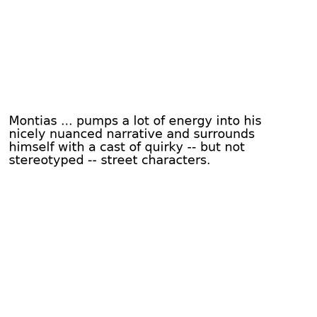

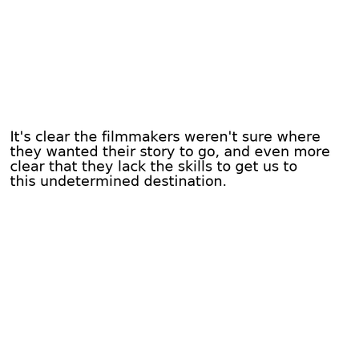

**EN.** Figure 19: Two example images from the Rendered SST2 dataset

**中.** 图 19：渲染 SST2 数据集中的两个示例图像

| Dataset 数据集 | Classes 课程 | Train size 列车尺寸 | Test size 测试尺寸 | Evaluation metric 评估指标 |
| --- | --- | --- | --- | --- |
| Food-101 食品101 | 102 | 75,750 | 25,250 | accuracy 准确度 |
| CIFAR-10 | 10 | 50,000 | 10,000 | accuracy 准确度 |
| CIFAR-100 | 100 | 50,000 | 10,000 | accuracy 准确度 |
| Birdsnap 鸟鸣 | 500 | 42,283 | 2,149 | accuracy 准确度 |
| SUN397 太阳397 | 397 | 19,850 | 19,850 | accuracy 准确度 |
| Stanford Cars 斯坦福汽车 | 196 | 8,144 | 8,041 | accuracy 准确度 |
| FGVC Aircraft FGVC 飞机 | 100 | 6,667 | 3,333 | mean per class 每班平均数 |
| Pascal VOC 2007 Classification 帕斯卡 VOC 2007 分类 | 20 | 5,011 | 4,952 | 11-point mAP 11点地图 |
| Describable Textures 可描述的纹理 | 47 | 3,760 | 1,880 | accuracy 准确度 |
| Oxford-IIIT Pets 牛津-IIIT 宠物 | 37 | 3,680 | 3,669 | mean per class 每班平均数 |
| Caltech-101 加州理工学院-101 | 102 | 3,060 | 6,085 | mean-per-class 每类平均数 |
| Oxford Flowers 102 牛津花102 | 102 | 2,040 | 6,149 | mean per class 每班平均数 |
| MNIST | 10 | 60,000 | 10,000 | accuracy 准确度 |
| Facial Emotion Recognition 2013 面部表情识别2013 | 8 | 32,140 | 3,574 | accuracy 准确度 |
| STL-10 | 10 | 1000 | 8000 | accuracy 准确度 |
| EuroSAT 欧洲卫星公司 | 10 | 10,000 | 5,000 | accuracy 准确度 |
| RESISC45 | 45 | 3,150 | 25,200 | accuracy 准确度 |
| GTSRB | 43 | 26,640 | 12,630 | accuracy 准确度 |
| KITTI 基蒂 | 4 | 6,770 | 711 | accuracy 准确度 |
| Country211 国家211 | 211 | 43,200 | 21,100 | accuracy 准确度 |
| PatchCamelyon 补丁卡梅利昂 | 2 | 294,912 | 32,768 | accuracy 准确度 |
| UCF101 | 101 | 9,537 | 1,794 | accuracy 准确度 |
| Kinetics700 动力学700 | 700 | 494,801 | 31,669 | mean(top1, top5) 平均值（前1，前5） |
| CLEVR Counts CLEVR 计数 | 8 | 2,000 | 500 | accuracy 准确度 |
| Hateful Memes 可恶的模因 | 2 | 8,500 | 500 | ROC AUC 中华民国曲线下面积 |
| Rendered SST2 渲染的 SST2 | 2 | 7,792 | 1,821 | accuracy 准确度 |
| ImageNet 图像网 | 1000 | 1,281,167 | 50,000 | accuracy 准确度 |

**EN.** Table 9: Datasets examined for linear probes. We note that, for the Birdsnap and Kinetics700 datasets, we used the resources that are available online at the time of this writing.

**中.** 表 9：线性探针检查的数据集。我们注意到，对于 Birdsnap 和 Kinetics700 数据集，我们使用了撰写本文时在线可用的资源。

### Models / 型号

**EN.** In combination with the datasets listed above, we evaluate the following series of models using linear probes.

**中.** 结合上面列出的数据集，我们使用线性探针评估以下一系列模型。

#### LM RN50

**EN.** This is a multimodal model that uses an autoregressive loss instead of a contrastive loss, while using the ResNet-50 architecture as in the smallest contrastive model. To do so, the output from the CNN is projected into four tokens, which are then fed as a prefix to a language model autoregressively predicting the text tokens. Apart from the training objective, the model was trained on the same dataset for the same number of epochs as other CLIP models.

**中.** 这是一个多模态模型，使用自回归损失而不是对比损失，同时使用 ResNet-50 架构作为最小对比模型。为此，CNN 的输出被投影为四个标记，然后将其作为前缀提供给自回归预测文本标记的语言模型。除了训练目标之外，该模型还与其他 CLIP 模型在相同的数据集上进行了相同数量的训练。

#### CLIP-RN / 剪辑RN

**EN.** Five ResNet-based contrastive CLIP models are included. As discussed in the paper, the first two models follow ResNet-50 and ResNet-101, and we use EfficientNet-style ( Tan & Le, 2019 ) scaling for the next three models which simultaneously scale the model width, the number of layers, and the input resolution to obtain models with roughly 4x, 16x, and 64x computation.

**中.** 其中包括五个基于 ResNet 的对比 CLIP 模型。正如论文中所讨论的，前两个模型遵循 ResNet-50 和 ResNet-101，我们对接下来的三个模型使用 EfficientNet 式（Tan & Le，2019）缩放，同时缩放模型宽度、层数和输入分辨率，以获得具有大约 4 倍、16 倍和 64 倍计算量的模型。

#### CLIP-ViT / 剪辑ViT

**EN.** We include four CLIP models that use the Vision Transformer ( Dosovitskiy et al., 2020 ) architecture as the image encoder. We include three models trained on 224-by-224 pixel images: ViT-B/32, ViT-B/16, ViT-L/14, and the ViT-L/14 model fine-tuned on 336-by-336 pixel input images.

**中.** 我们包括四个使用 Vision Transformer（Dosovitskiy 等人，2020）架构作为图像编码器的 CLIP 模型。我们包括在 224 x 224 像素图像上训练的三个模型：ViT-B/32、ViT-B/16、ViT-L/14 和在 336 x 336 像素输入图像上微调的 ViT-L/14 模型。

#### EfficietNet / 高效网

**EN.** We use the nine models (B0-B8) from the original EfficientNet paper ( Tan & Le, 2019 ) , as well as the noisy-student variants (B0-B7, L2-475, and L2-800) ( Tan & Le, 2019 ) . The largest models (L2-475 and L2-800) take the input resolutions of 475x475 and 800x800 pixels, respectively.

**中.** 我们使用原始 EfficientNet 论文 (Tan & Le, 2019) 中的九个模型 (B0-B8)，以及嘈杂的学生变体 (B0-B7、L2-475 和 L2-800) (Tan & Le, 2019)。最大的模型（L2-475 和 L2-800）分别采用 475x475 和 800x800 像素的输入分辨率。

#### Instagram-pretrained ResNeXt / Instagram 预训练 ResNeXt

**EN.** We use the four models (32x8d, 32x16d, 32x32d, 32x48d) released by ( Mahajan et al., 2018 ) , as well as their two FixRes variants which use higher input resolutions ( Touvron et al., 2019 ) .

**中.** 我们使用（Mahajan et al., 2018）发布的四个模型（32x8d、32x16d、32x32d、32x48d），以及它们的两个使用更高输入分辨率的 FixRes 变体（Touvron et al., 2019）。

#### Big Transfer (BiT) / 大额转账 (BiT)

**EN.** We use BiT-S and BiT-M models ( Kolesnikov et al., 2019 ) , trained on the ImageNet-1k and ImageNet-21k datasets. The model weights for BiT-L is not publicly available.

**中.** 我们使用 BiT-S 和 BiT-M 模型（Kolesnikov 等人，2019），在 ImageNet-1k 和 ImageNet-21k 数据集上进行训练。 BiT-L 的模型权重未公开。

#### Vision Transformer (ViT) / 视觉转换器 (ViT)

**EN.** We also include four ViT ( Dosovitskiy et al., 2020 ) checkpoints pretrained on the ImageNet-21k dataset, namely ViT-B/32, ViT-B/16, ViT-L/16, and ViT-H/14. We note that their best-performing models, trained on the JFT-300M dataset, are not available publicly.

**中.** 我们还包括在 ImageNet-21k 数据集上预训练的四个 ViT（Dosovitskiy 等人，2020）检查点，即 ViT-B/32、ViT-B/16、ViT-L/16 和 ViT-H/14。我们注意到，他们在 JFT-300M 数据集上训练的性能最佳模型尚未公开。

#### SimCLRv2

**EN.** The SimCLRv2 ( Chen et al., 2020c ) project released pre-trained and fine-tuned models in various settings. We use the seven pretrain-only checkpoints with selective kernels.

**中.** SimCLRv2（Chen 等人，2020c）项目发布了各种设置下的预训练和微调模型。我们使用带有选择性内核的七个仅预训练检查点。

#### BYOL / 自带许可

**EN.** We use the recently released model weights of BYOL ( Grill et al., 2020 ) , specifically their 50x1 and 200x2 checkpoints.

**中.** 我们使用最近发布的 BYOL 模型权重（Grill et al., 2020），特别是它们的 50x1 和 200x2 检查点。

#### Momentum Contrast (MoCo) / 动量对比 (MoCo)

**EN.** We include the MoCo-v1 ( He et al., 2020 ) and the MoCo-v2 ( Chen et al., 2020d ) checkpoints.

**中.** 我们包括 MoCo-v1 (He et al., 2020) 和 MoCo-v2 (Chen et al., 2020d) 检查点。

#### VirTex / 维特克斯

**EN.** We use the pretrained model of VirTex ( Desai & Johnson, 2020 ) . We note that VirTex has a similar model design to CLIP-AR but is trained on a 1000x smaller dataset of high-quality captions from MSCOCO.

**中.** 我们使用 VirTex 的预训练模型（Desai & Johnson，2020）。我们注意到 VirTex 具有与 CLIP-AR 类似的模型设计，但在来自 MSCOCO 的小 1000 倍的高质量字幕数据集上进行训练。

#### ResNet / 残差网络

**EN.** We add the original ResNet checkpoints released by ( He et al., 2016b ) , namely ResNet-50, ResNet-101, and ResNet152.

**中.** 我们添加了（He et al., 2016b）发布的原始 ResNet 检查点，即 ResNet-50、ResNet-101 和 ResNet152。

### Evaluation / 评价

**EN.** We use image features taken from the penultimate layer of each model, ignoring any classification layer provided. For CLIP-ViT models, we used the features before the linear projection to the embedding space, which corresponds to I_f in Figure 3 . We train a logistic regression classifier using scikit-learn’s L-BFGS implementation, with maximum 1,000 iterations, and report the corresponding metric for each dataset. We determine the L2 regularization strength $\lambda$ using a hyperparameter sweep on the validation sets over the range between $10^{-6}$ and $10^{6}$ , with 96 logarithmically spaced steps. To save compute required for the sweeps, we perform a parametric binary search that starts with $\lambda=[10^{-6},10^{-4},10^{-2},1,10^{2},10^{4},10^{6}]$ and iteratively halves the interval around the peak until it reaches a resolution of 8 steps per decade. The hyperparameter sweeps are performed on a validation split of each dataset. For the datasets that contain a validation split in addition to a test split, we use the provided validation set to perform the hyperparameter search, and for the datasets that do not provide a validation split or have not published labels for the test data, we split the training dataset to perform the hyperparameter search. For the final result, we combine the validation split back with the training split and report the performance on the unused split.

**中.** 我们使用从每个模型的倒数第二层获取的图像特征，忽略提供的任何分类层。对于CLIP-ViT模型，我们使用线性投影到嵌入空间之前的特征，对应于图3中的I_f。我们使用 scikit-learn 的 L-BFGS 实现来训练逻辑回归分类器，最多迭代 1,000 次，并报告每个数据集的相应指标。我们使用 $10^{-6}$ 和 $10^{6}$ 之间范围内的验证集的超参数扫描来确定 L2 正则化强度 $\lambda$ ，具有 96 个对数间隔的步骤。为了节省扫描所需的计算量，我们执行参数二分搜索，从 $\lambda=[10^{-6},10^{-4},10^{-2},1,10^{2},10^{4},10^{6}]$ 开始，迭代地将峰值周围的间隔减半，直到达到每十年 8 步的分辨率。超参数扫描是在每个数据集的验证分割上执行的。对于除了测试分割之外还包含验证分割的数据集，我们使用提供的验证集来执行超参数搜索，对于不提供验证分割或没有发布测试数据标签的数据集，我们分割训练数据集来执行超参数搜索。对于最终结果，我们将验证分割与训练分割结合起来，并报告未使用分割的性能。

### Results / 结果

**EN.** The individual linear probe scores are provided in Table 10 and plotted in Figure 20 . The best-performing CLIP model, using ViT-L/14 archiecture and 336-by-336 pixel images, achieved the state of the art in 21 of the 27 datasets, i.e. included in the Clopper-Pearson 99.5% confidence interval around each dataset’s top score. For many datasets, CLIP performs significantly better than other models, demonstrating the advantage of natural language supervision over traditional pre-training approaches based on image classification. See Section 3.2 for more discussions on the linear probe results.

**中.** 各个线性探针得分在表10中提供并在图20中绘制。性能最佳的 CLIP 模型使用 ViT-L/14 架构和 336×336 像素图像，在 27 个数据集中的 21 个数据集中达到了最先进的水平，即包含在围绕每个数据集最高得分的 Clopper-Pearson 99.5% 置信区间中。对于许多数据集，CLIP 的表现明显优于其他模型，展示了自然语言监督相对于基于图像分类的传统预训练方法的优势。有关线性探针结果的更多讨论，请参见第 3.2 节。

|  |  |  | Food101 食品101 | CIFAR10 西法尔10 | CIFAR100 西法尔100 | Birdsnap 鸟鸣 | SUN397 太阳397 | Cars 汽车 | Aircraft 飞机 | VOC2007 | DTD | Pets 宠物 | Caltech101 加州理工学院101 | Flowers 鲜花 | MNIST | FER2013 | STL10 ⋆ | EuroSAT 欧洲卫星公司 | RESISC45 | GTSRB | KITTI 基蒂 | Country211 国家211 | PCAM 相变存储器 | UCF101 | Kinetics700 动力学700 | CLEVR 克莱弗 | HatefulMemes 仇恨模因 | SST 海温 | ImageNet 图像网 |
| --- | --- | --- | --- | --- | --- | --- | --- | --- | --- | --- | --- | --- | --- | --- | --- | --- | --- | --- | --- | --- | --- | --- | --- | --- | --- | --- | --- | --- | --- |
|  | LM RN50 |  | 81.3 | 82.8 | 61.7 | 44.2 | 69.6 | 74.9 | 44.9 | 85.5 | 71.5 | 82.8 | 85.5 | 91.1 | 96.6 | 60.1 | 95.3 | 93.4 | 84.0 | 73.8 | 70.2 | 19.0 | 82.9 | 76.4 | 51.9 | 51.2 | 65.2 | 76.8 | 65.2 |
| CLIP-RN 剪辑RN | 50 |  | 86.4 | 88.7 | 70.3 | 56.4 | 73.3 | 78.3 | 49.1 | 87.1 | 76.4 | 88.2 | 89.6 | 96.1 | 98.3 | 64.2 | 96.6 | 95.2 | 87.5 | 82.4 | 70.2 | 25.3 | 82.7 | 81.6 | 57.2 | 53.6 | 65.7 | 72.6 | 73.3 |
| CLIP-RN 剪辑RN | 101 |  | 88.9 | 91.1 | 73.5 | 58.6 | 75.1 | 84.0 | 50.7 | 88.0 | 76.3 | 91.0 | 92.0 | 96.4 | 98.4 | 65.2 | 97.8 | 95.9 | 89.3 | 82.4 | 73.6 | 26.6 | 82.8 | 84.0 | 60.3 | 50.3 | 68.2 | 73.3 | 75.7 |
| CLIP-RN 剪辑RN | 50x4 |  | 91.3 | 90.5 | 73.0 | 65.7 | 77.0 | 85.9 | 57.3 | 88.4 | 79.5 | 91.9 | 92.5 | 97.8 | 98.5 | 68.1 | 97.8 | 96.4 | 89.7 | 85.5 | 59.4 | 30.3 | 83.0 | 85.7 | 62.6 | 52.5 | 68.0 | 76.6 | 78.2 |
| CLIP-RN 剪辑RN | 50x16 |  | 93.3 | 92.2 | 74.9 | 72.8 | 79.2 | 88.7 | 62.7 | 89.0 | 79.1 | 93.5 | 93.7 | 98.3 | 98.9 | 68.7 | 98.6 | 97.0 | 91.4 | 89.0 | 69.2 | 34.8 | 83.5 | 88.0 | 66.3 | 53.8 | 71.1 | 80.0 | 81.5 |
| CLIP-RN 剪辑RN | 50x64 |  | 94.8 | 94.1 | 78.6 | 77.2 | 81.1 | 90.5 | 67.7 | 88.9 | 82.0 | 94.5 | 95.4 | 98.9 | 98.9 | 71.3 | 99.1 | 97.1 | 92.8 | 90.2 | 69.2 | 40.7 | 83.7 | 89.5 | 69.1 | 55.0 | 75.0 | 81.2 | 83.6 |
| CLIP-ViT 剪辑ViT | B/32 |  | 88.8 | 95.1 | 80.5 | 58.5 | 76.6 | 81.8 | 52.0 | 87.7 | 76.5 | 90.0 | 93.0 | 96.9 | 99.0 | 69.2 | 98.3 | 97.0 | 90.5 | 85.3 | 66.2 | 27.8 | 83.9 | 85.5 | 61.7 | 52.1 | 66.7 | 70.8 | 76.1 |
| CLIP-ViT 剪辑ViT | B/16 |  | 92.8 | 96.2 | 83.1 | 67.8 | 78.4 | 86.7 | 59.5 | 89.2 | 79.2 | 93.1 | 94.7 | 98.1 | 99.0 | 69.5 | 99.0 | 97.1 | 92.7 | 86.6 | 67.8 | 33.3 | 83.5 | 88.4 | 66.1 | 57.1 | 70.3 | 75.5 | 80.2 |
| CLIP-ViT 剪辑ViT | L/14 |  | 95.2 | 98.0 | 87.5 | 77.0 | 81.8 | 90.9 | 69.4 | 89.6 | 82.1 | 95.1 | 96.5 | 99.2 | 99.2 | 72.2 | 99.7 | 98.2 | 94.1 | 92.5 | 64.7 | 42.9 | 85.8 | 91.5 | 72.0 | 57.8 | 76.2 | 80.8 | 83.9 |
| CLIP-ViT 剪辑ViT | L/14-336px 长/14-336像素 |  | 95.9 | 97.9 | 87.4 | 79.9 | 82.2 | 91.5 | 71.6 | 89.9 | 83.0 | 95.1 | 96.0 | 99.2 | 99.2 | 72.9 | 99.7 | 98.1 | 94.9 | 92.4 | 69.2 | 46.4 | 85.6 | 92.0 | 73.0 | 60.3 | 77.3 | 80.5 | 85.4 |
| EfficientNet 高效网络 | B0 |  | 74.3 | 92.5 | 76.5 | 59.7 | 62.0 | 62.5 | 55.7 | 84.4 | 71.2 | 93.0 | 93.3 | 91.7 | 98.2 | 57.2 | 97.1 | 97.3 | 85.5 | 80.0 | 73.8 | 12.4 | 83.1 | 74.4 | 47.6 | 47.9 | 55.7 | 53.4 | 76.9 |
| EfficientNet 高效网络 | B1 |  | 74.2 | 93.2 | 77.2 | 61.3 | 62.6 | 62.5 | 56.1 | 84.7 | 74.2 | 93.4 | 93.6 | 92.4 | 98.3 | 57.0 | 97.5 | 96.8 | 84.5 | 75.9 | 75.5 | 12.5 | 82.7 | 74.7 | 48.5 | 44.3 | 54.5 | 54.4 | 78.6 |
| EfficientNet 高效网络 | B2 |  | 75.8 | 93.6 | 77.9 | 64.4 | 64.0 | 63.2 | 57.0 | 85.3 | 73.5 | 93.9 | 93.5 | 92.9 | 98.5 | 56.6 | 97.7 | 96.9 | 84.4 | 76.4 | 73.1 | 12.6 | 84.3 | 75.1 | 49.4 | 42.6 | 55.4 | 55.2 | 79.7 |
| EfficientNet 高效网络 | B3 |  | 77.4 | 94.0 | 78.0 | 66.5 | 64.4 | 66.0 | 59.3 | 85.8 | 73.1 | 94.1 | 93.7 | 93.3 | 98.5 | 57.1 | 98.2 | 97.3 | 85.0 | 75.8 | 76.1 | 13.4 | 83.3 | 78.1 | 50.9 | 45.1 | 53.8 | 54.8 | 81.0 |
| EfficientNet 高效网络 | B4 |  | 79.7 | 94.1 | 78.7 | 70.1 | 65.4 | 66.4 | 60.4 | 86.5 | 73.4 | 94.7 | 93.5 | 93.2 | 98.8 | 57.9 | 98.6 | 96.8 | 85.0 | 78.3 | 72.3 | 13.9 | 83.1 | 79.1 | 52.5 | 46.5 | 54.4 | 55.4 | 82.9 |
| EfficientNet 高效网络 | B5 |  | 81.5 | 93.6 | 77.9 | 72.4 | 67.1 | 72.7 | 68.9 | 86.7 | 73.9 | 95.0 | 94.7 | 94.5 | 98.4 | 58.5 | 98.7 | 96.8 | 86.0 | 78.5 | 69.6 | 14.9 | 84.7 | 80.9 | 54.5 | 46.6 | 53.3 | 56.3 | 83.7 |
| EfficientNet 高效网络 | B6 |  | 82.4 | 94.0 | 78.0 | 73.5 | 65.8 | 71.1 | 68.2 | 87.6 | 73.9 | 95.0 | 94.1 | 93.7 | 98.4 | 60.2 | 98.7 | 96.8 | 85.4 | 78.1 | 72.7 | 15.3 | 84.2 | 80.0 | 54.1 | 51.1 | 53.3 | 57.0 | 84.0 |
| EfficientNet 高效网络 | B7 |  | 84.5 | 94.9 | 80.1 | 74.7 | 69.0 | 77.1 | 72.3 | 87.2 | 76.8 | 95.2 | 94.7 | 95.9 | 98.6 | 61.3 | 99.1 | 96.3 | 86.8 | 80.8 | 75.8 | 16.4 | 85.2 | 81.9 | 56.8 | 51.9 | 54.4 | 57.8 | 84.8 |
| EfficientNet 高效网络 | B8 |  | 84.5 | 95.0 | 80.7 | 75.2 | 69.6 | 76.8 | 71.5 | 87.4 | 77.1 | 94.9 | 95.2 | 96.3 | 98.6 | 61.4 | 99.2 | 97.0 | 87.4 | 80.4 | 70.9 | 17.4 | 85.2 | 82.4 | 57.7 | 51.4 | 51.7 | 55.8 | 85.3 |
| EfficientNet Noisy Student EfficientNet 吵闹的学生 | B0 |  | 78.1 | 94.0 | 78.6 | 63.5 | 65.5 | 57.2 | 53.7 | 85.6 | 75.6 | 93.8 | 93.1 | 94.5 | 98.1 | 55.6 | 98.2 | 97.0 | 84.3 | 74.0 | 71.6 | 14.0 | 83.1 | 76.7 | 51.7 | 47.3 | 55.7 | 55.0 | 78.5 |
| EfficientNet Noisy Student EfficientNet 吵闹的学生 | B1 |  | 80.4 | 95.1 | 80.2 | 66.6 | 67.6 | 59.6 | 53.7 | 86.2 | 77.0 | 94.6 | 94.4 | 95.1 | 98.0 | 56.1 | 98.6 | 96.9 | 84.3 | 73.1 | 67.1 | 14.5 | 83.9 | 79.9 | 54.5 | 46.1 | 54.3 | 54.9 | 81.1 |
| EfficientNet Noisy Student EfficientNet 吵闹的学生 | B2 |  | 80.9 | 95.3 | 81.3 | 67.6 | 67.9 | 60.9 | 55.2 | 86.3 | 77.7 | 95.0 | 94.7 | 94.4 | 98.0 | 55.5 | 98.8 | 97.3 | 84.6 | 71.7 | 70.0 | 14.6 | 82.9 | 80.1 | 55.1 | 46.1 | 54.1 | 55.3 | 82.2 |
| EfficientNet Noisy Student EfficientNet 吵闹的学生 | B3 |  | 82.6 | 95.9 | 82.1 | 68.6 | 68.8 | 60.6 | 55.4 | 86.5 | 77.2 | 95.0 | 94.8 | 95.2 | 98.1 | 56.0 | 99.1 | 96.5 | 85.0 | 70.5 | 69.5 | 15.1 | 83.1 | 81.8 | 56.8 | 45.1 | 55.7 | 52.0 | 83.8 |
| EfficientNet Noisy Student EfficientNet 吵闹的学生 | B4 |  | 85.2 | 95.6 | 81.0 | 72.5 | 69.7 | 56.1 | 52.6 | 87.0 | 78.7 | 94.8 | 95.2 | 95.3 | 98.2 | 56.0 | 99.3 | 95.3 | 84.8 | 61.9 | 64.8 | 16.0 | 82.8 | 83.4 | 59.8 | 43.2 | 55.3 | 53.0 | 85.4 |
| EfficientNet Noisy Student EfficientNet 吵闹的学生 | B5 |  | 87.6 | 96.3 | 82.4 | 75.3 | 71.6 | 64.7 | 64.8 | 87.8 | 79.6 | 95.5 | 95.6 | 96.6 | 98.8 | 60.9 | 99.4 | 96.1 | 87.0 | 68.5 | 73.7 | 16.4 | 83.5 | 86.4 | 61.6 | 46.3 | 53.4 | 55.8 | 85.8 |
| EfficientNet Noisy Student EfficientNet 吵闹的学生 | B6 |  | 87.3 | 97.0 | 83.9 | 75.8 | 71.4 | 67.6 | 65.6 | 87.3 | 78.5 | 95.2 | 96.4 | 97.2 | 98.6 | 61.9 | 99.5 | 96.6 | 86.1 | 70.7 | 72.4 | 17.6 | 84.2 | 85.5 | 61.0 | 49.6 | 54.6 | 55.7 | 86.4 |
| EfficientNet Noisy Student EfficientNet 吵闹的学生 | B7 |  | 88.4 | 96.0 | 82.0 | 76.9 | 72.6 | 72.2 | 71.2 | 88.1 | 80.5 | 95.5 | 95.5 | 96.6 | 98.5 | 62.7 | 99.4 | 96.2 | 88.5 | 73.4 | 73.0 | 18.5 | 83.8 | 86.6 | 63.2 | 50.5 | 57.2 | 56.7 | 87.0 |
| EfficientNet Noisy Student EfficientNet 吵闹的学生 | L2-475 |  | 91.6 | 99.0 | 91.0 | 74.8 | 76.4 | 75.1 | 66.8 | 89.5 | 81.9 | 95.6 | 96.5 | 97.7 | 98.9 | 67.5 | 99.6 | 97.0 | 89.5 | 73.4 | 68.9 | 22.2 | 86.3 | 89.4 | 68.2 | 58.3 | 58.6 | 55.2 | 88.3 |
| EfficientNet Noisy Student EfficientNet 吵闹的学生 | L2-800 |  | 92.0 | 98.7 | 89.0 | 78.5 | 75.7 | 75.5 | 68.4 | 89.4 | 82.5 | 95.6 | 94.7 | 97.9 | 98.5 | 68.4 | 99.7 | 97.2 | 89.9 | 77.7 | 66.9 | 23.7 | 86.8 | 88.9 | 66.7 | 62.7 | 58.4 | 56.9 | 88.4 |
| Instagram | 32x8d |  | 84.8 | 95.9 | 80.9 | 63.8 | 69.0 | 74.2 | 56.0 | 88.0 | 75.4 | 95.4 | 93.9 | 91.7 | 97.4 | 60.7 | 99.1 | 95.7 | 82.1 | 72.3 | 69.2 | 16.7 | 82.3 | 80.1 | 56.8 | 42.2 | 53.3 | 55.2 | 83.3 |
| Instagram | 32x16d |  | 85.7 | 96.5 | 80.9 | 64.8 | 70.5 | 77.5 | 56.7 | 87.9 | 76.2 | 95.6 | 94.9 | 92.5 | 97.4 | 61.6 | 99.3 | 95.5 | 82.8 | 73.8 | 66.1 | 17.5 | 83.4 | 81.1 | 58.2 | 41.3 | 54.2 | 56.1 | 84.4 |
| Instagram | 32x32d |  | 86.7 | 96.8 | 82.7 | 67.1 | 71.5 | 77.5 | 55.4 | 88.3 | 78.5 | 95.8 | 95.3 | 94.4 | 97.9 | 62.4 | 99.3 | 95.7 | 85.4 | 71.2 | 66.8 | 18.0 | 83.7 | 82.1 | 58.8 | 39.7 | 55.3 | 56.7 | 85.0 |
| Instagram | 32x48d |  | 86.9 | 96.8 | 83.4 | 65.9 | 72.2 | 76.6 | 53.2 | 88.0 | 77.2 | 95.5 | 95.8 | 93.6 | 98.1 | 63.7 | 99.4 | 95.3 | 85.4 | 73.0 | 67.2 | 18.5 | 82.7 | 82.8 | 59.2 | 41.3 | 55.5 | 56.7 | 85.2 |
| Instagram | FixRes-v1 修复Res-v1 |  | 88.5 | 95.7 | 81.1 | 67.4 | 72.9 | 80.5 | 57.6 | 88.0 | 77.9 | 95.8 | 96.1 | 94.5 | 97.9 | 62.2 | 99.4 | 96.2 | 86.6 | 76.5 | 64.8 | 19.3 | 82.5 | 83.4 | 59.8 | 43.5 | 56.6 | 59.0 | 86.0 |
| Instagram | FixRes-v2 修复Res-v2 |  | 88.5 | 95.7 | 81.1 | 67.3 | 72.9 | 80.7 | 57.5 | 88.0 | 77.9 | 95.0 | 96.0 | 94.5 | 98.0 | 62.1 | 99.4 | 96.5 | 86.6 | 76.3 | 64.8 | 19.5 | 82.3 | 83.5 | 59.8 | 44.2 | 56.6 | 59.0 | 86.0 |
| BiT-S | R50x1 |  | 72.5 | 91.7 | 74.8 | 57.7 | 61.1 | 53.5 | 52.5 | 83.7 | 72.4 | 92.3 | 91.2 | 92.0 | 98.4 | 56.1 | 96.4 | 97.4 | 85.0 | 70.0 | 66.0 | 12.5 | 83.0 | 72.3 | 47.5 | 48.3 | 54.1 | 55.3 | 75.2 |
| BiT-S | R50x3 |  | 75.1 | 93.7 | 79.0 | 61.1 | 63.7 | 55.2 | 54.1 | 84.8 | 74.6 | 92.5 | 91.6 | 92.8 | 98.8 | 58.7 | 97.0 | 97.8 | 86.4 | 73.1 | 73.8 | 14.0 | 84.2 | 76.4 | 50.0 | 49.2 | 54.7 | 54.2 | 77.2 |
| BiT-S | R101x1 |  | 73.5 | 92.8 | 77.4 | 58.4 | 61.3 | 54.0 | 52.4 | 84.4 | 73.5 | 92.5 | 91.8 | 90.6 | 98.3 | 56.5 | 96.8 | 97.3 | 84.6 | 69.4 | 68.9 | 12.6 | 82.0 | 73.5 | 48.6 | 45.4 | 52.6 | 55.5 | 76.0 |
| BiT-S | R101x3 |  | 74.7 | 93.9 | 79.8 | 57.8 | 62.9 | 54.7 | 53.3 | 84.7 | 75.5 | 92.3 | 91.2 | 92.6 | 98.8 | 59.7 | 97.3 | 98.0 | 85.5 | 71.8 | 60.2 | 14.1 | 83.1 | 75.9 | 50.4 | 49.7 | 54.1 | 54.6 | 77.4 |
| BiT-S | R152x2 |  | 74.9 | 94.3 | 79.7 | 58.7 | 62.7 | 55.9 | 53.6 | 85.3 | 74.9 | 93.0 | 92.0 | 91.7 | 98.6 | 58.3 | 97.1 | 97.8 | 86.2 | 71.8 | 71.6 | 13.9 | 84.1 | 76.2 | 49.9 | 48.2 | 53.8 | 55.9 | 77.1 |
| BiT-S | R152x4 |  | 74.7 | 94.2 | 79.2 | 57.8 | 62.9 | 51.2 | 50.8 | 85.4 | 75.4 | 93.1 | 91.2 | 91.4 | 98.9 | 61.4 | 97.2 | 98.0 | 85.5 | 72.8 | 67.9 | 14.9 | 83.1 | 76.0 | 50.3 | 42.9 | 53.6 | 56.0 | 78.5 |
| BiT-M | R50x1 |  | 83.3 | 94.9 | 82.2 | 70.9 | 69.9 | 59.0 | 55.6 | 86.8 | 77.3 | 91.5 | 93.9 | 99.4 | 98.0 | 60.6 | 98.4 | 97.5 | 87.4 | 68.6 | 68.2 | 16.6 | 82.5 | 79.4 | 53.2 | 49.4 | 54.5 | 53.4 | 76.7 |
| BiT-M | R50x3 |  | 86.9 | 96.7 | 86.2 | 75.7 | 74.6 | 60.6 | 54.2 | 87.7 | 78.5 | 93.2 | 95.3 | 99.4 | 98.6 | 64.6 | 99.3 | 98.0 | 88.1 | 69.9 | 59.6 | 19.6 | 83.4 | 83.5 | 57.8 | 51.3 | 55.8 | 55.6 | 80.7 |
| BiT-M | R101x1 |  | 85.5 | 95.7 | 84.4 | 73.0 | 72.5 | 59.8 | 55.0 | 87.3 | 78.1 | 92.2 | 95.0 | 99.5 | 98.1 | 62.5 | 99.0 | 97.6 | 87.8 | 68.7 | 67.7 | 18.0 | 84.0 | 82.3 | 55.9 | 53.4 | 54.8 | 53.1 | 79.4 |
| BiT-M | R101x3 |  | 87.2 | 97.4 | 87.5 | 72.4 | 75.0 | 57.4 | 47.4 | 87.5 | 79.6 | 93.2 | 95.4 | 99.6 | 98.6 | 64.3 | 99.4 | 98.2 | 87.7 | 68.8 | 64.1 | 20.7 | 80.4 | 84.0 | 58.7 | 52.6 | 54.9 | 54.3 | 81.2 |
| BiT-M | R152x2 |  | 88.0 | 97.5 | 87.8 | 75.8 | 75.9 | 61.5 | 55.3 | 88.1 | 79.8 | 93.6 | 95.9 | 99.5 | 98.5 | 64.3 | 99.5 | 97.9 | 89.0 | 70.0 | 70.3 | 20.7 | 82.6 | 85.5 | 59.6 | 50.8 | 54.9 | 55.1 | 81.9 |
| BiT-M | R152x4 |  | 87.2 | 97.6 | 88.2 | 72.4 | 75.0 | 49.1 | 43.4 | 87.1 | 79.9 | 92.4 | 95.4 | 99.3 | 98.5 | 65.7 | 99.5 | 97.8 | 87.7 | 68.2 | 57.1 | 20.6 | 80.4 | 84.6 | 59.0 | 49.7 | 57.2 | 55.1 | 81.5 |
| ViT 维特 | B/32 |  | 81.8 | 96.7 | 86.3 | 65.2 | 70.7 | 49.1 | 42.7 | 85.3 | 73.1 | 90.4 | 94.5 | 98.7 | 97.8 | 59.0 | 99.0 | 96.3 | 83.0 | 68.1 | 65.1 | 15.7 | 82.6 | 79.1 | 51.7 | 38.9 | 57.1 | 54.6 | 76.6 |
| ViT 维特 | B/16 |  | 86.7 | 96.9 | 86.4 | 74.0 | 74.2 | 54.7 | 46.0 | 86.7 | 74.3 | 92.7 | 94.1 | 99.2 | 97.4 | 61.3 | 99.5 | 96.4 | 84.5 | 63.1 | 61.5 | 17.5 | 85.4 | 82.7 | 56.6 | 40.0 | 57.0 | 56.1 | 80.9 |
| ViT 维特 | L/16 |  | 87.4 | 97.9 | 89.0 | 76.5 | 74.9 | 62.5 | 52.2 | 86.1 | 75.0 | 92.9 | 94.7 | 99.3 | 98.0 | 64.0 | 99.6 | 96.5 | 85.7 | 70.4 | 58.8 | 17.7 | 85.7 | 84.1 | 58.0 | 38.4 | 58.4 | 52.8 | 81.9 |
| ViT 维特 | H/14 |  | 83.4 | 95.8 | 84.5 | 70.2 | 69.2 | 62.3 | 54.8 | 84.7 | 75.4 | 91.7 | 93.7 | 98.9 | 98.5 | 62.4 | 98.4 | 97.3 | 87.0 | 73.9 | 63.4 | 15.4 | 87.0 | 79.4 | 52.1 | 41.1 | 55.9 | 54.1 | 75.9 |
| SimCLRv2 | R50x1 |  | 76.4 | 93.2 | 77.9 | 48.6 | 64.1 | 56.3 | 51.7 | 84.4 | 77.0 | 88.3 | 91.8 | 92.9 | 97.6 | 59.7 | 96.7 | 97.5 | 85.8 | 71.1 | 69.1 | 15.8 | 84.8 | 78.4 | 51.0 | 56.2 | 53.9 | 53.8 | 73.8 |
| SimCLRv2 | R50x3 |  | 81.0 | 95.6 | 82.4 | 56.5 | 67.0 | 65.6 | 61.1 | 85.9 | 78.8 | 90.9 | 94.1 | 95.4 | 98.7 | 62.6 | 98.2 | 97.9 | 88.2 | 78.2 | 74.7 | 17.6 | 85.4 | 82.6 | 54.6 | 55.4 | 54.2 | 55.2 | 77.3 |
| SimCLRv2 | R101x1 |  | 77.9 | 94.8 | 79.9 | 51.9 | 65.2 | 57.1 | 52.0 | 85.4 | 77.2 | 90.0 | 91.6 | 92.7 | 97.2 | 59.4 | 97.6 | 96.8 | 84.6 | 65.7 | 70.6 | 16.1 | 84.3 | 78.8 | 52.4 | 53.6 | 55.1 | 55.7 | 76.1 |
| SimCLRv2 | R101x3 |  | 82.2 | 96.4 | 83.4 | 57.5 | 68.2 | 64.6 | 60.0 | 86.2 | 78.9 | 91.8 | 95.0 | 95.4 | 98.4 | 63.0 | 98.5 | 97.9 | 88.0 | 77.5 | 69.1 | 18.3 | 85.5 | 82.9 | 55.9 | 52.2 | 54.5 | 56.3 | 78.8 |
| SimCLRv2 | R152x1 |  | 78.6 | 95.0 | 79.9 | 50.3 | 65.6 | 55.6 | 52.2 | 85.8 | 77.3 | 90.1 | 92.5 | 91.8 | 97.6 | 59.8 | 98.1 | 96.6 | 84.3 | 64.8 | 70.3 | 16.6 | 83.9 | 79.4 | 53.1 | 57.2 | 55.8 | 54.8 | 76.9 |
| SimCLRv2 | R152x2 |  | 82.3 | 96.7 | 83.9 | 58.1 | 68.5 | 64.9 | 58.7 | 86.6 | 79.1 | 92.2 | 94.1 | 96.0 | 98.2 | 64.1 | 98.5 | 98.0 | 88.1 | 77.0 | 69.8 | 18.4 | 85.3 | 82.7 | 56.2 | 53.6 | 56.0 | 56.5 | 79.2 |
| SimCLRv2 | R152x3 |  | 83.6 | 96.8 | 84.5 | 60.3 | 69.1 | 68.5 | 63.1 | 86.7 | 80.5 | 92.6 | 94.9 | 96.3 | 98.7 | 65.4 | 98.8 | 98.1 | 89.5 | 78.4 | 68.5 | 19.4 | 85.2 | 83.5 | 57.0 | 54.4 | 54.6 | 54.2 | 80.0 |
| BYOL 自带许可 | 50x1 |  | 74.0 | 93.6 | 79.1 | 47.6 | 63.7 | 61.6 | 62.3 | 82.6 | 77.0 | 88.3 | 93.7 | 94.3 | 98.7 | 58.8 | 96.4 | 97.6 | 88.2 | 80.1 | 71.4 | 14.1 | 84.8 | 77.3 | 49.3 | 56.1 | 53.8 | 54.4 | 73.3 |
| BYOL 自带许可 | 200x2 |  | 78.5 | 96.2 | 83.3 | 53.4 | 68.5 | 61.7 | 55.4 | 86.6 | 77.4 | 91.9 | 95.5 | 93.9 | 98.7 | 62.6 | 98.6 | 97.7 | 87.4 | 77.1 | 76.4 | 16.4 | 84.0 | 82.6 | 55.1 | 54.1 | 52.5 | 52.4 | 79.2 |
| MoCo 莫科 | v1 |  | 65.9 | 85.0 | 63.1 | 27.5 | 52.6 | 35.9 | 43.5 | 75.7 | 70.0 | 70.4 | 78.1 | 85.4 | 97.6 | 54.3 | 85.6 | 97.1 | 82.9 | 62.6 | 60.2 | 12.6 | 85.7 | 64.2 | 40.7 | 54.7 | 55.6 | 53.5 | 57.2 |
| MoCo 莫科 | v2 |  | 72.2 | 93.4 | 76.3 | 39.6 | 60.2 | 48.3 | 51.1 | 82.6 | 75.1 | 84.4 | 89.9 | 90.7 | 98.4 | 58.3 | 95.7 | 97.2 | 85.4 | 75.7 | 75.4 | 13.2 | 85.6 | 72.7 | 47.8 | 56.9 | 53.9 | 53.8 | 69.1 |
|  | VirTex 维特克斯 |  | 57.9 | 83.9 | 57.5 | 17.0 | 49.8 | 22.4 | 34.5 | 83.8 | 58.2 | 53.6 | 70.6 | 74.7 | 98.1 | 56.5 | 86.7 | 94.8 | 74.1 | 69.5 | 71.3 | 8.7 | 83.1 | 61.5 | 39.9 | 45.5 | 53.5 | 55.8 | 50.7 |
| ResNet 残差网络 | 50 |  | 71.3 | 91.8 | 74.5 | 52.7 | 60.5 | 49.9 | 48.5 | 83.8 | 72.3 | 92.4 | 90.8 | 90.8 | 98.3 | 54.9 | 96.4 | 96.7 | 83.6 | 70.6 | 67.1 | 11.7 | 82.5 | 71.2 | 46.8 | 43.0 | 56.5 | 55.5 | 74.3 |
| ResNet 残差网络 | 101 |  | 72.7 | 93.0 | 77.2 | 53.7 | 60.8 | 50.1 | 47.0 | 84.4 | 71.6 | 92.3 | 91.9 | 90.4 | 98.5 | 56.6 | 97.0 | 97.1 | 83.4 | 72.5 | 63.6 | 11.9 | 83.3 | 72.7 | 48.3 | 43.2 | 53.0 | 54.7 | 75.8 |
| ResNet 残差网络 | 152 |  | 73.7 | 93.5 | 78.0 | 55.1 | 61.6 | 52.8 | 48.4 | 84.5 | 71.9 | 93.0 | 92.1 | 89.6 | 98.2 | 57.0 | 97.6 | 97.0 | 83.1 | 70.1 | 70.2 | 12.3 | 82.9 | 75.3 | 49.2 | 42.4 | 53.2 | 53.9 | 77.1 |

**EN.** Table 10: Linear probe performance of various pre-trained models over 27 datasets. Scores within the 99.5% Clopper-Pearson confidence interval of each dataset’s top score are shown in bold. ⋆ We updated the STL10 scores from the previous version of this paper after fixing a CUDA-related bug.

**中.** 表 10：27 个数据集上各种预训练模型的线性探测性能。每个数据集最高得分的 99.5% Clopper-Pearson 置信区间内的得分以粗体显示。 ⋆ 在修复了与 CUDA 相关的错误后，我们更新了本文前一版本的 STL10 分数。

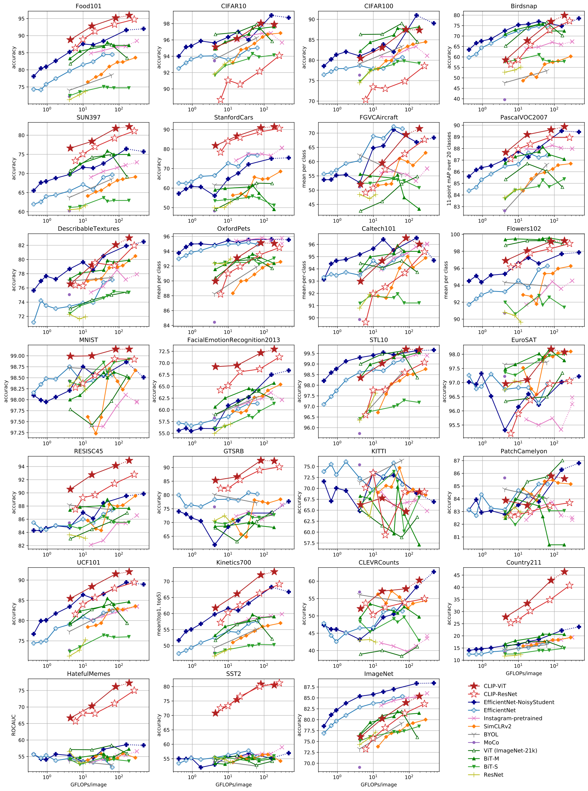

**EN.** Figure 20: Linear probe performance plotted for each of the 27 datasets, using the data from Table 10 .

**中.** 图 20：使用表 10 中的数据绘制 27 个数据集的线性探针性能图。

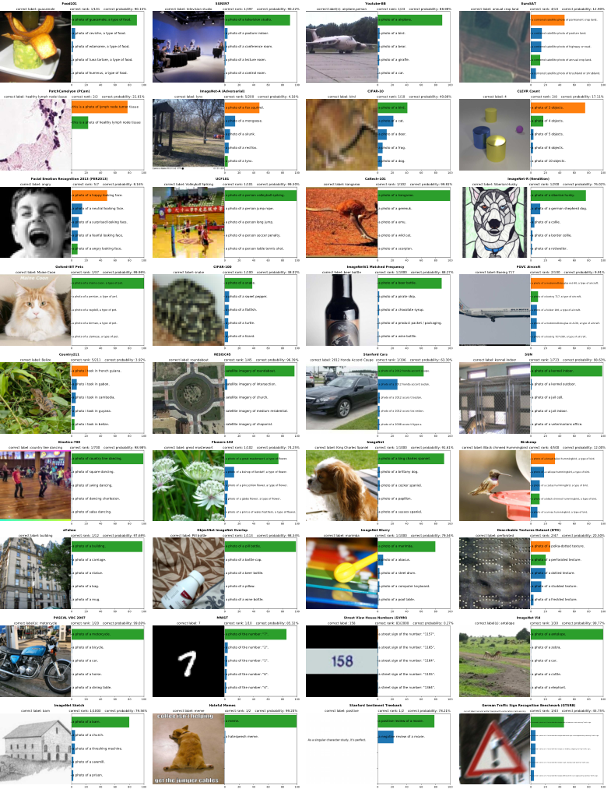

**EN.** Figure 21: Visualization of predictions from 36 CLIP zero-shot classifiers. All examples are random with the exception of reselecting Hateful Memes to avoid offensive content. The predicted probability of the top 5 classes is shown along with the text used to represent the class. When more than one template is used, the first template is shown. The ground truth label is colored green while an incorrect prediction is colored orange.

**中.** 图 21：36 个 CLIP 零样本分类器的预测可视化。除了重新选择可恶模因以避免冒犯性内容之外，所有示例都是随机的。前 5 个类别的预测概率与用于表示该类别的文本一起显示。当使用多个模板时，将显示第一个模板。地面真实标签为绿色，而错误的预测为橙色。

|  |  |  | Food101 食品101 | CIFAR10 西法尔10 | CIFAR100 西法尔100 | Birdsnap 鸟鸣 | SUN397 太阳397 | Stanford Cars 斯坦福汽车 | FGVC Aircraft FGVC 飞机 | VOC2007 | DTD | Oxford Pets 牛津宠物 | Caltech101 加州理工学院101 | Flowers102 鲜花102 | MNIST | FER2013 | STL10 | EuroSAT 欧洲卫星公司 | RESISC45 | GTSRB | KITTI 基蒂 | Country211 国家211 | PCam 电脑摄像头 | UCF101 | Kinetics700 动力学700 | CLEVR 克莱弗 | HatefulMemes 仇恨模因 | Rendered SST2 渲染的 SST2 | ImageNet 图像网 |
| --- | --- | --- | --- | --- | --- | --- | --- | --- | --- | --- | --- | --- | --- | --- | --- | --- | --- | --- | --- | --- | --- | --- | --- | --- | --- | --- | --- | --- | --- |
| CLIP-ResNet | RN50 |  | 81.1 | 75.6 | 41.6 | 32.6 | 59.6 | 55.8 | 19.3 | 82.1 | 41.7 | 85.4 | 82.1 | 65.9 | 66.6 | 42.2 | 94.3 | 41.1 | 54.2 | 35.2 | 42.2 | 16.1 | 57.6 | 63.6 | 43.5 | 20.3 | 59.7 | 56.9 | 59.6 |
| CLIP-ResNet | RN101 |  | 83.9 | 81.0 | 49.0 | 37.2 | 59.9 | 62.3 | 19.5 | 82.4 | 43.9 | 86.2 | 85.1 | 65.7 | 59.3 | 45.6 | 96.7 | 33.1 | 58.5 | 38.3 | 33.3 | 16.9 | 55.2 | 62.2 | 46.7 | 28.1 | 61.1 | 64.2 | 62.2 |
| CLIP-ResNet | RN50x4 |  | 86.8 | 79.2 | 48.9 | 41.6 | 62.7 | 67.9 | 24.6 | 83.0 | 49.3 | 88.1 | 86.0 | 68.0 | 75.2 | 51.1 | 96.4 | 35.0 | 59.2 | 35.7 | 26.0 | 20.2 | 57.5 | 65.5 | 49.0 | 17.0 | 58.3 | 66.6 | 65.8 |
| CLIP-ResNet | RN50x16 |  | 90.5 | 82.2 | 54.2 | 45.9 | 65.0 | 72.3 | 30.3 | 82.9 | 52.8 | 89.7 | 87.6 | 71.9 | 80.0 | 56.0 | 97.8 | 40.3 | 64.4 | 39.6 | 33.9 | 24.0 | 62.5 | 68.7 | 53.4 | 17.6 | 58.9 | 67.6 | 70.5 |
| CLIP-ResNet | RN50x64 |  | 91.8 | 86.8 | 61.3 | 48.9 | 66.9 | 76.0 | 35.6 | 83.8 | 53.4 | 93.4 | 90.6 | 77.3 | 90.8 | 61.0 | 98.3 | 59.4 | 69.7 | 47.9 | 33.2 | 29.6 | 65.0 | 74.1 | 56.8 | 27.5 | 62.1 | 70.7 | 73.6 |
| CLIP-ViT 剪辑ViT | B/32 |  | 84.4 | 91.3 | 65.1 | 37.8 | 63.2 | 59.4 | 21.2 | 83.1 | 44.5 | 87.0 | 87.9 | 66.7 | 51.9 | 47.3 | 97.2 | 49.4 | 60.3 | 32.2 | 39.4 | 17.8 | 58.4 | 64.5 | 47.8 | 24.8 | 57.6 | 59.6 | 63.2 |
| CLIP-ViT 剪辑ViT | B/16 |  | 89.2 | 91.6 | 68.7 | 39.1 | 65.2 | 65.6 | 27.1 | 83.9 | 46.0 | 88.9 | 89.3 | 70.4 | 56.0 | 52.7 | 98.2 | 54.1 | 65.5 | 43.3 | 44.0 | 23.3 | 48.1 | 69.8 | 52.4 | 23.4 | 61.7 | 59.8 | 68.6 |
| CLIP-ViT 剪辑ViT | L/14 |  | 92.9 | 96.2 | 77.9 | 48.3 | 67.7 | 77.3 | 36.1 | 84.1 | 55.3 | 93.5 | 92.6 | 78.7 | 87.2 | 57.5 | 99.3 | 59.9 | 71.6 | 50.3 | 23.1 | 32.7 | 58.8 | 76.2 | 60.3 | 24.3 | 63.3 | 64.0 | 75.3 |
| CLIP-ViT 剪辑ViT | L/14-336px 长/14-336像素 |  | 93.8 | 95.7 | 77.5 | 49.5 | 68.4 | 78.8 | 37.2 | 84.3 | 55.7 | 93.5 | 92.8 | 78.3 | 88.3 | 57.7 | 99.4 | 59.6 | 71.7 | 52.3 | 21.9 | 34.9 | 63.0 | 76.9 | 61.3 | 24.8 | 63.3 | 67.9 | 76.2 |

**EN.** Table 11: Zero-shot performance of CLIP models over 27 datasets.

**中.** 表 11：CLIP 模型在 27 个数据集上的零样本性能。

## Zero-Shot Prediction / 零样本预测

**EN.** To provide a qualitative summary / overview of CLIP’s zero-shot performance we visualize a randomly selected prediction for 36 different zero-shot CLIP classifiers in Figure 21 . In addition, Table 22 and Figure 22 show the individual zero-shot performance scores for each dataset.

**中.** 为了提供 CLIP 零样本性能的定性总结/概述，我们在图 21 中可视化了 36 个不同零样本 CLIP 分类器的随机选择预测。此外，表 22 和图 22 显示了每个数据集的单独零样本性能得分。

## Duplicate Detector / 重复检测器

**EN.** Our early attempts at duplicate detection and analysis used nearest neighbors in the model’s learned embedding space. While it is intuitive to use a model’s own notion of similarity, we encountered issues. We found the model’s feature space is weighted very heavily towards semantic similarity. Many false positives occurred due to distinct objects that would be described similarly (soccer balls, flowers of the same species, etc…) having almost perfect similarity. We also observed the model was quite poor at assigning certain kinds of near-duplicates high similarity scores. We noticed repeatedly that images with high-frequency textures (such as fur or stripe patterns) pre-processed by different resizing algorithms (nearest neighbor vs bi-linear) could have surprisingly low similarity. This resulted in many false negatives.

**中.** 我们早期尝试重复检测和分析，使用模型学习的嵌入空间中的最近邻居。虽然使用模型自己的相似性概念很直观，但我们遇到了问题。我们发现模型的特征空间非常注重语义相似性。许多误报的发生是由于相似描述的不同物体（足球、同一物种的花朵等）几乎完全相似。我们还观察到该模型在分配某些类型的近似重复的高相似性分数方面相当差。我们反复注意到，通过不同的调整大小算法（最近邻与双线性）预处理的具有高频纹理（例如毛皮或条纹图案）的图像可能具有令人惊讶的低相似度。这导致了许多漏报。

**EN.** We built our own near-duplicate detector to fix this issue. We created a synthetic data augmentation pipeline that combined a variety of common image manipulations. The augmentation pipeline combines random cropping and zooming, aspect ratio distortion, downsizing and upscaling to different resolutions, minor rotations, jpeg compression, and HSV color jitter. The pipeline also randomly selects from different interpolation algorithms for all relevant steps. We then trained a model to maximize the similarity of an image and its transformed variant while minimizing similarity to all other images in a training batch. We used the same n-pair / InfoNCE loss as CLIP but with a fixed temperature of 0.07.

**中.** 我们构建了自己的近乎重复的检测器来解决这个问题。我们创建了一个综合数据增强管道，结合了各种常见的图像操作。增强管道结合了随机裁剪和缩放、纵横比失真、缩小和放大到不同的分辨率、微小旋转、jpeg 压缩和 HSV 颜色抖动。该管道还为所有相关步骤随机选择不同的插值算法。然后，我们训练一个模型，以最大化图像及其变换后的变体的相似性，同时最小化与训练批次中所有其他图像的相似性。我们使用与 CLIP 相同的 n 对/InfoNCE 损耗，但固定温度为 0.07。

**EN.** We selected a ResNet-50 as the model architecture. We modified the base ResNet-50 with the anti-alias improvements from ( Zhang, 2019 ) and used weight norm ( Salimans & Kingma, 2016 ) instead of batch norm ( Ioffe & Szegedy, 2015 ) to avoid leaking information about duplicates via batch statistics - a problem previously noted in ( Henaff, 2020 ) . We also found the GELU activation function ( Hendrycks & Gimpel, 2016 ) to perform better for this task. We trained the model with a total batch size of 1,712 for approximately 30 million images sampled from our pre-training dataset. At the end of training it achieves nearly 100% accuracy on its proxy training task.

**中.** 我们选择 ResNet-50 作为模型架构。我们通过（Zhang，2019）的抗锯齿改进修改了基础 ResNet-50，并使用权重范数（Salimans & Kingma，2016）而不是批量范数（Ioffe & Szegedy，2015）以避免通过批量统计泄漏有关重复项的信息 - 这是先前在（Henaff，2020）中提到的问题。我们还发现 GELU 激活函数（Hendrycks & Gimpel，2016）可以更好地完成这项任务。我们使用从预训练数据集中采样的约 3000 万张图像来训练模型，总批量大小为 1,712。训练结束时，其代理训练任务的准确率接近 100%。

## Dataset Ablation on YFCC100M / YFCC100M 上的数据集消融

|  | Linear Classifier 线性分类器 | Linear Classifier 线性分类器 | Linear Classifier 线性分类器 | Zero Shot 零射击 | Zero Shot 零射击 | Zero Shot 零射击 |
| --- | --- | --- | --- | --- | --- | --- |
| Dataset 数据集 | YFCC | WIT 威特 | $\Delta$ | YFCC | WIT 威特 | $\Delta$ |
| Birdsnap 鸟鸣 | 47.4 | 35.3 | $+$ 12.1 | 19.9 | 4.5 | $+$ 15.4 |
| Country211 国家211 | 23.1 | 17.3 | $+$ 5.8 | 5.2 | 5.3 | $+$ 0.1 |
| Flowers102 鲜花102 | 94.4 | 89.8 | $+$ 4.6 | 48.6 | 21.7 | $+$ 26.9 |
| GTSRB | 66.8 | 72.5 | $-$ 5.7 | 6.9 | 7.0 | $-$ 0.1 |
| UCF101 | 69.2 | 74.9 | $-$ 5.7 | 22.9 | 32.0 | $-$ 9.1 |
| Stanford Cars 斯坦福汽车 | 31.4 | 50.3 | $-$ 18.9 | 3.8 | 10.9 | $-$ 7.1 |
| ImageNet 图像网 | 62.0 | 60.8 | $+1.2$ | 31.3 | 27.6 | $+$ 3.7 |
| Dataset Average 数据集平均值 | 65.5 | 66.6 | $-$ 1.1 | 29.6 | 30.0 | $-$ 0.4 |
| Dataset “Wins” 数据集“获胜” | 10 | 15 | $-$ 5 | 19 | 18 | $+$ 1 |

**EN.** Table 12: CLIP performs similarly when trained on only YFCC100M. Comparing a ResNet-50 trained on only YFCC100M with a same sized subset of WIT shows similar average performance and number of wins on zero shot and linear classifier evals. However, large differences in dataset specific performance occur. We include performance on the 3 datasets where YFCC does best and worst compared to WIT according to a linear probe in order to highlight this as well as aggregate performance across all linear and zero-shot evals and the canonical ImageNet dataset.

**中.** 表 12：仅在 YFCC100M 上训练时，CLIP 的表现类似。将仅在 YFCC100M 上训练的 ResNet-50 与相同大小的 WIT 子集进行比较，显示出相似的平均性能以及零样本和线性分类器评估的获胜次数。然而，数据集特定性能存在很大差异。根据线性探针，我们纳入了 YFCC 与 WIT 相比表现最好和最差的 3 个数据集的性能，以强调这一点以及所有线性和零样本评估以及规范 ImageNet 数据集的总体性能。

**EN.** To study whether our custom dataset is critical to the performance of CLIP, we trained a model on a filtered subset of the YFCC100M dataset (details described in Section 2.2 ) and compared its performance to the same model trained on an equally sized subset of WIT. We train each model for 32 epochs at which point transfer performance begins to plateau due to overfitting. Results are shown in Table 12 . Across our whole eval suite, YFCC and WIT perform similarly on average for both zero-shot and linear probe settings. However, performance on specific fine-grained classification datasets can vary widely - sometimes by over 10%. Our speculation is that these differences in performance reflect the relative density of relevant data in each pre-training dataset. For instance, pre-training on YFCC100M, which might contain many photos of birds and flowers (common subjects for photographers), results in better performance on Birdsnap and Flowers102, while pre-training on WIT results in better car and pet classifiers (which appear common in our dataset).

**中.** 为了研究我们的自定义数据集是否对 CLIP 的性能至关重要，我们在 YFCC100M 数据集的过滤子集上训练了一个模型（详细信息在第 2.2 节中描述），并将其性能与在同等大小的 WIT 子集上训练的相同模型进行了比较。我们将每个模型训练 32 个时期，此时传输性能由于过度拟合而开始趋于稳定。结果如表12所示。在我们的整个评估套件中，YFCC 和 WIT 对于零样本和线性探针设置的平均表现相似。然而，特定细粒度分类数据集的性能可能差异很大 - 有时超过 10%。我们的推测是，这些性能差异反映了每个预训练数据集中相关数据的相对密度。例如，在 YFCC100M 上进行预训练可能包含许多鸟类和花卉的照片（摄影师的常见主题），从而在 Birdsnap 和 Flowers102 上获得更好的性能，而在 WIT 上进行预训练则得到更好的汽车和宠物分类器（这在我们的数据集中很常见）。

**EN.** Overall, these results are encouraging as they suggest our approach can use any reasonably filtered collection of paired (text, image) data. This mirrors recent work which reported positive results using the same contrastive pre-training objective on the relatively different domain of medical imaging ( Zhang et al., 2020 ) . It also is similar to the findings of noisy student self-training which reported only slight improvements when using their JFT300M dataset over YFCC100M ( Xie et al., 2020 ) . We suspect the major advantage of our dataset over the already existing YFCC100M is its much larger size.

**中.** 总的来说，这些结果令人鼓舞，因为它们表明我们的方法可以使用任何合理过滤的配对（文本、图像）数据集合。这反映了最近的工作，该工作在相对不同的医学成像领域使用相同的对比预训练目标报告了积极的结果（Zhang et al., 2020）。这也与嘈杂的学生自我训练的结果类似，该结果报告在使用 JFT300M 数据集时仅比 YFCC100M 数据集略有改进（Xie 等人，2020）。我们怀疑我们的数据集相对于现有的 YFCC100M 的主要优势是它的尺寸要大得多。

**EN.** Finally, we caution that WIT includes this filtered subset of YFCC100M. This could result in our ablation underestimating the size of performance differences between YFCC100M and the rest of WIT. We do not think this is likely as YFCC100M is only 3.7% of the overall WIT data blend and it did not noticeably change the performance of models when it was added to the existing data blend during the creation of WIT.

**中.** 最后，我们提醒您，WIT 包含 YFCC100M 的过滤子集。这可能导致我们的消融低估了 YFCC100M 与 WIT 其余部分之间性能差异的大小。我们认为这种情况不太可能发生，因为 YFCC100M 仅占整个 WIT 数据混合的 3.7%，并且在创建 WIT 期间将其添加到现有数据混合中时并没有明显改变模型的性能。

|  |  | Text Retrieval 文本检索 | Text Retrieval 文本检索 | Text Retrieval 文本检索 | Text Retrieval 文本检索 | Text Retrieval 文本检索 | Text Retrieval 文本检索 | Image Retrieval 图像检索 | Image Retrieval 图像检索 | Image Retrieval 图像检索 | Image Retrieval 图像检索 | Image Retrieval 图像检索 | Image Retrieval 图像检索 |
| --- | --- | --- | --- | --- | --- | --- | --- | --- | --- | --- | --- | --- | --- |
|  |  | Flickr30k | Flickr30k | Flickr30k | MSCOCO 莫斯科可可 | MSCOCO 莫斯科可可 | MSCOCO 莫斯科可可 | Flickr30k | Flickr30k | Flickr30k | MSCOCO 莫斯科可可 | MSCOCO 莫斯科可可 | MSCOCO 莫斯科可可 |
|  |  | R@1 | R@5 | R@10 | R@1 | R@5 | R@10 | R@1 | R@5 | R@10 | R@1 | R@5 | R@10 |
| Finetune 微调 | Unicoder-VL a | 86.2 | 96.3 | 99.0 | 62.3 | 87.1 | 92.8 | 71.5 | 90.9 | 94.9 | 46.7 | 76.0 | 85.3 |
| Finetune 微调 | Uniter b 联合b | 87.3 | 98.0 | 99.2 | 65.7 | 88.6 | 93.8 | 75.6 | 94.1 | 96.8 | 52.9 | 79.9 | 88.0 |
| Finetune 微调 | VILLA c 别墅c | 87.9 | 97.5 | 98.8 | - | - | - | 76.3 | 94.2 | 96.8 | - | - | - |
| Finetune 微调 | Oscar d 奥斯卡·D | - | - | - | 73.5 | 92.2 | 96.0 | - | - | - | 57.5 | 82.8 | 89.8 |
| Finetune 微调 | ERNIE-ViL e 厄尼·维尔 | 88.7 | 98.0 | 99.2 | - | - | - | 76.7 | 93.6 | 96.4 | - | - | - |
| Zero-Shot 零射击 | Visual N-Grams f 视觉 N 元语法 f | 15.4 | 35.7 | 45.1 | 8.7 | 23.1 | 33.3 | 8.8 | 21.2 | 29.9 | 5.0 | 14.5 | 21.9 |
| Zero-Shot 零射击 | ImageBERT g 图像BERT g | - | - | - | 44.0 | 71.2 | 80.4 | - | - | - | 32.3 | 59.0 | 70.2 |
| Zero-Shot 零射击 | Unicoder-VL a | 64.3 | 86.8 | 92.3 | - | - | - | 48.4 | 76.0 | 85.2 | - | - | - |
| Zero-Shot 零射击 | Uniter b 联合b | 83.6 | 95.7 | 97.7 | - | - | - | 68.7 | 89.2 | 93.9 | - | - | - |
| Zero-Shot 零射击 | CLIP 剪辑 | 88.0 | 98.7 | 99.4 | 58.4 | 81.5 | 88.1 | 68.7 | 90.6 | 95.2 | 37.8 | 62.4 | 72.2 |

**EN.** Table 13: CLIP improves zero-shot retrieval and is competitive with the best fine-tuned result on Flickr30k text retrieval. Bold indicates best overall performance while an underline indicates best in category performance (zero-shot or fine-tuned). For all other models, best results from the paper are reported regardless of model size / variant. MSCOCO performance is reported on the 5k test set. a ( Li et al., 2020a ) b ( Chen et al., 2019 ) c ( Gan et al., 2020 ) d ( Li et al., 2020b ) e ( Yu et al., 2020 ) f ( Li et al., 2017 ) g ( Qi et al., 2020 )

**中.** 表 13：CLIP 改进了零样本检索，并且与 Flickr30k 文本检索上的最佳微调结果具有竞争力。粗体表示最佳整体性能，而下划线表示最佳类别性能（零样本或微调）。对于所有其他模型，无论模型大小/变体如何，都会报告本文的最佳结果。 MSCOCO 性能是在 5k 测试集上报告的。 a ( Li et al., 2020a ) b ( Chen et al., 2019 ) c ( Gan et al., 2020 ) d ( Li et al., 2020b ) e ( Yu et al., 2020 ) f ( Li et al., 2017 ) g ( Qi et al., 2020 )

## Selected Task and Dataset Results / 选定的任务和数据集结果

**EN.** Due to the large variety of datasets and experiments considered in this work, the main body focuses on summarizing and analyzing overall results. In the following subsections we report details of performance for specific groups of tasks, datasets, and evaluation settings.

**中.** 由于本工作考虑的数据集和实验种类繁多，因此正文侧重于总结和分析总体结果。在以下小节中，我们报告特定任务组、数据集和评估设置的性能详细信息。

### Image and Text Retrieval / 图像和文本检索

**EN.** CLIP pre-trains for the task of image-text retrieval on our noisy web-scale dataset. Although the focus of this paper is on representation learning and task learning for the purpose of transfer to a wide variety of downstream datasets, validating that CLIP is able to achieve high transfer performance transfer on exactly what it is pre-trained for is an important sanity check / proof of concept. In Table 13 we check the zero-shot transfer performance of CLIP for both text and image retrieval on the Flickr30k and MSCOCO datsets. Zero-shot CLIP matches or outperforms all prior zero-shot results on these two datasets. Zero-shot CLIP is also competitive with the current overall SOTA for the task of text retrieval on Flickr30k. On image retrieval, CLIP’s performance relative to the overall state of the art is noticeably lower. However, zero-shot CLIP is still competitive with a fine-tuned Unicoder-VL. On the larger MS-COCO dataset fine-tuning improves performance significantly and zero-shot CLIP is not competitive with the most recent work. For both these datasets we prepend the prompt “ a photo of ” to the description of each image which we found boosts CLIP’s zero-shot R@1 performance between 1 and 2 points.

**中.** CLIP 在我们嘈杂的网络规模数据集上预训练图像文本检索任务。尽管本文的重点是表示学习和任务学习，目的是迁移到各种下游数据集，但验证 CLIP 能够在其预训练的基础上实现高迁移性能迁移是一项重要的健全性检查/概念证明。在表 13 中，我们检查了 CLIP 在 Flickr30k 和 MSCOCO 数据集上进行文本和图像检索的零样本传输性能。零样本 CLIP 在这两个数据集上匹配或优于所有先前的零样本结果。对于 Flickr30k 上的文本检索任务，零样本 CLIP 也与当前整体 SOTA 具有竞争力。在图像检索方面，CLIP 的性能相对于整体技术水平明显较低。然而，零样本 CLIP 仍然与微调的 Unicoder-VL 具有竞争力。在更大的 MS-COCO 数据集上，微调显着提高了性能，并且零样本 CLIP 与最新的工作相比没有竞争力。对于这两个数据集，我们在每张图像的描述中添加提示“a photo of”，我们发现这将 CLIP 的零样本 R@1 性能提高了 1 到 2 点。

|  |  |  |  | IIIT5K | Hateful 可恨的 |  |
| --- | --- | --- | --- | --- | --- | --- |
|  |  | MNIST | SVHN | 1k | Memes 模因 | SST-2 |
| Finetune 微调 | SOTA 索塔 | 99.8 a | 96.4 b | 98.9 c | 78.0 d | 97.5 e |
| Finetune 微调 | JOINT f 关节f | - | - | 89.6 | - | - |
| Finetune 微调 | CBoW g CBW g | - | - | - | - | 80.0 |
| Linear 线性 | Raw Pixels 原始像素 | 92.5 | - | - | - | - |
| Linear 线性 | ES Best 最佳ES | 98.9 h | - | - | 58.6 h | 59.0 i |
| Linear 线性 | CLIP 剪辑 | 99.2 | - | - | 77.3 | 80.5 |
| ZS | CLIP 剪辑 | 88.4 | 51.0 | 90.0 | 63.3 | 67.9 |

**EN.** Table 14: OCR performance on 5 datasets. All metrics are accuracy on the test set except for Hateful Memes which reports ROC AUC on the dev set. Single model SOTA reported to best of knowledge. ES Best reports the best performance across the 56 non-CLIP models in our evaluation suite. a ( Assiri, 2020 ) b ( Jaderberg et al., 2015 ) c ( Wang et al., 2020 ) d ( Lippe et al., 2020 ) f ( Jaderberg et al., 2014 ) g ( Wang et al., 2018 ) h ( Xie et al., 2020 ) i ( Mahajan et al., 2018 )

**中.** 表 14：5 个数据集上的 OCR 性能。除 Hateful Memes 报告开发集上的 ROC AUC 外，所有指标都是测试集上的准确性。据了解，单一模型 SOTA 报告。 ES Best 报告了我们评估套件中 56 个非 CLIP 模型的最佳性能。 a ( Assiri, 2020) b ( Jaderberg et al., 2015 ) c ( Wang et al., 2020 ) d ( Lippe et al., 2020 ) f ( Jaderberg et al., 2014 ) g ( Wang et al., 2018 ) h ( Xie et al., 2020 ) i ( Mahajan et al., 2018）

### Optical Character Recognition / 光学字符识别

**EN.** Although visualizations have shown that ImageNet models contain features that respond to the presence of text in an image ( Zeiler & Fergus, 2014 ) , these representations are not sufficiently fine-grained to use for the task of optical character recognition (OCR). To compensate, models are augmented with the outputs of custom OCR engines and features to boost performance on tasks where this capability is required ( Singh et al., 2019 ; Yang et al., 2020 ) . Early during the development of CLIP, we noticed that CLIP began to learn primitive OCR capabilities which appeared to steadily improve over the course of the project. To evaluate this qualitatively noticed behavior, we measured performance on 5 datasets requiring the direct and indirect use of OCR. Three of these datasets MNIST ( LeCun, ) , SVHN ( Netzer et al., 2011 ) , and IIIT5K ( Mishra et al., 2012 ) directly check the ability of a model to perform low-level character and word recognition, while Hateful Memes ( Kiela et al., 2020 ) and SST-2 ( Socher et al., 2013 ) check the ability of a model to use OCR to perform a semantic task. Results are reported in Table 14 .

**中.** 尽管可视化显示 ImageNet 模型包含响应图像中文本存在的特征（Zeiler & Fergus，2014），但这些表示的粒度不够细，无法用于光学字符识别 (OCR) 任务。作为补偿，模型通过自定义 OCR 引擎和功能的输出进行了增强，以提高需要此功能的任务的性能（Singh 等人，2019 年；Yang 等人，2020 年）。在 CLIP 开发的早期，我们注意到 CLIP 开始学习原始的 OCR 功能，这些功能似乎在项目过程中稳步提高。为了评估这种定性注意到的行为，我们测量了 5 个需要直接和间接使用 OCR 的数据集的性能。其中三个数据集 MNIST (LeCun, )、SVHN (Netzer et al., 2011) 和 IIIT5K (Mishra et al., 2012) 直接检查模型执行低级字符和单词识别的能力，而 Hateful Memes (Kiela et al., 2020) 和 SST-2 (Socher et al., 2013) 检查模型执行低级字符和单词识别的能力。使用 OCR 执行语义任务的模型。结果报告于表14中。

**EN.** CLIP’s performance is still highly variable and appears to be sensitive to some combination of the domain (rendered or natural images) and the type of text to be recognized (numbers or words). CLIP’s OCR performance is strongest Hateful Memes and SST-2 - datasets where the text is digitally rendered and consists mostly of words. On IIIT5K, which is natural images of individually cropped words, zero-shot CLIP performs a bit more respectively and its performance is similar to Jaderberg et al. (2014) early work combining deep learning and structured prediction to perform open-vocabulary OCR. However, performance is noticeably lower on two datasets involving recognition of hand written and street view numbers. CLIP’s 51% accuracy on full number SVHN is well below any published results. Inspection suggests CLIP struggles with repeated characters as well as the low resolution and blurry images of SVHN. CLIP’s zero-shot MNIST performance is also poor and is outperformed by supervised logistic regression on raw pixels, one of the simplest possible machine learning baselines.

**中.** CLIP 的性能仍然存在很大差异，并且似乎对域（渲染或自然图像）和要识别的文本类型（数字或单词）的某些组合敏感。 CLIP 的 OCR 性能在 Hateful Memes 和 SST-2 数据集中是最强的，其中文本是数字渲染的并且主要由单词组成。在 IIIT5K（单独裁剪单词的自然图像）上，零样本 CLIP 的表现分别更好一些，其性能与 Jaderberg 等人相似。 (2014) 结合深度学习和结构化预测来执行开放词汇 OCR 的早期工作。然而，在涉及手写数字和街景数字识别的两个数据集上，性能明显较低。 CLIP 对完整 SVHN 的准确率为 51%，远低于任何已发布的结果。检查表明 CLIP 难以应对重复字符以及 SVHN 的低分辨率和模糊图像。 CLIP 的零样本 MNIST 性能也很差，并且优于原始像素的监督逻辑回归（最简单的机器学习基线之一）。

**EN.** SST-2 is a sentence level NLP dataset which we render into images. We include SST-2 in order to check whether CLIP is able to convert low level OCR capability into a higher level representation. Fitting a linear classifier on CLIP’s representation of rendered sentences achives 80.5% accuracy. This is on par with the 80% accuracy of a continuous bag of words baseline using GloVe word vectors pre-trained on 840 billion tokens ( Pennington et al., 2014 ) . While this is a simple NLP baseline by today’s standard, and well below the 97.5% of the current SOTA, it is encouraging to see that CLIP is able to turn an image of rendered text into a non-trivial sentence level representation. Fully supervised CLIP is also surprisingly strong on Hateful Meme detection, where CLIP is only 0.7 points behind the current single model SOTA and several points above the best baseline from the original paper. Similar to SST-2, these other results on Hateful Memes use the ground truth text which CLIP does not have access to. Finally, we note that zero-shot CLIP outperforms the best results using fully supervised linear probes across all other 56 models included in our evaluation suite. This suggests CLIP’s OCR capability is at least somewhat unique compared to existing work on self-supervised and supervised representation learning.

**中.** SST-2 是一个句子级 NLP 数据集，我们将其渲染为图像。我们加入 SST-2 是为了检查 CLIP 是否能够将低级 OCR 功能转换为更高级别的表示。在 CLIP 的渲染句子表示上安装线性分类器可达到 80.5% 的准确率。这与使用在 8400 亿个标记上预训练的 GloVe 词向量的连续词袋基线的 80% 准确率相当（Pennington 等人，2014 年）。虽然按照今天的标准，这是一个简单的 NLP 基线，并且远低于当前 SOTA 的 97.5%，但令人鼓舞的是，CLIP 能够将渲染文本的图像转换为不平凡的句子级表示。完全监督的 CLIP 在 Hateful Meme 检测方面也出人意料地强大，其中 CLIP 仅落后当前单一模型 SOTA 0.7 个点，比原始论文的最佳基线高出几个点。与 SST-2 类似，Hateful Memes 上的这些其他结果使用 CLIP 无法访问的真实文本。最后，我们注意到，在我们的评估套件中包含的所有其他 56 个模型中，零样本 CLIP 的性能优于使用完全监督线性探针的最佳结果。这表明，与现有的自我监督和监督表示学习工作相比，CLIP 的 OCR 功能至少在某种程度上是独特的。

|  |  | UCF101 | K700 | RareAct 稀有法案 | RareAct 稀有法案 |
| --- | --- | --- | --- | --- | --- |
|  |  | Top-1 前1名 | AVG 平均电压 | mWAP 移动WAP | mWSAP 无线应用程序 |
| Finetune 微调 | R(2+1)D-BERT a | 98.7 | - | - | - |
|  | NS ENet-L2 b | - | 84.8 | - | - |
|  | HT100M S3D d | 91.3 | - | - | - |
|  | Baseline I3D e 基线 I3D e | - | 70.2 | - | - |
| Linear 线性 | MMV FAC f | 91.8 | - | - | - |
|  | NS ENet-L2 c | 89.4 c | 68.2 c | - | - |
|  | CLIP 剪辑 | 92.0 | 73.0 | - | - |
| ZS | HT100M S3D d | - | - | 30.5 | 34.8 |
|  | CLIP 剪辑 | 80.3 | 69.6 | 40.7 | 44.8 |

**EN.** Table 15: Action recognition performance on 3 video datasets. Single model SOTA reported to best of knowledge. Note that linear CLIP and linear NS ENet-L2 are trained and evaluated on a single frame subsampled version of each dataset and not directly comparable to prior work. On Kinetics-700, we report the ActivityNet competition metric which is the average of top-1 and top-5 performance. a ( Kalfaoglu et al., 2020 ) b ( Lu et al., 2020 ) c ( Xie et al., 2020 ) d ( Miech et al., 2020b ) e ( Carreira et al., 2019 ) f ( Alayrac et al., 2020 )

**中.** 表 15：3 个视频数据集上的动作识别性能。据了解，单一模型 SOTA 报告。请注意，线性 CLIP 和线性 NS ENet-L2 是在每个数据集的单帧子采样版本上进行训练和评估的，不能直接与之前的工作进行比较。在 Kinetics-700 上，我们报告了 ActivityNet 竞争指标，即 top-1 和 top-5 性能的平均值。 a ( Kalfaoglu et al., 2020 ) b ( Lu et al., 2020 ) c ( Xie et al., 2020 ) d ( Miech et al., 2020b ) e ( Carreira et al., 2019 ) f ( Alayrac et al., 2020 )

### Action Recognition in Videos / 视频中的动作识别

**EN.** For the purpose of learning, a potentially important aspect of natural language is its ability to express, and therefore supervise, an extremely wide set of concepts. A CLIP model, since it is trained to pair semi-arbitrary text with images, is likely to receive supervision for a wide range of visual concepts involving both common and proper nouns, verbs, and adjectives. ImageNet-1K, by contrast, only labels common nouns. Does the lack of broader supervision in ImageNet result in weaker transfer of ImageNet models to tasks involving the recognition of visual concepts that are not nouns?

**中.** 出于学习的目的，自然语言的一个潜在重要方面是其表达并因此监督极其广泛的概念的能力。 CLIP 模型经过训练，可以将半任意文本与图像配对，因此可能会接受涉及常见和专有名词、动词和形容词的各种视觉概念的监督。相比之下，ImageNet-1K 仅标记常见名词。 ImageNet 缺乏更广泛的监督是否会导致 ImageNet 模型向涉及非名词视觉概念识别的任务转移较弱？

**EN.** To investigate this, we measure and compare the performance of CLIP and ImageNet models on several video action classification datasets which measure the ability of a model to recognize verbs. In Table 15 we report results on UCF-101 ( Soomro et al., 2012 ) and Kinetics-700 ( Carreira et al., 2019 ) , two common datasets for the task. Unfortunately, our CPU based linear classifier takes a prohibitively long time to evaluate on a video dataset due to the very large number of training frames. To deal with this, we aggressively sub-sample each video to only a single center frame, effectively turning it into an image classification dataset. As a result, our reported performance in a linear evaluation setting likely under estimates performance by a moderate amount.

**中.** 为了研究这个问题，我们测量并比较了 CLIP 和 ImageNet 模型在几个视频动作分类数据集上的性能，这些数据集测量了模型识别动词的能力。在表 15 中，我们报告了该任务的两个常见数据集 UCF-101（Soomro 等人，2012）和 Kinetics-700（Carreira 等人，2019）的结果。不幸的是，由于训练帧数量非常大，我们基于 CPU 的线性分类器需要非常长的时间来评估视频数据集。为了解决这个问题，我们积极地将每个视频子采样到单个中心帧，有效地将其转变为图像分类数据集。因此，我们在线性评估设置中报告的绩效可能会适度低估绩效。

|  | IN 在 | IN-V2 | IN-A | IN-R 内R | ObjectNet 对象网 | IN-Sketch IN-草图 | IN-Vid 视频内 | IN-Vid 视频内 | YTBB | YTBB |
| --- | --- | --- | --- | --- | --- | --- | --- | --- | --- | --- |
|  | Top-1 前1名 | Top-1 前1名 | Top-1 前1名 | Top-1 前1名 | Top-1 前1名 | Top-1 前1名 | PM0 | PM10 颗粒物10 | PM0 | PM10 颗粒物10 |
| NS EfficientNet-L2 a | 88.3 | 80.2 | 84.9 | 74.7 | 68.5 | 47.6 | 88.0 | 82.1 | 67.7 | 63.5 |
| FixResNeXt101-32x48d V2 b | 86.4 | 78.0 | 68.4 | 80.0 | 57.8 | 59.1 | 85.8 | 72.2 | 68.9 | 57.7 |
| Linear Probe CLIP 线性探针夹 | 85.4 | 75.9 | 75.3 | 84.2 | 66.2 | 57.4 | 89.1 | 77.2 | 68.7 | 63.1 |
| Zero-Shot CLIP 零射击剪辑 | 76.2 | 70.1 | 77.2 | 88.9 | 72.3 | 60.2 | 95.3 | 89.2 | 95.2 | 88.5 |

**EN.** Table 16: Detailed ImageNet robustness performance. IN is used to abbreviate for ImageNet. a ( Xie et al., 2020 ) b ( Touvron et al., 2019 )

**中.** 表 16：详细的 ImageNet 鲁棒性性能。 IN 是 ImageNet 的缩写。 a ( Xie et al., 2020 ) b ( Touvron et al., 2019 )

**EN.** Despite this handicap, CLIP features transfer surprisingly well to this task. CLIP matches the best prior result on UCF-101 in a linear probe evaluation setting and also outperforms all other models in our evaluation suite. On Kinetics-700, CLIP also outperforms the fine-tuned I3D baseline from the original paper. Since it does not require a training stage, we report CLIP’s zero-shot performance when averaging predictions across all frames. CLIP also performs well in this setting and on Kinetics-700 its performance is within 1% of the fully supervised I3D baseline which is trained on 545000 labeled videos. Encouraged by these results, we also measure CLIP’s performance on the recently introduced RareAct dataset ( Miech et al., 2020a ) which was designed to measure zero-shot recognition of unusual actions like “hammering a phone” and “drilling an egg”. CLIP improves over the prior state of the art, a S3D model trained on automatically extracted captions from 100 million instructional videos, by 10 points.

**中.** 尽管存在这样的障碍，CLIP 功能却出人意料地很好地完成了这项任务。 CLIP 在线性探头评估设置中与 UCF-101 的最佳先前结果相匹配，并且也优于我们评估套件中的所有其他模型。在 Kinetics-700 上，CLIP 的性能也优于原始论文中经过微调的 I3D 基线。由于它不需要训练阶段，我们报告了 CLIP 在对所有帧的预测进行平均时的零样本性能。 CLIP 在此设置中也表现良好，在 Kinetics-700 上，其性能与完全监督的 I3D 基线（在 545000 个标记视频上进行训练）的误差在 1% 以内。受这些结果的鼓舞，我们还在最近推出的 RareAct 数据集（Miech 等人，2020a）上测量了 CLIP 的性能，该数据集旨在测量对“锤击手机”和“钻鸡蛋”等异常动作的零样本识别。 CLIP 比现有技术（使用从 1 亿个教学视频中自动提取的字幕进行训练的 S3D 模型）改进了 10 个百分点。

**EN.** While CLIP has encouragingly strong performance on the task of action recognition, we note that there are many differences between the models being compared beyond just their form of supervision such as model architecture, training data distribution, dataset size, and compute used. Further work is needed to more precisely determine what specific design decisions contribute to achieving high performance on this task.

**中.** 虽然 CLIP 在动作识别任务上具有令人鼓舞的强大性能，但我们注意到，所比较的模型之间存在许多差异，而不仅仅是它们的监督形式，例如模型架构、训练数据分布、数据集大小和使用的计算。需要进一步的工作来更准确地确定哪些具体设计决策有助于实现此任务的高性能。

|  | 1km 1公里 | 25km 25公里 | 200km 200公里 | 750km 750公里 | 2500km 2500公里 |
| --- | --- | --- | --- | --- | --- |
| ISNs a ISN a | 16.9 | 43.0 | 51.9 | 66.7 | 80.2 |
| CPlaNet b 地球网b | 16.5 | 37.1 | 46.4 | 62.0 | 78.5 |
| CLIP 剪辑 | 13.9 | 32.9 | 43.0 | 62.0 | 79.3 |
| Deep-Ret+ c 深度-Ret+c | 14.4 | 33.3 | 47.7 | 61.6 | 73.4 |
| PlaNet d 行星d | 8.4 | 24.5 | 37.6 | 53.6 | 71.3 |

**EN.** Table 17: Geolocalization performance on the IM2GPS test set. Metric is percent of images localized within a given radius. Models are ordered by average performance. a ( Muller-Budack et al., 2018 ) b ( Hongsuck Seo et al., 2018 ) c ( Vo et al., 2017 ) c ( Weyand et al., 2016 )

**中.** 表 17：IM2GPS 测试集上的地理定位性能。指标是给定半径内定位的图像的百分比。模型按平均性能排序。 a ( Muller-Budack 等人，2018 ) b ( Hongsuck Seo 等人，2018 ) c ( Vo 等人，2017 ) c ( Weyand 等人，2016 )

### Geolocalization / 地理定位

**EN.** Another behavior we noticed during the development of CLIP was its ability to recognize many places and locations. To quantify this we created the Country211 dataset as described in Appendix A and report results on it throughout the paper. However it is a new benchmark so to compare with prior work on geolocalization we also report results on the IM2GPS test set from Hays & Efros (2008) in Table 17 . Since IM2GPS is a regression benchmark, we guess the GPS coordinates of the nearest image in a set of reference images using CLIP’s embedding space. This is not a zero-shot result since it uses nearest-neighbor regression. Despite querying only 1 million images, which is much less than prior work, CLIP performs similarly to several task specific models. It is not, however, competitive with the current state of the art.

**中.** 我们在 CLIP 开发过程中注意到的另一个行为是它能够识别许多地点和地点。为了量化这一点，我们创建了附录 A 中所述的 Country211 数据集，并在整篇论文中报告了其结果。然而，这是一个新的基准，因此为了与之前的地理定位工作进行比较，我们还在表 17 中报告了 Hays & Efros (2008) 的 IM2GPS 测试集的结果。由于 IM2GPS 是回归基准，因此我们使用 CLIP 的嵌入空间猜测一组参考图像中最近图像的 GPS 坐标。这不是零样本结果，因为它使用最近邻回归。尽管只查询了 100 万张图像，这比之前的工作要少得多，但 CLIP 的表现与几个特定于任务的模型类似。然而，它与当前的技术水平不具有竞争力。

### Robustness to Distribution Shift / 对分布变化的稳健性

**EN.** Section 3.3 provides a high level summary and analysis of ImageNet-related robustness results. We briefly provide some additional numerical details in this appendix. Performance results per dataset are provided in Table 16 and compared with the current state of the art results reported in Taori et al. (2020) ’s evaluation suite. Zero-shot CLIP improves the state of the art on 5 of the 7 datasets, ImageNet-R, ObjectNet, ImageNet-Sketch, ImageNet-Vid, and Youtube-BB. CLIP’s improvements are largest on ImageNet-Vid and Youtube-BB due to its flexible zero-shot capability and on ImageNet-R, which likely reflects CLIP’s pre-training distribution including significant amounts of creative content. A similar behavior has been documented for the Instagram pre-trained ResNeXt models as discussed in Taori et al. (2020) .

**中.** 3.3 节对 ImageNet 相关的鲁棒性结果进行了高级总结和分析。我们在本附录中简要提供了一些额外的数字细节。表 16 中提供了每个数据集的性能结果，并与 Taori 等人报告的当前最先进的结果进行了比较。 (2020) 的评估套件。零样本 CLIP 改进了 7 个数据集中的 5 个数据集（ImageNet-R、ObjectNet、ImageNet-Sketch、ImageNet-Vid 和 Youtube-BB）的最新技术水平。由于其灵活的零样本能力，CLIP 在 ImageNet-Vid 和 Youtube-BB 上的改进最大，而在 ImageNet-R 上，这可能反映了 CLIP 的预训练分布，包括大量的创意内容。正如 Taori 等人所讨论的，Instagram 预训练的 ResNeXt 模型也有类似的行为。 （2020）。

## Model Hyperparameters / 模型超参数

| Hyperparameter 超参数 | Value 价值 |
| --- | --- |
| Batch size 批量大小 | 32768 |
| Vocabulary size 词汇量 | 49408 |
| Training epochs 训练纪元 | 32 |
| Maximum temperature 最高温度 | 100.0 |
| Weight decay 重量衰减 | 0.2 |
| Warm-up iterations 预热迭代 | 2000 |
| Adam $\beta_{1}$ 亚当 $\beta_{1}$ | 0.9 |
| Adam $\beta_{2}$ 亚当 $\beta_{2}$ | 0.999 (ResNet), 0.98 (ViT) 0.999（ResNet），0.98（ViT） |
| Adam $\epsilon$ 亚当 $\epsilon$ | $10^{-8}$ (ResNet), $10^{-6}$ (ViT) $10^{-8}$ (ResNet)、$10^{-6}$ (ViT) |

|  | Learning 学习 | Embedding 嵌入 | Input 输入 | ResNet 残差网络 | ResNet 残差网络 | Text Transformer 文本转换器 | Text Transformer 文本转换器 | Text Transformer 文本转换器 |
| --- | --- | --- | --- | --- | --- | --- | --- | --- |
| Model 型号 | rate 率 | dimension 维度 | resolution 分辨率 | blocks 块 | width 宽度 | layers 层数 | width 宽度 | heads 头 |
| RN50 | $5\times 10^{-4}$ | 1024 | 224 | (3, 4, 6, 3) | 2048 | 12 | 512 | 8 |
| RN101 | $5\times 10^{-4}$ | 512 | 224 | (3, 4, 23, 3) | 2048 | 12 | 512 | 8 |
| RN50x4 | $5\times 10^{-4}$ | 640 | 288 | (4, 6, 10, 6) | 2560 | 12 | 640 | 10 |
| RN50x16 | $4\times 10^{-4}$ | 768 | 384 | (6, 8, 18, 8) | 3072 | 12 | 768 | 12 |
| RN50x64 | $3.6\times 10^{-4}$ | 1024 | 448 | (3, 15, 36, 10) | 4096 | 12 | 1024 | 16 |

|  | Learning 学习 | Embedding 嵌入 | Input 输入 | Vision Transformer 视觉Transformer | Vision Transformer 视觉Transformer | Vision Transformer 视觉Transformer | Text Transformer 文本转换器 | Text Transformer 文本转换器 | Text Transformer 文本转换器 |
| --- | --- | --- | --- | --- | --- | --- | --- | --- | --- |
| Model 型号 | rate 率 | dimension 维度 | resolution 分辨率 | layers 层数 | width 宽度 | heads 头 | layers 层数 | width 宽度 | heads 头 |
| ViT-B/32 维生素B/32 | $5\times 10^{-4}$ | 512 | 224 | 12 | 768 | 12 | 12 | 512 | 8 |
| ViT-B/16 维生素B/16 | $5\times 10^{-4}$ | 512 | 224 | 12 | 768 | 12 | 12 | 512 | 8 |
| ViT-L/14 维T-L/14 | $4\times 10^{-4}$ | 768 | 224 | 24 | 1024 | 16 | 12 | 768 | 12 |
| ViT-L/14-336px | $2\times 10^{-5}$ | 768 | 336 | 24 | 1024 | 16 | 12 | 768 | 12 |

**EN.** Table 18: Common CLIP hyperparameters

**中.** 表 18：常见 CLIP 超参数

## Footnotes / 脚注

[^id1]: **EN.** Equal contribution **中.** 平等贡献

[^footnote1]: **EN.** The base query list is all words occurring at least 100 times in the English version of Wikipedia. This is augmented with bi-grams with high pointwise mutual information as well as the names of all Wikipedia articles above a certain search volume. Finally all WordNet synsets not already in the query list are added. **中.** 基本查询列表是在英文版维基百科中至少出现 100 次的所有单词。这是通过具有高逐点互信息的二元模型以及高于特定搜索量的所有维基百科文章的名称来增强的。最后添加查询列表中尚未存在的所有 WordNet 同义词集。

[^footnote2]: **EN.** Alec learned much more about flower species and German traffic signs over the course of this project than he originally anticipated. **中.** 在这个项目过程中，亚历克对花卉种类和德国交通标志的了解比他最初预期的要多得多。

[^footnote3]: **EN.** We refer readers to Hendrycks et al. (2020a) for additional experiments and discussion on this claim. **中.** 我们建议读者参考 Hendrycks 等人。 (2020a) 有关此主张的其他实验和讨论。

[^footnote4]: **EN.** We caution that a zero-shot model can still exploit spurious correlations that are shared between the pre-training and evaluation distributions. **中.** 我们警告说，零样本模型仍然可以利用预训练和评估分布之间共享的虚假相关性。

[^footnote5]: **EN.** There is not a perfect correspondence between the human few-shot tasks and the model’s few-shot performance since the model cannot refer to sample images in the way that the humans can. **中.** 人类的少样本任务和模型的少样本性能之间并不存在完美的对应关系，因为模型无法像人类那样引用样本图像。

[^footnote6]: **EN.** FairFace is a face image dataset designed to balance age, gender, and race, in order to reduce asymmetries common in previous face datasets. It categorizes gender into 2 groups: female and male and race into 7 groups: White, Black, Indian, East Asian, Southeast Asian, Middle Eastern, and Latino. There are inherent problems with race and gender classifications, as e.g. Bowker & Star (2000) and Keyes (2018) have shown. While FairFace’s dataset reduces the proportion of White faces, it still lacks representation of entire large demographic groups, effectively erasing such categories. We use the 2 gender categories and 7 race categories defined in the FairFace dataset in a number of our experiments not in order to reinforce or endorse the use of such reductive categories, but in order to enable us to make comparisons to prior work. **中.** FairFace 是一个人脸图像数据集，旨在平衡年龄、性别和种族，以减少以前人脸数据集中常见的不对称性。它将性别分为 2 组：女性和男性，将种族分为 7 组：白人、黑人、印度人、东亚人、东南亚人、中东人和拉丁人。种族和性别分类存在固有的问题，例如Bowker & Star (2000) 和 Keyes (2018) 已经展示。尽管 FairFace 的数据集减少了白人面孔的比例，但它仍然缺乏对整个大型人口群体的代表性，从而有效地消除了此类类别。我们在许多实验中使用 FairFace 数据集中定义的 2 个性别类别和 7 个种族类别，并不是为了强化或认可此类简化类别的使用，而是为了使我们能够与之前的工作进行比较。

[^footnote7]: **EN.** One challenge with this comparison is that the FairFace model uses binary classes for race (“White” and “Non-White”), instead of breaking down races into finer-grained sub-groups. **中.** 这种比较的一个挑战是 FairFace 模型使用二元种族类别（“白人”和“非白人”），而不是将种族分解为更细粒度的子组。

[^footnote8]: **EN.** Note: The CelebA dataset is more representative of faces with lighter skin tones. Due to the nature of the dataset, we were not able to control for race, gender, age, etc. **中.** 注意：CelebA 数据集更能代表肤色较浅的人脸。由于数据集的性质，我们无法控制种族、性别、年龄等。

[^footnote9]: **EN.** A model could be unfit for use due to inadequate performance or due to the inappropriateness of AI use in the application area itself. **中.** 由于性能不足或人工智能在应用领域本身的使用不当，模型可能不适合使用。
