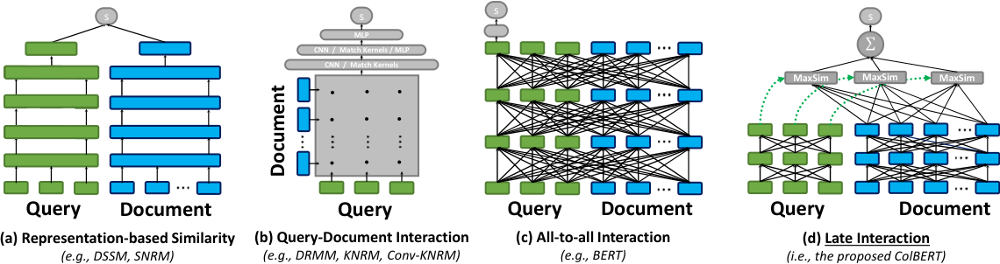
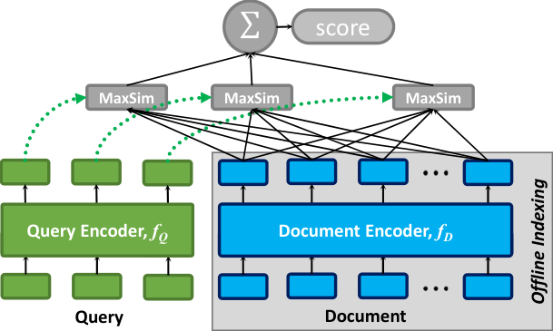
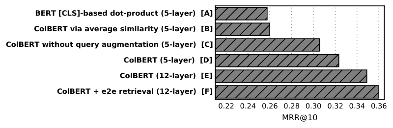

# ColBERT：论文精炼研读

> 先分别编码查询与文档的 token，再用 MaxSim 延后交互，使细粒度匹配可以利用离线文档索引。
>
> SIGIR 2020 · [原论文](https://arxiv.org/abs/2004.12832v2) · [补充解读](ColBERT解读.md)

## 摘要

BERT 联合编码查询和文档能提高排序质量，却需要为每个候选重新运行 Transformer。ColBERT 保留每个 token 的上下文表示，将两侧独立编码，再以“每个查询向量寻找最佳文档向量并求和”的 MaxSim 完成匹配，兼顾离线预计算与局部匹配。

论文在 MS MARCO 与 TREC CAR 上比较重排和全库检索：重排质量接近 BERT-base，查询期计算显著降低，全库候选检索还能找回 BM25 漏掉的结果。代价转移到多向量存储和读取，近似候选阶段也不能保证找到精确 MaxSim 的全库 top-k。

## 引言

2018–2019 年，BERT 微调做 passage ranking（把 $q$ 与 $d$ 拼进同一 Transformer，用 `[CLS]` 打分）把 MS MARCO MRR@10 抬到约 **34–36%**，但相对 BM25 / KNRM 等，**单 query 延迟可达数万毫秒、FLOPs 高 3–4 个数量级**。用户侧延迟每增约 100ms 即可影响体验与收入；工业上很难为每个候选都跑一次完整 cross-encoder。

同期两条折中路线：

1. **表示式（representation）**：独立编码 $q$、$d$ 为单向量，点积打分 → 文档可离线预计算，但表达力弱（一个向量要吃下全部匹配关系）。
2. **交互式（interaction）**：词级交互矩阵 + CNN/Kernel，或 BERT 联合编码 → 质量高，但难预计算、难全库剪枝。

ColBERT 的观察：**细粒度匹配不必与联合前向绑死**。只要把「query–document 交互」**延迟（late）** 到两侧已各自上下文编码之后，且交互算子足够便宜且 **可剪枝（pruning-friendly）**，就能同时享受：

- 深度 LM 的上下文表示；
- 文档侧离线索引；
- 用向量相似度索引做端到端 top-$k$。

## 相关工作

理解 ColBERT 之前，先对齐 neural IR 的四类匹配方式：

| 范式 | 示意 | 文档预计算 | 细粒度交互 | 典型代表 |
| ------ | ------ | ------------ | ------------ | ---------- |
| (a) 表示式 | $q\to\mathbf{u},\ d\to\mathbf{v},\ s=\langle\mathbf{u},\mathbf{v}\rangle$ | ✅ | ❌ | DSSM、DPR、ANCE |
| (b) 早期交互 | 词嵌入交互矩阵 → CNN / Kernel | 部分难 | ✅ | KNRM、ConvKNRM、Duet |
| (c) 深度联合交互 | $[q;d]$ 进 BERT，`[CLS]` → MLP | ❌ | ✅（含交叉注意力） | monoBERT、duoBERT |
| (d) **Late interaction** | $q$、$d$ 独立多向量 → MaxSim 求和 | ✅ | ✅（延迟到打分时） | **ColBERT** |

几何直觉：

- (a) 把复杂匹配压进一个点积；
- (b)(c) 在表示或注意力里就把 $q$ 与 $d$ 绑在一起；
- (d) **先各自上下文化，再在嵌入空间做 token 对齐**——每个 query token「软检索」文档中最像的 token，再把证据加总。

## ColBERT

### 架构

ColBERT 三件套：

1. **Query encoder** $f_Q$：文本 query → 袋（bag）$E_q=\{E_{q_i}\}$；
2. **Document encoder** $f_D$：passage → 袋 $E_d=\{E_{d_j}\}$；
3. **Late interaction**：对 $E_q$、$E_d$ 做无参 MaxSim 求和。

两侧共享同一 BERT 权重；输入前缀用特殊标记区分类型。

### 查询与文档编码器

#### 查询编码器

流程：

1. WordPiece 分词得到 $q_0 q_1\ldots q_l$；
2. 在 `[CLS]` 后插入 **`[Q]`**；
3. **Query augmentation**：若长度 $< N_q$，用 BERT 的 `[mask]` 垫到 $N_q$（论文默认 $N_q=32$）；过长则截断；
4. 过 BERT，再过 **无激活的线性层**（降到 $m$ 维，默认 $m=128$）；
5. **逐向量 L2 归一化**。

论文写作（CNN 指线性投影层的实现习惯称呼）：

$$
E_q := \mathrm{Normalize}\big(\mathrm{CNN}\big(\mathrm{BERT}(``[\mathrm{Q}]\,q_0 q_1\ldots q_l\,\#\#\ldots\#")\big)\big).

$$

其中 $\#$ 表示 `[mask]`。归一化后点积等于余弦相似度，取值 $[-1,1]$。

**Query augmentation 的作用**：在 mask 位置上让 BERT 产出「可学习的软扩展 / 重加权」向量——不是显式生成新词，而是可微地扩展匹配槽位。消融显示去掉后 MRR@10 明显下降（见后文消融）。

#### 文档编码器

流程：

1. 前缀 `[CLS]` + **`[D]`** + 文档 tokens（**不**加 mask）；
2. BERT + 线性投影 + L2 归一化；
3. **标点过滤（punctuation filter）**：按预定义标点表丢掉对应 embedding，减少每文档向量数。

$$
E_d := \mathrm{Filter}\big(\mathrm{Normalize}\big(\mathrm{CNN}\big(\mathrm{BERT}(``[\mathrm{D}]\,d_0 d_1\ldots d_n")\big)\big)\big).

$$

假设：即便上下文化后，标点 embedding 对相关性贡献有限，过滤可直接省索引空间与 MaxSim 计算量。

### Late Interaction / MaxSim（论文 Eq.3）

相关性分数：

$$
S_{q,d} := \sum_{i\in[|E_q|]}\max_{j\in[|E_d|]} E_{q_i}\cdot E_{d_j}^{\mathsf{T}}.

$$

也可把点积换成 **负平方 L2**（端到端 faiss 检索时作者更常用 L2）。交互层 **无可训练参数**。

直觉分解：

1. 对每个 query 向量 $E_{q_i}$，在文档袋中找最相似的 $E_{d_j}$（MaxSim）；
2. 把所有 query 侧最大相似度 **求和** → 文档相关性。

为何选 max 而不是 mean：max 强调「某个文档词真的对上了某个查询意图」；mean 会把无关 token 噪声平均进来，且更不利于剪枝。

#### 利用向量索引生成候选

候选生成可以利用 MaxSim 的分解结构：对每个 $E_{q_i}$，在 **全库所有文档 embedding** 上做近邻检索，再把命中映射回文档 ID、聚合。因此可用 **faiss** 等向量索引做候选生成，再对候选做精确 MaxSim 精排。有限深度 ANN 是近似候选过程，并不与全库精确 MaxSim top-k 等价。

给定三元组 $\langle q, d^{+}, d^{-}\rangle$（MS MARCO 官方：人工正例 + BM25 未标注负例）：

1. 分别算 $S_{q,d^{+}}$、$S_{q,d^{-}}$；
2. **Pairwise softmax cross-entropy**（对两分数做 softmax 后交叉熵）。

优化器：**Adam**，学习率 $3\times 10^{-6}$，batch 32；MS MARCO 上训 **200k** iterations；微调全部 BERT 参数，并从零训练线性层与 `[Q]`/`[D]` embedding。

要点：

- 交互无参 → 梯度主要塑造 encoder，使「该对齐的 token 更近」；
- 与 monoBERT 的「整对进模型」不同，正负例各自前向，**文档表示与训练时的查询无关**，与索引一致性强。

### 离线索引（§3.4）

批处理跑 $f_D$，存每文档 embedding 矩阵。吞吐优化：

- 多 GPU；
- **按长度分桶**（BucketIterator）：组内长度接近，减少 padding；
- CPU 并行 WordPiece。

MS MARCO（约 9M passages）约 **4 GPU / 3 小时** 可编完。存盘可用 32-bit 或 16-bit。

### Top-$k$ 重排（§3.5）

对 BM25 等召回的 $k$（如 1000）篇：

1. 编码 $E_q$ 一次；
2. 把 $k$ 个文档矩阵堆成 3D tensor，搬到 GPU；
3. batch 点积 → 对文档维 max-pool → 对 query 维 sum → 排序。

相对 monoBERT：后者要对每个 $(q,d_i)$ 跑长度 $|q|+|d_i|$ 的注意力；ColBERT **只对 query 跑一次 BERT**，且与 $k$ 弱相关。瓶颈常在 **CPU→GPU 搬运预存 embedding**，而非交互本身（交互约十几 ms）。

### 端到端检索（§3.6）

两阶段：

**阶段 1（近似候选）**：对 $E_q$ 中每个向量，在 faiss 上取 top-$k'$ 近邻 embedding → 映射到文档 ID → 去重得 $K$ 篇。

**阶段 2（精排）**：对这 $K$ 篇做 前述重排阶段的完整 MaxSim。

faiss 配置示例：IVFPQ，$P=2000$ 个分区，探测 $p=10$，向量切成 $s=16$ 子向量各 1 byte；精排侧可用 16-bit。

## 实验评估

### 实验方法

#### 数据集、指标与实现

| 项 | 取值 |
| ---- | ------ |
| 数据 | MS MARCO Passage（8.8M）、TREC CAR |
| 指标 | MS MARCO：**MRR@10**；TREC CAR：MAP / MRR@10 |
| $N_q$ | 32 |
| $m$ | 128（可降到 24 仍可用） |
| 重排相似度 | cosine（归一化点积） |
| 端到端 | 平方 L2 + faiss |

#### 硬件与计时

重排用单张 32 GiB Tesla V100；全库检索和索引用配备四张 Titan V 的另一台服务器，每个查询仍只分配一张 GPU。两台服务器均有双路 Xeon Gold 6132、469 GiB 内存。BM25 系统使用单线程，FAISS 候选检索可用全部 CPU 核；表中延迟保留这些资源差异。ColBERT 重排延迟包含取出、堆叠与搬运文档向量及查询编码，BERT 基线不含可预计算的文本预处理。

TREC CAR 以 Wikipedia 标题和章节标题构造查询，测试集 2,254 个查询。为避免 Wikipedia 预训练污染，使用仅在 CAR 训练文章预训练的 BERT-large，微调 125k 次。

### Top-k 重排的质量与成本

| Method | MRR@10 Dev | MRR@10 Eval | Latency (ms) | FLOPs/query |
| -------- | ------------ | ------------- | -------------- | ------------- |
| BM25 | 16.7 | 16.5 | — | — |
| KNRM | 19.8 | 19.8 | 3 | 592M |
| Duet | 24.3 | 24.5 | 22 | 159B |
| fT+ConvKNRM | 29.0 | 27.7 | 28 | 78B |
| BERT_base (Nogueira) | 34.7 | — | 10,700 | 97T |
| BERT_base (同损训练) | 36.0 | — | 10,700 | 97T |
| BERT_large | 36.5 | 35.9 | 32,900 | 340T |
| **ColBERT (BERT_base)** | **34.9** | **34.9** | **61** | **7B** |

解读：

- 相对原版 BERT_base 重排，MRR 几乎持平（34.9 vs 34.7），比同损训练的 BERT_base 略低约 1.1；
- 延迟 **≈170×**、FLOPs **≈13,900×** 优势；
- 显著超过全部非 BERT 神经匹配基线。

随重排深度 $k$：BERT 的 FLOPs 近似随 $k$ 线性爆；ColBERT 因 query 只编码一次，差距在 $k=2000$ 时可达约 **23,000×** FLOPs。

### 端到端 Top-k 检索

| Method | MRR@10 Dev | Latency (ms) | R@50 | R@200 | R@1000 |
| -------- | ------------ | -------------- | ------ | ------- | -------- |
| BM25 (Anserini) | 18.7 | 62 | 59.2 | 73.8 | 85.7 |
| doc2query | 21.5 | 85 | 64.4 | 77.9 | 89.1 |
| DeepCT | 24.3 | ~62 | 69 | 82 | 91 |
| docTTTTTquery | 27.7 | 87 | 75.6 | 86.9 | 94.7 |
| ColBERT_L2 (re-rank) | 34.8 | — | 75.3 | 80.5 | 81.4 |
| **ColBERT_L2 (e2e)** | **36.0** | **458** | **82.9** | **92.3** | **96.8** |

要点：端到端不仅抬高 Recall，**MRR@10 也高于同模型重排**（找回了 BM25 top-1000 以外的相关文）。相对 docTTTTTquery 等「NLU 增强 BM25」路线，质量差距仍大，但延迟更高（向量检索 + 精排）。

#### TREC CAR 对照

BM25+ColBERT：**MAP 31.3**，接近 BM25+BERT_base（31.0），低于 BERT_large（33.5）。结论与 MS MARCO 一致：late interaction 用可接受的质量代价换数量级效率。

### 消融实验

| 变体 | 含义 | 结论 |
| ------ | ------ | ------ |
| [A] 单向量 | `[CLS]` 扩到 4096 维点积 | 远弱于 multi-vector → **该设置下细粒度交互更有效** |
| [B] AvgSim | max 改成平均相似度 | 下降 → **Max 优于 Avg** |
| [C] 无 query aug | 去掉 `[mask]` 填充 | 下降 → **该设置下 augmentation 有收益** |
| [D]/[E] | 5 层 vs 12 层主模型 | 层数与全流程都重要 |
| e2e vs re-rank | 全库检索 | 召回与 MRR 双升 |

### 索引吞吐与空间

多 GPU、按长度分桶与 CPU 并行分词共同提高离线吞吐，四张 GPU 约三小时编码完整 MS MARCO。论文 Figure 6 逐项消融这些优化；查询时省掉的文档 BERT 前向，需要先在索引期完成一次。

| Setting | $m$ | Bytes/Dim | Space (GiB) | MRR@10 |
| --------- | ----- | ----------- | ------------- | -------- |
| Re-rank Cosine | 128 | 4 | 286 | 34.9 |
| End-to-end L2 | 128 | 2 | 154 | 36.0 |
| Re-rank Cosine | 48 | 4 | 54 | 34.4 |
| Re-rank Cosine | 24 | 2 | **27** | 33.9 |

降维到 24-d + 半精度，空间约 **27 GiB**，MRR 仅掉约 1 个点——说明 token 向量有很大压缩空间（ColBERTv2 残差量化继续挖）。

## 结论

ColBERT 将上下文编码与查询—文档交互分开，使文档可离线预计算，同时保留 token 级匹配。MS MARCO 上的重排接近 BERT-base 质量，延迟降低约 170 倍、计算量降低约 14,000 倍；端到端检索进一步找回 BM25 候选之外的证据。多向量存储、搬运与近似候选损失仍构成代价。

## 参考资料

1. Khattab & Zaharia. *ColBERT: Efficient and Effective Passage Search via Contextualized Late Interaction over BERT*. SIGIR 2020. [arXiv:2004.12832](https://arxiv.org/abs/2004.12832)
2. Nogueira & Cho. *Passage Re-ranking with BERT*. arXiv:1901.04085, 2019.
3. Nguyen et al. *MS MARCO*. arXiv:1611.09268, 2016.
4. Santhanam et al. *ColBERTv2*. arXiv:2112.01488, 2021.（续作）
5. Faysse et al. *ColPali*. arXiv:2407.01449, 2024.（视觉续作）
