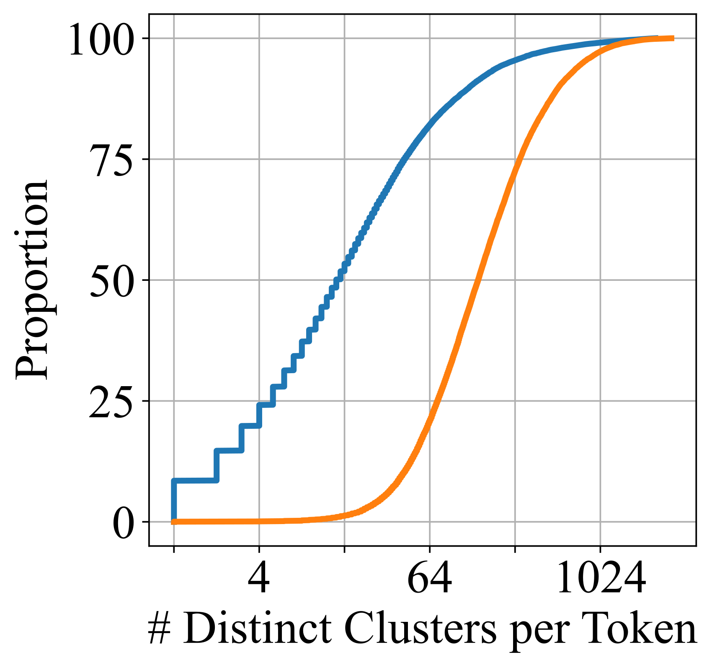
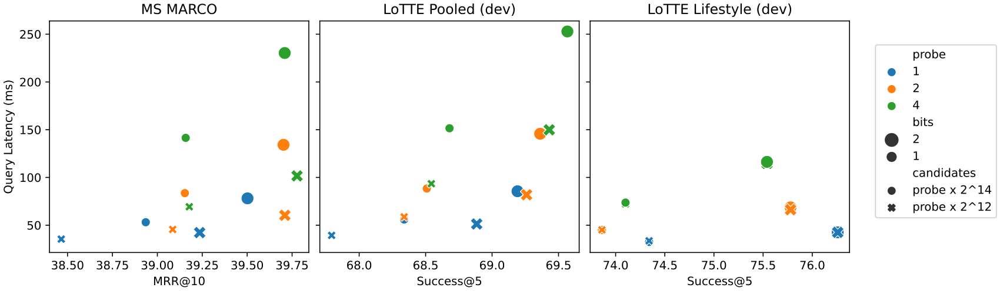

# ColBERTv2：论文精炼研读

> 以 cross-encoder 去噪蒸馏提升多向量质量，再用“质心＋低比特残差”压缩 token 表示。
>
> NAACL 2022 · [原论文](https://arxiv.org/abs/2112.01488v3) · [补充解读](ColBERTv2解读.md)

## 摘要

ColBERT 让 token 级匹配可以离线索引，但索引庞大，早期三元组监督也限制了质量。ColBERTv2 同时改进训练与表示：用更难的候选和 cross-encoder 软分数去噪监督，用质心及每维 1–2 bit 残差存储文档向量；查询时先近似筛选，再读取候选的完整压缩表示。

在 MS MARCO 上模型达到 39.7 MRR@10，并在 BEIR、开放域问答和新建 LoTTE 长尾基准中展示域外收益，索引较原版缩小约 6–10 倍。但训练链路更复杂，低比特表示及候选剪枝仍需权衡质量；本文并未解决所有多向量查询延迟。

## 引言

ColBERT（arXiv:2004.12832）证明：把相关性拆到 token 级 MaxSim，比单向量点积更稳、可端到端检索。但 Web 规模下要存 **数十亿小向量**，空间比 DPR 类单向量大约一个数量级。

2020–2021：ANCE 难负例、RocketQA 去噪、TAS-B / SPLADEv2 蒸馏、coCondenser 预训练等，让 **单向量** 甚至赶上 vanilla ColBERT。于是出现质疑：

> late interaction 的固定 token 归纳偏置，是否还能吃到蒸馏 / 难负例的红利？压缩后会不会把优势抹掉？

ColBERTv2 的回答是：**能**——且压缩可 **off-the-shelf**（不改 MaxSim 架构）叠加。

## 背景与相关工作

### Token 分解的神经检索

ColBERT、Poly-encoders 等多向量方法把匹配分解到细粒度表示，SPLADE 等学习稀疏方法则按词项分解打分。它们相较单向量保留更多匹配信息，但分解方式、索引结构和成本不同。

### 神经检索的向量压缩

标量量化、乘积量化与 ANN 可降低存储和搜索成本；本文利用 token 表示的聚簇特征，先存最近质心，再低比特编码残差。

### 单向量质量改进

难负例、cross-encoder 蒸馏和检索预训练显著提高 ANCE、RocketQA、coCondenser 等单向量模型。本文将监督改进与多向量匹配结合。

### 域外评测

BEIR 检验跨领域检索，但部分任务源自语义相似或引文关系；本文另建 LoTTE，补充长尾主题中的自然信息寻求问题。

## ColBERTv2

### 建模

Query / passage 独立过 BERT，token 输出投影到较低维（通常 128），离线存 passage 多向量。检索时：

$$
S_{q,d}=\sum_{i=1}^{N}\max_{j=1}^{M} Q_i\cdot D_j^{\mathsf{T}}.

\tag{1}
$$

$Q\in\mathbb{R}^{N\times d}$，$D\in\mathbb{R}^{M\times d}$。每个 query token 对齐文档中最相似 token，再求和。交互无参；可微，可蒸馏。

与单向量对比：

| | 单向量 | Late interaction (ColBERT/v2) |
| -- | -------- | -------------------------------- |
| 表示粒度 | 1 个向量 / 文 | 1 个向量 / token |
| 匹配 | 一次点积 | $N$ 次 MaxSim |
| 编码器负担 | 极高（一切塞进一个向量） | 较低（匹配交给交互） |
| 存储 | 小 | 大（需压缩） |

### 监督

#### 标准 triples 的问题

原版 ColBERT 用 MS MARCO $\langle q,d^{+},d^{-}\rangle$：$d^{+}$ 人工标注，$d^{-}$ 来自 BM25 未标注集。问题包括：

- **假负**：相关但未标注的 passage 被当负例惩罚；
- **假正 / 弱正**：标注稀疏；
- **负例偏易**：BM25 负例不够「难」，学不到精细排序面。

#### ColBERTv2 监督流水线

1. **冷启动**：先用 triples 训一个 ColBERT（可带 v2 压缩索引）；
2. **检索**：对每个训练 query 取 top-$k$ passages；
3. **CE 打分**：用 Thakur et al. 蒸馏过的 **MiniLM-L6 cross-encoder**（约 22M，`cross-encoder/ms-marco-MiniLM-L-6-v2`）给每个 $(q,d)$ 打分；
4. **构造 $w$-way tuple**：一篇高分（或标注正例）+ 多篇更低分；论文 **$w=64$**；
5. **蒸馏损失**：用 **KL 散度** 把 CE 分数分布蒸到 ColBERT 分数上；
6. **In-batch negatives**：每 GPU 内，query 正例分数 vs 其它 query 的 passages，再加交叉熵；
7. **刷新一次**：用新模型重建索引，重新挖难负例，再训一轮。

与 RocketQAv2 等「去噪蒸馏」同族，但学生是 **multi-vector MaxSim**，不是单向量。

#### 损失形态（概念式）

记 CE 对候选集给出分数向量 $\mathbf{s}^{\mathrm{CE}}$，学生 MaxSim 分数 $\mathbf{s}^{\mathrm{Col}}$：

$$
\mathcal{L}_{\mathrm{KD}}=\mathrm{KL}\big(\mathrm{softmax}(\mathbf{s}^{\mathrm{CE}}/\tau)\,\|\,\mathrm{softmax}(\mathbf{s}^{\mathrm{Col}}/\tau)\big).

$$

再加 in-batch 的

$$
\mathcal{L}_{\mathrm{CE}}=-\log\frac{\exp(S_{q,d^{+}})}{\sum_{d\in\mathcal{B}}\exp(S_{q,d})}.

$$

总目标为二者加权组合（实现细节以官方代码为准）。关键是：**用 CE 清洗标签噪声，用难负例拉高分辨面，用 KL 学习教师的候选分布**。

### 表示与残差压缩

#### 编码

给定质心集 $C=\{C_1,\ldots,C_{|C|}\}$，对向量 $v$：

1. $t=\arg\min_t \|v-C_t\|$（或等价相似度，具体取决于归一化约定）；
2. 残差 $r=v-C_t$；
3. 将 $r$ 的 **每一维量化为 $b$ bit**（$b\in\{1,2\}$），得 $\tilde{r}$；
4. 存储：质心下标 $t$ + $\tilde{r}$。

重建：

$$
\tilde{v}=C_t+\tilde{r}.

$$

#### 比特预算

设维数 $n=128$：

| 成分 | 典型字节 |
| ------ | ---------- |
| 质心 ID | 4 bytes（可寻址至 $2^{32}$ 质心） |
| 残差 $b=1$ | $128\times 1/8=16$ bytes |
| 残差 $b=2$ | 32 bytes |
| **合计** | **20 或 36 bytes / 向量** |

对比 vanilla ColBERT：16-bit 精度下约 **$128\times 2=256$ bytes / 向量**。

理论下界：$\lceil\log_2|C|\rceil + bn$ bits；工程上用定长 4+16/32 字节便于对齐。

#### 与 Product Quantization 的关系

经典 PQ：把 **一个** 高维向量切成子向量，各用码本 ID。

ColBERTv2：表示 **已经是** token 矩阵；对每个小向量做「最近质心 + 残差量化」，相当于把残差向量量化嵌进 multi-vector IR。论文称这是对 late interaction 的自然延伸，且 **无需量化感知再训练** 即可大致保质（Appendix B 有对比）。

#### 为何「几乎不掉点」

Appendix A 的簇分析：质心常对应细粒度词义簇（如 photo/picture 系、tornado/storm 系）；上下文残差幅度小，低比特量化足够。这与「随机向量不可残差压缩」形成对照（文中 CDF 对比）。

### 索引

#### Centroid Selection

$|C|$ 取与嵌入总数平方根成比例；实践上取不小于 $16\sqrt{n_{\mathrm{embeddings}}}$ 的最近 2 的幂量级（受 FAISS 启发）。

为避免先物化全量未压缩向量：对 **采样 passages**（采样量也随 $\sqrt{N}$ 规模）跑 BERT，再 k-means 得质心。

#### Passage Encoding

全库编码：BERT → 投影 → 赋最近质心 → 量化残差 → 分块落盘。

#### Index Inversion

按质心聚合同簇 embedding ID，写倒排表。检索时：query 向量找近邻质心 → 倒排取出候选 token 向量 → 解压算相似度。

### 检索

对 query 多向量 $Q$：

**候选生成（近似 MaxSim）**

1. 对每个 $Q_i$，取最近 $n_{\mathrm{probe}}\ge 1$ 个质心；
2. 倒排取出附近 passage embeddings，解压；
3. 与所有 query 向量算余弦，按 passage 聚合时做 **max-reduce**；
4. 对 query 维求和，得到近似分数下界（只见局部候选，故 ≤ 真 MaxSim）；
5. 取 top-$n_{\mathrm{candidate}}$ passages。

**精排**

加载候选完整（压缩）向量，用完整 Eq.1 打分排序。

这把「IVF 风格候选」与「精确 late interaction」串成两段，延迟量级约 **50–250 ms/query**（Appendix C）。

## LoTTE：长尾、跨领域检索评测

**LoTTE**（Long-Tail Topic-stratified Evaluation）：补 BEIR 不足——强调 **长尾主题 + 自然信息寻求 query**，而非仅语义相关 / 维基热门实体。

### 结构

五个领域：Writing / Recreation / Science / Technology / Lifestyle；各含 Search 与 Forum 测试；另有 Pooled 汇总。

| 查询类型 | 来源 | 特点 |
| ---------- | ------ | ------ |
| Search | GooAQ 中答案链到 StackExchange 的 Google 自动补全问句 | 短、偏事实 |
| Forum | SE 帖子标题 → 对应 answer posts | 更开放、多样 |

语料来自 StackExchange answer posts；dev/test 的 passage 文本 **刻意不相交**，逼近真实 OOD。

### 指标

**Success@5**：top-5 中是否命中目标页上 accepted 或 upvote≥1 的答案帖。

动机：BEIR 很多任务是引用/论据/重复问等「相关」而非「搜索」；LoTTE 更贴近垂直站内检索。

## 评估

除非注明，评测用 **$b=2$** bit 残差。

### 域内检索质量

| Method | Dev MRR@10 | R@50 | R@1k | Local Eval MRR@10 |
| -------- | ------------ | ------ | ------ | ------------------- |
| ColBERT (vanilla) | 36.0 | 82.9 | 96.8 | 36.7 |
| SPLADEv2 | 36.8 | — | 97.9 | 37.9 |
| RocketQAv2 | 38.8 | 86.2 | 98.1 | 39.8 |
| **ColBERTv2** | **39.7** | **86.8** | **98.4** | **40.8** |

结论：蒸馏时代单向量（RocketQAv2）已超过 vanilla ColBERT；**ColBERTv2 再超过它们**，说明 multi-vector **吃得下** 去噪监督，且压缩后仍 SOTA。

### 域外检索质量

论文宣称在 **28 个 OOD 测试中的 22 个** 取得最高或并列最优；相对次优可高至约 **8%** 相对提升。

**BEIR 搜索类（nDCG@10，节选）**

| Corpus | ColBERT | SPLADEv2 | ColBERTv2 |
| -------- | --------- | ---------- | ----------- |
| DBPedia | 39.2 | 43.5 | **44.6** |
| FiQA | 31.7 | 33.6 | **35.6** |
| NQ | 52.4 | 52.1 | **56.2** |
| TREC-COVID | 67.7 | 71.0 | **73.8** |
| HotpotQA | 59.3 | **68.4** | 66.7 |

模式：自然搜索问句上 ColBERTv2 常领先；偏「句子声明 / 人工看过答案写问句」的任务上 SPLADE 有时更强（词法扩展偏置）。

**Wikipedia OpenQA Success@5**

| | ColBERT | SPLADEv2 | ColBERTv2 |
| -- | --------- | ---------- | ----------- |
| NQ-dev | 65.7 | 65.6 | **68.9** |
| TQ-dev | 72.6 | 74.7 | **76.7** |
| SQuAD-dev | 60.0 | 60.4 | **65.0** |

**LoTTE（Success@5）**：Search / Forum 各主题上 ColBERTv2 全面高于 ANCE、RocketQAv2、SPLADEv2；Forum（更难泛化）上 term-decomposed 模型（SPLADE / ColBERT 族）相对单向量优势更明显。

### 效率

| 系统 | MS MARCO 索引约 |
| ------ | ----------------- |
| ColBERT (16-bit) | **154 GiB** |
| ColBERTv2 $b=1$ | **16 GiB**（含 ~4.5 GiB 倒排） |
| ColBERTv2 $b=2$ | **25 GiB** |
| 单向量 768-d × float32 × 9M | ≈ **25+ GiB**（未计 HNSW） |

压缩比约 **6–10×**，与「典型未压缩单向量」同量级，同时保留 late interaction 质量。

## 结论

去噪监督提高 late interaction 的排序质量，残差压缩使索引缩小约 6–10 倍。两项改进叠加后，ColBERTv2 在域内 MS MARCO 及多项域外任务上超过论文所比较的强基线，说明细粒度匹配可以兼得较强泛化与可承受的索引空间。

## 影响与研究局限

| 局限 | 说明 |
| ------ | ------ |
| 语言 | 主评测英语；MS MARCO 训练后零样本迁到其它英语域 |
| 标注噪声 | 几乎所有 IR 集有假负；作者用多标注来源（TREC 池化 / Google / SE / 答案串匹配）交叉验证 |
| 训练成本 | 相对原版 triples，CE 打分 + 难负例 + 二次刷新 **更贵更复杂** |
| 压缩未穷尽 | 可再叠 token 丢弃、更强 RVQ；作者未宣称极限压缩 |
| 极端资源 | 极低资源下 SPLADE / 单向量可能更好调；系统级优化（PLAID 等）另文 |

伦理侧：更强 OOD 检索利于垂直应用，也可放大语料中的偏见与错误信息召回。

## 附录：压缩为何有效

ColBERT 的 token 向量在语义上 **很「轻」**：同一词义的向量高度聚簇，上下文只造成小扰动。因此适合：

$$
v \approx C_t + r,\quad r=v-C_t,

$$

用质心 $C_t$ 吃掉主语义，用廉价量化残差 $r$ 保留上下文微调。

附录分别分析聚簇语义、压缩位数与检索延迟。1-bit 更省空间，2-bit 更接近未压缩表示；延迟受探测质心数和候选预算影响，不能仅凭压缩比推断查询加速。

## 参考资料

1. Santhanam, Khattab, Saad-Falcon, Potts, Zaharia. *ColBERTv2: Effective and Efficient Retrieval via Lightweight Late Interaction*. [arXiv:2112.01488](https://arxiv.org/abs/2112.01488), 2021.
2. Khattab & Zaharia. *ColBERT*. [arXiv:2004.12832](https://arxiv.org/abs/2004.12832), 2020.
3. Thakur et al. *BEIR*. arXiv:2104.08663, 2021.
4. Formal et al. *SPLADE v2*. arXiv:2109.10086, 2021.
5. Ren et al. *RocketQAv2*. arXiv:2110.07367, 2021.
6. Wang et al. *MiniLM*. arXiv:2002.10957, 2020.
