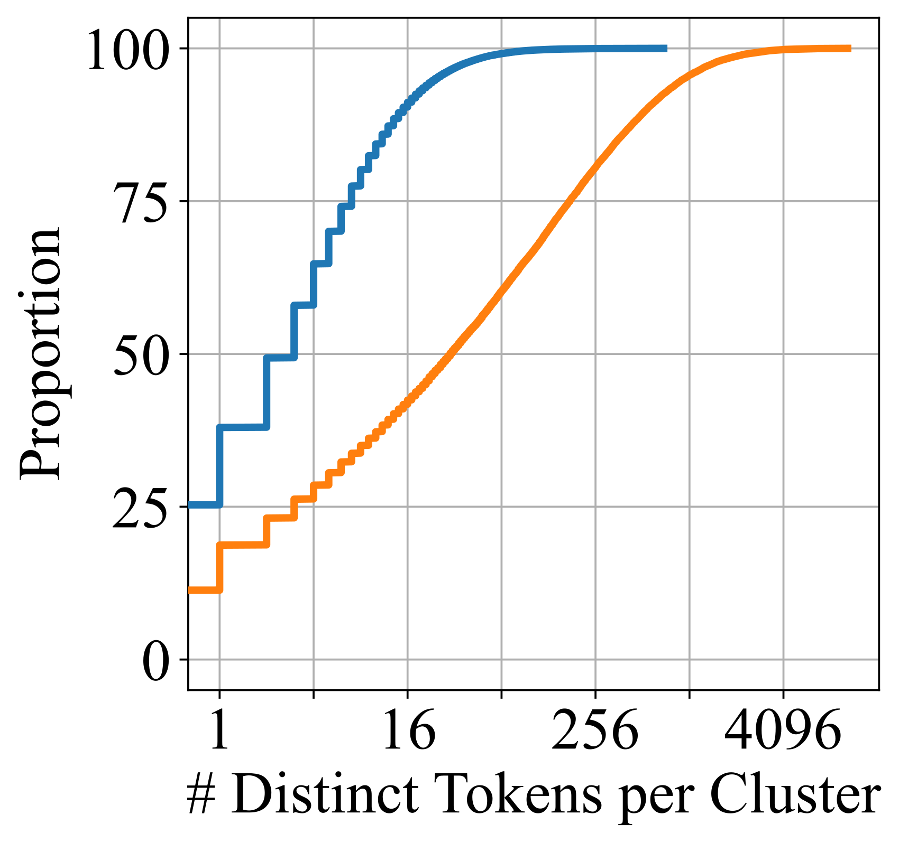
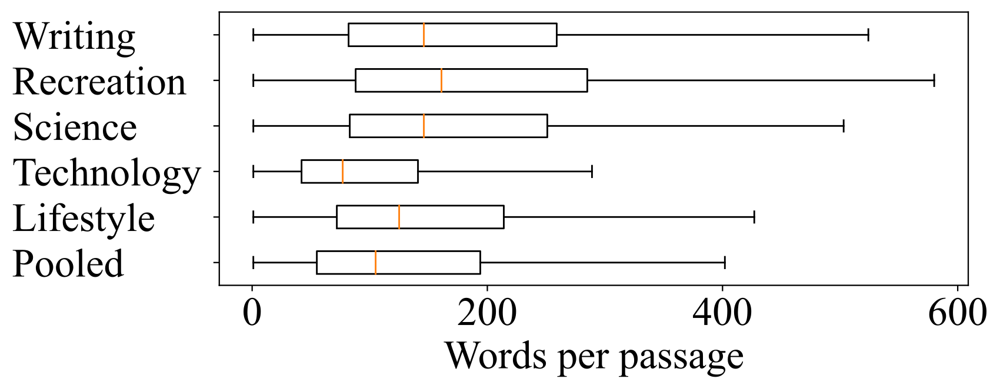
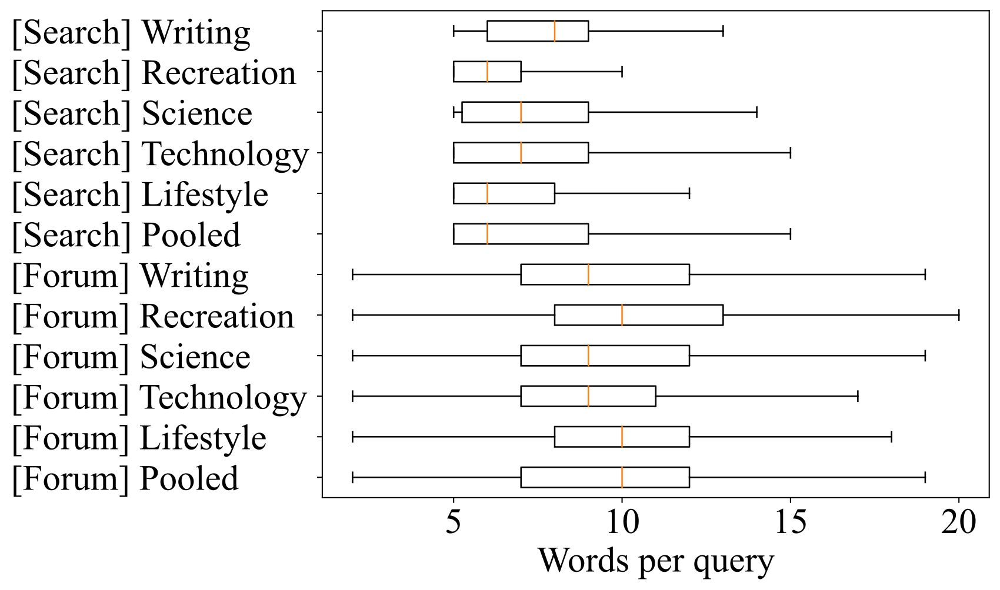
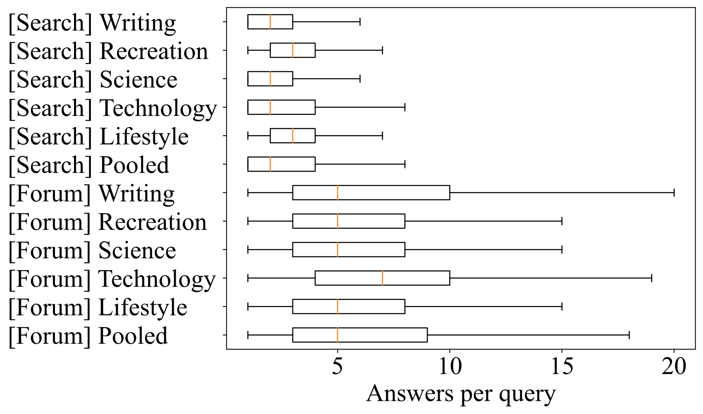

# ColBERTv2: Effective and Efficient Retrieval via Lightweight Late Interaction / 全文中英对照

> 来源：[arXiv:2112.01488v3](https://arxiv.org/abs/2112.01488v3)。英文段落后紧接中文，覆盖所取 HTML 版本的主文、附录、图表、脚注与参考文献；公式、数字表和书目信息共用。中文以机器初译为底稿，进行了术语整理与结构核对，尚未逐句人工审定；遇到歧义请以紧邻英文和原论文为准。 原作版权归所列作者，许可见 [原作许可](http://creativecommons.org/licenses/by/4.0/)；中文译文与版式改写在该许可条件下提供（涉及 SA 时沿用相同许可，涉及 NC 时仅限非商业使用）。

## Authors and affiliations / 作者与机构

Keshav Santhanam [^id1] Affiliation: Stanford University Omar Khattab [^footnotex1] Affiliation: Stanford University Jon Saad-Falcon Affiliation: Georgia Institute of Technology Christopher Potts Affiliation: Stanford University Matei Zaharia Affiliation: Stanford University

## Abstract / 摘要

**EN.** Neural information retrieval (IR) has greatly advanced search and other knowledge-intensive language tasks. While many neural IR methods encode queries and documents into single-vector representations, late interaction models produce multi-vector representations at the granularity of each token and decompose relevance modeling into scalable token-level computations. This decomposition has been shown to make late interaction more effective, but it inflates the space footprint of these models by an order of magnitude. In this work, we introduce ColBERTv2, a retriever that couples an aggressive residual compression mechanism with a denoised supervision strategy to simultaneously improve the quality and space footprint of late interaction. We evaluate ColBERTv2 across a wide range of benchmarks, establishing state-of-the-art quality within and outside the training domain while reducing the space footprint of late interaction models by 6–10 $\times$ .

**中.** 神经信息检索（IR）极大地推进了搜索和其他知识密集型语言任务。虽然许多神经 IR 方法将查询和文档编码为单向量表示，但后期交互模型在每个标记的粒度上生成多向量表示，并将相关性建模分解为可扩展的标记级计算。这种分解已被证明可以使后期交互更加有效，但它使这些模型的空间足迹扩大了一个数量级。在这项工作中，我们引入了 ColBERTv2，这是一种检索器，它将积极的残差压缩机制与去噪监督策略结合起来，以同时提高后期交互的质量和空间占用。我们通过广泛的基准评估 ColBERTv2，在训练领域内外建立最先进的质量，同时将后期交互模型的空间占用减少 6-10 $\times$ 。

## Introduction / 简介

**EN.** Neural information retrieval (IR) has quickly dominated the search landscape over the past 2–3 years, dramatically advancing not only passage and document search Nogueira and Cho (2019) but also many knowledge-intensive NLP tasks like open-domain question answering Guu et al. (2020) , multi-hop claim verification Khattab et al. (2021a) , and open-ended generation Paranjape et al. (2022) .

**中.** 神经信息检索（IR）在过去 2-3 年中迅速主导了搜索领域，不仅极大地推进了段落和文档搜索 Nogueira 和 Cho（2019）的发展，而且还推动了许多知识密集型 NLP 任务，例如开放域问答 Guu 等人。 (2020)，多跳声明验证 Khattab 等人。 (2021a) 和开放式一代 Paranjape 等人。 （2022）。

**EN.** Many neural IR methods follow a single-vector similarity paradigm: a pretrained language model is used to encode each query and each document into a single high-dimensional vector, and relevance is modeled as a simple dot product between both vectors. An alternative is late interaction , introduced in ColBERT Khattab and Zaharia (2020) , where queries and documents are encoded at a finer-granularity into multi-vector representations, and relevance is estimated using rich yet scalable interactions between these two sets of vectors. ColBERT produces an embedding for every token in the query (and document) and models relevance as the sum of maximum similarities between each query vector and all vectors in the document.

**中.** 许多神经 IR 方法遵循单向量相似性范式：使用预训练的语言模型将每个查询和每个文档编码为单个高维向量，并将相关性建模为两个向量之间的简单点积。另一种替代方案是 ColBERT Khattab 和 Zaharia (2020) 中引入的后期交互，其中查询和文档以更细粒度编码为多向量表示，并使用这两组向量之间丰富但可扩展的交互来估计相关性。 ColBERT 为查询（和文档）中的每个标记生成嵌入，并将相关性建模为每个查询向量与文档中所有向量之间的最大相似度之和。

**EN.** By decomposing relevance modeling into token-level computations, late interaction aims to reduce the burden on the encoder: whereas single-vector models must capture complex query–document relationships within one dot product, late interaction encodes meaning at the level of tokens and delegates query–document matching to the interaction mechanism. This added expressivity comes at a cost: existing late interaction systems impose an order-of-magnitude larger space footprint than single-vector models, as they must store billions of small vectors for Web-scale collections. Considering this challenge, it might seem more fruitful to focus instead on addressing the fragility of single-vector models Menon et al. (2022) by introducing new supervision paradigms for negative mining Xiong et al. (2020) , pretraining Gao and Callan (2021) , and distillation Qu et al. (2021) . Indeed, recent single-vector models with highly-tuned supervision strategies Ren et al. (2021b) ; Formal et al. (2021a) sometimes perform on-par or even better than “vanilla” late interaction models, and it is not necessarily clear whether late interaction architectures—with their fixed token-level inductive biases—admit similarly large gains from improved supervision.

**中.** 通过将相关性建模分解为标记级计算，后期交互旨在减轻编码器的负担：单向量模型必须捕获一个点积内的复杂查询-文档关系，而后期交互则在标记级对含义进行编码，并将查询-文档匹配委托给交互机制。这种增加的表现力是有代价的：现有的后期交互系统比单向量模型占用的空间更大，因为它们必须为网络规模的集合存储数十亿个小向量。考虑到这一挑战，专注于解决单向量模型的脆弱性似乎会更有成效。 Xiong 等人（2022）通过引入新的负挖掘监管范式。 (2020)、预训练 Gau 和 Callan (2021) 以及蒸馏 Qu 等人。 （2021）。事实上，最近的单向量模型具有高度调整的监督策略 Ren 等人。 （2021b）；正式等人。 （2021a）有时表现与“普通”后期交互模型相当甚至更好，并且不一定清楚后期交互架构（具有固定的代币级归纳偏差）是否能从改进的监督中获得类似的巨大收益。

**EN.** In this work, we show that late interaction retrievers naturally produce lightweight token representations that are amenable to efficient storage off-the-shelf and that they can benefit drastically from denoised supervision. We couple those in ColBERTv2 , [^footnote1] a new late-interaction retriever that employs a simple combination of distillation from a cross-encoder and hard-negative mining (§ 3.2 ) to boost quality beyond any existing method, and then uses a residual compression mechanism (§ 3.3 ) to reduce the space footprint of late interaction by 6–10 $\times$ while preserving quality. As a result, ColBERTv2 establishes state-of-the-art retrieval quality both within and outside its training domain with a competitive space footprint with typical single-vector models.

**中.** 在这项工作中，我们表明，后期交互检索器自然会产生轻量级令牌表示，这些表示适合于现成的高效存储，并且它们可以从去噪监督中受益匪浅。我们将 ColBERTv2 中的 [^footnote1] 结合起来，这是一种新的后期交互检索器，它采用交叉编码器蒸馏和硬负挖掘（§ 3.2）的简单组合来提高质量，超越任何现有方法，然后使用残差压缩机制（§ 3.3）将后期交互的空间占用减少 6-10 $\times$，同时保持质量。因此，ColBERTv2 在其训练领域内外建立了最先进的检索质量，并通过典型的单向量模型提供了具有竞争力的空间足迹。

**EN.** When trained on MS MARCO Passage Ranking, ColBERTv2 achieves the highest MRR@10 of any standalone retriever. In addition to in-domain quality, we seek a retriever that generalizes “zero-shot” to domain-specific corpora and long-tail topics, ones that are often under-represented in large public training sets. To this end, we evaluate ColBERTv2 on a wide array of out-of-domain benchmarks. These include three Wikipedia Open-QA retrieval tests and 13 diverse retrieval and semantic-similarity tasks from BEIR Thakur et al. (2021) . In addition, we introduce a new benchmark, dubbed LoTTE , for Lo ng- T ail T opic-stratified E valuation for IR that features 12 domain-specific search tests, spanning StackExchange communities and using queries from GooAQ Khashabi et al. (2021) . LoTTE focuses on relatively long-tail topics in its passages, unlike the Open-QA tests and many of the BEIR tasks, and evaluates models on their capacity to answer natural search queries with a practical intent, unlike many of BEIR’s semantic-similarity tasks. On 22 of 28 out-of-domain tests, ColBERTv2 achieves the highest quality, outperforming the next best retriever by up to 8% relative gain, while using its compressed representations.

**中.** 当接受 MS MARCO Passage Ranking 训练时，ColBERTv2 达到了所有独立检索器中最高的 MRR@10。除了领域内的质量之外，我们还寻求一种将“零样本”泛化到特定领域的语料库和长尾主题的检索器，这些主题在大型公共训练集中通常代表性不足。为此，我们在广泛的域外基准测试上评估 ColBERTv2。其中包括来自 BEIR Thakur 等人的三个 Wikipedia Open-QA 检索测试和 13 个不同的检索和语义相似性任务。 （2021）。此外，我们还引入了一个名为 LoTTE 的新基准，用于 IR 的长尾主题分层 E 评估，该基准具有 12 个特定领域的搜索测试，跨越 StackExchange 社区并使用来自 GooAQ Khashabi 等人的查询。 （2021）。与 Open-QA 测试和许多 BEIR 任务不同，LoTTE 专注于其段落中相对长尾的主题，并评估模型以实际意图回答自然搜索查询的能力，这与许多 BEIR 语义相似性任务不同。在 28 项域外测试中的 22 项中，ColBERTv2 实现了最高质量，在使用其压缩表示的同时，其性能比次佳检索器高出高达 8% 的相对增益。

**EN.** This work makes the following contributions:

**中.** 这项工作做出了以下贡献：

**EN.** 1.

**中.** 1.

**EN.** We propose ColBERTv2, a retriever that combines denoised supervision and residual compression, leveraging the token-level decomposition of late interaction to achieve high robustness with a reduced space footprint.

**中.** 我们提出了 ColBERTv2，这是一种结合了去噪监督和残差压缩的检索器，利用后期交互的令牌级分解来实现高鲁棒性并减少空间占用。

**EN.** 2.

**中.** 2.

**EN.** We introduce LoTTE, a new resource for out-of-domain evaluation of retrievers. LoTTE focuses on natural information-seeking queries over long-tail topics, an important yet understudied application space.

**中.** 我们引入了 LoTTE，这是一种用于检索器域外评估的新资源。 LoTTE 专注于长尾主题的自然信息搜索查询，这是一个重要但尚未得到充分研究的应用领域。

**EN.** 3.

**中.** 3.

**EN.** We evaluate ColBERTv2 across a wide range of settings, establishing state-of-the-art quality within and outside the training domain.

**中.** 我们在广泛的环境中评估 ColBERTv2，在训练领域内外建立最先进的质量。

## Background & Related Work / 背景及相关工作

### Token-Decomposed Scoring in Neural IR / 神经 IR 中的标记分解评分

**EN.** Many neural IR approaches encode passages as a single high-dimensional vector, trading off the higher quality of cross-encoders for improved efficiency and scalability Karpukhin et al. (2020) ; Xiong et al. (2020) ; Qu et al. (2021) . ColBERT’s Khattab and Zaharia (2020) late interaction paradigm addresses this tradeoff by computing multi-vector embeddings and using a scalable “MaxSim” operator for retrieval. Several other systems leverage multi-vector representations, including Poly-encoders Humeau et al. (2020) , PreTTR MacAvaney et al. (2020) , and MORES Gao et al. (2020) , but these target attention-based re-ranking as opposed to ColBERT’s scalable MaxSim end-to-end retrieval.

**中.** 许多神经 IR 方法将段落编码为单个高维向量，牺牲交叉编码器的更高质量来提高效率和可扩展性 Karpukhin 等人。 (2020);熊等人。 (2020);曲等人。 （2021）。 ColBERT 的 Khattab 和 Zaharia (2020) 后期交互范例通过计算多向量嵌入并使用可扩展的“MaxSim”运算符进行检索来解决这种权衡问题。其他几个系统利用多向量表示，包括 Poly 编码器 Humeau 等人。 (2020)，PreTTR MacAvaney 等人。 （2020），以及更多高等人。 (2020)，但这些目标是基于注意力的重新排序，而不是 ColBERT 的可扩展 MaxSim 端到端检索。

**EN.** ME-BERT Luan et al. (2021) generates token-level document embeddings similar to ColBERT, but retains a single embedding vector for queries. COIL Gao et al. (2021) also generates token-level document embeddings, but the token interactions are restricted to lexical matching between query and document terms. uniCOIL Lin and Ma (2021) limits the token embedding vectors of COIL to a single dimension, reducing them to scalar weights that extend models like DeepCT Dai and Callan (2020) and DeepImpact Mallia et al. (2021) . To produce scalar weights, SPLADE Formal et al. (2021b) and SPLADEv2 Formal et al. (2021a) produce a sparse vocabulary-level vector that retains the term-level decomposition of late interaction while simplifying the storage into one dimension per token. The SPLADE family also piggybacks on the language modeling capacity acquired by BERT during pretraining. SPLADEv2 has been shown to be highly effective, within and across domains, and it is a central point of comparison in the experiments we report on in this paper.

**中.** ME-BERT 栾等人(2021) 生成类似于 ColBERT 的 token 级文档嵌入，但保留了用于查询的单个嵌入向量。线圈高等人。 (2021) 还生成令牌级文档嵌入，但令牌交互仅限于查询和文档术语之间的词汇匹配。 uniCOIL Lin 和 Ma (2021) 将 COIL 的标记嵌入向量限制为单一维度，将其减少为标量权重，从而扩展了 DeepCT Dai 和 Callan (2020) 以及 DeepImpact Mallia 等人的模型。 （2021）。为了产生标量权重，SPLADE Formal 等人。 (2021b) 和 SPLADEv2 Formal 等人。 （2021a）生成一个稀疏词汇级向量，保留后期交互的术语级分解，同时将存储简化为每个标记的一维。 SPLADE 系列还利用了 BERT 在预训练期间获得的语言建模能力。 SPLADEv2 已被证明在领域内和跨领域都非常有效，并且它是我们在本文中报告的实验中比较的中心点。

### Vector Compression for Neural IR / 神经 IR 的矢量压缩

**EN.** There has been a surge of recent interest in compressing representations for IR. Izacard et al. (2020) explore dimension reduction, product quantization (PQ), and passage filtering for single-vector retrievers. BPR Yamada et al. (2021a) learns to directly hash embeddings to binary codes using a differentiable tanh function. JPQ Zhan et al. (2021a) and its extension, RepCONC Zhan et al. (2022) , use PQ to compress embeddings, and jointly train the query encoder along with the centroids produced by PQ via a ranking-oriented loss.

**中.** 最近人们对压缩 IR 表示的兴趣激增。伊扎卡德等人。 (2020) 探索单向量检索器的降维、乘积量化 (PQ) 和通道过滤。 BPR 山田等人。 (2021a) 学习使用可微 tanh 函数直接将嵌入哈希为二进制代码。 JPQ 詹等人。 (2021a) 及其扩展，RepCONC Zhan 等人。 (2022)，使用 PQ 压缩嵌入，并通过面向排名的损失联合训练查询编码器以及 PQ 产生的质心。

**EN.** SDR Cohen et al. (2021) uses an autoencoder to reduce the dimensionality of the contextual embeddings used for attention-based re-ranking and then applies a quantization scheme for further compression. DensePhrases Lee et al. (2021a) is a system for Open-QA that relies on a multi-vector encoding of passages, though its search is conducted at the level of individual vectors and not aggregated with late interaction. Very recently, Lee et al. (2021b) propose a quantization-aware finetuning method based on PQ to reduce the space footprint of DensePhrases. While DensePhrases is effective at Open-QA, its retrieval quality—as measured by top-20 retrieval accuracy on NaturalQuestions and TriviaQA—is competitive with DPR Karpukhin et al. (2020) and considerably less effective than ColBERT Khattab et al. (2021b) .

**中.** SDR 科恩等人。 (2021) 使用自动编码器来降低用于基于注意力的重新排序的上下文嵌入的维度，然后应用量化方案进行进一步压缩。密集短语 Lee 等人。 (2021a) 是一个 Open-QA 系统，它依赖于段落的多向量编码，尽管它的搜索是在单个向量的水平上进行的，而不是通过后期交互进行聚合。最近，李等人。 (2021b) 提出了一种基于 PQ 的量化感知微调方法，以减少 DensePhrases 的空间占用。虽然 DensePhrases 在 Open-QA 中有效，但其检索质量（根据 NaturalQuestions 和 TriviaQA 上前 20 名的检索准确度来衡量）与 DPR Karpukhin 等人具有竞争力。 (2020)，并且比 ColBERT Khattab 等人的效率低得多。 （2021b）。

**EN.** In this work, we focus on late-interaction retrieval and investigate compression using a residual compression approach that can be applied off-the-shelf to late interaction models, without special training. We show in Appendix A that ColBERT’s representations naturally lend themselves to residual compression. Techniques in the family of residual compression are well-studied Barnes et al. (1996) and have previously been applied across several domains, including approximate nearest neighbor search Wei et al. (2014) ; Ai et al. (2017) , neural network parameter and activation quantization Li et al. (2021b) ; Li et al. (2021a) , and distributed deep learning Chen et al. (2018) ; Liu et al. (2020) . To the best of our knowledge, ColBERTv2 is the first approach to use residual compression for scalable neural IR.

**中.** 在这项工作中，我们专注于后期交互检索，并使用残差压缩方法研究压缩，该方法可以将现成的应用到后期交互模型，无需特殊训练。我们在附录 A 中表明，ColBERT 的表示自然适合残差压缩。 Barnes 等人对残余压缩技术进行了深入研究。 （1996）并且之前已应用于多个领域，包括近似最近邻搜索 Wei 等人。 (2014);艾等人。 (2017)，神经网络参数和激活量化 Li 等人。 （2021b）；李等人。 (2021a) 和分布式深度学习 Chen 等人。 (2018);刘等人。 （2020）。据我们所知，ColBERTv2 是第一个使用残差压缩进行可扩展神经 IR 的方法。

### Improving the Quality of Single-Vector Representations / 提高单向量表示的质量

**EN.** Instead of compressing multi-vector representations as we do, much recent work has focused on improving the quality of single-vector models, which are often very sensitive to the specifics of supervision. This line of work can be decomposed into three directions: (1) distillation of more expressive architectures Hofstätter et al. (2020) ; Lin et al. (2020) including explicit denoising Qu et al. (2021) ; Ren et al. (2021b) , (2) hard negative sampling Xiong et al. (2020) ; Zhan et al. (2020a) ; Zhan et al. (2021b) , and (3) improved pretraining Gao and Callan (2021) ; Oğuz et al. (2021) . We adopt similar techniques to (1) and (2) for ColBERTv2’s multi-vector representations (see § 3.2 ).

**中.** 最近的许多工作并没有像我们那样压缩多向量表示，而是专注于提高单向量模型的质量，单向量模型通常对监督的细节非常敏感。这一系列工作可以分解为三个方向：（1）更具表现力的架构的提炼 Hofstätter 等人。 (2020);林等人。 (2020) 包括显式去噪 Qu 等人。 (2021);任等人。 (2021b) , (2) 硬负采样 Xiong 等人。 (2020);詹等人。 (2020a);詹等人。 (2021b) 和 (3) 改进预训练 Gau 和 Callan (2021) ；奥古兹等人。 （2021）。对于 ColBERTv2 的多向量表示，我们采用与 (1) 和 (2) 类似的技术（参见第 3.2 节）。

### Out-of-Domain Evaluation in IR / IR 中的域外评估

**EN.** Recent progress in retrieval has mostly focused on large-data evaluation, where many tens of thousands of annotated training queries are associated with the test domain, as in MS MARCO or Natural Questions ( Kwiatkowski et al., 2019 ) . In these benchmarks, queries tend to reflect high-popularity topics like movies and athletes in Wikipedia. In practice, user-facing IR and QA applications often pertain to domain-specific corpora, for which little to no training data is available and whose topics are under-represented in large public collections.

**中.** 检索领域的最新进展主要集中在大数据评估上，其中数以万计的带注释的训练查询与测试域相关联，如 MS MARCO 或 Natural Questions（Kwiatkowski 等人，2019）。在这些基准测试中，查询往往反映维基百科中的电影和运动员等热门主题。在实践中，面向用户的 IR 和 QA 应用程序通常涉及特定领域的语料库，这些语料库几乎没有可用的训练数据，并且其主题在大型公共集合中代表性不足。

**EN.** This out-of-domain regime has received recent attention with the BEIR Thakur et al. (2021) benchmark. BEIR combines several existing datasets into a heterogeneous suite for “zero-shot IR” tasks, spanning bio-medical, financial, and scientific domains. While the BEIR datasets provide a useful testbed, many capture broad semantic relatedness tasks—like citations, counter arguments, or duplicate questions–instead of natural search tasks, or else they focus on high-popularity entities like those in Wikipedia. In § 4 , we introduce LoTTE, a new dataset for out-of-domain retrieval, exhibiting natural search queries over long-tail topics.

**中.** 这种域外政权最近受到了 BEIR Thakur 等人的关注。 (2021) 基准。 BEIR 将多个现有数据集组合成一个异构套件，用于“零样本 IR”任务，涵盖生物医学、金融和科学领域。虽然 BEIR 数据集提供了一个有用的测试平台，但许多数据集捕获广泛的语义相关性任务（例如引文、反驳或重复问题），而不是自然搜索任务，或者它们专注于维基百科中的高流行实体。在第 4 节中，我们介绍了 LoTTE，这是一个用于域外检索的新数据集，展示了针对长尾主题的自然搜索查询。

**EN.** Figure 1: The late interaction architecture, given a query and a passage. Diagram from Khattab et al. (2021b) with permission.

**中.** 图 1：给定查询和段落的后期交互架构。 Khattab 等人的图表。 (2021b) 经许可。

## ColBERTv2

**EN.** We now introduce ColBERTv2, which improves the quality of multi-vector retrieval models (§ 3.2 ) while reducing their space footprint (§ 3.3 ).

**中.** 我们现在推出 ColBERTv2，它提高了多向量检索模型的质量（第 3.2 节），同时减少了其空间占用（第 3.3 节）。

### Modeling / 造型

**EN.** ColBERTv2 adopts the late interaction architecture of ColBERT, depicted in Figure 1 . Queries and passages are independently encoded with BERT Devlin et al. (2019) , and the output embeddings encoding each token are projected to a lower dimension. During offline indexing, every passage $d$ in the corpus is encoded into a set of vectors, and these vectors are stored. At search time, the query $q$ is encoded into a multi-vector representation, and its similarity to a passage $d$ is computed as the summation of query-side “MaxSim” operations, namely, the largest cosine similarity between each query token embedding and all passage token embeddings:

**中.** ColBERTv2采用了ColBERT的后期交互架构，如图1所示。查询和段落由 BERT Devlin 等人独立编码。 (2019) ，并且编码每个标记的输出嵌入被投影到较低的维度。离线索引时，语料库中的每个段落$d$都被编码成一组向量，并存储这些向量。在搜索时，查询 $q$ 被编码为多向量表示，其与段落 $d$ 的相似度被计算为查询端“MaxSim”操作的总和，即每个查询标记嵌入与所有段落标记嵌入之间的最大余弦相似度：

$$
S_{q,d}=\sum_{i=1}^{N}\max_{j=1}^{M}Q_{i}\cdot D_{j}^{T}\tag{1}
$$

**EN.** where $Q$ is an matrix encoding the query with $N$ vectors and $D$ encodes the passage with $M$ vectors. The intuition of this architecture is to align each query token with the most contextually relevant passage token, quantify these matches, and combine the partial scores across the query. We refer to Khattab and Zaharia (2020) for a more detailed treatment of late interaction.

**中.** 其中 $Q$ 是使用 $N$ 向量对查询进行编码的矩阵，$D$ 使用 $M$ 向量对段落进行编码。该架构的直觉是将每个查询标记与上下文最相关的段落标记对齐，量化这些匹配，并组合查询中的部分分数。我们参考 Khattab 和 Zaharia (2020) 来更详细地处理晚期交互。

### Supervision / 监督

**EN.** Training a neural retriever typically requires positive and negative passages for each query in the training set. Khattab and Zaharia (2020) train ColBERT using the official $\langle$ q, d + , d ${}^{-}\rangle$ triples of MS MARCO. For each query, a positive $d^{+}$ is human-annotated, and each negative $d^{-}$ is sampled from unannotated BM25-retrieved passages.

**中.** 训练神经检索器通常需要训练集中每个查询的正向和负向段落。 Khattab 和 Zaharia (2020) 使用 MS MARCO 的官方 $\langle$ q、d + 、d ${}^{-}\rangle$ 三元组训练 ColBERT。对于每个查询，正 $d^{+}$ 均经过人工注释，每个负 $d^{-}$ 均从未注释的 BM25 检索到的段落中采样。

**EN.** Subsequent work has identified several weaknesses in this standard supervision approach (see § 2.3 ). Our goal is to adopt a simple, uniform supervision scheme that selects challenging negatives and avoids rewarding false positives or penalizing false negatives. To this end, we start with a ColBERT model trained with triples as in Khattab et al. (2021b) , using this to index the training passages with ColBERTv2 compression.

**中.** 随后的工作发现了该标准监督方法的几个弱点（参见第 2.3 节）。我们的目标是采用一种简单、统一的监督方案，选择具有挑战性的阴性结果，并避免奖励假阳性或惩罚假阴性。为此，我们从使用三元组训练的 ColBERT 模型开始，如 Khattab 等人所述。 (2021b)，用它来索引具有 ColBERTv2 压缩的训练段落。

**EN.** For each training query, we retrieve the top- $k$ passages. We feed each of those query–passage pairs into a cross-encoder reranker. We use a 22M-parameter MiniLM Wang et al. (2020) cross-encoder trained with distillation by Thakur et al. (2021) . [^footnote2] This small model has been shown to exhibit very strong performance while being relatively efficient for inference, making it suitable for distillation.

**中.** 对于每个训练查询，我们检索最前面的 $k$ 段落。我们将每个查询-段落对输入到交叉编码器重新排序器中。我们使用 22M 参数 MiniLM Wang 等人。 (2020) 由​​ Thakur 等人通过蒸馏训练的交叉编码器。 （2021）。 [^footnote2] 这个小模型已被证明表现出非常强大的性能，同时推理效率相对较高，使其适合蒸馏。

**EN.** We then collect $w$ -way tuples consisting of a query, a highly-ranked passage (or labeled positive), and one or more lower-ranked passages. In this work, we use $w=64$ passages per example. Like RocketQAv2 Ren et al. (2021b) , we use a KL-Divergence loss to distill the cross-encoder’s scores into the ColBERT architecture. We use KL-Divergence as ColBERT produces scores (i.e., the sum of cosine similarities) with a restricted scale, which may not align directly with the output scores of the cross-encoder. We also employ in-batch negatives per GPU, where a cross-entropy loss is applied to the positive score of each query against all passages corresponding to other queries in the same batch. We repeat this procedure once to refresh the index and thus the sampled negatives.

**中.** 然后，我们收集 $w$ 路元组，其中包含查询、高排名段落（或标记为正）和一个或多个低排名段落。在这项工作中，我们每个示例都使用 $w=64$ 段落。像 RocketQAv2 Ren 等人一样。 (2021b)，我们使用 KL-Divergence 损失将交叉编码器的分数提取到 ColBERT 架构中。我们使用 KL-Divergence，因为 ColBERT 生成具有有限尺度的分数（即余弦相似度之和），该分数可能与交叉编码器的输出分数不直接对齐。我们还采用每个 GPU 的批内负数，其中交叉熵损失应用于每个查询的正分数，与同一批中其他查询相对应的所有段落。我们重复此过程一次以刷新索引，从而刷新采样的底片。

**EN.** Denoised training with hard negatives has been positioned in recent work as ways to bridge the gap between single-vector and interaction-based models, including late interaction architectures like ColBERT. Our results in § 5 reveal that such supervision can improve multi-vector models dramatically, resulting in state-of-the-art retrieval quality.

**中.** 在最近的工作中，使用难负例的去噪训练被定位为弥合单向量模型和基于交互的模型之间差距的方法，包括 ColBERT 等后期交互架构。我们在第 5 节中的结果表明，这种监督可以显着改善多向量模型，从而实现最先进的检索质量。

### Representation / 代表

**EN.** We hypothesize that the ColBERT vectors cluster into regions that capture highly-specific token semantics. We test this hypothesis in Appendix A , where evidence suggests that vectors corresponding to each sense of a word cluster closely, with only minor variation due to context. We exploit this regularity with a residual representation that dramatically reduces the space footprint of late interaction models, completely off-the-shelf without architectural or training changes. Given a set of centroids $C$ , ColBERTv2 encodes each vector $v$ as the index of its closest centroid $C_{t}$ and a quantized vector $\tilde{r}$ that approximates the residual $r=v-C_{t}$ . At search time, we use the centroid index $t$ and residual $\tilde{r}$ recover an approximate $\tilde{v}=C_{t}+\tilde{r}$ .

**中.** 我们假设 ColBERT 向量聚集成捕获高度特定的标记语义的区域。我们在附录 A 中测试了这个假设，其中的证据表明，与单词的每种含义相对应的向量紧密相连，仅因上下文而存在微小变化。我们通过残差表示来利用这种规律性，显着减少后期交互模型的空间占用，完全现成的，无需架构或训练更改。给定一组质心 $C$ ，ColBERTv2 将每个向量 $v$ 编码为其最接近质心 $C_{t}$ 的索引，以及近似残差 $r=v-C_{t}$ 的量化向量 $\tilde{r}$ 。在搜索时，我们使用质心索引 $t$ 和残差 $\tilde{r}$ 恢复近似的 $\tilde{v}=C_{t}+\tilde{r}$ 。

**EN.** To encode $\tilde{r}$ , we quantize every dimension of $r$ into one or two bits. In principle, our $b$ -bit encoding of $n$ -dimensional vectors needs $\lceil\log{|C|}\rceil+bn$ bits per vector. In practice, with $n=128$ , we use four bytes to capture up to $2^{32}$ centroids and 16 or 32 bytes (for $b=1$ or $b=2$ ) to encode the residual. This total of 20 or 36 bytes per vector contrasts with ColBERT’s use of 256-byte vector encodings at 16-bit precision. While many alternatives can be explored for compression, we find that this simple encoding largely preserves model quality, while considerably lowering storage costs against typical 32- or 16-bit precision used by existing late interaction systems.

**中.** 为了编码 $\tilde{r}$ ，我们将 $r$ 的每个维度量化为一位或两位。原则上，我们对 $n$ 维向量的 $b$ 位编码每个向量需要 $\lceil\log{|C|}\rceil+bn$ 位。实际上，对于 $n=128$ ，我们使用 4 个字节来捕获最多 $2^{32}$ 质心，并使用 16 或 32 个字节（对于 $b=1$ 或 $b=2$ ）来对残差进行编码。每个向量总计 20 或 36 字节，与 ColBERT 在 16 位精度下使用 256 字节向量编码形成对比。虽然可以探索许多替代方案来进行压缩，但我们发现这种简单的编码在很大程度上保留了模型质量，同时与现有后期交互系统使用的典型 32 位或 16 位精度相比，大大降低了存储成本。

**EN.** This centroid-based encoding can be considered a natural extension of product quantization to multi-vector representations. Product quantization Gray (1984) ; Jegou et al. (2010) compresses a single vector by splitting it into small sub-vectors and encoding each of them using an ID within a codebook. In our approach, each representation is already a matrix that is naturally divided into a number of small vectors (one per token). We encode each vector using its nearest centroid plus a residual. Refer to Appendix B for tests of the impact of compression on retrieval quality and a comparison with a baseline compression method for ColBERT akin to BPR Yamada et al. (2021b) .

**中.** 这种基于质心的编码可以被认为是乘积量化到多向量表示的自然扩展。乘积量化格雷（1984）；杰古等人。 (2010) 通过将单个向量分割成小的子向量并使用码本中的 ID 对每个子向量进行编码来压缩单个向量。在我们的方法中，每个表示已经是一个矩阵，它自然地分为许多小向量（每个标记一个）。我们使用最近的质心加上残差对每个向量进行编码。请参阅附录 B，了解压缩对检索质量影响的测试以及与类似于 BPR Yamada 等人的 ColBERT 基线压缩方法的比较。 （2021b）。

| Topic 主题 | Question Set 问题集 | Dev 开发者 | Dev 开发者 | Dev 开发者 | Test 测试 | Test 测试 | Test 测试 |
| --- | --- | --- | --- | --- | --- | --- | --- |
| Topic 主题 | Question Set 问题集 | # Questions # 问题 | # Passages # 段落 | Subtopics 副主题 | # Questions # 问题 | # Passages # 段落 | Subtopics 副主题 |
| Writing 写作 | Search 搜索 | 497 | 277k | ESL, Linguistics, Worldbuilding ESL、语言学、世界构建 | 1071 | 200k | English 英语 |
| Writing 写作 | Forum 论坛 | 2003 | 277k | ESL, Linguistics, Worldbuilding ESL、语言学、世界构建 | 2000 | 200k | English 英语 |
| Recreation 休闲 | Search 搜索 | 563 | 263k | Sci-Fi, RPGs, Photography 科幻、角色扮演、摄影 | 924 | 167k | Gaming, Anime, Movies 游戏、动漫、电影 |
| Recreation 休闲 | Forum 论坛 | 2002 | 263k | Sci-Fi, RPGs, Photography 科幻、角色扮演、摄影 | 2002 | 167k | Gaming, Anime, Movies 游戏、动漫、电影 |
| Science 科学 | Search 搜索 | 538 | 344k | Chemistry, Statistics, Academia 化学、统计学、学术界 | 617 | 1.694M | Math, Physics, Biology 数学、物理、生物学 |
| Science 科学 | Forum 论坛 | 2013 | 344k | Chemistry, Statistics, Academia 化学、统计学、学术界 | 2017 | 1.694M | Math, Physics, Biology 数学、物理、生物学 |
| Technology 技术 | Search 搜索 | 916 | 1.276M | Web Apps, Ubuntu, SysAdmin Web 应用程序、Ubuntu、系统管理员 | 596 | 639k | Apple, Android, UNIX, Security 苹果、安卓、UNIX、安全 |
| Technology 技术 | Forum 论坛 | 2003 | 1.276M | Web Apps, Ubuntu, SysAdmin Web 应用程序、Ubuntu、系统管理员 | 2004 | 639k | Apple, Android, UNIX, Security 苹果、安卓、UNIX、安全 |
| Lifestyle 生活方式 | Search 搜索 | 417 | 269k | DIY, Music, Bicycles, Car Maintenance DIY、音乐、自行车、汽车维修 | 661 | 119k | Cooking, Sports, Travel 烹饪、运动、旅行 |
| Lifestyle 生活方式 | Forum 论坛 | 2076 | 269k | DIY, Music, Bicycles, Car Maintenance DIY、音乐、自行车、汽车维修 | 2002 | 119k | Cooking, Sports, Travel 烹饪、运动、旅行 |
| Pooled 汇集 | Search 搜索 | 2931 | 2.4M | All of the above 以上所有 | 3869 | 2.8M | All of the above 以上所有 |
| Pooled 汇集 | Forum 论坛 | 10097 | 2.4M | All of the above 以上所有 | 10025 | 2.8M | All of the above 以上所有 |

**EN.** Table 1: Composition of LoTTE showing topics, question sets, and a sample of corresponding subtopics. Search Queries are taken from GooAQ, while Forum Queries are taken directly from the StackExchange archive. The pooled datasets combine the questions and passages from each of the subtopics.

**中.** 表 1：LoTTE 的组成，显示主题、问题集和相应子主题的示例。搜索查询取自 GooAQ，而论坛查询则直接取自 StackExchange 存档。合并的数据集结合了每个子主题的问题和段落。

### Indexing / 索引

**EN.** Given a corpus of passages, the indexing stage precomputes all passage embeddings and organizes their representations to support fast nearest-neighbor search. ColBERTv2 divides indexing into three stages, described below.

**中.** 给定一个段落语料库，索引阶段会预先计算所有段落嵌入并组织它们的表示以支持快速最近邻搜索。 ColBERTv2 将索引分为三个阶段，如下所述。

**EN.** Centroid Selection. In the first stage, ColBERTv2 selects a set of cluster centroids $C$ . These are embeddings that ColBERTv2 uses to support residual encoding (§ 3.3 ) and also for nearest-neighbor search (§ 3.5 ). Standardly, we find that setting $|C|$ proportionally to the square root of $n_{\text{embeddings}}$ in the corpus works well empirically. [^footnote3] Khattab and Zaharia (2020) only clustered the vectors after computing the representations of all passages, but doing so requires storing them uncompressed. To reduce memory consumption, we apply $k$ -means clustering to the embeddings produced by invoking our BERT encoder over only a sample of all passages, proportional to the square root of the collection size, an approach we found to perform well in practice.

**中.** 质心选择。在第一阶段，ColBERTv2 选择一组簇质心 $C$ 。这些是 ColBERTv2 用于支持残差编码（第 3.3 节）和最近邻搜索（第 3.5 节）的嵌入。标准情况下，我们发现根据经验，将 $|C|$ 与语料库中 $n_{\text{embeddings}}$ 的平方根成比例设置效果很好。 [^footnote3] Khattab 和 Zaharia (2020) 仅在计算所有段落的表示后才对向量进行聚类，但这样做需要以未压缩的方式存储它们。为了减少内存消耗，我们将 $k$ 均值聚类应用于仅在所有段落的样本上调用 BERT 编码器生成的嵌入，与集合大小的平方根成正比，我们发现这种方法在实践中表现良好。

**EN.** Passage Encoding. Having selected the centroids, we encode every passage in the corpus. This entails invoking the BERT encoder and compressing the output embeddings as described in § 3.3 , assigning each embedding to the nearest centroid and computing a quantized residual. Once a chunk of passages is encoded, the compressed representations are saved to disk.

**中.** 通道编码。选择质心后，我们对语料库中的每个段落进行编码。这需要调用 BERT 编码器并按第 3.3 节中所述压缩输出嵌入，将每个嵌入分配给最近的质心并计算量化残差。一旦对一段段落进行编码，压缩后的表示就会保存到磁盘上。

**EN.** Index Inversion. To support fast nearest-neighbor search, we group the embedding IDs that correspond to each centroid together, and save this inverted list to disk. At search time, this allows us to quickly find token-level embeddings similar to those in a query.

**中.** 索引反转。为了支持快速的最近邻搜索，我们将与每个质心对应的嵌入ID分组在一起，并将这个倒排列表保存到磁盘。在搜索时，这使我们能够快速找到与查询中类似的标记级嵌入。

### Retrieval / 检索

**EN.** Given a query representation $Q$ , retrieval starts with candidate generation. For every vector $Q_{i}$ in the query, the nearest $n_{\text{probe}}\geq 1$ centroids are found. Using the inverted list, ColBERTv2 identifies the passage embeddings close to these centroids, decompresses them, and computes their cosine similarity with every query vector. The scores are then grouped by passage ID for each query vector, and scores corresponding to the same passage are $\max$ -reduced. This allows ColBERTv2 to conduct an approximate “MaxSim” operation per query vector. This computes a lower-bound on the true MaxSim (§ 3.1 ) using the embeddings identified via the inverted list, which resembles the approximation explored for scoring by Macdonald and Tonellotto (2021) but is applied for candidate generation.

**中.** 给定查询表示 $Q$ ，检索从候选生成开始。对于查询中的每个向量 $Q_{i}$，找到最近的 $n_{\text{probe}}\geq 1$ 质心。使用倒排列表，ColBERTv2 识别靠近这些质心的段落嵌入，对其进行解压缩，并计算它们与每个查询向量的余弦相似度。然后，分数按每个查询向量的段落 ID 进行分组，并且对应于同一段落的分数被 $\max$ 减少。这允许 ColBERTv2 对每个查询向量进行近似的“MaxSim”操作。这使用通过倒排列表识别的嵌入来计算真实 MaxSim（第 3.1 节）的下界，这类似于 Macdonald 和 Tonellotto（2021）探索的评分近似值，但应用于候选生成。

**EN.** These lower bounds are summed across the query tokens, and the top-scoring $n_{\text{candidate}}$ candidate passages based on these approximate scores are selected for ranking, which loads the complete set of embeddings of each passage, and conducts the same scoring function using all embeddings per document following Equation 1 . The result passages are then sorted by score and returned.

**中.** 这些下限跨查询标记求和，并选择基于这些近似分数的最高得分 $n_{\text{candidate}}$ 候选段落进行排名，这会加载每个段落的完整嵌入集，并使用每个文档的所有嵌入按照公式 1 执行相同的评分函数。然后将结果段落按分数排序并返回。

## LoTTE: Long-Tail, Cross-Domain Retrieval Evaluation / LoTTE：长尾、跨域检索评估

**EN.** We introduce LoTTE (pronounced latte), a new dataset for Lo ng- T ail T opic-stratified E valuation for IR. To complement the out-of-domain tests of BEIR Thakur et al. (2021) , as motivated in § 2.4 , LoTTE focuses on natural user queries that pertain to long-tail topics , ones that might not be covered by an entity-centric knowledge base like Wikipedia. LoTTE consists of 12 test sets, each with 500–2000 queries and 100k–2M passages.

**中.** 我们引入了 LoTTE（发音为 latte），这是一个用于 IR 长尾主题分层 E 评估的新数据集。为了补充 BEIR Thakur 等人的域外测试。 (2021)，正如第 2.4 节中的动机，LoTTE 专注于与长尾主题相关的自然用户查询，这些主题可能不会被像维基百科这样的以实体为中心的知识库涵盖。 LoTTE 由 12 个测试集组成，每个测试集有 500-2000 个查询和 100k-2M 段。

**EN.** The test sets are explicitly divided by topic, and each test set is accompanied by a validation set of related but disjoint queries and passages. We elect to make the passage texts disjoint to encourage more realistic out-of-domain transfer tests, allowing for minimal development on related but distinct topics. The test (and dev) sets include a “pooled” setting. In the pooled setting, the passages and queries are aggregated across all test (or dev) topics to evaluate out-of-domain retrieval across a larger and more diverse corpus.

**中.** 测试集按主题明确划分，每个测试集都附有一组相关但不相交的查询和段落的验证集。我们选择使段落文本不相交，以鼓励更现实的域外转移测试，从而允许对相关但不同的主题进行最小化的开发。测试（和开发）集包括“池化”设置。在池化设置中，所有测试（或开发）主题的段落和查询都被聚合，以评估更大、更多样化的语料库中的域外检索。

**EN.** Table 1 outlines the composition of LoTTE. We derive the topics and passage corpora from the answer posts across various StackExchange forums. StackExchange is a set of question-and-answer communities that target individual topics (e.g., “physics” or “bicycling”). We gather forums from five overarching domains: writing, recreation, science, technology, and lifestyle. To evaluate retrievers, we collect Search and Forum queries, each of which is associated with one or more target answer posts in its corpus. Example queries, and short snippets from posts that answer them in the corpora, are shown in Table 2 .

**中.** 表 1 概述了 LoTTE 的组成。我们从各个 StackExchange 论坛的答案帖子中获取主题和段落语料库。 StackExchange 是一组针对各个主题（例如“物理”或“骑自行车”）的问答社区。我们收集来自五个总体领域的论坛：写作、娱乐、科学、技术和生活方式。为了评估检索器，我们收集搜索和论坛查询，每个查询都与其语料库中的一个或多个目标答案帖子相关联。表 2 显示了示例查询以及语料库中回答这些查询的帖子的简短片段。

**EN.** Search Queries. We collect search queries from GooAQ Khashabi et al. (2021) , a recent dataset of Google search-autocomplete queries and their answer boxes, which we filter for queries whose answers link to a specific StackExchange post. As Khashabi et al. (2021) hypothesize, Google Search likely maps these natural queries to their answers by relying on a wide variety of signals for relevance, including expert annotations, user clicks, and hyperlinks as well as specialized QA components for various question types with access to the post title and question body . Using those annotations as ground truth, we evaluate the models on their capacity for retrieval using only free text of the answer posts (i.e., no hyperlinks or user clicks, question title or body, etc.), posing a significant challenge for IR and NLP systems trained only on public datasets.

**中.** 搜索查询。我们从 GooAQ Khashabi 等人那里收集搜索查询。 (2021) ，这是 Google 搜索自动完成查询及其答案框的最新数据集，我们会过滤其答案链接到特定 StackExchange 帖子的查询。正如卡沙比等人。 （2021）假设，Google 搜索可能会依靠各种相关信号将这些自然查询映射到答案，这些信号包括专家注释、用户点击和超链接，以及针对各种问题类型的专门 QA 组件，可以访问帖子标题和问题正文。使用这些注释作为基本事实，我们仅使用答案帖子的自由文本（即没有超链接或用户点击、问题标题或正文等）来评估模型的检索能力，这对仅在公共数据集上训练的 IR 和 NLP 系统提出了重大挑战。

| Q: what is the difference between root and stem in linguistics? A: A root is the form to which derivational affixes are added to form a stem. A stem is the form to which inflectional affixes are added to form a word. 问：语言学中词根和词干有什么区别？答：词根是添加派生词缀形成词干的形式。词干是添加屈折词缀以形成单词的形式。 |
| --- |
| Q: are there any airbenders left? A: the Fire Nation had wiped out all Airbenders while Aang was frozen. Tenzin and his 3 children are the only Airbenders left in Korra’s time. 问：还有气宗吗？答：当安昂被冰冻时，火烈国消灭了所有气宗。丹增和他的三个孩子是科拉时代仅存的气宗。 |
| Q: Why are there two Hydrogen atoms on some periodic tables? A: some periodic tables show hydrogen in both places to emphasize that hydrogen isn’t really a member of the first group or the seventh group. 问：为什么有些元素周期表上有两个氢原子？答：一些元素周期表在两个位置都显示氢，以强调氢实际上并不是第一族或第七族的成员。 |
| Q: How can cache be that fast? A: the cache memory sits right next to the CPU on the same die (chip), it is made using SRAM which is much, much faster than the DRAM. 问：缓存怎么能这么快？答：高速缓存位于 CPU 旁边的同一芯片上，它是使用 SRAM 制成的，比 DRAM 快得多。 |

**EN.** Table 2: Examples of queries and shortened snippets of answer passages from LoTTE. The first two examples show “search” queries, whereas the last two are “forum” queries. Snippets are shortened for presentation.

**中.** 表 2：LoTTE 的查询示例和答案段落的缩短片段。前两个示例显示“搜索”查询，而后两个示例显示“论坛”查询。为了演示，片段被缩短。

| Q: what is xerror in rpart? Q: is sub question one word? Q: how to open a garage door without making noise? Q: is docx and dotx the same? Q: are upvotes and downvotes anonymous? Q: what is the difference between descriptive essay and narrative essay? Q: how to change default user profile in chrome? Q: does autohotkey need to be installed? Q: how do you tag someone on facebook with a youtube video? Q: has mjolnir ever been broken? 问：rpart 中的 xerror 是什么？问：子问题是一个词吗？问：如何在不发出噪音的情况下打开车库门？问：docx 和 dotx 一样吗？问：赞成票和反对票都是匿名的吗？问：记叙文和记叙文有什么区别？问：如何更改 Chrome 中的默认用户配置文件？问：需要安装autohotkey吗？问：如何使用 YouTube 视频在 Facebook 上标记某人？问：雷神锤有被破坏过吗？ |
| --- |
| Q: Snoopy can balance on an edge atop his doghouse. Is any reason given for this? Q: How many Ents were at the Entmoot? Q: What does a hexagonal sun tell us about the camera lens/sensor? Q: Should I simply ignore it if authors assume that Im male in their response to my review of their article? Q: Why is the 2s orbital lower in energy than the 2p orbital when the electrons in 2s are usually farther from the nucleus? Q: Are there reasons to use colour filters with digital cameras? Q: How does the current know how much to flow, before having seen the resistor? Q: What is the difference between Fact and Truth? Q: hAs a DM, how can I handle my Druid spying on everything with Wild shape as a spider? Q: What does 1x1 convolution mean in a neural network? 问：史努比可以在狗屋顶上的边缘保持平衡。对此有什么理由吗？问：有多少树人参加了 Entmoot？问：六角形太阳告诉我们有关相机镜头/传感器的什么信息？问：如果作者在回应我对其文章的评论时认为我是男性，我是否应该忽略它？问：为什么 2s 轨道的能量比 2p 轨道的能量低，而 2s 轨道的电子通常距离原子核较远？问：数码相机使用彩色滤光片有什么理由吗？问：在看到电阻之前，电流如何知道要流过多少电流？问：事实和真理有什么区别？问：作为一名 DM，我该如何处理我的德鲁伊以蜘蛛的形式监视一切狂野形态的情况？问：1x1 卷积在神经网络中意味着什么？ |

**EN.** Table 3: Comparison of a random sample of search queries (top) vs. forum queries (bottom).

**中.** 表 3：搜索查询随机样本（上）与论坛查询（下）的比较。

**EN.** Forum Queries. We collect the forum queries by extracting post titles from the StackExchange communities to use as queries and collect their corresponding answer posts as targets. We select questions in order of their popularity and sample questions according to the proportional contribution of individual communities within each topic. These queries tend to have a wider variety than the “search” queries, while the search queries may exhibit more natural patterns. Table 3 compares a random samples of search and forum queries. It can be seen that search queries tend to be brief, knowledge-based questions with direct answers, whereas forum queries tend to reflect more open-ended questions. Both query sets target topics that exceed the scope of a general-purpose knowledge repository such as Wikipedia.

**中.** 论坛查询。我们通过从 StackExchange 社区提取帖子标题作为查询来收集论坛查询，并收集其相应的答案帖子作为目标。我们按照问题的受欢迎程度来选择问题，并根据各个社区在每个主题中的贡献比例来抽样问题。这些查询往往比“搜索”查询具有更广泛的种类，而搜索查询可能表现出更自然的模式。表 3 比较了搜索和论坛查询的随机样本。可以看出，搜索查询往往是简短的、基于知识的问题，并有直接答案，而论坛查询往往反映更多开放式问题。这两个查询集的目标主题都超出了通用知识库（例如维基百科）的范围。

**EN.** For search as well as forum queries, the resulting evaluation set consists of a query and a target set of StackExchange answer posts (in particular, the answer posts from the target StackExchange page). Similar to evaluation in the Open-QA literature Karpukhin et al. (2020) ; Khattab et al. (2021b) , we evaluate retrieval quality by computing the success@5 (S@5) metric. Specifically, we award a point to the system for each query where it finds an accepted or upvoted (score $\geq$ 1) answer from the target page in the top-5 hits.

**中.** 对于搜索和论坛查询，生成的评估集由查询和 StackExchange 答案帖子的目标集（特别是来自目标 StackExchange 页面的答案帖子）组成。与 Open-QA 文献 Karpukhin 等人中的评估类似。 (2020);哈塔布等人。 (2021b)，我们通过计算 success@5 (S@5) 指标来评估检索质量。具体来说，当系统在前 5 名点击中的目标页面中找到接受或赞成（得分 $\geq$ 1）答案的每个查询时，我们都会向系统奖励一分。

**EN.** Appendix D reports on the breakdown of constituent communities per topic, the construction procedure of LoTTE as well as licensing considerations, and relevant statistics. Figures 5 and 6 quantitatively compare the search and forum queries.

**中.** 附录 D 报告了每个主题的组成社区的细分、LoTTE 的构建程序以及许可考虑因素以及相关统计数据。图 5 和图 6 定量比较了搜索和论坛查询。

## Evaluation / 评价

**EN.** We now evaluate ColBERTv2 on passage retrieval tasks, testing its quality within the training domain (§ 5.1 ) as well as outside the training domain in zero-shot settings (§ 5.2 ). Unless otherwise stated, we compress ColBERTv2 embeddings to $b=2$ bits per dimension in our evaluation.

**中.** 我们现在在段落检索任务上评估 ColBERTv2，在训练域内（第 5.1 节）以及训练域外的零样本设置（第 5.2 节）中测试其质量。除非另有说明，我们在评估中将 ColBERTv2 嵌入压缩为每维度 $b=2$ 位。

| Method 方法 | Official Dev (7k) 官方开发 (7k) | Official Dev (7k) 官方开发 (7k) | Official Dev (7k) 官方开发 (7k) | Local Eval (5k) 本地评估 (5k) | Local Eval (5k) 本地评估 (5k) | Local Eval (5k) 本地评估 (5k) |
| --- | --- | --- | --- | --- | --- | --- |
| Method 方法 | MRR@10 | R@50 | R@1k | MRR@10 | R@50 | R@1k |
| Models without Distillation or Special Pretraining 未经蒸馏或特殊预训练的模型 | Models without Distillation or Special Pretraining 未经蒸馏或特殊预训练的模型 | Models without Distillation or Special Pretraining 未经蒸馏或特殊预训练的模型 | Models without Distillation or Special Pretraining 未经蒸馏或特殊预训练的模型 | Models without Distillation or Special Pretraining 未经蒸馏或特殊预训练的模型 | Models without Distillation or Special Pretraining 未经蒸馏或特殊预训练的模型 | Models without Distillation or Special Pretraining 未经蒸馏或特殊预训练的模型 |
| RepBERT 代表伯特 | 30.4 | - | 94.3 | - | - | - |
| DPR | 31.1 | - | 95.2 | - | - | - |
| ANCE 恩斯 | 33.0 | - | 95.9 | - | - | - |
| LTRe | 34.1 | - | 96.2 | - | - | - |
| ColBERT 科尔伯特 | 36.0 | 82.9 | 96.8 | 36.7 | - | - |
| Models with Distillation or Special Pretraining 经过蒸馏或特殊预训练的模型 | Models with Distillation or Special Pretraining 经过蒸馏或特殊预训练的模型 | Models with Distillation or Special Pretraining 经过蒸馏或特殊预训练的模型 | Models with Distillation or Special Pretraining 经过蒸馏或特殊预训练的模型 | Models with Distillation or Special Pretraining 经过蒸馏或特殊预训练的模型 | Models with Distillation or Special Pretraining 经过蒸馏或特殊预训练的模型 | Models with Distillation or Special Pretraining 经过蒸馏或特殊预训练的模型 |
| TAS-B | 34.7 | - | 97.8 | - | - | - |
| SPLADEv2 斯普拉德v2 | 36.8 | - | 97.9 | 37.9 | 84.9 | 98.0 |
| PAIR 配对 | 37.9 | 86.4 | 98.2 | - | - | - |
| coCondenser 共冷凝器 | 38.2 | - | 98.4 | - | - | - |
| RocketQAv2 | 38.8 | 86.2 | 98.1 | 39.8 | 85.8 | 97.9 |
| ColBERTv2 | 39.7 | 86.8 | 98.4 | 40.8 | 86.3 | 98.3 |

**EN.** Table 4: In-domain performance on the development set of MS MARCO Passage Ranking as well the “Local Eval” test set described by Khattab and Zaharia (2020) . Dev-set results for baseline systems are from their respective papers: Zhan et al. (2020b) , Xiong et al. (2020) for DPR and ANCE, Zhan et al. (2020a) , Khattab and Zaharia (2020) , Hofstätter et al. (2021) , Gao and Callan (2021) , Ren et al. (2021a) , Formal et al. (2021a) , and Ren et al. (2021b) .

**中.** 表 4：MS MARCO Passage Ranking 开发集以及 Khattab 和 Zaharia (2020) 描述的“本地评估”测试集的域内性能。基线系统的开发集结果来自他们各自的论文：Zhan 等人。 (2020b)，熊等人。 (2020) DPR 和 ANCE，Zhan 等人。 (2020a)、Khattab 和 Zaharia (2020)、Hofstätter 等人。 （2021），高和卡兰（2021），任等人。 (2021a)，Formal 等人。 (2021a) 和 Ren 等人。 （2021b）。

| Corpus 语料库 | Models without Distillation 不带蒸馏的型号 | Models without Distillation 不带蒸馏的型号 | Models without Distillation 不带蒸馏的型号 | Models without Distillation 不带蒸馏的型号 | Models with Distillation 蒸馏模型 | Models with Distillation 蒸馏模型 | Models with Distillation 蒸馏模型 | Models with Distillation 蒸馏模型 |
| --- | --- | --- | --- | --- | --- | --- | --- | --- |
| Corpus 语料库 | ColBERT 科尔伯特 | DPR-M | ANCE 恩斯 | MoDIR 莫迪尔 | TAS-B | RocketQAv2 | SPLADEv2 斯普拉德v2 | ColBERTv2 |
| BEIR Search Tasks (nDCG@10) BEIR 搜索任务 (nDCG@10) | BEIR Search Tasks (nDCG@10) BEIR 搜索任务 (nDCG@10) | BEIR Search Tasks (nDCG@10) BEIR 搜索任务 (nDCG@10) | BEIR Search Tasks (nDCG@10) BEIR 搜索任务 (nDCG@10) | BEIR Search Tasks (nDCG@10) BEIR 搜索任务 (nDCG@10) | BEIR Search Tasks (nDCG@10) BEIR 搜索任务 (nDCG@10) | BEIR Search Tasks (nDCG@10) BEIR 搜索任务 (nDCG@10) | BEIR Search Tasks (nDCG@10) BEIR 搜索任务 (nDCG@10) |  |
| DBPedia 数据库百科 | 39.2 | 23.6 | 28.1 | 28.4 | 38.4 | 35.6 | 43.5 | 44.6 |
| FiQA 质量保证协会 | 31.7 | 27.5 | 29.5 | 29.6 | 30.0 | 30.2 | 33.6 | 35.6 |
| NQ 网Q | 52.4 | 39.8 | 44.6 | 44.2 | 46.3 | 50.5 | 52.1 | 56.2 |
| HotpotQA 火锅QA | 59.3 | 37.1 | 45.6 | 46.2 | 58.4 | 53.3 | 68.4 | 66.7 |
| NFCorpus NFC语料库 | 30.5 | 20.8 | 23.7 | 24.4 | 31.9 | 29.3 | 33.4 | 33.8 |
| T-COVID 新冠病毒 | 67.7 | 56.1 | 65.4 | 67.6 | 48.1 | 67.5 | 71.0 | 73.8 |
| Touché (v2) 触摸 (v2) | - | - | - | - | - | 24.7 | 27.2 | 26.3 |
| BEIR Semantic Relatedness Tasks (nDCG@10) BEIR 语义相关性任务 (nDCG@10) | BEIR Semantic Relatedness Tasks (nDCG@10) BEIR 语义相关性任务 (nDCG@10) | BEIR Semantic Relatedness Tasks (nDCG@10) BEIR 语义相关性任务 (nDCG@10) | BEIR Semantic Relatedness Tasks (nDCG@10) BEIR 语义相关性任务 (nDCG@10) | BEIR Semantic Relatedness Tasks (nDCG@10) BEIR 语义相关性任务 (nDCG@10) | BEIR Semantic Relatedness Tasks (nDCG@10) BEIR 语义相关性任务 (nDCG@10) | BEIR Semantic Relatedness Tasks (nDCG@10) BEIR 语义相关性任务 (nDCG@10) | BEIR Semantic Relatedness Tasks (nDCG@10) BEIR 语义相关性任务 (nDCG@10) |  |
| ArguAna 阿尔古阿纳 | 23.3 | 41.4 | 41.5 | 41.8 | 42.7 | 45.1 | 47.9 | 46.3 |
| C-FEVER C-发烧 | 18.4 | 17.6 | 19.8 | 20.6 | 22.8 | 18.0 | 23.5 | 17.6 |
| FEVER 发烧 | 77.1 | 58.9 | 66.9 | 68.0 | 70.0 | 67.6 | 78.6 | 78.5 |
| Quora 知乎 | 85.4 | 84.2 | 85.2 | 85.6 | 83.5 | 74.9 | 83.8 | 85.2 |
| SCIDOCS | 14.5 | 10.8 | 12.2 | 12.4 | 14.9 | 13.1 | 15.8 | 15.4 |
| SciFact 科学事实 | 67.1 | 47.8 | 50.7 | 50.2 | 64.3 | 56.8 | 69.3 | 69.3 |

| Corpus 语料库 | ColBERT 科尔伯特 | BM25 | ANCE 恩斯 | RocketQAv2 | SPLADEv2 斯普拉德v2 | ColBERTv2 |
| --- | --- | --- | --- | --- | --- | --- |
| OOD Wikipedia Open QA (Success@5) OOD 维基百科开放质量检查 (Success@5) | OOD Wikipedia Open QA (Success@5) OOD 维基百科开放质量检查 (Success@5) | OOD Wikipedia Open QA (Success@5) OOD 维基百科开放质量检查 (Success@5) | OOD Wikipedia Open QA (Success@5) OOD 维基百科开放质量检查 (Success@5) | OOD Wikipedia Open QA (Success@5) OOD 维基百科开放质量检查 (Success@5) | OOD Wikipedia Open QA (Success@5) OOD 维基百科开放质量检查 (Success@5) |  |
| NQ -dev NQ-开发 | 65.7 | 44.6 | - | - | 65.6 | 68.9 |
| TQ -dev TQ-开发 | 72.6 | 67.6 | - | - | 74.7 | 76.7 |
| SQuAD -dev 小队开发 | 60.0 | 50.6 | - | - | 60.4 | 65.0 |
| LoTTE Search Test Queries (Success@5) LoTTE 搜索测试查询 (Success@5) | LoTTE Search Test Queries (Success@5) LoTTE 搜索测试查询 (Success@5) | LoTTE Search Test Queries (Success@5) LoTTE 搜索测试查询 (Success@5) | LoTTE Search Test Queries (Success@5) LoTTE 搜索测试查询 (Success@5) | LoTTE Search Test Queries (Success@5) LoTTE 搜索测试查询 (Success@5) | LoTTE Search Test Queries (Success@5) LoTTE 搜索测试查询 (Success@5) |  |
| Writing 写作 | 74.7 | 60.3 | 74.4 | 78.0 | 77.1 | 80.1 |
| Recreation 休闲 | 68.5 | 56.5 | 64.7 | 72.1 | 69.0 | 72.3 |
| Science 科学 | 53.6 | 32.7 | 53.6 | 55.3 | 55.4 | 56.7 |
| Technology 技术 | 61.9 | 41.8 | 59.6 | 63.4 | 62.4 | 66.1 |
| Lifestyle 生活方式 | 80.2 | 63.8 | 82.3 | 82.1 | 82.3 | 84.7 |
| Pooled 汇集 | 67.3 | 48.3 | 66.4 | 69.8 | 68.9 | 71.6 |
| LoTTE Forum Test Queries (Success@5) LoTTE 论坛测试查询 (Success@5) | LoTTE Forum Test Queries (Success@5) LoTTE 论坛测试查询 (Success@5) | LoTTE Forum Test Queries (Success@5) LoTTE 论坛测试查询 (Success@5) | LoTTE Forum Test Queries (Success@5) LoTTE 论坛测试查询 (Success@5) | LoTTE Forum Test Queries (Success@5) LoTTE 论坛测试查询 (Success@5) | LoTTE Forum Test Queries (Success@5) LoTTE 论坛测试查询 (Success@5) |  |
| Writing 写作 | 71.0 | 64.0 | 68.8 | 71.5 | 73.0 | 76.3 |
| Recreation 休闲 | 65.6 | 55.4 | 63.8 | 65.7 | 67.1 | 70.8 |
| Science 科学 | 41.8 | 37.1 | 36.5 | 38.0 | 43.7 | 46.1 |
| Technology 技术 | 48.5 | 39.4 | 46.8 | 47.3 | 50.8 | 53.6 |
| Lifestyle 生活方式 | 73.0 | 60.6 | 73.1 | 73.7 | 74.0 | 76.9 |
| Pooled 汇集 | 58.2 | 47.2 | 55.7 | 57.7 | 60.1 | 63.4 |

**EN.** Table 5: Zero-shot evaluation results. Sub-table (a) reports results on BEIR and sub-table (b) reports results on the Wikipedia Open QA and the test sets of the LoTTE benchmark. On BEIR, we test ColBERTv2 and RocketQAv2 and copy the results for ANCE, TAS-B, and ColBERT from Thakur et al. (2021) , for MoDIR and DPR-MSMARCO (DPR-M) from Xin et al. (2021) , and for SPLADEv2 from Formal et al. (2021a) .

**中.** 表 5：零样本评估结果。子表 (a) 报告了 BEIR 的结果，子表 (b) 报告了 Wikipedia Open QA 和 LoTTE 基准测试集的结果。在 BEIR 上，我们测试了 ColBERTv2 和 RocketQAv2，并复制了 Thakur 等人的 ANCE、TAS-B 和 ColBERT 结果。 (2021)，来自 Xin 等人的 MoDIR 和 DPR-MSMARCO (DPR-M)。 (2021)，以及来自 Formal 等人的 SPLADEv2。 （2021a）。

### In-Domain Retrieval Quality / 域内检索质量

**EN.** Similar to related work, we train for IR tasks on MS MARCO Passage Ranking Nguyen et al. (2016) . Within the training domain, our development-set results are shown in Table 4 , comparing ColBERTv2 with vanilla ColBERT as well as state-of-the-art single-vector systems.

**中.** 与相关工作类似，我们在 MS MARCO Passage Ranking Nguyen 等人上训练 IR 任务。 （2016）。在训练领域，我们的开发集结果如表 4 所示，将 ColBERTv2 与普通 ColBERT 以及最先进的单向量系统进行了比较。

**EN.** While ColBERT outperforms single-vector systems like RepBERT, ANCE, and even TAS-B, improvements in supervision such as distillation from cross-encoders enable systems like SPLADEv2, PAIR, and RocketQAv2 to achieve higher quality than vanilla ColBERT. These supervision gains challenge the value of fine-grained late interaction, and it is not inherently clear whether the stronger inductive biases of ColBERT-like models permit it to accept similar gains under distillation, especially when using compressed representations. Despite this, we find that with denoised supervision and residual compression, ColBERTv2 achieves the highest quality across all systems. As we discuss in § 5.3 , it exhibits space footprint competitive with these single-vector models and much lower than vanilla ColBERT.

**中.** 虽然 ColBERT 的性能优于 RepBERT、ANCE 甚至 TAS-B 等单向量系统，但交叉编码器蒸馏等监督方面的改进使 SPLADEv2、PAIR 和 RocketQAv2 等系统能够实现比普通 ColBERT 更高的质量。这些监督收益挑战了细粒度后期交互的价值，并且本质上尚不清楚类 ColBERT 模型的更强归纳偏差是否允许其接受蒸馏下的类似收益，尤其是在使用压缩表示时。尽管如此，我们发现通过降噪监督和残差压缩，ColBERTv2 在所有系统中实现了最高质量。正如我们在第 5.3 节中讨论的，它的空间占用与这些单向量模型相当，并且远低于普通 ColBERT。

**EN.** Besides the official dev set, we evaluated ColBERTv2, SPLADEv2, and RocketQAv2 on the “Local Eval” test set described by Khattab and Zaharia (2020) for MS MARCO, which consists of 5000 queries disjoint with the training and the official dev sets. These queries are obtained from labeled 50k queries that are provided in the official MS MARCO Passage Ranking task as additional validation data. [^footnote4] On this test set, ColBERTv2 obtains 40.8% MRR@10, considerably outperforming the baselines, including RocketQAv2 which makes use of document titles in addition to the passage text unlike the other systems.

**中.** 除了官方开发集之外，我们还在 Khattab 和 Zaharia (2020) 为 MS MARCO 描述的“本地评估”测试集上评估了 ColBERTv2、SPLADEv2 和 RocketQAv2，该测试集由 5000 个与训练和官方开发集不相交的查询组成。这些查询是从官方 MS MARCO Passage Ranking 任务中作为附加验证数据提供的带标签的 50k 查询中获得的。 [^footnote4] 在此测试集上，ColBERTv2 获得了 40.8% MRR@10，大大优于基线，包括 RocketQAv2，与其他系统不同，RocketQAv2 除了段落文本之外还使用文档标题。

### Out-of-Domain Retrieval Quality / 域外检索质量

**EN.** Next, we evaluate ColBERTv2 outside the training domain using BEIR Thakur et al. (2021) , Wikipedia Open QA retrieval as in Khattab et al. (2021b) , and LoTTE. We compare against a wide range of recent and state-of-the-art retrieval systems from the literature.

**中.** 接下来，我们使用 BEIR Thakur 等人在训练领域之外评估 ColBERTv2。 (2021)，维基百科开放 QA 检索，如 Khattab 等人。 (2021b) 和乐天。我们与文献中的各种最新和最先进的检索系统进行比较。

**EN.** BEIR. We start with BEIR, reporting the quality of models that do not incorporate distillation from cross-encoders, namely, ColBERT Khattab and Zaharia (2020) , DPR-MARCO Xin et al. (2021) , ANCE Xiong et al. (2020) , and MoDIR Xin et al. (2021) , as well as models that do utilize distillation, namely, TAS-B Hofstätter et al. (2021) , SPLADEv2 Formal et al. (2021a) , and also RocketQAv2, which we test ourselves using the official checkpoint trained on MS MARCO. We divide the table into ‘‘search’’ (i.e., natural queries and questions) and ‘‘semantic relatednes’’ (e.g., citation-relatedness and claim verification) tasks to reflect the nature of queries in each dataset. [^footnote5]

**中.** 贝尔。我们从 BEIR 开始，报告不包含交叉编码器蒸馏的模型的质量，即 ColBERT Khattab 和 Zaharia (2020)、DPR-MAR​​CO Xin 等人。 （2021），ANCE Xiong 等。 (2020) 和 MoDIR Xin 等人。 (2021)，以及利用蒸馏的模型，即 TAS-B Hofstätter 等人。 (2021)，SPLADEv2 Formal 等人。 (2021a) ，还有 RocketQAv2，我们使用在 MS MARCO 上训练的官方检查点进行测试。我们将表分为“搜索”（即自然查询和问题）和“语义相关”（例如引用相关性和声明验证）任务，以反映每个数据集中查询的性质。 [^footnote5]

**EN.** Table 5(a) reports results with the official nDCG@10 metric. Among the models without distillation, we see that the vanilla ColBERT model outperforms the single-vector systems DPR, ANCE, and MoDIR across all but three tasks. ColBERT often outpaces all three systems by large margins and, in fact, outperforms the TAS-B model, which utilizes distillation, on most datasets. Shifting our attention to models with distillation, we see a similar pattern: while distillation-based models are generally stronger than their vanilla counterparts, the models that decompose scoring into term-level interactions, ColBERTv2 and SPLADEv2, are almost always the strongest.

**中.** 表 5(a) 报告了官方 nDCG@10 指标的结果。在没有蒸馏的模型中，我们发现普通 ColBERT 模型在除三个任务之外的所有任务上都优于单向量系统 DPR、ANCE 和 MoDIR。 ColBERT 通常远远超过所有三个系统，事实上，在大多数数据集上，它的性能优于使用蒸馏的 TAS-B 模型。将我们的注意力转移到带有蒸馏的模型上，我们看到了类似的模式：虽然基于蒸馏的模型通常比普通模型更强，但将评分分解为术语级交互的模型 ColBERTv2 和 SPLADEv2 几乎总是最强的。

**EN.** Looking more closely into the comparison between SPLADEv2 and ColBERTv2, we see that ColBERTv2 has an advantage on six benchmarks and ties SPLADEv2 on two, with the largest improvements attained on NQ, TREC-COVID, and FiQA-2018, all of which feature natural search queries. On the other hand, SPLADEv2 has the lead on five benchmarks, displaying the largest gains on Climate-FEVER (C-FEVER) and HotPotQA. In C-FEVER, the input queries are sentences making climate-related claims and, as a result, do not reflect the typical characteristics of search queries. In HotPotQA, queries are written by crowdworkers who have access to the target passages. This is known to lead to artificial lexical bias Lee et al. (2019) , where crowdworkers copy terms from the passages into their questions as in the Open-SQuAD benchmark.

**中.** 更仔细地比较 SPLADEv2 和 ColBERTv2 之间的比较，我们发现 ColBERTv2 在六个基准上具有优势，并且在两个基准上与 SPLADEv2 持平，其中在 NQ、TREC-COVID 和 FiQA-2018 上取得了最大的改进，所有这些都具有自然搜索查询功能。另一方面，SPLADEv2 在五个基准测试中处于领先地位，在 Climate-FEVER (C-FEVER) 和 HotPotQA 上表现出最大的进步。在 C-FEVER 中，输入查询是做出与气候相关的声明的句子，因此不反映搜索查询的典型特征。在 HotPotQA 中，查询是由有权访问目标段落的众包人员编写的。众所周知，这会导致人为的词汇偏见 Lee 等人。 (2019)，众包工作者将段落中的术语复制到他们的问题中，就像 Open-SQuAD 基准一样。

**EN.** Wikipedia Open QA. As a further test of out-of-domain generalization, we evaluate the MS MARCO-trained ColBERTv2, SPLADEv2, and vanilla ColBERT on retrieval for open-domain question answering, similar to the out-of-domain setting of Khattab et al. (2021b) . We report Success@5 (sometimes referred to as Recall@5), which is the percentage of questions whose short answer string overlaps with one or more of the top-5 passages. For the queries, we use the development set questions of the open-domain versions Lee et al. (2019) ; Karpukhin et al. (2020) of Natural Questions (NQ; Kwiatkowski et al. 2019 ), TriviaQA (TQ; Joshi et al. 2017 ), and SQuAD Rajpurkar et al. (2016) datasets in Table 5(b) . As a baseline, we include the BM25 Robertson et al. (1995) results using the Anserini Yang et al. (2018a) toolkit. We observe that ColBERTv2 outperforms BM25, vanilla ColBERT, and SPLADEv2 across the three query sets, with improvements of up to 4.6 points over SPLADEv2.

**中.** 维基百科开放质量检查。作为域外泛化的进一步测试，我们评估了 MS MARCO 训练的 ColBERTv2、SPLADEv2 和普通 ColBERT 的开放域问答检索，类似于 Khattab 等人的域外设置。 （2021b）。我们报告 Success@5（有时称为 Recall@5），即简短答案字符串与前 5 个段落中的一个或多个重叠的问题的百分比。对于查询，我们使用开放域版本 Lee 等人的开发集问题。 (2019);卡普欣等人。 Natural Questions (NQ; Kwiatkowski et al. 2019)、TriviaQA (TQ; Joshi et al. 2017) 和 SQuAD Rajpurkar et al. (2020)。 (2016) 表 5(b) 中的数据集。作为基线，我们包括 BM25 Robertson 等人。 (1995) 使用 Anserini Yang 等人的结果。 （2018a）工具包。我们观察到，ColBERTv2 在三个查询集上优于 BM25、vanilla ColBERT 和 SPLADEv2，比 SPLADEv2 提高了 4.6 个百分点。

**EN.** LoTTE. Next, we analyze performance on the LoTTE test benchmark, which focuses on natural queries over long-tail topics and exhibits a different annotation pattern to the datasets in the previous OOD evaluations. In particular, LoTTE uses automatic Google rankings (for the “search” queries) and organic StackExchange question–answer pairs (for “forum” queries), complimenting the pooling-based annotation of datasets like TREC-COVID (in BEIR) and the answer overlap metrics of Open-QA retrieval. We report Success@5 for each corpus on both search queries and forum queries.

**中.** 乐天。接下来，我们分析 LoTTE 测试基准的性能，该基准侧重于长尾主题的自然查询，并表现出与之前 OOD 评估中的数据集不同的注释模式。特别是，LoTTE 使用自动 Google 排名（用于“搜索”查询）和有机 StackExchange 问答对（用于“论坛”查询），补充了 TREC-COVID（在 BEIR 中）等数据集的基于池的注释以及 Open-QA 检索的答案重叠指标。我们在搜索查询和论坛查询上为每个语料库报告 Success@5。

**EN.** Overall, we see that ANCE and vanilla ColBERT outperform BM25 on all topics, and that the three methods using distillation are generally the strongest. Similar to the Wikipedia-OpenQA results, we find that ColBERTv2 outperforms the baselines across all topics for both query types, improving upon SPLADEv2 and RocketQAv2 by up to 3.7 and 8.1 points, respectively. Considering the baselines, we observe that while RocketQAv2 tends to have a slight advantage over SPLADEv2 on the “search” queries, SPLADEv2 is considerably more effective on the “forum” tests. We hypothesize that the search queries, obtained from Google (through GooAQ) are more similar to MS MARCO than the forum queries and, as a result, the latter stresses generalization more heavily, rewarding term-decomposed models like SPLADEv2 and ColBERTv2.

**中.** 总的来说，我们看到 ANCE 和 vanilla ColBERT 在所有主题上都优于 BM25，并且使用蒸馏的三种方法通常是最强的。与 Wikipedia-OpenQA 结果类似，我们发现 ColBERTv2 在两种查询类型的所有主题上都优于基线，分别比 SPLADEv2 和 RocketQAv2 提高了 3.7 点和 8.1 点。考虑到基线，我们观察到虽然 RocketQAv2 在“搜索”查询上比 SPLADEv2 稍有优势，但 SPLADEv2 在“论坛”测试上要有效得多。我们假设从 Google（通过 GooAQ）获得的搜索查询比论坛查询更类似于 MS MARCO，因此，后者更强调泛化，奖励像 SPLADEv2 和 ColBERTv2 这样的术语分解模型。

### Efficiency / 效率

**EN.** ColBERTv2’s residual compression approach significantly reduces index sizes compared to vanilla ColBERT. Whereas ColBERT requires 154 GiB to store the index for MS MARCO, ColBERTv2 only requires 16 GiB or 25 GiB when compressing embeddings to 1 or 2 bit(s) per dimension, respectively, resulting in compression ratios of 6–10 $\times$ . This storage figure includes 4.5 GiB for storing the inverted list.

**中.** 与普通 ColBERT 相比，ColBERTv2 的剩余压缩方法显着减小了索引大小。 ColBERT 需要 154 GiB 来存储 MS MARCO 的索引，而 ColBERTv2 在将嵌入压缩到每维 1 或 2 位时仅需要 16 GiB 或 25 GiB，从而产生 6-10 $\times$ 的压缩比。该存储空间包括用于存储倒排列表的 4.5 GiB。

**EN.** This matches the storage for a typical single-vector model on MS MARCO, with 4-byte lossless floating-point storage for one 768-dimensional vector for each of the 9M passages amounting to a little over 25 GiBs. In practice, the storage for a single-vector model could be even larger when using a nearest-neighbor index like HNSW for fast search. Conversely, single-vector representations could be themselves compressed very aggressively Zhan et al. (2021a) ; Zhan et al. (2022) , though often exacerbating the loss in quality relative to late interaction methods like ColBERTv2.

**中.** 这与 MS MARCO 上典型的单向量模型的存储相匹配，其中 4 字节无损浮点存储用于存储 9M 通道中每个通道的一个 768 维向量，总计略多于 25 GiB。实际上，当使用 HNSW 等最近邻索引进行快速搜索时，单向量模型的存储空间可能会更大。相反，单向量表示本身可以被非常积极地压缩 Zhan 等人。 (2021a);詹等人。 (2022)，尽管相对于 ColBERTv2 等后期交互方法而言，通常会加剧质量损失。

**EN.** We discuss the impact of our compression method on search quality in Appendix B and present query latency results on the order of 50–250 milliseconds per query in Appendix C .

**中.** 我们在附录 B 中讨论了压缩方法对搜索质量的影响，并在附录 C 中展示了每个查询大约 50-250 毫秒的查询延迟结果。

## Conclusion / 结论

**EN.** We introduced ColBERTv2, a retriever that advances the quality and space efficiency of multi-vector representations. We hypothesized that cluster centroids capture context-aware semantics of the token-level representations and proposed a residual representation that leverages these patterns to dramatically reduce the footprint of multi-vector systems off-the-shelf . We then explored improved supervision for multi-vector retrieval and found that their quality improves considerably upon distillation from a cross-encoder system. The proposed ColBERTv2 considerably outperforms existing retrievers in within-domain and out-of-domain evaluations, which we conducted extensively across 28 datasets, establishing state-of-the-art quality while exhibiting competitive space footprint.

**中.** 我们引入了 ColBERTv2，这是一种可以提高多向量表示的质量和空间效率的检索器。我们假设集群质心捕获令牌级表示的上下文感知语义，并提出了一种残差表示，利用这些模式来显着减少现成的多向量系统的占用空间。然后，我们探索了多向量检索的改进监督，发现它们的质量在从交叉编码器系统中蒸馏后显着提高。所提出的 ColBERTv2 在域内和域外评估方面远远优于现有的检索器，我们在 28 个数据集上广泛进行了评估，建立了最先进的质量，同时展现了有竞争力的空间足迹。

## Acknowledgements / 致谢

**EN.** This research was supported in part by affiliate members and other supporters of the Stanford DAWN project—Ant Financial, Facebook, Google, and VMware—as well as Cisco, SAP, Virtusa, and the NSF under CAREER grant CNS-1651570. Any opinions, findings, and conclusions or recommendations expressed in this material are those of the authors and do not necessarily reflect the views of the National Science Foundation.

**中.** 这项研究得到了斯坦福 DAWN 项目的附属成员和其他支持者（蚂蚁金服、Facebook、谷歌和 VMware）以及思科、SAP、Virtusa 和 NSF 职业资助 CNS-1651570 的部分支持。本材料中表达的任何意见、发现、结论或建议均为作者的观点，并不一定反映国家科学基金会的观点。

## Broader Impact & Ethical Considerations / 更广泛的影响和道德考虑

**EN.** This work is primarily an effort toward retrieval models that generalize better while performing reasonably efficiently in terms of space consumption. Strong out-of-the-box generalization to small domain-specific applications can serve many users in practice, particularly where training data is not available. Moreover, retrieval holds significant promise for many downstream NLP tasks, as it can help make language models smaller and thus more efficient (i.e., by decoupling knowledge from computation), more transparent (i.e., by allowing users to check the sources the model relied on when making a claim or prediction), and easier to update (i.e., by allowing developers to replace or add documents to the corpus without retraining the model) Guu et al. (2020) ; Borgeaud et al. (2021) ; Khattab et al. (2021a) . Nonetheless, such work poses risks in terms of misuse, particularly toward misinformation, as retrieval can surface results that are relevant yet inaccurate, depending on the contents of a corpus. Moreover, generalization from training on a large-scale dataset can propagate the biases of that dataset well beyond its typical reach to new domains and applications.

**中.** 这项工作主要是为了使检索模型能够更好地泛化，同时在空间消耗方面表现得相当高效。对小型特定领域应用程序的强大开箱即用泛化可以在实践中为许多用户提供服务，特别是在训练数据不可用的情况下。此外，检索对于许多下游 NLP 任务具有重大前景，因为它可以帮助使语言模型更小，从而更高效（即，通过将知识与计算解耦）、更透明（即，通过允许用户在做出声明或预测时检查模型所依赖的来源），并且更容易更新（即，允许开发人员在不重新训练模型的情况下替换或添加文档到语料库）。 (2020);博尔若等人。 (2021);哈塔布等人。 （2021a）。尽管如此，此类工作存在误用风险，特别是错误信息，因为根据语料库的内容，检索可能会显示相关但不准确的结果。此外，大规模数据集训练的泛化可以将该数据集的偏差传播到新领域和应用程序，远远超出其典型范围。

**EN.** While our contributions have made ColBERT’s late interaction more efficient at storage costs, large-scale distillation with hard negatives increases system complexity and accordingly increases training cost, when compared with the straightforward training paradigm of the original ColBERT model. While ColBERTv2 is efficient in terms of latency and storage at inference time, we suspect that under extreme resource constraints, simpler model designs like SPLADEv2 or RocketQAv2 could lend themselves to easier-to-optimize environments. We leave low-level systems optimizations of all systems to future work. Another worthwhile dimension for future exploration of tradeoffs is re-ranking architectures over various systems with cross-encoders, which are known to be expensive yet precise due to their highly expressive capacity.

**中.** 虽然我们的贡献使 ColBERT 的后期交互在存储成本方面更加高效，但与原始 ColBERT 模型的直接训练范例相比，具有难负例的大规模蒸馏增加了系统复杂性，从而相应地增加了训练成本。虽然 ColBERTv2 在推理时的延迟和存储方面非常高效，但我们怀疑，在极端的资源限制下，SPLADEv2 或 RocketQAv2 等更简单的模型设计可能有助于更容易优化的环境。我们将所有系统的低级系统优化留给未来的工作。未来探索权衡的另一个有价值的维度是使用交叉编码器对各种系统的架构进行重新排名，众所周知，由于其高度表达能力，交叉编码器虽然昂贵但精确。

## Research Limitations / 研究局限性

**EN.** While we evaluate ColBERTv2 on a wide range of tests, all of our benchmarks are in English and, in line with related work, our out-of-domain tests evaluate models that are trained on MS MARCO. We expect our approach to work effectively for other languages and when all models are trained using other, smaller training set (e.g., NaturalQuestions), but we leave such tests to future work.

**中.** 虽然我们在广泛的测试中评估 ColBERTv2，但我们所有的基准测试都是英文的，并且根据相关工作，我们的域外测试评估在 MS MARCO 上训练的模型。我们希望我们的方法能够有效地适用于其他语言，并且当所有模型都使用其他较小的训练集（例如 NaturalQuestions）进行训练时，但我们将此类测试留给未来的工作。

**EN.** We have observed consistent gains for ColBERTv2 against existing state-of-the-art systems across many diverse settings. Despite this, almost all IR datasets contain false negatives (i.e., relevant but unlabeled passages) and thus some caution is needed in interpreting any individual result. Nonetheless, we intentionally sought out benchmarks with dissimilar annotation biases: for instance, TREC-COVID (in BEIR) annotates the pool of documents retrieved by the systems submitted at the time of the competition, LoTTE uses automatic Google rankings (for “search” queries) and StackExchange question–answer pairs (for “forum” queries), and the Open-QA tests rely on passage-answer overlap for factoid questions. ColBERTv2 performed well in all of these settings. We discuss other issues pertinent to LoTTE in Appendix § D .

**中.** 我们观察到 ColBERTv2 在许多不同的环境中相对于现有最先进的系统取得了一致的进步。尽管如此，几乎所有 IR 数据集都包含假阴性（即相关但未标记的段落），因此在解释任何单个结果时都需要谨慎。尽管如此，我们还是有意寻找具有不同注释偏差的基准：例如，TREC-COVID（在 BEIR 中）注释了竞赛时提交的系统检索到的文档池，LoTTE 使用自动 Google 排名（用于“搜索”查询）和 StackExchange 问答对（用于“论坛”查询），而 Open-QA 测试依赖于事实问题的段落答案重叠。 ColBERTv2 在所有这些设置中都表现良好。我们在附录 § D 中讨论与 LoTTE 相关的其他问题。

**EN.** We have compared with a wide range of strong baselines—including sparse retrieval and single-vector models—and found reliable patterns across tests. However, we caution that empirical trends can change as innovations are introduced to each of these families of models and that it can be difficult to ensure exact apple-to-apple comparisons across families of models, since each of them calls for different sophisticated tuning strategies. We thus primarily used results and models from the rich recent literature on these problems, with models like RocketQAv2 and SPLADEv2.

**中.** 我们与各种强大的基线（包括稀疏检索和单向量模型）进行了比较，并在测试中发现了可靠的模式。然而，我们警告说，随着每个模型系列的创新的引入，经验趋势可能会发生变化，并且可能很难确保模型系列之间进行精确的同类比较，因为每个模型都需要不同的复杂调整策略。因此，我们主要使用有关这些问题的最新文献的结果和模型，例如 RocketQAv2 和 SPLADEv2 等模型。

**EN.** On the representational side, we focus on reducing the storage cost using residual compression, achieving strong gains in reducing footprint while largely preserving quality. Nonetheless, we have not exhausted the space of more sophisticated optimizations possible, and we would expect more sophisticated forms of residual compression and composing our approach with dropping tokens Zhou and Devlin (2021) to open up possibilities for further reductions in space footprint.

**中.** 在代表性方面，我们专注于使用残余压缩来降低存储成本，在减少占用空间方面取得巨大成果，同时在很大程度上保持质量。尽管如此，我们还没有耗尽更复杂的优化空间，我们期望更复杂的残余压缩形式，并通过删除代币 Zhou 和 Devlin (2021) 来构建我们的方法，为进一步减少空间占用开辟可能性。

## References / 参考文献

- (1) [Stack Exchange Data Dump](https://archive.org/details/stackexchange) .

- Ai et al. (2017) Liefu Ai, Junqing Yu, Zebin Wu, Yunfeng He, and Tao Guan. 2017. Optimized Residual Vector Quantization for Efficient Approximate Nearest Neighbor Search. Multimedia Systems , 23(2):169–181.

- Auer et al. (2007) Sören Auer, Christian Bizer, Georgi Kobilarov, Jens Lehmann, Richard Cyganiak, and Zachary Ives. 2007. DBpedia: A Nucleus for a Web of Open Data. In The semantic web , pages 722–735. Springer.

- Barnes et al. (1996) Christopher F Barnes, Syed A Rizvi, and Nasser M Nasrabadi. 1996. Advances in Residual Vector Quantization: A Review. IEEE transactions on image processing , 5(2):226–262.

- Bondarenko et al. (2020) Alexander Bondarenko, Maik Fröbe, Meriem Beloucif, Lukas Gienapp, Yamen Ajjour, Alexander Panchenko, Chris Biemann, Benno Stein, Henning Wachsmuth, Martin Potthast, et al. 2020. Overview of touché 2020: Argument Retrieval. In International Conference of the Cross-Language Evaluation Forum for European Languages , pages 384–395. Springer.

- Borgeaud et al. (2021) Sebastian Borgeaud, Arthur Mensch, Jordan Hoffmann, Trevor Cai, Eliza Rutherford, Katie Millican, George van den Driessche, Jean-Baptiste Lespiau, Bogdan Damoc, Aidan Clark, et al. 2021. [Improving language models by retrieving from trillions of tokens](https://arxiv.org/abs/2112.04426) . arXiv preprint arXiv:2112.04426 .

- Boteva et al. (2016) Vera Boteva, Demian Gholipour, Artem Sokolov, and Stefan Riezler. 2016. A Full-text Learning to Rank Dataset for Medical Information Retrieval. In European Conference on Information Retrieval , pages 716–722. Springer.

- Chen et al. (2018) Chia-Yu Chen, Jungwook Choi, Daniel Brand, Ankur Agrawal, Wei Zhang, and Kailash Gopalakrishnan. 2018. [Adacomp : Adaptive residual gradient compression for data-parallel distributed training](https://www.aaai.org/ocs/index.php/AAAI/AAAI18/paper/view/16859) . In Proceedings of the Thirty-Second AAAI Conference on Artificial Intelligence, (AAAI-18), the 30th innovative Applications of Artificial Intelligence (IAAI-18), and the 8th AAAI Symposium on Educational Advances in Artificial Intelligence (EAAI-18), New Orleans, Louisiana, USA, February 2-7, 2018 , pages 2827–2835. AAAI Press.

- Cohan et al. (2020) Arman Cohan, Sergey Feldman, Iz Beltagy, Doug Downey, and Daniel Weld. 2020. [SPECTER: Document-level representation learning using citation-informed transformers](https://doi.org/10.18653/v1/2020.acl-main.207) . In Proceedings of the 58th Annual Meeting of the Association for Computational Linguistics , pages 2270–2282, Online. Association for Computational Linguistics.

- Cohen et al. (2021) Nachshon Cohen, Amit Portnoy, Besnik Fetahu, and Amir Ingber. 2021. [SDR: Efficient Neural Re-ranking using Succinct Document Representation](https://arxiv.org/abs/2110.02065) . arXiv preprint arXiv:2110.02065 .

- Dai and Callan (2020) Zhuyun Dai and Jamie Callan. 2020. [Context-aware term weighting for first stage passage retrieval](https://doi.org/10.1145/3397271.3401204) . In Proceedings of the 43rd International ACM SIGIR conference on research and development in Information Retrieval, SIGIR 2020, Virtual Event, China, July 25-30, 2020 , pages 1533–1536. ACM.

- Devlin et al. (2019) Jacob Devlin, Ming-Wei Chang, Kenton Lee, and Kristina Toutanova. 2019. [BERT: Pre-training of deep bidirectional transformers for language understanding](https://doi.org/10.18653/v1/N19-1423) . In Proceedings of the 2019 Conference of the North American Chapter of the Association for Computational Linguistics: Human Language Technologies, Volume 1 (Long and Short Papers) , pages 4171–4186, Minneapolis, Minnesota. Association for Computational Linguistics.

- Diggelmann et al. (2020) Thomas Diggelmann, Jordan Boyd-Graber, Jannis Bulian, Massimiliano Ciaramita, and Markus Leippold. 2020. [CLIMATE-FEVER: A Dataset for Verification of Real-World Climate Claims](https://arxiv.org/abs/2012.00614) . arXiv preprint arXiv:2012.00614 .

- Formal et al. (2021a) Thibault Formal, Carlos Lassance, Benjamin Piwowarski, and Stéphane Clinchant. 2021a. [SPLADE v2: Sparse Lexical and Expansion Model for Information Retrieval](https://arxiv.org/abs/2109.10086) . arXiv preprint arXiv:2109.10086 .

- Formal et al. (2021b) Thibault Formal, Benjamin Piwowarski, and Stéphane Clinchant. 2021b. SPLADE: Sparse Lexical and Expansion Model for First Stage Ranking. In Proceedings of the 44th International ACM SIGIR Conference on Research and Development in Information Retrieval , pages 2288–2292.

- Gao and Callan (2021) Luyu Gao and Jamie Callan. 2021. [Unsupervised corpus aware language model pre-training for dense passage retrieval](https://arxiv.org/abs/2108.05540) . arXiv preprint arXiv:2108.05540 .

- Gao et al. (2020) Luyu Gao, Zhuyun Dai, and Jamie Callan. 2020. [Modularized transfomer-based ranking framework](https://doi.org/10.18653/v1/2020.emnlp-main.342) . In Proceedings of the 2020 Conference on Empirical Methods in Natural Language Processing (EMNLP) , pages 4180–4190, Online. Association for Computational Linguistics.

- Gao et al. (2021) Luyu Gao, Zhuyun Dai, and Jamie Callan. 2021. [COIL: Revisit exact lexical match in information retrieval with contextualized inverted list](https://doi.org/10.18653/v1/2021.naacl-main.241) . In Proceedings of the 2021 Conference of the North American Chapter of the Association for Computational Linguistics: Human Language Technologies , pages 3030–3042, Online. Association for Computational Linguistics.

- Gray (1984) Robert Gray. 1984. Vector quantization. IEEE Assp Magazine , 1(2):4–29.

- Guu et al. (2020) Kelvin Guu, Kenton Lee, Zora Tung, Panupong Pasupat, and Ming-Wei Chang. 2020. [Realm: Retrieval-augmented language model pre-training](https://arxiv.org/abs/2002.08909) . arXiv preprint arXiv:2002.08909 .

- Hofstätter et al. (2020) Sebastian Hofstätter, Sophia Althammer, Michael Schröder, Mete Sertkan, and Allan Hanbury. 2020. [Improving Efficient Neural Ranking Models with Cross-Architecture Knowledge Distillation](https://arxiv.org/abs/2010.02666) . arXiv preprint arXiv:2010.02666 .

- Hofstätter et al. (2021) Sebastian Hofstätter, Sheng-Chieh Lin, Jheng-Hong Yang, Jimmy Lin, and Allan Hanbury. 2021. [Efficiently Teaching an Effective Dense Retriever with Balanced Topic Aware Sampling](https://arxiv.org/abs/2104.06967) . arXiv preprint arXiv:2104.06967 .

- Humeau et al. (2020) Samuel Humeau, Kurt Shuster, Marie-Anne Lachaux, and Jason Weston. 2020. [Poly-encoders: Architectures and pre-training strategies for fast and accurate multi-sentence scoring](https://openreview.net/forum?id=SkxgnnNFvH) . In 8th International Conference on Learning Representations, ICLR 2020, Addis Ababa, Ethiopia, April 26-30, 2020 . OpenReview.net.

- Izacard et al. (2020) Gautier Izacard, Fabio Petroni, Lucas Hosseini, Nicola De Cao, Sebastian Riedel, and Edouard Grave. 2020. [A memory efficient baseline for open domain question answering](https://arxiv.org/abs/2012.15156) . arXiv preprint arXiv:2012.15156 .

- Jegou et al. (2010) Herve Jegou, Matthijs Douze, and Cordelia Schmid. 2010. Product quantization for nearest neighbor search. IEEE transactions on pattern analysis and machine intelligence , 33(1):117–128.

- Jiang et al. (2020) Yichen Jiang, Shikha Bordia, Zheng Zhong, Charles Dognin, Maneesh Singh, and Mohit Bansal. 2020. [HoVer: A dataset for many-hop fact extraction and claim verification](https://doi.org/10.18653/v1/2020.findings-emnlp.309) . In Findings of the Association for Computational Linguistics: EMNLP 2020 , pages 3441–3460, Online. Association for Computational Linguistics.

- Johnson et al. (2019) Jeff Johnson, Matthijs Douze, and Hervé Jégou. 2019. Billion-scale similarity search with gpus. IEEE Transactions on Big Data .

- Joshi et al. (2017) Mandar Joshi, Eunsol Choi, Daniel Weld, and Luke Zettlemoyer. 2017. [TriviaQA: A large scale distantly supervised challenge dataset for reading comprehension](https://doi.org/10.18653/v1/P17-1147) . In Proceedings of the 55th Annual Meeting of the Association for Computational Linguistics (Volume 1: Long Papers) , pages 1601–1611, Vancouver, Canada. Association for Computational Linguistics.

- Karpukhin et al. (2020) Vladimir Karpukhin, Barlas Oguz, Sewon Min, Patrick Lewis, Ledell Wu, Sergey Edunov, Danqi Chen, and Wen-tau Yih. 2020. [Dense passage retrieval for open-domain question answering](https://doi.org/10.18653/v1/2020.emnlp-main.550) . In Proceedings of the 2020 Conference on Empirical Methods in Natural Language Processing (EMNLP) , pages 6769–6781, Online. Association for Computational Linguistics.

- Khashabi et al. (2021) Daniel Khashabi, Amos Ng, Tushar Khot, Ashish Sabharwal, Hannaneh Hajishirzi, and Chris Callison-Burch. 2021. [GooAQ: Open Question Answering with Diverse Answer Types](https://arxiv.org/abs/2104.08727) . arXiv preprint arXiv:2104.08727 .

- Khattab et al. (2021a) Omar Khattab, Christopher Potts, and Matei Zaharia. 2021a. Baleen: Robust Multi-Hop Reasoning at Scale via Condensed Retrieval. In Thirty-Fifth Conference on Neural Information Processing Systems .

- Khattab et al. (2021b) Omar Khattab, Christopher Potts, and Matei Zaharia. 2021b. Relevance-guided supervision for openqa with ColBERT. Transactions of the Association for Computational Linguistics , 9:929–944.

- Khattab and Zaharia (2020) Omar Khattab and Matei Zaharia. 2020. [Colbert: Efficient and effective passage search via contextualized late interaction over BERT](https://doi.org/10.1145/3397271.3401075) . In Proceedings of the 43rd International ACM SIGIR conference on research and development in Information Retrieval, SIGIR 2020, Virtual Event, China, July 25-30, 2020 , pages 39–48. ACM.

- Kwiatkowski et al. (2019) Tom Kwiatkowski, Jennimaria Palomaki, Olivia Redfield, Michael Collins, Ankur Parikh, Chris Alberti, Danielle Epstein, Illia Polosukhin, Jacob Devlin, Kenton Lee, Kristina Toutanova, Llion Jones, Matthew Kelcey, Ming-Wei Chang, Andrew M. Dai, Jakob Uszkoreit, Quoc Le, and Slav Petrov. 2019. [Natural questions: A benchmark for question answering research](https://doi.org/10.1162/tacl_a_00276) . Transactions of the Association for Computational Linguistics , 7:452–466.

- Lee et al. (2021a) Jinhyuk Lee, Mujeen Sung, Jaewoo Kang, and Danqi Chen. 2021a. [Learning dense representations of phrases at scale](https://doi.org/10.18653/v1/2021.acl-long.518) . In Proceedings of the 59th Annual Meeting of the Association for Computational Linguistics and the 11th International Joint Conference on Natural Language Processing (Volume 1: Long Papers) , pages 6634–6647, Online. Association for Computational Linguistics.

- Lee et al. (2021b) Jinhyuk Lee, Alexander Wettig, and Danqi Chen. 2021b. [Phrase retrieval learns passage retrieval, too](https://arxiv.org/abs/2109.08133) . arXiv preprint arXiv:2109.08133 .

- Lee et al. (2019) Kenton Lee, Ming-Wei Chang, and Kristina Toutanova. 2019. [Latent retrieval for weakly supervised open domain question answering](https://doi.org/10.18653/v1/P19-1612) . In Proceedings of the 57th Annual Meeting of the Association for Computational Linguistics , pages 6086–6096, Florence, Italy. Association for Computational Linguistics.

- Li et al. (2021a) Yue Li, Wenrui Ding, Chunlei Liu, Baochang Zhang, and Guodong Guo. 2021a. TRQ: Ternary Neural Networks With Residual Quantization. In Proceedings of the AAAI Conference on Artificial Intelligence , volume 35, pages 8538–8546.

- Li et al. (2021b) Zefan Li, Bingbing Ni, Teng Li, Xiaokang Yang, Wenjun Zhang, and Wen Gao. 2021b. Residual Quantization for Low Bit-width Neural Networks. IEEE Transactions on Multimedia .

- Lin and Ma (2021) Jimmy Lin and Xueguang Ma. 2021. [A Few Brief Notes on DeepImpact, COIL, and a Conceptual Framework for Information Retrieval Techniques](https://arxiv.org/abs/2106.14807) . arXiv preprint arXiv:2106.14807 .

- Lin et al. (2020) Sheng-Chieh Lin, Jheng-Hong Yang, and Jimmy Lin. 2020. [Distilling Dense Representations for Ranking using Tightly-Coupled Teachers](https://arxiv.org/abs/2010.11386) . arXiv preprint arXiv:2010.11386 .

- Liu et al. (2020) Xiaorui Liu, Yao Li, Jiliang Tang, and Ming Yan. 2020. [A double residual compression algorithm for efficient distributed learning](http://proceedings.mlr.press/v108/liu20a.html) . In The 23rd International Conference on Artificial Intelligence and Statistics, AISTATS 2020, 26-28 August 2020, Online [Palermo, Sicily, Italy] , volume 108 of Proceedings of Machine Learning Research , pages 133–143. PMLR.

- Luan et al. (2021) Yi Luan, Jacob Eisenstein, Kristina Toutanova, and Michael Collins. 2021. Sparse, Dense, and Attentional Representations for Text Retrieval. Transactions of the Association for Computational Linguistics , 9:329–345.

- MacAvaney et al. (2020) Sean MacAvaney, Franco Maria Nardini, Raffaele Perego, Nicola Tonellotto, Nazli Goharian, and Ophir Frieder. 2020. [Efficient document re-ranking for transformers by precomputing term representations](https://doi.org/10.1145/3397271.3401093) . In Proceedings of the 43rd International ACM SIGIR conference on research and development in Information Retrieval, SIGIR 2020, Virtual Event, China, July 25-30, 2020 , pages 49–58. ACM.

- Macdonald and Tonellotto (2021) Craig Macdonald and Nicola Tonellotto. 2021. On approximate nearest neighbour selection for multi-stage dense retrieval. In Proceedings of the 30th ACM International Conference on Information & Knowledge Management , pages 3318–3322.

- Maia et al. (2018) Macedo Maia, Siegfried Handschuh, André Freitas, Brian Davis, Ross McDermott, Manel Zarrouk, and Alexandra Balahur. 2018. WWW’18 Open Challenge: Financial Opinion Mining and Question Answering. In Companion Proceedings of the The Web Conference 2018 , pages 1941–1942.

- Mallia et al. (2021) Antonio Mallia, Omar Khattab, Torsten Suel, and Nicola Tonellotto. 2021. Learning passage impacts for inverted indexes. In Proceedings of the 44th International ACM SIGIR Conference on Research and Development in Information Retrieval , pages 1723–1727.

- Menon et al. (2022) Aditya Krishna Menon, Sadeep Jayasumana, Seungyeon Kim, Ankit Singh Rawat, Sashank J. Reddi, and Sanjiv Kumar. 2022. [In defense of dual-encoders for neural ranking](https://openreview.net/forum?id=bglU8l_Pq8Q) .

- Nguyen et al. (2016) Tri Nguyen, Mir Rosenberg, Xia Song, Jianfeng Gao, Saurabh Tiwary, Rangan Majumder, and Li Deng. 2016. [MS MARCO: A human-generated MAchine reading COmprehension dataset](https://arxiv.org/abs/1611.09268) . arXiv preprint arXiv:1611.09268 .

- Nogueira and Cho (2019) Rodrigo Nogueira and Kyunghyun Cho. 2019. [Passage Re-ranking with BERT](https://arxiv.org/abs/1901.04085) . arXiv preprint arXiv:1901.04085 .

- Oğuz et al. (2021) Barlas Oğuz, Kushal Lakhotia, Anchit Gupta, Patrick Lewis, Vladimir Karpukhin, Aleksandra Piktus, Xilun Chen, Sebastian Riedel, Wen-tau Yih, Sonal Gupta, et al. 2021. [Domain-matched Pre-training Tasks for Dense Retrieval](https://arxiv.org/abs/2107.13602) . arXiv preprint arXiv:2107.13602 .

- Paranjape et al. (2022) Ashwin Paranjape, Omar Khattab, Christopher Potts, Matei Zaharia, and Christopher D Manning. 2022. [Hindsight: Posterior-guided training of retrievers for improved open-ended generation](https://openreview.net/forum?id=Vr_BTpw3wz) . In International Conference on Learning Representations .

- Qu et al. (2021) Yingqi Qu, Yuchen Ding, Jing Liu, Kai Liu, Ruiyang Ren, Wayne Xin Zhao, Daxiang Dong, Hua Wu, and Haifeng Wang. 2021. [RocketQA: An optimized training approach to dense passage retrieval for open-domain question answering](https://doi.org/10.18653/v1/2021.naacl-main.466) . In Proceedings of the 2021 Conference of the North American Chapter of the Association for Computational Linguistics: Human Language Technologies , pages 5835–5847, Online. Association for Computational Linguistics.

- Rajpurkar et al. (2016) Pranav Rajpurkar, Jian Zhang, Konstantin Lopyrev, and Percy Liang. 2016. [SQuAD: 100,000+ questions for machine comprehension of text](https://doi.org/10.18653/v1/D16-1264) . In Proceedings of the 2016 Conference on Empirical Methods in Natural Language Processing , pages 2383–2392, Austin, Texas. Association for Computational Linguistics.

- Ren et al. (2021a) Ruiyang Ren, Shangwen Lv, Yingqi Qu, Jing Liu, Wayne Xin Zhao, QiaoQiao She, Hua Wu, Haifeng Wang, and Ji-Rong Wen. 2021a. [PAIR: Leveraging passage-centric similarity relation for improving dense passage retrieval](https://doi.org/10.18653/v1/2021.findings-acl.191) . In Findings of the Association for Computational Linguistics: ACL-IJCNLP 2021 , pages 2173–2183, Online. Association for Computational Linguistics.

- Ren et al. (2021b) Ruiyang Ren, Yingqi Qu, Jing Liu, Wayne Xin Zhao, Qiaoqiao She, Hua Wu, Haifeng Wang, and Ji-Rong Wen. 2021b. [RocketQAv2: A Joint Training Method for Dense Passage Retrieval and Passage Re-ranking](https://arxiv.org/abs/2110.07367) . arXiv preprint arXiv:2110.07367 .

- Robertson et al. (1995) Stephen E Robertson, Steve Walker, Susan Jones, Micheline M Hancock-Beaulieu, Mike Gatford, et al. 1995. Okapi at TREC-3. NIST Special Publication .

- Thakur et al. (2021) Nandan Thakur, Nils Reimers, Andreas Rücklé, Abhishek Srivastava, and Iryna Gurevych. 2021. [BEIR: A Heterogenous Benchmark for Zero-shot Evaluation of Information Retrieval Models](https://arxiv.org/abs/2104.08663) . arXiv preprint arXiv:2104.08663 .

- Thorne et al. (2018) James Thorne, Andreas Vlachos, Christos Christodoulopoulos, and Arpit Mittal. 2018. [FEVER: a large-scale dataset for fact extraction and VERification](https://doi.org/10.18653/v1/N18-1074) . In Proceedings of the 2018 Conference of the North American Chapter of the Association for Computational Linguistics: Human Language Technologies, Volume 1 (Long Papers) , pages 809–819, New Orleans, Louisiana. Association for Computational Linguistics.

- Voorhees et al. (2021) Ellen Voorhees, Tasmeer Alam, Steven Bedrick, Dina Demner-Fushman, William R Hersh, Kyle Lo, Kirk Roberts, Ian Soboroff, and Lucy Lu Wang. 2021. TREC-COVID: Constructing a Pandemic Information Retrieval Test Collection. In ACM SIGIR Forum , volume 54, pages 1–12. ACM New York, NY, USA.

- Wachsmuth et al. (2018) Henning Wachsmuth, Shahbaz Syed, and Benno Stein. 2018. [Retrieval of the best counterargument without prior topic knowledge](https://doi.org/10.18653/v1/P18-1023) . In Proceedings of the 56th Annual Meeting of the Association for Computational Linguistics (Volume 1: Long Papers) , pages 241–251, Melbourne, Australia. Association for Computational Linguistics.

- Wadden et al. (2020) David Wadden, Shanchuan Lin, Kyle Lo, Lucy Lu Wang, Madeleine van Zuylen, Arman Cohan, and Hannaneh Hajishirzi. 2020. [Fact or fiction: Verifying scientific claims](https://doi.org/10.18653/v1/2020.emnlp-main.609) . In Proceedings of the 2020 Conference on Empirical Methods in Natural Language Processing (EMNLP) , pages 7534–7550, Online. Association for Computational Linguistics.

- Wang et al. (2020) Wenhui Wang, Furu Wei, Li Dong, Hangbo Bao, Nan Yang, and Ming Zhou. 2020. [MiniLM: Deep Self-Attention Distillation for Task-Agnostic Compression of Pre-Trained Transformers](https://arxiv.org/abs/2002.10957) . arXiv preprint arXiv:2002.10957 .

- Wei et al. (2014) Benchang Wei, Tao Guan, and Junqing Yu. 2014. Projected Residual Vector Quantization for ANN Search. IEEE multimedia , 21(3):41–51.

- Wolf et al. (2020) Thomas Wolf, Lysandre Debut, Victor Sanh, Julien Chaumond, Clement Delangue, Anthony Moi, Pierric Cistac, Tim Rault, Remi Louf, Morgan Funtowicz, Joe Davison, Sam Shleifer, Patrick von Platen, Clara Ma, Yacine Jernite, Julien Plu, Canwen Xu, Teven Le Scao, Sylvain Gugger, Mariama Drame, Quentin Lhoest, and Alexander Rush. 2020. [Transformers: State-of-the-art natural language processing](https://doi.org/10.18653/v1/2020.emnlp-demos.6) . In Proceedings of the 2020 Conference on Empirical Methods in Natural Language Processing: System Demonstrations , pages 38–45, Online. Association for Computational Linguistics.

- Xin et al. (2021) Ji Xin, Chenyan Xiong, Ashwin Srinivasan, Ankita Sharma, Damien Jose, and Paul N Bennett. 2021. [Zero-Shot Dense Retrieval with Momentum Adversarial Domain Invariant Representations](https://arxiv.org/abs/2110.07581) . arXiv preprint arXiv:2110.07581 .

- Xiong et al. (2020) Lee Xiong, Chenyan Xiong, Ye Li, Kwok-Fung Tang, Jialin Liu, Paul N Bennett, Junaid Ahmed, and Arnold Overwijk. 2020. Approximate Nearest Neighbor Negative Contrastive Learning for Dense Text Retrieval. In International Conference on Learning Representations .

- Yamada et al. (2021a) Ikuya Yamada, Akari Asai, and Hannaneh Hajishirzi. 2021a. [Efficient passage retrieval with hashing for open-domain question answering](https://doi.org/10.18653/v1/2021.acl-short.123) . In Proceedings of the 59th Annual Meeting of the Association for Computational Linguistics and the 11th International Joint Conference on Natural Language Processing (Volume 2: Short Papers) , pages 979–986, Online. Association for Computational Linguistics.

- Yamada et al. (2021b) Ikuya Yamada, Akari Asai, and Hannaneh Hajishirzi. 2021b. [Efficient passage retrieval with hashing for open-domain question answering](https://doi.org/10.18653/v1/2021.acl-short.123) . In Proceedings of the 59th Annual Meeting of the Association for Computational Linguistics and the 11th International Joint Conference on Natural Language Processing (Volume 2: Short Papers) , pages 979–986, Online. Association for Computational Linguistics.

- Yang et al. (2018a) Peilin Yang, Hui Fang, and Jimmy Lin. 2018a. Anserini: Reproducible ranking baselines using lucene. Journal of Data and Information Quality (JDIQ) , 10(4):1–20.

- Yang et al. (2018b) Zhilin Yang, Peng Qi, Saizheng Zhang, Yoshua Bengio, William Cohen, Ruslan Salakhutdinov, and Christopher D. Manning. 2018b. [HotpotQA: A dataset for diverse, explainable multi-hop question answering](https://doi.org/10.18653/v1/D18-1259) . In Proceedings of the 2018 Conference on Empirical Methods in Natural Language Processing , pages 2369–2380, Brussels, Belgium. Association for Computational Linguistics.

- Zhan et al. (2021a) Jingtao Zhan, Jiaxin Mao, Yiqun Liu, Jiafeng Guo, Min Zhang, and Shaoping Ma. 2021a. Jointly Optimizing Query Encoder and Product Quantization to Improve Retrieval Performance. In Proceedings of the 30th ACM International Conference on Information & Knowledge Management , pages 2487–2496.

- Zhan et al. (2021b) Jingtao Zhan, Jiaxin Mao, Yiqun Liu, Jiafeng Guo, Min Zhang, and Shaoping Ma. 2021b. Optimizing Dense Retrieval Model Training with Hard Negatives. In Proceedings of the 44th International ACM SIGIR Conference on Research and Development in Information Retrieval , pages 1503–1512.

- Zhan et al. (2022) Jingtao Zhan, Jiaxin Mao, Yiqun Liu, Jiafeng Guo, Min Zhang, and Shaoping Ma. 2022. [Learning discrete representations via constrained clustering for effective and efficient dense retrieval](https://doi.org/10.1145/3488560.3498443) . In Proceedings of the Fifteenth ACM International Conference on Web Search and Data Mining , WSDM ’22, page 1328–1336. Association for Computing Machinery.

- Zhan et al. (2020a) Jingtao Zhan, Jiaxin Mao, Yiqun Liu, Min Zhang, and Shaoping Ma. 2020a. [Learning to retrieve: How to train a dense retrieval model effectively and efficiently](https://arxiv.org/abs/2010.10469) . arXiv preprint arXiv:2010.10469 .

- Zhan et al. (2020b) Jingtao Zhan, Jiaxin Mao, Yiqun Liu, Min Zhang, and Shaoping Ma. 2020b. [Repbert: Contextualized text embeddings for first-stage retrieval](https://arxiv.org/abs/2006.15498) . arXiv preprint arXiv:2006.15498 .

- Zhou and Devlin (2021) Giulio Zhou and Jacob Devlin. 2021. [Multi-vector attention models for deep re-ranking](https://doi.org/10.18653/v1/2021.emnlp-main.443) . In Proceedings of the 2021 Conference on Empirical Methods in Natural Language Processing , pages 5452–5456, Online and Punta Cana, Dominican Republic. Association for Computational Linguistics.

## Analysis of ColBERT’s Semantic Space / ColBERT语义空间分析

**EN.** ColBERT Khattab and Zaharia (2020) decomposes representations and similarity computation at the token level. Because of this compositional architecture, we hypothesize that ColBERT exhibits a “lightweight” semantic space: without any special re-training, vectors corresponding to each sense of a word would cluster very closely, with only minor variation due to context.

**中.** ColBERT Khattab 和 Zaharia (2020) 在令牌级别分解表示和相似性计算。由于这种组合架构，我们假设 ColBERT 表现出“轻量级”语义空间：在没有任何特殊的重新训练的情况下，对应于单词的每个含义的向量将非常紧密地聚集，仅因上下文而产生微小的变化。

**EN.** Figure 2: Empirical CDFs analyzing semantic properties of MS MARCO token-level embeddings both encoded by ColBERT and randomly generated. The embeddings are partitioned into $2^{18}$ clusters and correspond to roughly 27,000 distinct tokens.

**中.** 图 2：经验 CDF 分析由 ColBERT 编码并随机生成的 MS MARCO 令牌级嵌入的语义属性。嵌入被划分为 $2^{18}$ 簇，并对应于大约 27,000 个不同的标记。

| Cluster ID 集群ID | Most Common Tokens 最常见的代币 | Most Common Clusters Per Token 每个代币最常见的集群 | Most Common Clusters Per Token 每个代币最常见的集群 |
| --- | --- | --- | --- |
| Cluster ID 集群ID | Most Common Tokens 最常见的代币 | Token 代币 | Clusters 集群 |
| 917 | ‘photos’, ‘photo’, ‘pictures’, ‘photographs’, ‘images’, ‘photography’, ‘photograph’ ‘照片’、‘照片’、‘图片’、‘照片’、‘图像’、‘摄影’、‘照片’ | ‘photos’ ‘照片’ | Photos-Photo, Photos-Pictures-Photo 照片-照片、照片-图片-照片 |
| 917 | ‘photos’, ‘photo’, ‘pictures’, ‘photographs’, ‘images’, ‘photography’, ‘photograph’ ‘照片’、‘照片’、‘图片’、‘照片’、‘图像’、‘摄影’、‘照片’ | ‘photo’ ‘照片’ | Photo-Image-Picture, Photo-Picture-Photograph, Photo-Picture-Photography 照片-图像-图片、照片-图片-照片、照片-图片-摄影 |
| 917 | ‘photos’, ‘photo’, ‘pictures’, ‘photographs’, ‘images’, ‘photography’, ‘photograph’ ‘照片’、‘照片’、‘图片’、‘照片’、‘图像’、‘摄影’、‘照片’ | ‘pictures’ ‘图片’ | Pictures-Picture-Images, Picture-Pictures-Artists, Pictures-Photo-Picture 图片-图片-图像、图片-图片-艺术家、图片-照片-图片 |
| 216932 | ‘tornado’, ‘tornadoes’, ‘storm’ ‘hurricane’, ‘storms’ ‘龙卷风’、‘龙卷风’、‘风暴’、‘飓风’、‘风暴’ | ‘tornado’ ‘龙卷风’ | Tornado-Hurricane-Storm, Tornadoes-Tornado-Blizzard 龙卷风-飓风-风暴、龙卷风-龙卷风-暴风雪 |
| 216932 | ‘tornado’, ‘tornadoes’, ‘storm’ ‘hurricane’, ‘storms’ ‘龙卷风’、‘龙卷风’、‘风暴’、‘飓风’、‘风暴’ | ‘tornadoes’ ‘龙卷风’ | Tornadoes-Tornado-Storms, Tornadoes-Tornado-Blizzard, Tornado-Hurricane-Storm 龙卷风-龙卷风-风暴、龙卷风-龙卷风-暴风雪、龙卷风-飓风-风暴 |
| 216932 | ‘tornado’, ‘tornadoes’, ‘storm’ ‘hurricane’, ‘storms’ ‘龙卷风’、‘龙卷风’、‘风暴’、‘飓风’、‘风暴’ | ‘storm’ ‘风暴’ | Storm-Storms, Storm-Storms-Weather, Storm-Storms-Tempest 风暴-风暴、风暴-风暴-天气、风暴-风暴-暴风雨 |

**EN.** Table 6: Examples of clusters taken from all MS MARCO passages. We present the tokens that appear most frequently in the selected clusters as well as additional clusters the top tokens appear in.

**中.** 表 6：取自所有 MS MARCO 段落的簇示例。我们呈现在所选集群中最常出现的令牌以及出现次数最多的令牌的其他集群。

**EN.** If this hypothesis is true, we would expect the embeddings corresponding to each token in the vocabulary to localize in only a small number of regions in the embedding space, corresponding to the contextual “senses” of the token. To validate this hypothesis, we analyze the ColBERT embeddings corresponding to the tokens in the MS MARCO Passage Ranking Nguyen et al. (2016) collection: we perform $k$ -means clustering on the nearly 600M embeddings—corresponding to 27,000 unique tokens—into $k=2^{18}$ clusters. As a baseline, we repeat this clustering with random embeddings but keep the true distribution of tokens. Figure 2 presents empirical cumulative distribution function (eCDF) plots representing the number of distinct non-stopword tokens appearing in each cluster ( 2(a) ) and the number of distinct clusters in which each token appears ( 2(b) ). [^footnote6] Most tokens appear in a very small fraction of the number of centroids: in particular, we see that roughly 90% of clusters have $\leq$ 16 distinct tokens with the ColBERT embeddings, whereas less than 50% of clusters have $\leq$ 16 distinct tokens with the random embeddings. This suggests that the centroids effectively map the ColBERT semantic space.

**中.** 如果这个假设成立，我们预计词汇表中每个标记对应的嵌入仅位于嵌入空间中的少数区域，对应于标记的上下文“含义”。为了验证这一假设，我们分析了与 MS MARCO Passage Ranking Nguyen 等人中的标记相对应的 ColBERT 嵌入。 (2016) 集合：我们对近 6 亿个嵌入（对应于 27,000 个唯一标记）执行 $k$ 聚类到 $k=2^{18}$ 集群中。作为基线，我们使用随机嵌入重复此聚类，但保留标记的真实分布。图 2 呈现了经验累积分布函数 (eCDF) 图，表示每个聚类中出现的不同非停用词标记的数量 ( 2(a) ) 以及每个标记出现的不同聚类的数量 ( 2(b) )。 [^footnote6] 大多数令牌出现在质心数量的很小一部分中：特别是，我们看到大约 90% 的集群具有带有 ColBERT 嵌入的 $\leq$ 16 个不同令牌，而不到 50% 的集群具有带有随机嵌入的 $\leq$ 16 个不同令牌。这表明质心有效地映射了 ColBERT 语义空间。

**EN.** Table 6 presents examples to highlight the semantic space captured by the centroids. The most frequently appearing tokens in cluster #917 relate to photography; these include, for example, ‘photos’ and ‘photographs’. If we then examine the additional clusters in which these tokens appear, we find that there is substantial semantic overlap between these new clusters (e.g., Photos-Photo, Photo-Image-Picture) and cluster #917. We observe a similar effect with tokens appearing in cluster #216932, comprising tornado-related terms.

**中.** 表 6 提供了突出显示质心捕获的语义空间的示例。集群 #917 中最常出现的标记与摄影有关；例如，这些包括“照片”和“照片”。如果我们随后检查这些标记出现的其他集群，我们会发现这些新集群（例如照片-照片、照片-图像-图片）和集群 #917 之间存在大量语义重叠。我们观察到出现在集群 #216932 中的令牌具有类似的效果，其中包含与龙卷风相关的术语。

**EN.** This analysis indicates that cluster centroids can summarize the ColBERT representations with high precision. In § 3.3 , we propose a residual compression mechanism that uses these centroids along with minor refinements at the dimension level to efficiently encode late-interaction vectors.

**中.** 该分析表明聚类质心可以高精度地概括 ColBERT 表示。在第 3.3 节中，我们提出了一种残差压缩机制，该机制使用这些质心以及维度级别的细微改进来有效地编码后期交互向量。

## Impact of Compression / 压缩的影响

**EN.** Our residual compression approach (§ 3.3 ) preserves approximately the same quality as the uncompressed embeddings. In particular, when applied to a vanilla ColBERT model on MS MARCO whose MRR@10 is 36.2% and Recall@50 is 82.1%, the quality of the model with 2-bit compression is 36.2% MRR@10 and 82.3% Recall@50. With 1-bit compression, the model achieves 35.5% MRR@10 and 81.6% Recall@50. [^footnote7]

**中.** 我们的残差压缩方法（第 3.3 节）保留了与未压缩嵌入大致相同的质量。特别是，当应用于 MS MARCO 上的普通 ColBERT 模型（其 MRR@10 为 36.2%，Recall@50 为 82.1%）时，2 位压缩的模型质量为 36.2% MRR@10 和 82.3% Recall@50。通过 1 位压缩，该模型实现了 35.5% MRR@10 和 81.6% Recall@50。 [^footnote7]

**EN.** Figure 3: Latency vs. retrieval quality with varying parameter configurations for three datasets of different collection sizes. We sweep a range of values for the number of centroids per vector ( probe ), the number of bits used for residual compression, and the number of candidates. Note that retrieval quality is measured in MRR@10 for MS MARCO and Success@5 for LoTTE datasets. Results toward the bottom right corner (higher quality, lower latency) are best.

**中.** 图 3：对于不同集合大小的三个数据集，不同参数配置下的延迟与检索质量。我们扫描每个向量的质心数量（探针）、用于残差压缩的位数以及候选数量的一系列值。请注意，对于 MS MARCO，检索质量以 MRR@10 衡量；对于 LoTTE 数据集，检索质量以 Success@5 衡量。右下角的结果（更高质量，更低延迟）是最好的。

**EN.** We also tested the residual compression approach on late-interaction retrievers that conduct downstream tasks, namely, ColBERT-QA Khattab et al. (2021b) for the NaturalQuestions open-domain QA task, and Baleen Khattab et al. (2021a) for multi-hop reasoning on HoVer for claim verification. On the NQ dev set, ColBERT-QA’s success@5 (success@20) dropped only marginally from 75.3% (84.3%) to 74.3% (84.2%) and its downstream Open-QA answer exact match dropped from 47.9% to 47.7%, when using 2-bit compression for retrieval and using the same checkpoints of ColBERT-QA otherwise.

**中.** 我们还在执行下游任务的后期交互检索器上测试了残余压缩方法，即 ColBERT-QA Khattab 等人。 (2021b) 用于 NaturalQuestions 开放域 QA 任务，以及 Baleen Khattab 等人。 (2021a) 用于 HoVer 上的多跳推理以进行声明验证。在 NQ 开发集上，当使用 2 位压缩进行检索并使用与 ColBERT-QA 相同的检查点时，ColBERT-QA 的 success@5 (success@20) 仅略微从 75.3% (84.3%) 下降到 74.3% (84.2%)，其下游 Open-QA 答案精确匹配率从 47.9% 下降到 47.7%。

**EN.** Similarly, on the HoVer Jiang et al. (2020) dev set, Baleen’s retrieval R@100 dropped from 92.2% to only 90.6% but its sentence-level exact match remained roughly the same, going from 39.2% to 39.4%. We hypothesize that the supervision methods applied in ColBERTv2 (§ 3.2 ) can also be applied to lift quality in downstream tasks by improving the recall of retrieval for these tasks. We leave such exploration for future work.

**中.** 同样，关于 HoVer Jiang 等人。 (2020) 开发集，Baleen 的检索 R@100 从 92.2% 下降到只有 90.6%，但其句子级精确匹配保持大致相同，从 39.2% 下降到 39.4%。我们假设 ColBERTv2（第 3.2 节）中应用的监督方法也可以通过提高这些任务的检索召回率来提高下游任务的质量。我们将这样的探索留给未来的工作。

## Retrieval Latency / 检索延迟

**EN.** Figure 3 evaluates the latency of ColBERTv2 across three collections of varying sizes, namely, MS MARCO, LoTTE Pooled (dev), and LoTTE Lifestyle (dev), which contain approximately 9M passages, 2.4M answer posts, and 270k answer posts, respectively. We average latency across three runs of the MS MARCO dev set and the LoTTE “search” queries. Search is executed using a Titan V GPU on a server with two Intel Xeon Gold 6132 CPUs, each with 28 hardware execution contexts.

**中.** 图 3 评估了 ColBERTv2 在三个不同大小的集合中的延迟，即 MS MARCO、LoTTE Pooled (dev) 和 LoTTE Lifestyle (dev)，这三个集合分别包含约 900 万个段落、240 万个答案帖子和 27 万个答案帖子。我们对 MS MARCO 开发集和 LoTTE“搜索”查询的三次运行的延迟进行平均。搜索是在具有两个 Intel Xeon Gold 6132 CPU 的服务器上使用 Titan V GPU 执行的，每个 CPU 都有 28 个硬件执行上下文。

**EN.** The figure varies three settings of ColBERTv2. In particular, we evaluate indexing with 1-bit and 2-bit encoding (§ 3.4 ) and searching by probing the nearest 1, 2, or 4 centroids to each query vector (§ 3.5 ). When probing probe centroids per vector, we score either $\texttt{probe}\times 2^{12}$ or $\texttt{probe}\times 2^{14}$ candidates per query. [^footnote8]

**中.** 该图改变了 ColBERTv2 的三种设置。特别是，我们使用 1 位和 2 位编码（第 3.4 节）评估索引，并通过探测距离每个查询向量最近的 1、2 或 4 个质心进行搜索（第 3.5 节）。当探测每个向量的探针质心时，我们对每个查询的 $\texttt{probe}\times 2^{12}$ 或 $\texttt{probe}\times 2^{14}$ 候选者进行评分。 [^footnote8]

**EN.** To begin with, we notice that the quality reported on the $x$ -axis varies only within a relatively narrow range. For instance, the axis ranges from 38.50 through 39.75 for MS MARCO, and all but two of the cheapest settings score above 39.00. Similarly, the $y$ -axis varies between approximately 50 milliseconds per query up to 250 milliseconds (mostly under 150 milliseconds) using our relatively simple Python-based implementation.

**中.** 首先，我们注意到 $x$ 轴上报告的质量仅在相对较窄的范围内变化。例如，MS MARCO 的轴范围为 38.50 到 39.75，除了两个最便宜的设置外，所有设置的得分均高于 39.00。同样，使用我们相对简单的基于 Python 的实现，$y$ 轴在每个查询大约 50 毫秒到 250 毫秒（大部分低于 150 毫秒）之间变化。

**EN.** Digging deeper, we see that the best quality in these metrics can be achieved or approached closely with around 100 milliseconds of latency across all three datasets, despite their various sizes and characteristics, and that 2-bit indexing reliably outperforms 1-bit indexing but the loss from more aggressive compression is small.

**中.** 深入挖掘后，我们发现，尽管所有三个数据集的大小和特征各异，但只需大约 100 毫秒的延迟，就可以实现或接近这些指标的最佳质量，并且 2 位索引可靠地优于 1 位索引，但更激进的压缩带来的损失很小。

## LoTTE / 乐天

**EN.** Figure 4: LoTTE words per passage

**中.** 图 4：每段 LoTTE 单词

**EN.** Figure 5: LoTTE words per query

**中.** 图 5：每个查询的 LoTTE 单词

**EN.** Figure 6: LoTTE answers per query

**中.** 图 6：LoTTE 每个查询的答案

#### Domain coverage / 领域覆盖范围

**EN.** Table 9 presents the full distribution of communities in the LoTTE dev dataset. The topics covered by LoTTE cover a wide range of linguistic phenomena given the diversity in topics and communities represented. However, since all posts are submitted by anonymous users we do not have demographic information regarding the identify of the contributors. All posts are written in English.

**中.** 表 9 显示了 LoTTE 开发数据集中社区的完整分布。鉴于主题和社区的多样性，LoTTE 涵盖的主题涵盖了广泛的语言现象。然而，由于所有帖子都是由匿名用户提交的，我们没有有关贡献者身份的人口统计信息。所有帖子均以英文撰写。

#### Passages / 段落

**EN.** As mentioned in § 4 , we construct LoTTE collections by selecting passages from the StackExchange archive with positive scores. We remove HTML tags from passages and filter out empty passages. For each passage we record its corresponding query and save the query-to-passage mapping to keep track of the posted answers corresponding to each query.

**中.** 如第 4 节中所述，我们通过从 StackExchange 存档中选择具有正分数的段落来构建 LoTTE 集合。我们从段落中删除 HTML 标签并过滤掉空段落。对于每个段落，我们记录其相应的查询并保存查询到段落的映射，以跟踪与每个查询相对应的发布答案。

#### Search queries / 搜索查询

**EN.** We construct the list of LoTTE search queries by drawing from GooAQ queries that appear in the StackExchange post archive. We first shuffle the list of GooAQ queries so that in cases where multiple queries exist for the same answer passage we randomly select the query to include in LoTTE rather than always selecting the first appearing query. We verify that every query has at least one corresponding answer passage.

**中.** 我们通过从 StackExchange 帖子存档中出现的 GooAQ 查询构建 LoTTE 搜索查询列表。我们首先对 GooAQ 查询列表进行打乱，以便在同一答案段落存在多个查询的情况下，我们随机选择要包含在 LoTTE 中的查询，而不是始终选择第一个出现的查询。我们验证每个查询至少有一个对应的答案段落。

#### Forum queries / 论坛查询

**EN.** For each LoTTE topic and its constituent communities we first compute the fraction of the total queries attributed to each individual community. We then use this distribution to construct a truncated query set by selecting the highest ranked queries from each community as determined by 1) the query scores and 2) the query view counts. We only use queries which have an accepted answer. We ensure that each community contributes at least 50 queries to the truncated set whenever possible. We set the overall size of the truncated set to be 2000 queries, though note that the total can exceed this due to rounding and/or the minimum per-community query count. We remove all quotation marks and HTML tags.

**中.** 对于每个 LoTTE 主题及其组成社区，我们首先计算归因于每个社区的总查询的比例。然后，我们使用此分布来构建截断的查询集，方法是从每个社区中选择排名最高的查询，该查询由 1) 查询得分和 2) 查询视图计数确定。我们只使用具有可接受答案的查询。我们确保每个社区尽可能向截断集贡献至少 50 个查询。我们将截断集的总体大小设置为 2000 个查询，但请注意，由于舍入和/或每个社区的最小查询计数，总数可能会超过此值。我们删除所有引号和 HTML 标签。

#### Statistics / 统计数据

**EN.** Figure 4 plots the number of words per passage in each LoTTE dev corpus. Figures 5 and 6 plot the number of words and number of corresponding answer passages respectively per query, split across search and forum queries.

**中.** 图 4 绘制了每个 LoTTE 开发语料库中每个段落的单词数。图 5 和图 6 分别绘制了每个查询的单词数和相应答案段落的数量，分为搜索查询和论坛查询。

| Corpus 语料库 | ColBERT 科尔伯特 | BM25 | ANCE 恩斯 | RocketQAv2 | SPLADEv2 斯普拉德v2 | ColBERTv2 |
| --- | --- | --- | --- | --- | --- | --- |
| LoTTE Search Dev Queries (Success@5) LoTTE 搜索开发查询 (Success@5) | LoTTE Search Dev Queries (Success@5) LoTTE 搜索开发查询 (Success@5) | LoTTE Search Dev Queries (Success@5) LoTTE 搜索开发查询 (Success@5) | LoTTE Search Dev Queries (Success@5) LoTTE 搜索开发查询 (Success@5) | LoTTE Search Dev Queries (Success@5) LoTTE 搜索开发查询 (Success@5) |  |  |
| Writing 写作 | 76.3 | 47.3 | 75.7 | 79.5 | 78.9 | 81.7 |
| Recreation 休闲 | 71.8 | 56.3 | 66.1 | 73.0 | 70.7 | 76.0 |
| Science 科学 | 71.7 | 52.2 | 66.9 | 67.7 | 73.4 | 74.2 |
| Technology 技术 | 52.8 | 35.8 | 55.7 | 54.3 | 56.3 | 59.3 |
| Lifestyle 生活方式 | 73.1 | 54.4 | 69.8 | 72.4 | 71.2 | 75.8 |
| Pooled 汇集 | 65.4 | 45.6 | 63.7 | 66.4 | 67.0 | 69.3 |
| LoTTE Forum Dev Queries (Success@5) LoTTE 论坛开发查询 (Success@5) | LoTTE Forum Dev Queries (Success@5) LoTTE 论坛开发查询 (Success@5) | LoTTE Forum Dev Queries (Success@5) LoTTE 论坛开发查询 (Success@5) | LoTTE Forum Dev Queries (Success@5) LoTTE 论坛开发查询 (Success@5) | LoTTE Forum Dev Queries (Success@5) LoTTE 论坛开发查询 (Success@5) |  |  |
| Writing 写作 | 75.5 | 66.2 | 74.4 | 75.5 | 78.1 | 80.8 |
| Recreation 休闲 | 69.1 | 56.6 | 65.9 | 69.0 | 68.9 | 71.8 |
| Science 科学 | 58.2 | 51.3 | 56.3 | 56.7 | 59.9 | 62.6 |
| Technology 技术 | 39.6 | 30.7 | 38.8 | 39.9 | 42.1 | 45.0 |
| Lifestyle 生活方式 | 61.1 | 48.2 | 61.8 | 62.0 | 61.8 | 65.8 |
| Pooled 汇集 | 59.1 | 47.8 | 57.4 | 58.9 | 60.6 | 63.7 |

**EN.** Table 7: Zero-shot evaluation results on the dev sets of the LoTTE benchmark.

**中.** 表 7：LoTTE 基准测试开发集的零样本评估结果。

#### Dev Results / 开发结果

**EN.** Table 7 presents out-of-domain evaluation results on the LoTTE dev queries. Continuing the trend we observed in 5 , ColBERTv2 consistently outperforms all other models we tested.

**中.** 表 7 显示了 LoTTE 开发查询的域外评估结果。延续我们在 5 中观察到的趋势，ColBERTv2 始终优于我们测试的所有其他模型。

#### Licensing and Anonymity / 许可和匿名

**EN.** The original StackExchange post archive is licensed under a Creative Commons BY-SA 4.0 license sta () . Personal data is removed from the archive before being uploaded, though all posts are public; when we release LoTTE publicly we will include URLs to the original posts for proper attribution as required by the license. The GooAQ dataset is licensed under an Apache license, version 2.0 Khashabi et al. (2021) . We will also release LoTTE with a CC BY-SA 4.0 license. The search queries can be used for non-commercial research purposes only as per the GooAQ license.

**中.** 原始 StackExchange 帖子存档已获得 Creative Commons BY-SA 4.0 许可证 sta () 的许可。尽管所有帖子都是公开的，但个人数据在上传之前会从档案中删除；当我们公开发布 LoTTE 时，我们将包含原始帖子的 URL，以便根据许可证的要求进行正确归属。 GooAQ 数据集根据 Apache 许可证、版本 2.0 Khashabi 等人获得许可。 （2021）。我们还将发布具有 CC BY-SA 4.0 许可证的 LoTTE。根据 GooAQ 许可证，搜索查询只能用于非商业研究目的。

## Datasets in BEIR / BEIR 中的数据集

**EN.** Table 8 lists the BEIR datasets we used in our evaluation, including their respective license information as well as the numbers of documents as well as the number of test set queries. We refer to Thakur et al. (2021) for a more detailed description of each of the datasets.

**中.** 表 8 列出了我们在评估中使用的 BEIR 数据集，包括它们各自的许可信息以及文档数量以及测试集查询数量。我们参考 Thakur 等人。 （2021）了解每个数据集的更详细描述。

**EN.** Our Touché evaluation uses an updated version of the data in BEIR, which we use for evaluating the models we run (i.e., ColBERTv2 and RocketQAv2) as well as SPLADEv2.

**中.** 我们的 Touché 评估使用 BEIR 中数据的更新版本，我们用它来评估我们运行的模型（即 ColBERTv2 和 RocketQAv2）以及 SPLADEv2。

| Dataset 数据集 | License 许可证 | # Passages # 段落 | # Test Queries # 测试查询 |
| --- | --- | --- | --- |
| ArguAna Wachsmuth et al. (2018) 阿古安娜·沃克斯穆斯 (ArguAna Wachsmuth) 等人。 (2018) | CC BY 4.0 抄送4.0 | 8674 | 1406 |
| Climate-Fever Diggelmann et al. (2020) 气候热 Diggelmann 等人。 (2020) | Not reported 未报道 | 5416593 | 1535 |
| DBPedia Auer et al. (2007) DBPedia 奥尔等人。 (2007) | CC BY-SA 3.0 抄送-SA 3.0 | 4635922 | 400 |
| FEVER Thorne et al. (2018) 发烧 索恩等人。 (2018) | CC BY-SA 3.0 抄送-SA 3.0 |  |  |
| FiQA-2018 Maia et al. (2018) FiQA-2018 Maia 等人。 (2018) | Not reported 未报道 | 57638 | 648 |
| HotpotQA Yang et al. (2018b) HotpotQA 杨等人(2018b) | CC BY-SA 4.0 抄送-SA 4.0 | 5233329 | 7405 |
| NFCorpus Boteva et al. (2016) NFCorpus Boteva 等人。 (2016) | Not reported 未报道 | 3633 | 323 |
| NQ Kwiatkowski et al. (2019) NQ Kwiatkowski 等人。 (2019) | CC BY-SA 3.0 抄送-SA 3.0 | 2681468 | 3452 |
| SCIDOCS Cohan et al. (2020) SCIDOCS 科汉等人。 (2020) | GNU General Public License v3.0 GNU 通用公共许可证 v3.0 | 25657 | 1000 |
| SciFact Wadden et al. (2020) SciFact 瓦登等人。 (2020) | CC BY-NC 2.0 | 5183 | 300 |
| Quora 知乎 | Not reported 未报道 | 522931 | 10000 |
| Touché-2020 Bondarenko et al. (2020) Touché-2020 Bondarenko 等人。 (2020) | CC BY 4.0 抄送4.0 | 382545 | 49 |
| TREC-COVID Voorhees et al. (2021) TREC-COVID Voorhees 等人。 (2021) | Dataset License Agreement 数据集许可协议 | 171332 | 50 |

**EN.** Table 8: BEIR dataset information.

**中.** 表 8：BEIR 数据集信息。

**EN.** We also tested on the Open-QA benchmarks NQ, TQ, and SQuAD, each of which has approximately 9k dev-set questions and muli-hop HoVer, whose development set has 4k claims. In the compression evaluation § B , we used models trained in-domain on NQ and HoVer, whose training sets contain 79k and 18k queries, respectively.

**中.** 我们还对 Open-QA 基准测试 NQ、TQ 和 SQuAD 进行了测试，每个基准测试都有大约 9k 个开发集问题，以及多跳 HoVer，其开发集有 4k 个声明。在压缩评估§B中，我们使用了在NQ和HoVer上进行域内训练的模型，其训练集分别包含79k和18k个查询。

## Implementation & Hyperparameters / 实现和超参数

**EN.** We implement ColBERTv2 using Python 3.7, PyTorch 1.9, and HuggingFace Transformers 4.10 Wolf et al. (2020) , extending the original implementation of ColBERT by Khattab and Zaharia (2020) . We use FAISS 1.7 Johnson et al. (2019) for $k$ -means clustering, [^footnote9] though unlike ColBERT we do not use it for nearest-neighbor search. Instead, we implement our candidate generation mechanism (§ 3.5 ) using PyTorch primitives in Python.

**中.** 我们使用 Python 3.7、PyTorch 1.9 和 HuggingFace Transformers 4.10 Wolf 等人实现 ColBERTv2。 (2020)，扩展了 Khattab 和 Zaharia (2020) 最初实现的 ColBERT。我们使用 FAISS 1.7 Johnson 等人。 (2019) 对于 $k$ - 表示聚类，[^footnote9] 尽管与 ColBERT 不同，我们不将其用于最近邻搜索。相反，我们使用 Python 中的 PyTorch 原语实现候选生成机制（第 3.5 节）。

**EN.** We conducted our experiments on an internal cluster, typically using up to four 12GB Titan V GPUs for each of the inference tasks (e.g., indexing, computing distillation scores, and retrieval) and four 80GB A100 GPUs for training, though GPUs with smaller RAM can be used via gradient accumulation. Using this infrastructure, computing the distillation scores takes under a day, training a 64-way model on MS MARCO for 400,000 steps takes around five days, and indexing takes approximately two hours. We very roughly estimate an upper bound total of 20 GPU-months for all experimentation, development, and evaluation performed for this work over a period of several months.

**中.** 我们在内部集群上进行了实验，通常使用最多四个 12GB Titan V GPU 来执行每个推理任务（例如，索引、计算蒸馏分数和检索），并使用四个 80GB A100 GPU 来进行训练，不过可以通过梯度累积使用 RAM 较小的 GPU。使用此基础设施，计算蒸馏分数只需不到一天的时间，在 MS MARCO 上训练 64 路模型 400,000 个步骤大约需要五天，索引编制大约需要两小时。我们非常粗略地估计，在几个月的时间内为这项工作进行的所有实验、开发和评估的上限总计为 20 个 GPU 月。

**EN.** Like ColBERT, our encoder is a bert-base-uncased model that is shared between the query and passage encoders and which has 110M parameters. We retain the default vector dimension suggested by Khattab and Zaharia (2020) and used in subsequent work, namely, $d$ =128. For the experiments reported in this paper, we train on MS MARCO training set. We use simple defaults with limited manual exploration on the official development set for the learning rate ( $10^{-5}$ ), batch size (32 examples), and warm up (for 20,000 steps) with linear decay.

**中.** 与 ColBERT 一样，我们的编码器是一个 bert-base-uncased 模型，在查询和段落编码器之间共享，并且具有 110M 参数。我们保留 Khattab 和 Zaharia (2020) 建议并在后续工作中使用的默认向量维度，即 $d$ = 128。对于本文报告的实验，我们在 MS MARCO 训练集上进行训练。我们在官方开发集上使用简单的默认值和有限的手动探索，包括学习率（$10^{-5}$）、批量大小（32 个示例）和线性衰减的预热（20,000 步）。

**EN.** Hyperparameters corresponding to retrieval are explored in § C . We default to $\texttt{probe}=2$ , but use $\texttt{probe}=4$ on the largest datasets, namely, MS MARCO and Wikipedia. By default we set $\texttt{candidates}=\texttt{probe}*2^{12}$ , but for Wikipedia we set $\texttt{candidates}=\texttt{probe}*2^{13}$ and for MS MARCO we set $\texttt{candidates}=\texttt{probe}*2^{14}$ . We leave extensive tuning of hyperparameters to future work.

**中.** § C 中探讨了与检索相对应的超参数。我们默认为 $\texttt{probe}=2$ ，但在最大的数据集（即 MS MARCO 和 Wikipedia）上使用 $\texttt{probe}=4$ 。默认情况下，我们设置 $\texttt{candidates}=\texttt{probe}*2^{12}$ ，但对于 Wikipedia，我们设置 $\texttt{candidates}=\texttt{probe}*2^{13}$ ，对于 MS MARCO，我们设置 $\texttt{candidates}=\texttt{probe}*2^{14}$ 。我们将超参数的广泛调整留给未来的工作。

**EN.** We train on MS MARCO using 64-way tuples for distillation, sampling them from the top-500 retrieved passages per query. The training set of MS MARCO contains approximately 800k queries, though only about 500k have associated labels. We apply distillation using all 800k queries, where each training example contains exactly one “positive”, defined as a passage labeled as positive or the top-ranked passage by the cross-encoder teacher, irrespective of its label.

**中.** 我们使用 64 路元组进行蒸馏，在 MS MARCO 上进行训练，从每个查询检索到的前 500 个段落中进行采样。 MS MARCO 的训练集包含大约 800k 个查询，但只有大约 500k 个具有关联标签。我们使用所有 800k 查询进行蒸馏，其中每个训练示例恰好包含一个“正”，定义为被标记为正的段落或由交叉编码器教师排名靠前的段落，无论其标签是什么。

**EN.** We train for 400k steps, initializing from a pre-finetuned checkpoint using 32-way training examples and 150k steps. To generate the top- $k$ passages per training query, we apply two rounds, following Khattab et al. (2021b) . We start from a model trained with hard triples (akin to Khattab et al. (2021b) ), train with distillation, and then use the distilled model to retrieve for the second round of training. Preliminary experiments indicate that quality has low sensitivity to this initialization and two-round training, suggesting that both of them could be avoided to reduce the cost of training.

**中.** 我们训练 40 万步，使用 32 路训练示例和 15 万步从预先微调的检查点进行初始化。为了生成每个训练查询的前 $k$ 段落，我们按照 Khattab 等人的方法应用了两轮。 （2021b）。我们从使用硬三元组训练的模型开始（类似于 Khattab 等人（2021b）），通过蒸馏进行训练，然后使用蒸馏模型进行检索以进行第二轮训练。初步实验表明，质量对这种初始化和两轮训练的敏感性较低，这表明可以避免这两种方法以降低训练成本。

**EN.** Unless otherwise stated, the results shown represent a single run. The latency results in § 3 are averages of three runs. To evaluate for Open-QA retrieval, we use evaluation scripts from Khattab et al. (2021b) , which checks if the short answer string appears in the (titled) Wikipedia passage. This adapts the DPR Karpukhin et al. (2020) evaluation code. [^footnote10] We use the preprocessed Wikipedia Dec 2018 dump released by Karpukhin et al. (2020) .

**中.** 除非另有说明，显示的结果代表单次运行。第 3 节中的延迟结果是三次运行的平均值。为了评估 Open-QA 检索，我们使用 Khattab 等人的评估脚本。 (2021b) ，它检查短答案字符串是否出现在（标题）维基百科段落中。这适应了 DPR Karpukhin 等人。 （2020）评估代码。 [^footnote10] 我们使用 Karpukhin 等人发布的 2018 年 12 月预处理的维基百科转储。 （2020）。

**EN.** For out-of-domain evaluation, we elected to follow Thakur et al. (2021) and set the maximum document length of ColBERT, RocketQAv2, and ColBERTv2 to 300 tokens on BEIR and LoTTE. Formal et al. (2021a) selected maximum sequence length 256 for SPLADEv2 both on MS MARCO and on BEIR for both queries and documents, and we retained this default when testing their system on LoTTE. Unless otherwise stated, we keep the default query maximum sequence length for ColBERTv2 and RocketQAv2, which is 32 tokens. For the ArguAna test in BEIR, as the queries are themselves long documents, we set the maximum query length used by ColBERTv2 and RocketQAv2 to 300. For Climate-FEVER, as the queries are relatively long sentence claims, we set the maximum query length used by ColBERTv2 to 64.

**中.** 对于域外评估，我们选择遵循 Thakur 等人。 (2021) 并将 BEIR 和 LoTTE 上的 ColBERT、RocketQAv2 和 ColBERTv2 的最大文档长度设置为 300 个令牌。正式等人。 (2021a) 在 MS MARCO 和 BEIR 上为查询和文档选择 SPLADEv2 的最大序列长度 256，并且我们在 LoTTE 上测试他们的系统时保留了此默认值。除非另有说明，我们保留 ColBERTv2 和 RocketQAv2 的默认查询最大序列长度，即 32 个令牌。对于 BEIR 中的 ArguAna 测试，由于查询本身就是长文档，因此我们将 ColBERTv2 和 RocketQAv2 使用的最大查询长度设置为 300。对于 Climate-FEVER，由于查询是相对较长的句子声明，我们将 ColBERTv2 使用的最大查询长度设置为 64。

**EN.** We use the open source BEIR implementation [^footnote11] and SPLADEv2 evaluation [^footnote12] code as the basis for our evaluations of SPLADEv2 and ANCE as well as for BM25 on LoTTE. We use the Anserini Yang et al. (2018a) toolkit for BM25 on the Wikipedia Open-QA retrieval tests as in Khattab et al. (2021b) . We use the implementation developed by the RocketQAv2 authors for evaluating RocketQAv2. [^footnote13]

**中.** 我们使用开源 BEIR 实现 [^footnote11] 和 SPLADEv2 评估 [^footnote12] 代码作为我们评估 SPLADEv2 和 ANCE 以及 LoTTE 上的 BM25 的基础。我们使用 Anserini Yang 等人。 (2018a) Wikipedia Open-QA 检索测试中的 BM25 工具包，如 Khattab 等人。 （2021b）。我们使用 RocketQAv2 作者开发的实现来评估 RocketQAv2。 [^footnote13]

| Topic 主题 | Communities 社区 | # Passages # 段落 | # Search queries # 搜索查询 | # Forum queries # 论坛查询 |
| --- | --- | --- | --- | --- |
| Writing 写作 | ell.stackexchange.com | 108143 | 433 | 1196 |
| Writing 写作 | literature.stackexchange.com 文献.stackexchange.com | 4778 | 7 | 58 |
| Writing 写作 | writing.stackexchange.com 写作.stackexchange.com | 29330 | 23 | 163 |
| Writing 写作 | linguistics.stackexchange.com 语言学.stackexchange.com | 12302 | 22 | 116 |
| Writing 写作 | worldbuilding.stackexchange.com | 122519 | 12 | 470 |
| Recreation 休闲 | rpg.stackexchange.com | 89066 | 91 | 621 |
| Recreation 休闲 | boardgames.stackexchange.com | 20340 | 67 | 179 |
| Recreation 休闲 | scifi.stackexchange.com | 102561 | 343 | 852 |
| Recreation 休闲 | photo.stackexchange.com | 51058 | 62 | 350 |
| Science 科学 | chemistry.stackexchange.com Chemistry.stackexchange.com | 39435 | 245 | 267 |
| Science 科学 | stats.stackexchange.com | 144084 | 137 | 949 |
| Science 科学 | academia.stackexchange.com | 76450 | 66 | 302 |
| Science 科学 | astronomy.stackexchange.com | 14580 | 15 | 88 |
| Science 科学 | earthscience.stackexchange.com Earthscience.stackexchange.com | 6734 | 10 | 50 |
| Science 科学 | engineering.stackexchange.com Engineering.stackexchange.com | 12064 | 16 | 77 |
| Science 科学 | datascience.stackexchange.com | 23234 | 15 | 156 |
| Science 科学 | philosophy.stackexchange.com Philosophy.stackexchange.com | 27061 | 34 | 124 |
| Technology 技术 | superuser.com 超级用户网站 | 418266 | 441 | 648 |
| Technology 技术 | electronics.stackexchange.com | 205891 | 118 | 314 |
| Technology 技术 | askubuntu.com | 296291 | 132 | 480 |
| Technology 技术 | serverfault.com 服务器故障网 | 323943 | 148 | 506 |
| Technology 技术 | webapps.stackexchange.com | 31831 | 77 | 55 |
| Lifestyle 生活方式 | pets.stackexchange.com | 10070 | 20 | 87 |
| Lifestyle 生活方式 | lifehacks.stackexchange.com | 7893 | 2 | 50 |
| Lifestyle 生活方式 | gardening.stackexchange.com 园艺.stackexchange.com | 20601 | 16 | 182 |
| Lifestyle 生活方式 | parenting.stackexchange.com 父母教育.stackexchange.com | 18357 | 10 | 87 |
| Lifestyle 生活方式 | crafts.stackexchange.com | 3094 | 4 | 50 |
| Lifestyle 生活方式 | outdoors.stackexchange.com Outdoors.stackexchange.com | 13324 | 16 | 76 |
| Lifestyle 生活方式 | coffee.stackexchange.com 咖啡.stackexchange.com | 2249 | 11 | 50 |
| Lifestyle 生活方式 | music.stackexchange.com | 47399 | 65 | 287 |
| Lifestyle 生活方式 | diy.stackexchange.com | 82659 | 135 | 732 |
| Lifestyle 生活方式 | bicycles.stackexchange.com bikes.stackexchange.com | 35567 | 40 | 229 |
| Lifestyle 生活方式 | mechanics.stackexchange.com mechanism.stackexchange.com | 27680 | 98 | 246 |

**EN.** Table 9: Per-community distribution of LoTTE dev dataset passages and questions.

**中.** 表 9：LoTTE 开发数据集段落和问题的每个社区分布。

## Footnotes / 脚注

[^id1]: **EN.** Equal contribution. **中.** 同等贡献。

[^footnote1]: **EN.** Code, models, and LoTTE data are maintained at [https://github.com/stanford-futuredata/ColBERT](https://github.com/stanford-futuredata/ColBERT) **中.** 代码、模型和 LoTTE 数据维护在 [https://github.com/stanford-futuredata/ColBERT](https://github.com/stanford-futuredata/ColBERT)

[^footnote2]: **EN.** [https://huggingface.co/cross-encoder/ms-marco-MiniLM-L-6-v2](https://huggingface.co/cross-encoder/ms-marco-MiniLM-L-6-v2) **中.** [https://huggingface.co/cross-encoder/ms-marco-MiniLM-L-6-v2](https://huggingface.co/cross-encoder/ms-marco-MiniLM-L-6-v2)

[^footnote3]: **EN.** We round down to the nearest power of two larger than $16\times\sqrt{n_{\text{embeddings}}}$ , inspired by FAISS Johnson et al. (2019) . **中.** 受 FAISS Johnson 等人的启发，我们四舍五入到比 $16\times\sqrt{n_{\text{embeddings}}}$ 更大的两个最接近的幂。 （2019）。

[^footnote4]: **EN.** These are sampled from delta between qrels.dev.tsv and qrels.dev.small.tsv on [https://microsoft.github.io/msmarco/Datasets](https://microsoft.github.io/msmarco/Datasets) . We refer to Khattab and Zaharia (2020) for details. All our query IDs will be made public to aid reproducibility. **中.** 这些是从 [https://microsoft.github.io/msmarco/Datasets](https://microsoft.github.io/msmarco/Datasets) 上 qrels.dev.tsv 和 qrels.dev.small.tsv 之间的增量中采样的。详细信息请参阅 Khattab 和 Zaharia (2020)。我们所有的查询 ID 都将公开，以提高可重复性。

[^footnote5]: **EN.** Following Formal et al. (2021a) , we conduct our evaluationg using the publicly-available datasets in BEIR. Refer to § E for details. **中.** 继Formal等人之后。 (2021a)，我们使用 BEIR 中公开的数据集进行评估。详细信息请参阅§E。

[^footnote6]: **EN.** We rank tokens by number of clusters they appear in and designate the top-1% (under 300) as stopwords. **中.** 我们根据标记出现的簇数对标记进行排名，并将前 1%（300 以下）指定为停用词。

[^footnote7]: **EN.** We contrast this with an early implementation of compression for ColBERT, which used binary representations as in BPR Yamada et al. (2021a) without residual centroids, and achieves 34.8% (35.7%) MRR@10 and 80.5% (81.8%) Recall@50 with 1-bit (2-bit) binarization. Like the original ColBERT, this form of compression relied on a separate FAISS index for candidate generation. **中.** 我们将其与 ColBERT 的早期压缩实现进行对比，后者使用二进制表示，如 BPR Yamada 等人。 （2021a）没有残余质心，并通过 1 位（2 位）二值化实现了 34.8%（35.7%）MRR@10 和 80.5%（81.8%）Recall@50。与最初的 ColBERT 一样，这种形式的压缩依赖于单独的 FAISS 索引来生成候选。

[^footnote8]: **EN.** These settings are selected based on preliminary exploration of these parameters, which indicated that performance for larger probe values tends to require scoring a larger number of candidates. **中.** 这些设置是基于对这些参数的初步探索而选择的，这表明较大探测值的性能往往需要对更多数量的候选进行评分。

[^footnote9]: **EN.** [https://github.com/facebookresearch/faiss](https://github.com/facebookresearch/faiss) **中.** [https://github.com/facebookresearch/faiss](https://github.com/facebookresearch/faiss)

[^footnote10]: **EN.** [https://github.com/facebookresearch/DPR/blob/main/dpr/data/qa_validation.py](https://github.com/facebookresearch/DPR/blob/main/dpr/data/qa_validation.py) **中.** [https://github.com/facebookresearch/DPR/blob/main/dpr/data/qa_validation.py](https://github.com/facebookresearch/DPR/blob/main/dpr/data/qa_validation.py)

[^footnote11]: **EN.** [https://github.com/UKPLab/beir](https://github.com/UKPLab/beir) **中.** [https://github.com/UKPLab/beir](https://github.com/UKPLab/beir)

[^footnote12]: **EN.** [https://github.com/naver/splade](https://github.com/naver/splade) **中.** [https://github.com/naver/splade](https://github.com/naver/splade)

[^footnote13]: **EN.** [https://github.com/PaddlePaddle/RocketQA](https://github.com/PaddlePaddle/RocketQA) **中.** [https://github.com/PaddlePaddle/RocketQA](https://github.com/PaddlePaddle/RocketQA)
