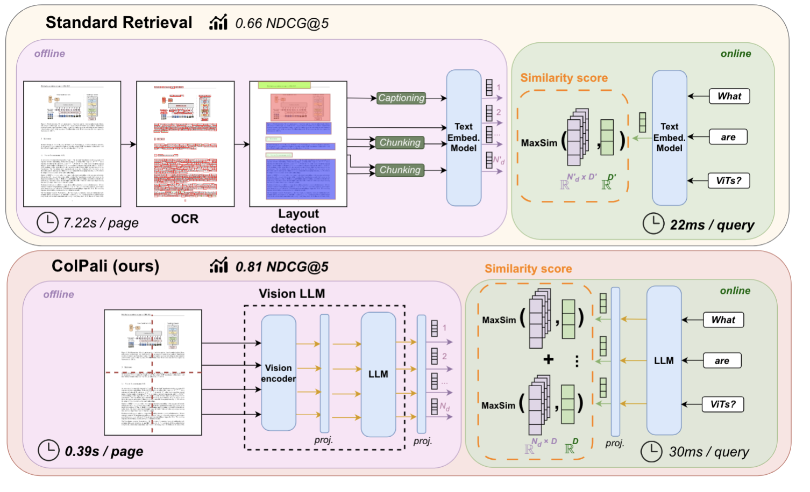

# ColQwen：基于 Qwen 视觉语言骨干的多向量检索系列

> ColQwen 将页面和查询编码成多组向量，再用 ColBERT 式 MaxSim 汇总局部相关性；不同发布者与版本的骨干、维度和训练数据各不相同。
>
> [ColPali 源论文](https://arxiv.org/abs/2407.01449) · [ColQwen2 模型卡](https://huggingface.co/vidore/colqwen2-v1.0) · [ColQwen2.5 模型卡](https://huggingface.co/vidore/colqwen2.5-v0.2) · [Tomoro ColQwen3 模型卡](https://huggingface.co/TomoroAI/tomoro-colqwen3-embed-4b) · 模型卡核对日期：2026-10-22

视觉文档检索需要保留文字、表格、布局和图像细节，单向量压缩可能丢失细粒度证据。ColQwen 沿用 ColPali 的页面图像编码与迟交互思路，将视觉语言骨干换为 Qwen 系列，并在动态分辨率下输出局部向量。早期 vidore 模型沿用 ColPali 数据，Tomoro 的 ColQwen3 则融合文本与视觉语言初始化并使用多源训练数据。它们在视觉检索基准上表现较强，但索引明显大于单向量，处理器和查询格式也影响可复现性。本文是官方模型报告精炼，未将系列名称包装成一篇不存在的独立论文。

## 共同方法：页面独立编码，查询时局部匹配

查询 token 和页面 token 经模型及投影层得到单位化向量。对每个查询向量找最相似的页面向量，再求和：

$$
S(Q,D)=\sum_{i=1}^{n_q}\max_{1\le j\le n_d}q_i^\top d_j.
$$

页面可提前编码；查询时的交互发生在向量之间。模型并不对每个查询—页面对重新运行完整 VLM，也不只输出一个页面向量。



此图来自 ColPali 源论文，用于说明共享的页面编码与迟交互机制。ColQwen 的具体骨干与图像处理应以对应 checkpoint 为准，不能把图中的全部配置直接照搬。

## vidore ColQwen2 与 ColQwen2.5

| 模型 | 骨干 | 典型输出 | 图像预算 |
| --- | --- | --- | --- |
| colqwen2-v1.0 | Qwen2-VL-2B-Instruct | token 数 × 128 | 模型卡最多 768 图像 patch |
| colqwen2.5-v0.2 | Qwen2.5-VL-3B-Instruct | token 数 × 128 | 模型卡最多 768 图像 patch |

两者支持动态分辨率并保留宽高比，通过预算约束缩放，而不是无限接受原始分辨率。更多 patch 在实验中可提高效果，同时增加编码和索引成本。

模型卡沿用 127,460 个 query–page 对：约 63% 来自公开学术训练集，37% 来自网页 PDF 与 Claude-3 Sonnet 生成的问题；训练检索数据为英语，留出 2% 验证，并按多页 PDF 避免训练/评测交叉。底座预训练本身包含多语言，因此英语检索训练不代表模型从未接触其他语言。

通用训练说明使用 LoRA rank=32、alpha=32、学习率 $5\times10^{-5}$、2.5% warmup、线性衰减和 8bit optimizer。ColQwen2 卡片首部另写该版本批量 256、五个 epoch，而下方通用段落仍写批量 32、一个 epoch。两者存在版本说明冲突，不能把复制的通用参数当成已无歧义的 checkpoint 配方。

## Tomoro ColQwen3

TomoroAI 发布的 4B 模型以 Qwen3-VL-4B-Instruct 与 Qwen3-Embedding-4B 合并初始化，保留视觉栈，再训练 320 维投影头。训练数据包括多语言 VDR、ColPali 和 VisRAG 的合成及域内数据。它是另一个发布者的模型，不能默认等同于 vidore 下一代官方 checkpoint。

模型卡给出每页最多 1,280 个视觉 token、短视频最多 5,120 个视觉 token；输出每个 token 的单位化 320 维向量。视频能力主要来自图文训练后的泛化，卡片没有声称进行了专门的视频—文本微调。

| 模型卡评测 | 4B | 8B |
| --- | --- | --- |
| ViDoRe v1 英语 nDCG@5 | 0.9057 | 0.9076 |
| ViDoRe v2 四个英语任务平均 | 0.6598 | 0.6772 |
| ViDoRe v3 英语平均 | 0.5934 | 0.6113 |
| MMEB-v2 video_ret，Hit@1 平均 | 51.7 | 51.2 |

这是采集时的动态模型卡结果，不是统一第三方复现。v2 的四任务平均与原 v2 报告九任务平均不同；视频结果也说明更大模型未必在每项集合上更强。

## 如何使用与保持一致

官方模型卡提供 Sentence Transformers `MultiVectorEncoder` 和 `colpali-engine` 两类入口。编码结果是变长二维张量集合，必须用多向量相似度函数，不能把它误当普通二维“样本数 × 维度”矩阵。

```python
from sentence_transformers import MultiVectorEncoder

model = MultiVectorEncoder("vidore/colqwen2-v1.0")
query_vectors = model.encode_query(["2024 年的总收入是多少？"])
page_vectors = model.encode_document(["report-page.png"])
scores = model.similarity(query_vectors, page_vectors)
```

该接口依据当前模型卡，要求相应版本的 `sentence-transformers[image]`（卡片为 >=6.0.0）；示意代码未在本次下载大模型执行。生产环境应固定模型 revision 和依赖版本。

卡片明确指出 `colpali-engine` 0.3.13 起查询前缀变化可能使表示与原训练格式不同。因此模型权重相同也不保证向量一致：查询模板、padding、图像预算、保留哪些 token 都属于编码配置。更改这些设置后需要重新验证查询与旧索引兼容性。

## 局限与结论

模型主要面向页面图像和高资源语言；多向量存储与 MaxSim 计算需要专门索引支持。仅压缩向量维度并不能消除大量 token 的存储成本，原始索引还需额外数据结构。底座和 adapter 的许可分别适用，例如 ColQwen2.5-3B 模型卡列出的底座为 Qwen Research License，不能只看 adapter 的 MIT 标签。

ColQwen 系列的核心价值是把 VLM 的视觉理解转为可离线建库的细粒度匹配。阅读和复现时最关键的是绑定发布者、checkpoint、处理器和评测集合，而不是只用“ColQwen”作为一种固定配置。
