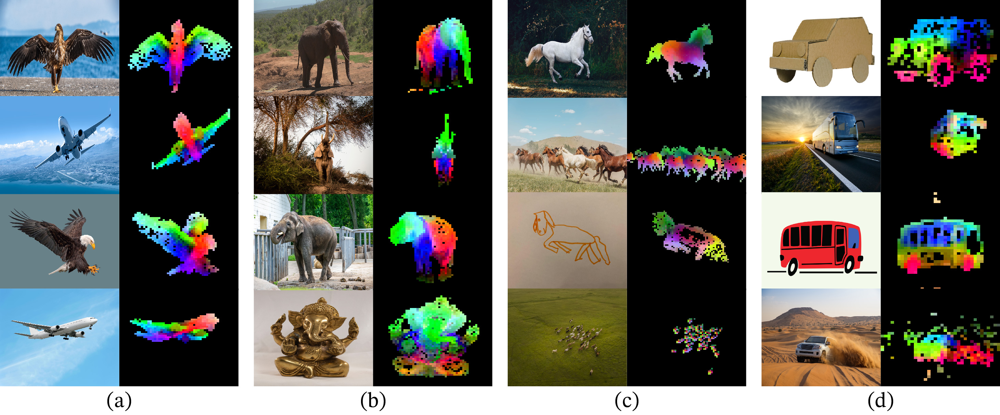
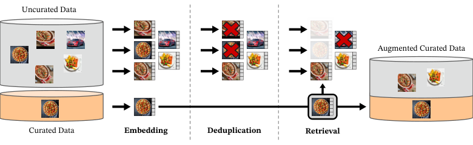
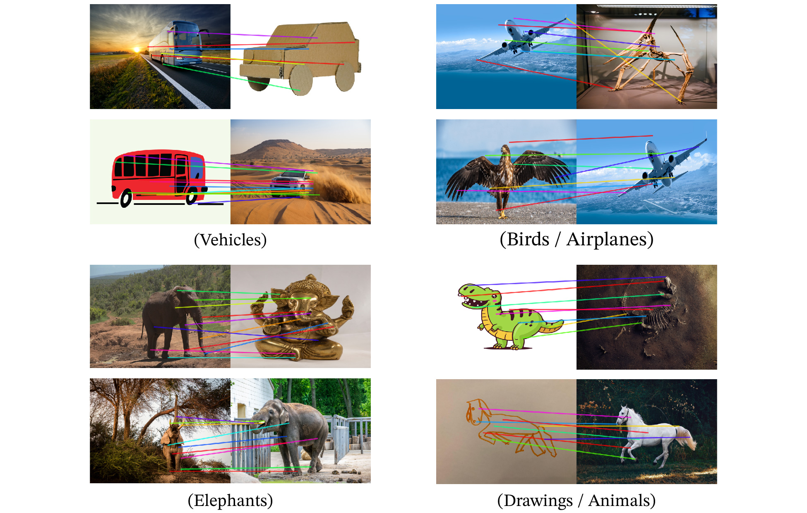

# DINOv2：无需文本监督的通用视觉特征

> DINOv2 将图像级自蒸馏、patch 级预测和大规模数据筛选结合，训练能直接迁移到分类、检索及像素级任务的视觉编码器。
>
> [论文](https://arxiv.org/abs/2304.07193) · 本文依据 v2 · [代码](https://github.com/facebookresearch/dinov2)

视觉基础模型需要同时提供整图语义和局部结构信息。图文预训练依赖描述提供监督，描述却未必覆盖图像中的全部细节；以往纯图像自监督扩大到未筛选数据后，特征质量也不稳定。DINOv2 从约 12 亿图像中筛出 LVD-142M，将 DINO、iBOT、分布正则和高效训练组合，先训练约十亿参数的 ViT，再蒸馏出小模型。冻结特征在分类、实例检索、分割和深度估计上都具有较强表现。它提供视觉表示，不自带文本对齐或开放词表问答能力。

## 背景与相关路线

MAE 等重建方法在充分微调后表现强，但本文关心“冻结后也好用”的特征。DINO 的跨视图自蒸馏倾向于学习整图语义，iBOT 的遮挡 patch 预测补充局部信号。论文研究如何把这类判别式自监督扩展到更大模型和经过整理的大规模数据，而非提出一个完全独立的新损失。

同列相关图像的 patch 经共同 PCA 后用颜色显示。相似部件能够出现对应颜色，说明表示包含可迁移的局部结构；这是一种定性现象，不等同于有标注的部件分割准确率。

## 数据：从原始图像池到 LVD-142M

原始池经过基本过滤、去重等处理后约有 1.2B 图像。作者采用图像相似度去重，同时去除与评测集近重复的图像，再利用 ImageNet-22k、地标和细粒度数据集等作为种子，进行相似图像检索及聚类采样，得到 142M 图像。

筛选器使用在 ImageNet-22k 上自监督训练的 ViT-H/16 表示和 Faiss 检索。对较大种子集通常每个样本检索四个近邻；对较小种子集从对应聚类采样，以兼顾覆盖与重复率。因此“无监督”指学习目标不使用类别标签，并不意味着数据来源和种子选择完全没有人为先验。

## 图像级与 patch 级自蒸馏

学生处理多个裁剪视图，教师参数由学生的指数移动平均更新。图像级 DINO 损失让同一图像不同视图的 CLS 表示在原型分布上相符：

$$
\mathcal L_{\mathrm{DINO}}=-\sum_k p_t(k)\log p_s(k).
$$

patch 级 iBOT 损失则遮住学生输入中的部分 patch，用未遮挡教师对应位置的分布作目标：

$$
\mathcal L_{\mathrm{iBOT}}=-\sum_{i\in\mathcal M}\sum_k p_{t,i}(k)\log p_{s,i}(k).
$$

教师输出停止梯度；图像级和 patch 级使用独立投影头。教师分布采用 Sinkhorn-Knopp 归一化，学生采用 softmax。它们共同防止学习退化为没有区分能力的表示。

KoLeo 正则鼓励单位化特征在空间中展开：

$$
\mathcal L_{\mathrm{KoLeo}}=-\frac1n\sum_i\log\min_{j\ne i}\|x_i-x_j\|_2.
$$

最近邻过近会受到较大惩罚，从而改善特征分布。训练末期短暂提高到 518×518 分辨率，使细节表示适配像素级任务。

## 扩大训练的实现与模型蒸馏

论文采用高效注意力、序列打包、stochastic depth 的高效实现和 FSDP；相比 iBOT 实现，在相同硬件条件下约快两倍、显存约为三分之一。这里是论文具体实现的测量，不是任意配置的保证。

先训练 ViT-g/14，再用固定的大模型教师蒸馏 ViT-S/B/L 等学生。蒸馏仍利用全局与局部学习信号，但不再用学生的 EMA 充当大教师。它让小模型继承大规模训练所得知识，降低部署成本。

## 实验与主要结果

评测同时覆盖 ImageNet 分类及分布偏移、细粒度与视频分类、Oxford/Paris 等实例检索、ADE20K 语义分割、NYUv2/KITTI 深度估计。冻结骨干后训练一个线性预测头，与全参数微调要分开阅读。

| 模型 | ImageNet kNN | ImageNet 线性探测 |
| --- | --- | --- |
| OpenCLIP ViT-G/14 | 83.2 | 86.2 |
| iBOT ViT-L/16 | 72.9 | 82.3 |
| DINOv2 ViT-S/14 | 79.0 | 81.1 |
| DINOv2 ViT-B/14 | 82.1 | 84.5 |
| DINOv2 ViT-L/14 | 83.5 | 86.3 |
| DINOv2 ViT-g/14 | 83.5 | 86.5 |

ViT-g 在 448 分辨率下线性探测为 86.7，全参微调为 88.9，不能把后者称为冻结特征成绩。实例检索也显示小模型不一定所有任务都弱于大模型：Oxford Hard 上 ViT-L 为 54.0，ViT-g 为 52.3。

通过局部特征匹配可以在姿态、风格甚至物体类别变化时建立部分语义对应。论文还展示冻结特征接简单预测头进行分割与深度估计，说明信息不仅存在于 CLS 中，也分布在 patch 表示里。

## 消融与附录要点

训练配方逐步加入 KoLeo、SwiGLU、patch size 调整、批量和教师动量等，最终将复现起点的 ImageNet kNN 74.5 提高到 82.0；各项收益并非在每种评测上都单调。

数据消融尤其重要：未筛选数据的 ImageNet 线性分数为 83.3，而 LVD-142M 为 85.8；但未筛选数据在 ADE20K 并非最差。数据质量要相对于目标任务理解，不能只用一个分类分数概括。模型规模、数据规模、蒸馏和末期高分辨率共同贡献结果。

附录给出数据来源、近重复处理、采样与训练超参数。论文也评估地理及人口属性偏差：不同地区和收入群体之间仍有明显性能差距，并估计训练能耗。结论是大规模经过筛选的自监督学习可以产生通用冻结视觉特征，但不等于消除了数据偏差，也不能直接替代文本可查询的多模态检索器。
