# DINOv2: Learning Robust Visual Features without Supervision / 全文中英对照

> 来源：[arXiv:2304.07193v2](https://arxiv.org/abs/2304.07193v2)。英文段落后紧接中文，覆盖所取 HTML 版本的主文、附录、图表、脚注与参考文献；公式、数字表和书目信息共用。中文以机器初译为底稿，进行了术语整理与结构核对，尚未逐句人工审定；遇到歧义请以紧邻英文和原论文为准。 本文对照整理基于仓库原有论文副本，原作版权归所列作者。

## Authors and affiliations / 作者与机构

Maxime Oquab ** , Timothée Darcet ** , Théo Moutakanni ** ,Huy V. Vo * , Marc Szafraniec * , Vasil Khalidov * , Pierre Fernandez, Daniel Haziza,Francisco Massa, Alaaeldin El-Nouby, Mahmoud Assran, Nicolas Ballas, Wojciech Galuba,Russell Howes, Po-Yao Huang, Shang-Wen Li, Ishan Misra, Michael Rabbat Vasu Sharma Gabriel Synnaeve Hu Xu Hervé Jegou Julien MairalPatrick Labatut * , Armand Joulin * , Piotr Bojanowski * Meta AI Research Inria * core team ** equal contribution

## Abstract / 摘要

**EN.** The recent breakthroughs in natural language processing for model pretraining on large quantities of data have opened the way for similar foundation models in computer vision. These models could greatly simplify the use of images in any system by producing general-purpose visual features, i.e., features that work across image distributions and tasks without finetuning. This work shows that existing pretraining methods, especially self-supervised methods, can produce such features if trained on enough curated data from diverse sources. We revisit existing approaches and combine different techniques to scale our pretraining in terms of data and model size. Most of the technical contributions aim at accelerating and stabilizing the training at scale. In terms of data, we propose an automatic pipeline to build a dedicated, diverse, and curated image dataset instead of uncurated data, as typically done in the self-supervised literature. In terms of models, we train a ViT model ( Dosovitskiy et al., 2021 ) with 1B parameters and distill it into a series of smaller models that surpass the best available general-purpose features, OpenCLIP ( Ilharco et al., 2021 ) on most of the benchmarks at image and pixel levels.

**中.** 最近在针对大量数据进行模型预训练的自然语言处理方面取得的突破，为计算机视觉中的类似基础模型开辟了道路。这些模型可以通过产生通用视觉特征（即无需微调即可跨图像分布和任务工作的特征）来极大地简化任何系统中图像的使用。这项工作表明，现有的预训练方法，尤其是自监督方法，如果使用来自不同来源的足够的精选数据进行训练，可以产生此类特征。我们重新审视现有的方法并结合不同的技术来扩展我们的数据和模型大小的预训练。大多数技术贡献旨在加速和稳定大规模培训。在数据方面，我们提出了一个自动管道来构建专用的、多样化的和精选的图像数据集，而不是像自我监督文献中通常所做的那样未经精选的数据。在模型方面，我们训练具有 1B 参数的 ViT 模型（Dosovitskiy 等人，2021），并将其提炼成一系列较小的模型，这些模型在图像和像素级别的大多数基准上超越了最佳可用的通用功能 OpenCLIP（Ilharco 等人，2021）。

**EN.** Reviewed on OpenReview: [https://openreview.net/forum?id=a68SUt6zFt](https://openreview.net/forum?id=a68SUt6zFt)

**中.** 在 OpenReview 上审核：[https://openreview.net/forum?id=a68SUt6zFt](https://openreview.net/forum?id=a68SUt6zFt)

## Introduction / 简介

**EN.** Learning task-agnostic pretrained representations have become the standard in Natural Language Processing (NLP) ( Radford et al., 2019 ; Raffel et al., 2020 ; Chowdhery et al., 2022 ; Hoffmann et al., 2022 ; Touvron et al., 2023 ) . One can use these features “as they are”, i.e., without fine-tuning, and achieve performances on downstream tasks that are significantly better than those produced by task-specific models ( Brown et al., 2020 ) . This success has been fueled by pretraining on large quantities of raw text using pretext objectives, such as language modeling ( Radford et al., 2017 ) or word vectors ( Devlin et al., 2019 ) , that require no supervision.

**中.** 学习与任务无关的预训练表示已成为自然语言处理（NLP）的标准（Radford et al., 2019; Raffel et al., 2020; Chowdhery et al., 2022; Hoffmann et al., 2022; Touvron et al., 2023）。人们可以“按原样”使用这些特征，即无需微调，并且在下游任务上实现的性能明显优于特定任务模型产生的性能（Brown 等人，2020）。这一成功得益于使用借口目标对大量原始文本进行预训练，例如无需监督的语言建模（Radford 等人，2017 年）或词向量（Devlin 等人，2019 年）。

**EN.** Following this paradigm shift in NLP, we expect similar “foundation” models to appear in computer vision ( Bommasani et al., 2021 ) . These models should generate visual features that work out of the box on any task, both at the image level, e.g., image classification, and pixel level, e.g., segmentation. Most promising efforts towards these foundation models focus on text-guided pretraining, i.e., using a form of textual supervision to guide the training of the features ( Joulin et al., 2016 ; Mahajan et al., 2018 ; Radford et al., 2021 ) . This form of text-guided pretraining limits the information that can be retained about the image since captions only approximate the rich information in images, and complex pixel-level information may not surface with this supervision. Furthermore, these image encoders require aligned text-image corpora and hence, do not offer the flexibility of their text counterparts, that is, to learn from raw data alone.

**中.** 随着 NLP 范式的转变，我们预计计算机视觉中也会出现类似的“基础”模型（Bommasani 等人，2021）。这些模型应该生成可以在任何任务上开箱即用的视觉特征，无论是在图像级别（例如图像分类）还是像素级别（例如分割）。这些基础模型最有前途的努力集中在文本引导的预训练上，即使用文本监督的形式来指导特征的训练（Joulin 等人，2016 年；Mahajan 等人，2018 年；Radford 等人，2021 年）。这种形式的文本引导预训练限制了可以保留的有关图像的信息，因为标题仅近似图像中的丰富信息，而复杂的像素级信息可能不会通过这种监督而浮现出来。此外，这些图像编码器需要对齐的文本图像语料库，因此不提供文本对应物的灵活性，即仅从原始数据中学习。

**EN.** Figure 1 : Visualization of the first PCA components. We compute a PCA between the patches of the images from the same column (a, b, c and d) and show their first 3 components. Each component is matched to a different color channel. Same parts are matched between related images despite changes of pose, style or even objects. Background is removed by thresholding the first PCA component.

**中.** 图 1：第一个 PCA 组件的可视化。我们计算同一列（a、b、c 和 d）的图像块之间的 PCA，并显示它们的前 3 个分量。每个组件都与不同的颜色通道匹配。尽管姿势、风格甚至物体发生了变化，但相关图像之间的相同部分仍会匹配。通过对第一个 PCA 分量进行阈值处理来去除背景。

**EN.** An alternative to text-guided pretraining is self-supervised learning ( Caron et al., 2018 ; Chen et al., 2020 ; He et al., 2022 ) where features are learned from images alone. These approaches are conceptually closer to pretext tasks such as language modeling and can capture information at the image and pixel level ( Caron et al., 2021 ) . Additionally, the features output by self-supervised models have been shown to exhibit various useful properties, and have enabled enabled a wide variety of applications ( Amir et al., 2022 ; Tumanyan et al., 2022 ; Ofri-Amar et al., 2023 ; Hamilton et al., 2022 ) . However, despite their potential to learn general-purpose features, most of the advances in self-supervised learning were made in the context of pretraining on a small curated dataset, ImageNet-1k ( Russakovsky et al., 2015 ) . Some efforts on scaling these approaches beyond ImageNet-1k have been attempted ( Caron et al., 2019 ; Goyal et al., 2021 ; Goyal et al., 2022a ) , but they focused on uncurated datasets, which typically lead to a significant drop in the quality of the features. This is explained by the lack of control over the data quality and diversity, which are essential to produce good features.

**中.** 文本引导预训练的替代方法是自监督学习（Caron et al., 2018；Chen et al., 2020；He et al., 2022），其中特征仅从图像中学习。这些方法在概念上更接近于语言建模等借口任务，并且可以捕获图像和像素级别的信息（Caron 等人，2021）。此外，自监督模型输出的特征已被证明表现出各种有用的属性，并实现了广泛的应用（Amir et al., 2022；Tumanyan et al., 2022；Ofri-Amar et al., 2023；Hamilton et al., 2022）。然而，尽管它们具有学习通用特征的潜力，但自监督学习的大部分进步都是在小型数据集 ImageNet-1k 上进行预训练的背景下取得的（Russakovsky 等人，2015）。人们已经尝试将这些方法扩展到 ImageNet-1k 之外（Caron 等人，2019；Goyal 等人，2021；Goyal 等人，2022a），但他们专注于未经整理的数据集，这通常会导致特征质量显着下降。这是因为缺乏对数据质量和多样性的控制，而数据质量和多样性对于产生良好的特征至关重要。

**EN.** In this work, we explore if self-supervised learning has the potential to learn general-purpose visual features if pretrained on a large quantity of curated data. We revisit existing discriminative self-supervised approaches that learn features at both the image and patch level, such as iBOT ( Zhou et al., 2022a ) , and we reconsider some of their design choices under the lens of a larger dataset. Most of our technical contributions are tailored toward stabilizing and accelerating discriminative self-supervised learning when scaling in model and data sizes. These improvements make our approach around 2 $\times$ faster and require 3 $\times$ less memory than similar discriminative self-supervised methods, allowing us to leverage longer training with larger batch sizes.

**中.** 在这项工作中，我们探索如果对大量精选数据进行预训练，自监督学习是否有潜力学习通用视觉特征。我们重新审视现有的在图像和块级别学习特征的判别性自我监督方法，例如 iBOT（Zhou et al., 2022a），并且我们在更大的数据集的镜头下重新考虑他们的一些设计选择。我们的大部分技术贡献都是为了在模型和数据规模扩展时稳定和加速有区别的自我监督学习。这些改进使我们的方法比类似的判别性自监督方法快了约 2 $\times$，并且需要的内存少了 3 $\times$，从而使我们能够利用更大批量的更长训练时间。

**EN.** Regarding pretraining data, we have built an automatic pipeline to filter and rebalance datasets from an extensive collection of uncurated images. This pipeline is inspired by pipelines used in NLP ( Wenzek et al., 2020 ) , where data similarities are used instead of external metadata and do not require manual annotation. A major difficulty when dealing with images in the wild is to rebalance concepts and avoid overfitting on a few dominant modes. In this work, a naive clustering approach works reasonably well to resolve this issue. We gathered a small but diverse corpus of 142M images to validate our approach.

**中.** 关于预训练数据，我们构建了一个自动管道，用于从大量未经整理的图像中过滤和重新平衡数据集。该管道的灵感来自于 NLP 中使用的管道（Wenzek et al., 2020），其中使用数据相似性而不是外部元数据，并且不需要手动注释。在野外处理图像时的一个主要困难是重新平衡概念并避免对一些主导模式的过度拟合。在这项工作中，朴素的聚类方法可以很好地解决这个问题。我们收集了一个由 1.42 亿张图像组成的小型但多样化的语料库来验证我们的方法。

**EN.** Finally, we provide a variety of pretrained visual models, called DINOv2, trained with different Vision Transformers (ViT) ( Dosovitskiy et al., 2016 ) architectures on our data. We release all the models and the code to retrain DINOv2 on any data. We validate the quality of DINOv2 on various computer vision benchmarks at both image and pixel levels as we scale them, as summarized in Fig. 2 . We conclude that self-supervised pretraining alone is a good candidate for learning transferable frozen features that are competitive with the best openly available weakly-supervised models.

**中.** 最后，我们提供了各种预训练的视觉模型，称为 DINOv2，在我们的数据上使用不同的 Vision Transformers (ViT) (Dosovitskiy et al., 2016) 架构进行训练。我们发布了所有模型和代码，以在任何数据上重新训练 DINOv2。我们在缩放图像和像素级别时在各种计算机视觉基准上验证了 DINOv2 的质量，如图 2 所示。我们的结论是，自监督预训练本身就是学习可转移冻结特征的良好候选者，这些特征与最好的公开可用的弱监督模型具有竞争力。

## Related Work / 相关工作

#### Intra-image self-supervised training. / 图像内自我监督训练。

**EN.** A first family of self-supervised methods focuses on pretext tasks built from the image, i.e., extracting a signal from the image to be predicted from the rest of the image. This idea has become prevalent with the work of Doersch et al. (2015) , where they train by predicting the context of a given patch. Many other pretext tasks were introduced based on, for example, re-colorizing images ( Zhang et al., 2016 ) , predicting transformations ( Gidaris et al., 2018 ) , inpainting ( Pathak et al., 2016 ) or patch re-ordering ( Noroozi & Favaro, 2016 ; Misra & Maaten, 2020 ) . Recently, the emergence of patch-based architectures, like ViTs, has led to a revisit of inpainting for pre-training ( He et al., 2022 ; Bao et al., 2021 ; El-Nouby et al., 2021 ) , potentially in feature space ( Assran et al., 2023 ; Baevski et al., 2022 ) . Of particular interest, He et al. (2022) show that a masked auto-encoder (MAE) learns features that provide substantial improvements when finetuned on downstream tasks. This property of MAEs has been further validated on video ( Tong et al., 2022 ) , audio ( Xu et al., 2022 ) , and across other modalities ( Girdhar et al., 2023 ) . However, their features require supervised finetuning, while our features perform well out of the box.

**中.** 第一类自监督方法侧重于从图像构建的借口任务，即从图像中提取信号以根据图像的其余部分进行预测。这种想法在 Doersch 等人的工作中变得普遍。 (2015)，他们通过预测给定补丁的上下文进行训练。引入了许多其他借口任务，例如，重新着色图像（Zhang et al., 2016）、预测变换（Gidaris et al., 2018）、修复（Pathak et al., 2016）或补丁重新排序（Noroozi & Favaro, 2016；Misra & Maaten, 2020）。最近，基于补丁的架构（如 ViT）的出现，导致了对预训练修复的重新审视（He et al., 2022；Bao et al., 2021；El-Nouby et al., 2021），可能在特征空间中（Assran et al., 2023；Baevski et al., 2022）。特别感兴趣的是，He 等人。 （2022）表明，掩码自动编码器（MAE）学习的功能在对下游任务进行微调时可提供实质性改进。 MAE 的这一特性已在视频（Tong 等人，2022）、音频（Xu 等人，2022）和其他模式（Girdhar 等人，2023）上得到了进一步验证。然而，他们的功能需要监督微调，而我们的功能开箱即用，表现良好。

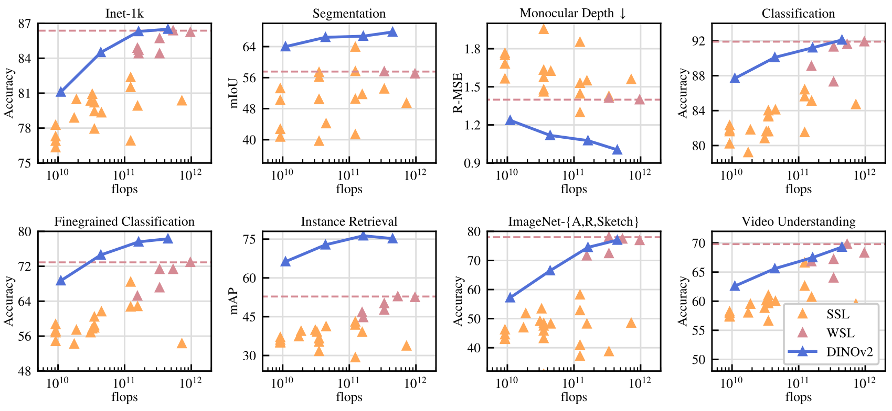

**EN.** Figure 2 : Evolution of performance when scaling in parameters. We show performance on eight types of vision tasks, as presented in Sec. 7 , and average metrics with each type. Features are extracted from our self-supervised encoders, DINOv2 (dark blue), and we compare them with self-supervised methods (pale orange), as well as weakly-supervised methods (dark pink). We report the best-performing weakly-supervised model’s performance as a dashed horizontal line. Our family of models drastically improves over the previous state of the art in self-supervised learning and reaches performance comparable with weakly-supervised features. See Sec. 7 for a detailed analysis.

**中.** 图 2：参数缩放时性能的演变。我们展示了八种类型的视觉任务的表现，如第 2 节中所示。 7 ，以及每种类型的平均指标。特征是从我们的自监督编码器 DINOv2（深蓝色）中提取的，我们将它们与自监督方法（浅橙色）以及弱监督方法（深粉色）进行比较。我们将表现最好的弱监督模型的性能报告为水平虚线。我们的模型系列比之前的自监督学习技术有了很大的进步，并且达到了与弱监督特征相当的性能。参见第 2 节。 7 详细分析。

#### Discriminative self-supervised learning. / 歧视性自我监督学习。

**EN.** The second line of work, closer to ours, is using discriminative signals between images or groups of images to learn features. This family of methods has roots in early deep learning work ( Hadsell et al., 2006 ) but became popular with the emergence of instance classification methods ( Dosovitskiy et al., 2016 ; Bojanowski & Joulin, 2017 ; Wu et al., 2018 ) . Several improvements were made based either on instance-level objectives ( Hénaff et al., 2019 ; He et al., 2020 ; Chen & He, 2021 ; Chen et al., 2020 ; Grill et al., 2020 ; Caron et al., 2021 ) or clustering ( Caron et al., 2018 ; Asano et al., 2020 ; Caron et al., 2020 ) . These methods provide performant frozen features on standard benchmarks like ImageNet ( Russakovsky et al., 2015 ) , but they are hard to scale to larger model sizes ( Chen et al., 2021 ) . In this work, we revisit the training of these approaches in the context of large pretraining datasets and models. In particular, we build on top of Zhou et al. (2022a) that we find particularly suited for scaling.

**中.** 第二条工作与我们的工作更接近，是使用图像或图像组之间的判别信号来学习特征。这一系列方法源于早期的深度学习工作（Hadsell 等人，2006），但随着实例分类方法的出现而变得流行（Dosovitskiy 等人，2016；Bojanowski 和 Joulin，2017；Wu 等人，2018）。基于实例级目标（Hénaff et al., 2019; He et al., 2020; Chen & He, 2021; Chen et al., 2020; Grill et al., 2020; Caron et al., 2021）或聚类（Caron et al., 2018; Asano et al., 2020;卡伦等人，2020）。这些方法在 ImageNet 等标准基准上提供了高性能的冻结特征（Russakovsky 等人，2015），但它们很难扩展到更大的模型尺寸（Chen 等人，2021）。在这项工作中，我们在大型预训练数据集和模型的背景下重新审视这些方法的训练。特别是，我们建立在 Zhou 等人的基础上。 （2022a）我们发现特别适合扩展。

#### Scaling self-supervised pretraining. / 扩展自我监督预训练。

**EN.** A growing body of work has focused on the scaling abilities of self-supervised learning in terms of data and model size ( Caron et al., 2019 ; Goyal et al., 2019 ; Tian et al., 2021 ; Goyal et al., 2022a ) . Most of these works use large quantities of uncurated data to train models without supervision. They show evidence that discriminative methods scale with data, but because of the poor quality of the pretraining data, most of the results are obtained by finetuning the features. Of particular interest, Goyal et al. (2021) have also shown that these methods benefit from scaling in model size given enough pretrained data. This line of work questions the ability of self-supervised methods to work on any data while we focus on producing the best pretrained encoders.

**中.** 越来越多的工作集中在数据和模型大小方面自我监督学习的扩展能力（Caron 等人，2019；Goyal 等人，2019；Tian 等人，2021；Goyal 等人，2022a）。这些工作大多数都使用大量未经整理的数据来在没有监督的情况下训练模型。他们证明了判别方法会随着数据的变化而扩展，但由于预训练数据的质量较差，大多数结果都是通过对特征进行微调来获得的。特别感兴趣的是，Goyal 等人。 （2021）还表明，在给定足够的预训练数据的情况下，这些方法受益于模型大小的缩放。这一系列工作质疑自监督方法处理任何数据的能力，而我们专注于生产最好的预训练编码器。

#### Automatic data curation. / 自动数据整理。

**EN.** Our dataset construction borrows from the image retrieval community ( Weinzaepfel et al., 2021 ; Radenović et al., 2018b ; Berman et al., 2019 ; Douze et al., 2009 ; Tolias et al., 2016 ; Revaud et al., 2019 ) . In particular, the use of retrieval to augment the training set has been studied in the context of semi-supervised learning ( Yalniz et al., 2019 ) . Similarly, others have used hashtags or other metadata ( Mahajan et al., 2018 ; Radford et al., 2021 ) or pretrained vision encoders ( Schuhmann et al., 2021 ; Schuhmann et al., 2022 ) to filter uncurated datasets. Unlike these works, we use no pretrained encoders, metadata nor supervision to filter images and leverage visual similarity between images. Our approach is inspired by text curation pipelines ( Wenzek et al., 2020 ) , where a language model is trained on Wikipedia to score texts extracted from an uncurated source.

**中.** 我们的数据集构建借鉴了图像检索社区的经验（Weinzaepfel et al., 2021；Radenović et al., 2018b；Berman et al., 2019；Douze et al., 2009；Tolias et al., 2016；Revaud et al., 2019）。特别是，在半监督学习的背景下研究了使用检索来增强训练集（Yalniz 等人，2019）。同样，其他人使用主题标签或其他元数据（Mahajan 等人，2018；Radford 等人，2021）或预训练视觉编码器（Schuhmann 等人，2021；Schuhmann 等人，2022）来过滤未经整理的数据集。与这些作品不同的是，我们不使用预训练的编码器、元数据或监督来过滤图像并利用图像之间的视觉相似性。我们的方法受到文本管理管道的启发（Wenzek et al., 2020），其中语言模型在维基百科上进行训练，以对从未经管理的来源中提取的文本进行评分。

## Data Processing / 数据处理

**EN.** We assemble our curated LVD-142M dataset by retrieving, from a large pool of uncurated data, images that are close to those in several curated datasets. We describe below the main components in our data pipeline including the curated/uncurated data sources, the image deduplication step and the retrieval system. Our pipeline does not require any metadata or text and directly works with images, as shown in Fig. 3 . We refer the reader to appendix A for more details on our approach.

**中.** 我们通过从大量未整理的数据中检索与多个整理数据集中的图像接近的图像来组装整理的 LVD-142M 数据集。下面我们描述了数据管道中的主要组件，包括精选/非精选数据源、图像重复数据删除步骤和检索系统。我们的管道不需要任何元数据或文本，直接处理图像，如图 3 所示。我们建议读者参阅附录 A，了解有关我们方法的更多详细信息。

**EN.** Figure 3 : Overview of our data processing pipeline. Images from curated and uncurated data sources are first mapped to embeddings. Uncurated images are then deduplicated before being matched to curated images. The resulting combination augments the initial dataset through a self-supervised retrieval system.

**中.** 图 3：我们的数据处理流程概述。来自精选和非精选数据源的图像首先被映射到嵌入。然后，将未整理的图像进行重复数据删除，然后将其与整理的图像进行匹配。由此产生的组合通过自我监督的检索系统增强了初始数据集。

**EN.** Data sources. Our selection of curated datasets is detailed in the appendix (Table 15 ) and contains ImageNet-22k, the train split of ImageNet-1k, Google Landmarks and several fine-grained datasets. For the uncurated data source, we collect a raw unfiltered dataset of images from a publicly available repository of crawled web data. From each web page in the repository, we extract URL links of images from  tags. We discard URLs that are unsafe or restricted by domains, and post-process the downloaded images (PCA hash deduplication, NSFW filtering, and blurring identifiable faces). This results in 1.2B unique images.

**中.** 数据来源。我们选择的精选数据集详见附录（表 15），其中包含 ImageNet-22k、ImageNet-1k 的训练分割、Google Landmarks 和几个细粒度数据集。对于未经整理的数据源，我们从公开可用的爬网网络数据存储库收集原始的未经过滤的图像数据集。从存储库中的每个网页中，我们从  标签中提取图像的 URL 链接。我们丢弃不安全或受域限制的 URL，并对下载的图像进行后处理（PCA 哈希重复数据删除、NSFW 过滤和模糊可识别面孔）。这会产生 1.2B 的独特图像。

**EN.** Deduplication. We apply the copy detection pipeline of Pizzi et al. (2022) to the uncurated data and remove near-duplicate images. This reduces redundancy and increases diversity among images. We also remove near-duplicates of images contained in the test or validation set of any benchmark used in this work.

**中.** 重复数据删除。我们应用 Pizzi 等人的复制检测管道。 (2022) 处理未经整理的数据并删除几乎重复的图像。这减少了冗余并增加了图像之间的多样性。我们还删除了本工作中使用的任何基准的测试或验证集中包含的几乎重复的图像。

**EN.** Self-supervised image retrieval. We build our curated pretraining dataset by retrieving images from our uncurated data source that are close to images in our curated sources. In order to do this, we first compute an image embedding using a self-supervised ViT-H/16 network pretrained on ImageNet-22k, and use cosine-similarity as a distance measure between images. Then, we perform k-means clustering of the uncurated data. Given a query dataset for retrieval, if it is large enough we retrieve $N$ (typically 4) nearest neighbors for each query image. If it is small, we sample $M$ images from the cluster corresponding to each query image. Although visual inspection seemed to indicate good retrieval quality for $N$ much larger than 4, this leads to more collisions (images that are nearest-neighbor retrievals of multiple queries). We choose $N=4$ as it provides a good tradeoff in that sense.

**中.** 自监督图像检索。我们通过从我们的非策划数据源中检索与我们策划的源中的图像接近的图像来构建我们策划的预训练数据集。为此，我们首先使用在 ImageNet-22k 上预训练的自监督 ViT-H/16 网络计算图像嵌入，并使用余弦相似度作为图像之间的距离度量。然后，我们对未整理的数据执行 k 均值聚类。给定一个用于检索的查询数据集，如果它足够大，我们将为每个查询图像检索 $N$（通常是 4 个）最近邻。如果它很小，我们从每个查询图像对应的簇中采样 $M$ 图像。尽管目视检查似乎表明 $N$ 远大于 4 的检索质量良好，但这会导致更多冲突（图像是多个查询的最近邻检索）。我们选择 $N=4$，因为它在这个意义上提供了良好的权衡。

**EN.** Implementation Details. The deduplication and retrieval stages of our pipeline rely on the Faiss library ( Johnson et al., 2019 ) to efficiently index and compute batch searches of nearest embeddings. In particular, we heavily leverage its support for GPU-accelerated indices, using inverted file indices with product quantization codes ( Jegou et al., 2010 ) . The whole processing is distributed on a compute cluster of 20 nodes equipped with 8 V100-32GB GPUs and takes less than two days to produce the LVD-142M dataset.

**中.** 实施细节。我们管道的重复数据删除和检索阶段依赖于 Faiss 库（Johnson et al., 2019）来有效地索引和计算最近嵌入的批量搜索。特别是，我们充分利用了它对 GPU 加速索引的支持，使用带有产品量化代码的倒排文件索引（Jegou 等人，2010）。整个处理分布在配备 8 个 V100-32GB GPU 的 20 个节点的计算集群上，生成 LVD-142M 数据集需要不到两天的时间。

## Discriminative Self-supervised Pre-training / 区分性自监督预训练

**EN.** We learn our features with a discriminative self-supervised method that can be seen as a combination of DINO and iBOT losses with the centering of SwAV ( Caron et al., 2020 ) . We also add a regularizer to spread features and a short high-resolution training phase. We rapidly introduce each of these approaches, but more details can be found in the related papers, or in our open-sourced code.

**中.** 我们通过一种有区别的自我监督方法来学习我们的特征，该方法可以被视为以 SwAV 为中心的 DINO 和 iBOT 损失的组合（Caron 等人，2020）。我们还添加了一个正则化器来传播特征和一个简短的高分辨率训练阶段。我们快速介绍了每种方法，但更多详细信息可以在相关论文或我们的开源代码中找到。

**EN.** Image-level objective ( Caron et al., 2021 ) . We consider the cross-entropy loss between the features extracted from a student and a teacher network. Both features are coming from the class token of a ViT, obtained from different crops of the same image. We pass the student class token through the student DINO head. This head is an MLP model outputting a vector of scores, that we call "prototype scores". We then apply a softmax to obtain $p_{s}$ . Similarly, we apply the teacher DINO head to the teacher class token to obtain teacher prototype scores. We then apply a softmax followed by a centering with moving average (or a Sinkhorn-Knopp centering as detailed thereafter) to obtain $p_{t}$ . The DINO loss term corresponds to:

**中.** 图像级目标（Caron 等人，2021）。我们考虑从学生和教师网络提取的特征之间的交叉熵损失。这两个特征都来自 ViT 的类标记，是从同一图像的不同裁剪中获得的。我们通过学生 DINO 头传递学生班级令牌。这个头是一个输出分数向量的 MLP 模型，我们称之为“原型分数”。然后我们应用 softmax 来获得 $p_{s}$ 。同样，我们将教师 DINO 头应用到教师类令牌中以获得教师原型分数。然后，我们应用 softmax，然后使用移动平均进行居中（或 Sinkhorn-Knopp 居中，如下文详述）以获得 $p_{t}$ 。 DINO 损失项对应于：

$$
{\mathcal{L}}_{DINO}=-\sum p_{t}\log p_{s}
$$

**EN.** We learn the parameters of the student and build the teacher head with an exponential moving average of past iterates ( He et al., 2020 ) .

**中.** 我们学习学生的参数，并使用过去迭代的指数移动平均值构建教师头（He et al., 2020）。

**EN.** Patch-level objective ( Zhou et al., 2022a ) . We randomly mask some of the input patches given to the student, but not to the teacher. We then apply the student iBOT head to the student mask tokens. Similarly, we apply the teacher iBOT head to the (visible) teacher patch tokens corresponding to the ones masked in the student. We then apply the softmax and centering steps as above, and obtain the iBOT loss term:

**中.** 补丁级目标（Zhou et al., 2022a）。我们随机屏蔽一些提供给学生的输入补丁，但不屏蔽给老师的输入补丁。然后，我们将学生 iBOT 头应用到学生面具令牌上。类似地，我们将教师 iBOT 头应用于与学生中屏蔽的标记相对应的（可见）教师补丁标记。然后我们应用上面的 softmax 和中心化步骤，并获得 iBOT 损失项：

$$
{\mathcal{L}}_{iBOT}=-\sum_{i}p_{ti}\log p_{si}
$$

**EN.** , where $i$ are patch indices for masked tokens. Similarly to above, we learn the parameters of the student, and build the teacher head through exponential moving average.

**中.** ，其中 $i$ 是屏蔽令牌的补丁索引。与上面类似，我们学习学生的参数，并通过指数移动平均构建教师头。

**EN.** Untying head weights between both objectives. Both the DINO and the iBOT loss use a learnable MLP projection head. It is applied to the output tokens and the loss is compute atop. In Zhou et al. (2022a) , an ablation study shows that sharing parameters between the DINO and iBOT heads leads to better performance. At scale, we observed that the opposite is true, and we therefore use two separate heads in all our experiments.

**中.** 解除两个目标之间的头部重量。 DINO 和 iBOT 损失都使用可学习的 MLP 投影头。它应用于输出令牌，并在顶部计算损失。在周等人中。 (2022a)，一项消融研究表明，DINO 和 iBOT 头之间共享参数可以带来更好的性能。在规模上，我们观察到事实恰恰相反，因此我们在所有实验中使用两个单独的头。

**EN.** Sinkhorn-Knopp centering ( Caron et al., 2020 ) . Ruan et al. (2023) recommend to replace the teacher softmax-centering step of DINO and iBot by the Sinkhorn-Knopp (SK) batch normalization of SwAV ( Caron et al., 2020 ) . We run the Sinkhorn-Knopp algorithm steps for 3 iterations. For the student, we apply the softmax normalization.

**中.** Sinkhorn-Knopp 定心（Caron 等人，2020）。阮等人。 (2023) 建议用 SwAV 的 Sinkhorn-Knopp (SK) 批量归一化代替 DINO 和 iBot 的教师 softmax-centering 步骤（Caron 等人，2020）。我们运行 Sinkhorn-Knopp 算法步骤 3 次迭代。对于学生，我们应用 softmax 归一化。

**EN.** KoLeo regularizer ( Sablayrolles et al., 2019 ) . The KoLeo regularizer derives from the Kozachenko-Leonenko differential entropy estimator (see Beirlant et al. (1997) ; Delattre & Fournier (2017) ) and encourages a uniform span of the features within a batch. Given a set of $n$ vectors $(x_{1},\dots,x_{n})$ , it is defined as

**中.** KoLeo 正则化器（Sablayrolles 等人，2019）。 KoLeo 正则化器源自 Kozachenko-Leonenko 微分熵估计器（参见 Beirlant 等人 (1997)；Delattre & Fournier (2017)），并鼓励批次内特征的统一跨度。给定一组 $n$ 向量 $(x_{1},\dots,x_{n})$ ，它定义为

$$
{\mathcal{L}}_{\mathrm{koleo}}=-\frac{1}{n}\sum_{i=1}^{n}\log(d_{n,i}),
$$

**EN.** where $d_{n,i}=\min_{j\neq i}\|x_{i}-x_{j}\|$ is the minimum distance between $x_{i}$ and any other point within the batch. We also $\ell_{2}$ -normalize the features before computing this regularizer.

**中.** 其中 $d_{n,i}=\min_{j\neq i}\|x_{i}-x_{j}\|$ 是 $x_{i}$ 与批次内任何其他点之间的最小距离。我们还在计算此正则化器之前对特征进行 $\ell_{2}$ 标准化。

**EN.** Adapting the resolution ( Touvron et al., 2019 ) . Increasing image resolution is key to pixel-level downstream tasks such as segmentation or detection, where small objects disappear at low resolutions. However, training at high resolution is time and memory demanding, and instead, we increase the resolution of images to $518\times 518$ during a short period at the end of pretraining. This is also similar to UniViT training from Likhomanenko et al. (2021) and FlexiViT training from Beyer et al. (2023) .

**中.** 调整分辨率（Touvron 等人，2019）。提高图像分辨率是分割或检测等像素级下游任务的关键，其中小物体在低分辨率下会消失。然而，高分辨率训练需要时间和内存，因此我们在预训练结束时的短时间内将图像分辨率提高到 $518\times 518$。这也类似于 Likhomanenko 等人的 UniViT 培训。 (2021) 和 Beyer 等人的 FlexiViT 培训。 （2023）。

## Efficient implementation / 高效实施

**EN.** We consider several improvements to train models at a larger scale. We train models on A100 GPUs using PyTorch 2.0. The code and pretrained models are made available under Apache 2.0 license [^footnote1] . The details of our models are in the appendix, Table 17 . With the same hardware, compared to the iBOT implementation, the DINOv2 code runs around $2\times$ faster using only $1/3$ of the memory.

**中.** 我们考虑对更大规模的训练模型进行一些改进。我们使用 PyTorch 2.0 在 A100 GPU 上训练模型。代码和预训练模型可在 Apache 2.0 许可证 [^footnote1] 下使用。我们模型的详细信息参见附录表 17。在相同的硬件下，与 iBOT 实现相比，DINOv2 代码仅使用 $1/3$ 内存，运行速度大约为 $2\times$。

#### Fast and memory-efficient attention. / 快速且高效记忆的注意力。

**EN.** We implemented our own version of FlashAttention ( Dao et al., 2022 ) to improve memory usage and speed on the self-attention layers. Our version is on par with or better than the original on all cases considered, while covering more use-cases and hardware. Due to the GPU hardware specifics, the efficiency is best when the embedding dimension per head is a multiple of 64, and the matrix operations are even better when the full embedding dimension is a multiple of 256. As a consequence, our ViT-g architecture slightly differs from the architecture proposed by Zhai et al. (2022) in order to maximize compute efficiency, and we use an embedding dimension of 1536 with 24 heads (64 dim/head), rather than 1408 with 16 heads (88 dim/head). Our experiments did not show significant differences in final accuracy, and our ViT-g backbone counts 1.1B parameters.

**中.** 我们实现了自己的 FlashAttention 版本（Dao et al., 2022），以提高自注意力层的内存使用率和速度。我们的版本在所有考虑的情况下都与原始版本相当或更好，同时涵盖了更多的用例和硬件。由于 GPU 硬件的具体情况，当每个头的嵌入维度为 64 的倍数时，效率最佳，当完整嵌入维度为 256 的倍数时，矩阵运算甚至更好。因此，我们的 ViT-g 架构与 Zhai 等人提出的架构略有不同。 （2022）为了最大限度地提高计算效率，我们使用 1536 个 24 个头（64 个暗淡/头）的嵌入维度，而不是 1408 个 16 个头（88 个暗淡/头）。我们的实验没有显示出最终精度的显着差异，并且我们的 ViT-g 主干网计数了 1.1B 参数。

#### Sequence packing. / 顺序打包。

**EN.** The DINO algorithm requires forwarding both large crops (at resolution 224) and small crops (resolution 98). When split into patches, these two groups are represented by token sequences of different lengths and cannot be forwarded together. In order to accelerate training, we use a trick called "sequence packing," which originates from NLP ( Krell et al., 2022 ) . The idea is simple: we concatenate the sequences we must forward through the transformers into a single long sequence. We pass this sequence through the transformer blocks as usual. However, a block-diagonal mask is applied to the self-attention matrix in attention layers, preventing attention between different sequences. This way, the forward is strictly equivalent to forwarding each sequence separately. This trick gives us significant compute efficiency gains compared to using separate forward and backward passes, as in prior implementations. The lower-level components of our setup are available in the xFormers library [^footnote2] ( Lefaudeux et al. (2022) ).

**中.** DINO 算法需要转发大作物（分辨率 224）和小作物（分辨率 98）。当分割成补丁时，这两组由不同长度的令牌序列表示，并且不能一起转发。为了加速训练，我们使用了一种名为“序列打包”的技巧，该技巧源自 NLP（Krell 等人，2022）。这个想法很简单：我们将必须通过Transformer转发的序列连接成一个长序列。我们像往常一样通过Transformer块传递这个序列。然而，对注意力层中的自注意力矩阵应用了块对角掩码，从而防止了不同序列之间的注意力。这样，转发严格相当于分别转发每个序列。与之前的实现中使用单独的前向和后向传递相比，这个技巧为我们带来了显着的计算效率提升。我们设置的较低级别组件可在 xFormers 库 [^footnote2] 中找到（Lefaudeux 等人 (2022)）。

#### Efficient stochastic depth. / 有效的随机深度。

**EN.** We implement an improved version of stochastic depth ( Huang et al., 2016 ) that skips the computation of the dropped residuals rather than masking the result. This saves memory and compute in proportion approximately equal to the drop rate, thanks to specific fused kernels. With high drop rates ( $d=40\%$ in this work), this allows a drastic improvement in compute efficiency and memory usage. The implementation consists of randomly shuffling the $B$ samples over the batch dimension, and slicing the first $(1-d)\times B$ samples for the computations in the block.

**中.** 我们实现了随机深度的改进版本（Huang et al., 2016），它跳过了丢弃残差的计算，而不是屏蔽结果。得益于特定的融合内核，这可以节省内存和计算，其比例大约等于丢弃率。由于高掉率（本工作中为 $d=40\%$），这可以显着提高计算效率和内存使用率。该实现包括在批量维度上随机混洗 $B$ 样本，以及对第一个 $(1-d)\times B$ 样本进行切片以用于块中的计算。

#### Fully-Sharded Data Parallel (FSDP). / 全分片数据并行 (FSDP)。

**EN.** Minimizing our objective with the AdamW optimizer requires 4 model replicas in float32 precision – student, teacher, optimizer first moments, optimizer second moments. This sums to $16~\mathrm{GB}$ of memory for a billion-parameter model such as our ViT-g. In order to reduce this memory footprint per GPU, we split the model replicas across GPUs, i.e., sharding $16~\mathrm{GB}$ across GPUs using the PyTorch implementation of FSDP. Consequently, the model size is not bounded by the memory of a single GPU but by the total sum of GPU memory across compute nodes. The Pytorch implementation of FSDP brings a second advantage, which is to save on the cross-GPU communication costs: the weight shards are stored in float32 precision as required by the optimizer, but broadcasting weights and reducing gradients is done in float16 precision for the backbone (MLP heads gradients are reduced in float32 to avoid training instabilities). This leads to approximately 50% reduction in communication costs compared to the float32 gradient all-reduce operation used in DistributedDataParallel (DDP), which is used in other self-supervised pretraining methods ( Caron et al., 2021 ; Zhou et al., 2022a ) . As a consequence, the training procedure scales more efficiently than DDP with float16 autocast when scaling the number of GPU nodes. Overall, Pytorch-FSDP mixed-precision is superior to DDP with autocast in virtually all cases we encountered.

**中.** 使用 AdamW 优化器最小化我们的目标需要 4 个 float32 精度的模型副本 - 学生、教师、优化器第一时刻、优化器第二时刻。对于像我们的 ViT-g 这样的十亿参数模型来说，这总共需要 $16~\mathrm{GB}$ 的内存。为了减少每个 GPU 的内存占用，我们将模型副本拆分到多个 GPU，即使用 FSDP 的 PyTorch 实现跨 GPU 分片 $16~\mathrm{GB}$。因此，模型大小不受单个 GPU 内存的限制，而是受计算节点上 GPU 内存总和的限制。 FSDP 的 Pytorch 实现带来了第二个优势，即节省跨 GPU 通信成本：权重分片根据优化器的要求以 float32 精度存储，但骨干网的广播权重和减少梯度以 float16 精度完成（MLP 头梯度以 float32 减少，以避免训练不稳定）。与其他自监督预训练方法中使用的 DistributedDataParallel (DDP) 中使用的 float32 梯度全归约操作相比，这导致通信成本降低了约 50%（Caron 等人，2021；Zhou 等人，2022a）。因此，在扩展 GPU 节点数量时，训练过程的扩展效率比使用 float16 自动转换的 DDP 更有效。总的来说，在我们遇到的几乎所有情况下，Pytorch-FSDP 混合精度都优于带有自动转换的 DDP。

#### Model distillation. / 模型蒸馏。

**EN.** Most of our technical improvements to the training loop aim at improving the training of large models over large quantities of data. For smaller models, we distill them from our largest model, the ViT-g, instead of training them from scratch. Knowledge distillation ( Hinton et al., 2014 ) aims at reproducing the output of a large model with a smaller model by minimizing some distance between both outputs for a set of given inputs. Since our objective function is a form of distillation from the teacher network to the student network, we leverage the same training loop with a few exceptions: we use a larger model as a frozen teacher, keep a spare EMA of the student that we use as our final model, remove the masking and stochastic depth, and, apply the iBOT loss on the two global crops. In our ablations, we observe that this approach achieves better performance than training from scratch, even for a ViT-L. Our distillation method ends up close to the one described by Duval et al. (2023) , except we do not modify the loss terms for distillation and evaluate the EMA of the student.

**中.** 我们对训练循环的大多数技术改进旨在改进大型模型在大量数据上的训练。对于较小的模型，我们从最大的模型 ViT-g 中提取它们，而不是从头开始训练它们。知识蒸馏（Hinton et al., 2014）旨在通过最小化一组给定输入的两个输出之间的距离，用较小的模型再现大型模型的输出。由于我们的目标函数是从教师网络到学生网络的一种蒸馏形式，因此我们利用相同的训练循环，但有一些例外：我们使用更大的模型作为冻结的教师，保留学生的备用 EMA 作为最终模型，删除掩蔽和随机深度，并将 iBOT 损失应用于两种全局作物。在我们的消融中，我们观察到这种方法比从头开始训练取得了更好的性能，即使对于 ViT-L 也是如此。我们的蒸馏方法最终接近杜瓦尔等人描述的方法。 (2023) ，但我们不修改蒸馏的损失项并评估学生的 EMA。

## Ablation Studies / 消融研究

**EN.** We present a set of ablations to empirically validate different components of our pipeline: the technical modifications described in Sec. 4 , the pretraining data and the impact of model distillation. We consider various downstream tasks that are described in Sec. 7 .

**中.** 我们提出了一组消融来凭经验验证我们管道的不同组成部分：第 2 节中描述的技术修改。 4、预训练数据和模型蒸馏的影响。我们考虑第 2 节中描述的各种下游任务。 7.

### Improved Training Recipe / 改进的训练方法

**EN.** Our approach improves over the iBOT method by combining it with several existing components described in Sec. 4 . To evaluate their importance, we train multiple models where we successively add components to a baseline iBOT model. We report the Top-1 accuracy on the validation set of ImageNet-1k with a k-NN and a linear probe in Table 1 . Generally, we observe that each component improves the performance on either k-NN or linear probing and even both in most cases. Only LayerScale and Stochastic Depth incur a performance drop in linear probing but significantly improve the training stability in our experience.

**中.** 我们的方法通过与第 2 节中描述的几个现有组件相结合，对 iBOT 方法进行了改进。 4.为了评估它们的重要性，我们训练了多个模型，并相继将组件添加到基线 iBOT 模型中。我们在表 1 中报告了使用 k-NN 和线性探针的 ImageNet-1k 验证集的 Top-1 准确度。一般来说，我们观察到每个组件都提高了 k-NN 或线性探测的性能，甚至在大多数情况下两者都提高了。根据我们的经验，只有 LayerScale 和随机深度会导致线性探测的性能下降，但会显着提高训练稳定性。

|  | INet-1k k-NN | INet-1k linear INet-1k 线性 |
| --- | --- | --- |
| iBOT | 72.9 | 82.3 |
| +(our reproduction) +（我们的复制品） | 74.5 $\uparrow 1.6$ | 83.2 $\uparrow 0.9$ |
| +LayerScale, Stochastic Depth +图层比例、随机深度 | 75.4 $\uparrow 0.9$ | 82.0 $\downarrow 1.2$ |
| +128k prototypes +128k 原型 | 76.6 $\uparrow 1.2$ | 81.9 $\downarrow 0.1$ |
| +KoLeo +科利奥 | 78.9 $\uparrow 2.3$ | 82.5 $\uparrow 0.6$ |
| +SwiGLU FFN | 78.7 $\downarrow 0.2$ | 83.1 $\uparrow 0.6$ |
| +Patch size 14 +贴片尺寸 14 | 78.9 $\uparrow 0.2$ | 83.5 $\uparrow 0.4$ |
| +Teacher momentum 0.994 +教师动力0.994 | 79.4 $\uparrow 0.5$ | 83.6 $\uparrow 0.1$ |
| +Tweak warmup schedules +调整热身时间表 | 80.5 $\uparrow 1.1$ | 83.8 $\uparrow 0.2$ |
| +Batch size 3k +批量大小3k | 81.7 $\uparrow 1.2$ | 84.7 $\uparrow 0.9$ |
| +Sinkhorn-Knopp +辛克霍恩-克诺普 | 81.7 $=$ | 84.7 $=$ |
| +Untying heads = DINOv2 +解开头颅 = DINOv2 | 82.0 $\uparrow 0.3$ | 84.5 $\downarrow 0.2$ |

**EN.** Table 1 : Ablation study of the training differences between iBOT and DINOv2. We optimize for k-NN performance, as in our experience, the linear probe performance is lower-bounded by the k-NN performance. Some modifications, like LayerScale and a high Stochastic Depth (rate= $0.4$ ), incur a decrease in linear probe performance, but have the benefits of increasing the stability of training by avoiding NaN loss values during training ( Touvron et al., 2022 ) . Overall, these modifications allowed for the next set of improvements to be added. Experiments are run using the ViT-Large architecture on ImageNet-22k.

**中.** 表 1：iBOT 和 DINOv2 之间训练差异的消融研究。我们针对 k-NN 性能进行优化，根据我们的经验，线性探针性能受到 k-NN 性能的下限。一些修改，例如 LayerScale 和高随机深度（速率 = $0.4$ ），会导致线性探针性能下降，但具有通过在训练期间避免 NaN 损失值来提高训练稳定性的好处（Touvron 等人，2022）。总的来说，这些修改允许添加下一组改进。使用 ImageNet-22k 上的 ViT-Large 架构运​​行实验。

### Pretraining Data Source / 预训练数据源

**EN.** The quality of features is directly related to the quality of the pretraining data. In this experiment, we probe the impact of LVD-142M compared to ImageNet-22k, a commonly used pretraining dataset, or using directly raw and uncurated data. For the uncurated dataset, we randomly sample $142$ million images from the same data source as LVD-142M. We train a ViT-g/14 on each dataset for the same number of iterations. We also include a variant of ImageNet-22k obtained by removing the synsets of ImageNet-1k (INet-22k $\setminus$ INet-1k) for completeness. We report the comparisons in Table 2 .

**中.** 特征的质量与预训练数据的质量直接相关。在本实验中，我们探讨了 LVD-142M 与 ImageNet-22k（常用的预训练数据集）或直接使用原始数据和未经整理的数据相比的影响。对于未经整理的数据集，我们从与 LVD-142M 相同的数据源中随机采样 $142$ 百万张图像。我们在每个数据集上训练 ViT-g/14，进行相同次数的迭代。为了完整性，我们还包括通过删除 ImageNet-1k (INet-22k $\setminus$ INet-1k) 的同义词而获得的 ImageNet-22k 变体。我们在表 2 中报告了比较结果。

| Training Data 训练数据 |  | INet-1k | Im-A 伊姆-A | ADE-20k | Oxford-M 牛津-M | iNat2018 | iNat2021 | Places205 地点205 |
| --- | --- | --- | --- | --- | --- | --- | --- | --- |
| INet-22k |  | 85.9 | 73.5 | 46.6 | 62.5 | 81.1 | 85.6 | 67.0 |
| INet-22k $\setminus$ INet-1k |  | 85.3 | 70.3 | 46.2 | 58.7 | 80.1 | 85.1 | 66.5 |
| Uncurated data 未经整理的数据 |  | 83.3 | 59.4 | 48.5 | 54.3 | 68.0 | 76.4 | 67.2 |
| LVD-142M |  | 85.8 | 73.9 | 47.7 | 64.6 | 82.3 | 86.4 | 67.6 |

**EN.** Table 2 : Ablation of the source of pretraining data. We compare the INet-22k dataset that was used in iBOT to our dataset, LVD-142M. Each model is trained for the same number of iterations, that is smaller than in our final run, without high-resolution adaptation. Pretraining on LVD-142M maintains the performance over INet-1k while leading to models that perform better in other domains.

**中.** 表 2：预训练数据来源的消融。我们将 iBOT 中使用的 INet-22k 数据集与我们的数据集 LVD-142M 进行比较。每个模型都经过相同次数的迭代训练，这比我们最终运行时要少，没有高分辨率适应。 LVD-142M 上的预训练保持了 INet-1k 上的性能，同时导致模型在其他领域表现更好。

**EN.** The most salient observation is that training on a curated set of images works better on most benchmarks than training on uncurated data. This confirms the benefit of curating data, even in the case of self-supervised pretraining. When compared with models trained on ImageNet-22k, training on LVD-142M is also superior on all the benchmarks but ImageNet-1k. This confirms that training on a more diverse set of images improves the quality of the features in domains that are not covered by ImageNet-22k. We also see that training on our curated data increases the performances on domains that are not used for the curation process (INaturalist 2018, 2021 and Places205), proving that scale and diversity can benefit unseen domains. Overall, the conclusion of this ablation is that our dataset provides a good balance of different types of images that leads to the best performance overall.

**中.** 最显着的观察结果是，在大多数基准测试中，对精选图像集进行训练比对未经精选数据进行训练效果更好。这证实了整理数据的好处，即使在自我监督预训练的情况下也是如此。与在 ImageNet-22k 上训练的模型相比，LVD-142M 上的训练在除 ImageNet-1k 之外的所有基准测试中也表现出色。这证实了对更多样化的图像集进行训练可以提高 ImageNet-22k 未涵盖的领域中特征的质量。我们还发现，对我们策划的数据进行训练可以提高未用于策划过程的领域（INaturalist 2018、2021 和 Places205）的性能，证明规模和多样性可以使看不见的领域受益。总的来说，这种消融的结论是，我们的数据集提供了不同类型图像的良好平衡，从而实现了整体最佳性能。

### Model Size and Data / 模型尺寸和数据

**EN.** We quantify the importance of scaling data with the model size in Fig. 4 . As the size of models grow, training on LVD-142M becomes more beneficial than training on ImageNet-22k. For instance, a ViT-g trained on LVD-142M matches the performance on ImageNet-1k of a model trained on ImageNet-22k while significantly outperforming it on the other benchmarks.

**中.** 我们用图 4 中的模型大小来量化缩放数据的重要性。随着模型规模的增长，LVD-142M 上的训练比 ImageNet-22k 上的训练更有利。例如，在 LVD-142M 上训练的 ViT-g 与在 ImageNet-22k 上训练的模型在 ImageNet-1k 上的性能相匹配，同时在其他基准测试上显着优于它。

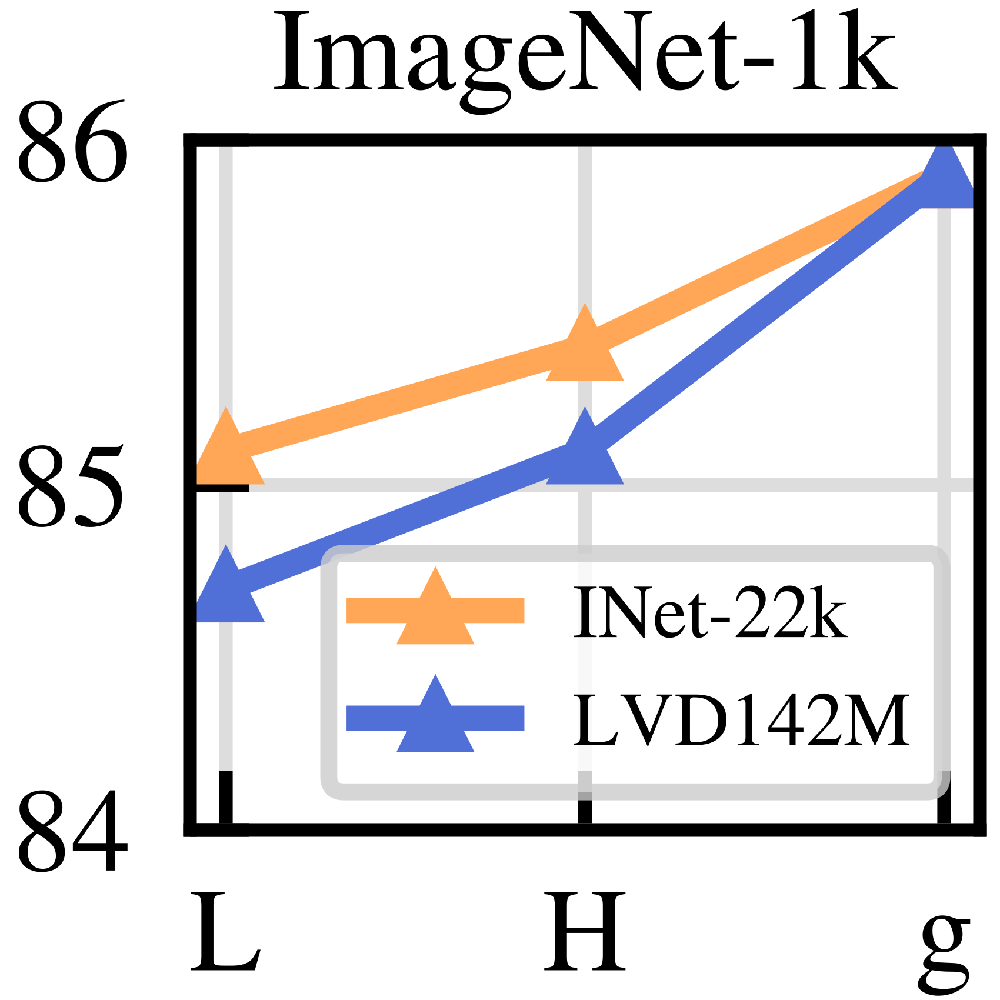

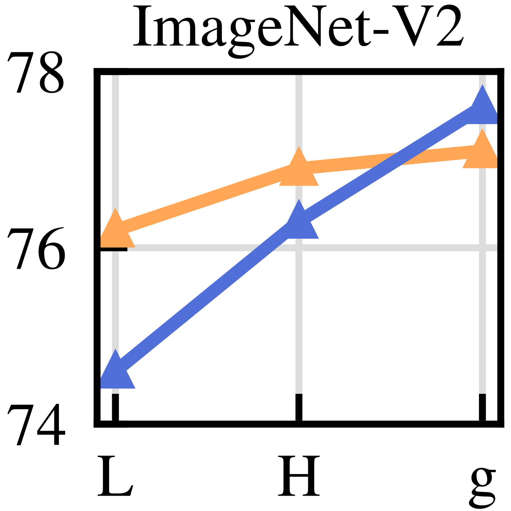

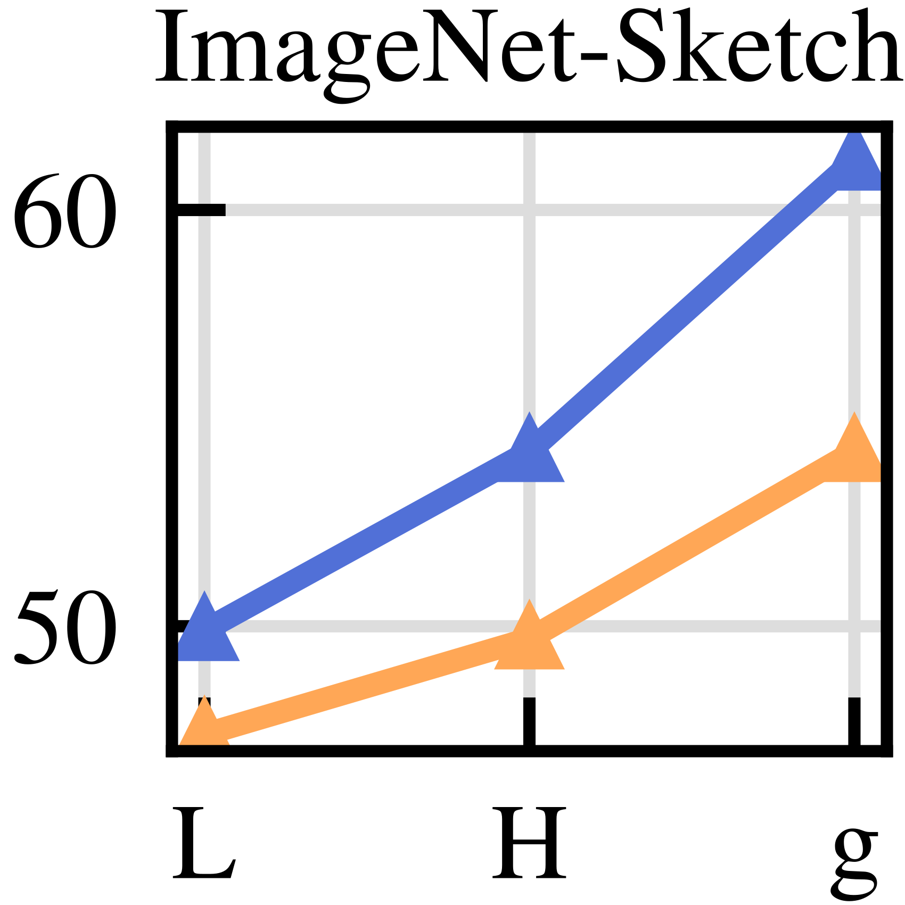

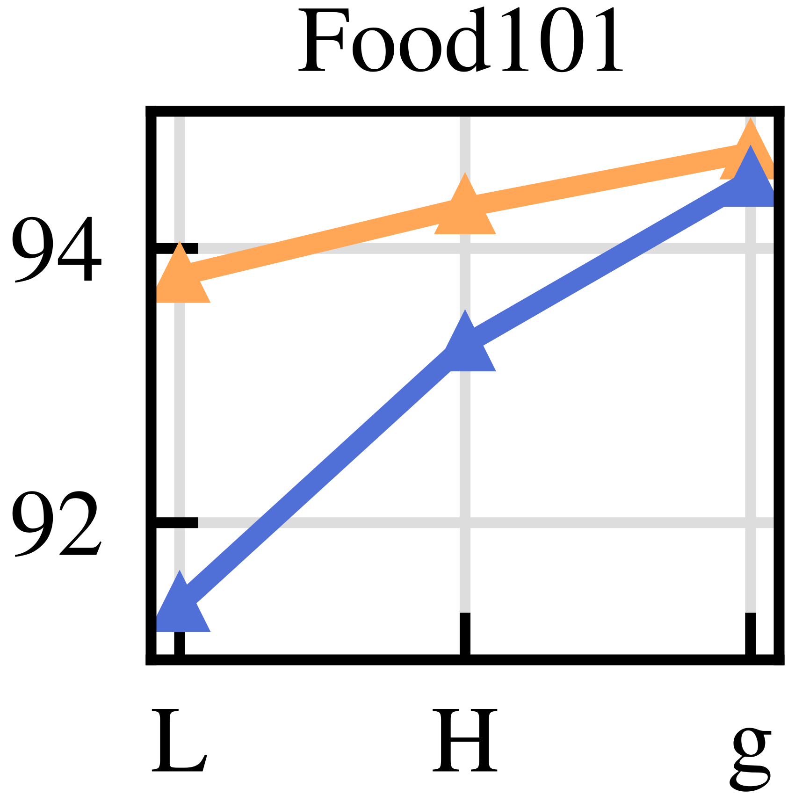

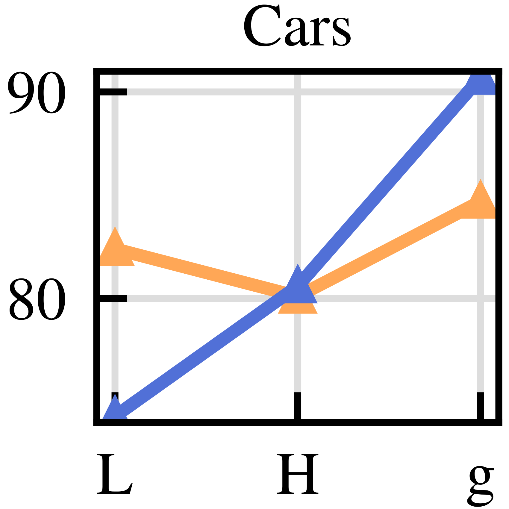

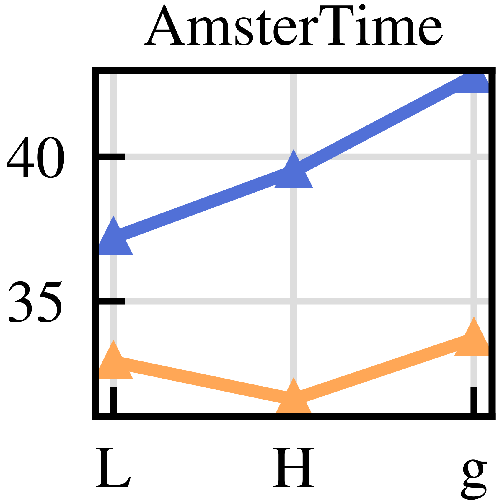

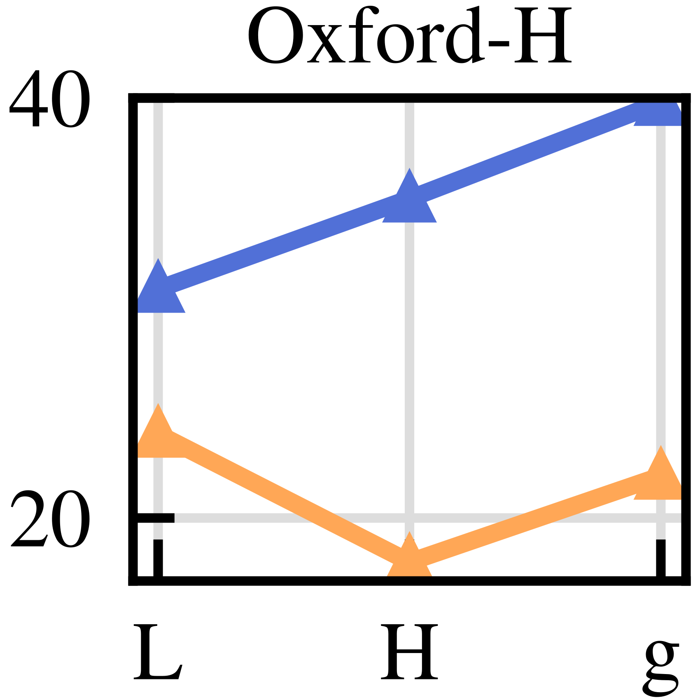

**EN.** Figure 4 : Model scale versus data scale. Evolution of performance as a function of model size for two different pretraining datasets: ImageNet-22k (14M images) and LVD-142M (142M images). The ViT-g trained on LVD-142M surpasses the ViT-g trained on ImageNet-22k on most benchmarks.

**中.** 图 4：模型规模与数据规模。两个不同预训练数据集的性能随模型大小的变化：ImageNet-22k（14M 图像）和 LVD-142M（142M 图像）。在大多数基准测试中，在 LVD-142M 上训练的 ViT-g 超过了在 ImageNet-22k 上训练的 ViT-g。

### Loss Components / 损耗成分

**EN.** We validated the proposed technical improvements in Sec. 6.1 by adding them incrementally. This section analyzes the performance hit observed if we ablate specific loss terms, starting from our best-performing model. We ablate the importance of the KoLeo loss and the impact of the masked image modeling term. For both, we report performance on ImageNet-1k using a linear classifier, ADE-20k segmentation using a linear classifier, and nearest-neighbor image retrieval on Oxford-M. Table 3(a) shows the impact of using the KoLeo loss. We see that the instance retrieval performance improves by more than $8\%$ , confirming that this term helps spread features in the output space. At the same time, the other metrics do not suffer from this regularization. In Table 3(b) , we show the impact of using the masked image modeling term from iBOT. This term is critical for dense prediction tasks, leading to almost $3\%$ performance improvement.

**中.** 我们验证了第二节中提出的技术改进。 6.1 通过增量添加它们。本节分析了如果我们从性能最佳的模型开始消除特定损失项，观察到的性能影响。我们消除了 KoLeo 损失的重要性和掩模图像建模项的影响。对于这两者，我们报告了使用线性分类器的 ImageNet-1k 的性能、使用线性分类器的 ADE-20k 分割的性能以及 Oxford-M 上的最近邻图像检索的性能。表 3(a) 显示了使用 KoLeo 损失的影响。我们看到实例检索性能的提高超过 $8\%$ ，证实该术语有助于在输出空间中传播特征。同时，其他指标不会受到这种正则化的影响。在表 3(b) 中，我们展示了使用 iBOT 的掩模图像建模术语的影响。该术语对于密集预测任务至关重要，几乎可以提高 $3\%$ 的性能。

| KoLeo 科利奥 |  | INet-1k | Im-A 伊姆-A | ADE-20k | Oxford-M 牛津-M |
| --- | --- | --- | --- | --- | --- |
| ✕ |  | 85.3 | 70.6 | 47.2 | 55.6 |
| ✓ |  | 85.8 | 72.8 | 47.1 | 63.9 |

| MIM |  | INet-1k | Im-A 伊姆-A | ADE-20k | Oxford-M 牛津-M |
| --- | --- | --- | --- | --- | --- |
| ✕ |  | 85.3 | 72.0 | 44.2 | 64.3 |
| ✓ |  | 85.8 | 72.8 | 47.1 | 63.9 |

**EN.** Table 3 : (a) Effect of the KoLeo loss term. (b) Effect of the iBOT Masked Image Modeling (MIM) loss term. Evaluation performed on ImageNet-{1k,A} (classification with linear probe, accuracy %), ADE-20k (segmentation with linear layer, mIoU) and Oxford-M (image retrieval, mAP). Each model is trained on the same number of iterations, that is smaller than our final run. The KoLeo loss term improves nearest-neighbor search tasks (e.g. retrieval), and the MIM loss improves patch-level tasks (e.g. segmentation).

**中.** 表 3：(a) KoLeo 损失项的影响。 (b) iBOT 掩模图像建模 (MIM) 损失项的影响。在 ImageNet-{1k,A}（使用线性探针分类，准确度 %）、ADE-20k（使用线性层分割，mIoU）和 Oxford-M（图像检索，mAP）上进行评估。每个模型都经过相同次数的迭代训练，这比我们的最终运行要少。 KoLeo 损失项改进了最近邻搜索任务（例如检索），MIM 损失项改进了补丁级任务（例如分割）。

### Impact of Knowledge Distillation / 知识蒸馏的影响

**EN.** For small architectures, we distill larger models instead of training them from scratch. We use the distillation procedure described in Sec. 5 . We evaluate the effectiveness of this approach by comparing a ViT-L/14 trained from scratch with one distilled from a ViT-g/14 over 12 benchmarks in Fig. 5 . We also report the performance of the ViT-g/14 used for distillation as a topline. The distilled model outperforms the one trained from scratch on all 12 benchmarks, validating our pretraining approach for small models.

**中.** 对于小型架构，我们提取更大的模型，而不是从头开始训练它们。我们使用第 2 节中描述的蒸馏程序。 5.我们通过将从头开始训练的 ViT-L/14 与从 ViT-g/14 中提取的 ViT-g/14 在图 5 中的 12 个基准进行比较来评估这种方法的有效性。我们还报告了用于蒸馏的 ViT-g/14 的性能作为顶线。蒸馏后的模型在所有 12 个基准测试中都优于从头开始训练的模型，验证了我们针对小型模型的预训练方法。

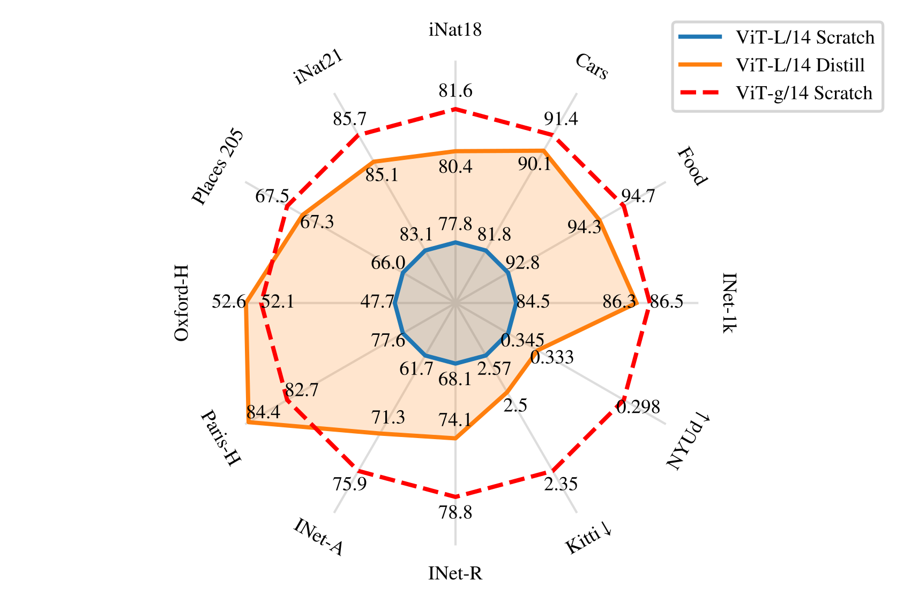

**EN.** Figure 5 : Effectiveness of knowledge distillation. Comparison between a ViT-L trained from scratch or distilled from DINOv2 using ViT-g/14. For reference, we also report the performance of the ViT-g/14 teacher. We show that a ViT-L model distilled from a frozen ViT-g outperforms a the same model trained from scratch on all benchmarks, sometimes even outperforming the distillation target.

**中.** 图 5：知识蒸馏的有效性。从头开始训练的 ViT-L 或使用 ViT-g/14 从 DINOv2 中提取的 ViT-L 之间的比较。作为参考，我们还报告了 ViT-g/14 老师的表现。我们证明，从冷冻 ViT-g 中提取的 ViT-L 模型在所有基准测试中都优于从头开始训练的相同模型，有时甚至优于提取目标。

### Impact of Resolution / 决议的影响

**EN.** We measure the impact of changing the resolution during the pretraining on the performance of image and patch-level features. We consider models trained from scratch using a fixed resolution of either $224\times 224$ or $416\times 416$ , and a model trained from scratch at $224\times 224$ , then resumed for 10k more iterations at $416\times 416$ . High-resolution training is compute-intensive, so we conduct this ablation on a small setup: a ViT-L/16 trained on ImageNet1k. In Fig. 6 , we report the performance of a linear probe on ImageNet-1k and ADE-20k, evaluated at various resolutions. The model trained on high-resolution images performs best across resolutions, but this comes at a high cost: training at $416$ is approximately $3\times{}$ more compute-intensive than training at $224$ . On the other hand, training at high resolution for only 10k iterations at the end of the training is almost as good and only requiring a fraction of the compute. As a consequence, we include this step at the end of the training rather than training at a high resolution from scratch.

**中.** 我们测量预训练期间改变分辨率对图像和补丁级特征性能的影响。我们考虑使用固定分辨率从头开始训练的模型$224\times 224$或者$416\times 416$，以及一个从头开始训练的模型$224\times 224$，然后继续进行 10k 次迭代$416\times 416$。高分辨率训练是计算密集型的，因此我们在一个小型设置上进行这种消融：在 ImageNet1k 上训练的 ViT-L/16。在图 6 中，我们报告了线性探针在 ImageNet-1k 和 ADE-20k 上的性能，并在各种分辨率下进行了评估。在高分辨率图像上训练的模型在各种分辨率下表现最佳，但这需要很高的成本：训练$416$大约是$3\times{}$比训练的计算密集度更高$224$。另一方面，在训练结束时仅进行 10k 次迭代的高分辨率训练几乎同样好，并且只需要一小部分计算。因此，我们在训练结束时包含此步骤，而不是从头开始进行高分辨率训练。

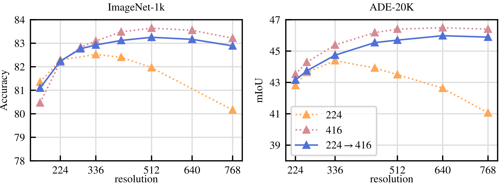

**EN.** Figure 6 : Role of resolution. Performance of ViT-L/16 trained on ImageNet-1k at fixed resolution (“224” and “416”) or trained at 224 then 416 for a short duration (“224 $\rightarrow$ 416”). We train linear classifiers on top of frozen features at different resolutions and report Top-1 accuracy on ImageNet and mIoU on ADE-20k. We observe that performing SSL training at high resolution for a short duration achieve behavior and results close to training at the same high resolution for the full training, at a fraction of the cost.

**中.** 图 6：分辨率的作用。 ViT-L/16 在 ImageNet-1k 上以固定分辨率（“224”和“416”）训练或在 224 然后 416 上进行短期训练（“224 $\rightarrow$ 416”）的性能。我们在不同分辨率的冻结特征之上训练线性分类器，并在 ImageNet 上报告 Top-1 准确率，在 ADE-20k 上报告 mIoU。我们观察到，在短时间内以高分辨率进行 SSL 训练所获得的行为和结果接近于在相同高分辨率下进行完整训练，而成本只是其一小部分。

## Results / 结果

**EN.** In this section, we present the empirical evaluation of our models on many image understanding tasks. We evaluate both global and local image representations, on category and instance-level recognition, semantic segmentation, monocular depth prediction, and action recognition. We detail the list of benchmarks in Appendix C . The goal of this evaluation is twofold. First, we show that our self-supervised features outperform the current state of the art by a very large margin. Second, we show that they match, or surpass the performance of weakly-supervised ones on a substantial number of tasks.

**中.** 在本节中，我们将介绍我们的模型在许多图像理解任务上的实证评估。我们评估类别和实例级识别、语义分割、单目深度预测和动作识别方面的全局和局部图像表示。我们在附录 C 中详细列出了基准列表。本次评估的目标是双重的。首先，我们证明我们的自我监督功能大大优于当前最先进的技术。其次，我们表明它们在大量任务上的表现与弱监督的表现相匹配或超过。

**EN.** Baselines. In our comparisons, we use two kinds of models as baselines. We compare to the best performing self-supervised models that are openly available. First, we run our evaluations for MAE ( He et al., 2022 ) , DINO ( Caron et al., 2021 ) , SEERv2 ( Goyal et al., 2022a ) , MSN ( Assran et al., 2022 ) , EsViT ( Li et al., 2022a ) , Mugs ( Zhou et al., 2022b ) and iBOT ( Zhou et al., 2022a ) . When several architectural variants were proposed for a given method, we report results for the one that leads to best top-1 accuracy on ImageNet-1k. Second, we report performance of open-source weakly-supervised models such as CLIP ( Radford et al., 2021 ) , OpenCLIP ( Ilharco et al., 2021 ; Cherti et al., 2023 ) , and SWAG ( Singh et al., 2022 ) . When evaluating models on ImageNet-1k, we report the performance for each of the aforementioned methods. For all other evaluations, we report the four best-performing models amongst SSL ones. Also, for reference, we report the best performing OpenCLIP-G for weakly-supervised ones.

**中.** 基线。在我们的比较中，我们使用两种模型作为基线。我们与公开可用的表现最佳的自我监督模型进行比较。首先，我们对 MAE (He et al., 2022)、DINO (Caron et al., 2021)、SEERv2 (Goyal et al., 2022a)、MSN (Assran et al., 2022)、EsViT (Li et al., 2022a)、Mugs (Zhou et al., 2022a) 进行评估。 2022b) 和 iBOT (Zhou et al., 2022a)。当针对给定方法提出多种架构变体时，我们会报告在 ImageNet-1k 上获得最佳 top-1 准确度的变体的结果。其次，我们报告了开源弱监督模型的性能，例如 CLIP（Radford 等人，2021）、OpenCLIP（Ilharco 等人，2021；Cherti 等人，2023）和 SWAG（Singh 等人，2022）。在 ImageNet-1k 上评估模型时，我们报告了上述每种方法的性能。对于所有其他评估，我们报告了 SSL 模型中性能最佳的四个模型。此外，作为参考，我们报告了弱监督 OpenCLIP-G 中性能最佳的 OpenCLIP-G。

### ImageNet Classification / ImageNet 分类

**EN.** As a first evaluation, we probe the quality of the holistic image representation produced by the model on the ImageNet-1k classification dataset. We evaluate the quality of features by training a simple classifier over a frozen backbone, and do not perform finetuning of the backbone weights. Following previous work, we use a linear model for simplicity, ensuring a reproducible evaluation, despite the fact that classes may not be linearly separable. Because most SSL methods were developped using ImageNet-1k validation performance as a debugging signal, we also report the top-1 accuracy on ImageNet-ReaL and ImageNet-V2. In order to report this additional validation performance, for all models, we run the evaluation with our code. We compare our frozen features to the best publicly available SSL features in Table 4 , regardless of architecture or pretraining data. We see the components proposed in this work lead to a very significant improvement ( $+4.2\%$ ) over the previous state of the art (iBOT ViT-L/16 trained on ImageNet-22k) on linear evaluation. At the same time, we also see that the performance increase on the alternative test sets is larger for our method, indicating stronger generalization. We describe details of our linear evaluation in Appendix B.3 .

**中.** 作为第一次评估，我们探讨了模型在 ImageNet-1k 分类数据集上生成的整体图像表示的质量。我们通过在冻结的主干上训练一个简单的分类器来评估特征的质量，并且不对主干权重进行微调。继之前的工作之后，为了简单起见，我们使用线性模型，确保可重复的评估，尽管类别可能不是线性可分的。由于大多数 SSL 方法都是使用 ImageNet-1k 验证性能作为调试信号来开发的，因此我们还报告了 ImageNet-ReaL 和 ImageNet-V2 上的 top-1 准确度。为了报告所有模型的额外验证性能，我们使用代码运行评估。我们将我们的冻结功能与表 4 中最好的公开可用的 SSL 功能进行比较，无论架构或预训练数据如何。我们看到这项工作中提出的组件在线性评估方面比之前的最先进技术（在 ImageNet-22k 上训练的 iBOT ViT-L/16）带来了非常显着的改进（$+4.2\%$）。同时，我们还看到我们的方法在替代测试集上的性能提升更大，表明泛化能力更强。我们在附录 B.3 中描述了线性评估的细节。

|  |  |  |  |  | kNN |  | linear 线性 | linear 线性 | linear 线性 |
| --- | --- | --- | --- | --- | --- | --- | --- | --- | --- |
| Method 方法 | Arch. 拱门。 | Data 数据 | Text sup. 文字支持。 |  | val 瓦尔 |  | val 瓦尔 | ReaL 真实 | V2 |
| Weakly supervised 监管薄弱 | Weakly supervised 监管薄弱 | Weakly supervised 监管薄弱 | Weakly supervised 监管薄弱 | Weakly supervised 监管薄弱 | Weakly supervised 监管薄弱 | Weakly supervised 监管薄弱 | Weakly supervised 监管薄弱 | Weakly supervised 监管薄弱 | Weakly supervised 监管薄弱 |
| CLIP 剪辑 | ViT-L/14 维T-L/14 | WIT-400M | ✓ |  | 79.8 |  | 84.3 | 88.1 | 75.3 |
| CLIP 剪辑 | ViT-L/14 ${}_{\text{336}}$ | WIT-400M | ✓ |  | 80.5 |  | 85.3 | 88.8 | 75.8 |
| SWAG | ViT-H/14 | IG3.6B | ✓ |  | 82.6 |  | 85.7 | 88.7 | 77.6 |
| OpenCLIP 开放式剪辑 | ViT-H/14 | LAION-2B 莱昂2B | ✓ |  | 81.7 |  | 84.4 | 88.4 | 75.5 |
| OpenCLIP 开放式剪辑 | ViT-G/14 维T-G/14 | LAION-2B 莱昂2B | ✓ |  | 83.2 |  | 86.2 | 89.4 | 77.2 |
| EVA-CLIP EVA-夹子 | ViT-g/14 | custom ∗ 定制* | ✓ |  | 83.5 |  | 86.4 | 89.3 | 77.4 |
| Self-supervised 自我监督 | Self-supervised 自我监督 | Self-supervised 自我监督 | Self-supervised 自我监督 | Self-supervised 自我监督 | Self-supervised 自我监督 | Self-supervised 自我监督 | Self-supervised 自我监督 | Self-supervised 自我监督 | Self-supervised 自我监督 |
| MAE | ViT-H/14 | INet-1k | ✕ |  | 49.4 |  | 76.6 | 83.3 | 64.8 |
| DINO 恐龙 | ViT-S/8 | INet-1k | ✕ |  | 78.6 |  | 79.2 | 85.5 | 68.2 |
| SEERv2 | RG10B | IG2B | ✕ |  | – |  | 79.8 | – | – |
| MSN 微软网络 | ViT-L/7 | INet-1k | ✕ |  | 79.2 |  | 80.7 | 86.0 | 69.7 |
| EsViT 埃斯维特 | Swin-B/W=14 斯温-B/W=14 | INet-1k | ✕ |  | 79.4 |  | 81.3 | 87.0 | 70.4 |
| Mugs 马克杯 | ViT-L/16 维T-L/16 | INet-1k | ✕ |  | 80.2 |  | 82.1 | 86.9 | 70.8 |
| iBOT | ViT-L/16 维T-L/16 | INet-22k | ✕ |  | 72.9 |  | 82.3 | 87.5 | 72.4 |
| DINOv2 恐龙v2 | ViT-S/14 | LVD-142M | ✕ |  | 79.0 |  | 81.1 | 86.6 | 70.9 |
| DINOv2 恐龙v2 | ViT-B/14 维生素B/14 | LVD-142M | ✕ |  | 82.1 |  | 84.5 | 88.3 | 75.1 |
| DINOv2 恐龙v2 | ViT-L/14 维T-L/14 | LVD-142M | ✕ |  | 83.5 |  | 86.3 | 89.5 | 78.0 |
| DINOv2 恐龙v2 | ViT-g/14 | LVD-142M | ✕ |  | 83.5 |  | 86.5 | 89.6 | 78.4 |

**EN.** Table 4 : Linear evaluation on ImageNet-1k of frozen pretrained features. We report Top-1 accuracy on the validation set for publicly available models trained on public or private data, and with or without text supervision (text sup.). For reference, we also report the kNN performance on the validation set. We compare across any possible architectures (Arch.), at resolution $224\times 224$ unless stated otherwise. The dataset used for training EVA-CLIP is a custom mixture, see paper for details ( Fang et al., 2023 ) .

**中.** 表 4：对冻结预训练特征的 ImageNet-1k 进行线性评估。我们报告了在公共或私人数据上训练的公开可用模型的验证集的 Top-1 准确性，无论是否有文本监督（文本支持）。作为参考，我们还报告了验证集上的 kNN 性能。除非另有说明，我们以 $224\times 224$ 分辨率对任何可能的架构 (Arch.) 进行比较。用于训练 EVA-CLIP 的数据集是自定义混合物，详细信息请参阅论文 (Fang et al., 2023)。

#### How far are we from weakly-supervised models? / 我们离弱监督模型还有多远？

**EN.** We also want to validate that our features are competitive with state-of-the-art open-source weakly supervised models. To this end, we compare on ImageNet-1k, using the linear evaluation, to three off-the-shelf methods with several architectural variants. For all models, we run the linear evaluation using our code, after making sure that our numbers match those reported in technical reports and papers. We show the result of this evaluation in Table 4 . We see that our backbone, surpases the performance of OpenCLIP with a ViT-G/14 architecture ( $+0.3\%$ ) and EVA-CLIP with a ViT-g/14 ( $+0.1\%$ ). At the same time, we also observe that our performance on the ImageNet-V2 test set is significantly better ( $+1.1\%$ versus EVA-CLIP), indicating better generalization. For the remainder of this section, we report OpenCLIP-G as a reference for weakly-supervised models.

**中.** 我们还想验证我们的功能与最先进的开源弱监督模型具有竞争力。为此，我们使用线性评估在 ImageNet-1k 上与具有多种架构变体的三种现成方法进行比较。对于所有模型，在确保我们的数字与技术报告和论文中报告的数字相符后，我们都会使用我们的代码运行线性评估。我们将评估结果示于表 4 中。我们看到我们的主干网的性能超越了具有 ViT-G/14 架构的 OpenCLIP ($+0.3\%$) 和具有 ViT-g/14 ($+0.1\%$) 的 EVA-CLIP。同时，我们还观察到我们在 ImageNet-V2 测试集上的性能明显更好（$+1.1\%$ 与 EVA-CLIP），表明泛化能力更好。在本节的其余部分中，我们报告 OpenCLIP-G 作为弱监督模型的参考。

#### Can we finetune the encoders? / 我们可以微调编码器吗？

**EN.** We question if the ability of our models to produce high quality frozen features impact their performance when finetuned with supervision on a specific dataset. While this is not core to this paper, this experiment is indicative of whether we have involuntarily specialized our models to the setting of linear evaluations of frozen features. To run this sanity check, we apply the finetuning pipeline from Touvron et al. (2022) , without tweaking hyper-parameters. In Table 5 , we show that the Top-1 accuracy on the validation set of ImageNet-1k improves by more than $+2\%$ when the backbone is finetuned. This is true both when using models at resolution $224$ and $448$ . Further gains can be obtained by tuning the hyper-parameters of the finetuning, but this is beyond the goal of this sanity check. Nonetheless, our best finetuned performance ( $88.9\%$ ) is only a couple of percent below ( $-2.2\%$ ) the absolute state of the arts ( $91.1\%$ ), obtained by Chen et al. (2023a) . As DINOv2 leads to features that are strong in both the linear and finetuning settings, a strong property of our approach is that finetuning is optional .

**中.** 我们质疑我们的模型在对特定数据集进行监督微调时产生高质量冻结特征的能力是否会影响其性能。虽然这不是本文的核心，但这个实验表明我们是否不自觉地将我们的模型专门用于冻结特征的线性评估的设置。为了运行此健全性检查，我们应用了 Touvron 等人的微调管道。 (2022) ，无需调整超参数。在表 5 中，我们表明，当主干网络进行微调时，ImageNet-1k 验证集上的 Top-1 准确率提高了超过 $+2\%$。使用分辨率为 $224$ 和 $448$ 的模型时都是如此。通过调整微调的超参数可以获得进一步的增益，但这超出了此健全性检查的目标。尽管如此，我们的最佳微调性能（$88.9\%$）仅比陈等人获得的绝对最先进性能（$91.1\%$）低几个百分点（$-2.2\%$）。 （2023a）。由于 DINOv2 在线性和微调设置方面都具有强大的功能，因此我们方法的一个强大特性是微调是可选的。

| Arch. 拱门。 | Res. 资源。 | Linear 线性 | Finetuned 微调 | $\Delta$ |
| --- | --- | --- | --- | --- |
| ViT-g/14 | 224 | 86.5 | 88.5 | +2.0 |
| ViT-g/14 | 448 | 86.7 | 88.9 | +2.2 |

**EN.** Table 5 : Supervised finetuning on ImageNet-1k. We use the pipeline of Touvron et al. (2022) to finetune our encoders on ImageNet-1k at resolutions $224\times 224$ or $448\times 448$ . We compare with the accuracy obtained with linear probing and observe only modest improvements with fine-tuning: this suggests that DINOv2 features already perform well out-of-the-box.

**中.** 表 5：ImageNet-1k 上的监督微调。我们使用 Touvron 等人的管道。 (2022) 以分辨率 $224\times 224$ 或 $448\times 448$ 微调 ImageNet-1k 上的编码器。我们与线性探测获得的精度进行比较，并观察到微调仅带来适度的改进：这表明 DINOv2 功能已经开箱即用，表现良好。

#### Robustness analysis. / 稳健性分析。

**EN.** To complement our study, and probe the generalization of our features, we evaluate our ImageNet-1k models trained with linear classification heads on domain generalization benchmarks. We use the best performing linear classifier as described above and simply run inference on those benchmarks. Please note that most results in the literature are obtained with models that are finetuned end-to-end on ImageNet-1k. We show the result of this experiment in Table 6 . When comparing with state-of-the-art SSL methods, our models shows drastically better robustness ( $+29.6\%$ on A ( Hendrycks et al., 2021b ) , $+22.1\%$ on R ( Hendrycks et al., 2021a ) and $+23.0\%$ on Sketch ( Wang et al., 2019 ) compared to iBOT). Our model also improves upon the best weakly-supervised model on ImageNet-A while lagging behind on R and Sketch.

**中.** 为了补充我们的研究并探讨我们特征的泛化，我们评估了在域泛化基准上使用线性分类头训练的 ImageNet-1k 模型。如上所述，我们使用性能最佳的线性分类器，并简单地对这些基准进行推理。请注意，文献中的大多数结果都是通过在 ImageNet-1k 上进行端到端微调的模型获得的。我们在表 6 中展示了该实验的结果。与最先进的 SSL 方法相比，我们的模型显示出明显更好的鲁棒性（A 上的 $+29.6\%$（Hendrycks 等人，2021b）、R 上的 $+22.1\%$（Hendrycks 等人，2021a）和 Sketch 上的 $+23.0\%$（Wang 等人，2019）机器人）。我们的模型还改进了 ImageNet-A 上最好的弱监督模型，但落后于 R 和 Sketch。

| Method 方法 | Arch 拱门 | Data 数据 |  | Im-A 伊姆-A | Im-R | Im-C $\downarrow$ | Sketch 素描 |
| --- | --- | --- | --- | --- | --- | --- | --- |
| OpenCLIP 开放式剪辑 | ViT-G/14 维T-G/14 | LAION-2B 莱昂2B |  | 63.8 | 87.8 | 45.3 | 66.4 |
| MAE | ViT-H/14 | INet-1k |  | 10.2 | 34.4 | 61.4 | 21.9 |
| DINO 恐龙 | ViT-B/8 维生素B/8 | INet-1k |  | 23.9 | 37.0 | 56.6 | 25.5 |
| iBOT | ViT-L/16 维T-L/16 | INet-22k |  | 41.5 | 51.0 | 43.9 | 38.5 |
| DINOv2 恐龙v2 | ViT-S/14 | LVD-142M |  | 33.5 | 53.7 | 54.4 | 41.2 |
| DINOv2 恐龙v2 | ViT-B/14 维生素B/14 | LVD-142M |  | 55.1 | 63.3 | 42.7 | 50.6 |
| DINOv2 恐龙v2 | ViT-L/14 维T-L/14 | LVD-142M |  | 71.3 | 74.4 | 31.5 | 59.3 |
| DINOv2 恐龙v2 | ViT-g/14 | LVD-142M |  | 75.9 | 78.8 | 28.2 | 62.5 |

**EN.** Table 6 : Domain Generalization with a linear probe on top of frozen features at a resolution of 224. Higher numbers are better for all benchmarks except Im-C.

**中.** 表 6：在分辨率为 224 的冻结特征之上使用线性探针进行域概括。对于除 Im-C 之外的所有基准测试，数字越高越好。

### Additional Image and Video classification Benchmarks / 附加图像和视频分类基准

**EN.** In this section we study the generalization of our features on downstream classification benchmarks. We consider two sets of evaluations in that context. On one hand, we use large and finegrained datasets such as iNaturalist and Places205. On the other, we use the 12 image classification tasks originally proposed in SimCLR ( Chen et al., 2020 ) . For iNaturalist 2018, iNaturalist 2021, and Places205, we train a linear classifier with data augmentations as in Sec. 7.1 We report top-1 accuracy for those three datasets in Table 7 . Interestingly, our model significantly outperforms OpenCLIP ViT-G/14 on both variants of iNaturalist ( $+8.6\%$ and $+9.7\%$ for 2018 and 2021 respectively), and lags slightly behind on Places 205 ( $-2.3\%$ ).

**中.** 在本节中，我们研究下游分类基准上的特征的泛化。我们在此背景下考虑两组评估。一方面，我们使用大型且细粒度的数据集，例如 iNaturalist 和 Places205。另一方面，我们使用 SimCLR 中最初提出的 12 个图像分类任务（Chen 等人，2020）。对于 iNaturalist 2018、iNaturalist 2021 和 Places205，我们使用数据增强训练线性分类器，如第 2 节中所示。 7.1 我们在表 7 中报告了这三个数据集的 top-1 准确度。有趣的是，我们的模型在 iNaturalist 的两个变体（分别为 2018 年和 2021 年的 $+8.6\%$ 和 $+9.7\%$）上均显着优于 OpenCLIP ViT-G/14，并且在 Places 205（$-2.3\%$）上略微落后。

|  |  |  | Image classification 图像分类 | Image classification 图像分类 | Image classification 图像分类 |  | Video classification 视频分类 | Video classification 视频分类 | Video classification 视频分类 |
| --- | --- | --- | --- | --- | --- | --- | --- | --- | --- |
| Feature 特点 | Arch 拱门 |  | iNat2018 | iNat2021 | Places205 地点205 |  | K400 | UCF-101 | SSv2 |
| OpenCLIP 开放式剪辑 | ViT-G/14 维T-G/14 |  | 73.0 | 76.0 | 69.8 |  | 78.3 | 90.7 | 35.8 |
| MAE | ViT-H/14 |  | 31.0 | 32.3 | 52.4 |  | 54.2 | 70.6 | 29.2 |
| DINO 恐龙 | ViT-B/8 维生素B/8 |  | 59.6 | 68.3 | 60.4 |  | 64.5 | 85.0 | 32.6 |
| iBOT | ViT-L/16 维T-L/16 |  | 66.3 | 74.6 | 64.4 |  | 72.6 | 88.6 | 38.7 |
| DINOv2 恐龙v2 | ViT-S/14 |  | 69.0 | 74.2 | 62.9 |  | 67.8 | 87.0 | 33.1 |
| DINOv2 恐龙v2 | ViT-B/14 维生素B/14 |  | 76.4 | 81.1 | 66.2 |  | 73.2 | 89.1 | 34.4 |
| DINOv2 恐龙v2 | ViT-L/14 维T-L/14 |  | 80.4 | 85.1 | 67.3 |  | 76.3 | 90.5 | 35.6 |
| DINOv2 恐龙v2 | ViT-g/14 |  | 81.6 | 85.7 | 67.5 |  | 78.4 | 91.2 | 38.3 |

**EN.** Table 7 : Linear evaluation on other image and video classification. The image benchmarks contain a large quantity of fine-grained examples about objects or scenes. The video benchmarks cover action classification and human-object interaction. All the features are frozen with a linear probe on top.

**中.** 表 7：对其他图像和视频分类的线性评估。图像基准包含大量有关对象或场景的细粒度示例。视频基准涵盖动作分类和人机交互。所有特征都被顶部的线性探针冻结。

**EN.** In a second set of evaluations, we measure the performance of our model on video action recognition even though our features were not trained on videos.. We evaluated features on three datasets, namely UCF-101 ( Soomro et al., 2012 ) , Kinetics-400 ( Kay et al., 2017 ) and Something-Something v2 ( Goyal et al., 2017 ) . For this evaluation, we pick $8$ evenly spaced frames in the video and train a linear classifier on the average of the features for UCF and K-400. For SSv2, we opt for concatenation to retain more temporal information than with feature averaging. For each dataset, we measure average accuracy and report the results in Table 7 . We see that amongst self-supervised approaches, our model clearly sets a new state of the art. Moreover, our model matches the accuracy of the OpenCLIP features on UCF and Kinetics ( $+0.1\%$ and $+0.5\%$ respectively) and clearly outperforms them on SSv2 ( $+2.5\%$ ). This is particularly interesting, as SSv2 requires a much richer understanding of the video frames.

**中.** 在第二组评估中，我们测量了模型在视频动作识别上的性能，即使我们的特征没有在视频上进行训练。我们评估了三个数据集上的特征，即 UCF-101 (Soomro et al., 2012)、Kinetics-400 (Kay et al., 2017) 和 Something-Something v2 (Goyal et al., 2017)。对于此评估，我们在视频中选择 $8$ 均匀间隔的帧，并根据 UCF 和 K-400 的平均特征训练线性分类器。对于 SSv2，我们选择级联来保留比特征平均更多的时间信息。对于每个数据集，我们测量平均准确度并在表 7 中报告结果。我们看到，在自我监督的方法中，我们的模型显然树立了新的技术水平。此外，我们的模型在 UCF 和 Kinetics（分别为 $+0.1\%$ 和 $+0.5\%$）上与 OpenCLIP 特征的准确性相匹配，并且在 SSv2（$+2.5\%$）上明显优于它们。这特别有趣，因为 SSv2 需要对视频帧有更丰富的理解。

**EN.** Finally, in Table 8 , we compare selected frozen features on 12 transfer classification benchmarks initially proposed by Chen et al. (2020) . This benchmark covers scenes, objects (food, cars, planes), and textures. We replace the Birdsnap dataset with CUB because the former was not publicly available in its entirety. We follow the experimental protocol as outlined by Chen et al. (2020) , namely training a logistic regression on precomputed features. Our model significantly outperforms state-of-the-art SSL models, with most notable differences on Stanford Cars ( $+14.8\%$ versus DINO ViT-B/8) and FGVC Aircraft ( $+14.8\%$ versus iBOT ViT-L/16). Even though these benchmarks favor text-guided pretraining, our features are still competitive with OpenCLIP on most classification benchmarks, with the exception of a few datasets, especially SUN ( $-5.3\%$ ) and Cars ( $-4.7\%$ ).

**中.** 最后，在表 8 中，我们比较了 Chen 等人最初提出的 12 个转移分类基准上选定的冻结特征。 （2020）。该基准测试涵盖场景、物体（食物、汽车、飞机）和纹理。我们将 Birdsnap 数据集替换为 CUB，因为前者并未完整公开。我们遵循 Chen 等人概述的实验方案。 (2020)，即在预先计算的特征上训练逻辑回归。我们的模型显着优于最先进的 SSL 模型，在斯坦福汽车（$+14.8\%$ 与 DINO ViT-B/8）和 FGVC 飞机（$+14.8\%$ 与 iBOT ViT-L/16）上最显着的差异。尽管这些基准有利于文本引导的预训练，但我们的功能在大多数分类基准上仍然与 OpenCLIP 具有竞争力，除了少数数据集，特别是 SUN ( $-5.3\%$ ) 和 Cars ( $-4.7\%$ )。

| Feature 特点 | Arch 拱门 | Food 食品 | C10 | C100 | SUN 太阳 | Cars 汽车 | Aircr 艾尔克 | VOC 挥发性有机化合物 | DTD | Pets 宠物 | Cal101 钙101 | Flowers 鲜花 | CUB 库布 | Avg 平均 |
| --- | --- | --- | --- | --- | --- | --- | --- | --- | --- | --- | --- | --- | --- | --- |
| OpenCLIP 开放式剪辑 | ViT-G/14 维T-G/14 | 94.5 | 98.7 | 91.0 | 84.0 | 96.1 | 80.2 | 89.3 | 86.0 | 95.7 | 98.1 | 99.5 | 89.9 | 91.9 |
| MAE | ViT-H/14 | 78.4 | 96.1 | 83.9 | 63.9 | 56.1 | 63.4 | 84.3 | 75.4 | 89.4 | 95.9 | 92.3 | 57.2 | 78.0 |
| DINO 恐龙 | ViT-B/8 维生素B/8 | 85.1 | 97.2 | 86.9 | 70.3 | 76.6 | 70.6 | 86.7 | 79.6 | 93.2 | 95.4 | 97.6 | 81.7 | 85.1 |
| iBOT | ViT-L/16 维T-L/16 | 91.0 | 99.0 | 92.8 | 75.6 | 71.8 | 72.4 | 89.0 | 80.7 | 87.7 | 97.5 | 99.6 | 82.1 | 86.6 |
| DINOv2 恐龙v2 | ViT-S/14 | 89.1 | 97.7 | 87.5 | 74.4 | 81.6 | 74.0 | 87.8 | 80.6 | 95.1 | 97.0 | 99.6 | 88.1 | 87.7 |
| DINOv2 恐龙v2 | ViT-B/14 维生素B/14 | 92.8 | 98.7 | 91.3 | 77.3 | 88.2 | 79.4 | 88.2 | 83.3 | 96.2 | 96.1 | 99.6 | 89.6 | 90.1 |
| DINOv2 恐龙v2 | ViT-L/14 维T-L/14 | 94.3 | 99.3 | 93.4 | 78.7 | 90.1 | 81.5 | 88.3 | 84.0 | 96.6 | 97.5 | 99.7 | 90.5 | 91.2 |
| DINOv2 恐龙v2 | ViT-g/14 | 94.7 | 99.5 | 94.4 | 78.7 | 91.4 | 87.2 | 89.0 | 84.5 | 96.7 | 97.6 | 99.7 | 91.6 | 92.1 |

**EN.** Table 8 : Linear evaluation of frozen features on fine-grained benchmarks. Accuracy on 12 benchmarks covering objects, scenes and textures following the evaluation protocol proposed in Chen et al. (2020) .

**中.** 表 8：细粒度基准上冻结特征的线性评估。遵循 Chen 等人提出的评估协议，涵盖对象、场景和纹理的 12 个基准的准确性。 （2020）。

### Instance Recognition / 实例识别

**EN.** In this experiment, we probe our model on the task of instance-level recognition using a non-parametric approach. Images from a database are ranked according to their cosine similarity with a query image. We evaluated our model and compare to baselines on Paris and Oxford, that are landmark recognition benchmarks. We also evaluated on Met, a dataset of artworks from the Metropolitan museum, and AmsterTime, containing street view images matched to archival images of Amsterdam. We measure performance by computing the mean average precision and report our results in Table 9 . We see that our features significantly outperform both SSL ( $+41\%$ mAP on Oxford-Hard), and weakly-supervised ( $+34\%$ mAP on Oxford-Hard) ones. It is interesting to see that our features perform well across task granularities, both at the category-level and instance-level. This is a desirable property for strong off-the-shelf computer vision features.

**中.** 在这个实验中，我们使用非参数方法探讨了实例级识别任务的模型。数据库中的图像根据其与查询图像的余弦相似度进行排名。我们评估了我们的模型，并与巴黎和牛津的基线进行比较，这是具有里程碑意义的识别基准。我们还对 Met（大都会博物馆的艺术品数据集）和 AmsterTime 进行了评估，其中包含与阿姆斯特丹档案图像匹配的街景图像。我们通过计算平均精度来衡量性能，并在表 9 中报告我们的结果。我们发现我们的特征显着优于 SSL（Oxford-Hard 上的 $+41\%$ mAP）和弱监督（Oxford-Hard 上的 $+34\%$ mAP）特征。有趣的是，我们的功能在类别级别和实例级别的任务粒度上都表现良好。对于强大的现成计算机视觉功能来说，这是一个理想的属性。

|  |  |  | Oxford 牛津 | Oxford 牛津 |  | Paris 巴黎 | Paris 巴黎 |  | Met 蛋氨酸 | Met 蛋氨酸 | Met 蛋氨酸 |  | AmsterTime 阿姆斯特丹时间 |
| --- | --- | --- | --- | --- | --- | --- | --- | --- | --- | --- | --- | --- | --- |
| Feature 特点 | Arch 拱门 |  | M | H |  | M | H |  | GAP 差距 | GAP- 间隙- | ACC |  | mAP 平均AP |
| OpenCLIP 开放式剪辑 | ViT-G/14 维T-G/14 |  | 50.7 | 19.7 |  | 79.2 | 60.2 |  | 6.5 | 23.9 | 34.4 |  | 24.6 |
| MAE | ViT-H/14 |  | 11.7 | 2.2 |  | 19.9 | 4.7 |  | 7.5 | 23.5 | 30.5 |  | 4.2 |
| DINO 恐龙 | ViT-B/8 维生素B/8 |  | 40.1 | 13.7 |  | 65.3 | 35.3 |  | 17.1 | 37.7 | 43.9 |  | 24.6 |
| iBOT | ViT-L/16 维T-L/16 |  | 39.0 | 12.7 |  | 70.7 | 47.0 |  | 25.1 | 54.8 | 58.2 |  | 26.7 |
| DINOv2 恐龙v2 | ViT-S/14 |  | 68.8 | 43.2 |  | 84.6 | 68.5 |  | 29.4 | 54.3 | 57.7 |  | 43.5 |
| DINOv2 恐龙v2 | ViT-B/14 维生素B/14 |  | 72.9 | 49.5 |  | 90.3 | 78.6 |  | 36.7 | 63.5 | 66.1 |  | 45.6 |
| DINOv2 恐龙v2 | ViT-L/14 维T-L/14 |  | 75.1 | 54.0 |  | 92.7 | 83.5 |  | 40.0 | 68.9 | 71.6 |  | 50.0 |
| DINOv2 恐龙v2 | ViT-g/14 |  | 73.6 | 52.3 |  | 92.1 | 82.6 |  | 36.8 | 73.6 | 76.5 |  | 46.7 |

**EN.** Table 9 : Evaluation of frozen features on instance-level recognition. We consider 4 different benchmarks and report their main metrics.

**中.** 表 9：实例级识别中冻结特征的评估。我们考虑了 4 个不同的基准并报告了它们的主要指标。

### Dense Recognition Tasks / 密集识别任务

**EN.** We probe the quality of patch-level features extracted from our network on several dense downstream tasks. We consider semantic image segmentation and monocular depth estimation in several settings and we conduct evaluations on multiple datasets for each.

**中.** 我们在几个密集的下游任务中探测从网络中提取的补丁级特征的质量。我们考虑在多种设置中进行语义图像分割和单目深度估计，并对每种设置的多个数据集进行评估。

#### Semantic segmentation. / 语义分割。

**EN.** For our semantic segmentation evaluation, we consider two different setups. Linear : a linear layer is trained to predict class logits from a patch tokens. It is used to produce a low-resolution logit map (eg 32x32 for a model with patch size 16), which is then upsampled to full resolution (512x512) to obtain a segmentation map. This procedure is extremely simple but cannot easily produce high-resolution segmentations. +ms : a boosted version of the linear setup. We concatenate the patch tokens of the 4 last layers, use a larger image resolution of 640, and use multiscale test-time augmentations to improve the predictions. We report the performance of our model variants as well as the baselines on three datasets under the two setups in Table 10 .

**中.** 对于我们的语义分割评估，我们考虑两种不同的设置。线性：训练线性层以根据补丁标记预测类别逻辑。它用于生成低分辨率 logit 图（例如，块大小为 16 的模型为 32x32），然后将其上采样到全分辨率 (512x512) 以获得分割图。这个过程非常简单，但不能轻易产生高分辨率的分割。 +ms：线性设置的增强版本。我们连接最后 4 层的补丁标记，使用更大的图像分辨率 640，并使用多尺度测试时间增强来改进预测。我们在表 10 中报告了模型变体的性能以及两种设置下三个数据集的基线。

**EN.** Our models show very good performance on all datasets and for all setups. Interestingly, our evaluation using +ms is on par with fully finetuning MAE with an Upernet decoder ( $53.0$ versus $53.6$ mIoU). This is surprising because we use a significantly simpler predictor. Also, our best model, when evaluated using the boosted recipe, almost matches the state of the art on Pascal VOC ( $86.2$ versus $89.0$ mIoU).

**中.** 我们的模型在所有数据集和所有设置上都显示出非常好的性能。有趣的是，我们使用 +ms 的评估与使用上网解码器完全微调 MAE 的评估相当（$53.0$ 与 $53.6$ mIoU）。这是令人惊讶的，因为我们使用了一个简单得多的预测器。此外，当使用增强配方进行评估时，我们的最佳模型几乎与 Pascal VOC 的最新技术相匹配（$86.2$ 与 $89.0$ mIoU）。

#### Frozen backbone in a SOTA pipeline. / SOTA 管道中的骨干网冻结。

**EN.** In a final experiment, we freeze our backbone, and plug it into a ViT-Adapter Chen et al. (2023b) with a Mask2former head ( Cheng et al., 2022 ) . We tune the weights of the adapter and head, but keep the backbone frozen, meaning 66% of the weights are frozen. This allows for a lighter segmentation training than full end-to-end fine-tuning. With this setup, we reach $60.2$ mIoU on ADE20k, close to the competitive state of the art, standing at 62.9 mIoU ( Wang et al., 2022 ) . Although our setup for this experiment doesn’t makes use of the optimisations described in Sec. 5 , the segmentation training in this experiment took 28 hours on 16 V100 GPUs.

**中.** 在最后的实验中，我们冻结了主干，并将其插入 ViT-Adapter Chen 等人。 (2023b) 具有 Mask2former 头（Cheng 等人，2022）。我们调整适配器和头部的重量，但保持主干冻结，这意味着 66% 的重量被冻结。与完整的端到端微调相比，这允许更轻松的分割训练。通过这种设置，我们在 ADE20k 上达到了 $60.2$ mIoU，接近最先进的竞争水平，为 62.9 mIoU（Wang 等人，2022）。尽管我们的实验设置没有利用第 2 节中描述的优化。如图5所示，本实验中的分割训练在16个V100 GPU上花费了28小时。

|  |  |  | ADE20k | ADE20k |  | CityScapes 城市景观 | CityScapes 城市景观 |  | Pascal VOC 帕斯卡VOC | Pascal VOC 帕斯卡VOC |
| --- | --- | --- | --- | --- | --- | --- | --- | --- | --- | --- |
|  |  |  | (62.9) | (62.9) |  | (86.9) | (86.9) |  | (89.0) | (89.0) |
| Method 方法 | Arch. 拱门。 |  | lin. 林。 | +ms +毫秒 |  | lin. 林。 | +ms +毫秒 |  | lin. 林。 | +ms +毫秒 |
| OpenCLIP 开放式剪辑 | ViT-G/14 维T-G/14 |  | 39.3 | 46.0 |  | 60.3 | 70.3 |  | 71.4 | 79.2 |
| MAE | ViT-H/14 |  | 33.3 | 30.7 |  | 58.4 | 61.0 |  | 67.6 | 63.3 |
| DINO 恐龙 | ViT-B/8 维生素B/8 |  | 31.8 | 35.2 |  | 56.9 | 66.2 |  | 66.4 | 75.6 |
| iBOT | ViT-L/16 维T-L/16 |  | 44.6 | 47.5 |  | 64.8 | 74.5 |  | 82.3 | 84.3 |
| DINOv2 恐龙v2 | ViT-S/14 |  | 44.3 | 47.2 |  | 66.6 | 77.1 |  | 81.1 | 82.6 |
| DINOv2 恐龙v2 | ViT-B/14 维生素B/14 |  | 47.3 | 51.3 |  | 69.4 | 80.0 |  | 82.5 | 84.9 |
| DINOv2 恐龙v2 | ViT-L/14 维T-L/14 |  | 47.7 | 53.1 |  | 70.3 | 80.9 |  | 82.1 | 86.0 |
| DINOv2 恐龙v2 | ViT-g/14 |  | 49.0 | 53.0 |  | 71.3 | 81.0 |  | 83.0 | 86.2 |

**EN.** Table 10 : Semantic segmentation on ADE20K, CityScapes and Pascal VOC with frozen features and a linear classifier (lin.) and with multiscale (+ms). The absolute state of the art – from Wang et al. (2022) , Liu et al. (2021) and Chen et al. (2018) respectively – are mentioned at the top of the Table. For reference, using the Mask2Former pipeline ( Steiner et al., 2021 ) with a ViT-Adapter ( Chen et al., 2023b ) on top of our frozen ViT-g/14 backbone gives 60.2 mIoU on ADE-20k.

**中.** 表 10：ADE20K、CityScapes 和 Pascal VOC 上的语义分割，具有冻结特征和线性分类器 (lin.) 以及多尺度 (+ms)。绝对最先进的技术——来自 Wang 等人。 （2022），刘等人。 （2021）和陈等人。 （2018）分别在表的顶部提到。作为参考，在我们冷冻的 ViT-g/14 主干上使用 Mask2Former 管道（Steiner 等人，2021）和 ViT 适配器（Chen 等人，2023b）在 ADE-20k 上给出了 60.2 mIoU。

#### Depth estimation. / 深度估计。

**EN.** In this experiment, we evaluate our patch-level features on three monocular depth estimation benchmarks: NYUd, KITTI and zero-shot transfer from NYUd to SUN3d. We follow the evaluation protocol of Li et al. (2022b) . We consider three different setups for this evaluation. lin. 1 : we extract the last layer of the frozen transformer and concatenate the [CLS] token to each patch token. Then we bi-linearly upsample the tokens by a factor of 4 to increase the resolution. Finally we train a simple linear layer using a classification loss by dividing the depth prediction range in 256 uniformly distributed bins and use a linear normalization following Bhat et al. (2021) . lin. 4 : we use the same protocol that we use with one layer, but concatenate the tokens from layers $l=\{3,6,9,12\}$ for ViT-S/B, $l=\{5,12,18,24\}$ for ViT-L, and $l=\{10,20,30,40\}$ for ViT-g. DPT : we use the DPT decoder ( Ranftl et al., 2021 ) on top of our frozen models and setup a regression task. We scale the size of the head following the dimension of the features for each architecture. We show results for all baselines, all datasets and all setups in Table 11 .

**中.** 在本实验中，我们在三个单目深度估计基准上评估我们的补丁级特征：NYUd、KITTI 以及从 NYUd 到 SUN3d 的零样本迁移。我们遵循 Li 等人的评估方案。 （2022b）。我们为此评估考虑了三种不同的设置。林。 1：我们提取冻结Transformer的最后一层并将 [CLS] 标记连接到每个补丁标记。然后，我们对标记进行双线性上采样 4 倍以提高分辨率。最后，我们通过将深度预测范围划分为 256 个均匀分布的箱，使用分类损失训练一个简单的线性层，并使用遵循 Bhat 等人的线性归一化。 （2021）。林。 4：我们使用与一层相同的协议，但连接 ViT-S/B 层 $l=\{3,6,9,12\}$、ViT-L 层 $l=\{5,12,18,24\}$ 和 ViT-g 层 $l=\{10,20,30,40\}$ 的令牌。 DPT：我们在冻结模型之上使用 DPT 解码器（Ranftl 等人，2021）并设置回归任务。我们根据每个架构的特征尺寸来缩放头部的大小。我们在表 11 中显示了所有基线、所有数据集和所有设置的结果。

**EN.** From this table, we see that our features clearly surpass the best SSL and WSL features available. It is interesting to see that iBOT features extracted from a ViT-L outperform the ones of OpenCLIP with a ViT-G. This observation supports the intuition that caption-based feature learning fails to learn subtle patterns like this one. Also, our model, with the DPT decoder and frozen backbone, matches or exceeds the performance of the recent work of Li et al. (2022b) . Finally, the out-of-domain generalization result on SUN-RGBd shows that our features allow very good transfer between domains. A depth prediction module trained on indoor scenes from NYUd generalizes pretty well to the outdoor examples of SUN-RGBd.

**中.** 从该表中，我们看到我们的功能明显超过了现有的最佳 SSL 和 WSL 功能。有趣的是，从 ViT-L 提取的 iBOT 特征优于使用 ViT-G 提取的 OpenCLIP 特征。这一观察结果支持了这样一种直觉：基于标题的特征学习无法学习像这样的微妙模式。此外，我们的模型具有 DPT 解码器和冻结骨干网，匹配或超过了 Li 等人最近工作的性能。 （2022b）。最后，SUN-RGBd 上的域外泛化结果表明，我们的特征允许域之间非常好的传输。在 NYUd 的室内场景上训练的深度预测模块可以很好地推广到 SUN-RGBd 的室外示例。

|  |  |  | NYUd 纽约大学 | NYUd 纽约大学 | NYUd 纽约大学 |  | KITTI 基蒂 | KITTI 基蒂 | KITTI 基蒂 |  | NYUd $\rightarrow$ SUN RGB-D 纽约大学 $\rightarrow$ SUN RGB-D | NYUd $\rightarrow$ SUN RGB-D 纽约大学 $\rightarrow$ SUN RGB-D | NYUd $\rightarrow$ SUN RGB-D 纽约大学 $\rightarrow$ SUN RGB-D |
| --- | --- | --- | --- | --- | --- | --- | --- | --- | --- | --- | --- | --- | --- |
|  |  |  | (0.330) | (0.330) | (0.330) |  | (2.10) | (2.10) | (2.10) |  | (0.421) | (0.421) | (0.421) |
| Method 方法 | Arch. 拱门。 |  | lin. 1 林。 1 | lin. 4 林。 4 | DPT |  | lin. 1 林。 1 | lin. 4 林。 4 | DPT |  | lin. 1 林。 1 | lin. 4 林。 4 | DPT |
| OpenCLIP 开放式剪辑 | ViT-G/14 维T-G/14 |  | 0.541 | 0.510 | 0.414 |  | 3.57 | 3.21 | 2.56 |  | 0.537 | 0.476 | 0.408 |
| MAE | ViT-H/14 |  | 0.517 | 0.483 | 0.415 |  | 3.66 | 3.26 | 2.59 |  | 0.545 | 0.523 | 0.506 |
| DINO 恐龙 | ViT-B/8 维生素B/8 |  | 0.555 | 0.539 | 0.492 |  | 3.81 | 3.56 | 2.74 |  | 0.553 | 0.541 | 0.520 |
| iBOT | ViT-L/16 维T-L/16 |  | 0.417 | 0.387 | 0.358 |  | 3.31 | 3.07 | 2.55 |  | 0.447 | 0.435 | 0.426 |
| DINOv2 恐龙v2 | ViT-S/14 |  | 0.449 | 0.417 | 0.356 |  | 3.10 | 2.86 | 2.34 |  | 0.477 | 0.431 | 0.409 |
| DINOv2 恐龙v2 | ViT-B/14 维生素B/14 |  | 0.399 | 0.362 | 0.317 |  | 2.90 | 2.59 | 2.23 |  | 0.448 | 0.400 | 0.377 |
| DINOv2 恐龙v2 | ViT-L/14 维T-L/14 |  | 0.384 | 0.333 | 0.293 |  | 2.78 | 2.50 | 2.14 |  | 0.429 | 0.396 | 0.360 |
| DINOv2 恐龙v2 | ViT-g/14 |  | 0.344 | 0.298 | 0.279 |  | 2.62 | 2.35 | 2.11 |  | 0.402 | 0.362 | 0.338 |

**EN.** Table 11 : Depth estimation with frozen features . We report performance when training a linear classifier on top of one (lin. 1) or four (lin. 4) transformer layers, as well, as the DPT decoder (DPT) of Ranftl et al. (2021) . We report the RMSE metric on the 3 datasets. Lower is better. For reference, we report state-of-the-art results taken from Li et al. (2022b) on each benchmark on top of the Table.

**中.** 表 11：使用冻结特征进行深度估计。我们还报告了在一个（第 1 行）或四个（第 4 行）Transformer层之上训练线性分类器时的性能，以及 Ranftl 等人的 DPT 解码器（DPT）。 （2021）。我们报告 3 个数据集的 RMSE 指标。越低越好。作为参考，我们报告了 Li 等人的最新结果。 (2022b) 表顶部的每个基准。

### Qualitative Results / 定性结果

**EN.** In this final section of the empirical evaluation of our features, we propose a few qualitative analyses.

**中.** 在对我们的特征进行实证评估的最后一部分中，我们提出了一些定性分析。

#### Semantic Segmentation and Depth Estimation. / 语义分割和深度估计。

**EN.** We show some qualitative results for our dense prediction evaluations: segmentation on ADE20K in Fig. 7 and depth estimation on NYUd, KITTI and SUN RGB-D in Fig. 7 . We compare DINOv2 with OpenCLIP with a linear classifier on each dataset. While not perfect, the linear segmentation model using our DINOv2 backbone produces good results and behaves much better than the OpenCLIP one under this evaluation setup. Indeed, the segmentation mask produced by OpenCLIP-G shows many artifacts and disconnected components. The qualitative results on depth estimation clearly illustrate the quantitative gap between OpenCLIP and DINOv2. These results highlight that our features, as well as the features extracted from OpenCLIP, are able to linearly separate complex information such as depth, even though neither was trained with this type of information. However, our features lead to a much smoother depth estimation, with less artifacts. Some objects such as the chair on the SUN RGB-D image are completely ignored by OpenCLIP and correctly positioned using our features.

**中.** 我们展示了密集预测评估的一些定性结果：图 7 中 ADE20K 上的分割以及图 7 中 NYUd、KITTI 和 SUN RGB-D 上的深度估计。我们将 DINOv2 与 OpenCLIP 进行比较，并在每个数据集上使用线性分类器。虽然并不完美，但使用我们的 DINOv2 主干的线性分割模型产生了良好的结果，并且在此评估设置下的表现比 OpenCLIP 模型好得多。事实上，OpenCLIP-G 生成的分割掩模显示了许多伪影和断开的组件。深度估计的定性结果清楚地说明了 OpenCLIP 和 DINOv2 之间的定量差距。这些结果表明，我们的特征以及从 OpenCLIP 中提取的特征能够线性分离深度等复杂信息，即使两者都没有接受过此类信息的训练。然而，我们的功能可以实现更平滑的深度估计，并且伪影更少。 OpenCLIP 完全忽略了一些对象，例如 SUN RGB-D 图像上的椅子，并使用我们的特征正确定位。

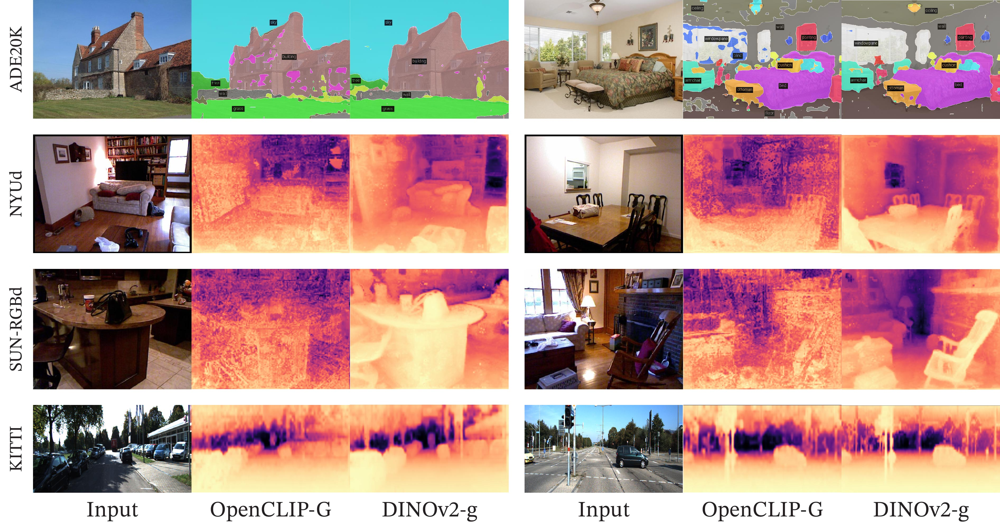

**EN.** Figure 7 : Segmentation and depth estimation with linear classifiers. Examples from ADE20K, NYUd, SUN RGB-D and KITTI with a linear probe on frozen OpenCLIP-G and DINOv2-g features.

**中.** 图 7：使用线性分类器进行分割和深度估计。来自 ADE20K、NYUd、SUN RGB-D 和 KITTI 的示例，在冻结的 OpenCLIP-G 和 DINOv2-g 特征上使用线性探针。

#### Out-of-distribution generalization. / 分布外泛化。

**EN.** We show a few examples of applying the depth prediction and segmentation linear classifiers to out-of-distribution examples in Fig. 8 . The qualitative results support our claim that our features transfer between domains. The quality of the depth and segmentation predicted for pictures of animals, or paintings is very good, even though the domains are very different.

**中.** 我们展示了将深度预测和分割线性分类器应用于图 8 中的分布外示例的一些示例。定性结果支持我们的主张，即我们的特征在域之间转移。动物图片或绘画的预测深度和分割的质量非常好，即使领域非​​常不同。

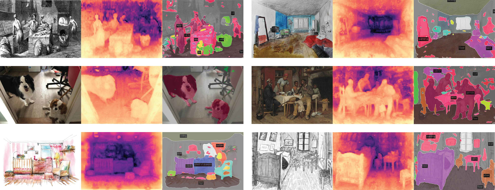

**EN.** Figure 8 : Examples of out-of-distribution examples with frozen DINOv2-g features and a linear probe.

**中.** 图 8：具有冻结 DINOv2-g 特征和线性探针的分布外示例。

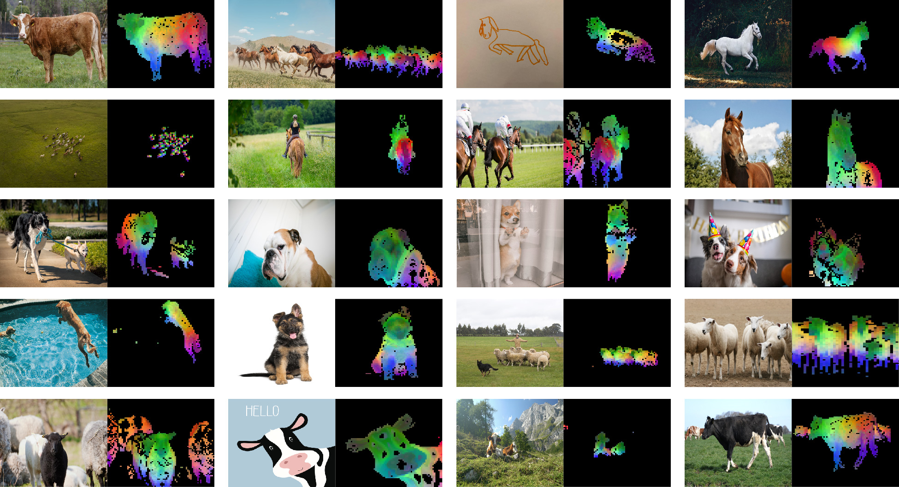

**EN.** Figure 9 : More visualization of the first PCA components. We compute the PCA between the patches from all of the images and show their first 3 components. Each component corresponds to a specific color channel. Same parts are matched between related images depsite changes of pose, style or even objects. Background is removed by removing patches with a negative score of the first PCA component.

**中.** 图 9：第一个 PCA 组件的更多可视化。我们计算所有图像的补丁之间的 PCA，并显示它们的前 3 个分量。每个组件对应一个特定的颜色通道。尽管姿势、风格甚至物体发生变化，但相关图像之间的相同部分仍然匹配。通过移除第一个 PCA 分量得分为负的补丁来移除背景。

#### PCA of patch features. / 补丁特征的PCA。

**EN.** We show the results of the principal component analysis (PCA) performed on the patch features extracted by our model. We keep only patches with a positive value after we threshold the first component. This procedure turns out to separate the image’s main object from the background. We compute a second PCA on the remaining patches across three images depicting the same category. We color the three first components with three different colors and present the results in Fig. 1 and 9 . There are two interesting observations: first, our unsupervised foreground / background detector, based on detecting the highest variance direction, performs very well and is capable of delineating the boundary of the main object in the picture. Second, the other components correspond to "parts" of objects and match well for images of the same category. This is an emerging property – our model was not trained to parse parts of objects.

**中.** 我们展示了对我们的模型提取的补丁特征进行主成分分析（PCA）的结果。在对第一个分量进行阈值处理后，我们只保留具有正值的补丁。这个过程最终将图像的主要对象与背景分开。我们对描述同一类别的三张图像的剩余补丁计算第二个 PCA。我们用三种不同的颜色对前三个组件进行着色，并在图 1 和图 9 中显示结果。有两个有趣的观察结果：首先，我们的无监督前景/背景检测器基于检测最高方差方向，表现非常好，能够勾画出图片中主要物体的边界。其次，其他组件对应于对象的“部分”，并且与同一类别的图像匹配得很好。这是一个新兴的特性——我们的模型没有经过训练来解析对象的各个部分。

#### Patch matching. / 补丁匹配。

**EN.** Finally, we explore what type of information our patch-level features contain by matching them across images. We start by detecting the foreground object using the procedure described above. Then, we compute the euclidean distance between patch features extracted from two images and map them by solving an assignment problem. In order to reduce the number of matches, we then apply a non-maximum suppression to keep only the salient ones. In Fig. 10 , we show some examples of such matchings.

**中.** 最后，我们通过跨图像匹配补丁级特征来探索它们包含什么类型的信息。我们首先使用上述过程检测前景对象。然后，我们计算从两个图像中提取的补丁特征之间的欧几里德距离，并通过解决分配问题来映射它们。为了减少匹配的数量，我们应用非极大值抑制来仅保留显着的匹配。在图 10 中，我们展示了此类匹配的一些示例。

**EN.** We observe that the features seem to capture information about semantic regions that serve similar purpose in different objects or animals. For instance, the wing of a plane matches the wing of a bird. We also observe that the model is robust to style (image versus drawing), and to large variation of poses (see the elephant).

**中.** 我们观察到这些特征似乎捕获了有关在不同物体或动物中具有相似目的的语义区域的信息。例如，飞机的机翼与鸟的翅膀相匹配。我们还观察到该模型对于风格（图像与绘图）和姿势的大变化（参见大象）具有鲁棒性。

**EN.** Figure 10 : Matching across images. We match patch-level features between images from different domains, poses and even objects that share similar semantic information. This exhibits the ability of our model to transfer across domains and understand relations between similar parts of different objects.

**中.** 图 10：跨图像匹配。我们匹配来自不同领域、姿势甚至共享相似语义信息的对象的图像之间的补丁级特征。这展示了我们的模型跨领域转移和理解不同对象的相似部分之间关系的能力。

## Fairness and Bias Analysis / 公平性和偏见分析

**EN.** We conduct two fairness evaluations of our models. We probe for geographical fairness and potential harmful label associations. For both evaluations, we experiment with our largest ViT-g model.

**中.** 我们对模型进行了两次公平性评估。我们探讨地理公平性和潜在的有害标签关联。对于这两项评估，我们都使用最大的 ViT-g 模型进行实验。

### Geographical Fairness / 地理公平

**EN.** We evaluate geographical fairness on the Dollar Street dataset introduced in De Vries et al. (2019) using the evaluation protocol of Goyal et al. (2022b) . This benchmark compares performance across countries and income levels. It contains 16,073 images from 289 households across 54 countries. The task is to recognize 94 concepts that vary visually between households based on income or location. In Table 12 , we compare our model with SEERv2 ( Goyal et al., 2022a ) , a model trained on a geographically diverse set of images. Our model is slightly fairer across regions and incomes than the SEERv2 model and significantly better than the supervised baseline reported by Goyal et al. (2022a) . However, we still observe a significant difference between regions, particularly in Africa, where our model performance drops by 25.7% compared to Europe. This shows that our model is still biased toward Western countries. Similarly, our model performs significantly better on high-income households than low-income ones, with a difference of 31.7%. Despite improvements, we observe significant biases in our models toward wealthy households from Western countries.

**中.** 我们在 De Vries 等人引入的 Dollar Street 数据集上评估地理公平性。 (2019) 使用 Goyal 等人的评估方案。 （2022b）。该基准比较了不同国家和收入水平的表现。它包含来自 54 个国家/地区 289 个家庭的 16,073 张图像。任务是识别 94 个概念，这些概念根据收入或位置在不同家庭之间存在视觉上的差异。在表 12 中，我们将我们的模型与 SEERv2（Goyal 等人，2022a）进行了比较，SEERv2 是一个在地理上不同的图像集上训练的模型。我们的模型在不同地区和收入方面比 SEERv2 模型稍微公平一些，并且明显优于 Goyal 等人报告的监督基线。 （2022a）。然而，我们仍然观察到地区之间存在显着差异，特别是在非洲，与欧洲相比，我们的模型性能下降了 25.7%。这说明我们的模式仍然偏向西方国家。同样，我们的模型在高收入家庭上的表现明显优于低收入家庭，相差 31.7%。尽管有所改进，但我们观察到我们的模型对西方国家富裕家庭存在显着偏见。

|  |  |  |  | Income buckets 收入桶 | Income buckets 收入桶 | Income buckets 收入桶 |  | Regions 地区 | Regions 地区 | Regions 地区 | Regions 地区 |
| --- | --- | --- | --- | --- | --- | --- | --- | --- | --- | --- | --- |
| Method 方法 | Arch. 拱门。 | Data 数据 |  | low 低 | medium 中等 | high 高 |  | Africa 非洲 | Asia 亚洲 | Americas 美洲 | Europe 欧洲 |
| SEERv2 | RG-10B | IG-1B |  | 59.7 | 78.5 | 86.6 |  | 65.9 | 76.3 | 81.1 | 85.6 |
| DINOv2 恐龙v2 | ViT-g/14 | LVD-142M |  | 67.4 | 83.3 | 90.5 |  | 74.0 | 81.6 | 86.2 | 89.7 |

**EN.** Table 12 : Geographical fairness and diversity analysis across income buckets and regions.

**中.** 表 12：跨收入类别和地区的地理公平性和多样性分析。

### Gender, Skintones and Age / 性别、肤色和年龄

**EN.** In a second set of evaluations, we question how our model classifies images of people of different gender, skin tone, and age (all self-reported). We follow the protocol of Goyal et al. (2022b) , where we train a multiclass classifier on a subset of 619 classes of ImageNet-22k. We group the 619 classes into four broader categories: Human, Possibly Human, Non-Human, or Crime. Non-Human and Crime are considered harmful. Using this classifier, we run inference on 2955 images from the Casual Conversations dataset ( Hazirbas et al., 2021 ) and keep all labels in the top-5 that are assigned a probability of 0.1 or more. Because of that, we can assign multiple classes to each image. We make one modification to the original evaluation protocol: we do not backpropagate gradients to the backbone and keep it frozen. We compare our model to SEERv2 in Table 13 .

**中.** 在第二组评估中，我们质疑我们的模型如何对不同性别、肤色和年龄的人的图像进行分类（全部是自我报告的）。我们遵循 Goyal 等人的协议。 (2022b)，我们在 ImageNet-22k 的 619 个类的子集上训练多类分类器。我们将 619 个类别分为四个更广泛的类别：人类、可能人类、非人类或犯罪。非人类和犯罪被认为是有害的。使用此分类器，我们对 Casual Conversations 数据集（Hazirbas 等人，2021）中的 2955 张图像进行推理，并将所有标签保留在前 5 名中，并分配概率为 0.1 或更高。因此，我们可以为每个图像分配多个类。我们对原始评估协议进行了一项修改：我们不将梯度反向传播到主干网并保持其冻结。我们将我们的模型与表 13 中的 SEERv2 进行比较。

**EN.** Our model often classifies images of all groups as Human without large deviations across skin tones. Neither SEERv2 nor DINOv2 predict harmful labels from the Non-Human or Crime meta-categories (except for two instances where the background contains bars visually similar to prison bars). We see that our model triggers the Possibly-Human classes often. This class is constructed from objects in ImageNet-22k that are often related to Humans, such as Scarf, Glasses, or Beard. Our model often predicts the Possibly-Human class for men because of the prevalence of the Beard class. No clear pattern indicates a bias against a particular group in this study. While this is encouraging, we also acknowledge that a more thorough evaluation of biases may reveal flaws in our model.

**中.** 我们的模型通常将所有群体的图像分类为人类，而肤色之间没有大的偏差。 SEERv2 和 DINOv2 都无法预测来自非人类或犯罪元类别的有害标签（背景包含视觉上与监狱酒吧类似的酒吧的两个实例除外）。我们看到我们的模型经常触发可能的人类类别。此类由 ImageNet-22k 中通常与人类相关的对象构建，例如围巾、眼镜或胡须。由于胡须类别的普遍存在，我们的模型经常预测男性的可能人类类别。在这项研究中，没有明确的模式表明对特定群体存在偏见。虽然这令人鼓舞，但我们也承认，对偏见进行更彻底的评估可能会揭示我们模型中的缺陷。

|  |  | Gender Skintone 性别肤色 | Gender Skintone 性别肤色 | Gender Skintone 性别肤色 | Gender Skintone 性别肤色 |  | Age Groups 年龄组 | Age Groups 年龄组 | Age Groups 年龄组 | Age Groups 年龄组 |
| --- | --- | --- | --- | --- | --- | --- | --- | --- | --- | --- |
| Model 型号 | Assoc. 副教授。 | female darker 女性较黑 | female lighter 女打火机 | male darker 男性较黑 | male lighter 男打火机 |  | 18-30 | 30-45 | 45-70 | 70+ |
| SEER | Non-Human 非人类 | 0.0 | 0.0 | 0.0 | 0.0 |  | 0.0 | 0.0 | 0.0 | 0.0 |
| RG-10B | Crime 犯罪 | 0.0 | 0.0 | 0.0 | 0.0 |  | 0.0 | 0.0 | 0.0 | 0.0 |
|  | Human 人类 | 94.9 | 95.8 | 86.6 | 79.0 |  | 90.5 | 88.3 | 91.9 | 82.3 |
|  | Possibly-Human 可能是人类 | 13.6 | 6.7 | 65.0 | 60.2 |  | 32.8 | 37.2 | 29.4 | 6.5 |
| DINOv2 恐龙v2 | Non-Human 非人类 | 0.0 | 0.0 | 0.0 | 0.0 |  | 0.0 | 0.0 | 0.0 | 0.0 |
| ViT-g/14 | Crime 犯罪 | 0.0 | 0.0 | 0.2 | 0.0 |  | 0.0 | 0.1 | 0.0 | 0.0 |
|  | Human 人类 | 97.3 | 97.7 | 86.1 | 84.0 |  | 91.2 | 90.2 | 93.2 | 88.7 |
|  | Possibly-Human 可能是人类 | 15.8 | 17.2 | 52.2 | 48.1 |  | 35.3 | 37.3 | 23.0 | 9.7 |

**EN.** Table 13 : Label association fairness evaluation across gender, skintones and age groups. We follow the protocol proposed by Goyal et al. (2022b) with a slight modification. Instead of finetuning the backbone, we simply learn a linear classifier on the subset of 619 classes of ImageNet-22k.

**中.** 表 13：跨性别、肤色和年龄组的标签关联公平性评估。我们遵循 Goyal 等人提出的协议。 （2022b）稍作修改。我们没有对主干网进行微调，而是简单地在 ImageNet-22k 的 619 个类别的子集上学习线性分类器。

## Estimating the Environmental Impact of Training our Models / 估计训练模型对环境的影响

| Model to 模型为 | GPU Type 图形处理器类型 | GPU Power GPU 功率 | GPU-hours GPU 小时数 | PUE | Total power 总功率 | Carbon emitted 碳排放量 |
| --- | --- | --- | --- | --- | --- | --- |
| Reproduce 再现 | GPU Type 图形处理器类型 | consumption 消费 | GPU-hours GPU 小时数 | PUE | consumption 消费 | (tCO 2 eq) (tCO 2 当量) |
| DINOv2-g DINov2-g | A100-40GB | 400W | 22,016 | 1.1 | 9.7 MWh 9.7兆瓦时 | 3.7 |

**EN.** Table 14 : Carbon footprint of reproducing DINOv2. We report the potential carbon emission of reproducing DINOv2-g when assuming a power consumption for the A100-40GB of 400W, a PUE of 1.1 and carbon intensity factor of 0.385 kg CO 2 e per KWh.

**中.** 表 14：繁殖 DINOv2 的碳足迹。我们报告了假设 A100-40GB 的功耗为 400W、PUE 为 1.1、碳强度因子为每千瓦时 0.385 kg CO 2 e 时，复制 DINOv2-g 的潜在碳排放量。

**EN.** Training foundation models consumes a significant amount of energy, resulting in carbon dioxide emissions. Patterson et al. (2021) propose a methodology to report an estimation of the carbon emitted during the training of a model based on the specifics of the data center and its power grid. This computation informs the design of the data center used for the training of models and the choice of location for data centers. This methodology requires to know the specifics of the data center used for training, which can be complex when multiple data centers are involved over time. Additionally, these specifics are most often not in the control of the AI practitioner, and hence, this methodology is less helpful when practioners make technical decisions about future trainings. Instead, in this section, we follow an alternative that reports the potential carbon emission of retraining a similar model in an average data center located in the US. This methodology was used in previous work in natural language processing ( Strubell et al., 2019 ; Touvron et al., 2023 ) to establish an apple-to-apple comparison between pretraining schemes. More precisely, we fix the value of all exogenous variables, i.e., the Power Usage Effectiveness (PUE) and carbon intensity factor of a power grid to the same values as in Touvron et al. (2023) , that is, a PUE of 1.1 and the carbon intensity factor to the US average of 0.385 kg CO 2 eq/KWh. We use the same formula as in Patterson et al. (2021) to estimate the potential energy consumption and the carbon emission. For the power consumption of an A100-80GB, we take the thermal design power for NVLink systems, which is 400W. We report the potential carbon emission of retraining a DINOv2 ViT-g in Table 14 . For comparison, retraining an OpenCLIP ViT-L or OpenCLIP ViT-G would require 22.4 MWh and 118.9 MWh, respectively, if run in the same data center. This is 10 $\times$ more carbon emission. Note that this comparison is not fair to them, since they also train a text encoder in parallel, and we thus do not report them in the table. However, it gives a reasonable guideline for those who are interested in training only visual features: in this context, training a self-supervised model is preferable in terms of carbon emission. Training a text-guided model still makes sense when planning to reuse the text encoder.

**中.** 训练基础模型会消耗大量能源，导致二氧化碳排放。帕特森等人。 (2021) 提出了一种方法，用于根据数据中心及其电网的具体情况报告模型训练期间碳排放的估计。该计算为用于模型训练的数据中心的设计以及数据中心位置的选择提供了信息。这种方法需要了解用于训练的数据中心的具体情况，当随着时间的推移涉及多个数据中心时，这可能会很复杂。此外，这些细节通常不受人工智能从业者的控制，因此，当从业者对未来的培训做出技术决策时，这种方法的帮助不大。相反，在本节中，我们采用另一种替代方案，报告在美国的普通数据中心重新训练类似模型的潜在碳排放量。这种方法已在之前的自然语言处理工作中使用过（Strubell 等人，2019；Touvron 等人，2023），以建立预训练方案之间的逐一比较。更准确地说，我们将所有外生变量的值，即电网的电力使用效率（PUE）和碳强度因子固定为与Touvron等人相同的值。 (2023)，即 PUE 为 1.1，美国平均值的碳强度系数为 0.385 kg CO 2 eq/KWh。我们使用与帕特森等人相同的公式。 （2021）估计潜在的能源消耗和碳排放。对于A100-80GB的功耗，我们采用NVLink系统的热设计功率，为400W。我们在表 14 中报告了重新训练 DINOv2 ViT-g 的潜在碳排放量。相比之下，如果在同一数据中心运行，重新训练 OpenCLIP ViT-L 或 OpenCLIP ViT-G 将分别需要 22.4 MWh 和 118.9 MWh。这相当于 10 $\times$ 的碳排放量。请注意，这种比较对他们来说不公平，因为他们还并行训练文本编码器，因此我们不会在表中报告它们。然而，它为那些只对训练视觉特征感兴趣的人提供了合理的指导：在这种情况下，就碳排放而言，训练自监督模型是更好的选择。当计划重用文本编码器时，训练文本引导模型仍然有意义。

#### Carbon footprint of the whole project. / 整个项目的碳足迹。

**EN.** Additionally, we estimate the footprint of the whole project to be between $0.5$ k and $1$ k tCO 2 eq using the same grid as presented above [^footnote3] . This carbon footprint represents in the order of $200$ k GPU-days. The primary sources of emissions are the self-supervised pre-trainings of the models. For example, a single pre-training of a ViT-g model (22k GPU-hours) emits 3.7 tons of CO 2 eq, while a finetuning on ImageNet-1k (1k GPU-hours) emits 0.2 tons. This estimate only considers the GPUs’ electricity consumption and ignores other emissions, such as their manufacturing and disposal.

**中.** 此外，我们使用与上面 [^footnote3] 相同的网格估计整个项目的占地面积在 $0.5$ k 和 $1$ k tCO 2 eq 之间。此碳足迹相当于 $200$ k GPU 天。排放的主要来源是模型的自我监督预训练。例如，ViT-g 模型（22k GPU 小时）的单次预训练会排放 3.7 吨 CO 2 eq，而 ImageNet-1k（1k GPU 小时）的微调则排放 0.2 吨。该估计仅考虑 GPU 的电力消耗，忽略其他排放，例如其制造和处置。

## Future work and Discussion / 未来的工作和讨论

**EN.** In this work, we present DINOv2, a new series of image encoders pretrained on large curated data with no supervision. This is the first SSL work on image data that leads to visual features that close the performance gap with (weakly) supervised alternatives across a wide range of benchmarks and without the need for finetuning. We can attribute the strong performance of the DINOv2 family of models to several factors: i ) an improved training recipe with better hyperparameters and regularization (Table 1 ), ii ) a larger model scale with improved results regardless of the data used for training (Fig. 4 ), iii ) a larger dataset (Fig. 4 ) and iv ) the distillation process that makes smaller models benefit from the performance of the strongest ViT-g model (Fig. 5 ). A few properties emerge from these models, such as an understanding of object parts and scene geometry regardless of the image domains. We expect that more of these properties will emerge at larger scales of models and data, akin to instruction emergence in large language models, and plan to continue scaling along these axes. This paper also demonstrates that these visual features are compatible with classifiers as simple as linear layers - meaning the underlying information is readily available . In future work, we plan to leverage this ability to train a a language-enabled AI system that can process visual features as if they were word tokens, and extract the required information to ground the system.

**中.** 在这项工作中，我们提出了 DINOv2，这是一系列新的图像编码器，在没有监督的情况下对大型精选数据进行了预训练。这是第一个针对图像数据的 SSL 工作，它产生的视觉特征可以缩小与（弱）监督替代方案在各种基准测试中的性能差距，并且无需进行微调。我们可以将 DINOv2 系列模型的强大性能归因于几个因素：i）具有更好的超参数和正则化的改进训练配方（表 1），ii）无论用于训练的数据如何，具有改进结果的更大模型规模（图 4），iii）更大的数据集（图 4）和 iv）精炼过程，使较小的模型受益于最强 ViT-g 模型的性能（图 5）。这些模型产生了一些属性，例如无论图像域如何，都能理解对象部分和场景几何形状。我们预计更多的这些属性将在更大规模的模型和数据中出现，类似于大型语言模型中的指令出现，并计划继续沿着这些轴扩展。本文还表明，这些视觉特征与像线性层一样简单的分类器兼容，这意味着底层信息很容易获得。在未来的工作中，我们计划利用这种能力来训练一个支持语言的人工智能系统，该系统可以像处理单词标记一样处理视觉特征，并提取所需的信息来支撑系统。

#### Acknowledgments. / 致谢。

**EN.** We thank Mathilde Caron for initial discussions that led to this work. Julien Mairal was supported by the ERC grant number 101087696 (APHELAIA project) and by ANR 3IA MIAI@Grenoble Alpes (ANR-19-P3IA-0003). We thank Olivia Joulin for the horse drawing used in Fig. 10 . We thank Madeleine and Léon for posing for Fig. 8 We also thank the rest of FAIR and Meta AI for feedback on this work through the entire project.

**中.** 我们感谢 Mathilde Caron 进行的初步讨论促成了这项工作。 Julien Mailal 得到了 ERC 拨款号 101087696（APHELAIA 项目）和 ANR 3IA MIAI@Grenoble Alpes (ANR-19-P3IA-0003) 的支持。我们感谢 Olivia Joulin 在图 10 中使用的马画。我们感谢 Madeleine 和 Léon 为图 8 摆好姿势。我们还感谢 FAIR 和 Meta AI 的其他成员在整个项目中对这项工作的反馈。

## References / 参考文献

- Amir et al. (2022) Shir Amir, Yossi Gandelsman, Shai Bagon, and Tali Dekel. Deep vit features as dense visual descriptors. In ECCV workshop on "What is Motion For?" , 2022.

- Asano et al. (2020) Yuki Markus Asano, Christian Rupprecht, and Andrea Vedaldi. Self-labelling via simultaneous clustering and representation learning. In ICLR , 2020.

- Assran et al. (2022) Mahmoud Assran, Mathilde Caron, Ishan Misra, Piotr Bojanowski, Florian Bordes, Pascal Vincent, Armand Joulin, Michael Rabbat, and Nicolas Ballas. Masked siamese networks for label-efficient learning. In ECCV , 2022.

- Assran et al. (2023) Mahmoud Assran, Quentin Duval, Ishan Misra, Piotr Bojanowski, Pascal Vincent, Michael Rabbat, Yann LeCun, and Nicolas Ballas. Self-supervised learning from images with a joint-embedding predictive architecture. In CVPR , 2023.

- Baevski et al. (2022) Alexei Baevski, Wei-Ning Hsu, Qiantong Xu, Arun Babu, Jiatao Gu, and Michael Auli. Data2vec: A general framework for self-supervised learning in speech, vision and language. In ICML , 2022.

- Bao et al. (2021) Hangbo Bao, Li Dong, and Furu Wei. Beit: Bert pre-training of image transformers. In ICLR , 2021.

- Beirlant et al. (1997) Jan Beirlant, Edward J Dudewicz, László Györfi, Edward C Van der Meulen, et al. Nonparametric entropy estimation: An overview. International Journal of Mathematical and Statistical Sciences , 6(1):17–39, 1997.

- Berman et al. (2019) Maxim Berman, Hervé Jégou, Vedaldi Andrea, Iasonas Kokkinos, and Matthijs Douze. MultiGrain: a unified image embedding for classes and instances. arXiv preprint arXiv:1902.05509 , 2019.

- Beyer et al. (2020) Lucas Beyer, Olivier J Hénaff, Alexander Kolesnikov, Xiaohua Zhai, and Aäron van den Oord. Are we done with imagenet? arXiv preprint arXiv:2006.07159 , 2020.

- Beyer et al. (2023) Lucas Beyer, Pavel Izmailov, Alexander Kolesnikov, Mathilde Caron, Simon Kornblith, Xiaohua Zhai, Matthias Minderer, Michael Tschannen, Ibrahim Alabdulmohsin, and Filip Pavetic. Flexivit: One model for all patch sizes. In CVPR , 2023.

- Bhat et al. (2021) Shariq Farooq Bhat, Ibraheem Alhashim, and Peter Wonka. AdaBins: Depth estimation using adaptive bins. In CVPR , 2021.

- Bojanowski & Joulin (2017) Piotr Bojanowski and Armand Joulin. Unsupervised learning by predicting noise. In ICML , 2017.

- Bommasani et al. (2021) Rishi Bommasani, Drew A Hudson, Ehsan Adeli, Russ Altman, Simran Arora, Sydney von Arx, Michael S Bernstein, Jeannette Bohg, Antoine Bosselut, Emma Brunskill, et al. On the opportunities and risks of foundation models. arXiv preprint arXiv:2108.07258 , 2021.

- Bossard et al. (2014) Lukas Bossard, Matthieu Guillaumin, and Luc Van Gool. Food-101 – mining discriminative components with random forests. In ECCV , 2014.

- Brown et al. (2020) Tom B Brown, Benjamin Mann, Nick Ryder, Melanie Subbiah, Jared Kaplan, Prafulla Dhariwal, Arvind Neelakantan, Pranav Shyam, Girish Sastry, Amanda Askell, et al. Language models are few-shot learners. In NeurIPS , 2020.

- Caron et al. (2018) Mathilde Caron, Piotr Bojanowski, Armand Joulin, and Matthijs Douze. Deep clustering for unsupervised learning of visual features. In ECCV , 2018.

- Caron et al. (2019) Mathilde Caron, Piotr Bojanowski, Julien Mairal, and Armand Joulin. Unsupervised pre-training of image features on non-curated data. In ICCV , 2019.

- Caron et al. (2020) Mathilde Caron, Ishan Misra, Julien Mairal, Priya Goyal, Piotr Bojanowski, and Armand Joulin. Unsupervised learning of visual features by contrasting cluster assignments. In NeurIPS , 2020.

- Caron et al. (2021) Mathilde Caron, Hugo Touvron, Ishan Misra, Hervé Jégou, Julien Mairal, Piotr Bojanowski, and Armand Joulin. Emerging properties in self-supervised vision transformers. In ICCV , 2021.

- Chen et al. (2018) Liang-Chieh Chen, Yukun Zhu, George Papandreou, Florian Schroff, and Hartwig Adam. Encoder-decoder with atrous separable convolution for semantic image segmentation. In ECCV , 2018.

- Chen et al. (2020) Ting Chen, Simon Kornblith, Mohammad Norouzi, and Geoffrey Hinton. A simple framework for contrastive learning of visual representations. In ICML , 2020.

- Chen et al. (2023a) Xiangning Chen, Chen Liang, Da Huang, Esteban Real, Kaiyuan Wang, Yao Liu, Hieu Pham, Xuanyi Dong, Thang Luong, Cho-Jui Hsieh, et al. Symbolic discovery of optimization algorithms. arXiv preprint arXiv:2302.06675 , 2023a.

- Chen & He (2021) Xinlei Chen and Kaiming He. Exploring simple siamese representation learning. In CVPR , 2021.

- Chen et al. (2021) Xinlei Chen, Saining Xie, and Kaiming He. An empirical study of training self-supervised vision transformers. In ICCV , 2021.

- Chen et al. (2023b) Zhe Chen, Yuchen Duan, Wenhai Wang, Junjun He, Tong Lu, Jifeng Dai, and Yu Qiao. Vision transformer adapter for dense predictions. In ICLR , 2023b.

- Cheng et al. (2022) Bowen Cheng, Ishan Misra, Alexander G Schwing, Alexander Kirillov, and Rohit Girdhar. Masked-attention mask transformer for universal image segmentation. In CVPR , 2022.

- Cherti et al. (2023) Mehdi Cherti, Romain Beaumont, Ross Wightman, Mitchell Wortsman, Gabriel Ilharco, Cade Gordon, Christoph Schuhmann, Ludwig Schmidt, and Jenia Jitsev. Reproducible scaling laws for contrastive language-image learning. In CVPR , 2023.

- Chowdhery et al. (2022) Aakanksha Chowdhery, Sharan Narang, Jacob Devlin, Maarten Bosma, Gaurav Mishra, Adam Roberts, Paul Barham, Hyung Won Chung, Charles Sutton, Sebastian Gehrmann, et al. Palm: Scaling language modeling with pathways. arXiv preprint arXiv:2204.02311 , 2022.

- Cimpoi et al. (2014) M. Cimpoi, S. Maji, I. Kokkinos, S. Mohamed, , and A. Vedaldi. Describing textures in the wild. In CVPR , 2014.

- Cordts et al. (2016) Marius Cordts, Mohamed Omran, Sebastian Ramos, Timo Rehfeld, Markus Enzweiler, Rodrigo Benenson, Uwe Franke, Stefan Roth, and Bernt Schiele. The cityscapes dataset for semantic urban scene understanding. In CVPR , 2016.

- Dao et al. (2022) Tri Dao, Daniel Y. Fu, Stefano Ermon, Atri Rudra, and Christopher Ré. Flashattention: Fast and memory-efficient exact attention with io-awareness. In NeurIPS , 2022.

- De Vries et al. (2019) Terrance De Vries, Ishan Misra, Changhan Wang, and Laurens Van der Maaten. Does object recognition work for everyone? In CVPR workshops , 2019.

- Delattre & Fournier (2017) Sylvain Delattre and Nicolas Fournier. On the kozachenko–leonenko entropy estimator. Journal of Statistical Planning and Inference , 185:69–93, 2017.

- Deng et al. (2009) Jia Deng, Wei Dong, Richard Socher, Li-Jia Li, Kai Li, and Li Fei-Fei. Imagenet: A large-scale hierarchical image database. In CVPR , 2009.

- Devlin et al. (2019) Jacob Devlin, Ming-Wei Chang, Kenton Lee, and Kristina Toutanova. Bert: Pre-training of deep bidirectional transformers for language understanding. NAACL , 2019.

- Doersch et al. (2015) Carl Doersch, Abhinav Gupta, and Alexei A Efros. Unsupervised visual representation learning by context prediction. In ICCV , 2015.

- Dosovitskiy et al. (2016) Alexey Dosovitskiy, Philipp Fischer, Jost Tobias Springenberg, Martin Riedmiller, and Thomas Brox. Discriminative unsupervised feature learning with exemplar convolutional neural networks. TPAMI , 2016.

- Dosovitskiy et al. (2021) Alexey Dosovitskiy, Lucas Beyer, Alexander Kolesnikov, Dirk Weissenborn, Xiaohua Zhai, Thomas Unterthiner, Mostafa Dehghani, Matthias Minderer, Georg Heigold, Sylvain Gelly, et al. An image is worth 16x16 words: Transformers for image recognition at scale. In ICLR , 2021.

- Douze et al. (2009) Matthijs Douze, Hervé Jégou, Harsimrat Sandhawalia, Laurent Amsaleg, and Cordelia Schmid. Evaluation of gist descriptors for web-scale image search. In CIVR , 2009.

- Duval et al. (2023) Quentin Duval, Ishan Misra, and Nicolas Ballas. A simple recipe for competitive low-compute self supervised vision models. arXiv preprint arXiv:2301.09451 , 2023.

- El-Nouby et al. (2021) Alaaeldin El-Nouby, Gautier Izacard, Hugo Touvron, Ivan Laptev, Hervé Jegou, and Edouard Grave. Are large-scale datasets necessary for self-supervised pre-training? arXiv preprint arXiv:2112.10740 , 2021.

- Everingham et al. (2010) Mark Everingham, Luc Van Gool, Christopher KI Williams, John Winn, and Andrew Zisserman. The pascal visual object classes (voc) challenge. IJCV , 2010.

- Fang et al. (2023) Yuxin Fang, Wen Wang, Binhui Xie, Quan Sun, Ledell Wu, Xinggang Wang, Tiejun Huang, Xinlong Wang, and Yue Cao. Eva: Exploring the limits of masked visual representation learning at scale. In CVPR , 2023.

- Fei-Fei et al. (2004) Li Fei-Fei, Rob Fergus, and Pietro Perona. Learning generative visual models from few training examples: An incremental bayesian approach tested on 101 object categories. In CVPR , 2004.

- Geiger et al. (2013) Andreas Geiger, Philip Lenz, Christoph Stiller, and Raquel Urtasun. Vision meets robotics: The kitti dataset. IJRR , 2013.

- Gidaris et al. (2018) Spyros Gidaris, Praveer Singh, and Nikos Komodakis. Unsupervised representation learning by predicting image rotations. In ICLR , 2018.

- Girdhar et al. (2023) Rohit Girdhar, Alaaeldin El-Nouby, Mannat Singh, Kalyan Vasudev Alwala, Armand Joulin, and Ishan Misra. Omnimae: Single model masked pretraining on images and videos. In CVPR , 2023.

- Goyal et al. (2019) Priya Goyal, Dhruv Mahajan, Abhinav Gupta, and Ishan Misra. Scaling and benchmarking self-supervised visual representation learning. In ICCV , 2019.

- Goyal et al. (2021) Priya Goyal, Mathilde Caron, Benjamin Lefaudeux, Min Xu, Pengchao Wang, Vivek Pai, Mannat Singh, Vitaliy Liptchinsky, Ishan Misra, Armand Joulin, et al. Self-supervised pretraining of visual features in the wild. preprint arXiv:2103.01988 , 2021.

- Goyal et al. (2022a) Priya Goyal, Quentin Duval, Isaac Seessel, Mathilde Caron, Mannat Singh, Ishan Misra, Levent Sagun, Armand Joulin, and Piotr Bojanowski. Vision models are more robust and fair when pretrained on uncurated images without supervision. arXiv preprint arXiv:2202.08360 , 2022a.

- Goyal et al. (2022b) Priya Goyal, Adriana Romero Soriano, Caner Hazirbas, Levent Sagun, and Nicolas Usunier. Fairness indicators for systematic assessments of visual feature extractors. In FAcct , 2022b.

- Goyal et al. (2017) Raghav Goyal, Samira Ebrahimi Kahou, Vincent Michalski, Joanna Materzynska, Susanne Westphal, Heuna Kim, Valentin Haenel, Ingo Fruend, Peter Yianilos, Moritz Mueller-Freitag, et al. The "something something" video database for learning and evaluating visual common sense. In ICCV , 2017.

- Grill et al. (2020) Jean-Bastien Grill, Florian Strub, Florent Altché, Corentin Tallec, Pierre H Richemond, Elena Buchatskaya, Carl Doersch, Bernardo Avila Pires, Zhaohan Daniel Guo, Mohammad Gheshlaghi Azar, Bilal Piot, Koray Kavukcuoglu, Rémi Munos, and Michal Valko. Bootstrap your own latent: A new approach to self-supervised learning. In NeurIPS , 2020.

- Hadsell et al. (2006) Raia Hadsell, Sumit Chopra, and Yann LeCun. Dimensionality reduction by learning an invariant mapping. In CVPR , 2006.

- Hamilton et al. (2022) Mark Hamilton, Zhoutong Zhang, Bharath Hariharan, Noah Snavely, and William T Freeman. Unsupervised semantic segmentation by distilling feature correspondences. In ICLR , 2022.

- Hazirbas et al. (2021) Caner Hazirbas, Joanna Bitton, Brian Dolhansky, Jacqueline Pan, Albert Gordo, and Cristian Canton Ferrer. Towards measuring fairness in ai: the casual conversations dataset. IEEE Transactions on Biometrics, Behavior, and Identity Science , 2021.

- He et al. (2020) Kaiming He, Haoqi Fan, Yuxin Wu, Saining Xie, and Ross Girshick. Momentum contrast for unsupervised visual representation learning. In CVPR , 2020.

- He et al. (2022) Kaiming He, Xinlei Chen, Saining Xie, Yanghao Li, Piotr Dollár, and Ross Girshick. Masked autoencoders are scalable vision learners. In CVPR , 2022.

- Hénaff et al. (2019) Olivier J Hénaff, Aravind Srinivas, Jeffrey De Fauw, Ali Razavi, Carl Doersch, SM Eslami, and Aaron van den Oord. Data-efficient image recognition with contrastive predictive coding. PMLR , 2019.

- Hendrycks & Dietterich (2019) Dan Hendrycks and Thomas Dietterich. Benchmarking neural network robustness to common corruptions and perturbations. In ICLR , 2019.

- Hendrycks et al. (2021a) Dan Hendrycks, Steven Basart, Norman Mu, Saurav Kadavath, Frank Wang, Evan Dorundo, Rahul Desai, Tyler Zhu, Samyak Parajuli, Mike Guo, et al. The many faces of robustness: A critical analysis of out-of-distribution generalization. In ICCV , 2021a.

- Hendrycks et al. (2021b) Dan Hendrycks, Kevin Zhao, Steven Basart, Jacob Steinhardt, and Dawn Song. Natural adversarial examples. In CVPR , 2021b.

- Hinton et al. (2014) Geoffrey Hinton, Oriol Vinyals, and Jeff Dean. Distilling the knowledge in a neural network. In NeurIPS Deep Learning Workshop , 2014.

- Hoffmann et al. (2022) Jordan Hoffmann, Sebastian Borgeaud, Arthur Mensch, Elena Buchatskaya, Trevor Cai, Eliza Rutherford, Diego de Las Casas, Lisa Anne Hendricks, Johannes Welbl, Aidan Clark, et al. Training compute-optimal large language models. arXiv preprint arXiv:2203.15556 , 2022.

- Huang et al. (2016) Gao Huang, Yu Sun, Zhuang Liu, Daniel Sedra, and Kilian Q Weinberger. Deep networks with stochastic depth. In ECCV , 2016.

- Ilharco et al. (2021) Gabriel Ilharco, Mitchell Wortsman, Ross Wightman, Cade Gordon, Nicholas Carlini, Rohan Taori, Achal Dave, Vaishaal Shankar, Hongseok Namkoong, John Miller, Hannaneh Hajishirzi, Ali Farhadi, and Ludwig Schmidt. Openclip. 2021.

- Jegou et al. (2010) Herve Jegou, Matthijs Douze, and Cordelia Schmid. Product quantization for nearest neighbor search. TPAMI , 2010.

- Johnson et al. (2019) Jeff Johnson, Matthijs Douze, and Hervé Jégou. Billion-scale similarity search with GPUs. IEEE Transactions on Big Data , 2019.

- Joulin et al. (2016) Armand Joulin, Laurens Van Der Maaten, Allan Jabri, and Nicolas Vasilache. Learning visual features from large weakly supervised data. In ECCV , 2016.

- Kay et al. (2017) Will Kay, Joao Carreira, Karen Simonyan, Brian Zhang, Chloe Hillier, Sudheendra Vijayanarasimhan, Fabio Viola, Tim Green, Trevor Back, Paul Natsev, et al. The kinetics human action video dataset. arXiv preprint arXiv:1705.06950 , 2017.

- Krause et al. (2013) Jonathan Krause, Michael Stark, Jia Deng, and Li Fei-Fei. 3d object representations for fine-grained categorization. In 3DRR , 2013.

- Krell et al. (2022) Mario Michael Krell, Matej Kosec, Sergio P. Perez, and Andrew Fitzgibbon. Efficient sequence packing without cross-contamination: Accelerating large language models without impacting performance, 2022.

- Krizhevsky et al. (2009) Alex Krizhevsky, Geoffrey Hinton, et al. Learning multiple layers of features from tiny images. 2009.

- Lefaudeux et al. (2022) Benjamin Lefaudeux, Francisco Massa, Diana Liskovich, Wenhan Xiong, Vittorio Caggiano, Sean Naren, Min Xu, Jieru Hu, Marta Tintore, Susan Zhang, Patrick Labatut, and Daniel Haziza. xformers: A modular and hackable transformer modelling library. [https://github.com/facebookresearch/xformers](https://github.com/facebookresearch/xformers) , 2022.

- Li et al. (2022a) Chunyuan Li, Jianwei Yang, Pengchuan Zhang, Mei Gao, Bin Xiao, Xiyang Dai, Lu Yuan, and Jianfeng Gao. Efficient self-supervised vision transformers for representation learning. In ICLR , 2022a.

- Li et al. (2022b) Zhenyu Li, Xuyang Wang, Xianming Liu, and Junjun Jiang. Binsformer: Revisiting adaptive bins for monocular depth estimation. arXiv preprint arXiv:2204.00987 , 2022b.

- Likhomanenko et al. (2021) Tatiana Likhomanenko, Qiantong Xu, Gabriel Synnaeve, Ronan Collobert, and Alex Rogozhnikov. Cape: Encoding relative positions with continuous augmented positional embeddings. In NeurIPS , 2021.

- Liu et al. (2021) Huajun Liu, Fuqiang Liu, Xinyi Fan, and Dong Huang. Polarized self-attention: towards high-quality pixel-wise regression. arXiv preprint arXiv:2107.00782 , 2021.

- Mahajan et al. (2018) Dhruv Mahajan, Ross Girshick, Vignesh Ramanathan, Kaiming He, Manohar Paluri, Yixuan Li, Ashwin Bharambe, and Laurens van der Maaten. Exploring the limits of weakly supervised pretraining. In ECCV , 2018.

- Maji et al. (2013) S. Maji, J. Kannala, E. Rahtu, M. Blaschko, and A. Vedaldi. Fine-grained visual classification of aircraft. Technical report, 2013.

- Misra & Maaten (2020) Ishan Misra and Laurens van der Maaten. Self-supervised learning of pretext-invariant representations. In CVPR , 2020.

- Nilsback & Zisserman (2008) Maria-Elena Nilsback and Andrew Zisserman. Automated flower classification over a large number of classes. In ICVGIP , 2008.

- Noroozi & Favaro (2016) Mehdi Noroozi and Paolo Favaro. Unsupervised learning of visual representations by solving jigsaw puzzles. In ECCV , 2016.

- Ofri-Amar et al. (2023) Dolev Ofri-Amar, Michal Geyer, Yoni Kasten, and Tali Dekel. Neural congealing: Aligning images to a joint semantic atlas. In CVPR , 2023.

- Parkhi et al. (2012) Omkar M. Parkhi, Andrea Vedaldi, Andrew Zisserman, and C. V. Jawahar. Cats and dogs. In CVPR , 2012.

- Pathak et al. (2016) Deepak Pathak, Philipp Krähenbühl, Jeff Donahue, Trevor Darrell, and Alexei Efros. Context encoders: Feature learning by inpainting. In CVPR , 2016.

- Patterson et al. (2021) David Patterson, Joseph Gonzalez, Quoc Le, Chen Liang, Lluis-Miquel Munguia, Daniel Rothchild, David So, Maud Texier, and Jeff Dean. Carbon emissions and large neural network training. arXiv preprint arXiv:2104.10350 , 2021.

- Pizzi et al. (2022) Ed Pizzi, Sreya Dutta Roy, Sugosh Nagavara Ravindra, Priya Goyal, and Matthijs Douze. A self-supervised descriptor for image copy detection. In CVPR , 2022.

- Radenović et al. (2018a) Filip Radenović, Ahmet Iscen, Giorgos Tolias, Yannis Avrithis, and Ondřej Chum. Revisiting oxford and paris: Large-scale image retrieval benchmarking. In CVPR , 2018a.

- Radenović et al. (2018b) Filip Radenović, Giorgos Tolias, and Ondřej Chum. Fine-tuning cnn image retrieval with no human annotation. TPAMI , 2018b.

- Radford et al. (2017) Alec Radford, Rafal Jozefowicz, and Ilya Sutskever. Learning to generate reviews and discovering sentiment. arXiv preprint arXiv:1704.01444 , 2017.

- Radford et al. (2019) Alec Radford, Jeffrey Wu, Rewon Child, David Luan, Dario Amodei, and Ilya Sutskever. Language models are unsupervised multitask learners. 2019.

- Radford et al. (2021) Alec Radford, Jong Wook Kim, Chris Hallacy, Aditya Ramesh, Gabriel Goh, Sandhini Agarwal, Girish Sastry, Amanda Askell, Pamela Mishkin, Jack Clark, et al. Learning transferable visual models from natural language supervision. In ICML , 2021.

- Raffel et al. (2020) Colin Raffel, Noam Shazeer, Adam Roberts, Katherine Lee, Sharan Narang, Michael Matena, Yanqi Zhou, Wei Li, Peter J Liu, et al. Exploring the limits of transfer learning with a unified text-to-text transformer. JMLR , 2020.

- Ranftl et al. (2021) René Ranftl, Alexey Bochkovskiy, and Vladlen Koltun. Vision transformers for dense prediction. In ICCV , 2021.

- Recht et al. (2019) Benjamin Recht, Rebecca Roelofs, Ludwig Schmidt, and Vaishaal Shankar. Do imagenet classifiers generalize to imagenet? In ICML , 2019.

- Revaud et al. (2019) Jerome Revaud, Jon Almazán, Rafael S Rezende, and Cesar Roberto de Souza. Learning with average precision: Training image retrieval with a listwise loss. In ICCV , 2019.

- Ruan et al. (2023) Yangjun Ruan, Saurabh Singh, Warren Morningstar, Alexander A Alemi, Sergey Ioffe, Ian Fischer, and Joshua V Dillon. Weighted ensemble self-supervised learning. In ICLR , 2023.

- Russakovsky et al. (2015) Olga Russakovsky, Jia Deng, Hao Su, Jonathan Krause, Sanjeev Satheesh, Sean Ma, Zhiheng Huang, Andrej Karpathy, Aditya Khosla, Michael Bernstein, Alexander C Berg, and Li Fei-Fei. Imagenet large scale visual recognition challenge. IJCV , 2015.

- Sablayrolles et al. (2019) Alexandre Sablayrolles, Matthijs Douze, Cordelia Schmid, and Hervé Jégou. Spreading vectors for similarity search. In ICLR , 2019.

- Schuhmann et al. (2021) Christoph Schuhmann, Richard Vencu, Romain Beaumont, Robert Kaczmarczyk, Clayton Mullis, Aarush Katta, Theo Coombes, Jenia Jitsev, and Aran Komatsuzaki. Laion-400m: Open dataset of clip-filtered 400 million image-text pairs. In NeurIPS Data Centric AI Workshop , 2021.

- Schuhmann et al. (2022) Christoph Schuhmann, Romain Beaumont, Richard Vencu, Cade Gordon, Ross Wightman, Mehdi Cherti, Theo Coombes, Aarush Katta, Clayton Mullis, Mitchell Wortsman, et al. Laion-5b: An open large-scale dataset for training next generation image-text models. In NeurIPS , 2022.

- Shazeer (2020) Noam Shazeer. Glu variants improve transformer. arXiv preprint arXiv:2002.05202 , 2020.

- Silberman et al. (2012) Nathan Silberman, Derek Hoiem, Pushmeet Kohli, and Rob Fergus. Indoor segmentation and support inference from rgbd images. In ECCV , 2012.

- Singh et al. (2022) Mannat Singh, Laura Gustafson, Aaron Adcock, Vinicius de Freitas Reis, Bugra Gedik, Raj Prateek Kosaraju, Dhruv Mahajan, Ross Girshick, Piotr Dollár, and Laurens van der Maaten. Revisiting Weakly Supervised Pre-Training of Visual Perception Models. In CVPR , 2022.

- Song et al. (2015) Shuran Song, Samuel P Lichtenberg, and Jianxiong Xiao. Sun rgb-d: A rgb-d scene understanding benchmark suite. In CVPR , 2015.

- Soomro et al. (2012) Khurram Soomro, Amir Roshan Zamir, and Mubarak Shah. Ucf101: A dataset of 101 human actions classes from videos in the wild. arXiv preprint arXiv:1212.0402 , 2012.

- Steiner et al. (2021) Andreas Steiner, Alexander Kolesnikov, Xiaohua Zhai, Ross Wightman, Jakob Uszkoreit, and Lucas Beyer. How to train your vit? data, augmentation, and regularization in vision transformers. TMLR , 2021.

- Strubell et al. (2019) Emma Strubell, Ananya Ganesh, and Andrew McCallum. Energy and policy considerations for deep learning in nlp. ACL , 2019.

- Tian et al. (2021) Yonglong Tian, Olivier J Henaff, and Aäron van den Oord. Divide and contrast: Self-supervised learning from uncurated data. In ICCV , 2021.

- Tolias et al. (2016) Giorgos Tolias, Ronan Sicre, and Hervé Jégou. Particular object retrieval with integral max-pooling of cnn activations. In ICLR , 2016.

- Tong et al. (2022) Zhan Tong, Yibing Song, Jue Wang, and Limin Wang. Videomae: Masked autoencoders are data-efficient learners for self-supervised video pre-training. In NeurIPS , 2022.

- Touvron et al. (2019) Hugo Touvron, Andrea Vedaldi, Matthijs Douze, and Hervé Jégou. Fixing the train-test resolution discrepancy. In NeurIPS , 2019.

- Touvron et al. (2022) Hugo Touvron, Matthieu Cord, and Hervé Jégou. Deit iii: Revenge of the vit. In ECCV , 2022.

- Touvron et al. (2023) Hugo Touvron, Thibaut Lavril, Gautier Izacard, Xavier Martinet, Marie-Anne Lachaux, Timothée Lacroix, Baptiste Rozière, Naman Goyal, Eric Hambro, Faisal Azhar, Aurelien Rodriguez, Armand Joulin, Edouard Grave, and Guillaume Lample. Llama: Open and efficient foundation language models. arXiv preprint arXiv:2302.13971 , 2023.

- Tumanyan et al. (2022) Narek Tumanyan, Omer Bar-Tal, Shai Bagon, and Tali Dekel. Splicing vit features for semantic appearance transfer. In CVPR , 2022.

- Van Horn et al. (2018) Grant Van Horn, Oisin Mac Aodha, Yang Song, Yin Cui, Chen Sun, Alex Shepard, Hartwig Adam, Pietro Perona, and Serge Belongie. The inaturalist species classification and detection dataset. In CVPR , 2018.

- Van Horn et al. (2021) Grant Van Horn, Elijah Cole, Sara Beery, Kimberly Wilber, Serge Belongie, and Oisin Mac Aodha. Benchmarking representation learning for natural world image collections. In CVPR , 2021.

- Wang et al. (2022) Wenhai Wang, Jifeng Dai, Zhe Chen, Zhenhang Huang, Zhiqi Li, Xizhou Zhu, Xiaowei Hu, Tong Lu, Lewei Lu, Hongsheng Li, et al. Internimage: Exploring large-scale vision foundation models with deformable convolutions. In CVPR , 2022.

- Wang et al. (2019) Xiaolong Wang, Allan Jabri, and Alexei A Efros. Learning correspondence from the cycle-consistency of time. In CVPR , 2019.

- Warburg et al. (2020) Frederik Warburg, Soren Hauberg, Manuel Lopez-Antequera, Pau Gargallo, Yubin Kuang, and Javier Civera. Mapillary street-level sequences: A dataset for lifelong place recognition. In CVPR , 2020.

- Weinzaepfel et al. (2021) Philippe Weinzaepfel, Thomas Lucas, Diane Larlus, and Yannis Kalantidis. Learning super-features for image retrieval. In ICLR , 2021.

- Welinder et al. (2010) P. Welinder, S. Branson, T. Mita, C. Wah, F. Schroff, S. Belongie, and P. Perona. Caltech-UCSD Birds 200. Technical Report CNS-TR-2010-001, 2010.

- Wenzek et al. (2020) Guillaume Wenzek, Marie-Anne Lachaux, Alexis Conneau, Vishrav Chaudhary, Francisco Guzmán, Armand Joulin, and Edouard Grave. Ccnet: Extracting high quality monolingual datasets from web crawl data. In LREC , 2020.

- Weyand et al. (2020) Tobias Weyand, Andre Araujo, Bingyi Cao, and Jack Sim. Google landmarks dataset v2 – a large-scale benchmark for instance-level recognition and retrieval. In CVPR , 2020.

- Wu et al. (2018) Zhirong Wu, Yuanjun Xiong, Stella X Yu, and Dahua Lin. Unsupervised feature learning via non-parametric instance discrimination. In CVPR , 2018.

- Xiao et al. (2010) J. Xiao, J. Hays, K. A. Ehinger, A. Oliva, and A. Torralba. Sun database: Large-scale scene recognition from abbey to zoo. In CVPR , 2010.

- Xu et al. (2022) Hu Xu, Juncheng Li, Alexei Baevski, Michael Auli, Wojciech Galuba, Florian Metze, Christoph Feichtenhofer, et al. Masked autoencoders that listen. arXiv preprint arXiv:2207.06405 , 2022.

- Yalniz et al. (2019) I Zeki Yalniz, Hervé Jégou, Kan Chen, Manohar Paluri, and Dhruv Mahajan. Billion-scale semi-supervised learning for image classification. arXiv preprint arXiv:1905.00546 , 2019.

- Yildiz et al. (2022) Burak Yildiz, Seyran Khademi, Ronald Maria Siebes, and Jan van Gemert. Amstertime: A visual place recognition benchmark dataset for severe domain shift. In ICPR , 2022.

- Ypsilantis et al. (2021) Nikolaos-Antonios Ypsilantis, Noa Garcia, Guangxing Han, Sarah Ibrahimi, Nanne Van Noord, and Giorgos Tolias. The met dataset: Instance-level recognition for artworks. In NeurIPS Datasets and Benchmarks Track , 2021.

- Zhai et al. (2022) Xiaohua Zhai, Alexander Kolesnikov, Neil Houlsby, and Lucas Beyer. Scaling vision transformers. In CVPR , 2022.

- Zhang et al. (2016) Richard Zhang, Phillip Isola, and Alexei A Efros. Colorful image colorization. In ECCV , 2016.

- Zhou et al. (2014) Bolei Zhou, Agata Lapedriza, Jianxiong Xiao, Antonio Torralba, and Aude Oliva. Learning deep features for scene recognition using places database. In NeurIPS , 2014.

- Zhou et al. (2017) Bolei Zhou, Hang Zhao, Xavier Puig, Sanja Fidler, Adela Barriuso, and Antonio Torralba. Scene parsing through ade20k dataset. In CVPR , 2017.

- Zhou et al. (2022a) Jinghao Zhou, Chen Wei, Huiyu Wang, Wei Shen, Cihang Xie, Alan Yuille, and Tao Kong. ibot: Image bert pre-training with online tokenizer. In ICLR , 2022a.

- Zhou et al. (2022b) Pan Zhou, Yichen Zhou, Chenyang Si, Weihao Yu, Teck Khim Ng, and Shuicheng Yan. Mugs: A multi-granular self-supervised learning framework. arXiv preprint arXiv:2203.14415 , 2022b.

## Data Processing / 数据处理

### Data selection / 数据选择

**EN.** Our selection of datasets for building LVD-142M is detailed in Tab. 15 . This collection is intended to provide images covering well various downstream vision tasks both for image-level and dense recognition.

**中.** 我们选择的用于构建 LVD-142M 的数据集详见表 1。 15.该集合旨在提供涵盖各种下游视觉任务的图像，用于图像级和密集识别。

### Image similarity / 图像相似度

**EN.** We employ cosine similarity to compare image features (whether ours or feature generated for deduplication) with the following similarity function $m$ :

**中.** 我们使用余弦相似度将图像特征（无论是我们的图像特征还是为重复数据删除生成的特征）与以下相似度函数 $m$ 进行比较：

$$
m(s,r)=\text{cosine-similarity}\left(f\left(s\right),f\left(r\right)\right)=\frac{f(s)\cdot{}f(r)}{\lVert f(s)\rVert_{2}\lVert f(r)\rVert_{2}}
$$

**EN.** where $s$ and $r$ are a pair of images to compare and $f$ is the model generating features.

**中.** 其中 $s$ 和 $r$ 是一对要比较的图像，$f$ 是模型生成特征。

### Deduplication / 重复数据删除

#### Self-deduplication. / 自重复数据删除。

**EN.** To deduplicate our uncurated data source of 1.3B images, we compute and use the embeddings generated by Pizzi et al. (2022) and retrieve the $k=64$ nearest neighbors of each image (using cosine similarity). Considering only neighbors with a similarity ${>}0.6$ , we extract the connected components of the associated $k$ -NN graph thanks to a scalable disjoint set data structure implementation. We then only keep one representative for each component of duplicate images. This results in a self-deduplicated data source of 1.1B images.

**中.** 为了对 1.3B 图像的未经整理的数据源进行重复数据删除，我们计算并使用 Pizzi 等人生成的嵌入。 (2022) 并检索每个图像的 $k=64$ 最近邻（使用余弦相似度）。仅考虑具有相似性的邻居 ${>}0.6$ ，由于可扩展的不相交集数据结构实现，我们提取了关联的 $k$ -NN 图的连接组件。然后，我们只为重复图像的每个组件保留一个代表。这会产生 1.1B 图像的自重复数据删除数据源。

#### Relative deduplication / 相对重复数据删除

**EN.** To reduce redundancy and also properly evaluate the performance of our features, we discard remaining images of our self-deduplicated data source that are too similar to train and test splits of our evaluation datasets. To achieve this, we apply a similar procedure as for self-deduplication, with a stricter similarity ${>}0.45$ , this time identifying the duplicate components (if any) to which each reference image belong and discarding it entirely. This results in a self- and relatively-deduplicated data source of 744M images.

**中.** 为了减少冗余并正确评估特征的性能，我们丢弃了自重复数据源的剩余图像，这些图像与评估数据集的训练和测试分割过于相似。为了实现这一目标，我们应用了与自重复数据删除类似的过程，具有更严格的相似性 ${>}0.45$ ，这次识别每个参考图像所属的重复组件（如果有）并将其完全丢弃。这会产生 744M 图像的自我重复数据删除和相对重复数据删除的数据源。

### Retrieval / 检索

**EN.** We employ two approaches to augment dataset via retrieval: sample-based and cluster-based. The first one, sample-based, applies to datasets larger than 1M images and consists in collecting a fixed number $k$ of nearest images for each sample image of the dataset to retrieve, effectively trying to multiply by $k$ the size of the dataset. We use $k=4$ for Google Landmarks v2 and ImageNet-22k but a larger $k=32$ to make this specific retrieval a core part of our LVD-142M dataset. For smaller datasets, the second approach, cluster-based, consists in first clustering our uncurated data source into $100,000$ separate clusters thanks to a distributed $k$ -means implementation. Each cluster should capture different types of image concept and contents. We then pick $10,000$ images from each cluster associated with more than $3$ images of the retrieved dataset. As this can result in a very large number of retrieved images for some dataset, we restrict such retrievals to a maximum of 1M images to maintain the balance between the different datasets within LVD-142M.

**中.** 我们采用两种方法通过检索来扩充数据集：基于样本和基于集群。第一个基于样本，适用于大于 1M 图像的数据集，包括为要检索的数据集的每个样本图像收集固定数量的 $k$ 最近图像，有效地尝试将数据集的大小乘以 $k$。我们对 Google Landmarks v2 和 ImageNet-22k 使用 $k=4$，但使用更大的 $k=32$ 来使此特定检索成为我们 LVD-142M 数据集的核心部分。对于较小的数据集，第二种基于集群的方法包括首先通过分布式 $k$ 实现将我们的未整理数据源聚类到 $100,000$ 单独的集群中。每个集群应该捕捉不同类型的图像概念和内容。然后，我们从与检索到的数据集的多个 $3$ 图像相关联的每个簇中挑选 $10,000$ 图像。由于这可能会导致某些数据集检索到大量图像，因此我们将此类检索限制为最多 1M 个图像，以保持 LVD-142M 内不同数据集之间的平衡。

| Task 任务 | Dataset / Split 数据集/分割 | Images 图片 | Retrieval 检索 | Retrieved 已检索 | Final 决赛 |
| --- | --- | --- | --- | --- | --- |
| classification 分类 | ImageNet-22k / – | 14,197,086 | as is 按原样 | – | 14,197,086 |
| classification 分类 | ImageNet-22k / – | 14,197,086 | sample 样品 | 56,788,344 | 56,788,344 |
| classification 分类 | ImageNet-1k / train ImageNet-1k / 火车 | 1,281,167 | sample 样品 | 40,997,344 | 40,997,344 |
| fine-grained classif. 细粒度分类。 | Caltech 101 / train 加州理工学院 101 / 火车 | 3,030 | cluster 集群 | 2,630,000 | 1,000,000 |
| fine-grained classif. 细粒度分类。 | CUB-200-2011 / train CUB-200-2011 / 火车 | 5,994 | cluster 集群 | 1,300,000 | 1,000,000 |
| fine-grained classif. 细粒度分类。 | DTD / train1 DTD / 火车1 | 1,880 | cluster 集群 | 1,580,000 | 1,000,000 |
| fine-grained classif. 细粒度分类。 | FGVC-Aircraft / train FGVC-飞机/火车 | 3,334 | cluster 集群 | 1,170,000 | 1,000,000 |
| fine-grained classif. 细粒度分类。 | Flowers-102 / train 鲜花-102/列 | 1,020 | cluster 集群 | 1,060,000 | 1,000,000 |
| fine-grained classif. 细粒度分类。 | Food-101 / train 食品-101 / 火车 | 75,750 | cluster 集群 | 21,670,000 | 1,000,000 |
| fine-grained classif. 细粒度分类。 | Oxford-IIIT Pet / trainval 牛津-IIIT Pet / trainval | 3,680 | cluster 集群 | 2,750,000 | 1,000,000 |
| fine-grained classif. 细粒度分类。 | Stanford Cars / train 斯坦福汽车/火车 | 8,144 | cluster 集群 | 7,220,000 | 1,000,000 |
| fine-grained classif. 细粒度分类。 | SUN397 / train1 SUN397 / 列车1 | 19,850 | cluster 集群 | 18,950,000 | 1,000,000 |
| fine-grained classif. 细粒度分类。 | Pascal VOC 2007 / train 帕斯卡 VOC 2007 / 火车 | 2,501 | cluster 集群 | 1,010,000 | 1,000,000 |
| segmentation 细分 | ADE20K / train ADE20K / 列车 | 20,210 | cluster 集群 | 20,720,000 | 1,000,000 |
| segmentation 细分 | Cityscapes / train 城市景观/火车 | 2,975 | cluster 集群 | 1,390,000 | 1,000,000 |
| segmentation 细分 | Pascal VOC 2012 (seg.) / trainaug Pascal VOC 2012（分段）/trainaug | 1,464 | cluster 集群 | 10,140,000 | 1,000,000 |
| depth estimation 深度估计 | Mapillary SLS / train Mapillary SLS / 火车 | 1,434,262 | as is 按原样 | – | 1,434,262 |
| depth estimation 深度估计 | KITTI / train (Eigen) KITTI / 火车（艾根） | 23,158 | cluster 集群 | 3,700,000 | 1,000,000 |
| depth estimation 深度估计 | NYU Depth V2 / train 纽约大学深度 V2 / 列车 | 24,231 | cluster 集群 | 10,850,000 | 1,000,000 |
| depth estimation 深度估计 | SUN RGB-D / train SUN RGB-D / 火车 | 4,829 | cluster 集群 | 4,870,000 | 1,000,000 |
| retrieval 检索 | Google Landmarks v2 / train (clean) Google Landmarks v2 / 火车（干净） | 1,580,470 | as is 按原样 | – | 1,580,470 |
| retrieval 检索 | Google Landmarks v2 / train (clean) Google Landmarks v2 / 火车（干净） | 1,580,470 | sample 样品 | 6,321,880 | 6,321,880 |
| retrieval 检索 | AmsterTime / new 阿姆斯特丹时间 / 新 | 1,231 | cluster 集群 | 960,000 | 960,000 |
| retrieval 检索 | AmsterTime / old 阿姆斯特丹时间 / 旧 | 1,231 | cluster 集群 | 830,000 | 830,000 |
| retrieval 检索 | Met / train 遇见/火车 | 397,121 | cluster 集群 | 62,860,000 | 1,000,000 |
| retrieval 检索 | Revisiting Oxford / base 重访牛津/基地 | 4,993 | cluster 集群 | 3,680,000 | 1,000,000 |
| retrieval 检索 | Revisiting Paris / base 重游巴黎 / 基地 | 6,322 | cluster 集群 | 3,660,000 | 1,000,000 |
|  |  |  |  |  | 142,109,386 |

**EN.** Table 15 : Composition of our LVD-142M dataset. We report the list of datasets and associated splits used to build the dataset, how they were included (as is without retrieval or via sample-based or cluster-based retrieval). For retrievals, we indicate the actual number of retrieved images and the final number included in the dataset. We chose to include as many datasets as possible in the pretraining data in order to cover as many domains as possible. We kept a few datasets aside in order to evaluate performance outside of the pretraining domain. More details about dataset usages can be found in Table 18 .

**中.** 表 15：我们的 LVD-142M 数据集的组成。我们报告用于构建数据集的数据集和相关分割的列表，以及它们是如何包含的（没有检索或通过基于样本或基于聚类的检索）。对于检索，我们指示检索到的图像的实际数量以及数据集中包含的最终数量。我们选择在预训练数据中包含尽可能多的数据集，以覆盖尽可能多的领域。我们保留了一些数据集，以便评估预训练领域之外的性能。有关数据集使用的更多详细信息可以在表 18 中找到。

## Implementation Details / 实施细节

### Unsupervised pre-training / 无监督预训练

**EN.** For unsupervised pre-training we build on the DINO and iBOT codebases. We use hyperparameters shown in Table 16 , ViT architectures described in Table 17 .

**中.** 对于无监督预训练，我们基于 DINO 和 iBOT 代码库构建。我们使用表 16 中所示的超参数，表 17 中描述的 ViT 架构。

|  | Arch. 拱门。 | Drop-rate 掉率 | LR | Batch size 批量大小 |
| --- | --- | --- | --- | --- |
| DINOv2-S (distilled) DINOv2-S（蒸馏） | ViT-S/14 | 0 | 1e-3 | 2048 |
| DINOv2-B (distilled) DINOv2-B（蒸馏） | ViT-B/14 维生素B/14 | 0 | 1e-3 | 2048 |
| DINOv2-L (distilled) DINOv2-L（蒸馏） | ViT-L/14 维T-L/14 | 0 | 1e-3 | 2048 |
| DINOv2-L (from scratch) DINOv2-L（从头开始） | ViT-L/14 维T-L/14 | 0.4 | 3.5e-4 | 3072 |
| DINOv2-g (from scratch) DINOv2-g（从头开始） | ViT-g/14 | 0.4 | 3.5e-4 | 3072 |

**EN.** Table 16: Training hyperparameters for DINOv2-S, DINOv2-B, DINOv2-L and DINOv2-g. All models run for 625k iterations with optimizer AdamW, an initial LayerScale value of 1e-5, a weight decay cosine schedule from 0.04 to 0.2, a learning rate warmup of 100k iterations, a teacher momentum cosine schedule from 0.994 to 1, and we train in float16 precision in all cases (except for the DINO heads where we reduce the gradients in float32).

**中.** 表 16：DINOv2-S、DINOv2-B、DINOv2-L 和 DINOv2-g 的训练超参数。所有模型都使用优化器 AdamW 运行 625k 次迭代，初始 LayerScale 值为 1e-5，权重衰减余弦计划从 0.04 到 0.2，学习率预热 100k 迭代，教师动量余弦计划从 0.994 到 1，并且我们在所有情况下都以 float16 精度进行训练（除了 DINO 头，我们在 float32 中减少了梯度）。

| Arch. 拱门。 | Embed dim 嵌入暗淡 | Heads 头 | Blocks 积木 | FFN layer FFN层 |
| --- | --- | --- | --- | --- |
| ViT-S/14 (distilled) ViT-S/14（蒸馏） | 384 | 6 | 12 | MLP 多层线性规划 |
| ViT-B/14 (distilled) ViT-B/14（蒸馏） | 768 | 12 | 18 | MLP 多层线性规划 |
| ViT-L/14 (distilled) ViT-L/14（蒸馏） | 1024 | 16 | 24 | MLP 多层线性规划 |
| ViT-L/14 (from scratch) ViT-L/14（从头开始） | 1024 | 16 | 24 | SwiGLU 斯维格鲁 |
| ViT-g/14 (from scratch) ViT-g/14（从头开始） | 1536 | 24 | 40 | SwiGLU 斯维格鲁 |

**EN.** Table 17: Architecture details of the ViT-S/B/L/g networks used in this work. We use MLP feed-forward networks for distilled models, and SwiGLU ( Shazeer, 2020 ) when training from scratch.

**中.** 表 17：本工作中使用的 ViT-S/B/L/g 网络的架构详细信息。我们将 MLP 前馈网络用于蒸馏模型，并在从头开始训练时使用 SwiGLU (Shazeer, 2020)。

#### KoLeo regularization. / KoLeo 正则化。

**EN.** We apply the KoLeo regularizer with a weight of 0.1 between the class tokens of the first global crop, for all samples within a GPU without cross-communication for this step.

**中.** 对于该步骤中没有交叉通信的 GPU 内的所有样本，我们在第一个全局裁剪的类标记之间应用权重为 0.1 的 KoLeo 正则化器。

#### EMA update for the teacher. / 老师的 EMA 更新。

**EN.** The teacher is initialized with the same state as the student, and is an exponential moving average of the student network, with a momentum value in [0.994, 1.0] following a cosine schedule. It is updated at the end of every training step.

**中.** 教师的初始化状态与学生相同，是学生网络的指数移动平均值，动量值在 [0.994, 1.0] 中，遵循余弦时间表。它在每个训练步骤结束时更新。

### High-Resolution adaptation / 高分辨率适配

**EN.** We initialise the model with the pretrained weights then train it for 10k iterations with the same procedure as the original pretraining. All the schedules are kept the same as in the original training, but compressed to fit in 10k iterations. All the hyperparameters are kept the same as in the first pretraining, except the base learning rate which is reduced.

**中.** 我们使用预训练权重初始化模型，然后使用与原始预训练相同的程序对其进行 10k 次迭代训练。所有计划均与原始训练中的计划保持相同，但经过压缩以适应 10k 次迭代。除了基础学习率降低之外，所有超参数都保持与第一次预训练相同。

### Linear probing evaluation / 线性探测评估

**EN.** For linear probing we define 3 evaluation parameters: the learning rate, how many output layers we use, whether we concatenate the average-pooled patch token features with the class token (or use only the class token). We train our linear layer with SGD for 12500 iterations, using random-resized-crop data augmentation, and perform the following grid search:

**中.** 对于线性探测，我们定义 3 个评估参数：学习率、使用多少个输出层、是否将平均池化补丁标记特征与类标记连接起来（或仅使用类标记）。我们使用随机调整大小裁剪数据增强，使用 SGD 训练线性层 12500 次迭代，并执行以下网格搜索：

**EN.** learning rate in $\{0.0001,0.0002,0.0005,0.001,0.002,0.005,0.01,0.02,0.05,0.1,0.2,0.3,0.5\}$

**中.** $\{0.0001,0.0002,0.0005,0.001,0.002,0.005,0.01,0.02,0.05,0.1,0.2,0.3,0.5\}$ 中的学习率

**EN.** output layers in $\{1,4\}$

**中.** $\{1,4\}$ 中的输出层

**EN.** concatenate average-pooled tokens in $\{yes,no\}$

**中.** 连接 $\{yes,no\}$ 中的平均池代币

**EN.** We then report the highest accuracy value obtained on the validation set as is common practice. Note that this grid search is not expensive, because at each iteration we perform inference on the backbone only once, then feed the output to all linear classifiers (each performing a single matrix multiplication).

**中.** 然后，我们按照惯例报告在验证集上获得的最高准确度值。请注意，这种网格搜索并不昂贵，因为在每次迭代中，我们仅在主干上执行一次推理，然后将输出提供给所有线性分类器（每个线性分类器执行单个矩阵乘法）。

## List of Datasets used / 使用的数据集列表

**EN.** We show in Table 18 the list of benchmarks and datasets used and their purposes.

**中.** 我们在表 18 中显示了所使用的基准和数据集及其用途的列表。

| Dataset 数据集 | Pretraining (as is) 预训练（按原样） | Retrieving pretraining data 检索预训练数据 | Eval. 评估。 | Task 任务 | Citation 引文 |
| --- | --- | --- | --- | --- | --- |
| ImageNet-1k | ✗ | ✓ | ✓ | Classif. 分类。 | ( Russakovsky et al., 2015 ) （鲁萨科夫斯基等人，2015） |
| ImageNet-22k | ✓ | ✓ | ✗ |  | ( Deng et al., 2009 ) （邓等，2009） |
| ImageNet-V2 | ✗ | ✗ | ✓ | Classif. 分类。 | ( Recht et al., 2019 ) （Recht 等人，2019） |
| ImageNet-ReaL ImageNet-Real | ✗ | ✗ | ✓ | Classif. 分类。 | ( Beyer et al., 2020 ) （拜尔等人，2020） |
| ImageNet-A | ✗ | ✗ | ✓ | Classif. 分类。 | ( Hendrycks et al., 2021b ) （Hendrycks 等人，2021b） |
| ImageNet-C | ✗ | ✗ | ✓ | Classif. 分类。 | ( Hendrycks & Dietterich, 2019 ) （亨德里克斯和迪特里希，2019） |
| ImageNet-R | ✗ | ✗ | ✓ | Classif. 分类。 | ( Hendrycks et al., 2021a ) （Hendrycks 等人，2021a） |
| ImageNet-Sk. ImageNet-Sk。 | ✗ | ✗ | ✓ | Classif. 分类。 | ( Wang et al., 2019 ) （王等人，2019） |
| Food-101 食品101 | ✗ | ✓ | ✓ | Classif. 分类。 | ( Bossard et al., 2014 ) （Bossard 等人，2014） |
| CIFAR-10 | ✗ | ✓ | ✓ | Classif. 分类。 | ( Krizhevsky et al., 2009 ) （克里热夫斯基等人，2009） |
| CIFAR-100 | ✗ | ✓ | ✓ | Classif. 分类。 | ( Krizhevsky et al., 2009 ) （克里热夫斯基等人，2009） |
| SUN397 太阳397 | ✗ | ✓ | ✓ | Classif. 分类。 | ( Xiao et al., 2010 ) （肖等人，2010） |
| StanfordCars 斯坦福汽车公司 | ✗ | ✓ | ✓ | Classif. 分类。 | ( Krause et al., 2013 ) （克劳斯等人，2013） |
| FGVC-Aircraft FGVC-飞机 | ✗ | ✓ | ✓ | Classif. 分类。 | ( Maji et al., 2013 ) （马吉等人，2013） |
| VOC 2007 | ✗ | ✓ | ✓ | Classif. 分类。 | ( Everingham et al., 2010 ) （Everingham 等人，2010） |
| DTD | ✗ | ✓ | ✓ | Classif. 分类。 | ( Cimpoi et al., 2014 ) （Cimpoi 等人，2014） |
| Oxford Pets 牛津宠物 | ✗ | ✓ | ✓ | Classif. 分类。 | ( Parkhi et al., 2012 ) （帕克希等人，2012） |
| Caltech101 加州理工学院101 | ✗ | ✓ | ✓ | Classif. 分类。 | ( Fei-Fei et al., 2004 ) （飞飞等，2004） |
| Flowers 鲜花 | ✗ | ✓ | ✓ | Classif. 分类。 | ( Nilsback & Zisserman, 2008 ) （尼尔斯巴克和齐瑟曼，2008） |
| CUB200 幼崽200 | ✗ | ✓ | ✓ | Classif. 分类。 | ( Welinder et al., 2010 ) （Welinder 等人，2010） |
| iNaturalist 2018 | ✗ | ✗ | ✓ | Classif. 分类。 | ( Van Horn et al., 2018 ) （范霍恩等人，2018） |
| iNaturalist 2021 | ✗ | ✗ | ✓ | Classif. 分类。 | ( Van Horn et al., 2021 ) （范霍恩等人，2021） |
| Places-205 地点-205 | ✗ | ✗ | ✓ | Classif. 分类。 | ( Zhou et al., 2014 ) （周等人，2014） |
| UCF101 | ✗ | ✗ | ✓ | Video 视频 | ( Soomro et al., 2012 ) （Soomro 等人，2012） |
| Kinetics-400 动力学-400 | ✗ | ✗ | ✓ | Video 视频 | ( Kay et al., 2017 ) （凯等人，2017） |
| SSv2 | ✗ | ✗ | ✓ | Video 视频 | ( Goyal et al., 2017 ) （戈亚尔等人，2017） |
| GLD v2 | ✓ | ✓ | ✗ |  | ( Weyand et al., 2020 ) （Weyand 等人，2020） |
| R-Paris R-巴黎 | ✗ | ✓ | ✓ | Retrieval 检索 | ( Radenović et al., 2018a ) （拉德诺维奇等人，2018a） |
| R-Oxford R-牛津 | ✗ | ✓ | ✓ | Retrieval 检索 | ( Radenović et al., 2018a ) （拉德诺维奇等人，2018a） |
| Met 蛋氨酸 | ✗ | ✓ | ✓ | Retrieval 检索 | ( Ypsilantis et al., 2021 ) （伊普西兰蒂斯等人，2021） |
| Amstertime 阿姆斯特丹时间 | ✗ | ✓ | ✓ | Retrieval 检索 | ( Yildiz et al., 2022 ) （Yildiz 等人，2022） |
| ADE20k | ✗ | ✓ | ✓ | Seg. 段。 | ( Zhou et al., 2017 ) （周等人，2017） |
| Cityscapes 城市景观 | ✗ | ✓ | ✓ | Seg. 段。 | ( Cordts et al., 2016 ) （Cordts 等人，2016） |
| VOC 2012 | ✗ | ✓ | ✓ | Seg. 段。 | ( Everingham et al., 2010 ) （Everingham 等人，2010） |
| Mapillary SLS 毛细管SLS | ✓ | ✗ | ✗ |  | ( Warburg et al., 2020 ) （瓦尔堡等人，2020） |
| NYU-Depth V2 纽约大学深度 V2 | ✗ | ✓ | ✓ | Depth 深度 | ( Silberman et al., 2012 ) （西尔伯曼等人，2012） |
| KITTI 基蒂 | ✗ | ✓ | ✓ | Depth 深度 | ( Geiger et al., 2013 ) （盖革等人，2013） |
| SUN-RGBD 太阳-RGBD | ✗ | ✓ | ✓ | Depth 深度 | ( Song et al., 2015 ) （宋等人，2015） |
| DollarStreet 美元街 | ✗ | ✗ | ✓ | Fairness 公平性 | ( De Vries et al., 2019 ) （德弗里斯等人，2019） |
| Casual Conv. 休闲会议 | ✗ | ✗ | ✓ | Fairness 公平性 | ( Hazirbas et al., 2021 ) （哈兹巴斯等人，2021） |
|  |  |  |  |  |  |

**EN.** Table 18 : List of datasets used.

**中.** 表 18：使用的数据集列表。

## Footnotes / 脚注

[^footnotex1]: **EN.** All the authors are affiliated to Meta, except Julien Mairal who is affiliated to Inria. Timothée Darcet and Pierre Fernandez have a co-affiliation with Inria. Théo Moutakanni has a co-affiliation with Université Paris Saclay. Alaaeldin El-Nouby has a co-affiliation with Inria and ENS-PSL. Correspondence: {qas, timdarcet, theomoutakanni, ajoulin, bojanowski}@meta.com **中.** 除 Julien Mailal 隶属于 Inria 之外，所有作者均隶属于 Meta。蒂莫西·达尔塞 (Timothée Darcet) 和皮埃尔·费尔南德斯 (Pierre Fernandez) 与 Inria 有共同关系。 Théo Moutakanni 与巴黎萨克雷大学有合作关系。 Alaaeldin El-Nouby 与 Inria 和 ENS-PSL 有合作关系。通讯作者：{qas, timdarcet, theomoutakanni, ajoulin, bojanowski}@meta.com

[^footnote1]: **EN.** [https://github.com/facebookresearch/dinov2](https://github.com/facebookresearch/dinov2) **中.** [https://github.com/facebookresearch/dinov2](https://github.com/facebookresearch/dinov2)

[^footnote2]: **EN.** [https://github.com/facebookresearch/xformers](https://github.com/facebookresearch/xformers) **中.** [https://github.com/facebookresearch/xformers](https://github.com/facebookresearch/xformers)

[^footnote3]: **EN.** For context, a full Boeing 777 return flight between London and New York corresponds to approximately 560 tCO 2 eq. **中.** 就上下文而言，伦敦和纽约之间的完整波音 777 返程航班相当于大约 560 tCO 2 eq。
