# DINOv3 / 全文中英对照

> 来源：[arXiv:2508.10104v1](https://arxiv.org/abs/2508.10104v1)。英文段落后紧接中文，覆盖所取 HTML 版本的主文、附录、图表、脚注与参考文献；公式、数字表和书目信息共用。中文以机器初译为底稿，进行了术语整理与结构核对，尚未逐句人工审定；遇到歧义请以紧邻英文和原论文为准。 本文对照整理基于仓库原有论文副本，原作版权归所列作者。

## Authors and affiliations / 作者与机构

Oriane Siméoni * Huy V. Vo * Maximilian Seitzer * Federico Baldassarre * Maxime Oquab * Cijo JoseVasil KhalidovMarc SzafraniecSeungeun YiMichaël RamamonjisoaFrancisco MassaDaniel HazizaLuca WehrstedtJianyuan WangTimothée DarcetThéo MoutakanniLeonel SentanaClaire RobertsAndrea VedaldiJamie Tolan John BrandtCamille Couprie Julien MairalHervé JégouPatrick LabatutPiotr Bojanowski Meta AI Research WRI Inria * corresponding authors: {osimeoni,huyvvo,seitzer,baldassarre,qas}@meta.com

## Abstract / 摘要

**EN.** Self-supervised learning holds the promise of eliminating the need for manual data annotation, enabling models to scale effortlessly to massive datasets and larger architectures. By not being tailored to specific tasks or domains, this training paradigm has the potential to learn visual representations from diverse sources, ranging from natural to aerial images—using a single algorithm. This technical report introduces DINOv3, a major milestone toward realizing this vision by leveraging simple yet effective strategies. First, we leverage the benefit of scaling both dataset and model size by careful data preparation, design, and optimization. Second, we introduce a new method called Gram anchoring, which effectively addresses the known yet unsolved issue of dense feature maps degrading during long training schedules. Finally, we apply post-hoc strategies that further enhance our models’ flexibility with respect to resolution, model size, and alignment with text. As a result, we present a versatile vision foundation model that outperforms the specialized state of the art across a broad range of settings, without fine-tuning. DINOv3 produces high-quality dense features that achieve outstanding performance on various vision tasks, significantly surpassing previous self- and weakly-supervised foundation models. We also share the DINOv3 suite of vision models, designed to advance the state of the art on a wide spectrum of tasks and data by providing scalable solutions for diverse resource constraints and deployment scenarios.

**中.** 自监督学习有望消除手动数据注释的需要，使模型能够轻松扩展到海量数据集和更大的架构。由于不针对特定任务或领域进行定制，这种训练范例有可能使用单一算法从不同来源（从自然图像到航空图像）学习视觉表示。本技术报告介绍了 DINOv3，这是通过利用简单而有效的策略实现这一愿景的一个重要里程碑。首先，我们通过仔细的数据准备、设计和优化来利用扩展数据集和模型大小的好处。其次，我们引入了一种称为 Gram 锚定的新方法，它有效地解决了已知但尚未解决的密集特征图在长时间训练计划中退化的问题。最后，我们应用事后策略，进一步增强模型在分辨率、模型大小和与文本对齐方面的灵活性。因此，我们提出了一种多功能视觉基础模型，该模型在广泛的设置中优于最先进的专业技术，无需进行微调。 DINOv3 产生高质量的密集特征，在各种视觉任务上实现出色的性能，显着超越以前的自监督和弱监督基础模型。我们还共享 DINOv3 视觉模型套件，旨在通过针对不同的资源限制和部署场景提供可扩展的解决方案，推进各种任务和数据的最新技术。

## Introduction / 简介

**EN.** Foundation models have become a central building block in modern computer vision, enabling broad generalization across tasks and domains through a single, reusable model. Self-supervised learning (SSL) is a powerful approach for training such models, by learning directly from raw pixel data and leveraging the natural co-occurrences of patterns in images. Unlike weakly and fully supervised pretraining methods ( Radford et al., 2021 ; Dehghani et al., 2023 ; Bolya et al., 2025 ) which require images paired with high-quality metadata, SSL unlocks training on massive, raw image collections. This is particularly effective for training large-scale visual encoders thanks to the availability of virtually unlimited training data. DINOv2 ( Oquab et al., 2024 ) exemplifies these strengths, achieving impressive results in image understanding tasks ( Wang et al., 2025 ) and enabling pre-training for complex domains such as histopathology ( Chen et al., 2024 ) . Models trained with SSL exhibit additional desirable properties: they are robust to input distribution shifts, provide strong global and local features, and generate rich embeddings that facilitate physical scene understanding. Since SSL models are not trained for any specific downstream task, they produce versatile and robust generalist features. For instance, DINOv2 models deliver strong performance across diverse tasks and domains without requiring task-specific finetuning, allowing a single frozen backbone to serve multiple purposes. Importantly, self-supervised learning is especially suitable to train on the vast amount of available observational data in domains like histopathology ( Vorontsov et al., 2024 ) , biology ( Kim et al., 2025 ) , medical imaging ( Pérez-García et al., 2025 ) , remote sensing ( Cong et al., 2022 ; Tolan et al., 2024 ) , astronomy ( Parker et al., 2024 ) , or high-energy particle physics ( Dillon et al., 2022 ) . These domain often lack metadata and have already been shown to benefit from foundation models like DINOv2. Finally, SSL, requiring no human intervention, is well-suited for lifelong learning amid the growing volume of web data.

**中.** 基础模型已成为现代计算机视觉的核心构建块，通过单个可重用模型实现跨任务和领域的广泛泛化。自监督学习 (SSL) 是训练此类模型的强大方法，它直接从原始像素数据中学习并利用图像中模式的自然共现。与需要图像与高质量元数据配对的弱监督和完全监督预训练方法（Radford et al., 2021；Dehghani et al., 2023；Bolya et al., 2025）不同，SSL 可以对大量原始图像集进行训练。由于几乎无限的训练数据的可用性，这对于训练大规模视觉编码器特别有效。 DINOv2（Oquab 等人，2024）体现了这些优势，在图像理解任务中取得了令人印象深刻的结果（Wang 等人，2025），并能够对组织病理学等复杂领域进行预训练（Chen 等人，2024）。使用 SSL 训练的模型表现出额外的理想特性：它们对输入分布变化具有鲁棒性，提供强大的全局和局部特征，并生成丰富的嵌入以促进物理场景理解。由于 SSL 模型没有针对任何特定的下游任务进行训练，因此它们产生通用且强大的通用功能。例如，DINOv2 模型可以在不同的任务和领域中提供强大的性能，而无需针对特定任务进行微调，从而允许单个冻结骨干网服务于多种用途。重要的是，自我监督学习特别适合训练组织病理学（Vorontsov et al., 2024）、生物学（Kim et al., 2025）、医学成像（Pérez-García et al., 2025）、遥感（Cong et al., 2022）、Tolan et al., 2024等领域的大量可用观察数据。 ）、天文学（Parker 等人，2024）或高能粒子物理学（Dillon 等人，2022）。这些领域通常缺乏元数据，但已被证明可以从 DINOv2 等基础模型中受益。最后，SSL 不需要人工干预，非常适合在网络数据量不断增长的情况下进行终身学习。

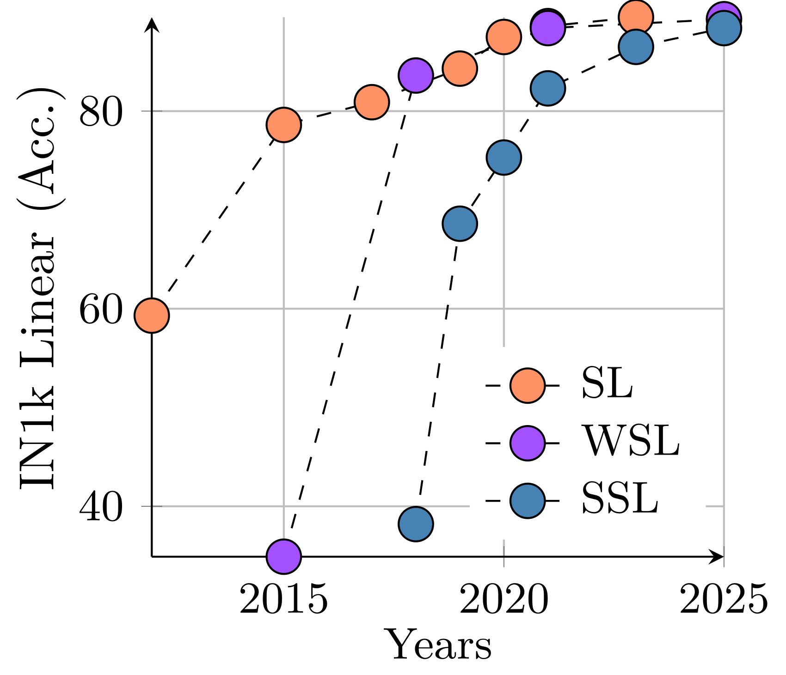

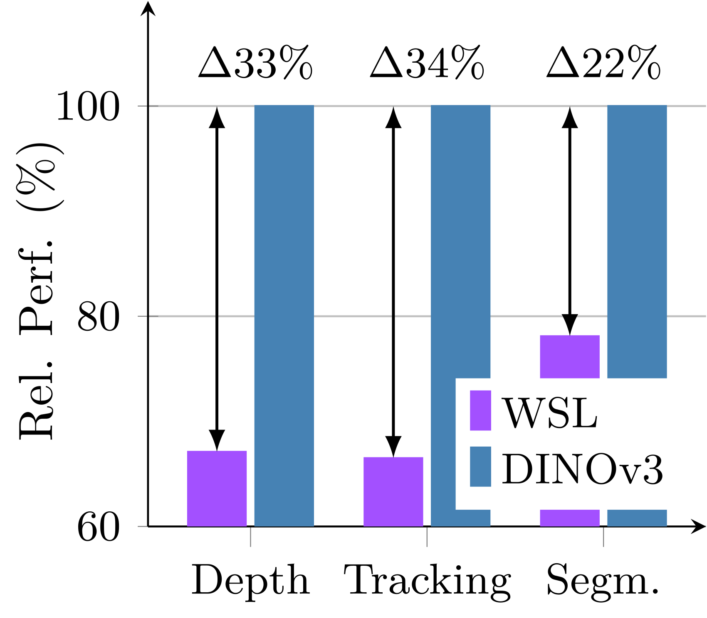

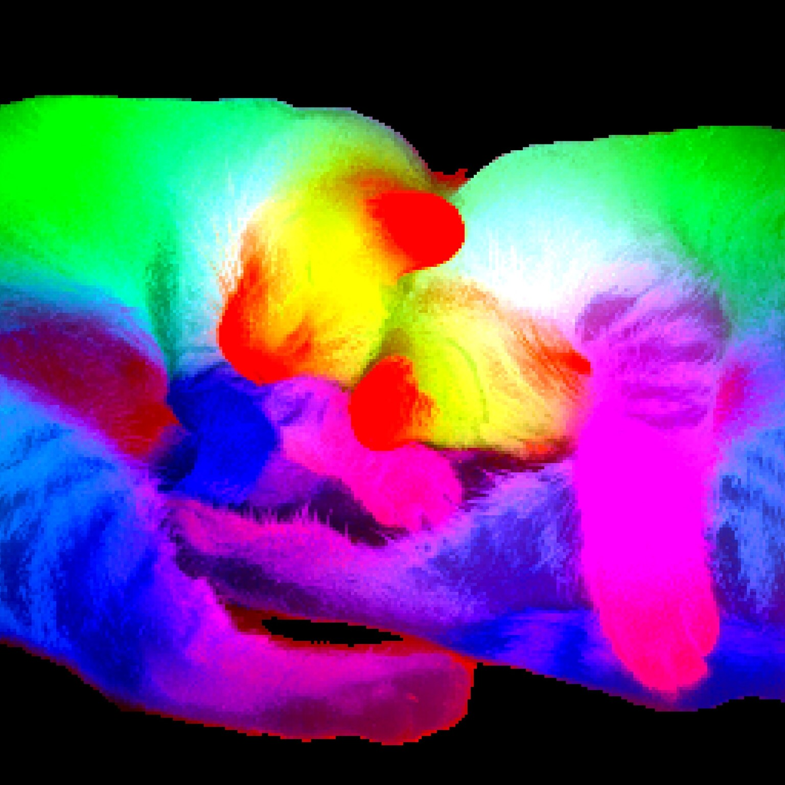

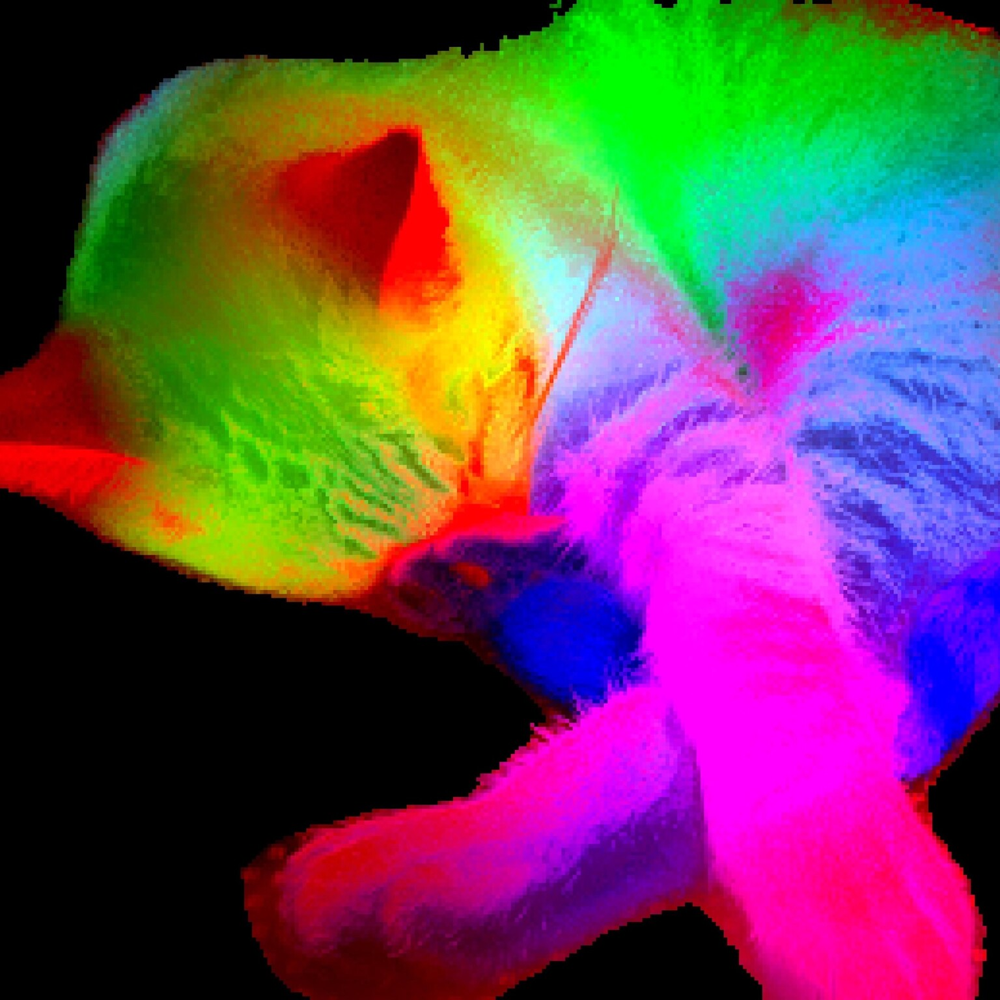

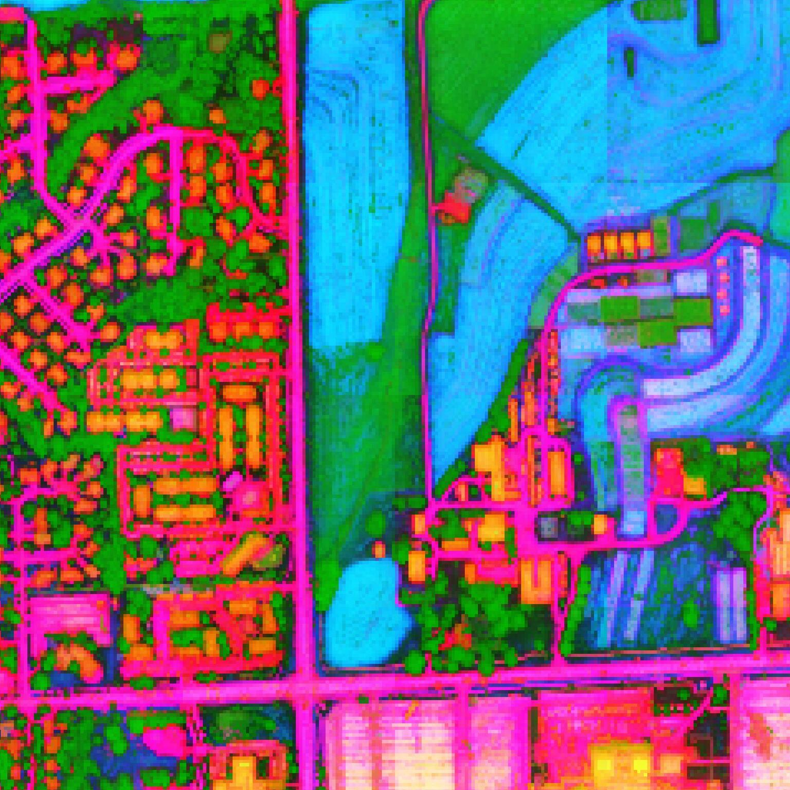

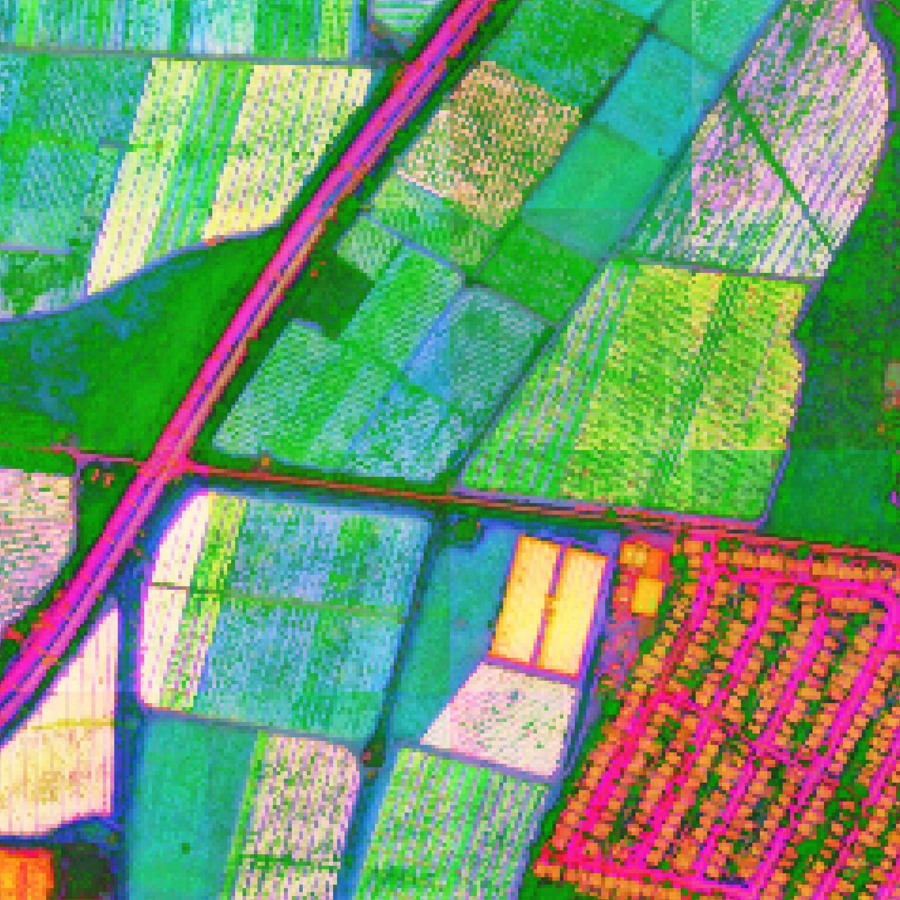

**EN.** Figure 1 : (a) Evolution of linear probing results on ImageNet1k (IN1k) over the years, comparing fully- (SL), weakly- (WSL) and self-supervised learning (SSL) methods. Despite coming into the picture later, SSL has quickly progressed and now reached the Imagenet accuracy plateau of recent years. On the other hand, we demonstrate that SSL offers the unique promise of high-quality dense features. With DINOv3, we markedly improve over weakly-supervised models on dense tasks, as shown by the relative performance of the best-in-class WSL models to DINOv3 (b). We also produce PCA maps of features obtained from high resolution images with DINOv3 trained on natural (c) and aerial images (d).

**中.** 图 1：(a) 多年来 ImageNet1k (IN1k) 上线性探测结果的演变，比较了完全监督学习 (SL)、弱监督学习 (WSL) 和自监督学习 (SSL) 方法。尽管 SSL 出现较晚，但它已经迅速发展，目前已达到近年来 Imagenet 准确度的稳定水平。另一方面，我们证明 SSL 提供了高质量密集功能的独特承诺。借助 DINOv3，我们在密集任务上比弱监督模型有了显着改进，如一流的 WSL 模型与 DINOv3 的相对性能所示 (b)。我们还使用在自然图像 (c) 和航空图像 (d) 上训练的 DINOv3 生成从高分辨率图像获得的特征的 PCA 地图。

**EN.** In practice, the promise of SSL, namely producing arbitrarily large and powerful models by leveraging large amounts of unconstrained data, remains challenging at scale. While model instabilities and collapse are mitigated by the heuristics proposed by Oquab et al. (2024) , more problems emerge from scaling further. First, it is unclear how to collect useful data from unlabeled collections. Second, in usual training practice, employing cosine schedules implies knowing the optimization horizon a priori, which is difficult when training on large image corpora. Third, the performance of the features gradually decreases after early training, confirmed by visual inspection of the patch similarity maps. This phenomenon appears in longer training runs with models above ViT-Large size (300M parameters), reducing the usefulness of scaling DINOv2.

**中.** 在实践中，SSL 的承诺，即通过利用大量无约束数据生成任意大且强大的模型，在规模上仍然具有挑战性。虽然 Oquab 等人提出的启发式方法减轻了模型的不稳定性和崩溃。 (2024)，进一步扩展会出现更多问题。首先，尚不清楚如何从未标记的集合中收集有用的数据。其次，在通常的训练实践中，采用余弦调度意味着先验地了解优化范围，这在大型图像语料库上进行训练时很困难。第三，在早期训练后，特征的性能逐渐下降，这通过补丁相似性图的目视检查得到证实。这种现象出现在 ViT-Large 尺寸（300M 参数）以上的模型的较长训练运行中，从而降低了缩放 DINOv2 的有用性。

**EN.** Addressing the problems above leads to this work, DINOv3 , which advances SSL training at scale. We demonstrate that a single frozen SSL backbone can serve as a universal visual encoder that achieves state-of-the-art performance on challenging downstream tasks, outperforming supervised and metadata-reliant pre-training strategies. Our research is guided by the following objectives: (1) training a foundational model versatile across tasks and domains, (2) improving the shortcomings of existing SSL models on dense features, (3) disseminating a family of models that can be used off-the-shelf. We discuss the three aims in the following.

**中.** 解决上述问题催生了这项工作 DINOv3，它大规模推进了 SSL 训练。我们证明，单个冻结的 SSL 主干网可以作为通用视觉编码器，在具有挑战性的下游任务上实现最先进的性能，优于受监督和依赖元数据的预训练策略。我们的研究遵循以下目标：(1) 训练跨任务和领域通用的基础模型，(2) 改进现有 SSL 模型在密集特征上的缺点，(3) 传播一系列可以现成使用的模型。我们将在下面讨论这三个目标。

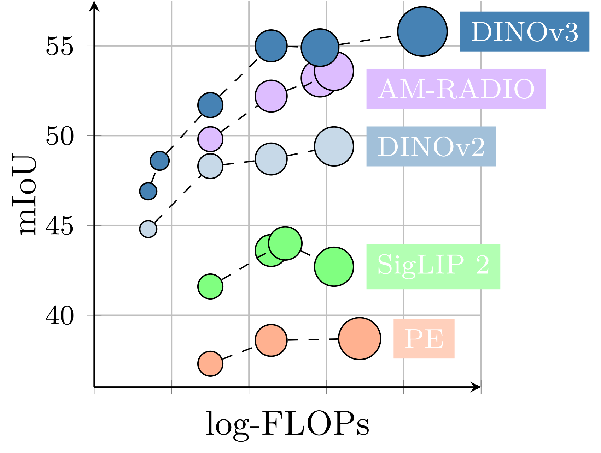

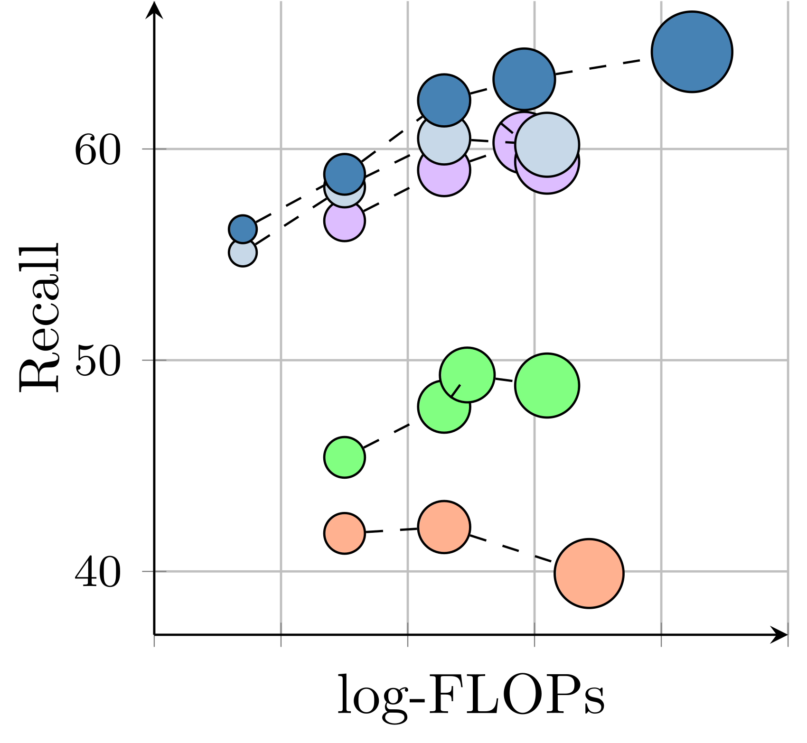

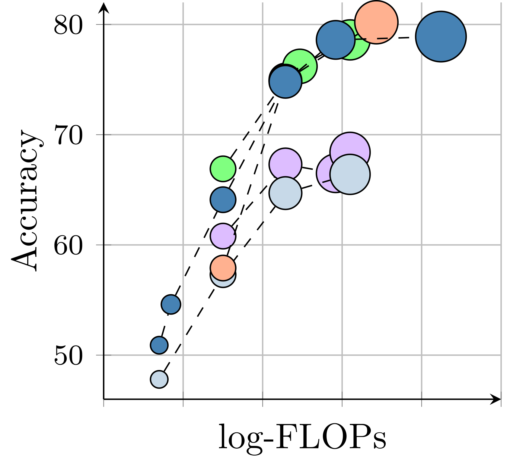

**EN.** Figure 2 : Performance of the DINOv3 family of models, compared to other families of self- or weakly-supervised models, on different benchmarks. DINOv3 significantly surpasses others on dense benchmarks, including models that leverage mask annotation priors such as AM-RADIO ( Heinrich et al., 2025 ) .

**中.** 图 2：DINOv3 系列模型在不同基准上的性能与其他自监督或弱监督模型系列的性能比较。 DINOv3 在密集基准测试上显着超越其他模型，包括利用掩模注释先验的模型，例如 AM-RADIO（Heinrich 等人，2025）。

#### Strong & Versatile Foundational Models / 强大且多功能的基础模型

**EN.** DINOv3 aims to offer a high level of versatility along two axes, which is enabled by the scaling of the model size and training data. First, a key desirable property for SSL models is to achieve excellent performance while being kept frozen, ideally reaching similar state-of-the-art results as specialized models. In that case, a single forward pass can deliver cutting-edge results across multiple tasks, leading to substantial computational savings—an essential advantage for practical applications, particularly on edge devices. We show the wide breadth of tasks that DINOv3 can successfully be applied to in Sec. 6 . Second, a scalable SSL training pipeline that does not depend on metadata unlocks numerous scientific applications. By pre-training on a diverse set of images, whether web images or observational data, SSL models generalize across a large set of domains and tasks. As illustrated in Fig. 1 (d), the PCA of DINOv3 features extracted from a high-resolution aerial image clearly allows to separates roads, houses, and greenery, highlighting the model’s feature quality.

**中.** DINOv3 旨在沿两个轴提供高水平的多功能性，这是通过模型大小和训练数据的缩放来实现的。首先，SSL 模型的一个关键理想特性是在保持冻结的同时实现卓越的性能，理想情况下达到与专用模型类似的最先进结果。在这种情况下，单次前向传递可以跨多个任务提供前沿结果，从而节省大量计算量，这对于实际应用（尤其是边缘设备）来说是一个重要优势。我们将在第 2 节中展示 DINOv3 可以成功应用于的广泛任务。 6.其次，不依赖于元数据的可扩展 SSL 训练管道可以解锁众多科学应用程序。通过对一组不同的图像（无论是网络图像还是观测数据）进行预训练，SSL 模型可以跨大量领域和任务进行泛化。如图 1（d）所示，从高分辨率航拍图像中提取的 DINOv3 特征的 PCA 可以清楚地区分道路、房屋和绿化，突出了模型的特征质量。

#### Superior Feature Maps Through Gram Anchoring / 通过 Gram 锚定获得卓越的特征图

**EN.** Another key feature of DINOv3 is a significant improvement of its dense feature maps. The DINOv3 SSL training strategy aims at producing models excelling at high-level semantic tasks while producing excellent feature maps amenable to solving geometric tasks such as depth estimation, or 3D matching. In particular, the models should produce dense features that can be used off-the-shelf or with little post-processing. The compromise between dense and global representation is especially difficult to optimize when training with vast amounts of images, since the objective of high-level understanding can conflict with the quality of the dense feature maps. These contradictory objectives lead to a collapse of dense features with large models and long training schedules. Our new Gram anchoring strategy effectively mitigates this collapse (see Sec. 4 ). As a result, DINOv3 obtains significantly better dense feature maps than DINOv2, staying clean even at high resolutions (see Fig. 3 ).

**中.** DINOv3 的另一个关键特性是其密集特征图的显着改进。 DINOv3 SSL 训练策略旨在生成擅长高级语义任务的模型，同时生成适合解决深度估计或 3D 匹配等几何任务的出色特征图。特别是，这些模型应该产生可以现成使用或几乎不需要后处理的密集特征。在使用大量图像进行训练时，稠密表示和全局表示之间的折衷尤其难以优化，因为高级理解的目标可能与密集特征图的质量相冲突。这些相互矛盾的目标导致大型模型和长训练计划的密集特征崩溃。我们新的 Gram 锚定策略有效地缓解了这种崩溃（参见第 4 节）。因此，DINOv3 获得了比 DINOv2 明显更好的密集特征图，即使在高分辨率下也能保持干净（见图 3）。

#### The DINOv3 Family of Models / DINOv3 模型系列

**EN.** Solving the degradation of dense feature map with Gram anchoring unlocks the power of scaling. As a consequence, training a much larger model with SSL leads to significant performance improvements. In this work, we successfully train a DINO model with 7B parameters. Since such a large model requires significant resources to run, we apply distillation to compress its knowledge into smaller variants. As a result, we present the DINOv3 family of vision models , a comprehensive suite designed to address a wide spectrum of computer vision challenges. This model family aims to advance the state of the art by offering scalable solutions adaptable to diverse resource constraints and deployment scenarios. The distillation process produces model variants at multiple scales, including Vision Transformer (ViT) Small, Base, and Large, as well as ConvNeXt-based architectures. Notably, the efficient and widely adopted ViT-L model achieves performance close to that of the original 7B teacher across a variety of tasks. Overall, the DINOv3 family demonstrates strong performance on a broad range of benchmarks, matching or exceeding the accuracy of competing models on global tasks, while significantly outperforming them on dense prediction tasks, as visible in Fig. 2 .

**中.** 使用 Gram 锚定解决密集特征图的退化问题释放了缩放的力量。因此，使用 SSL 训练更大的模型可以显着提高性能。在这项工作中，我们成功训练了具有 7B 参数的 DINO 模型。由于如此大的模型需要大量资源才能运行，因此我们应用蒸馏将其知识压缩为更小的变体。因此，我们推出了 DINOv3 系列视觉模型，这是一个旨在解决广泛的计算机视觉挑战的综合套件。该模型系列旨在通过提供适应不同资源限制和部署场景的可扩展解决方案来推进最先进的技术。蒸馏过程产生多个尺度的模型变体，包括 Vision Transformer (ViT) Small、Base 和 Large，以及基于 ConvNeXt 的架构。值得注意的是，高效且广泛采用的 ViT-L 模型在各种任务中实现了接近原始 7B 教师的性能。总体而言，DINOv3 系列在广泛的基准测试中表现出强大的性能，在全局任务上匹配或超过竞争模型的准确性，同时在密集预测任务上显着优于它们，如图 2 所示。

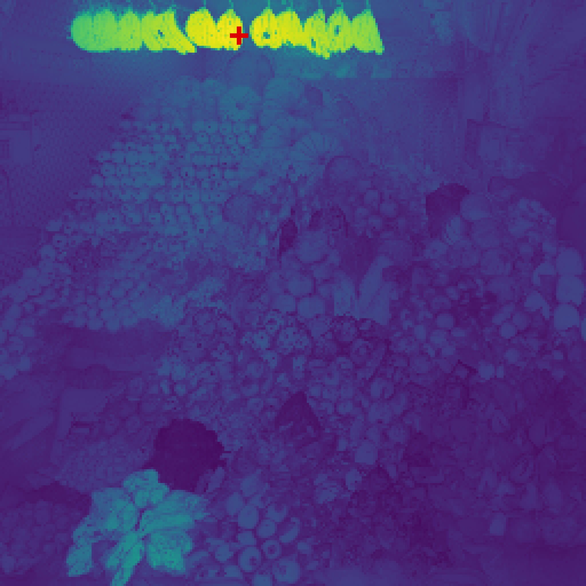

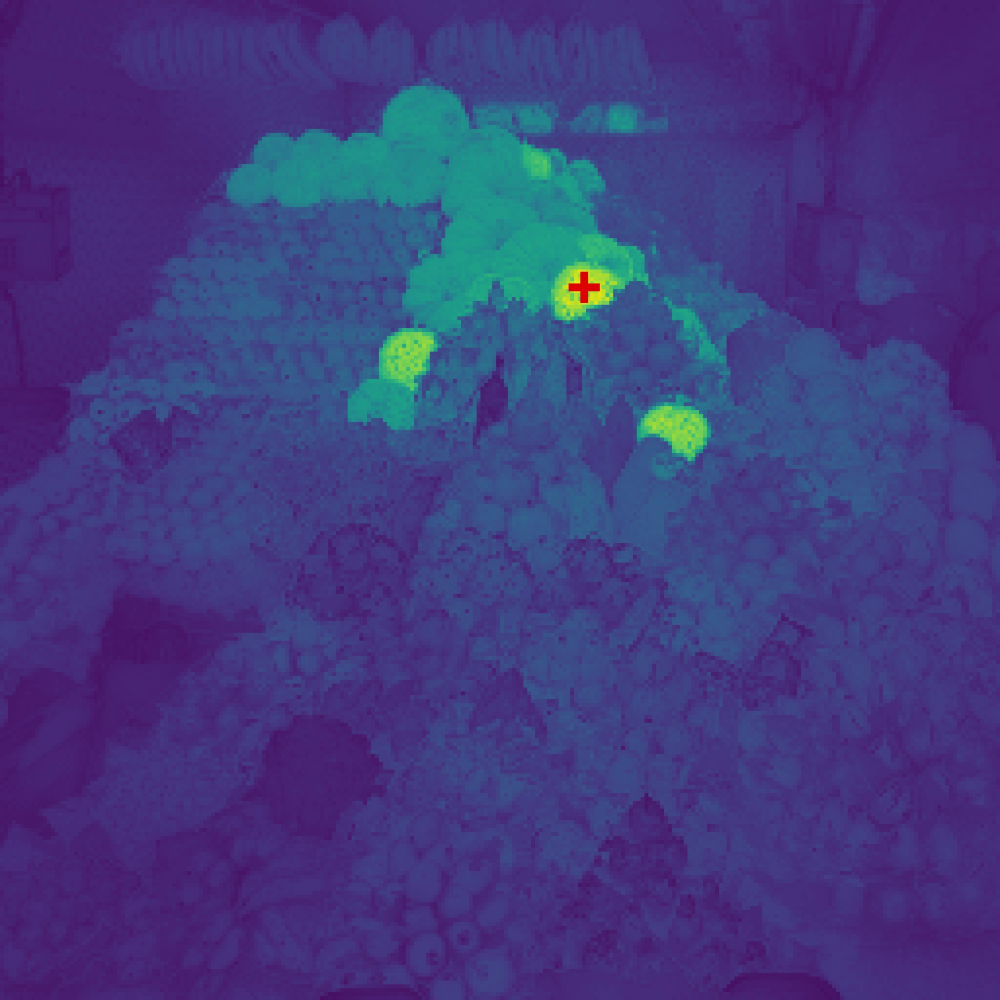

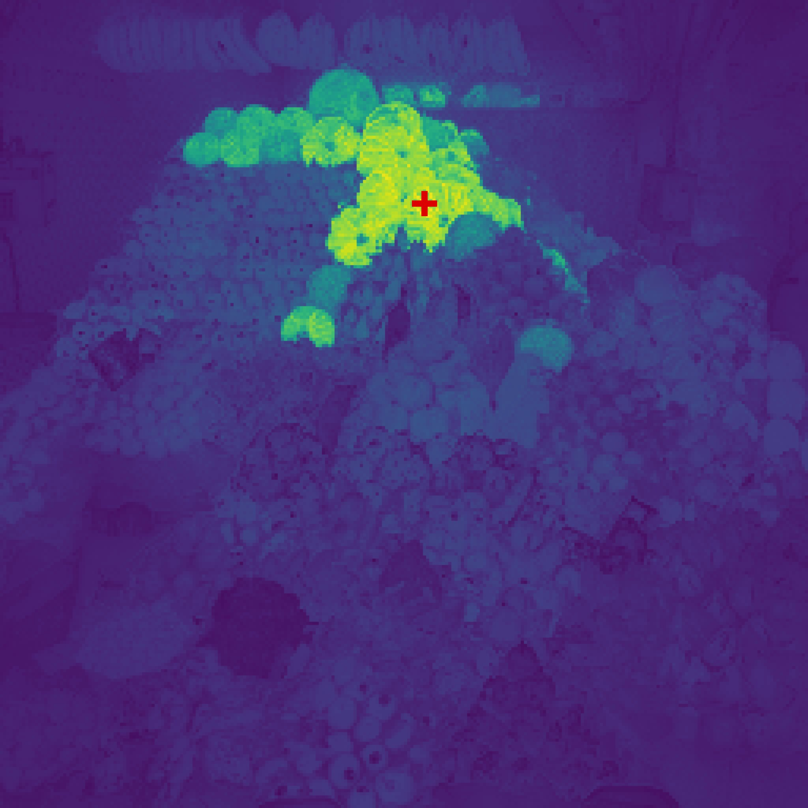

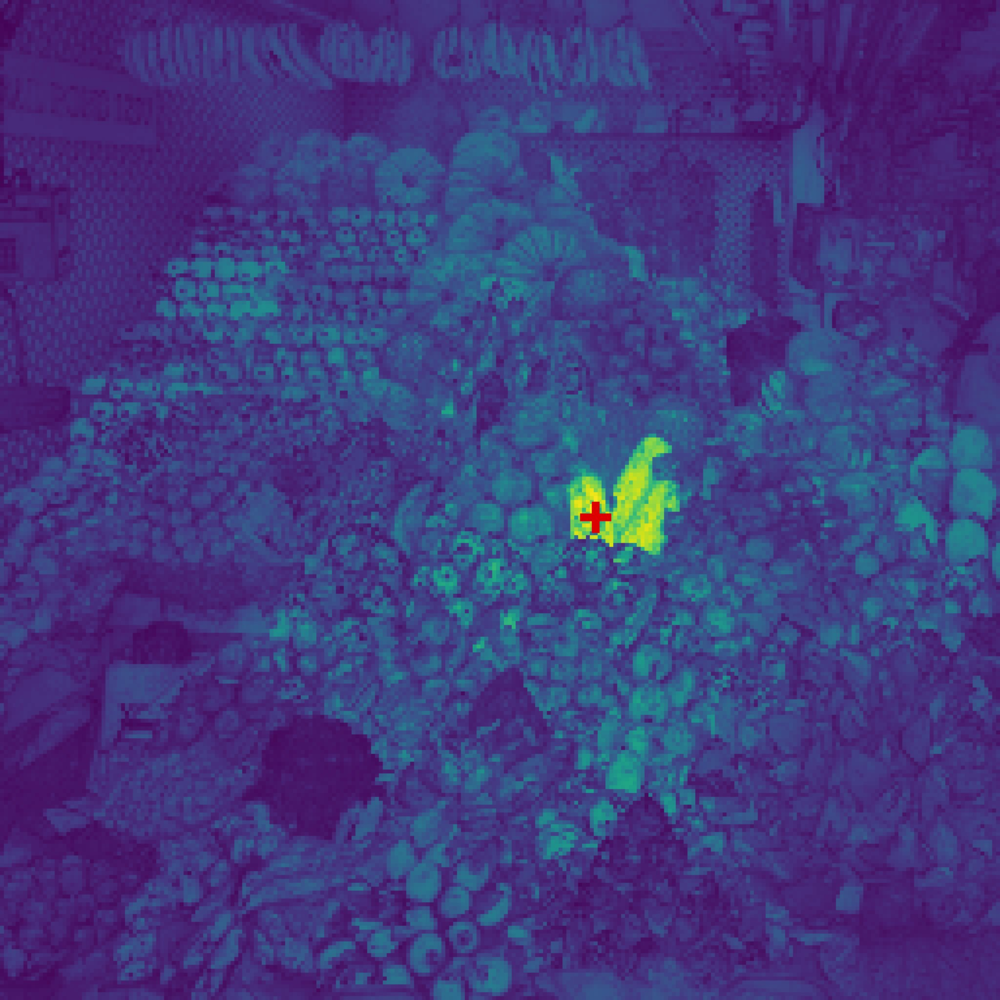

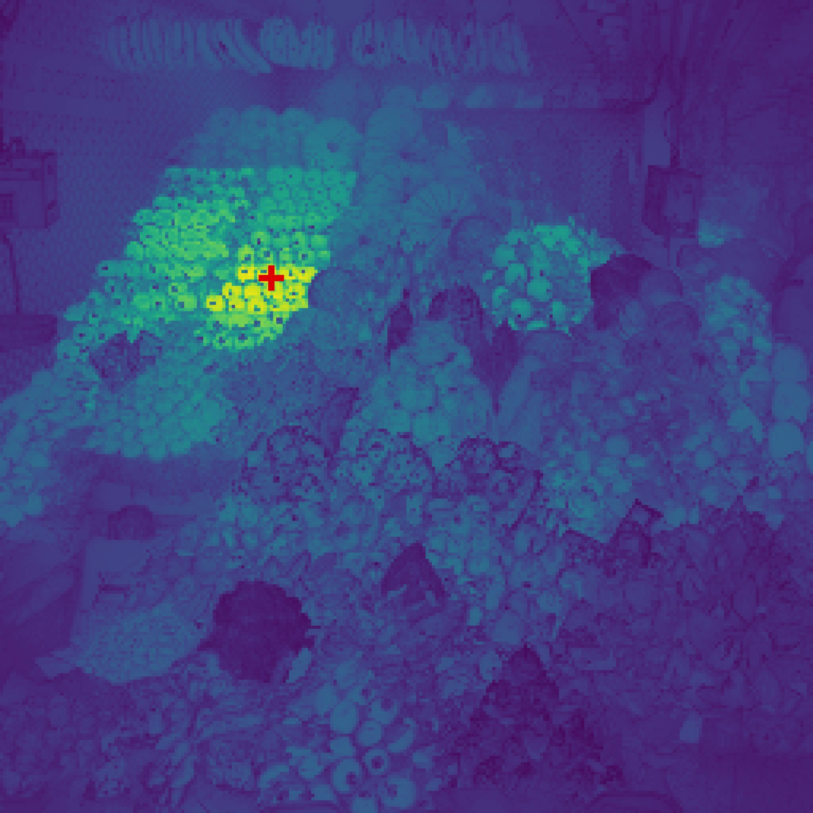

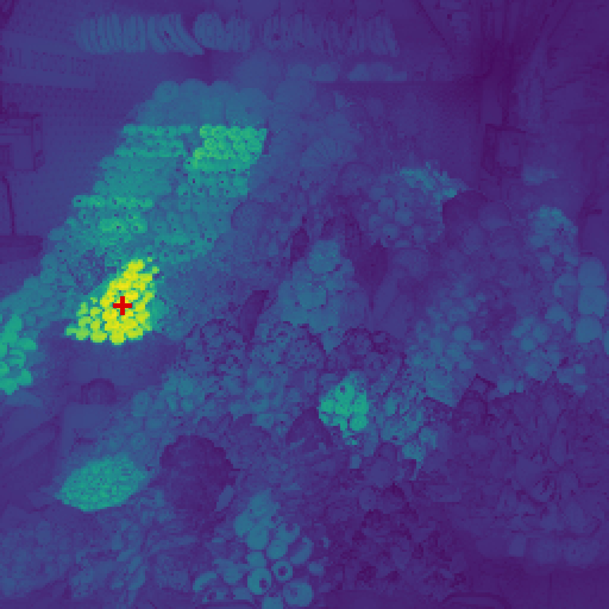

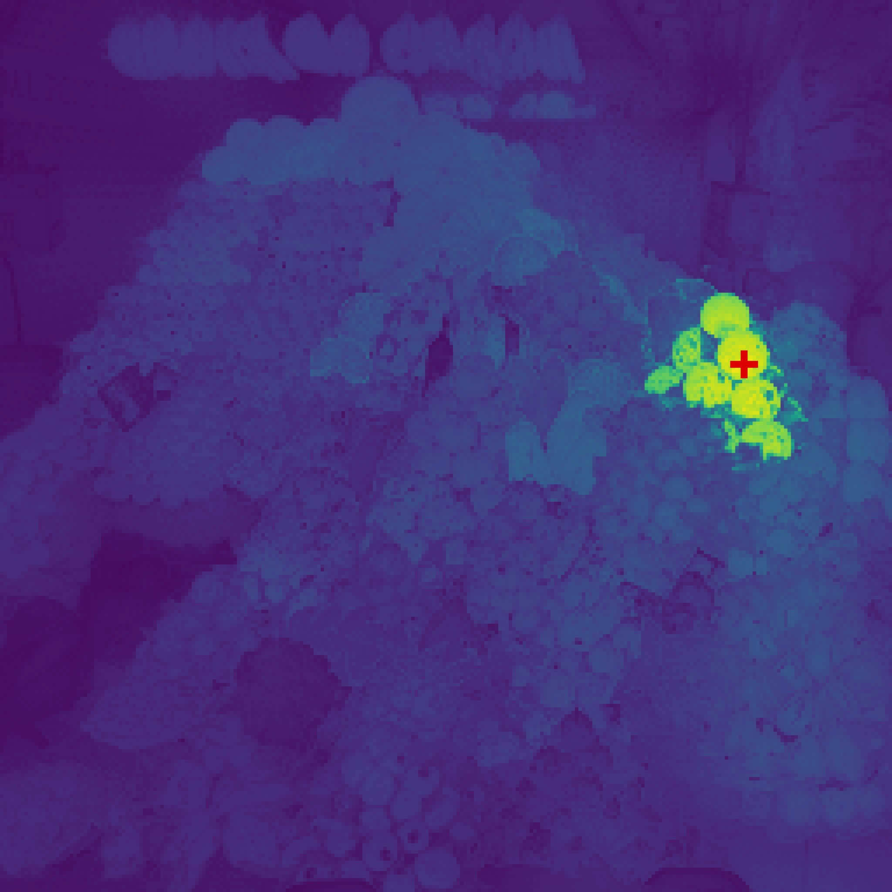

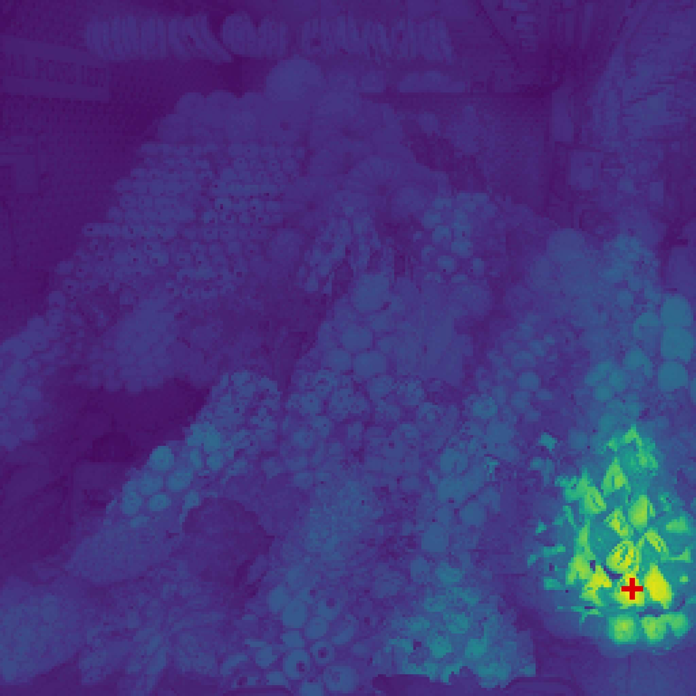

**EN.** Figure 3 : High-resolution dense features. We visualize the cosine similarity maps obtained with DINOv3 output features between the patches marked with a red cross and all other patches. Input image at 4096×4096. Please zoom in , do you agree with DINOv3?

**中.** 图 3：高分辨率密集特征。我们可视化使用 DINOv3 输出特征在标有红十字的补丁和所有其他补丁之间获得的余弦相似度图。输入分辨率为 4096×4096 的图像。请放大，您同意DINOv3吗？

#### Overview of Contributions / 贡献概述

**EN.** In this work, we introduce multiple contributions to address the challenge of scaling SSL towards a large frontier model. We build upon recent advances in automatic data curation ( Vo et al., 2024 ) to obtain a large “background” training dataset that we carefully mix with a bit of specialized data (ImageNet-1k). This allows leveraging large amounts of unconstrained data to improve the model performance. This contribution (i) around data scaling will be described in Sec. 3.1 .

**中.** 在这项工作中，我们引入了多项贡献来解决将 SSL 扩展到大型前沿模型的挑战。我们基于自动数据管理的最新进展（Vo 等人，2024）来获得一个大型“背景”训练数据集，我们将其与一些专门数据（ImageNet-1k）仔细混合。这允许利用大量无约束数据来提高模型性能。有关数据扩展的贡献 (i) 将在第 2 节中描述。 3.1.

**EN.** We increase our main model size to 7B parameters by defining a custom variant of the ViT architecture. We include modern position embeddings (axial RoPE) and develop a regularization technique to avoid positional artifacts. Departing from the multiple cosine schedules in DINOv2, we train with constant hyperparameter schedules for 1M iterations. This allows producing models with stronger performance. This contribution (ii) on model architecture and training will be described in Sec. 3.2 .

**中.** 我们通过定义 ViT 架构的自定义变体，将主模型大小增加到 7B 个参数。我们采用现代位置嵌入（轴向 RoPE）并开发正则化技术来避免位置伪影。与 DINOv2 中的多个余弦计划不同，我们使用常量超参数计划进行 1M 次迭代的训练。这使得能够生产出性能更强的模型。关于模型架构和训练的贡献 (ii) 将在第 2 节中描述。 3.2.

**EN.** With the above techniques, we are able to train a model following the DINOv2 algorithm at scale. However, as mentioned previously, scale leads to a degradation of dense features. To address this, we propose a core improvement of the pipeline with a Gram anchoring training phase. This cleans the noise in the feature maps, leading to impressive similarity maps, and drastically improving the performance on both parametric and non-parametric dense tasks. This contribution (iii) on Gram training will be described in Sec. 4 .

**中.** 通过上述技术，我们能够按照 DINOv2 算法大规模训练模型。然而，如前所述，规模会导致密集特征的退化。为了解决这个问题，我们提出了通过 Gram 锚定训练阶段对管道进行核心改进。这清除了特征图中的噪声，产生令人印象深刻的相似性图，并大大提高了参数和非参数密集任务的性能。关于 Gram 训练的贡献 (iii) 将在第 2 节中描述。 4.

**EN.** Following previous practice, the last steps of our pipeline consist of a high-resolution post-training phase and distillation into a series of high-performance models of various sizes. For the latter, we develop a novel and efficient single-teacher multiple-students distillation procedure. This contribution (iv) transfers the power of our 7B frontier model to a family of smaller practical models for common usage, that we describe in Sec. 5.2 .

**中.** 按照之前的实践，我们管道的最后一步包括高分辨率的训练后阶段和蒸馏成一系列不同大小的高性能模型。对于后者，我们开发了一种新颖且高效的单教师多学生蒸馏程序。这一贡献 (iv) 将我们的 7B 前沿模型的力量转移到一系列较小的通用实用模型中，我们在第 2 节中对此进行了描述。 5.2.

**EN.** As measured in our thorough benchmarking, results in Sec. 6 show that our approach defines a new standard in dense tasks and performs comparably to CLIP derivatives on global tasks. In particular, with a frozen vision backbone , we achieve state-of-the-art performance on longstanding computer vision problems such as object detection (COCO detection, mAP 66.1) and image segmentation (ADE20k, mIoU 63.0), outperforming specialized fine-tuned pipelines. Moreover, we provide evidence of the generality of our approach across domains by applying the DINOv3 algorithm to satellite imagery, in Sec. 8 , surpassing all prior approaches.

**中.** 根据我们全面的基准测试测量，结果在秒。图 6 显示我们的方法定义了密集任务的新标准，并且在全局任务上的表现与 CLIP 导数相当。特别是，借助冻结的视觉主干，我们在长期存在的计算机视觉问题上实现了最先进的性能，例如对象检测（COCO 检测，mAP 66.1）和图像分割（ADE20k，mIoU 63.0），优于专门的微调管道。此外，我们通过将 DINOv3 算法应用于卫星图像，提供了跨领域方法的通用性证据（第 2 节）。 8，超越了所有先前的方法。

## Related Work / 相关工作

#### Self-Supervised Learning / 自我监督学习

**EN.** Learning without annotations requires an artificial learning task that provides supervision in lieu for training. The art and challenge of SSL lies in carefully designing these so-called pre-text tasks in order to learn powerful representations for downstream tasks. The language domain, by its discrete nature, offers straightforward ways to set up such tasks, which led to many successful unsupervised pre-training approaches for text data. Examples include word embeddings ( Mikolov et al., 2013 ; Bojanowski et al., 2017 ) , sentence representations ( Devlin et al., 2018 ; Liu et al., 2019 ) , and plain language models ( Mikolov et al., 2010 ; Zaremba et al., 2014 ) . In contrast, computer vision presents greater challenges due to the continuous nature of the signal. Early attempts mimicking language approaches extracted supervisory signals from parts of an image to predict other parts, e.g . by predicting relative patch position ( Doersch et al., 2015 ) , patch re-ordering ( Noroozi and Favaro, 2016 ; Misra and Maaten, 2020 ) , or inpainting ( Pathak et al., 2016 ) . Other tasks involve re-colorizing images ( Zhang et al., 2016 ) or predicting image transformations ( Gidaris et al., 2018 ) .

**中.** 没有注释的学习需要人工学习任务来提供监督来代替训练。 SSL 的艺术和挑战在于仔细设计这些所谓的前置文本任务，以便学习下游任务的强大表示。语言领域由于其离散的性质，提供了设置此类任务的简单方法，这导致了许多成功的文本数据无监督预训练方法。例子包括词嵌入（Mikolov et al., 2013; Bojanowski et al., 2017）、句子表示（Devlin et al., 2018; Liu et al., 2019）和简单语言模型（Mikolov et al., 2010; Zaremba et al., 2014）。相比之下，由于信号的连续性，计算机视觉面临更大的挑战。早期尝试模仿语言方法从图像的某些部分提取监督信号来预测其他部分，例如。通过预测相对补丁位置（Doersch 等人，2015）、补丁重新排序（Noroozi 和 Favaro，2016；Misra 和 Maaten，2020）或修复（Pathak 等人，2016）。其他任务包括重新着色图像（Zhang et al., 2016）或预测图像变换（Gidaris et al., 2018）。

**EN.** Among these tasks, inpainting-based approaches have gathered significant interest thanks to the flexibility of the patch-based ViT architecture ( He et al., 2021 ; Bao et al., 2021 ; El-Nouby et al., 2021 ) . The objective is to reconstruct corrupted regions of an image, which can be viewed as a form of denoising auto-encoding and is conceptually related to the masked token prediction task in BERT pretraining ( Devlin et al., 2018 ) . Notably, He et al. (2021) demonstrated that pixel-based masked auto-encoders (MAE) can be used as strong initializations for finetuning on downstream tasks. In the following, Baevski et al. (2022) ; Baevski et al. (2023) ; Assran et al. (2023) showed that predicting a learned latent space instead of the pixel space leads to more powerful, higher-level features—a learning paradigm called JEPA: “Joint-Embedding Predictive Architecture” ( LeCun, 2022 ) . Recently, JEPAs have also been extended to video training ( Bardes et al., 2024 ; Assran et al., 2025 ) .

**中.** 在这些任务中，由于基于补丁的 ViT 架构的灵活性，基于修复的方法引起了人们的极大兴趣（He et al., 2021; Bao et al., 2021; El-Nouby et al., 2021）。目标是重建图像的损坏区域，这可以被视为去噪自动编码的一种形式，并且在概念上与 BERT 预训练中的屏蔽标记预测任务相关（Devlin 等人，2018）。值得注意的是，He 等人。 （2021）证明基于像素的掩码自动编码器（MAE）可以用作下游任务微调的强初始化。在下文中，Baevski 等人。 (2022);巴耶夫斯基等人。 (2023);阿斯兰等人。 （2023）表明，预测学习的潜在空间而不是像素空间会带来更强大、更高层次的特征——一种称为 JEPA 的学习范式：“联合嵌入预测架构”（LeCun，2022）。最近，JEPA 还扩展到视频训练（Bardes 等人，2024；Assran 等人，2025）。

**EN.** A second line of work, closer to ours, leverages discriminative signals between images to learn visual representations. This family of methods traces its origins to early deep learning research ( Hadsell et al., 2006 ) , but gained popularity with the introduction of instance classification techniques ( Dosovitskiy et al., 2016 ; Bojanowski and Joulin, 2017 ; Wu et al., 2018 ) . Subsequent advancements introduced contrastive objectives and information-theoretic criteria ( Hénaff et al., 2019 ; He et al., 2020 ; Chen and He, 2020 ; Chen et al., 2020a ; Grill et al., 2020 ; Bardes et al., 2021 ) , as well as self clustering-based strategies ( Caron et al., 2018 ; Asano et al., 2020 ; Caron et al., 2020 ; Caron et al., 2021 ) . More recent approaches, such as iBOT ( Zhou et al., 2021 ) , combine these discriminative losses with masked reconstruction objectives. All of these methods show the ability to learn strong features and achieve high performance on standard benchmarks like ImageNet ( Russakovsky et al., 2015 ) . However, most face challenges scaling to larger model sizes ( Chen et al., 2021 ) .

**中.** 第二条工作与我们的工作更接近，利用图像之间的判别信号来学习视觉表示。这一系列方法的起源可以追溯到早期的深度学习研究（Hadsell 等人，2006 年），但随着实例分类技术的引入而受到欢迎（Dosovitskiy 等人，2016 年；Bojanowski 和 Joulin，2017 年；Wu 等人，2018 年）。随后的进展引入了对比目标和信息理论标准（Hénaff et al., 2019；He et al., 2020；Chen and He, 2020；Chen et al., 2020a；Grill et al., 2020；Bardes et al., 2021），以及基于自聚类的策略（Caron et al., 2018） ；浅野等人，2020；卡伦等人，2021；最近的方法，例如 iBOT（Zhou et al., 2021），将这些判别性损失与掩盖的重建目标结合起来。所有这些方法都显示出学习强大特征的能力，并在 ImageNet 等标准基准上实现高性能（Russakovsky 等人，2015）。然而，大多数都面临着扩展到更大模型尺寸的挑战（Chen 等人，2021）。

#### Vision Foundation Models / 视觉基础模型

**EN.** The deep learning revolution began with the AlexNet breakthrough ( Krizhevsky et al., 2012 ) , a deep convolutional neural network that outperformed all previous methods on the ImageNet challenge ( Deng et al., 2009 ; Russakovsky et al., 2015 ) . Already early on, features learned end-to-end on the large manually-labeled ImageNet dataset were found to be highly effective for a wide range of transfer learning tasks ( Oquab et al., 2014 ) . Early work on vision foundation models then focused on architecture development, including VGG ( Simonyan and Zisserman, 2015 ) , GoogleNet ( Szegedy et al., 2015 ) , and ResNets ( He et al., 2016 ) .

**中.** 深度学习革命始于 AlexNet 的突破（Krizhevsky 等人，2012 年），这是一种深度卷积神经网络，在 ImageNet 挑战赛上超越了之前所有的方法（Deng 等人，2009 年；Russakovsky 等人，2015 年）。很早就发现，在大型手动标记的 ImageNet 数据集上端到端学习的特征对于各种迁移学习任务都非常有效（Oquab 等人，2014 年）。视觉基础模型的早期工作主要集中在架构开发上，包括 VGG（Simonyan 和 Zisserman，2015）、GoogleNet（Szegedy 等人，2015）和 ResNets（He 等人，2016）。

**EN.** Given the effectiveness of scaling , subsequent works explored training larger models on big datasets. Sun et al. (2017) expanded supervised training data with the proprietary JFT dataset containing 300 million labeled images, showing impressive results. JFT also enabled significant performance gains for Kolesnikov et al. (2020) . In parallel, scaling was explored using a combination of supervised and unsupervised data. For instance, an ImageNet-supervised model can be used to produce pseudo-labels for unsupervised data, which then serve to train larger networks ( Yalniz et al., 2019 ) . Subsequently, the availability of large supervised datasets such as JFT also facilitated the adaptation of the transformer architecture to computer vision ( Dosovitskiy et al., 2020 ) . In particular, achieving performance comparable to that of the original vision transformer (ViT) without access to JFT requires substantial effort ( Touvron et al., 2020 ; Touvron et al., 2022 ) . Due to the learning capacity of ViTs, scaling efforts were further extended by Zhai et al. (2022a) , culminating in the very large ViT-22B encoder ( Dehghani et al., 2023 ) .

**中.** 鉴于缩放的有效性，后续工作探索了在大数据集上训练更大的模型。孙等人。 (2017) 使用包含 3 亿张标记图像的专有 JFT 数据集扩展了监督训练数据，显示了令人印象深刻的结果。 JFT 还为 Kolesnikov 等人带来了显着的性能提升。 （2020）。同时，使用监督和非监督数据的组合来探索扩展。例如，ImageNet 监督模型可用于为无监督数据生成伪标签，然后用于训练更大的网络（Yalniz 等人，2019）。随后，JFT 等大型监督数据集的可用性也促进了 Transformer 架构对计算机视觉的适应（Dosovitskiy 等人，2020）。特别是，在不使用 JFT 的情况下实现与原始视觉转换器 (ViT) 相当的性能需要付出巨大的努力（Touvron 等人，2020；Touvron 等人，2022）。由于 ViT 的学习能力，Zhai 等人进一步扩展了扩展工作。 (2022a)，最终产生了非常大的 ViT-22B 编码器（Dehghani 等人，2023）。

**EN.** Given the complexity of manually labeling large datasets, weakly-supervised training —where annotations are derived from metadata associated with images—provides an effective alternative to supervised training. Early on, Joulin et al. (2016) demonstrated that a network can be pre-trained by simply predicting all words in the image caption as targets. This initial approach was further refined by leveraging sentence structures ( Li et al., 2017 ) , incorporating other types of metadata and involve curation ( Mahajan et al., 2018 ) , and scaling ( Singh et al., 2022 ) . However, weakly-supervised algorithms only reached their full potential with the introduction of contrastive losses and the joint-training of caption representations, as exemplified by Align ( Jia et al., 2021 ) and CLIP ( Radford et al., 2021 ) .

**中.** 考虑到手动标记大型数据集的复杂性，弱监督训练（其中注释源自与图像相关的元数据）提供了监督训练的有效替代方案。早期，Joulin 等人。 (2016) 证明，可以通过简单地预测图像标题中的所有单词作为目标来对网络进行预训练。通过利用句子结构（Li et al., 2017）、纳入其他类型的元数据并涉及管理（Mahajan et al., 2018）和扩展（Singh et al., 2022），进一步完善了这种初始方法。然而，弱监督算法只有通过引入对比损失和联合训练字幕表示才能充分发挥其潜力，例如 Align (Jia et al., 2021) 和 CLIP (Radford et al., 2021)。

**EN.** This highly successful approach inspired numerous open-source reproductions and scaling efforts . OpenCLIP ( Cherti et al., 2023 ) was the first open-source effort to replicate CLIP by training on the LAION dataset ( Schuhmann et al., 2021 ) ; following works leverage pre-trained backbones by fine-tuning them in a CLIP-style manner ( Sun et al., 2023 ; Sun et al., 2024 ) . Recognizing that data collection is a critical factor in the success of CLIP training, MetaCLIP ( Xu et al., 2024 ) precisely follows the original CLIP procedure to reproduce its results, whereas Fang et al. (2024a) use supervised datasets to curate pretraining data. Other works focus on improving the training loss, e.g . using a sigmoid loss in SigLIP ( Zhai et al., 2023 ) , or leveraging a pre-trained image encoder ( Zhai et al., 2022b ) . Ultimately though, the most critical components for obtaining cutting-edge foundation models are abundant high-quality data and substantial compute resources. In this vein, SigLIP 2 ( Tschannen et al., 2025 ) and Perception Encoder (PE) ( Bolya et al., 2025 ) achieve impressive results after training on more than $40$ B image-text pairs. The largest PE model is trained on $86$ B billion samples with a global batch size of $131$ K. Finally, a range of more complex and natively multimodal approaches have been proposed; these include contrastive captioning ( Yu et al., 2022 ) , masked modeling in the latent space ( Bao et al., 2021 ; Wang et al., 2022b ; Fang et al., 2023 ; Wang et al., 2023a ) , and auto-regressive training ( Fini et al., 2024 ) .

**中.** 这种非常成功的方法激发了众多开源复制品和扩展工作。 OpenCLIP（Cherti 等人，2023）是第一个通过在 LAION 数据集上进行训练来复制 CLIP 的开源项目（Schuhmann 等人，2021）；以下工作通过以 CLIP 风格的方式微调预训练的主干来利用它们（Sun 等人，2023；Sun 等人，2024）。认识到数据收集是 CLIP 训练成功的关键因素，MetaCLIP (Xu et al., 2024) 精确地遵循原始 CLIP 程序来重现其结果，而 Fang 等人。 (2024a) 使用监督数据集来管理预训练数据。其他工作侧重于改善训练损失，例如。在 SigLIP 中使用 sigmoid 损失（Zhai 等人，2023），或利用预先训练的图像编码器（Zhai 等人，2022b）。但归根结底，获得尖端基础模型的最关键因素是丰富的高质量数据和大量的计算资源。在这方面，SigLIP 2（Tschannen 等人，2025）和感知编码器（PE）（Bolya 等人，2025）在对超过 $40$ B 图像-文本对进行训练后取得了令人印象深刻的结果。最大的 PE 模型是在 $86$ B 十亿个样本上训练的，全局批量大小为 $131$ K。最后，提出了一系列更复杂和原生的多模态方法；其中包括对比字幕（Yu et al., 2022）、潜在空间中的掩模建模（Bao et al., 2021; Wang et al., 2022b; Fang et al., 2023; Wang et al., 2023a）和自回归训练（Fini et al., 2024）。

**EN.** In contrast, relatively little work has focused on scaling unsupervised image pretraining . Early efforts include Caron et al. (2019) and Goyal et al. (2019) utilizing the YFCC dataset ( Thomee et al., 2016 ) . Further progress has been achieved by focusing on larger datasets and models ( Goyal et al., 2021 ; Goyal et al., 2022a ) , as well as initial attempts at data curation for SSL ( Tian et al., 2021 ) . Careful tuning of the training algorithms, larger architectures, and more extensive training data lead to the impressive results of DINOv2 ( Oquab et al., 2024 ) ; for the first time, an SSL model matched or surpassed open-source CLIP variants on a range of tasks. This direction has recently been further pushed by Fan et al. (2025) by scaling to larger models without data curation, or by Venkataramanan et al. (2025) using open datasets and improved training recipes.

**中.** 相比之下，关注缩放无监督图像预训练的工作相对较少。早期的努力包括 Caron 等人。 （2019）和戈亚尔等人。 (2019) 利用 YFCC 数据集（Thomee 等人，2016）。通过关注更大的数据集和模型（Goyal 等人，2021；Goyal 等人，2022a）以及 SSL 数据管理的初步尝试（Tian 等人，2021），取得了进一步的进展。训练算法的仔细调整、更大的架构和更广泛的训练数据导致了 DINOv2 令人印象深刻的结果（Oquab 等人，2024）； SSL 模型首次在一系列任务上匹配或超越了开源 CLIP 变体。 Fan等人最近进一步推动了这一方向。 （2025）通过在没有数据管理的情况下扩展到更大的模型，或由 Venkataramanan 等人提出。 （2025）使用开放数据集和改进的训练方法。

#### Dense Transformer Features / 密集Transformer特点

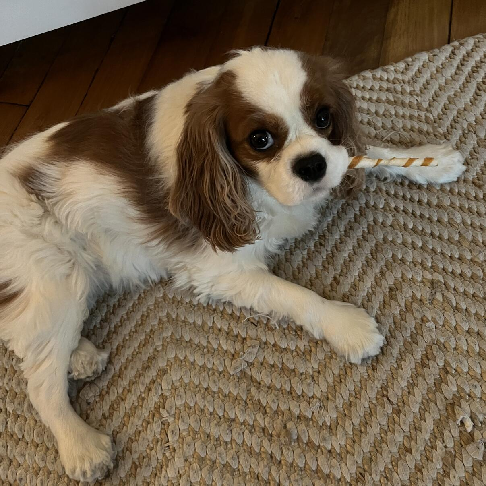

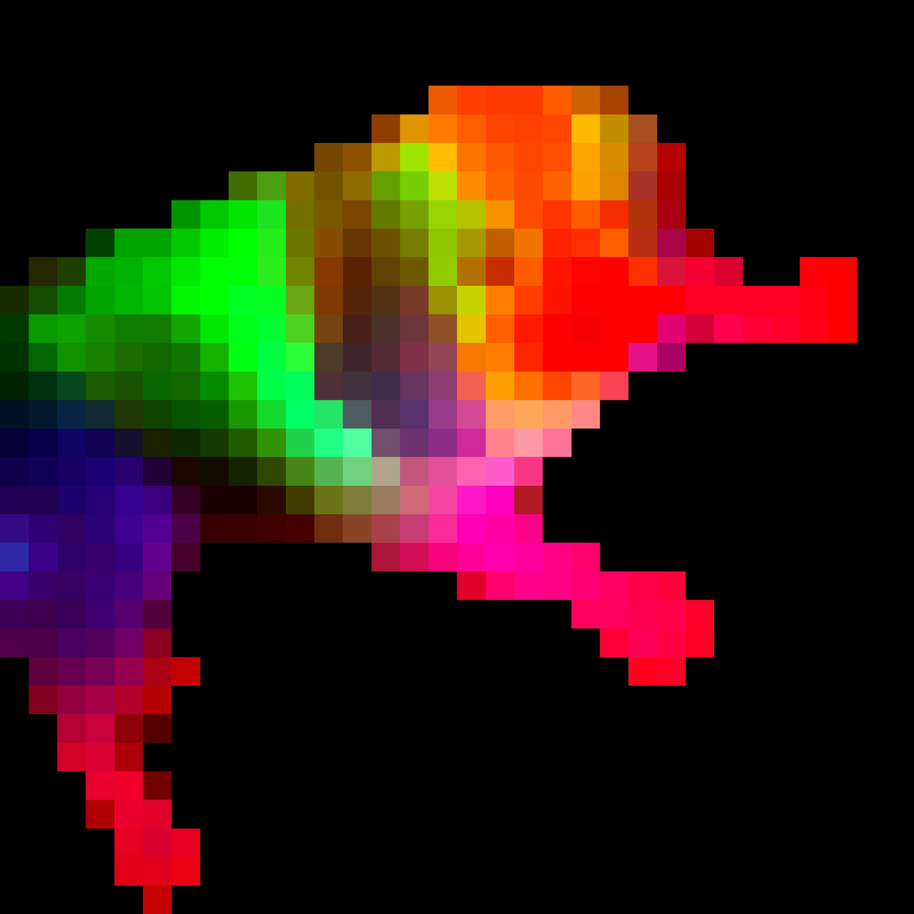

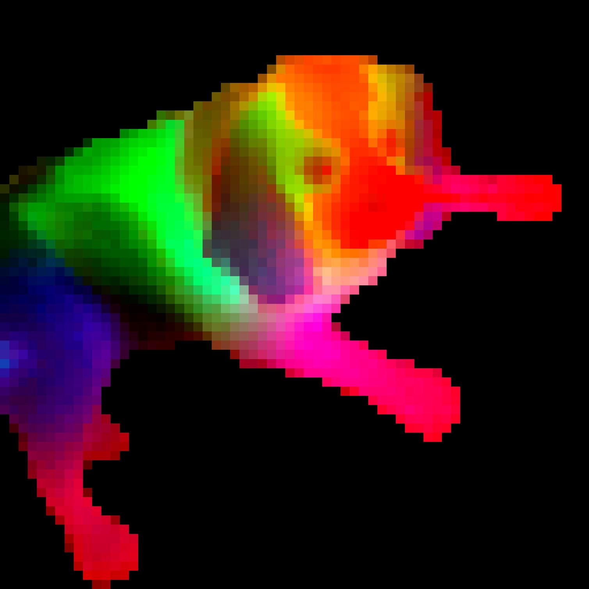

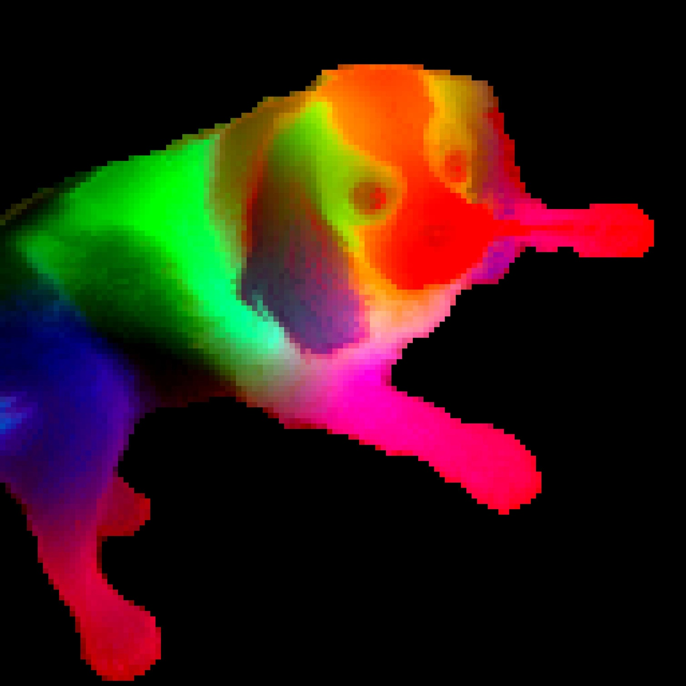

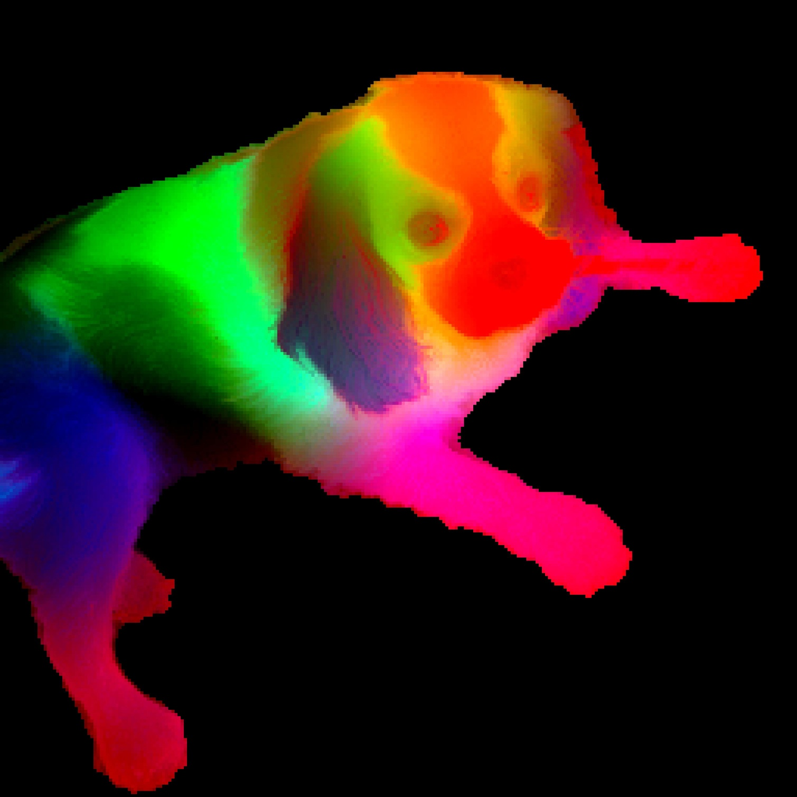

**EN.** Figure 4 : DINOv3 at very high resolution. We visualize dense features of DINOv3 by mapping the first three components of a PCA computed over the feature space to RGB. To focus the PCA on the subject, we mask the feature maps via background subtraction. With increasing resolution, DINOv3 produces crisp features that stay semantically meaningful. We visualize more PCAs in Sec. 6.1.1 .

**中.** 图 4：非常高分辨率的 DINOv3。我们通过将在特征空间上计算的 PCA 的前三个分量映射到 RGB 来可视化 DINOv3 的密集特征。为了将 PCA 聚焦在主题上，我们通过背景扣除来掩盖特征图。随着分辨率的提高，DINOv3 可以生成清晰的特征，并保持语义意义。我们在第二节中可视化了更多的 PCA。 6.1.1.

**EN.** A broad range of modern vision applications consume dense features of pre-trained transformers, including multi-modal models ( Liu et al., 2023 ; Beyer et al., 2024 ) , generative models ( Yu et al., 2025 ; Yao et al., 2025 ) , 3D understanding ( Wang et al., 2025 ) , video understanding ( Lin et al., 2023a ; Wang et al., 2024b ) , and robotics ( Driess et al., 2023 ; Kim et al., 2024 ) . On top of that, traditional vision tasks such as detection, segmentation, or depth estimation require accurate local descriptors. To enhance the quality of SSL-trained local descriptors, a substantial body of work focuses on developing local SSL losses . Examples include leveraging spatio-temporal consistency in videos, e.g . using point track loops as training signal ( Jabri et al., 2020 ) , exploiting the spatial alignment between different crops of the same image ( Pinheiro et al., 2020 ; Bardes et al., 2022 ) , or enforcing consistency between neighboring patches ( Yun et al., 2022 ) . Darcet et al. (2025) show that predicting clustered local patches leads to improved dense representations. DetCon ( Hénaff et al., 2021 ) and ORL ( Xie et al., 2021 ) perform contrastive learning on region proposals but assume that such proposals exist a priori ; this assumption is relaxed by approaches such as ODIN ( Hénaff et al., 2022 ) and SlotCon ( Wen et al., 2022 ) . Without changing the training objective, Darcet et al. (2024) show that adding register tokens to the input sequence greatly improves dense feature maps, and recent works find this can be done without model training ( Jiang et al., 2025 ; Chen et al., 2025 ) .

**中.** 广泛的现代视觉应用消耗预训练 Transformer 的密集特征，包括多模态模型（Liu et al., 2023；Beyer et al., 2024）、生成模型（Yu et al., 2025；Yao et al., 2025）、3D 理解（Wang et al., 2025）、视频理解（Lin et al., 2023a） ；Wang 等人，2024b) 和机器人技术（Driess 等人，2023；Kim 等人，2024）。最重要的是，检测、分割或深度估计等传统视觉任务需要准确的局部描述符。为了提高 SSL 训练的本地描述符的质量，大量工作集中在开发本地 SSL 损失上。示例包括利用视频中的时空一致性，例如使用点跟踪循环作为训练信号（Jabri et al., 2020），利用同一图像的不同作物之间的空间对齐（Pinheiro et al., 2020；Bardes et al., 2022），或强制相邻补丁之间的一致性（Yun et al., 2022）。达尔塞等人。 （2025）表明，预测聚集的局部补丁可以改善稠密表示。 DetCon (Hénaff et al., 2021) 和 ORL (Xie et al., 2021) 对区域提案进行对比学习，但假设此类提案是先验存在的； ODIN (Hénaff et al., 2022) 和 SlotCon (Wen et al., 2022) 等方法放松了这一假设。在不改变训练目标的情况下，Darcet 等人。 （2024）表明，向输入序列添加寄存器标记极大地改善了密集特征图，并且最近的工作发现这可以在没有模型训练的情况下完成（Jiang 等人，2025；Chen 等人，2025）。

**EN.** A recent trend are distillation-based, “ agglomerative ” methods that combine information from multiple image encoders with varying in global and local feature quality, trained using different levels of supervision ( Ranzinger et al., 2024 ; Bolya et al., 2025 ) : AM-RADIO ( Ranzinger et al., 2024 ) combines the strengths of the fully-supervised SAM ( Kirillov et al., 2023 ) , the weakly-supervised CLIP, and the self-supervised DINOv2 into a unified backbone. The Perception Encoder ( Bolya et al., 2025 ) similarly distills SAM(v2) into a specialized dense variant called PEspatial. They use an objective enforcing cosine similarity between student and teacher patches to be high, where their teacher is trained with mask annotations. Similar losses were shown to be effective in the context of style transfer, by reducing the inconsistency between the Gram matrices of feature dimensions ( Gatys et al., 2016 ; Johnson et al., 2016 ; Yoo et al., 2024 ) . In this work, we adopt a Gram objective to regularize cosine similarity between student and teacher patches, favoring them being close. In our case, we use earlier iterations of the SSL model itself as the teacher, demonstrating that early-stage SSL models effectively guides SSL training for both global and dense tasks.

**中.** 最近的趋势是基于蒸馏的“凝聚”方法，它将来自多个图像编码器的信息与不同的全局和局部特征质量相结合，并使用不同级别的监督进行训练（Ranzinger et al., 2024；Bolya et al., 2025）：AM-RADIO（Ranzinger et al., 2024）结合了完全监督的 SAM 的优势（Kirillov et al., 2023） ）、弱监督 CLIP 和自监督 DINOv2 成为统一的骨干网。感知编码器（Bolya et al., 2025）类似地将 SAM(v2) 提炼成一种称为 PEspatial 的专门密集变体。他们使用客观的方法来强制学生和教师补丁之间的余弦相似度较高，而他们的教师则接受了掩模注释的培训。通过减少特征维度的 Gram 矩阵之间的不一致，类似的损失被证明在风格迁移的背景下是有效的（Gatys 等人，2016 年；Johnson 等人，2016 年；Yoo 等人，2024 年）。在这项工作中，我们采用 Gram 目标来规范学生和教师补丁之间的余弦相似度，有利于它们接近。在我们的案例中，我们使用 SSL 模型本身的早期迭代作为教师，证明早期 SSL 模型有效地指导全局任务和密集任务的 SSL 训练。

**EN.** Other works focus on post-hoc improvements to the local features of SSL-trained models. For example, Ziegler and Asano (2022) fine-tune a pre-trained model with a dense clustering objective; similarly, Salehi et al. (2023) fine-tune by aligning patch features temporally, in both cases enhance the quality of local features. Closer to us, Pariza et al. (2025) propose a patch-sorting based objective to encourage the student and teacher to produce features with consistent neighbor ordering. Without finetuning, STEGO ( Hamilton et al., 2022 ) learns a non-linear projection on top of frozen SSL features to form compact clusters and amplify correlation patterns. Alternatively, Simoncini et al. (2024) augment self-supervised features by concatenating gradients from different self-supervised objectives to frozen SSL features. Recently, Wysoczańska et al. (2024) show that noisy feature maps are significantly improved through a weighted average of patches.

**中.** 其他工作侧重于对 SSL 训练模型的局部特征进行事后改进。例如，Ziegler 和 Asano (2022) 使用密集聚类目标对预训练模型进行了微调；同样，萨利希等人。 （2023）通过暂时对齐补丁特征进行微调，在这两种情况下都增强了局部特征的质量。离我们更近的是，Pariza 等人。 （2025）提出了一个基于补丁排序的目标，以鼓励学生和教师产生具有一致邻居排序的特征。在不进行微调的情况下，STEGO（Hamilton et al., 2022）可以在冻结的 SSL 特征之上学习非线性投影，以形成紧凑的集群并放大相关模式。或者，西蒙奇尼等人。 (2024) 通过将不同自监督目标的梯度连接到冻结的 SSL 特征来增强自监督特征。最近，Wysoczańska 等人。 （2024）表明，通过补丁的加权平均，噪声特征图得到了显着改善。

**EN.** Related, but not specific to SSL, some recent works generate high-resolution feature maps from ViT feature maps ( Fu et al., 2024 ) , which are often low-resolution due to patchification of images. In contrast with this body of work, our models natively deliver high-quality dense feature maps that remain stable and consistent across resolutions, as shown in Fig. 4 .

**中.** 与 SSL 相关但并非特定的，最近的一些工作从 ViT 特征图生成高分辨率特征图（Fu et al., 2024），由于图像的修补，这些特征图通常是低分辨率的。与这项工作相比，我们的模型本身提供了高质量的密集特征图，这些特征图在不同分辨率下保持稳定和一致，如图 4 所示。

## Training at Scale Without Supervision / 在没有监督的情况下进行大规模培训

**EN.** DINOv3 is a next-generation model designed to produce the most robust and flexible visual representations to date by pushing the boundaries of self-supervised learning. We draw inspiration from the success of large language models (LLMs), for which scaling-up the model capacity leads to outstanding emerging properties . By leveraging models and training datasets that are an order of magnitude larger, we seek to unlock the full potential of SSL and drive a similar paradigm shift for computer vision, unencumbered by the limitations inherent to traditional supervised or task-specific approaches. In particular, SSL produces rich, high-quality visual features that are not biased toward any specific supervision or task, thereby providing a versatile foundation for a wide range of downstream applications. While previous attempts at scaling SSL models have been hindered by issues of instability, this section describes how we harness the benefits of scaling with careful data preparation, design, and optimization. We first describe the dataset creation procedure ( Sec. 3.1 ), then present the self-supervised SSL recipe used for this first training phase of DINOv3 ( Sec. 3.2 ). This includes the choice of architecture, loss functions, and optimization techniques. The second training phase, focusing on dense features, will be described in Sec. 4 .

**中.** DINOv3 是下一代模型，旨在通过突破自我监督学习的界限来产生迄今为止最强大、最灵活的视觉表示。我们从大型语言模型（LLM）的成功中汲取灵感，扩大模型容量会带来出色的新兴特性。通过利用大一个数量级的模型和训练数据集，我们寻求释放 SSL 的全部潜力，并推动计算机视觉的类似范式转变，而不受传统监督或特定任务方法固有的限制的阻碍。特别是，SSL 产生丰富、高质量的视觉特征，这些特征不偏向任何特定的监督或任务，从而为广泛的下游应用程序提供了通用的基础。虽然之前扩展 SSL 模型的尝试因不稳定问题而受到阻碍，但本节介绍了我们如何通过仔细的数据准备、设计和优化来利用扩展的好处。我们首先描述数据集创建过程（第 3.1 节），然后介绍用于 DINOv3 第一个训练阶段的自监督 SSL 配方（第 3.2 节）。这包括架构、损失函数和优化技术的选择。第二个训练阶段，重点关注密集特征，将在第 2 节中描述。 4.

### Data Preparation / 数据准备

**EN.** Data scaling is one of the driving factors behind the success of large foundation models ( Touvron et al., 2023 ; Radford et al., 2021 ; Xu et al., 2024 ; Oquab et al., 2024 ) . However, increasing naively the size of the training data does not necessarily translate into higher model quality and better performance on downstream benchmarks ( Goyal et al., 2021 ; Oquab et al., 2024 ; Vo et al., 2024 ) : Successful data scaling efforts typically involve careful data curation pipelines. These algorithms may have different objectives: either focusing on improving data diversity and balance , or data usefulness —its relevance to common practical applications. For the development of DINOv3, we combine two complementary approaches to improve both the generalizability and performance of the model, striking a balance between the two objectives.

**中.** 数据扩展是大型基础模型成功背后的驱动因素之一（Touvron et al., 2023; Radford et al., 2021; Xu et al., 2024; Oquab et al., 2024）。然而，单纯地增加训练数据的大小并不一定会转化为更高的模型质量和更好的下游基准性能（Goyal 等人，2021；Oquab 等人，2024；Vo 等人，2024）：成功的数据扩展工作通常涉及仔细的数据管理管道。这些算法可能有不同的目标：要么专注于提高数据多样性和平衡性，要么专注于数据有用性——其与常见实际应用的相关性。在 DINOv3 的开发中，我们结合了两种互补的方法来提高模型的通用性和性能，在两个目标之间取得平衡。

| Dataset 数据集 |  | IN1k k-NN | IN1k Linear IN1k 线性 | ObjectNet 对象网 | iNaturalist 2021 | Paris Retrieval 巴黎检索 |
| --- | --- | --- | --- | --- | --- | --- |
| Raw 原料 |  | 80.1 | 84.8 | 70.3 | 70.1 | 63.3 |
| Clustering 聚类 |  | 79.4 | 85.4 | 72.3 | 81.3 | 85.2 |
| Retrieval 检索 |  | 84.0 | 86.7 | 70.7 | 86.0 | 82.7 |
| LVD-1689M (ours) LVD-1689M（我们的） |  | 84.6 | 87.2 | 72.8 | 87.0 | 85.9 |

**EN.** Table 1: Influence of training data on features quality shown via performance on downstream tasks. We compare datasets curated with clustering ( Vo et al., 2024 ) and retrieval ( Oquab et al., 2024 ) to raw data and to our data mixture. This ablation study is run for a shorter schedule of 200k iterations.

**中.** 表 1：通过下游任务的性能显示训练数据对特征质量的影响。我们将通过聚类（Vo 等人，2024）和检索（Oquab 等人，2024）整理的数据集与原始数据和我们的数据混合进行比较。这项消融研究的运行时间较短，迭代次数为 20 万次。

#### Data Collection and Curation / 数据收集和管理

**EN.** We build our large-scale pre-training dataset by leveraging a large data pool of web images collected from public posts on Instagram. These images already went through platform-level content moderation to help prevent harmful contents and we obtain an initial data pool of approximately 17 billions of images. Using this raw data pool, we create three dataset parts . We construct the first part by applying the automatic curation method based on hierarchical $k$ -means from Vo et al. (2024) . We employ DINOv2 as image embeddings, and use 5 levels of clustering with the number of clusters from the lowest to highest levels being $200$ M, $8$ M, $800$ k, $100$ k, and $25$ k respectively. After building the hierarchy of clusters, we apply the balanced sampling algorithm proposed in Vo et al. (2024) . This results in a curated subset of 1,689 million images (named LVD-1689M) that guarantees a balanced coverage of all visual concepts appearing on the web. For the second part, we adopt a retrieval-based curation system similar to the procedure proposed by Oquab et al. (2024) . We retrieve images from the data pool that are similar to those from selected seed datasets, creating a dataset that covers visual concepts relevant for downstream tasks. For the third part, we use raw publicly available computer vision datasets including ImageNet1k ( Deng et al., 2009 ) , ImageNet22k ( Russakovsky et al., 2015 ) , and Mapillary Street-level Sequences ( Warburg et al., 2020 ) . This final part allows us to optimize our model’s performance, following Oquab et al. (2024) .

**中.** 我们利用从 Instagram 上的公共帖子收集的大型网络图像数据池来构建大规模预训练数据集。这些图像已经经过平台级内容审核，以帮助防止有害内容，并且我们获得了约 170 亿张图像的初始数据池。使用这个原始数据池，我们创建三个数据集部分。我们通过应用基于 Vo 等人的分层 $k$ 均值的自动管理方法来构建第一部分。 （2024）。我们采用DINOv2作为图像嵌入，并使用5级聚类，从最低到最高级别的聚类数量分别为$200$ M、$8$ M、$800$ k、$100$ k和$25$ k。构建集群层次结构后，我们应用 Vo 等人提出的平衡采样算法。 （2024）。这产生了 16.89 亿张图像的精选子集（名为 LVD-1689M），保证了网络上出现的所有视觉概念的均衡覆盖。对于第二部分，我们采用基于检索的管理系统，类似于 Oquab 等人提出的程序。 （2024）。我们从数据池中检索与选定种子数据集中的图像相似的图像，创建一个涵盖与下游任务相关的视觉概念的数据集。对于第三部分，我们使用原始的公开计算机视觉数据集，包括 ImageNet1k (Deng et al., 2009)、ImageNet22​​k (Russakovsky et al., 2015) 和 Mapillary Street-level Sequences (Warburg et al., 2020)。最后一部分使我们能够按照 Oquab 等人的建议优化模型的性能。 （2024）。

#### Data Sampling / 数据采样

**EN.** During pre-training, we use a sampler to mix different data parts together. There are several different options for mixing the above data components. One is to train with homogeneous batches of data that come from a single, randomly selected component in each iteration. Alternatively, we can optimize the model on heterogeneous batches that are assembled by data from all components, selected using certain ratios. Inspired by Charton and Kempe (2024) , who observed that it is beneficial to have homogeneous batches consisting of very high quality data from a small dataset, we randomly sample in each iteration either a homogeneous batch from ImageNet1k alone or a heterogeneous batch mixing data from all other components. In our training, homogeneous batches from ImageNet1k account for 10% of training.

**中.** 在预训练期间，我们使用采样器将不同的数据部分混合在一起。有多种不同的选项可用于混合上述数据组件。一种是使用来自每次迭代中随机选择的单个组件的同质批次数据进行训练。或者，我们可以在异构批次上优化模型，这些批次由使用特定比率选择的所有组件的数据组装而成。受 Charton 和 Kempe (2024) 的启发，他们观察到拥有由小数据集中的高质量数据组成的同质批次是有益的，我们在每次迭代中随机采样仅来自 ImageNet1k 的同质批次或来自​​所有其他组件的异构批次混合数据。在我们的训练中，来自 ImageNet1k 的同质批次占训练的 10%。

#### Data Ablation / 数据消融

**EN.** To assess the impact of our data curation technique, we perform an ablation study to compare our data mix against datasets curated with clustering or retrieval-based methods alone, and the raw data pool. To this end, we train a model on each dataset and compare their performance on standard downstream tasks. For efficiency, we use a shorter schedule of 200k iterations instead of 1M iterations. In Tab. 1 , it can be seen that no single curation technique works best across all benchmarks, and that our full pipeline allows us to obtain the best of both worlds.

**中.** 为了评估我们的数据管理技术的影响，我们进行了一项消融研究，将我们的数据组合与仅使用聚类或基于检索的方法管理的数据集以及原始数据池进行比较。为此，我们在每个数据集上训练一个模型，并比较它们在标准下游任务上的性能。为了提高效率，我们使用 200k 迭代而不是 1M 迭代的更短计划。在选项卡中。如图 1 所示，可以看出，没有任何一种管理技术在所有基准测试中都能发挥最佳效果，并且我们的完整管道使我们能够获得两全其美的效果。

### Large-Scale Training with Self-Supervision / 自我监督的大规模培训

**EN.** While models trained with SSL have demonstrated interesting properties ( Chen et al., 2020b ; Caron et al., 2021 ) , most SSL algorithms have not been scaled-up to larger models sizes. This is either due to issues with training stability ( Darcet et al., 2025 ) , or overly simplistic solutions that fail to capture the full complexity of the visual world. When trained at scale ( Goyal et al., 2022a ) , models trained with SSL do not necessarily show impressive performance. One notable exception is DINOv2, a model with 1.1 billion parameters trained on curated data, matching the performance of weakly-supervised models like CLIP ( Radford et al., 2021 ) . A recent effort to scale DINOv2 to 7 billion parameters ( Fan et al., 2025 ) demonstrates promising results on global tasks, but with disappointing results on dense prediction. Here, we aim to scale up the model and data, and obtain even more powerful visual representations with both improved global and local properties.

**中.** 虽然使用 SSL 训练的模型表现出了有趣的特性（Chen 等人，2020b；Caron 等人，2021），但大多数 SSL 算法尚未扩展到更大的模型尺寸。这要么是由于训练稳定性问题（Darcet et al., 2025），要么是过于简单化的解决方案无法捕捉视觉世界的全部复杂性。当进行大规模训练时（Goyal 等人，2022a），使用 SSL 训练的模型不一定会表现出令人印象深刻的性能。一个值得注意的例外是 DINOv2，这是一种在精选数据上训练的具有 11 亿个参数的模型，与 CLIP 等弱监督模型的性能相匹配（Radford 等人，2021）。最近将 DINOv2 扩展到 70 亿个参数的努力（Fan 等人，2025）在全局任务上展示了有希望的结果，但在密集预测上的结果令人失望。在这里，我们的目标是扩大模型和数据的规模，并通过改进的全局和局部属性获得更强大的视觉表示。

| Teacher model 教师模型 | DINOv2 恐龙v2 | DINOv3 恐龙v3 |
| --- | --- | --- |
| Backbone 骨干网 | ViT-giant 维特巨人 | ViT-7B 维T-7B |
| #Params #参数 | 1.1B | 6.7B |
| #Blocks #块 | 40 | 40 |
| Patch Size 贴片尺寸 | 14 | 16 |
| Pos. Embeddings 位置。嵌入 | Learnable 可学习的 | RoPE 罗普 |
| Registers 寄存器 | 4 | 4 |
| Embed. Dim. 嵌入。暗淡。 | 1536 | 4096 |
| FFN Type FFN型 | SwiGLU 斯维格鲁 | SwiGLU 斯维格鲁 |
| FFN Hidden Dim. FFN 隐藏暗淡。 | 4096 | 8192 |
| Attn. Heads 收件人。头 | 24 | 32 |
| Attn. Heads Dim. 收件人。头昏暗。 | 64 | 128 |
| DINO Head MLP 恐龙头 MLP | 4096-4096-256 | 8192-8192-512 |
| DINO Prototypes 恐龙原型 | 128k | 256k |
| iBOT Head MLP iBOT 头 MLP | 4096-4096-256 | 8192-8192-384 |
| iBOT Prototypes iBOT 原型 | 128k | 96k |

**EN.** Table 2: Comparison of the teacher architectures used in DINOv2 and DINOv3 models. We keep the model $40$ blocks deep, and increase the embedding dimension to $4096$ . Importantly, we use a patch size of $16$ pixels, changing the effective sequence length for a given resolution.

**中.** 表 2：DINOv2 和 DINOv3 模型中使用的教师架构的比较。我们保持模型 $40$ 块的深度，并将嵌入维度增加到 $4096$ 。重要的是，我们使用 $16$ 像素的补丁大小，更改给定分辨率的有效序列长度。

#### Learning Objective / 学习目标

**EN.** We train the model with a discriminative self-supervised strategy which is a mix of several self-supervised objectives with both global and local loss terms. Following DINOv2 ( Oquab et al., 2024 ) , we use an image-level objective ( Caron et al., 2021 ) $\mathcal{L_{\mathrm{DINO}}}$ , and balance it with a patch-level latent reconstruction objective ( Zhou et al., 2021 ) $\mathcal{L_{\mathrm{iBOT}}}$ . We also replace the centering from DINO with the Sinkhorn-Knopp from SwAV ( Caron et al., 2020 ) in both objectives. Each objective is computed using the output of a dedicated head on top of the backbone network, allowing for some specialization of features before the computation of the losses. Additionally, we use a dedicated layer normalization applied to the backbone outputs of the local and global crops. Empirically, we found this change to stabilize ImageNet kNN-classification late in training (+0.2 accuracy) and improve dense performance ( e.g . +1 mIoU on ADE20k segmentation, -0.02 RMSE on NYUv2 depth estimation). In addition, a Koleo regularizer $\mathcal{L}_{\mathrm{Koleo}}$ is added to encourage the features within a batch to spread uniformly in the space ( Sablayrolles et al., 2018 ) . We use a distributed implementation of Koleo in which the loss is applied in small batches of $16$ samples—possibly across GPUs. Our initial training phase is carried by optimizing the following loss:

**中.** 我们使用有区别的自我监督策略来训练模型，该策略混合了多个具有全局和局部损失项的自我监督目标。继 DINOv2（Oquab 等人，2024）之后，我们使用图像级目标（Caron 等人，2021）$\mathcal{L_{\mathrm{DINO}}}$，并与补丁级潜在重建目标（Zhou 等人，2021）$\mathcal{L_{\mathrm{iBOT}}}$ 进行平衡。我们还在两个物镜中用 SwAV 的 Sinkhorn-Knopp 取代了 DINO 的中心（Caron 等人，2020）。每个目标都是使用主干网络顶部的专用头的输出来计算的，从而允许在计算损失之前对特征进行一些专门化。此外，我们使用专用层标准化应用于本地和全球作物的主干输出。根据经验，我们发现这一变化可以在训练后期稳定 ImageNet kNN 分类（+0.2 准确度）并提高密集性能（例如，ADE20k 分割上 +1 mIoU，NYUv2 深度估计上 -0.02 RMSE）。此外，还添加了 Koleo 正则化器 $\mathcal{L}_{\mathrm{Koleo}}$，以鼓励批次内的特征在空间中均匀分布（Sablayrolles 等人，2018）。我们使用 Koleo 的分布式实现，其中损失应用于小批量的 $16$ 样本——可能跨 GPU。我们的初始训练阶段是通过优化以下损失来进行的：

$$
\mathcal{L_{\mathrm{Pre}}}=\mathcal{L_{\mathrm{DINO}}}+\mathcal{L}_{\mathrm{iBOT}}+0.1*\mathcal{L}_{\mathrm{DKoleo}.}\tag{1}
$$

#### Updated Model Architecture / 更新的模型架构

**EN.** For the model scaling aspect of this work, we increase the size of the model to 7B parameters, and provide in Tab. 2 a comparison of the corresponding hyperparameters with the 1.1B parameter model trained in the DINOv2 work. We also employ a custom variant of RoPE: our base implementation assigns coordinates in a normalized $[-1,1]$ box to each patch, then applies a bias in the multi-head attention operation depending on the relative position of two patches. In order to improve the robustness of the model to resolutions, scales and aspect ratios, we employ RoPE-box jittering . The coordinate box $[-1,1]$ is randomly scaled to $[-s,s]$ , where $s\in[0.5,2]$ . Together, these changes enable DINOv3 to better learn detailed and robust visual features, improving its performance and scalability.

**中.** 对于这项工作的模型缩放方面，我们将模型的大小增加到 7B 个参数，并在表中提供。 2 相应超参数与 DINOv2 工作中训练的 1.1B 参数模型的比较。我们还采用了 RoPE 的自定义变体：我们的基本实现将标准化 $[-1,1]$ 框中的坐标分配给每个补丁，然后根据两个补丁的相对位置在多头注意力操作中应用偏差。为了提高模型对分辨率、尺度和纵横比的鲁棒性，我们采用了 RoPE-box jittering。坐标框 $[-1,1]$ 随机缩放到 $[-s,s]$ ，其中 $s\in[0.5,2]$ 。总之，这些变化使 DINOv3 能够更好地学习详细且强大的视觉特征，从而提高其性能和可扩展性。

#### Optimization / 优化

**EN.** Training large models on very large datasets represents a complicated experimental workflow. Because the interplay between model capacity and training data complexity is hard to assess a priori , it is impossible to guess the right optimization horizon. To overcome this, we get rid of all parameter scheduling, and train with constant learning rate, weight decay, and teacher EMA momentum. This has two main benefits. First, we can continue training as long as downstream performance continues to improve. Second, the number of optimization hyperparameters is reduced, making it easier to choose them properly. For the training to start properly, we still use a linear warmup for learning rate and teacher temperature. Following common practices, we use AdamW ( Loshchilov and Hutter, 2017 ) , and set the total batch size to $4096$ images split across $256$ GPUs. We train our models using the multi-crop strategy ( Caron et al., 2020 ) , taking $2$ global crops and $8$ local crops per image. We use square images with a side length of $256$ / $112$ pixels for global/local crops, which, along with the change in patch size, results in the same effective sequence length per image as in DINOv2 and a total sequence length of $3.7$ M tokens per batch. Additional hyperparameters can be found in App. C and in the code release.

**中.** 在非常大的数据集上训练大型模型代表着一个复杂的实验工作流程。由于模型容量和训练数据复杂性之间的相互作用很难先验评估，因此不可能猜测正确的优化范围。为了克服这个问题，我们摆脱了所有参数调度，并以恒定的学习率、权重衰减和教师 EMA 动量进行训练。这有两个主要好处。首先，只要下游性能持续提升，我们就可以继续训练。其次，减少了优化超参数的数量，更容易正确选择它们。为了训练正确开始，我们仍然对学习率和教师温度使用线性预热。按照常见做法，我们使用 AdamW（Losechilov 和 Hutter，2017），并将总批量大小设置为跨 $256$ GPU 分割的 $4096$ 图像。我们使用多裁剪策略（Caron et al., 2020）训练我们的模型，对每张图像采用 $2$ 全局裁剪和 $8$ 局部裁剪。我们使用边长为 $256$ / $112$ 像素的方形图像进行全局/局部裁剪，随着补丁大小的变化，每个图像的有效序列长度与 DINOv2 中相同，并且每批的总序列长度为 $3.7$ M 个令牌。其他超参数可以在 App 中找到。 C 并在代码发布中。

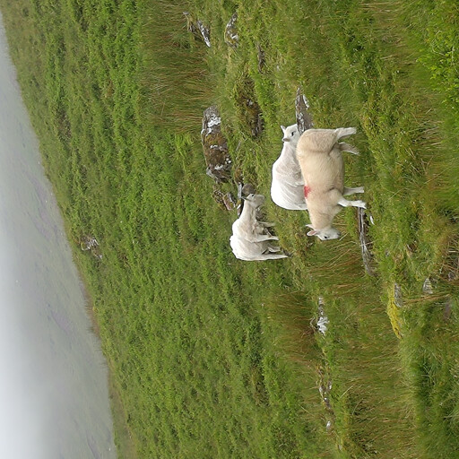

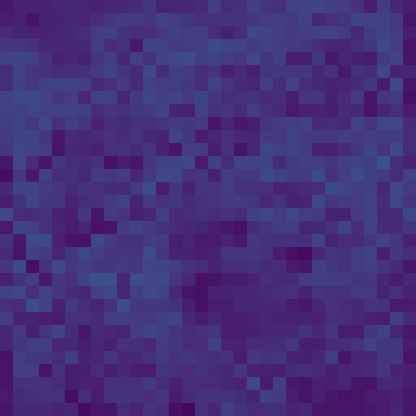

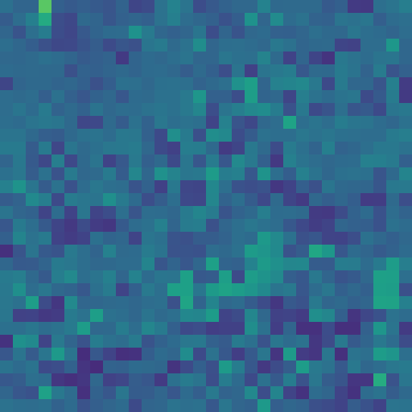

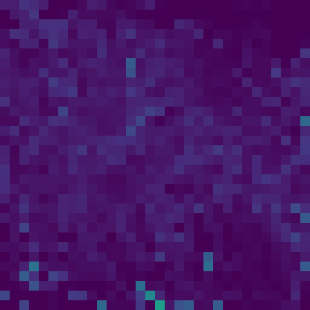

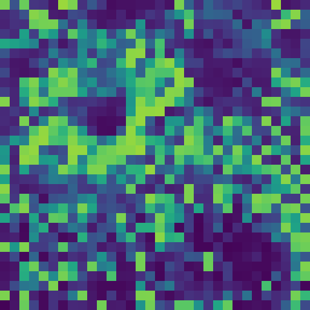

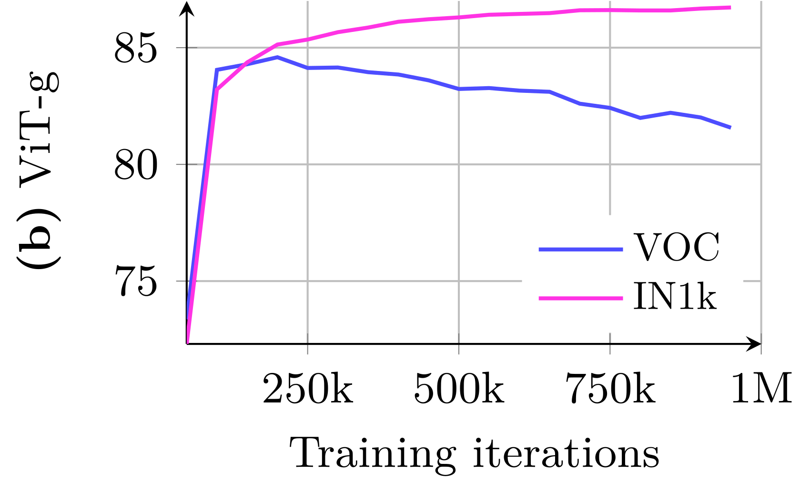

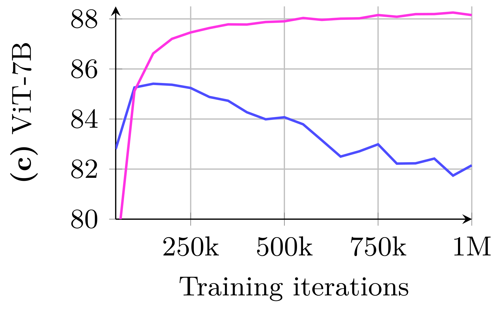

**EN.** Figure 5 : Evolution of the cosine similarities (a) and of the accuracy on ImageNet1k linear (IN1k) and segmentation on VOC for ViT-g (b) and ViT-7B (c). We observe that the segmentation performance is maximal when the cosine similarities between the patch tokens and the class tokens are low. As training progresses, these similarities increase and the performance on dense tasks decreases.

**中.** 图 5：ViT-g (b) 和 ViT-7B (c) 的余弦相似度 (a) 以及 ImageNet1k 线性 (IN1k) 和 VOC 分割的准确性的演变。我们观察到，当补丁标记和类标记之间的余弦相似度较低时，分割性能最高。随着训练的进行，这些相似性会增加，而密集任务的性能会下降。

## Gram Anchoring: A Regularization for Dense Features / 革兰氏锚定：密集特征的正则化

**EN.** To fully leverage the benefits of large-scale training, we aim to train the 7B model for an extended duration, with the notion that it could potentially train indefinitely. As expected, prolonged training leads to improvements on global benchmarks. However, as training progresses, the performance degrades on dense tasks ( Figs. 5 and 5 ). This phenomenon, which is due to the emergence of patch-level inconsistencies in feature representations, undermines the interest behind extended training. [^footnote1] In this section, we first analyze the loss of patch-level consistency, then propose a new objective to mitigate it, called Gram anchoring . We finally discuss the impact of our approach on both training stability and model performance.

**中.** 为了充分利用大规模训练的优势，我们的目标是延长 7B 模型的训练时间，并认为它可以无限期地训练。正如预期的那样，长期培训可以提高全球基准。然而，随着训练的进行，密集任务的性能会下降（图 5 和 5）。这种现象是由于特征表示中出现补丁级不一致而导致的，削弱了扩展训练背后的兴趣。 [^footnote1] 在本节中，我们首先分析补丁级一致性的损失，然后提出一个新的目标来减轻它，称为 Gram 锚定。我们最后讨论了我们的方法对训练稳定性和模型性能的影响。

### Loss of Patch-Level Consistency Over Training / 训练过程中补丁级别一致性的损失

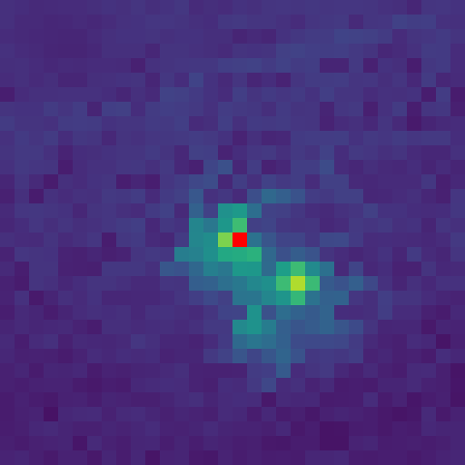

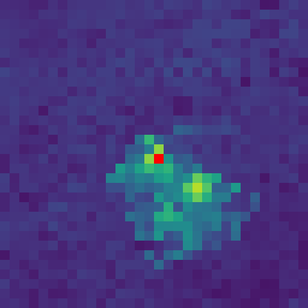

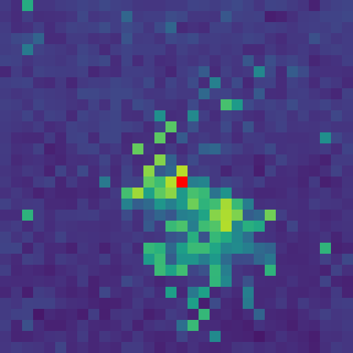

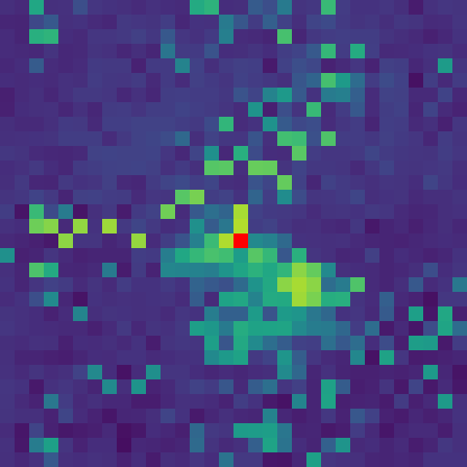

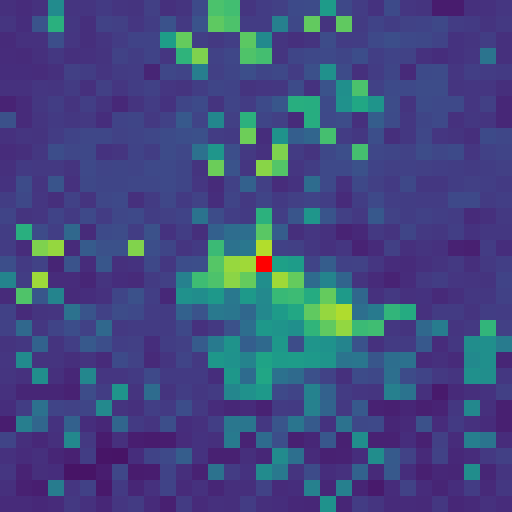

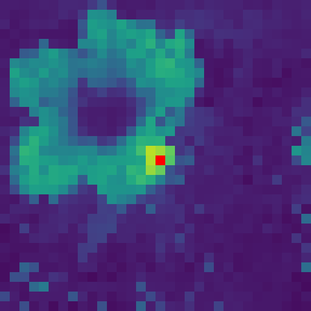

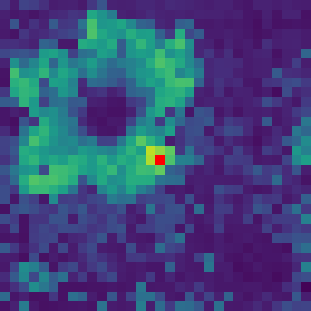

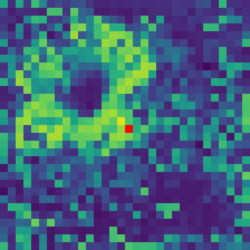

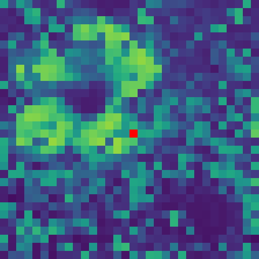

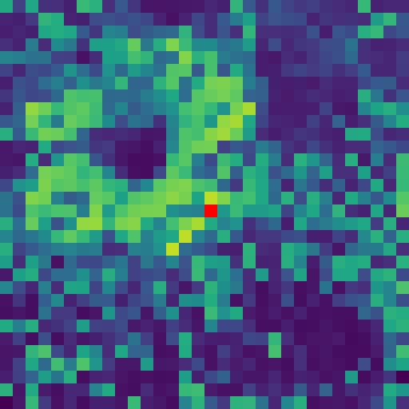

**EN.** Figure 6: Evolution of the cosine similarity between the patch noted in red and all other patches. As training progresses, the features produced by the model become less localized and the similarity maps become noisier.

**中.** 图 6：红色标记的补丁与所有其他补丁之间的余弦相似度的演变。随着训练的进行，模型产生的特征变得不太局部化，并且相似性图变得更加嘈杂。

**EN.** During extended training, we observe consistent improvements in global metrics but a notable decline in performance on dense prediction tasks. This behavior was previously observed, to a lesser extent, during the training of DINOv2, and also discussed in the scaling effort of Fan et al. (2025) . However, to the best of our knowledge, it remains unresolved to date. We illustrate the phenomenon in Figs. 5 and 5 , which present the performance of the model across iterations on both image classification and segmentation tasks. For classification, we train a linear classifier on ImageNet-1k using the CLS token and report top-1 accuracy. For segmentation, we train a linear layer on patch features extracted from Pascal VOC and report mean Intersection over Union (mIoU). We observe that both for the ViT-g and the ViT-7B, the classification accuracy monotonically improves throughout training. However, segmentation performance declines in both cases after approximately 200k iterations, falling below its early levels in the case of the ViT-7B.

**中.** 在扩展训练期间，我们观察到全局指标的持续改进，但密集预测任务的性能显着下降。这种行为之前在 DINOv2 的训练过程中曾在较小程度上观察到过，并且也在 Fan 等人的扩展工作中进行了讨论。 （2025）。然而，据我们所知，迄今为止该问题仍未解决。我们在图 2 和 3 中说明了该现象。图5和图5展示了模型在图像分类和分割任务上的迭代性能。对于分类，我们使用 CLS 令牌在 ImageNet-1k 上训练线性分类器并报告 top-1 准确度。对于分割，我们在从 Pascal VOC 中提取的补丁特征上训练线性层，并报告平均交并集 (mIoU)。我们观察到，对于 ViT-g 和 ViT-7B，分类精度在整个训练过程中单调提高。然而，在大约 20 万次迭代后，这两种情况下的分割性能都会下降，低于 ViT-7B 的早期水平。

**EN.** To better understand this degradation, we analyze the quality of patch features by visualizing cosine similarities between patches. Fig. 6 shows the cosine similarity maps between the backbone’s output patch features and a reference patch (highlighted in red). At 200k iterations, the similarity maps are smooth and well-localized, indicating consistent patch-level representations. However, by 600k iterations and beyond, the maps degrade substantially, with an increasing number of irrelevant patches with high similarity to the reference patch. This loss of patch-level consistency correlates with the drop in dense task performance.

**中.** 为了更好地理解这种退化，我们通过可视化补丁之间的余弦相似度来分析补丁特征的质量。图 6 显示了主干网的输出补丁特征和参考补丁（以红色突出显示）之间的余弦相似度图。在 200k 次迭代中，相似性图是平滑且定位良好的，表明补丁级表示是一致的。然而，经过 600k 次迭代及以上，地图会大幅退化，与参考补丁高度相似的不相关补丁数量不断增加。补丁级一致性的丧失与密集任务性能的下降相关。

**EN.** These patch-level irregularities differ from the high-norm patch outliers described in Darcet et al. (2024) . Specifically, with the integration of register tokens, patch norms remain stable throughout training. However, we notice that the cosine similarity between the CLS token and the patch outputs gradually increases during training. This is expected, yet it means that the locality of the patch features diminishes. We visualize this phenomenon in Fig. 5 , which depicts the cosine maps at 200k and 1M iterations. In order to mitigate the drop on dense tasks, we propose a new objective specifically designed to regularize the patch features and ensure a good patch-level consistency, while preserving high global performance.

**中.** 这些斑块级不规则性与 Darcet 等人中描述的高范数斑块异常值不同。 （2024）。具体来说，通过注册令牌的集成，补丁规范在整个训练过程中保持稳定。然而，我们注意到 CLS 令牌和补丁输出之间的余弦相似度在训练过程中逐渐增加。这是预料之中的，但这意味着补丁功能的局部性减弱。我们在图 5 中可视化了这种现象，它描绘了 200k 和 1M 迭代时的余弦图。为了减轻密集任务的下降，我们提出了一个新的目标，专门设计用于规范补丁特征并确保良好的补丁级一致性，同时保持较高的全局性能。

### Gram Anchoring Objective / 革兰氏锚定物镜

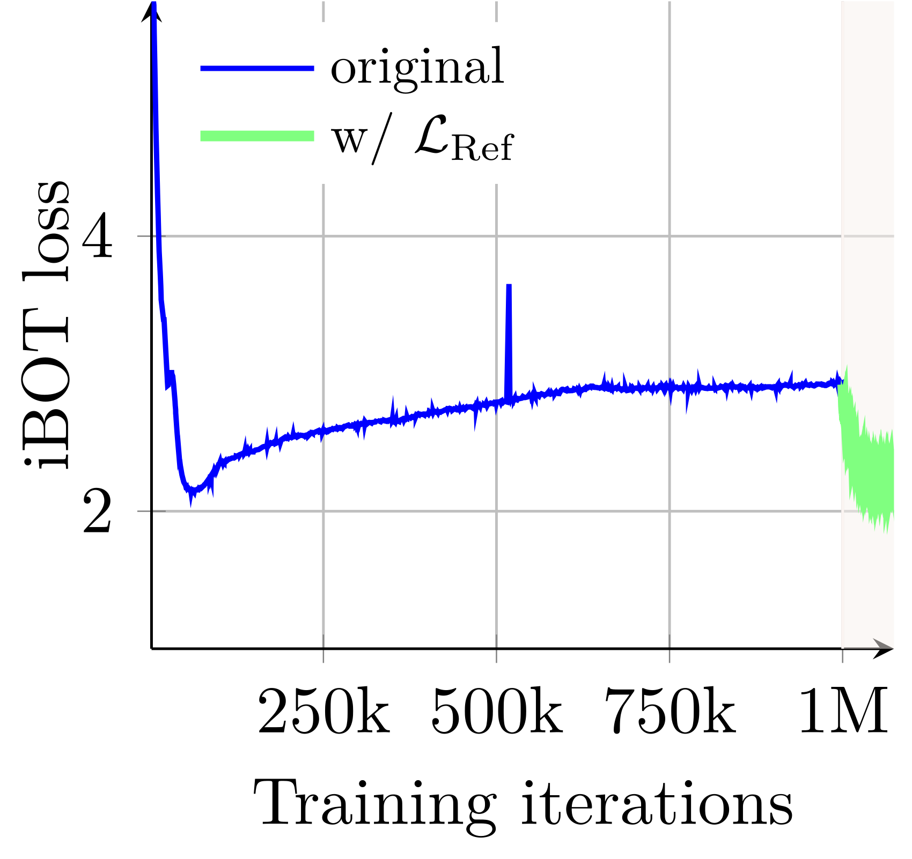

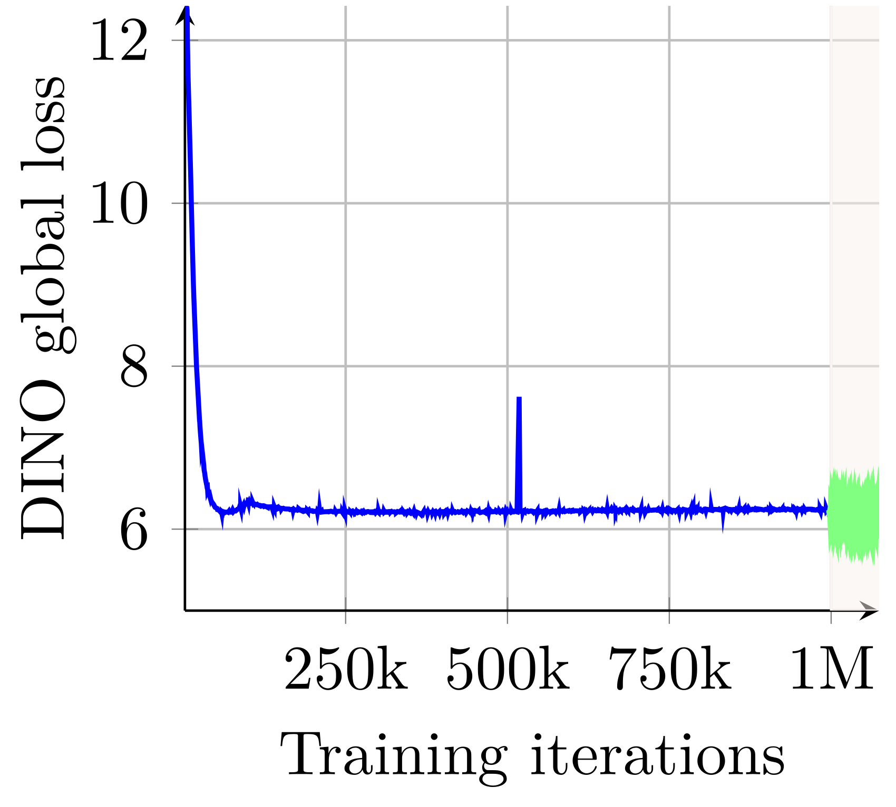

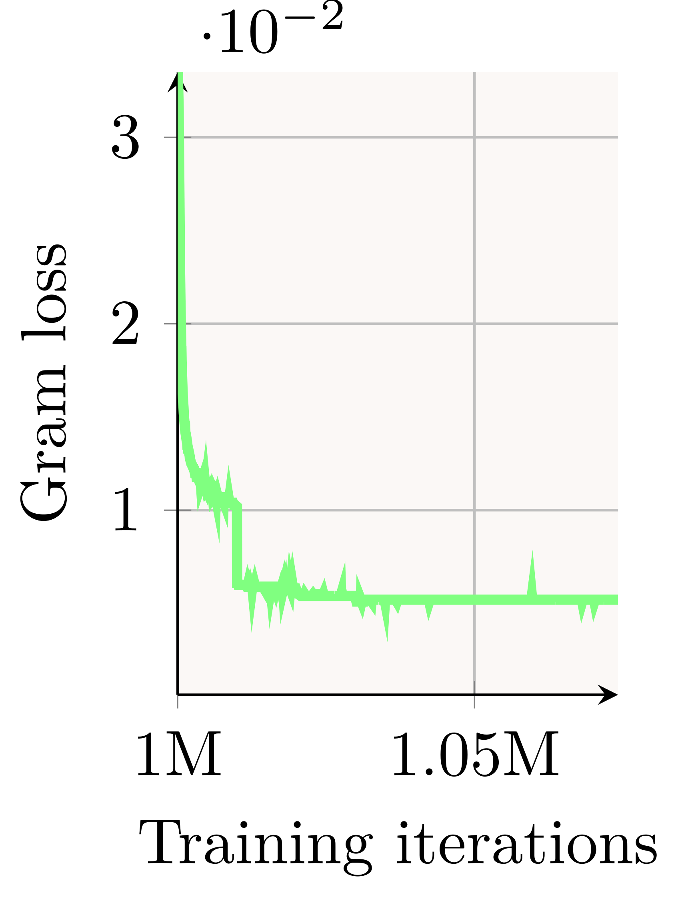

**EN.** Figure 7 : Evolution trough the training iterations of the patch-level iBOT loss, the global loss DINO (applied to the global crops) and the newly introduced Gram loss. We highlight the iterations of the refinement step $\mathcal{L}_{\mathrm{Ref}}$ which uses the Gram objective.

**中.** 图 7：通过补丁级 iBOT 损失、全局损失 DINO（应用于全局作物）和新引入的 Gram 损失的训练迭代进行演化。我们重点介绍使用 Gram 目标的细化步骤 $\mathcal{L}_{\mathrm{Ref}}$ 的迭代。

**EN.** Throughout our experiments, we have identified a relative independence between learning strong discriminative features and maintaining local consistency, as observed in the lack of correlation between global and dense performance. While combining the global DINO loss with the local iBOT loss has begun to address this issue, we observe that the balance is unstable, with global representation dominating as training progresses. Building on this insight, we propose a novel solution that explicitly leverages this independence.

**中.** 在我们的实验中，我们发现学习强区分性特征和保持局部一致性之间存在相对独立性，正如在全局和密集性能之间缺乏相关性所观察到的那样。虽然将全局 DINO 损失与局部 iBOT 损失相结合已经开始解决这个问题，但我们观察到平衡不稳定，随着训练的进展，全局表示占主导地位。基于这一见解，我们提出了一种明确利用这种独立性的新颖解决方案。

**EN.** We introduce a new objective which mitigates the degradation of patch-level consistency by enforcing the quality of the patch-level consistency, without impacting the features themselves. This new loss function operates on the Gram matrix: the matrix of all pairwise dot products of patch features in an image. We want to push the Gram matrix of the student towards that of an earlier model, referred to as the Gram teacher . We select the Gram teacher by taking an early iteration of the teacher network, which exhibits superior dense properties. By operating on the Gram matrix rather than the feature themselves, the local features are free to move, provided the structure of similarities remains the same. Suppose we have an image composed of $P$ patches, and a network that operates in dimension $d$ . Let us denote by $\mathbf{X}_{S}$ (respectively $\mathbf{X}_{G}$ ) the $P\times d$ matrix of $\mathbf{L}_{2}$ -normalized local features of the student (respectively the Gram teacher). We define the loss $\mathcal{L}_{\text{Gram}}$ as follows:

**中.** 我们引入了一个新的目标，通过增强补丁级一致性的质量来减轻补丁级一致性的退化，而不影响功能本身。这个新的损失函数在 Gram 矩阵上运行：图像中块特征的所有成对点积的矩阵。我们希望将学生的 Gram 矩阵推向早期模型（称为 Gram Teacher ）的矩阵。我们通过教师网络的早期迭代来选择 Gram 教师，该网络表现出卓越的密集特性。通过对 Gram 矩阵而不是特征本身进行操作，只要相似性的结构保持不变，局部特征就可以自由移动。假设我们有一个由 $P$ 补丁组成的图像，以及一个在维度 $d$ 中运行的网络。让我们用 $\mathbf{X}_{S}$ （分别为 $\mathbf{X}_{G}$ ）表示 $\mathbf{L}_{2}$ 的 $P\times d$ 矩阵 - 学生（分别为 Gram 老师）的归一化局部特征。我们将损失 $\mathcal{L}_{\text{Gram}}$ 定义如下：

$$
\mathcal{L}_{\text{Gram}}=\left\|\mathbf{X}_{S}\cdot\mathbf{X}_{S}^{\top}-\mathbf{X}_{G}\cdot\mathbf{X}_{G}^{\top}\right\|_{\text{F}}^{2}.\tag{2}
$$

**EN.** We only compute this loss on the global crops. Even though it can be applied early on during the training, for efficiency, we start only after $1$ M iterations. Interestingly, we observe that the late application of $\mathcal{L}_{\text{Gram}}$ still manages to “repair” very degraded local features. In order to further improve performance, we update the Gram teacher every 10k iterations at which the Gram teacher becomes identical to the main EMA teacher. We call this second step of training the refinement step , which optimizes the objective $\mathcal{L}_{\mathrm{Ref}}$ , with

**中.** 我们仅计算全球农作物的损失。尽管它可以在训练的早期应用，但为了提高效率，我们仅在 $1$ M 次迭代之后开始。有趣的是，我们观察到$\mathcal{L}_{\text{Gram}}$的后期应用仍然设法“修复”非常退化的局部特征。为了进一步提高性能，我们每 10k 次迭代更新 Gram 教师，此时 Gram 教师与主要 EMA 教师相同。我们将训练的第二步称为细化步骤，它优化了目标 $\mathcal{L}_{\mathrm{Ref}}$ ，其中

$$
\mathcal{L}_{\mathrm{Ref}}=w_{\mathrm{D}}\mathcal{L_{\mathrm{DINO}}}+\mathcal{L}_{\mathrm{iBOT}}+w_{\mathrm{DK}}\mathcal{L}_{\mathrm{DKoleo}}+w_{\mathrm{Gram}}\mathcal{L}_{\mathrm{Gram}}.\tag{3}
$$

**EN.** We visualize the evolution of different losses in Fig. 7 and observe that applying the Gram objective significantly influences the iBOT loss, causing it to decrease more rapidly. This suggests that the stability introduced by the stable Gram teacher positively impacts the iBOT objective. In contrast, the Gram objective does not have a significant effect on the DINO losses. This observation implies that the Gram and iBOT objectives impact the features in a similar way, whereas the DINO losses affect them differently.

**中.** 我们在图 7 中可视化了不同损失的演变，并观察到应用 Gram 目标会显着影响 iBOT 损失，导致其下降得更快。这表明稳定的 Gram 老师引入的稳定性对 iBOT 目标产生了积极影响。相比之下，Gram 目标对 DINO 损失没有显着影响。这一观察结果表明，Gram 和 iBOT 目标以类似的方式影响特征，而 DINO 损失对它们的影响不同。

**EN.** Regarding performance, we observe the impact of the new loss is almost immediate. As shown in Fig. 8 , incorporating Gram anchoring leads to significant improvements on dense tasks within the first 10k iterations. We also see notable gains on the ADE20k benchmark following the Gram teacher updates. Additionally, longer training further benefits performance on the ObjectNet benchmark and other global benchmarks show mild impact from the new loss.

**中.** 就业绩而言，我们观察到新损失的影响几乎是立竿见影的。如图 8 所示，结合 Gram 锚定可以在前 10k 次迭代中显着改进密集任务。在 Gram 教师更新后，我们还看到 ADE20k 基准测试有了显着的提升。此外，较长的训练时间进一步提高了 ObjectNet 基准测试的性能，而其他全球基准测试显示新损失的影响较小。

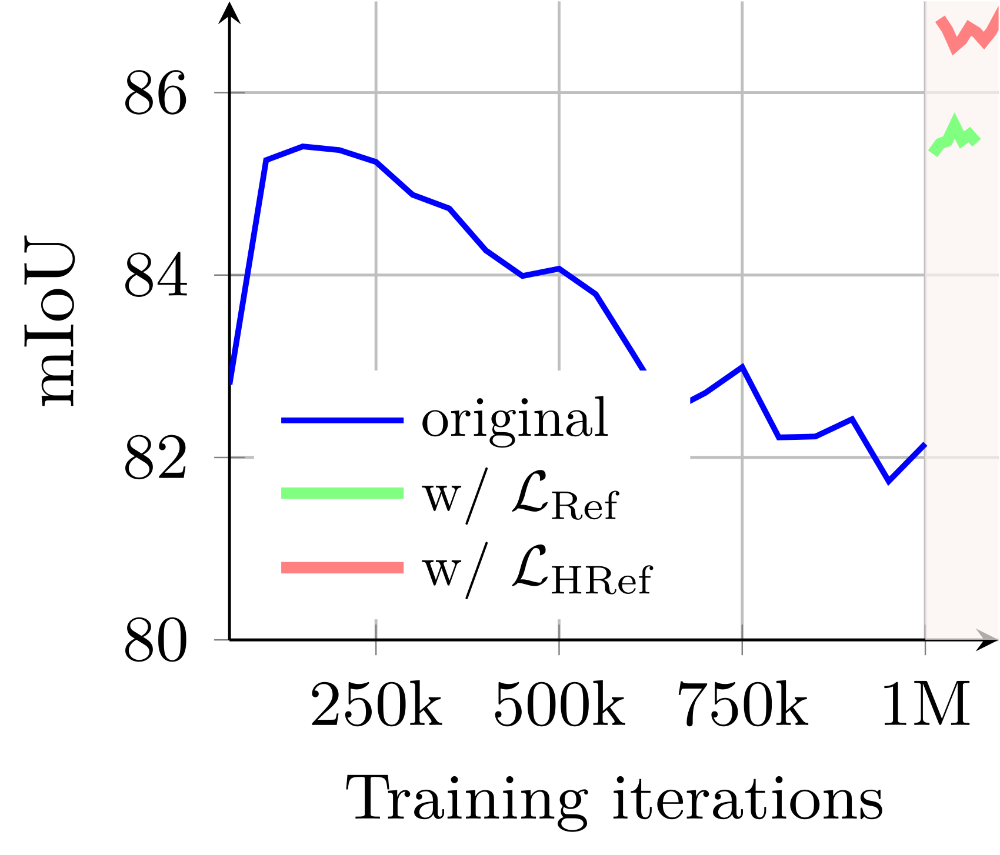

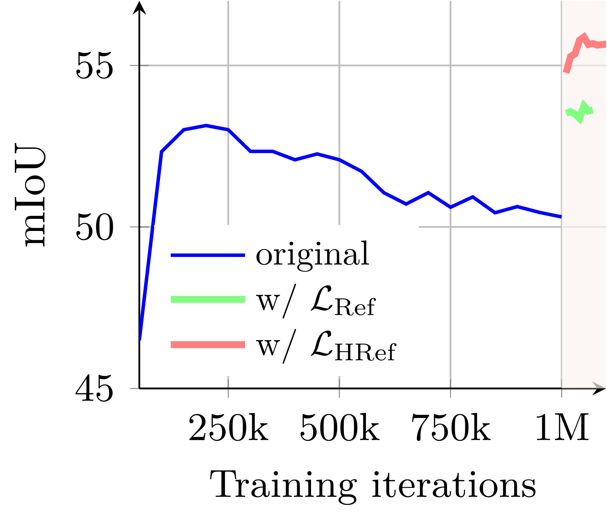

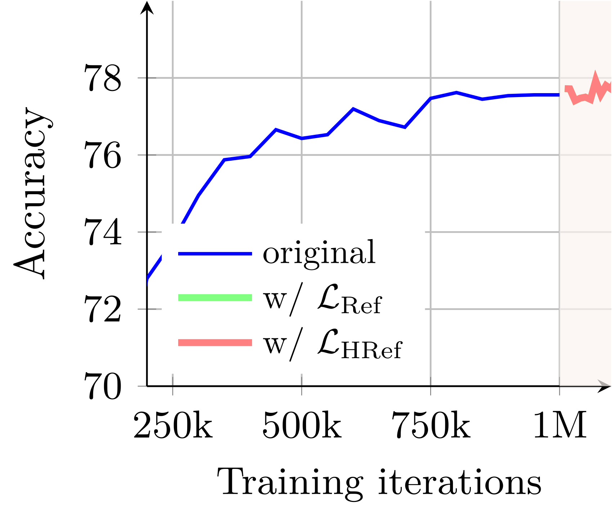

**EN.** Figure 8 : Evolution of the results on different benchmarks after applying our proposed Gram anchoring method. We visualize results when continuing the original training with our refinement step, noted ‘ $\mathcal{L}_{\mathrm{Ref}}$ ’. We also plot results obtained when using higher-resolution features for the Gram objective as introduced in following Sec. 4.3 and noted ‘ $\mathcal{L}_{\mathrm{HRef}}$ ’. We highlight the iterations which use the Gram objective.

**中.** 图 8：应用我们提出的 Gram 锚定方法后，不同基准上结果的演变。当继续原始训练和我们的细化步骤时，我们将结果可视化，标记为“$\mathcal{L}_{\mathrm{Ref}}$”。我们还绘制了为 Gram 目标使用更高分辨率特征时获得的结果，如下节所述。 4.3 并注明“$\mathcal{L}_{\mathrm{HRef}}$”。我们重点介绍使用 Gram 目标的迭代。

### Leveraging Higher-Resolution Features / 利用更高分辨率的功能

**EN.** Recent work shows that a weighted average of patch features can yield stronger local representations by smoothing outlier patches and enhancing patch-level consistency ( Wysoczańska et al., 2024 ) . On the other hand, feeding higher-resolution images into the backbone produces finer and more detailed feature maps. We leverage the benefits of both observations to compute high-quality features for Gram teacher. Specifically, we first input images at twice the normal resolution into the Gram teacher, then $2\times$ down-sample the resulting feature maps with the bicubic interpolation to achieve the desired smooth feature maps that match the size of the student output. Fig. 9(a) visualizes the Gram matrices of patch features obtained with images at resolutions 256 and 512, as well as those obtained after $2\times$ down-sampling features from the 512-resolution (denoted as ‘downsamp.’). We observe that the superior patch-level consistency in the higher-resolution features is preserved through down-sampling, resulting in smoother and more coherent patch-level representations. As a side note, our model can seamlessly process images at varying resolutions without requiring adaptation, thanks to the adoption of Rotary Positional Embeddings (RoPE) introduced by Su et al. (2024) .

**中.** 最近的工作表明，补丁特征的加权平均值可以通过平滑离群补丁和增强补丁级一致性来产生更强的局部表示（Wysoczańska et al., 2024）。另一方面，将更高分辨率的图像输入主干网会产生更精细、更详细的特征图。我们利用这两种观察的好处来计算 Gram 老师的高质量特征。具体来说，我们首先将正常分辨率两倍的图像输入 Gram 教师中，然后 $2\times$ 使用双三次插值对所得特征图进行下采样，以获得与学生输出大小相匹配的所需平滑特征图。图 9(a) 可视化了使用分辨率 256 和 512 的图像获得的 patch 特征的 Gram 矩阵，以及从 512 分辨率的 $2\times$ 下采样特征后获得的特征（表示为“下采样”）。我们观察到，通过下采样保留了更高分辨率特征中卓越的块级一致性，从而产生更平滑、更连贯的块级表示。顺便说一句，由于采用了 Su 等人提出的旋转位置嵌入（RoPE），我们的模型可以无缝处理不同分辨率的图像，而无需进行调整。 （2024）。

**EN.** We compute the Gram matrix of the down-sampled features and use it to replace $\mathbf{X}_{G}$ in the objective $\mathcal{L_{\mathrm{Gram}}}$ . We note the new resulting refinement objective as $\mathcal{L}_{\mathrm{HRef}}$ . This approach enables the Gram objective to effectively distill the improved patch consistency of smoothed high-resolution features into the student model. As shown in Fig. 8 and Fig. 9(b) , this distillation translates into better predictions on dense tasks, yielding additional gains on top of the benefit brought by $\mathcal{L}_{\mathrm{Ref}}$ (+2 mIoU on ADE20k). We also ablate the choice of Gram teacher in Fig. 9(b) . Interestingly, choosing the Gram teacher from 100k or 200k does not significantly impact the results, but using a much later Gram teacher (1M iterations) is detrimental because the patch-level consistency of such a teacher is inferior.

**中.** 我们计算下采样特征的 Gram 矩阵，并用它来替换目标 $\mathcal{L_{\mathrm{Gram}}}$ 中的 $\mathbf{X}_{G}$ 。我们将新产生的细化目标标记为 $\mathcal{L}_{\mathrm{HRef}}$ 。这种方法使 Gram 目标能够有效地将平滑高分辨率特征的改进补丁一致性提取到学生模型中。如图 8 和图 9(b) 所示，这种蒸馏转化为对密集任务的更好预测，除了 $\mathcal{L}_{\mathrm{Ref}}$ 带来的好处（在 ADE20k 上+2 mIoU）之外，还产生了额外的收益。我们还取消了图 9(b) 中语法老师的选择。有趣的是，从 100k 或 200k 中选择 Gram 教师不会对结果产生显着影响，但使用更晚的 Gram 教师（1M 次迭代）是有害的，因为这样的教师的补丁级一致性较差。

**EN.** Finally, we qualitatively illustrate the effect of Gram anchoring to patch-level consistency in Fig. 10 which visualizes the Gram matrices patch features obtained with the initial training and high-resolution Gram anchoring refinement. We observe great improvements in feature correlations that our high-resolution refinement procedure brings about.

**中.** 最后，我们在图 10 中定性地说明了 Gram 锚定对补丁级一致性的影响，该图可视化了通过初始训练和高分辨率 Gram 锚定细化获得的 Gram 矩阵补丁特征。我们观察到我们的高分辨率细化过程带来的特征相关性的巨大改进。

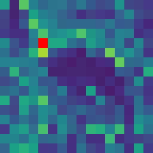

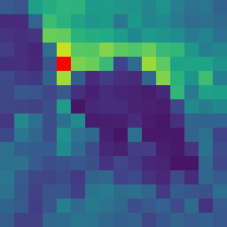

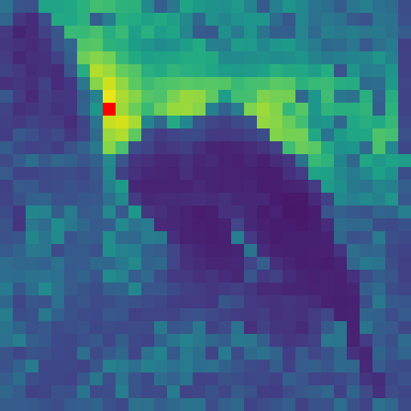

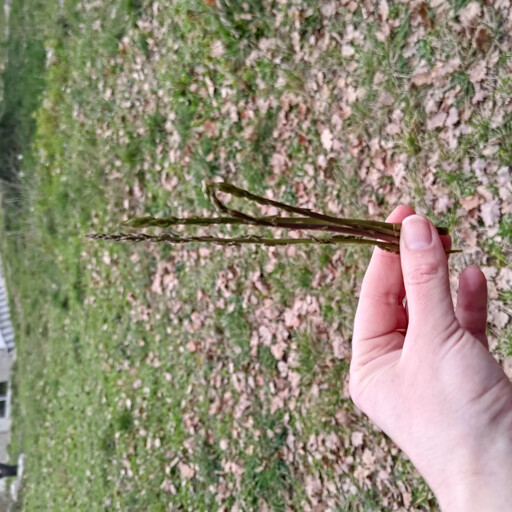

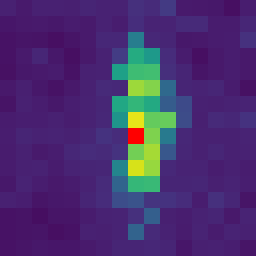

**EN.** Figure 9 : Quantitative and qualitative study of the impact of high-resolution Gram. We show (a) the improved cosine maps after down-sampling the high-resolution maps into smaller ones, and (b) the quantitative improvements brought by varying the training iteration and the resolution of the Gram teacher.

**中.** 图 9：高分辨率 Gram 影响的定量和定性研究。我们展示了（a）将高分辨率图下采样为较小的余弦图后的改进余弦图，以及（b）通过改变训练迭代和 Gram 老师的分辨率带来的定量改进。

**EN.** Figure 10 : Qualitative effect of Gram anchoring. We visualize cosine maps before and after using the refinement objective $\mathcal{L}_{\mathrm{HRef}}$ . The input resolution of the images is $1024\times 1024$ pixels.

**中.** 图 10：革兰氏锚定的定性效果。我们可视化使用细化目标 $\mathcal{L}_{\mathrm{HRef}}$ 之前和之后的余弦图。图像的输入分辨率为 $1024\times 1024$ 像素。

## Post-Training / 培训后

**EN.** This section presents post-training stages. This includes a high-resolution adaptation phase enabling effective inference at different input resolutions ( Sec. 5.1 ), model distillation producing quality and efficient smaller-sized models ( Sec. 5.2 ), and text alignment adding zero-shot capabilities to DINOv3 ( Sec. 5.3 ).

**中.** 本节介绍训练后阶段。这包括高分辨率适应阶段，能够在不同输入分辨率下进行有效推理（第 5.1 节），模型蒸馏产生高质量和高效的小型模型（第 5.2 节），以及为 DINOv3 添加零样本功能的文本对齐（第 5.3 节）。

### Resolution Scaling / 分辨率缩放

**EN.** We train our model at a relatively small resolution of $256$ , which gives us a good trade-off between speed and effectiveness. For a patch size of $16$ , this setup leads to the same input sequence length as DINOv2, which was trained with resolution $224$ and patch size $14$ . However, many contemporary computer vision applications require processing images at significantly higher resolutions, often $512\times 512$ pixels or greater, to capture intricate spatial information. The inference image resolution is also not fixed in practice and varies depending on specific use cases. To address this, we extend our training regime with a high-resolution adaptation step ( Touvron et al., 2019 ) . To ensure high performance across a range of resolutions, we utilize mixed resolutions , sampling differently-sized pairs of global and local crops per mini-batch. Specifically, we consider global crop sizes from $\{512,768\}$ and local crop sizes from $\{112,168,224,336\}$ and train the model for 10k additional iterations.

**中.** 我们以相对较小的分辨率 $256$ 训练模型，这使我们在速度和有效性之间取得了良好的权衡。对于 $16$ 的补丁大小，此设置导致与 DINOv2 相同的输入序列长度，DINOv2 使用分辨率 $224$ 和补丁大小 $14$ 进行训练。然而，许多当代计算机视觉应用需要以更高的分辨率（通常为 $512\times 512$ 像素或更大）处理图像，以捕获复杂的空间信息。推理图像分辨率在实践中也不是固定的，而是根据具体用例而变化。为了解决这个问题，我们通过高分辨率适应步骤扩展了我们的训练体系（Touvron et al., 2019）。为了确保在一系列分辨率下的高性能，我们使用混合分辨率，对每个小批量的不同大小的全局和本地作物进行采样。具体来说，我们考虑 $\{512,768\}$ 的全局裁剪尺寸和 $\{112,168,224,336\}$ 的局部裁剪尺寸，并训练模型进行 10k 次额外迭代。

**EN.** Similar to the main training, a key component of this high-resolution adaptation phase is the addition of Gram anchoring, using the 7B teacher as Gram teacher. We found this component to be essential: without it, the model performance on dense prediction tasks degrades significantly. The Gram anchoring encourages the model to maintain consistent and robust feature correlations across spatial locations, which is crucial when dealing with the increased complexity of high-resolution inputs.

**中.** 与主要训练类似，这个高分辨率适应阶段的一个关键组成部分是添加 Gram 锚定，使用 7B 教师作为 Gram 教师。我们发现这个组件至关重要：如果没有它，模型在密集预测任务上的性能会显着下降。 Gram 锚定鼓励模型在空间位置上保持一致且强大的特征相关性，这在处理高分辨率输入的复杂性增加时至关重要。

**EN.** Empirically, we observe that this relatively brief but targeted high-resolution step substantially enhances the overall model’s quality and allows it to generalize across a wide range of input sizes, as shown visually in Fig. 4 . In Fig. 11 , we compare our 7B model before and after adaptation. We find that resolution scaling leads to a small gain on ImageNet classification (a) with relatively stable performance w.r.t. resolution. However, in ObjectNet OOD transfer (b), we observe that the performance tends to degrade slightly for lower resolutions, while improving for higher resolutions. This is largely compensated by the improvement in the quality of local features at high resolution, shown by the positive trend in segmentation on ADE20k (c) and tracking on DAVIS (d). Adaptation leads to local features that improve with image size , leveraging the richer spatial information available at larger resolutions and effectively enabling high-resolution inference. Interestingly, the adapted model supports resolutions way beyond the maximum training resolution of 768—we visually observe stable feature maps at resolutions above 4k ( c.f . Fig. 4 ).

**中.** 根据经验，我们观察到，这个相对简短但有针对性的高分辨率步骤大大提高了整体模型的质量，并使其能够泛化到各种输入大小，如图 4 所示。在图 11 中，我们比较了适应前后的 7B 模型。我们发现分辨率缩放会导致 ImageNet 分类 (a) 的小幅提升，并且性能相对稳定。解决。然而，在 ObjectNet OOD 传输 (b) 中，我们观察到较低分辨率时性能会略有下降，而较高分辨率时性能会有所改善。这在很大程度上通过高分辨率局部特征质量的提高得到了补偿，ADE20k (c) 上的分割和 DAVIS (d) 上的跟踪的积极趋势表明了这一点。适应导致局部特征随着图像尺寸的变化而改进，利用更高分辨率下可用的更丰富的空间信息，并有效地实现高分辨率推理。有趣的是，适应后的模型支持的分辨率远远超出了最大训练分辨率 768——我们在 4k 以上的分辨率下直观地观察到稳定的特征图（参见图 4）。

**EN.** Figure 11 : Effect of high resolution adaptation. Results before (‘Pre-HR’) and after (‘Post-HR’) resolution scaling ( Sec. 5.1 ) on (a) linear classification on ImageNet, (b) applied OOD to ObjectNet, (c) linear semantic segmentation on ADE20k, and (d) segmentation tracking on DAVIS at different evaluation resolutions.

**中.** 图 11：高分辨率适应的效果。分辨率缩放之前（“HR 前”）和之后（“HR 后”）的结果（第 5.1 节）：(a) ImageNet 上的线性分类，(b) 将 OOD 应用于 ObjectNet，(c) ADE20k 上的线性语义分割，以及 (d) DAVIS 上不同评估分辨率下的分割跟踪。

### Model Distillation / 模型蒸馏

#### Family of Models for Multiple Use-Cases / 适用于多种用例的一系列模型

**EN.** We perform knowledge distillation of the ViT-7B model into smaller Vision Transformer variants (ViT-S, ViT-B, and ViT-L), which are highly valued by the community for their improved manageability and efficiency. Our distillation approach uses the same training objective as in the first training phase, ensuring consistency in learning signals. However, instead of relying on an exponential moving average (EMA) of model weights, we use the 7B model directly as the teacher to guide the smaller student models. In this case, the teacher model is fixed. We do not observe patch-level consistency issues and therefore do not apply the Gram anchoring technique. This strategy enables the distilled models to inherit the rich representational power of the large teacher while being more practical for deployment and experimentation.

**中.** 我们将 ViT-7B 模型的知识蒸馏为更小的 Vision Transformer 变体（ViT-S、ViT-B 和 ViT-L），这些变体因其改进的可管理性和效率而受到社区的高度重视。我们的蒸馏方法使用与第一个训练阶段相同的训练目标，确保学习信号的一致性。然而，我们没有依赖模型权重的指数移动平均值（EMA），而是直接使用 7B 模型作为教师来指导较小的学生模型。在这种情况下，教师模型是固定的。我们没有观察到补丁级一致性问题，因此不应用 Gram 锚定技术。这种策略使得蒸馏模型继承了大教师丰富的代表性能力，同时更适合部署和实验。

**EN.** Our ViT-7B model is distilled into a series of ViT models with sizes covering a broad range of compute budgets, and allowing proper comparison with concurrent models. They include the standard ViT-S (21M params), B (86M), L (0.3B), along with a custom ViT-S+ (29M) and a custom ViT-H+ (0.8B) model to close the performance gap with the self-distilled 7B teacher model. Indeed, we observe in DINOv2 that smaller student models can reach a performance on par with their teacher as the distillation. As a result, the distilled models deliver frontier-level performance for a fraction of the inference compute as we see in Tab. 14 . We train the models for 1M iterations then perform 250k iterations of learning-rate cooldown following a cosine schedule before applying the high-resolution phase described in Sec. 5.1 above without Gram anchoring.

**中.** 我们的 ViT-7B 模型被提炼成一系列 ViT 模型，其大小涵盖了广泛的计算预算，并允许与并发模型进行适当的比较。它们包括标准 ViT-S（21M 参数）、B（86M）、L（0.3B），以及定制 ViT-S+（29M）和定制 ViT-H+（0.8B）模型，以缩小与自提 7B 教师模型的性能差距。事实上，我们在 DINOv2 中观察到，作为蒸馏，较小的学生模型可以达到与老师相同的性能。因此，精炼模型为一小部分推理计算提供了前沿水平的性能，如表 1 所示。 14.我们训练模型进行 1M 次迭代，然后按照余弦时间表执行 250k 次学习率冷却迭代，然后再应用第 2 节中描述的高分辨率阶段。上面的 5.1 没有 Gram 锚定。

#### Efficient Multi-Student Distillation / 高效的多学生蒸馏

**EN.** As the inference cost for a large teacher can be orders of magnitude higher than for students (see Fig. 16(a) ), we design a parallel distillation pipeline that allows training multiple students at the same time and sharing the teacher inference across all nodes involved in the training (see Fig. 12 for a diagram). Let $C_{T}$ and $C_{S}$ be respectively the cost of running the teacher inference and the student training on a single sample, in single-teacher/single-student distillation with batch-size $B$ where each of the $N$ GPUs processes a $B/N$ slice of the data, the teacher inference costs $B/N\times C_{T}$ and the student training costs $B/N\times C_{S}$ per GPU. In multi-student distillation, we proceed as follows. Each student $Si$ is assigned a set of $N_{Si}$ GPUs for training, and all $N_{T}=\sum{N_{Si}}$ GPUs are part of the global inference group. At each iteration, we first run the teacher inference on the global group for a $B/N_{T}\times C_{T}$ compute cost per GPU. We then run an all-gather collective operation to share the input data and inference result with all compute nodes. Finally, each student group separately performs student training for a $B/N_{Si}\times C_{Si}$ cost.

**中.** 由于大型教师的推理成本可能比学生高出几个数量级（见图 16(a)），因此我们设计了一个并行蒸馏管道，允许同时训练多个学生，并在参与训练的所有节点之间共享教师推理（见图 12）。令 $C_{T}$ 和 $C_{S}$ 分别为在单个样本上运行教师推理和学生训练的成本，在批量大小为 $B$ 的单教师/单学生蒸馏中，其中每个 $N$ GPU 处理 $B/N$ 数据切片，教师推理成本每个 GPU 的 $B/N\times C_{T}$ 和学生培训成本为 $B/N\times C_{S}$。在多学生蒸馏中，我们按如下方式进行。每个学生 $Si$ 都被分配一组 $N_{Si}$ GPU 进行训练，所有 $N_{T}=\sum{N_{Si}}$ GPU 都是全局推理组的一部分。在每次迭代中，我们首先在全局组上运行教师推理，以获得每个 GPU 的 $B/N_{T}\times C_{T}$ 计算成本。然后，我们运行全收集集体操作，与所有计算节点共享输入数据和推理结果。最后，每个学生组单独进行学生训练，成本为$B/N_{Si}\times C_{Si}$。

**EN.** The above calculations shows that adding an additional student to the distillation pipeline will (1) reduce the per-GPU compute at each iteration, thus globally improving distillation speed, and (2) increase the overall compute only by the training cost of the new student, since the total teacher inference cost is now fixed. The implementation only requires setting up GPU process groups carefully, adapting data-loaders and teacher inference to ensure inputs and outputs are synchronized across groups using NCCL collectives. As the groups are synchronized at each iteration, in order to maximize speed, we adapt the number of GPUs for each student such that their iteration times are roughly the same. With this procedure, we seamlessly train multiple students, and produce a whole family of distilled models from our flagship 7B model.

**中.** 上述计算表明，向蒸馏管道中添加额外的学生将 (1) 减少每次迭代时的每 GPU 计算量，从而全局提高蒸馏速度，并且 (2) 仅通过新学生的训练成本来增加总体计算，因为总教师推理成本现在是固定的。该实现只需要仔细设置 GPU 进程组，调整数据加载器和教师推理，以确保使用 NCCL 集体的组之间的输入和输出同步。由于各组在每次迭代时都是同步的，为了最大限度地提高速度，我们调整每个学生的 GPU 数量，使他们的迭代时间大致相同。通过这个过程，我们可以无缝地培训多名学生，并从我们的旗舰 7B 模型中生成一整套精炼模型。

**EN.** Figure 12 : Multi-student distillation procedure. In this diagram, we distill 3 students in parallel: we first share teacher inference across all T nodes to save compute, and gather inputs and results on all GPUs. Then, smaller groups perform student training. We adjust the size of these groups such that the training step has the same duration across all students $Si$ , minimizing idle time waiting at the synchronization barrier.

**中.** 图 12：多学生蒸馏程序。在此图中，我们并行提取 3 个学生：我们首先在所有 T 节点之间共享教师推理以节省计算量，并收集所有 GPU 上的输入和结果。然后，较小的小组进行学生培训。我们调整这些组的大小，使所有学生 $Si$ 的训练步骤具有相同的持续时间，从而最大限度地减少在同步屏障处等待的空闲时间。

### Aligning DINOv3 with Text / 将 DINOv3 与文本对齐

**EN.** Open-vocabulary image-text alignment has received significant interest and enthusiasm from the research community, thanks to its potential to enable flexible and scalable multimodal understanding. A large body of work has focused on improving the quality of CLIP ( Radford et al., 2021 ) , which originally learned only a global alignment between image and text representations. While CLIP has demonstrated impressive zero-shot capabilities, its focus on global features limits its ability to capture fine-grained, localized correspondences. More recent works ( Zhai et al., 2022b ) have shown that effective image-text alignment can be achieved with pre-trained self-supervised visual backbones. This makes it possible to leverage these powerful models in multi-modal settings, facilitating richer and more precise text-to-image associations that extend beyond global semantics while also reducing computational costs, since the visual encoding is already learned.

**中.** 开放词汇图文对齐因其实现灵活且可扩展的多模态理解的潜力而受到了研究界的极大兴趣和热情。大量工作集中在提高 CLIP 的质量（Radford et al., 2021），它最初只学习图像和文本表示之间的全局对齐。虽然 CLIP 展示了令人印象深刻的零样本能力，但其对全局特征的关注限制了其捕获细粒度、本地化对应关系的能力。最近的工作（Zhai 等人，2022b）表明，可以通过预先训练的自我监督视觉主干来实现有效的图像文本对齐。这使得在多模态设置中利用这些强大的模型成为可能，促进更丰富、更精确的文本到图像关联，超越全局语义，同时还降低了计算成本，因为视觉编码已经被学习。

**EN.** We align a text encoder with our DINOv3 model by adopting the training strategy previously proposed in Jose et al. (2025) . This approach follows the LiT training paradigm ( Zhai et al., 2022b ) , training a text representation from scratch to match images to their captions with a contrastive objective, while keeping the vision encoder frozen. To allow for some flexibility on the vision side, two transformer layers are introduced on top of the frozen visual backbone. A key enhancement of this method is the concatenation of the mean-pooled patch embeddings with the output CLS token before matching to the text embeddings. This enables aligning both global and local visual features to text, leading to improved performance on dense prediction tasks without requiring additional heuristics or tricks. Furthermore, we use to the same data curation protocol as established in Jose et al. (2025) to ensure consistency and comparability.

**中.** 我们采用 Jose 等人之前提出的训练策略，将文本编码器与 DINOv3 模型对齐。 （2025）。这种方法遵循 LiT 训练范例（Zhai 等人，2022b），从头开始训练文本表示，以对比目标将图像与其标题进行匹配，同时保持视觉编码器冻结。为了在视觉方面实现一定的灵活性，在冻结的视觉主干之上引入了两个Transformer层。该方法的一个关键增强是在与文本嵌入匹配之前将均值池补丁嵌入与输出 CLS 标记串联起来。这使得能够将全局和局部视觉特征与文本对齐，从而提高密集预测任务的性能，而无需额外的启发或技巧。此外，我们使用与 Jose 等人建立的相同的数据管理协议。 （2025）以确保一致性和可比性。

## Results / 结果

**EN.** In this section, we evaluate our flagship DINOv3 7B model on a variety of computer vision tasks. Throughout our experiments, unless otherwise specified, we keep DINOv3 frozen and solely use its representations. We demonstrate that with DINOv3, finetuning is not necessary to obtain strong performance. This section is organized as follows. We first probe the quality of DINOv3’s dense ( Sec. 6.1 ) and global ( Sec. 6.2 ) image representations using lightweight evaluation protocols and compare it to the strongest available vision encoders. We show that DINOv3 learns exceptional dense features while offering robust and versatile global image representations. Then, we consider DINOv3 as a basis for developing more complex computer vision systems ( Sec. 6.3 ). We show with little effort on top of DINOv3, we are able to achieve results competitive with or exceeding the state of the art in tasks as diverse as object detection, semantic segmentation, 3D view estimation, or relative monocular depth estimation.

**中.** 在本节中，我们将在各种计算机视觉任务上评估我们的旗舰 DINOv3 7B 模型。在我们的整个实验中，除非另有说明，否则我们将 DINOv3 保持冻结并仅使用其表示形式。我们证明，使用 DINOv3，无需进行微调即可获得强大的性能。本节的组织如下。我们首先使用轻量级评估协议探讨 DINOv3 的密集（第 6.1 节）和全局（第 6.2 节）图像表示的质量，并将其与最强的可用视觉编码器进行比较。我们证明 DINOv3 可以学习异常密集的特征，同时提供强大且多功能的全局图像表示。然后，我们将 DINOv3 视为开发更复杂的计算机视觉系统的基础（第 6.3 节）。我们表明，在 DINOv3 之上，只需付出很少的努力，我们就能够在对象检测、语义分割、3D 视图估计或相对单眼深度估计等各种任务中取得与现有技术相媲美或超过现有技术的结果。

### DINOv3 provides Exceptional Dense Features / DINOv3 提供卓越的密集功能

**EN.** We first investigate the raw quality of DINOv3’s dense representations using a diverse set of lightweight evaluations. In all cases, we utilize the frozen patch features of the last layer, and evaluate them using (1) qualitative visualizations ( Sec. 6.1.1 ), (2) dense linear probing ( Sec. 6.1.2 : segmentation, depth estimation), (3) non-parametric approaches ( Sec. 6.1.3 : 3D correspondence estimation, Sec. 6.1.4 : object discovery, Sec. 6.1.5 : tracking), and (4) lightweight attentive probing ( Sec. 6.1.6 : video classification).

**中.** 我们首先使用一组不同的轻量级评估来研究 DINOv3 稠密表示的原始质量。在所有情况下，我们利用最后一层的冻结补丁特征，并使用（1）定性可视化（第6.1.1节），（2）密集线性探测（第6.1.2节：分割，深度估计），（3）非参数方法（第6.1.3节：3D对应估计，第6.1.4节：对象发现，第6.1.5节：跟踪）来评估它们， (4)轻量级注意力探测（第6.1.6节：视频分类）。

#### Baselines / 基线

**EN.** We compare the dense features of DINOv3 with those of the strongest publicly available image encoders, both weakly- and self-supervised ones. We consider the weakly-supervised encoders Perception Encoder (PE) Core ( Bolya et al., 2025 ) and SigLIP 2 ( Tschannen et al., 2025 ) , which use CLIP-style image-text contrastive learning. We also compare to the strongest self-supervised methods: DINOv3’s predecessor DINOv2 ( Oquab et al., 2024 ) with registers ( Darcet et al., 2024 ) , Web-DINO ( Fan et al., 2025 ) , a recent scaling effort of DINO, and Franca ( Venkataramanan et al., 2025 ) , the best open-data SSL model. Finally, we compare to the agglomerative models AM-RADIOv2.5 ( Heinrich et al., 2025 ) , distilled from DINOv2, CLIP ( Radford et al., 2021 ) , DFN ( Fang et al., 2024a ) , and Segment Anything (SAM) ( Kirillov et al., 2023 ) , and to PEspatial, distilling SAM 2 ( Ravi et al., 2025 ) into PEcore. For each baseline, we report the performance of the strongest model available and specify the architecture in the tables.

**中.** 我们将 DINOv3 的密集特征与最强的公开图像编码器（包括弱监督和自监督图像编码器）的特征进行了比较。我们考虑弱监督编码器 Perception Encoder (PE) Core (Bolya et al., 2025) 和 SigLIP 2 (Tschannen et al., 2025)，它们使用 CLIP 风格的图像文本对比学习。我们还与最强的自监督方法进行了比较：DINOv3 的前身 DINOv2（Oquab 等人，2024），带有寄存器（Darcet 等人，2024），Web-DINO（Fan 等人，2025），DINO 最近的扩展工作，以及 Franca（Venkataramanan 等人，2025），最好的开放数据SSL 模型。最后，我们与从 DINOv2、CLIP（Radford 等人，2021）、DFN（Fang 等人，2024a）和 Segment Anything（SAM）（Kirillov 等人，2023）中提炼出来的凝聚模型 AM-RADIOv2.5（Heinrich 等人，2025）进行比较，并PEspatial，将 SAM 2（Ravi 等人，2025）提取到 PEcore 中。对于每个基线，我们报告可用的最强模型的性能，并在表中指定架构。

#### Qualitative Analysis / 定性分析

**EN.** We start by analyzing DINOv3’s dense feature maps qualitatively. To this end, we project the dense feature space into 3 dimensions using principal component analysis (PCA), and map the resulting 3D space into RGB. Because of the sign ambiguity in PCA (eight variants) and the arbitrary mapping between principal components and colors (six variants), we explore all combinations and report the visually most compelling one. The resulting visualization is shown in Fig. 13 . Compared to other vision backbones, it can be seen that the features of DINOv3 are sharper, containing much less noise, and showing superior semantical coherence.

**中.** 我们首先定性分析 DINOv3 的密集特征图。为此，我们使用主成分分析 (PCA) 将密集特征空间投影到 3 维，并将生成的 3D 空间映射到 RGB。由于 PCA 中的符号模糊性（八种变体）以及主成分和颜色之间的任意映射（六种变体），我们探索所有组合并报告视觉上最引人注目的一种。所得可视化结果如图 13 所示。与其他视觉主干相比，可以看出 DINOv3 的特征更清晰，包含的噪声更少，并且表现出优异的语义连贯性。

**EN.** Figure 13 : Comparison of dense features. We compare several vision backbones by projecting their dense outputs using PCA and mapping them to RGB. From left to right: SigLIP 2 ViT-g/16, PEspatial ViT-G/14, DINOv2 ViT-g/14 with registers, DINOv3 ViT-7B/16. Images are forwarded at resolution $1280{\times}960$ for models using patch 16 and $1120{\times}840$ for patch 14, i.e . all feature maps have size $80{\times}60$ .

**中.** 图 13：密集特征比较。我们通过使用 PCA 投影它们的密集输出并将其映射到 RGB 来比较几种视觉主干。从左到右：SigLIP 2 ViT-g/16、PEspatial ViT-G/14、带寄存器的 DINOv2 ViT-g/14、DINOv3 ViT-7B/16。对于使用补丁 16 的模型，图像以分辨率 $1280{\times}960$ 转发，对于补丁 14，图像以 $1120{\times}840$ 转发，即所有特征图的大小为 $80{\times}60$ 。

#### Dense Linear Probing / 密集线性探测

**EN.** We perform linear probing on top of the dense features for two tasks: semantic segmentation and monocular depth estimation. In both cases, we train a linear transform on top of the frozen patch outputs of DINOv3. For semantic segmentation, we evaluate on the ADE20k ( Zhou et al., 2017 ) , Cityscapes ( Cordts et al., 2016 ) , and PASCAL VOC 2012 ( Everingham et al., 2012 ) datasets and report the mean intersection-over-union (mIoU) metric. For depth estimation, we use the NYUv2 ( Silberman et al., 2012 ) and KITTI ( Geiger et al., 2013 ) datasets and report the root mean squared error (RMSE).

**中.** 我们在密集特征之上执行线性探测以完成两项任务：语义分割和单目深度估计。在这两种情况下，我们都在 DINOv3 的冻结补丁输出之上训练线性变换。对于语义分割，我们对 ADE20k（Zhou et al., 2017）、Cityscapes（Cordts et al., 2016）和 PASCAL VOC 2012（Everingham et al., 2012）数据集进行评估，并报告平均交并集（mIoU）指标。对于深度估计，我们使用 NYUv2（Silberman 等人，2012）和 KITTI（Geiger 等人，2013）数据集并报告均方根误差（RMSE）。

|  |  |  | Segmentation 细分 | Segmentation 细分 | Segmentation 细分 |  | Depth 深度 | Depth 深度 |
| --- | --- | --- | --- | --- | --- | --- | --- | --- |
| Method 方法 | ViT 维特 |  | ADE20k | Citysc. 城市。 | VOC 挥发性有机化合物 |  | NYUv2 $\downarrow$ | KITTI $\downarrow$ 基蒂 $\downarrow$ |
| Agglomerative backbones 凝聚骨干 | Agglomerative backbones 凝聚骨干 |  |  |  |  |  |  |  |
| AM-RADIOv2.5 | g/14 |  | 53.0 | 78.4 | 85.4 |  | 0.340 | 2.918 |
| PEspatial PE空间 | G/14 |  | 49.3 | 73.2 | 82.7 |  | 0.362 | 3.082 |
| Weakly-supervised backbones 弱监督骨干网 | Weakly-supervised backbones 弱监督骨干网 |  |  |  |  |  |  |  |
| SigLIP 2 西格利普2 | g/16 |  | 42.7 | 64.8 | 72.7 |  | 0.494 | 3.273 |
| PEcore 聚乙烯核心 | G/14 |  | 38.9 | 61.1 | 69.2 |  | 0.590 | 4.119 |
| Self-supervised backbones 自监督骨干网 | Self-supervised backbones 自监督骨干网 |  |  |  |  |  |  |  |
| Franca 弗兰卡 | g/14 |  | 46.3 | 68.7 | 82.9 |  | 0.445 | 3.140 |
| DINOv2 恐龙v2 | g/14 |  | 49.5 | 75.6 | 83.1 |  | 0.372 | 2.624 |
| Web-DINO 网络恐龙 | 7B/14 |  | 42.7 | 68.3 | 76.1 |  | 0.466 | 3.158 |
| DINOv3 恐龙v3 | 7B/16 |  | 55.9 | 81.1 | 86.6 |  | 0.309 | 2.346 |

**EN.** Table 3: Dense linear probing results on semantic segmentation and monocular depth estimation with frozen backbones. We report the mean Intersection-over-Union (mIoU) metric for the segmentation benchmarks ADE20k, Cityscapes, and VOC. We report the Root Mean Squared Error (RMSE) metric for the depth benchmarks NYUv2 and KITTI. For segmentation, all models are evaluated with input resolution adapted to 1024 patch tokens ( i.e . $448\times 448$ for patch size 14, $512\times 512$ for patch size 16).

**中.** 表 3：使用冻结主干网进行语义分割和单目深度估计的密集线性探测结果。我们报告了分段基准 ADE20k、Cityscapes 和 VOC 的平均交集 (mIoU) 指标。我们报告深度基准 NYUv2 和 KITTI 的均方根误差 (RMSE) 指标。对于分割，所有模型都使用适合 1024 个补丁标记的输入分辨率进行评估（即，$448\times 448$ 适合补丁大小 14，$512\times 512$ 适合补丁大小 16）。

#### Results ( Tab. 3 ) / 结果（表3）

**EN.** The segmentation results demonstrate the superior quality of our dense features. On the general ADE20k dataset, DINOv3 outperforms the self-supervised baselines by more than 6 mIoU points, and the weakly supervised baselines by more than 13 points. Furthermore, DINOv3 surpasses PEspatial by more than 6 points, and AM-RADIOv2.5 by nearly 3 points. These results are remarkable as both are strong baselines, being distilled from the heavily supervised segmentation model SAM ( Kirillov et al., 2023 ) . Similar results are observed on the self-driving benchmark Cityscapes, with DINOv3 achieving the best mIoU of $81.1$ , surpassing AM-RADIOv2.5 by 2.5 points, and all other backbones by at least 5.5 points.

**中.** 分割结果证明了我们密集特征的卓越质量。在通用 ADE20k 数据集上，DINOv3 的性能优于自监督基线超过 6 mIoU 点，优于弱监督基线超过 13 点。此外，DINOv3 超过 PEspatial 超过 6 个百分点，AM-RADIOv2.5 超过近 3 个百分点。这些结果非常引人注目，因为两者都是强大的基线，是从严格监督的分割模型 SAM 中提炼出来的（Kirillov 等人，2023）。在自动驾驶基准 Cityscapes 上也观察到了类似的结果，DINOv3 实现了 $81.1$ 的最佳 mIoU，超过 AM-RADIOv2.5 2.5 分，超过所有其他骨干网至少 5.5 分。

**EN.** On monocular depth estimation, DINOv3 again outperforms all other models by significant margins: the weakly-supervised models PEcore and SigLIP 2 are still lagging, with DINOv2 and the more advanced models derived from SAM are the closest competitors. Interestingly, while PEspatial and AM-RADIO show strong performance on NYU, their performance is lower than DINOv2’s on KITTI. Even there, DINOv3 outperforms its predecessor DINOv2 by 0.278 RMSE.

**中.** 在单目深度估计方面，DINOv3 再次大幅优于所有其他模型：弱监督模型 PEcore 和 SigLIP 2 仍然落后，而 DINOv2 和源自 SAM 的更先进模型是最接近的竞争对手。有趣的是，虽然 PEspatial 和 AM-RADIO 在 NYU 上表现强劲，但它们在 KITTI 上的表现低于 DINOv2。即使如此，DINOv3 的性能仍比其前身 DINOv2 高出 0.278 RMSE。

**EN.** Both sets of evaluations show the outstanding representation power of the dense features of DINOv3 and reflect the visual results from Fig. 13 . With only a linear predictor, DINOv3 allows robust prediction of object categories and masks, as well as physical measurements of the scene such as relative depth. These results show that the features are not only visually sharp and properly localized, they also represent many important properties of the underlying observations in a linearly separable way. Finally, the absolute performance obtained with a linear classifier on ADE20k (55.9 mIoU) is itself impressive, as it is not far from the absolute the state-of-the-art (63.0 mIoU) on this dataset.

**中.** 两组评估都显示了 DINOv3 密集特征的出色表示能力，并反映了图 13 的视觉结果。仅使用线性预测器，DINOv3 就可以对对象类别和掩模进行稳健预测，以及场景的物理测量（例如相对深度）。这些结果表明，这些特征不仅在视觉上清晰且定位正确，而且还以线性可分离的方式代表了基础观察的许多重要属性。最后，在 ADE20k 上使用线性分类器获得的绝对性能 (55.9 mIoU) 本身就令人印象深刻，因为它与该数据集上最先进的绝对性能 (63.0 mIoU) 相差不远。

#### 3D Correspondence Estimation / 3D对应估计

**EN.** Understanding the 3D world has always been an important goal of computer vision Image foundation models have recently fueled research in 3D understanding by offering 3D-aware features . In this section, we evaluate the multi-view consistency of DINOv3—that is, whether patch features of the same keypoint in different views of an object are similar—following the protocol defined in Probe3D ( Banani et al., 2024 ) . We distinguish between geometric and semantic correspondence estimation. The former refers to matching keypoints for the same object instance while the latter refers to matching keypoints for different instances of the same object class . We evaluate geometric correspondence on the NAVI dataset ( Jampani et al., 2023 ) and semantic correspondence on the SPair dataset ( Min et al., 2019 ) , and measure performance with correspondence recall in both cases. Please refer to Sec. D.3 for more experimental details.

**中.** 了解 3D 世界一直是计算机视觉的重要目标。图像基础模型最近通过提供 3D 感知功能推动了 3D 理解的研究。在本节中，我们遵循 Probe3D 中定义的协议（Banani et al., 2024）评估 DINOv3 的多视图一致性，即对象不同视图中相同关键点的补丁特征是否相似。我们区分几何对应估计和语义对应估计。前者是指匹配同一对象实例的关键点，后者是指匹配同一对象类的不同实例的关键点。我们评估 NAVI 数据集（Jampani 等人，2023）上的几何对应性和 SPair 数据集（Min 等人，2019）上的语义对应性，并在这两种情况下通过对应召回来衡量性能。请参阅第 2 节。 D.3 了解更多实验细节。

|  |  |  | Geometric 几何 |  | Semantic 语义学 |
| --- | --- | --- | --- | --- | --- |
| Method 方法 | ViT 维特 |  | NAVI 导航 |  | SPair |
| Agglomerative backbones 凝聚骨干 | Agglomerative backbones 凝聚骨干 |  |  |  |  |
| AM-RADIOv2.5 | g/14 |  | 59.4 |  | 56.8 |
| PEspatial PE空间 | G/14 |  | 53.8 |  | 49.6 |
| Weakly-supervised backbones 弱监督骨干网 | Weakly-supervised backbones 弱监督骨干网 |  |  |  |  |
| SigLIP 2 西格利普2 | g/16 |  | 49.4 |  | 42.6 |
| PEcore 聚乙烯核心 | G/14 |  | 39.9 |  | 23.1 |
| Self-supervised backbones 自监督骨干网 | Self-supervised backbones 自监督骨干网 |  |  |  |  |
| Franca 弗兰卡 | g/14 |  | 54.6 |  | 51.0 |
| DINOv2 恐龙v2 | g/14 |  | 60.1 |  | 56.1 |
| Web-DINO 网络恐龙 | 7B/14 |  | 55.0 |  | 32.2 |
| DINOv3 恐龙v3 | 7B/16 |  | 64.4 |  | 58.7 |

**EN.** Table 4: Evaluation of 3D consistency of dense representations. We estimate 3D keypoint correspondences across views following the evaluation protocol of Probe3D ( Banani et al., 2024 ) . To measure performance, we report the correspondence recall, i.e . the percentage of correspondences falling into a specified distance.

**中.** 表 4：稠密表示的 3D 一致性评估。我们按照 Probe3D 的评估协议估计跨视图的 3D 关键点对应关系（Banani 等人，2024）。为了衡量性能，我们报告对应召回率，即落入指定距离的对应百分比。

#### Results ( Tab. 4 ) / 结果（表4）

**EN.** For geometric correspondences, DINOv3 outperforms all other models and improves over the second best model (DINOv2) by 4.3% recall. Other SSL scaling endeavors (Franca and WebSSL) lag behind DINOv2, showing that it is still a strong baseline. Weakly-supervised models (PEcore and SigLIP 2) do not fare well on this task, indicating a lack of 3D awareness. For models with SAM distillation, AM-RADIO nearly reaches the performance of DINOv2, but PEspatial still lags behind it ( $-11.6$ % recall), and even falls behind Franca ( $-0.8$ % recall). This suggests that self-supervised learning is a key component for strong performance on this task. For semantic correspondences, the same conclusions apply. DINOv3 performs best, outperforming both its predecessor ( $+2.6$ % recall) and AM-RADIO ( $+1.9$ % recall). Overall, these impressive performance on keypoint matching are very promising signals for downstream use of DINOv3 in other 3D-heavy applications.

**中.** 对于几何对应关系，DINOv3 优于所有其他模型，并且比第二最佳模型 (DINOv2) 提高了 4.3% 的召回率。其他 SSL 扩展工作（Franca 和 WebSSL）落后于 DINOv2，表明它仍然是一个强大的基线。弱监督模型（PEcore 和 SigLIP 2）在这项任务上表现不佳，表明缺乏 3D 意识。对于具有 SAM 蒸馏的模型，AM-RADIO 几乎达到了 DINOv2 的性能，但 PEspatial 仍然落后于它（$-11.6$ % 召回率），甚至落后于 Franca（$-0.8$ % 召回率）。这表明自我监督学习是在这项任务上取得出色表现的关键组成部分。对于语义对应，同样的结论适用。 DINOv3 表现最佳，优于其前身（$+2.6$ % 召回率）和 AM-RADIO（$+1.9$ % 召回率）。总体而言，这些令人印象深刻的关键点匹配性能对于 DINOv3 在其他 3D 密集应用程序中的下游使用来说是非常有希望的信号。

#### Unsupervised Object Discovery / 无监督对象发现

**EN.** Powerful self-supervised features facilitate discovering object instances in images without requiring any annotations ( Vo et al., 2021 ; Siméoni et al., 2021 ; Seitzer et al., 2023 ; Wang et al., 2023c ; Siméoni et al., 2025 ) . We test this capability for different vision encoders via the task of unsupervised object discovery, which requires class-agnostic segmentation of objects in images ( Russell et al., 2006 ; Tuytelaars et al., 2010 ; Cho et al., 2015 ; Vo et al., 2019 ) . In particular, we use the non-parametric graph-based TokenCut algorithm ( Wang et al., 2023c ) , which has shown strong performance on a variety of backbones. We run it on three widely used datasets: VOC 2007, VOC 2012 ( Everingham et al., 2015 ) , and COCO-20k ( Lin et al., 2014 ; Vo et al., 2020 ) . We follow the evaluation protocol defined by Siméoni et al. (2021) and report the CorLoc metric. To properly compare backbones with different feature distributions, we perform a search over the main TokenCut hyperparameter, namely the cosine similarity threshold applied when constructing the patch graph used for partitioning. Originally, the best object discovery results were obtained with DINO ( Caron et al., 2021 ) using the keys of the last attention layer. However, this hand-crafted choice does not consistently generalize to other backbones. For simplicity, we always employ the output features for all models.

**中.** 强大的自监督功能有助于发现图像中的对象实例，而无需任何注释（Vo 等人，2021；Siméoni 等人，2021；Seitzer 等人，2023；Wang 等人，2023c；Siméoni 等人，2025）。我们通过无监督对象发现任务测试不同视觉编码器的这种能力，这需要对图像中的对象进行类别无关的分割（Russell et al., 2006；Tuytelaars et al., 2010；Cho et al., 2015；Vo et al., 2019）。特别是，我们使用基于非参数图的 TokenCut 算法（Wang et al., 2023c），该算法在各种主干上都表现出了强大的性能。我们在三个广泛使用的数据集上运行它：VOC 2007、VOC 2012（Everingham 等人，2015）和 COCO-20k（Lin 等人，2014；Vo 等人，2020）。我们遵循 Siméoni 等人定义的评估协议。 (2021) 并报告 CorLoc 指标。为了正确比较具有不同特征分布的主干网，我们对主要 TokenCut 超参数执行搜索，即在构建用于分区的补丁图时应用的余弦相似度阈值。最初，最好的对象发现结果是通过 DINO (Caron et al., 2021) 使用最后一个注意力层的键获得的。然而，这种手工选择并不能始终推广到其他骨干网。为简单起见，我们始终对所有模型使用输出特征。

#### Results ( Fig. 14 ) / 结果（图14）

**EN.** The original DINO has set a very high bar for this task. Interestingly, while DINOv2 has shown very strong performance for pixel-wise dense tasks, it fails at object discovery. This can in part be attributed to the artifacts present in the dense features ( c.f . Fig. 13 ). DINOv3, with its clean and precise output feature maps outperforms both its predecessors, with a $5.9$ CorLoc improvement on VOC 2007, and all other backbones, whether self-, weakly-supervised or agglomerative. This evaluation confirms that DINOv3’s dense features are both semantically strong and well localized. We believe that this will pave the way for more class-agnostic object detection approaches, especially in scenarios where annotations are costly or unavailable, and where the set of relevant classes is not confined to a predefined subset.

**中.** 原版 DINO 为这项任务设定了非常高的标准。有趣的是，虽然 DINOv2 在像素级密集任务中表现出了非常强大的性能，但它在对象发现方面却失败了。这部分归因于密集特征中存在的伪影（参见图 13）。 DINOv3 以其干净、精确的输出特征图优于其前身，对 VOC 2007 和所有其他骨干网（无论是自监督、弱监督还是聚集）进行了 $5.9$ CorLoc 改进。该评估证实了 DINOv3 的密集特征在语义上既强大又定位良好。我们相信，这将为更多与类无关的对象检测方法铺平道路，特别是在注释成本高昂或不可用，以及相关类集不限于预定义子集的情况下。

**EN.** Figure 14: Unsupervised object discovery. We apply TokenCut ( Wang et al., 2022c ) on the output patch features of different backbones and report CorLoc metric. We also visualize predicted masks obtained with DINOv3 (red overlay on input images at res. $1024$ ), obtained with no annotation and no post-processing .

**中.** 图 14：无监督对象发现。我们将 TokenCut（Wang 等人，2022c）应用于不同主干网的输出补丁特征并报告 CorLoc 度量。我们还可视化使用 DINOv3 获得的预测掩模（在 res.$1024$ 的输入图像上的红色叠加），在没有注释和后处理的情况下获得。

#### Video Segmentation Tracking / 视频分段跟踪

**EN.** Beyond static images, an important property of visual representations is their temporal consistency , i.e . whether the features evolve in a stable manner through time. To test for this property, we evaluate DINOv3 on the task of video segmentation tracking: given ground-truth instance segmentation masks in the first frame of a video, the goal is to propagate these masks to subsequent frames. We use the DAVIS 2017 ( Pont-Tuset et al., 2017 ) , YouTube-VOS ( Xu et al., 2018 ) , and MOSE ( Ding et al., 2023 ) datasets. We evaluate performance using the standard $\mathcal{J}\&\mathcal{F}$ -mean metric, which combines region similarity ( $\mathcal{J}$ ) and contour accuracy ( $\mathcal{F}$ ) ( Perazzi et al., 2016 ) . Following Jabri et al. (2020) , we use a non-parametric label propagation algorithm that considers the similarity between patch features across frames. We evaluate at three input resolutions, using a short side length of 420/480 (S), 840/960 (M), and 1260/1440 (L) pixels for models with patch size 14/16 (matching the number of patch tokens). The $\mathcal{J}\&\mathcal{F}$ score is always computed at the native resolution of the videos. See Sec. D.5 for more detailed experimental settings.

**中.** 除了静态图像之外，视觉表示的一个重要属性是它们的时间一致性，即这些特征是否随着时间的推移以稳定的方式演变。为了测试这个属性，我们在视频分割跟踪任务上评估 DINOv3：给定视频第一帧中的真实实例分割掩码，目标是将这些掩码传播到后续帧。我们使用 DAVIS 2017（Pont-Tuset 等人，2017）、YouTube-VOS（Xu 等人，2018）和 MOSE（Ding 等人，2023）数据集。我们使用标准 $\mathcal{J}\&\mathcal{F}$ 均值指标来评估性能，该指标结合了区域相似性 ($\mathcal{J}$) 和轮廓精度 ($\mathcal{F}$) (Perazzi et al., 2016)。继 Jabri 等人之后。 (2020)，我们使用非参数标签传播算法，该算法考虑跨帧的补丁特征之间的相似性。我们使用 420/480 (S)、840/960 (M) 和 1260/1440 (L) 像素的短边长度对补丁大小为 14/16（与补丁标记数量匹配）的模型在三种输入分辨率下进行评估。 $\mathcal{J}\&\mathcal{F}$ 分数始终以视频的原始分辨率计算。参见第 2 节。 D.5 更详细的实验设置。

|  |  | DAVIS 戴维斯 | DAVIS 戴维斯 | DAVIS 戴维斯 | YouTube-VOS | YouTube-VOS | YouTube-VOS | MOSE 摩西 | MOSE 摩西 | MOSE 摩西 |
| --- | --- | --- | --- | --- | --- | --- | --- | --- | --- | --- |
| Method 方法 | ViT 维特 | S | M | L | S | M | L | S | M | L |
| Agglomerative backbones 凝聚骨干 | Agglomerative backbones 凝聚骨干 |  |  |  |  |  |  |  |  |  |
| AM-RADIOv2.5 | g/14 | 66.5 | 77.3 | 81.4 | 70.1 | 78.1 | 79.2 | 44.0 | 52.6 | 54.3 |
| PEspatial PE空间 | G/14 | 68.4 | 74.5 | 70.5 | 68.5 | 67.5 | 55.6 | 39.3 | 40.2 | 34.0 |
| Weakly-supervised backbones 弱监督骨干网 | Weakly-supervised backbones 弱监督骨干网 |  |  |  |  |  |  |  |  |  |
| SigLIP 2 西格利普2 | g/16 | 56.1 | 62.3 | 62.9 | 52.0 | 57.3 | 55.1 | 28.0 | 30.3 | 29.2 |
| PEcore 聚乙烯核心 | G/14 | 48.2 | 53.1 | 49.8 | 34.7 | 33.0 | 25.3 | 17.8 | 19.0 | 15.4 |
| Self-supervised backbones 自监督骨干网 | Self-supervised backbones 自监督骨干网 |  |  |  |  |  |  |  |  |  |
| Franca 弗兰卡 | g/14 | 61.8 | 66.9 | 66.5 | 67.3 | 70.5 | 67.9 | 40.3 | 42.6 | 41.9 |
| DINOv2 恐龙v2 | g/14 | 63.9 | 73.6 | 76.6 | 65.6 | 73.5 | 74.6 | 40.4 | 47.6 | 48.5 |
| Web-DINO 网络恐龙 | 7B/14 | 57.2 | 65.8 | 69.5 | 43.9 | 49.6 | 50.9 | 24.9 | 29.9 | 31.1 |
| DINOv3 恐龙v3 | 7B/16 | 71.1 | 79.7 | 83.3 | 74.1 | 80.2 | 80.7 | 46.0 | 53.9 | 55.6 |

**EN.** Table 5: Video segmentation tracking evaluation. We report the $\mathcal{J}\&\mathcal{F}$ -mean on DAVIS, YouTube-VOS, and MOSE at multiple resolutions. For models with patch size 14/16, the small, medium and large resolutions correspond to a video short side of 420/480, 840/960, 1260/1140 pixels.

**中.** 表 5：视频分割跟踪评估。我们在 DAVIS、YouTube-VOS 和 MOSE 上以多种分辨率报告 $\mathcal{J}\&\mathcal{F}$ 平均值。对于色块尺寸为 14/16 的型号，小、中、大分辨率分别对应 420/480、840/960、1260/1140 像素的视频短边。

#### Results ( Tab. 5 ) / 结果（表 5）

**EN.** Aligned with all previous results, weakly-supervised backbones do not deliver convincing performance. PEspatial, distilled from the video model SAMv2, provides satisfactory performance, surpassing DINOv2 on smaller resolutions, but falling short on larger ones. Across resolutions, DINOv3 outperforms all competitors, with a staggering $83.3$ $\mathcal{J}\&\mathcal{F}$ on DAVIS-L, $6.7$ points above DINOv2. Furthermore, performance as a function of resolution follows a healthy trend, confirming that our model is able to make use of more input pixels to output precise, high-resolution feature maps ( c.f . Figs. 3 and 4 ). In contrast, performance at higher resolutions stays almost flat for SigLIP 2 and PEcore, and degrades for PEspatial. Interestingly, our image model, without any tuning on video, allows to properly track objects in time (see Fig. 15 ). This makes it a great candidate to embed videos, allowing to build strong video models on top.

**中.** 与之前的所有结果一致，弱监督的主干网络无法提供令人信服的性能。 PEspatial 是从视频模型 SAMv2 中提炼出来的，提供了令人满意的性能，在较小的分辨率上超越了 DINOv2，但在较大的分辨率上却有所不足。在各个分辨率方面，DINOv3 均优于所有竞争对手，DAVIS-L 上的 $83.3$ $\mathcal{J}\&\mathcal{F}$、$6.7$ 分数均高于 DINOv2。此外，作为分辨率函数的性能遵循健康的趋势，证实我们的模型能够利用更多的输入像素来输出精确的高分辨率特征图（参见图 3 和图 4）。相比之下，SigLIP 2 和 PEcore 在更高分辨率下的性能几乎保持不变，而 PEspatial 的性能则下降。有趣的是，我们的图像模型无需对视频进行任何调整，就可以及时正确地跟踪对象（见图 15）。这使得它成为嵌入视频的绝佳选择，从而可以在其上构建强大的视频模型。

**EN.** Figure 15 : Segmentation tracking example. Given the ground-truth instance segmentation masks for the initial frame, we propagate the instance labels to subsequent frames according to patch similarity in the feature space of DINOv3. The input resolution is $2048{\times}1536$ pixels, resulting in $128{\times}96$ patches.

**中.** 图 15：分段跟踪示例。给定初始帧的真实实例分割掩码，我们根据 DINOv3 特征空间中的块相似性将实例标签传播到后续帧。输入分辨率为 $2048{\times}1536$ 像素，产生 $128{\times}96$ 补丁。

#### Video Classification / 视频分类

**EN.** The previous results have shown the low-level temporal consistency of DINOv3’s representations, allowing to accurately track objects in time. Going beyond, we evaluate in this section the suitability of its dense features for high-level video classification. Similar to the setup of V-JEPA 2 ( Assran et al., 2025 ) , we train an attentive probe —a shallow 4-layer transformer-based classifier—on top of patch features extracted from each frame. This enables reasoning over temporal and spatial dimensions as the features are extracted independently per frame. During evaluation, we either take a single clip per video, or use test-time augmentation (TTA) by averaging the predictions of 3 spatial and 2 temporal crops per video. See Sec. D.6 for experimental details. We run this evaluation on three datasets: UCF101 ( Soomro et al., 2012 ) , Something-Something V2 ( Goyal et al., 2017 ) , and Kinetics-400 ( Kay et al., 2017 ) , and report top-1 accuracy. As an additional baseline, we report the performance of V-JEPA v2, a state-of-the-art SSL model for video understanding.

**中.** 之前的结果显示了 DINOv3 表示的低级时间一致性，允许准确地及时跟踪对象。除此之外，我们在本节中评估其密集特征对于高级视频分类的适用性。与 V-JEPA 2（Assran 等人，2025）的设置类似，我们在从每帧提取的补丁特征之上训练一个注意力探针（基于浅层 4 层 Transformer 的分类器）。由于每帧独立提取特征，因此可以在时间和空间维度上进行推理。在评估过程中，我们要么为每个视频拍摄一个剪辑，要么通过对每个视频 3 个空间作物和 2 个时间作物的预测进行平均来使用测试时间增强 (TTA)。参见第 2 节。 D.6 实验细节。我们在三个数据集上运行此评估：UCF101（Soomro 等人，2012）、Something-Something V2（Goyal 等人，2017）和 Kinetics-400（Kay 等人，2017），并报告 top-1 准确度。作为额外的基准，我们报告了 V-JEPA v2 的性能，这是一种用于视频理解的最先进的 SSL 模型。

|  |  | UCF101 | UCF101 | SSv2 | SSv2 | K400 | K400 |
| --- | --- | --- | --- | --- | --- | --- | --- |
| Method 方法 | ViT 维特 | Single 单人 | TTA 塔塔 | Single 单人 | TTA 塔塔 | Single 单人 | TTA 塔塔 |
| Agglomerative backbones 凝聚骨干 | Agglomerative backbones 凝聚骨干 |  |  |  |  |  |  |
| AM-RADIOv2.5 | g/14 | 92.8 | 92.5 | 69.1 | 70.0 | 84.8 | 85.2 |
| PEspatial PE空间 | G/14 | 92.7 | 92.8 | 66.4 | 68.4 | 83.5 | 84.8 |
| Weakly-supervised backbones 弱监督骨干网 | Weakly-supervised backbones 弱监督骨干网 |  |  |  |  |  |  |
| SigLIP 2 西格利普2 | g/16 | 93.6 | 94.2 | 68.8 | 70.2 | 86.9 | 87.7 |
| PEcore 聚乙烯核心 | G/14 | 93.1 | 93.3 | 69.0 | 70.4 | 87.9 | 88.8 |
| Self-supervised backbones 自监督骨干网 | Self-supervised backbones 自监督骨干网 |  |  |  |  |  |  |
| DINOv2 恐龙v2 | g/14 | 93.5 | 93.8 | 67.4 | 68.4 | 84.4 | 85.6 |
| V-JEPA 2 | g/16 | 94.0 | 93.8 | 73.8 | 75.4 | 83.3 | 84.3 |
| Web-DINO 网络恐龙 | 7B/14 | 93.9 | 94.1 | 67.3 | 68.1 | 86.8 | 87.2 |
| DINOv3 恐龙v3 | 7B/16 | 93.5 | 93.5 | 70.1 | 70.8 | 87.8 | 88.2 |

**EN.** Table 6: Video classification evaluation using attentive probes. We report top-1 accuracy on UCF101, Something-Something V2 (SSv2), and Kinetics-400 (K400). For each model, we report performance for evaluating a single clip per video, or applying test-time augmentation (TTA) by averaging the predicted probabilities from multiple clips.

**中.** 表 6：使用注意力探针的视频分类评估。我们报告了 UCF101、Something-Something V2 (SSv2) 和 Kinetics-400 (K400) 上的 top-1 准确度。对于每个模型，我们报告评估每个视频的单个剪辑的性能，或通过平均多个剪辑的预测概率来应用测试时间增强（TTA）。

#### Results ( Tab. 6 ) / 结果（表6）

**EN.** In line with the conclusion of the previous experiment, we find that DINOv3 can be successfully used for extracting strong video features. As this evaluation involves training several layers of self-attention, the differences between models are less visible. However, DINOv3 lands in the same range as PEcore and SigLIP 2, and clearly outperforms other models (DINOv2, AM-RADIO) across datasets. UCF101 and K400 are appearance-focused, where strong category-level understanding of objects gives most of the performance. SSv2 on the other hand, requires better understanding of motion—the dedicated video model V-JEPA v2 shines on this dataset. Interestingly, the gap between DINOv3 and the weakly-supervised models is slightly bigger on this dataset. This again confirms the suitability of DINOv3 to video tasks.

**中.** 与之前实验的结论一致，我们发现DINOv3可以成功地用于提取强视频特征。由于此评估涉及训练多层自注意力，因此模型之间的差异不太明显。然而，DINOv3 与 PEcore 和 SigLIP 2 处于同一范围，并且在整个数据集上明显优于其他模型（DINOv2、AM-RADIO）。 UCF101 和 K400 注重外观，对对象的强大类别级别理解提供了大部分性能。另一方面，SSv2 需要更好地理解运动——专用视频模型 V-JEPA v2 在该数据集上表现出色。有趣的是，在这个数据集上，DINOv3 和弱监督模型之间的差距稍大一些。这再次证实了 DINOv3 对于视频任务的适用性。

### DINOv3 has Robust and Versatile Global Image Descriptors / DINOv3 具有强大且多功能的全局图像描述符

**EN.** In this section, we evaluate DINOv3’s ability to capture global image statistics. To this end, we consider classic classification benchmarks using linear probes ( Sec. 6.2.1 ) and instance retrieval benchmarks ( Sec. 6.2.2 ). Again, we compare to the strongest publicly available image encoders. In addition to the models from the previous section, we evaluate the two weakly supervised models AIMv2 ( Fini et al., 2024 ) , trained using joint auto-regressive pixel and text prediction, and the massive EVA-CLIP-18B ( Sun et al., 2024 ) .

**中.** 在本节中，我们评估 DINOv3 捕获全局图像统计数据的能力。为此，我们考虑使用线性探针的经典分类基准（第 6.2.1 节）和实例检索基准（第 6.2.2 节）。我们再次与最强大的公开图像编码器进行比较。除了上一节中的模型之外，我们还评估了使用联合自回归像素和文本预测进行训练的两个弱监督模型 AIMv2（Fini 等人，2024）以及大规模 EVA-CLIP-18B（Sun 等人，2024）。

#### Image Classification with Linear Probing / 使用线性探测进行图像分类

**EN.** We train a linear classifier on top of DINOv3’s output CLS token to evaluate the model on classification benchmarks. We consider the ImageNet1k ( Deng et al., 2009 ) dataset and its variants to evaluate out-of-distribution robustness, and a suite of datasets from different domains to understand DINOv3’s ability to distinguish fine-grained classes. See Sec. D.7 for evaluation details.

**中.** 我们在 DINOv3 的输出 CLS 标记之上训练线性分类器，以在分类基准上评估模型。我们考虑使用 ImageNet1k（Deng 等人，2009）数据集及其变体来评估分布外的鲁棒性，并考虑一组来自不同领域的数据集来了解 DINOv3 区分细粒度类别的能力。参见第 2 节。 D.7 评估细节。

#### Domain Generalization from ImageNet ( Tab. 7 ) / ImageNet 的域概括（表 7）

**EN.** In this experiment, we train on ImageNet- train , use ImageNet- val as a validation set to select hyperparameters, and transfer the best found classifier to different test datasets: ImageNet- V2 ( Recht et al., 2019 ) and ReaL ( Beyer et al., 2020 ) are alternative sets of images and labels for ImageNet, used to test overfitting on the ImageNet validation set; R endition ( Hendrycks et al., 2021a ) and S ketch ( Wang et al., 2019 ) show stylized and artificial versions of the ImageNet classes; A dversarial ( Hendrycks et al., 2021b ) and Obj ectNet ( Barbu et al., 2019 ) contain deliberately-chosen difficult examples; C orruptions ( Hendrycks and Dietterich, 2019 ) measures robustness to common image corruptions. For reference, we also list linear probing results from Dehghani et al. (2023) for ViTs trained using supervised classification on the massive JFT dataset (3B–4B images). Note that these results follow a slightly different evaluation protocol and are not directly comparable to our results.

**中.** 在本实验中，我们在 ImageNet-train 上进行训练，使用 ImageNet-val 作为验证集来选择超参数，并将找到的最佳分类器转移到不同的测试数据集：ImageNet-V2 (Recht et al., 2019) 和 ReaL (Beyer et al., 2020) 是 ImageNet 的替代图像和标签集，用于测试 ImageNet 验证集上的过拟合； R endition ( Hendrycks et al., 2021a ) 和 S ketch ( Wang et al., 2019 ) 显示了 ImageNet 类的程式化和人工版本； A dversarial (Hendrycks et al., 2021b) 和 Obj ectNet (Barbu et al., 2019) 包含故意选择的困难示例；损坏（Hendrycks 和 Dietterich，2019）衡量常见图像损坏的稳健性。作为参考，我们还列出了 Dehghani 等人的线性探测结果。 （2023）针对在大规模 JFT 数据集（3B-4B 图像）上使用监督分类进行训练的 ViT。请注意，这些结果遵循略有不同的评估协议，不能直接与我们的结果进行比较。

**EN.** DINOv3 significantly surpasses all previous self-supervised backbones, with gains of +10% on ImageNet-R, +6% on -Sketch, +13% on ObjectNet over the previously strongest SSL model DINOv2. We note that the strongest weakly-supervised models, SigLIP 2 and PE, are now better than the strongest supervised ones (ViT-22B) on hard OOD tasks like ImageNet-A and ObjectNet. DINOv3 reaches comparable results on ImageNet-R and -Sketch, and, on the hard tasks ImageNet-A and ObjectNet, is closely behind PE, while exceeding SigLIPv2. On ImageNet, while validation scores are 0.7–0.9 points behind SigLIPv2 and PE, the performance on the “cleaner” test sets -V2 and -ReaL is virtually the same. Notably, DINOv3 achieves the best robustness to corruptions (ImageNet-C). All in all, this is the first time that a SSL model has reached comparable results to weakly- and supervised models on image classification —a domain which used to be the strong point of (weakly-)supervised training approaches. This is a remarkable result, given that models like ViT-22B, SigLIP 2, and PE are trained using massive human-annotated datasets. In contrast, DINOv3 learns purely from images, which makes it feasible to further scale/improve the approach in the future.

**中.** DINOv3 显着超越了之前所有的自监督主干网络，与之前最强的 SSL 模型 DINOv2 相比，在 ImageNet-R 上提高了 +10%，在 -Sketch 上提高了 6%，在 ObjectNet 上提高了 13%。我们注意到，在 ImageNet-A 和 ObjectNet 等硬 OOD 任务上，最强的弱监督模型 SigLIP 2 和 PE 现在比最强的监督模型 (ViT-22B) 更好。 DINOv3 在 ImageNet-R 和 -Sketch 上取得了可比的结果，并且在困难任务 ImageNet-A 和 ObjectNet 上，紧随 PE 之后，同时超过了 SigLIPv2。在 ImageNet 上，虽然验证分数比 SigLIPv2 和 PE 低 0.7-0.9 分，但“更干净”的测试集 -V2 和 -ReaL 上的性能实际上是相同的。值得注意的是，DINOv3 实现了最佳的抗损坏鲁棒性 (ImageNet-C)。总而言之，这是 SSL 模型首次在图像分类方面达到与弱监督模型相当的结果，而图像分类曾经是（弱）监督训练方法的强项。鉴于 ViT-22B、SigLIP 2 和 PE 等模型是使用大量人工注释数据集进行训练的，这是一个了不起的结果。相比之下，DINOv3 纯粹从图像中学习，这使得未来进一步扩展/改进该方法成为可能。

|  |  |  | ImageNet 图像网 | ImageNet 图像网 | ImageNet 图像网 |  | Rendition 演绎 | Rendition 演绎 |  | Hard 硬 | Hard 硬 | Hard 硬 |
| --- | --- | --- | --- | --- | --- | --- | --- | --- | --- | --- | --- | --- |
| Method 方法 | ViT 维特 |  | Val 瓦尔 | V2 | ReaL 真实 |  | R | S |  | A | C $\downarrow$ | Obj. 对象。 |
| Supervised backbones 受监管的骨干 | Supervised backbones 受监管的骨干 |  |  |  |  |  |  |  |  |  |  |  |
| Zhai et al. (2022a) ∗ 翟等人。 （2022a）* | G/14 |  | 89.0 | 81.3 | 90.6 |  | 91.7 | — |  | 78.8 | — | 69.6 |
| Chen et al. (2023) ∗ 陈等人。 （2023）* | e/14 |  | 89.3 | 82.5 | 90.7 |  | 94.3 | — |  | 81.6 | — | 71.5 |
| Dehghani et al. (2023) ∗ 德加尼等人。 （2023）* | 22B/14 |  | 89.5 | 83.2 | 90.9 |  | 94.3 | — |  | 83.8 | — | 74.3 |
| Agglomerative backbones 凝聚骨干 | Agglomerative backbones 凝聚骨干 |  |  |  |  |  |  |  |  |  |  |  |
| AM-RADIOv2.5 | g/14 |  | 88.0 | 80.2 | 90.3 |  | 83.8 | 67.1 |  | 81.3 | 27.1 | 68.4 |
| Weakly-supervised backbones 弱监督骨干网 | Weakly-supervised backbones 弱监督骨干网 |  |  |  |  |  |  |  |  |  |  |  |
| PEcore 聚乙烯核心 | G/14 |  | 89.3 | 81.6 | 90.4 |  | 92.2 | 71.9 |  | 89.0 | 22.7 | 80.2 |
| SigLIP 2 西格利普2 | g/16 |  | 89.1 | 81.6 | 90.5 |  | 92.2 | 71.8 |  | 84.6 | 30.0 | 78.6 |
| AIMv2 | 3B/14 |  | 87.9 | 79.5 | 89.7 |  | 82.3 | 67.1 |  | 74.5 | 29.5 | 69.0 |
| EVA-CLIP EVA-夹子 | 18B/14 |  | 87.9 | 79.3 | 89.5 |  | 85.2 | 64.0 |  | 81.6 | 33.0 | 71.9 |
| Self-supervised backbones 自监督骨干网 | Self-supervised backbones 自监督骨干网 |  |  |  |  |  |  |  |  |  |  |  |
| Web-DINO 网络恐龙 | 7B/14 |  | 85.9 | 77.1 | 88.6 |  | 75.6 | 64.0 |  | 71.6 | 31.2 | 69.7 |
| Franca 弗兰卡 | g/14 |  | 84.8 | 75.3 | 89.2 |  | 67.6 | 49.5 |  | 56.5 | 40.0 | 54.5 |
| DINOv2 恐龙v2 | g/14 |  | 87.3 | 79.5 | 89.9 |  | 81.1 | 65.4 |  | 81.7 | 24.1 | 66.4 |
| DINOv3 恐龙v3 | 7B/16 |  | 88.4 | 81.4 | 90.4 |  | 91.1 | 71.3 |  | 86.9 | 19.6 | 79.0 |

**EN.** Table 7: Classification accuracy of linear probes trained on ImageNet1k with frozen backbones. Weakly- and self-supervised models are evaluated with image resolution adapted to 1024 patch tokens ( i.e . $448\times 448$ for patch size 14, $512\times 512$ for patch size 16). For reference, we also list results from Dehghani et al. (2023) using a different evaluation protocol (marked with ∗ ).

**中.** 表 7：在具有冻结主干的 ImageNet1k 上训练的线性探针的分类精度。弱监督和自监督模型使用适合 1024 个补丁标记的图像分辨率进行评估（即补丁大小 14 的 $448\times 448$，补丁大小 16 的 $512\times 512$）。作为参考，我们还列出了 Dehghani 等人的结果。 （2023）使用不同的评估协议（标有*）。

#### Finegrained Classification ( Tab. 9 ) / 细粒度分类（表9）

| Method 方法 | ViT 维特 | Fine-S 细-S | Places 地点 | iNat18 | iNat21 |
| --- | --- | --- | --- | --- | --- |
| Agglomerative backbones 凝聚骨干 | Agglomerative backbones 凝聚骨干 |  |  |  |  |
| AM-RADIOv2.5 | g/14 | 93.9 | 70.2 | 79.0 | 83.7 |
| Weakly-supervised backbones 弱监督骨干网 | Weakly-supervised backbones 弱监督骨干网 |  |  |  |  |
| SigLIP 2 西格利普2 | g/16 | 93.7 | 70.5 | 80.7 | 82.7 |
| PEcore 聚乙烯核心 | G/14 | 94.5 | 71.3 | 86.6 | 87.0 |
| AIMv2 | 3B/14 | 92.9 | 70.7 | 80.8 | 83.2 |
| EVA CLIP EVA夹 | 18B/14 | 92.9 | 71.1 | 80.7 | 83.5 |
| Self-supervised backbones 自监督骨干网 | Self-supervised backbones 自监督骨干网 |  |  |  |  |
| Franca 弗兰卡 | g/14 | 87.7 | 64.6 | 61.4 | 70.6 |
| DINOv2 恐龙v2 | g/14 | 92.6 | 68.2 | 80.7 | 86.1 |
| Web-DINO 网络恐龙 | 7B/14 | 90.2 | 69.6 | 65.3 | 74.1 |
| DINOv3 恐龙v3 | 7B/16 | 93.0 | 70.0 | 85.6 | 89.8 |

| Oxford-H 牛津-H | Paris-H 巴黎-H | Met (GAP) 代谢物 (GAP) | AmsterTime 阿姆斯特丹时间 |
| --- | --- | --- | --- |
| 47.5 | 85.7 | 30.5 | 23.1 |
| 25.1 | 60.9 | 13.9 | 15.5 |
| 32.7 | 68.9 | 10.6 | 23.1 |
| 28.8 | 71.4 | 29.5 | 14.6 |
| 27.1 | 65.6 | 0.5 | 18.9 |
| 14.3 | 51.6 | 27.2 | 21.1 |
| 58.2 | 84.6 | 44.6 | 48.9 |
| 31.2 | 80.3 | 35.2 | 30.6 |
| 60.7 | 87.1 | 55.4 | 56.5 |

**EN.** We also measure DINOv3’s performance when training linear probes on several datasets for fine-grained classification. In particular, we report the accuracy on 3 large datasets, namely Places205 ( Zhou et al., 2014 ) for scene recognition, and iNaturalist 2018 ( Van Horn et al., 2018 ) and iNaturalist 2021 ( Van Horn et al., 2021 ) ) for detailed plant and animal-species recognition, as well as the average over 12 smaller datasets covering scenes, objects, and textures (as in Oquab et al. (2024) , here termed Fine-S). See also Tab. 22 for individual results on those datasets.

**中.** 我们还测量了 DINOv3 在多个数据集上训练线性探针以进行细粒度分类时的性能。特别是，我们报告了 3 个大型数据集的准确性，即用于场景识别的 Places205（Zhou et al., 2014）、用于详细植物和动物物种识别的 iNaturalist 2018（Van Horn et al., 2018）和 iNaturalist 2021（Van Horn et al., 2021）），以及涵盖场景、物体和物体的 12 个较小数据集的平均值。纹理（如 Oquab 等人 (2024) 中所述，此处称为 Fine-S）。另请参见选项卡。 22 这些数据集的单独结果。

**EN.** We find that, again, DINOv3 surpasses all previous SSL methods. It also shows competitive results compared to the weakly-supervised methods, indicating its robustness and generalization capability across diverse finegrained classification tasks. Notably, DINOv3 attains the highest accuracy on the difficult iNaturalist21 dataset at 89.8%, outperforming even the best weakly-supervised model PEcore with 87.0%.

**中.** 我们再次发现 DINOv3 超越了之前所有的 SSL 方法。与弱监督方法相比，它还显示出有竞争力的结果，表明其在各种细粒度分类任务中的鲁棒性和泛化能力。值得注意的是，DINOv3 在困难的 iNaturalist21 数据集上达到了 89.8% 的最高准确率，甚至超过了最好的弱监督模型 PEcore 的 87.0%。

#### Instance Recognition / 实例识别

**EN.** To evaluate the instance-level recognition capabilities of our model, we adopted a non-parametric retrieval approach. Here, database images are ranked by their cosine similarity to a given query image, using the output CLS token. We benchmark performance across several datasets: the Oxford and Paris datasets for landmark recognition ( Radenović et al., 2018 ) , the Met dataset featuring artworks from the Metropolitan Museum ( Ypsilantis et al., 2021 ) , and AmsterTime, which consists of modern street view images matched to historical archival images of Amsterdam ( Yildiz et al., 2022 ) . Retrieval effectiveness is quantified using mean average precision for Oxford, Paris, and AmsterTime, and global average precision for Met. See Sec. D.8 for more evaluation details.

**中.** 为了评估我们模型的实例级识别能力，我们采用了非参数检索方法。在这里，使用输出 CLS 标记，根据与给定查询图像的余弦相似度对数据库图像进行排名。我们对多个数据集的性能进行了基准测试：用于地标识别的牛津和巴黎数据集（Radenović 等人，2018）、以大都会博物馆艺术品为特色的 Met 数据集（Ypsilantis 等人，2021）以及 AmsterTime，其中包含与阿姆斯特丹历史档案图像相匹配的现代街景图像（Yildiz 等人，2022）。使用 Oxford、Paris 和 AmsterTime 的平均精度以及 Met 的全球平均精度来量化检索有效性。参见第 2 节。 D.8 了解更多评估细节。

#### Results ( Tabs. 9 and 23 ) / 结果（表 9 和 23）

**EN.** Across all evaluated benchmarks, DINOv3 achieves the strongest performance by large margins, e.g . improving over the second best model DINOv2 by +10.8 points on Met and +7.6 points on AmsterTime. On this benchmark, weakly-supervised models are lagging far behind DINOv3, with the exception of AM-RADIO, which is distilled from DINOv2 features. These findings highlight the robustness and versatility of DINOv3 for instance-level retrieval tasks, spanning both traditional landmark datasets and more challenging domains such as art and historical image retrieval.

**中.** 在所有评估的基准中，DINOv3 都以大幅优势实现了最强的性能，例如在 Met 上比第二好的模型 DINOv2 提高了 +10.8 点，在 AmsterTime 上提高了 +7.6 点。在此基准上，弱监督模型远远落后于 DINOv3，但 AM-RADIO 除外，它是从 DINOv2 特征中提炼出来的。这些发现凸显了 DINOv3 对于实例级检索任务的鲁棒性和多功能性，涵盖传统的地标数据集和更具挑战性的领域，例如艺术和历史图像检索。

### DINOv3 is a Foundation for Complex Computer Vision Systems / DINOv3 是复杂计算机视觉系统的基础

**EN.** The previous two sections already provided solid signal for the quality of DINOv3 in both dense and global tasks. However, these results were obtained under “model probing” experimental protocols, using lightweight linear adapters or even non-parametric algorithms to assess the quality of features. While such simple evaluations allowed to remove confounding factors from involved experimental protocols, they are not enough to evaluate the full potential of DINOv3 as a foundational component in a larger computer vision system. Thus, in this section, we depart from the lightweight protocols, and instead train more involved downstream decoders and consider stronger, task-specific baselines. In particular, we use DINOv3 as a basis for (1) object detection with Plain-DETR ( Sec. 6.3.1 ), (2) semantic segmentation with Mask2Former ( Sec. 6.3.2 ), (3) monocular depth estimation with Depth Anything ( Sec. 6.3.3 ), and (4) 3D understanding with the Visual Geometry Grounded Transformer ( Sec. 6.3.4 ). These tasks are only intended as explorations for what is possible with DINOv3. Still, we find that building on DINOv3 unlocks competitive or even state-of-the-art results with little effort.

**中.** 前两节已经为 DINOv3 在密集任务和全局任务中的质量提供了可靠的信号。然而，这些结果是在“模型探测”实验协议下获得的，使用轻量级线性适配器甚至非参数算法来评估特征的质量。虽然这种简单的评估可以消除所涉及的实验方案中的混杂因素，但它们不足以评估 DINOv3 作为大型计算机视觉系统中的基础组件的全部潜力。因此，在本节中，我们脱离轻量级协议，而是训练更多涉及的下游解码器，并考虑更强大的、特定于任务的基线。特别是，我们使用 DINOv3 作为以下基础：(1) 使用 Plain-DETR 进行对象检测（第 6.3.1 节），(2) 使用 Mask2Former 进行语义分割（第 6.3.2 节），(3) 使用 Depth Anything 进行单眼深度估计（第 6.3.3 节），以及（4）使用 Visual Geometry Grounded Transformer 进行 3D 理解（第 6.3.4 节）。这些任务仅旨在探索 DINOv3 的可能性。尽管如此，我们发现，在 DINOv3 的基础上构建，可以毫不费力地获得有竞争力的甚至是最先进的结果。

#### Object Detection / 物体检测

**EN.** As a first task, we tackle the long-standing computer vision problem of object detection. Given an image, the goal is to provide bounding boxes for all instances of objects of pre-defined categories. This task requires both precise localization and good recognition, as boxes need to match the object boundaries and correspond to the correct category. While performance on standard benchmarks like COCO ( Lin et al., 2014 ) is mostly saturated, we propose to tackle this task with a frozen backbone, only training a small decoder on top.

**中.** 作为第一项任务，我们解决长期存在的计算机视觉目标检测问题。给定图像，目标是为预定义类别的对象的所有实例提供边界框。这项任务需要精确的定位和良好的识别，因为框需要匹配对象边界并对应于正确的类别。虽然像 COCO (Lin et al., 2014) 这样的标准基准测试的性能大部分已经饱和，但我们建议用冻结的骨干网来解决这个任务，只在顶部训练一个小型解码器。

#### Datasets and Metrics / 数据集和指标

**EN.** We evaluate DINOv3 on object detection capabilities with the COCO dataset ( Lin et al., 2014 ) , reporting results on the COCO-VAL2017 split. Additionally, we evaluate out-of-distribution performance on the COCO-O evaluation dataset ( Mao et al., 2023 ) . This dataset contains the same classes but provides input images under six distribution shift settings. For both datasets, we report mean Average Precision (mAP) with IoU thresholds in $[0.5:0.05:0.95]$ . For COCO-O, we additionally report the effective robustness (ER). Since COCO is a small dataset, comprising only 118k training images, we leverage the larger Objects365 dataset ( Shao et al., 2019 ) for pre-training the decoder, as is common practice.

**中.** 我们使用 COCO 数据集（Lin 等人，2014）评估 DINOv3 的对象检测能力，报告 COCO-VAL2017 分割的结果。此外，我们在 COCO-O 评估数据集上评估分布外性能（Mao et al., 2023）。该数据集包含相同的类，但提供六种分布偏移设置下的输入图像。对于这两个数据集，我们在 $[0.5:0.05:0.95]$ 中报告平均精度 (mAP) 和 IoU 阈值。对于 COCO-O，我们还报告了有效鲁棒性（ER）。由于 COCO 是一个小型数据集，仅包含 118k 训练图像，因此我们利用更大的 Objects365 数据集（Shao 等人，2019）来预训练解码器，这是常见的做法。

#### Implementation / 实施

**EN.** We build upon the Plain-DETR ( Lin et al., 2023b ) , but make the following modification: We do not fuse the transformer encoder into the backbone, but keep it as a separate module, similar to the original DETR ( Carion et al., 2020 ) , which allows us to keep the DINOv3 backbone completely frozen during training and inference. To the best of our knowledge, this makes it the first competitive detection model to use a frozen backbone . We train the Plain-DETR detector on Objects365 for 22 epochs at resolution 1536, then one epoch at resolution 2048, followed by 12 epochs on COCO at resolution 2048. At inference time, we run at resolution 2048. Optionally, we also apply test-time augmentation (TTA) by forwarding the image at multiple resolutions (from 1536 to 2880). See Sec. D.9 for full experimental details.

**中.** 我们以 Plain-DETR 为基础（Lin et al., 2023b），但进行了以下修改：我们不将 Transformer 编码器融合到主干中，而是将其保留为一个单独的模块，类似于原始 DETR（Carion et al., 2020），这使我们能够在训练和推理过程中保持 DINOv3 主干完全冻结。据我们所知，这使其成为第一个使用冻结主干的竞争性检测模型。我们在 Objects365 上以分辨率 1536 训练 Plain-DETR 检测器 22 个周期，然后在分辨率 2048 下训练一个周期，然后在分辨率 2048 上在 COCO 上训练 12 个周期。在推理时，我们以分辨率 2048 运行。或者，我们还通过以多种分辨率（从 1536 到 1536）转发图像来应用测试时间增强（TTA）。第2880章）参见第 2 节。 D.9 了解完整的实验细节。

#### Results ( Tab. 10 ) / 结果（表 10）

**EN.** We compare our system with four models: EVA-02 with a Cascade detector ( Fang et al., 2024b ) , EVA-02 with Co-DETR ( Zong et al., 2023 ) , InternImage-G with DINO ( Wang et al., 2023b ) , and PEspatial with DETA ( Bolya et al., 2025 ) . We find that our lightweight detector (100M parameters) trained on top of a frozen DINOv3 backbone manages to reach state-of-the-art performance. For COCO-O, the gap is pronounced, showing that the detection model can effectively leverage the robustness of the DINOv3. Interestingly, our model outperforms all previous models with much fewer trained parameters, with the smallest comparison point still using more than 300M trainable parameters. We argue that achieving such strong performance without specializing the backbone is an enabler for various practical applications: A single backbone forward can provide features that support multiple tasks, reducing compute requirements.

**中.** 我们将我们的系统与四种模型进行比较：带有级联探测器的 EVA-02（Fang 等人，2024b）、带有 Co-DETR 的 EVA-02（Zong 等人，2023）、带有 DINO 的 InternImage-G（Wang 等人，2023b）以及带有 DETA 的 PEspatial（Bolya 等人，2025）。我们发现，我们的轻量级检测器（100M 参数）在冻结的 DINOv3 主干上进行训练，能够达到最先进的性能。对于 COCO-O，差距很明显，表明检测模型可以有效利用 DINOv3 的鲁棒性。有趣的是，我们的模型在训练参数少得多的情况下优于所有以前的模型，最小的比较点仍然使用超过 3 亿个可训练参数。我们认为，在不专门化主干的情况下实现如此强大的性能是各种实际应用的推动者：单个主干转发可以提供支持多个任务的功能，从而降低计算要求。

|  |  |  | Parameters 参数 | Parameters 参数 | Parameters 参数 | COCO 可可 | COCO 可可 | COCO-O 可可-O | COCO-O 可可-O |
| --- | --- | --- | --- | --- | --- | --- | --- | --- | --- |
| Model 型号 | Detector 探测器 | FT 金融时报 | Encoder 编码器 | Decoder 解码器 | Trainable 可训练 | Simple 简单 | TTA 塔塔 | mAP 平均AP | ER 急诊室 |
| EVA-02 | Cascade 级联 | 🔥 | 300M | — | 300M | 64.1 | — | 63.6 | 34.7 |
| InternImage-G 实习生图像-G | DINO 恐龙 | 🔥 | 6B | — | 6B | 65.1 | 65.3 | — | — |
| EVA-02 | Co-DETR 共DETR | 🔥 | 300M | — | 300M | 65.4 | 65.9 | 63.7 | 34.3 |
| PEspatial PE空间 | DETA 德塔 | 🔥 | 1.9B | 0 50M | 2B | 65.3 | 66.0 | 64.0 | 34.7 |
| DINOv3 恐龙v3 | Plain-DETR 普通DETR | ❄ | 00 7B | 100M | 100M | 65.6 | 66.1 | 66.4 | 36.8 |

**EN.** Table 10: Comparison with state-of-the-art systems on object detection. We train a detection adapter on top of a frozen DINOv3 backbone. We show results on the validation set of the COCO and COCO-O datasets, and report the mAP across IoU thresholds, as well as the effective robustness (ER). Our detection system based on DINOv3 sets a new state of the art. As the InternImage-G detection model has not been released, we were unable to reproduce their results or compute COCO-O scores.

**中.** 表 10：与最先进的物体检测系统的比较。我们在冻结的 DINOv3 主干上训练检测适配器。我们展示了 COCO 和 COCO-O 数据集验证集的结果，并报告了跨 IoU 阈值的 mAP 以及有效鲁棒性 (ER)。我们基于 DINOv3 的检测系统开创了新的技术水平。由于 InternImage-G 检测模型尚未发布，我们无法重现其结果或计算 COCO-O 分数。

#### Semantic Segmentation / 语义分割

**EN.** Following the previous experiment, we now evaluate on semantic segmentation, another long-standing computer vision problem. This task also requires strong, well localized representations, and expects a dense per-pixel prediction. However, opposed to object detection, the model does not need to differentiate instances of the same object. Similar to detection, we train a decoder on top of a frozen DINOv3 model.

**中.** 继之前的实验之后，我们现在评估语义分割，这是另一个长期存在的计算机视觉问题。这项任务还需要强大的、定位良好的表示，并期望密集的每像素预测。然而，与对象检测相反，该模型不需要区分同一对象的实例。与检测类似，我们在冻结的 DINOv3 模型之上训练解码器。

#### Datasets and Metrics / 数据集和指标

**EN.** We focus our evaluation on the ADE20k dataset ( Zhou et al., 2017 ) , which contains 150 semantic categories across 20k training images and 2k validation images. We measure performance using the mean Intersection over Union (mIoU). To train the segmentation model, we additionally use the COCO-Stuff ( Caesar et al., 2018 ) and Hypersim ( Roberts et al., 2021 ) datasets. Those contain 164k images with 171 semantic categories, and 77k images with 40 categories respectively.

**中.** 我们将评估重点放在 ADE20k 数据集（Zhou et al., 2017）上，该数据集包含 20k 训练图像和 2k 验证图像中的 150 个语义类别。我们使用平均交并集 (mIoU) 来衡量性能。为了训练分割模型，我们还使用 COCO-Stuff (Caesar et al., 2018) 和 Hypersim (Roberts et al., 2021) 数据集。它们分别包含 164k 个具有 171 个语义类别的图像和 77k 个具有 40 个类别的图像。

#### Implementation / 实施

**EN.** To build a decoder that maps DINOv3 features to semantic categories, we combine ViT-Adapter ( Chen et al., 2022 ) and Mask2Former ( Cheng et al., 2022 ) , similar to prior work ( Wang et al., 2022b ; Wang et al., 2023b ; Wang et al., 2023a ) . However, in our case, the DINOv3 backbone remains frozen during training. In order to avoid altering the backbone features, we further modify the original ViT-Adapter architecture by removing the injector component. Compared to baselines, we also increase the embedding dimensions from $1024$ to $2048$ , to support processing the $4096$ -dimensional output of the DINOv3 backbone. We start by pre-training the segmentation decoder on COCO-Stuff for $80$ k iterations, followed by $10$ k iterations on Hypersim ( Roberts et al., 2021 ) . Finally, we train for 20k iterations on the training split of ADE20k and report results on the validation split. All training is done at an input resolution of 896. At inference time we consider two setups: single-scale, i.e . we forward images at training resolution, or multi-scale, i.e . we average predictions at multiple image ratios between ${\times}0.9$ and $1.1$ the original training resolution. We refer to Sec. D.10 for more experimental details.

**中.** 为了构建将 DINOv3 特征映射到语义类别的解码器，我们结合了 ViT-Adapter (Chen et al., 2022) 和 Mask2Former (Cheng et al., 2022)，类似于之前的工作 (Wang et al., 2022b; Wang et al., 2023b; Wang et al., 2023a)。然而，在我们的例子中，DINOv3 主干在训练期间保持冻结状态。为了避免改变主干功能，我们通过删除注入器组件来进一步修改原始 ViT-Adapter 架构。与基线相比，我们还将嵌入维度从 $1024$ 增加到 $2048$ ，以支持处理 DINOv3 主干的 $4096$ 维度输出。我们首先在 COCO-Stuff 上预训练分段解码器进行 $80$ k 次迭代，然后在 Hypersim 上进行 $10$ k 次迭代（Roberts et al., 2021）。最后，我们在 ADE20k 的训练分割上进行 20k 次迭代训练，并报告验证分割的结果。所有训练都是在输入分辨率 896 下完成的。在推理时，我们考虑两种设置：单尺度，即 。我们以训练分辨率或多尺度转发图像，即我们对 ${\times}0.9$ 和 $1.1$ 之间的多个图像比率（原始训练分辨率）的预测进行平均。我们参考第二节。 D.10 了解更多实验细节。

#### Results ( Tab. 11 ) / 结果（表 11）

**EN.** We compare our model’s performance with several state-of-the-art baselines, including BEIT-3 ( Wang et al., 2022b ) , InternImage-H ( Wang et al., 2023b ) and ONE-PEACE ( Wang et al., 2023a ) , and report results on additional datasets in Tab. 24 . Our segmentation model based on the frozen DINOv3 backbone reaches state-of-the-art performance, equaling that of ONE-PEACE ( $63.0$ mIoU). It also improves over all prior models on the COCO-Stuff ( Caesar et al., 2018 ) and VOC 2012 ( Everingham et al., 2012 ) datasets. As semantic segmentation requires accurate per-pixel predictions, vision transformer backbones pose a fundamental problem. Indeed, the 16 pixel-wide input patches make the granularity of the prediction relatively coarse—encouraging solutions like ViT-Adapter. On the other hand, we have shown that we can obtain high-quality feature maps, even at very high resolutions up to 4096 ( c.f . Figs. 3 and 4 ); this corresponds to dense feature maps 512-tokens wide. We hope that future work will be able to leverage these high-resolution features to reach state-of-the-art performance without having to rely on heavy decoders like ViT-Adapter with Mask2Former.

**中.** 我们将我们的模型的性能与几个最先进的基线进行比较，包括 BEIT-3 (Wang et al., 2022b)、InternImage-H (Wang et al., 2023b) 和 ONE-PEACE (Wang et al., 2023a)，并在选项卡中报告其他数据集的结果。 24.我们基于冻结的 DINOv3 主干的分割模型达到了最先进的性能，与 ONE-PEACE ($63.0$ mIoU) 的性能相当。它还改进了 COCO-Stuff（Caesar 等人，2018）和 VOC 2012（Everingham 等人，2012）数据集上的所有先前模型。由于语义分割需要准确的每像素预测，视觉变换器骨干网提出了一个基本问题。事实上，16 个像素宽的输入补丁使预测的粒度相对较粗，这鼓励了像 ViT-Adapter 这样的解决方案。另一方面，我们已经证明，即使在高达 4096 的高分辨率下，我们也可以获得高质量的特征图（参见图 3 和图 4）；这对应于 512 个令牌宽的密集特征图。我们希望未来的工作能够利用这些高分辨率功能来达到最先进的性能，而不必依赖像带有 Mask2Former 的 ViT-Adapter 这样的重型解码器。

|  |  | Parameters 参数 | Parameters 参数 | Parameters 参数 | mIoU 米卢 | mIoU 米卢 |
| --- | --- | --- | --- | --- | --- | --- |
| Model 型号 | FT 金融时报 | Encoder 编码器 | Decoder 解码器 | Trainable 可训练 | Simple 简单 | TTA 塔塔 |
| BEIT3 贝特3 | 🔥 | 1.0B | 550M | 1.6B | 62.0 | 62.8 |
| InternImage-H 实习生图像-H | 🔥 | 1.1B | 230M | 1.3B | 62.5 | 62.9 |
| ONE-PEACE 和平一号 | 🔥 | 1.5B | 710M | 2.2B | 62.0 | 63.0 |
| DINOv3 恐龙v3 | ❄ | 0. 7B | 927M | 927M | 62.6 | 63.0 |

**EN.** Table 11: Comparison with state-of-the-art systems for semantic segmentation on ADE20k. We evaluate the model in a single- or multi-scale setup (respectively Simple and TTA). Following common practice, we run this evaluation at resolution 896 and report mIoU scores. BEIT3, ONE-PEACE and DINOv3 use a Mask2Former with ViT-Adapter architecture, and the decoder parameters take into account both. We report results on further datasets in Tab. 24

**中.** 表 11：与 ADE20k 上最先进的语义分割系统的比较。我们在单尺度或多尺度设置（分别为简单和 TTA）中评估模型。按照惯例，我们在分辨率 896 下运行此评估并报告 mIoU 分数。 BEIT3、ONE-PEACE 和 DINOv3 使用具有 ViT-Adapter 架构的 Mask2Former，解码器参数将两者都考虑在内。我们在选项卡中报告了更多数据集的结果。 24

#### Monocular Depth Estimation / 单目深度估计

**EN.** We now consider building a system for monocular depth estimation. To do so, we follow the setup of Depth Anything V2 (DAv2) ( Yang et al., 2024b ) , a recent state-of-the-art method. The key innovation of DAv2 is to use a large collection of synthetically generated images with ground truth depth annotations. Critically, this relies on DINOv2 as a feature extractor that is able to bridge the sim-to-real gap, a capability that other vision backbones like SAM ( Kirillov et al., 2023 ) do not show ( Yang et al., 2024b ) . Thus, we swap DINOv2 with DINOv3 in the DAv2 pipeline to see if we can achieve similar results.

**中.** 我们现在考虑构建一个用于单目深度估计的系统。为此，我们遵循 Depth Anything V2 (DAv2)（Yang 等人，2024b）的设置，这是一种最新的最先进方法。 DAv2 的关键创新是使用大量带有地面真实深度注释的合成生成图像。至关重要的是，这依赖于 DINOv2 作为特征提取器，能够弥合模拟与真实的差距，这是 SAM（Kirillov 等人，2023）等其他视觉骨干网所不具备的功能（Yang 等人，2024b）。因此，我们在 DAv2 管道中将 DINOv2 与 DINOv3 交换，看看是否能获得类似的结果。

#### Implementation / 实施

**EN.** Like DAv2, we use a Dense Prediction Transformer (DPT) ( Ranftl et al., 2021 ) to predict a pixelwise depth field, using features from four equally spaced layers of DINOv3 as input. We train the model using the set of losses from DAv2 on DAv2’s synthetic dataset, increasing the training resolution to $1024\times 768$ to make use of DINOv3’s high resolution capabilities. In contrast to DAv2, we keep the backbone frozen instead of finetuning it, testing the out-of-the-box capabilities of DINOv3. We also found it beneficial to scale up the DPT head to obtain the full potential DINOv3 7B’s larger features. See Sec. D.11 for details.

**中.** 与 DAv2 一样，我们使用密集预测转换器 (DPT)（Ranftl 等人，2021）来预测像素深度场，并使用来自 DINOv3 的四个等距层的特征作为输入。我们在 DAv2 的合成数据集上使用 DAv2 的损失集来训练模型，将训练分辨率提高到 $1024\times 768$ 以利用 DINOv3 的高分辨率功能。与 DAv2 相比，我们保持主干冻结而不是对其进行微调，以测试 DINOv3 的开箱即用功能。我们还发现，扩大 DPT 头的尺寸有利于充分发挥 DINOv3 7B 的更大特征。参见第 2 节。 D.11 详细信息。

#### Datasets and Metrics / 数据集和指标

**EN.** We evaluate our model on 5 real-world datasets (NYUv2 ( Silberman et al., 2012 ) , KITTI ( Geiger et al., 2013 ) , ETH3D ( Schöps et al., 2017 ) , ScanNet (from Ke et al. (2025) ) and DIODE ( Vasiljevic et al., 2019 ) ) in the zero-shot scale-invariant depth setup, similar to Ranftl et al. (2020) ; Ke et al. (2025) ; Yang et al. (2024b) . We report the standard metrics absolute relative error (ARel) (lower is better) and $\delta_{1}$ (higher is better). We refer to Yang et al. (2024a) for a description of those metrics.

**中.** 我们在 5 个真实世界数据集（NYUv2（Silberman 等人，2012）、KITTI（Geiger 等人，2013）、ETH3D（Schöps 等人，2017）、ScanNet（来自 Ke 等人（2025））和 DIODE（Vasiljevic 等人，2019））上评估了我们的模型零样本尺度不变深度设置，类似于 Ranftl 等人。 (2020);柯等人。 (2025);杨等人。 （2024b）。我们报告标准指标绝对相对误差 (ARel)（越低越好）和 $\delta_{1}$（越高越好）。我们参考杨等人。 (2024a) 了解这些指标的描述。

#### Results ( Tab. 12 ) / 结果（表 12）

**EN.** We compare to the state of the art for relative depth estimation: MiDaS ( Ranftl et al., 2020 ) , LeReS ( Yin et al., 2021 ) , Omnidata ( Eftekhar et al., 2021 ) , DPT ( Ranftl et al., 2021 ) , Marigold in the ensemble version ( Ke et al., 2025 ) and DAv2. Our depth estimation model reaches a new state-of-the-art on all datasets, only lacking behind in ARel on DIODE compared to DPT. Remarkably, this is possible using a frozen backbone , whereas all other baselines need to finetune the backbone for depth estimation. In addition, this validates that DINOv3 inherits DINOv2’s strong sim-to-real capabilities , a desirable property that opens up the possibility for downstream tasks to use synthetically generated training data.

**中.** 我们比较了相对深度估计的现有技术：MiDaS (Ranftl et al., 2020)、LeReS (Yin et al., 2021)、Omnidata (Eftekhar et al., 2021)、DPT (Ranftl et al., 2021)、集成版本中的 Marigold (Ke et al., 2025) 和DAv2。我们的深度估计模型在所有数据集上都达到了新的最先进水平，与 DPT 相比，仅在 DIODE 上的 ARel 上落后。值得注意的是，使用冻结主干是可能的，而所有其他基线都需要微调主干以进行深度估计。此外，这验证了 DINOv3 继承了 DINOv2 强大的模拟到真实能力，这是一个理想的特性，为下游任务使用综合生成的训练数据提供了可能性。

|  |  |  | NYUv2 纽约大学v2 | NYUv2 纽约大学v2 |  | KITTI 基蒂 | KITTI 基蒂 |  | ETH3D | ETH3D |  | ScanNet 扫描网 | ScanNet 扫描网 |  | DIODE 二极管 | DIODE 二极管 |
| --- | --- | --- | --- | --- | --- | --- | --- | --- | --- | --- | --- | --- | --- | --- | --- | --- |
| Method 方法 | FT 金融时报 |  | ARel $\downarrow$ | $\delta_{1}\uparrow$ |  | ARel $\downarrow$ | $\delta_{1}\uparrow$ |  | ARel $\downarrow$ | $\delta_{1}\uparrow$ |  | ARel $\downarrow$ | $\delta_{1}\uparrow$ |  | ARel $\downarrow$ | $\delta_{1}\uparrow$ |
| MiDaS 米达斯 | 🔥 |  | 11.1 | 88.5 |  | 23.6 | 63.0 |  | 18.4 | 75.2 |  | 12.1 | 84.6 |  | 33.2 | 71.5 |
| LeReS 乐ReS | 🔥 |  | 9.0 | 91.6 |  | 14.9 | 78.4 |  | 17.1 | 77.7 |  | 9.1 | 91.7 |  | 27.1 | 76.6 |
| Omnidata 全数据 | 🔥 |  | 7.4 | 94.5 |  | 14.9 | 83.5 |  | 16.6 | 77.8 |  | 7.5 | 93.6 |  | 33.9 | 74.2 |
| DPT | 🔥 |  | 9.8 | 90.3 |  | 10.0 | 90.1 |  | 7.8 | 94.6 |  | 8.2 | 93.4 |  | 18.2 | 75.8 |
| Marigold 万寿菊 | 🔥 |  | 5.5 | 96.4 |  | 9.9 | 91.6 |  | 6.5 | 96.0 |  | 6.4 | 95.1 |  | 30.8 | 77.3 |
| DAv2 (ViT-g) | 🔥 |  | 4.4 | 97.9 |  | 7.5 | 94.7 |  | 13.1 | 86.5 |  | — | — |  | — | — |
| DINOv3 恐龙v3 | ❄ |  | 4.3 | 98.0 |  | 7.3 | 96.7 |  | 5.4 | 97.5 |  | 4.4 | 98.1 |  | 25.6 | 82.2 |

**EN.** Table 12: Comparison with state-of-the-art systems for relative monocular depth estimation. By combining DINOv3 with Depth Anything V2 ( Yang et al., 2024b ) , we obtain a SotA model for relative depth estimation.

**中.** 表 12：与最先进的相对单目深度估计系统的比较。通过将 DINOv3 与 Depth Anything V2（Yang 等人，2024b）相结合，我们获得了用于相对深度估计的 SotA 模型。

#### Visual Geometry Grounded Transformer with DINOv3 / 使用 DINOv3 的 Visual Geometry 接地Transformer

**EN.** Finally, we consider 3D understanding with the recent Visual Geometry Grounded Transformer (VGGT) ( Wang et al., 2025 ) . Trained on a large set of 3D-annotated data, VGGT learns to estimate all important 3D attributes of a scene, such as camera intrinsics and extrinsics, point maps, or depth maps, in a single forward pass. Using a simple, unified pipeline, it reaches state-of-the-art results on many 3D tasks while being more efficient than specialized methods—constituting a major advance in 3D understanding.

**中.** 最后，我们考虑使用最近的视觉几何接地Transformer (VGGT) 进行 3D 理解（Wang 等人，2025）。经过大量 3D 注释数据的训练，VGGT 学会在一次前向传递中估计场景的所有重要 3D 属性，例如相机内在和外在、点图或深度图。它使用简单、统一的管道，在许多 3D 任务上达到了最先进的结果，同时比专门的方法更高效——构成了 3D 理解的重大进步。

#### Implementation / 实施

**EN.** VGGT uses a DINOv2-pretrained backbone to obtain representations for different views of a scene, before fusing them with a transformer. Here, we simply swap the DINOv2 backbone with DINOv3, using our ViT-L variant (see Sec. 7 ) to match DINOv2 ViT-L/14 in the original work. We run the same training pipeline as VGGT, including finetuning of the image backbone. We switch the image resolution from $518\times 518$ to $592\times 592$ to accommodate DINOv3’s patch size 16 and keep the the results comparable to VGGT. We additionally adopt a small number of hyperparameter changes detailed in Sec. D.12 .

**中.** VGGT 使用 DINOv2 预训练主干来获取场景不同视图的表示，然后将它们与Transformer融合。在这里，我们简单地将 DINOv2 主干与 DINOv3 交换，使用我们的 ViT-L 变体（参见第 7 节）来匹配原始工作中的 DINOv2 ViT-L/14。我们运行与 VGGT 相同的训练流程，包括图像主干的微调。我们将图像分辨率从 $518\times 518$ 切换到 $592\times 592$ 以适应 DINOv3 的补丁大小 16 并保持结果与 VGGT 相当。我们还采用了第 2 节中详细介绍的少量超参数更改。 D.12。

| Method 方法 | Re10K 雷10K | CO3Dv2 |
| --- | --- | --- |
| DUSt3R | 67.7 | 76.7 |
| MASt3R | 76.4 | 81.8 |
| VG GSfM v2 | 78.9 | 83.4 |
| CUT3R 切割3R | 75.3 | 82.8 |
| FLARE 耀斑 | 78.8 | 83.3 |
| VGGT | 85.3 | 88.2 |
| DINOv3 恐龙v3 | 86.3 | 89.6 |

| Method 方法 | Acc. $\downarrow$ 附件。 $\downarrow$ | Comp. $\downarrow$ 比较。 $\downarrow$ | Overall $\downarrow$ 整体 $\downarrow$ |
| --- | --- | --- | --- |
| Gipuma ∗ 吉普玛* | 0.283 | 0.873 | 0.578 |
| CIDER ∗ 苹果酒* | 0.417 | 0.437 | 0.427 |
| MASt3R ∗ MASt3R* | 0.403 | 0.344 | 0.374 |
| GeoMVSNet ∗ 地理MVS网络* | 0.331 | 0.259 | 0.295 |
| DUSt3R | 2.677 | 0.805 | 1.741 |
| VGGT | 0.389 | 0.374 | 0.382 |
| DINOv3 恐龙v3 | 0.375 | 0.361 | 0.368 |

| Method 方法 | AUC@5 | AUC@10 |
| --- | --- | --- |
| SuperGlue 强力胶 | 16.2 | 33.8 |
| LoFTR 洛夫特 | 22.1 | 40.8 |
| DKM 德克曼 | 29.4 | 50.7 |
| CasMTR 卡斯MTR | 27.1 | 47.0 |
| Roma 罗马人 | 31.8 | 53.4 |
| VGGT | 33.9 | 55.2 |
| DINOv3 恐龙v3 | 35.2 | 56.1 |

**EN.** Table 13 : 3D understanding using Visual Geometry Grounded Transformer (VGGT) ( Wang et al., 2025 ) . Simply by swapping DINOv2 for DINOv3 ViT-L as the image feature extractor in the VGGT pipeline, we are able to obtain state-of-the-art results on various 3D geometry tasks. We reproduce baseline results from Wang et al. (2025) . We also report methods using ground truth camera information, marked with ∗ . Camera pose estimation results are reported with AUC@30.

**中.** 表 13：使用视觉几何接地Transformer (VGGT) 进行 3D 理解（Wang 等人，2025）。只需将 DINOv2 替换为 DINOv3 ViT-L 作为 VGGT 管道中的图像特征提取器，我们就能够在各种 3D 几何任务上获得最先进的结果。我们重现了 Wang 等人的基线结果。 （2025）。我们还报告了使用地面实况相机信息的方法，用 * 标记。相机姿态估计结果以 AUC@30 报告。

#### Datasets and Metrics / 数据集和指标

**EN.** Following Wang et al. (2025) , we evaluate on camera pose estimation on the Re10K ( Zhou et al., 2018 ) and CO3Dv2 ( Reizenstein et al., 2021 ) datasets, dense multi-view estimation on DTU ( Jensen et al., 2014 ) , and two-view matching on ScanNet-1500 ( Dai et al., 2017 ) . For camera pose estimation and two-view matching, we report the standard area-under-curve (AUC) metric. For multi-view estimation, we report the smallest L2-distance between prediction to ground truth as “Accuracy”, the smallest L2-distance from ground truth to prediction as “Completeness” and their average as ‘Overall”. We refer to Wang et al. (2025) for details about method and evaluation.

**中.** 继王等人之后。 (2025)，我们评估了 Re10K（Zhou 等人，2018）和 CO3Dv2（Reizenstein 等人，2021）数据集上的相机姿态估计、DTU 上的密集多视图估计（Jensen 等人，2014）以及 ScanNet-1500 上的双视图匹配（Dai 等人，2017）。 For camera pose estimation and two-view matching, we report the standard area-under-curve (AUC) metric.对于多视图估计，我们将预测与真实值之间的最小 L2 距离报告为“准确度”，将真实值与预测之间的最小 L2 距离报告为“完整性”，将它们的平均值报告为“总体”。有关方法和评估的详细信息，我们参考 Wang 等人（2025）。

#### Results ( Tab. 13 ) / 结果（表 13）

**EN.** We find that VGGT equipped with DINOv3 further improves over the previous state-of-the-art set by VGGT on all three considered tasks—using DINOv3 leads to clear and consistent gains. This is encouraging, given that we only applied minimal tuning for DINOv3. These tasks span different levels of visual understanding: high-level abstraction of scene content (camera pose estimation), dense geometric prediction (multi-view depth estimation), and fine-grained pixel-level correspondence (view matching). Together with the previous results on correspondence estimation ( Sec. 6.1.3 ) and depth estimation ( Sec. 6.3.3 ), we take this as further empirical evidence for the strong suitability of DINOv3 as a basis for 3D tasks. Additionally, we anticipate further improvements from using the larger DINOv3 7B model.

**中.** 我们发现，配备 DINOv3 的 VGGT 在所有三个考虑的任务上比 VGGT 之前设置的最先进技术有了进一步的改进——使用 DINOv3 带来了明显且一致的收益。鉴于我们只对 DINOv3 进行了最小程度的调整，这是令人鼓舞的。这些任务跨越不同级别的视觉理解：场景内容的高级抽象（相机姿态估计）、密集几何预测（多视图深度估计）和细粒度像素级对应（视图匹配）。结合之前的对应估计（第 6.1.3 节）和深度估计（第 6.3.3 节）的结果，我们将此作为进一步的经验证据，证明 DINOv3 作为 3D 任务的基础具有很强的适用性。 Additionally, we anticipate further improvements from using the larger DINOv3 7B model.

## Evaluating the Full Family of DINOv3 Models / 评估全系列 DINOv3 模型

**EN.** In this section, we provide quantitative evaluations on the family of models distilled from our 7B-parameters model (See Sec. 5.2 ). This family includes variants based on the Vision Transformer (ViT) and the ConvNeXt (CNX) architectures. We provide the detailed parameter counts and inference FLOPs for all models in Fig. 16(a) . These models cover a wide range of computational budgets to accommodate a broad spectrum of users and deployment scenarios. We conduct a thorough evaluation of all ViT ( Sec. 7.1 ) and ConvNeXt variants to assess their performance across tasks.

**中.** In this section, we provide quantitative evaluations on the family of models distilled from our 7B-parameters model (See Sec. 5.2 ).该系列包括基于 Vision Transformer (ViT) 和 ConvNeXt (CNX) 架构的变体。 We provide the detailed parameter counts and inference FLOPs for all models in Fig. 16(a) .这些模型涵盖了广泛的计算预算，以适应广泛的用户和部署场景。我们对所有 ViT（第 7.1 节）和 ConvNeXt 变体进行了彻底的评估，以评估它们在任务中的表现。

**EN.** Figure 2 provides an overview comparison of the DINOv3 family versus other model collections. The DINOv3 family significantly outperforms all others on dense prediction tasks. This includes specialized models distilled from supervised backbones like AM-RADIO and PEspatial. At the same time, our models achieve similar results on classification tasks, making them the optimal choice across compute budgets.

**中.** 图 2 提供了 DINOv3 系列与其他模型集合的概览比较。 DINOv3 系列在密集预测任务上显着优于所有其他系列。这包括从 AM-RADIO 和 PEspatial 等受监督骨干网中提取的专门模型。同时，我们的模型在分类任务上取得了类似的结果，使它们成为跨计算预算的最佳选择。

**EN.** In Sec. 7.1 detail our ViT models and compare them to other open-source alternatives. Then, in Sec. 7.2 , we discuss the ConvNeXt models. Finally, following Sec. 5.3 , we trained a text encoder aligned with the output of our ViT-L model. We present multi-modal alignment results for this model in Sec. 7.3 .

**中.** 在秒。 7.1 详细介绍我们的 ViT 模型并将其与其他开源替代方案进行比较。然后，在秒。 7.2，我们讨论ConvNeXt模型。最后，继第二节之后。 5.3，我们训练了一个与 ViT-L 模型的输出对齐的文本编码器。我们在第二节中展示了该模型的多模态对齐结果。 7.3.

**EN.** Figure 16 : (a) Presentation of the distilled models’ characteristics. CNX stands for ConvNeXT. We present per model the number of parameters and the GFLOPs estimated on images of size $256\times 256$ and $512\times 512$ . (b) We compare DINOv3 ViT-H+ to its 7B-sized teacher; despite having almost 10 $\times$ less parameters, the ViT-H+ is close to DINOv3 7B in performance.

**中.** 图 16：(a) 展示了蒸馏模型的特征。 CNX 代表 ConvNeXT。我们展示了每个模型的参数数量以及在大小为 $256\times 256$ 和 $512\times 512$ 的图像上估计的 GFLOP。 (b) 我们将 DINOv3 ViT-H+ 与其 7B 尺寸的教师进行比较；尽管 $\times$ 的参数少了近 10 个，但 ViT-H+ 的性能接近 DINOv3 7B。

### Vision Transformer for Every Use Case / 适用于每个用例的视觉转换器

**EN.** Our ViT family spans architectures from the compact ViT-S to the larger 840 million parameter ViT-H+ models. The former is designed to run efficiently on resource-constrained devices such as laptops, the latter delivers state-of-the-art performance for more demanding applications. We compare our ViT models to the best open-source image encoders of corresponding size, namely DINOv2 ( Oquab et al., 2024 ) , SigLIP 2 ( Tschannen et al., 2025 ) and Perception Encoder ( Bolya et al., 2025 ) . For a fair comparison, we ensure that the input sequence length is equivalent across models. Specifically, for model with a patch size of 16 we input images of size $512\times 512$ versus $448\times 448$ when models are using patch size 14.

**中.** 我们的 ViT 系列架构涵盖从紧凑型 ViT-S 到更大的 8.4 亿参数 ViT-H+ 模型。前者旨在在笔记本电脑等资源受限的设备上高效运行，后者为要求更高的应用程序提供最先进的性能。我们将我们的 ViT 模型与相应大小的最佳开源图像编码器进行比较，即 DINOv2 (Oquab et al., 2024)、SigLIP 2 (Tschannen et al., 2025) 和 Perception Encoder (Bolya et al., 2025)。为了公平比较，我们确保输入序列长度在模型之间是相等的。具体来说，对于补丁大小为 16 的模型，我们输入大小为 $512\times 512$ 的图像，而当模型使用补丁大小为 14 时，我们输入大小为 $448\times 448$ 的图像。

|  |  |  | Global Tasks 全局任务 | Global Tasks 全局任务 | Global Tasks 全局任务 | Global Tasks 全局任务 |  | Dense Tasks 密集任务 | Dense Tasks 密集任务 | Dense Tasks 密集任务 | Dense Tasks 密集任务 | Dense Tasks 密集任务 |
| --- | --- | --- | --- | --- | --- | --- | --- | --- | --- | --- | --- | --- |
| Size 尺寸 | Model 型号 |  | IN-ReaL 现实中 | IN-R 内R | Obj. 对象。 | Ox.-H 氧化氢-H |  | ADE20k | NYU $\downarrow$ 纽约大学$\downarrow$ | DAVIS 戴维斯 | NAVI 导航 | SPair |
| S | DINOv2 恐龙v2 |  | 87.3 | 54.0 | 47.8 | 39.5 |  | 45.5 | 0.446 | 73.6 | 53.4 | 51.6 |
| S | DINOv3 恐龙v3 |  | 87.0 | 60.4 | 50.9 | 49.5 |  | 47.0 | 0.403 | 72.7 | 56.3 | 50.4 |
| S+ | DINOv3 恐龙v3 |  | 88.0 | 68.8 | 54.6 | 50.0 |  | 48.8 | 0.399 | 75.5 | 57.1 | 55.2 |
| B | PEcore 聚乙烯核心 |  | 87.5 | 68.4 | 57.9 | 20.2 |  | 37.4 | 0.641 | 44.5 | 41.8 | 13.7 |
| B | SigLIP 2 西格利普2 |  | 89.3 | 80.6 | 66.9 | 20.2 |  | 41.6 | 0.512 | 63.2 | 45.4 | 32.8 |
| B | DINOv2 恐龙v2 |  | 89.0 | 68.4 | 57.3 | 51.0 |  | 48.4 | 0.416 | 72.9 | 56.9 | 57.1 |
| B | DINOv3 恐龙v3 |  | 89.3 | 76.7 | 64.1 | 58.5 |  | 51.8 | 0.373 | 77.2 | 58.8 | 57.2 |
| L | PEcore 聚乙烯核心 |  | 90.1 | 87.7 | 74.9 | 25.6 |  | 39.7 | 0.650 | 48.2 | 42.1 | 19.2 |
| L | SigLIP 2 西格利普2 |  | 90.1 | 89.2 | 75.0 | 21.4 |  | 43.6 | 0.484 | 66.3 | 47.8 | 41.9 |
| L | DINOv2 恐龙v2 |  | 89.7 | 79.1 | 64.7 | 55.7 |  | 48.8 | 0.394 | 73.4 | 59.9 | 57.0 |
| L | DINOv3 恐龙v3 |  | 90.2 | 88.1 | 74.8 | 63.1 |  | 54.9 | 0.352 | 79.9 | 62.3 | 61.2 |
| SO400m | SigLIP 2 西格利普2 |  | 90.3 | 90.4 | 76.2 | 23.0 |  | 44.0 | 0.402 | 64.8 | 48.8 | 38.7 |
| H+ | DINOv3 恐龙v3 |  | 90.3 | 90.0 | 78.6 | 64.5 |  | 54.8 | 0.352 | 79.3 | 63.3 | 56.3 |

**EN.** Table 14: Comparison of our family of models against open-source alternatives of comparable size. We showcase our ViT-{S, S+, B, L, H+} models on a representative set of global and dense benchmarks: classification (IN-ReAL, IN-R, ObjectNet), retrieval (Oxford-H), segmentation (ADE20k), depth (NYU), tracking (DAVIS at 960px), and keypoint matching (NAVI, SPair). We match the number of patch tokens for a fair comparison across models of different patch size.

**中.** 表 14：我们的模型系列与规模相当的开源替代方案的比较。我们在一组具有代表性的全局密集基准上展示我们的 ViT-{S、S+、B、L、H+} 模型：分类（IN-ReAL、IN-R、ObjectNet）、检索（Oxford-H）、分割（ADE20k）、深度（NYU）、跟踪（DAVIS at 960px）和关键点匹配（NAVI、SPair）。我们匹配补丁标记的数量，以便在不同补丁大小的模型之间进行公平比较。

**EN.** Our empirical study clearly demonstrates that DINOv3 models consistently outperform their counterparts on dense prediction tasks. Most notably, on the ADE20k benchmark, the DINOv3 ViT-L model achieves an improvement of over 6 mIoU points compared to the best competitor DINOv2. The ViT-B variant shows a gain of approximately 3 mIoU points against the next best competitor. These substantial improvements highlight the effectiveness of DINOv3’s local features in capturing fine-grained spatial details. Furthermore, evaluations on depth estimation tasks also reveal consistent performance gains over competing approaches. This underscores the versatility of the DINOv3 family across different dense vision problems. Importantly, our models achieve competitive results on global recognition benchmarks such as ObjectNet and ImageNet-1k. This indicates that the enhanced dense task performance does not come at the expense of global task accuracy. This balance confirms that DINOv3 models provide a robust and well-rounded solution, excelling across both dense and global vision tasks without compromise.

**中.** 我们的实证研究清楚地表明，DINOv3 模型在密集预测任务上始终优于其对应模型。最值得注意的是，在 ADE20k 基准测试中，与最佳竞争对手 DINOv2 相比，DINOv3 ViT-L 模型实现了超过 6 mIoU 点的改进。 ViT-B 变体比第二个最佳竞争对手增加了大约 3 mIoU 点。这些实质性改进凸显了 DINOv3 局部特征在捕捉细粒度空间细节方面的有效性。此外，对深度估计任务的评估也显示出相对于竞争方法的一致的性能增益。这强调了 DINOv3 家族在解决不同的密集视力问题上的多功能性。重要的是，我们的模型在 ObjectNet 和 ImageNet-1k 等全球识别基准上取得了有竞争力的结果。这表明密集任务性能的增强并不以牺牲全局任务准确性为代价。这种平衡证实了 DINOv3 模型提供了强大且全面的解决方案，在密集视觉任务和全局视觉任务中表现出色，毫不妥协。

**EN.** On another note, we want to also validate if the largest models that we distill capture all the information from the teacher. To this end, we run a comparison of our largest ViT-H+ with the 7B teacher. As shown in Fig. 16(b) , the largest student achieves performance that is on par with the 8 times larger ViT-7B model. This result not only validates the effectiveness of our distillation process but also demonstrates that, when guided by a high-quality teacher, smaller models can learn to deliver comparable levels of performance. This finding reinforces our belief that training very large models benefits the broader community . The strength of larger models can be successfully distilled into more efficient, smaller models with little or no loss of quality.

**中.** 另一方面，我们还想验证我们提取的最大模型是否捕获了老师的所有信息。为此，我们将最大的 ViT-H+ 与 7B 老师进行了比较。如图16(b)所示，最大的学生获得了与8倍大的ViT-7B模型相当的性能。这一结果不仅验证了我们蒸馏过程的有效性，而且还表明，在高质量教师的指导下，较小的模型可以学习提供可比的性能水平。这一发现强化了我们的信念：训练超大型模型有利于更广泛的社区。较大模型的优势可以成功地转化为更高效、更小的模型，而质量损失很小或没有。

**EN.** Figure 17 : Stability of the features at multiple resolutions for the DINOv3 ViT family of models. Top-to-bottom: ViT-S, S+, B, L, H+. We run inference on an image at multiple resolutions, then perform principal component analysis on the features computed on a $1792\times 1024$ image ( $112\times 64$ image tokens). We then project features at all resolutions onto the principal components 5–7 that we map to the RGB space for visualization. While the models are functional at all resolutions, we observe that the features remain consistent across a large range of resolutions before drifting: for example, ViT-S+ features are stable between $896\times 512$ and $3584\times 2048$ inputs, while ViT-L barely starts drifting on the largest resolution $7168\times 4096$ . ViT-H+ remains stable throughout the whole tested range.

**中.** 图 17：DINOv3 ViT 系列模型在多种分辨率下的特征稳定性。从上到下：ViT-S、S+、B、L、H+。我们对多个分辨率的图像进行推理，然后对 $1792\times 1024$ 图像（$112\times 64$ 图像标记）上计算的特征执行主成分分析。然后，我们将所有分辨率的特征投影到主成分 5-7 上，并将其映射到 RGB 空间以进行可视化。虽然模型在所有分辨率下都能正常工作，但我们观察到，在漂移之前，这些特征在大范围的分辨率下保持一致：例如，ViT-S+ 特征在 $896\times 512$ 和 $3584\times 2048$ 输入之间保持稳定，而 ViT-L 在最大分辨率 $7168\times 4096$ 上几乎不开始漂移。 ViT-H+ 在整个测试范围内保持稳定。

### Efficient ConvNeXts for Resource-Constrained Environments / 适用于资源受限环境的高效 ConvNeXt

**EN.** In this section, we evaluate the quality of our ConvNeXt (CNX) models distilled from the 7B teacher. ConvNeXt models are highly efficient in terms of FLOPs and are well-suited for deployment on devices optimized for convolutional computations. Furthermore, transformer models often do not lend themselves well to quantization ( Bondarenko et al., 2021 ) , whereas quantization of convolutional nets is a well explored subject. We distill CNX architectures of size T, S, B, and L (see Fig. 16(a) ) and compare them to the original ConvNeXt models ( Liu et al., 2022 ) . These baselines achieve high performance on ImageNet-1k as they were trained in a supervised fashion using ImageNet-22k labels, and thus represent a strong competitor. For this experiment, we provide results for global tasks at input resolutions 256 and 512, for ADE20k at resolution 512, and for NYU at resolution 640.

**中.** 在本节中，我们评估从 7B 老师那里提炼出来的 ConvNeXt (CNX) 模型的质量。 ConvNeXt 模型在 FLOP 方面非常高效，非常适合部署在针对卷积计算优化的设备上。此外，Transformer模型通常不太适合量化（Bondarenko et al., 2021），而卷积网络的量化是一个深入研究的主题。我们提炼了大小为 T、S、B 和 L 的 CNX 架构（见图 16(a)），并将它们与原始的 ConvNeXt 模型进行比较（Liu et al., 2022）。这些基线在 ImageNet-1k 上实现了高性能，因为它们是使用 ImageNet-22k 标签以监督方式进行训练的，因此代表了强大的竞争对手。对于本实验，我们提供了输入分辨率为 256 和 512 的全局任务的结果、分辨率为 512 的 ADE20k 以及分辨率为 640 的 NYU 的结果。

|  |  |  | Global Tasks 全局任务 | Global Tasks 全局任务 | Global Tasks 全局任务 | Global Tasks 全局任务 | Global Tasks 全局任务 | Global Tasks 全局任务 | Global Tasks 全局任务 | Global Tasks 全局任务 |  | Dense Tasks 密集任务 | Dense Tasks 密集任务 |
| --- | --- | --- | --- | --- | --- | --- | --- | --- | --- | --- | --- | --- | --- |
| Size 尺寸 | Model 型号 |  | IN-ReAL 现实中 | IN-ReAL 现实中 |  | IN-R 内R | IN-R 内R |  | Obj. 对象。 | Obj. 对象。 |  | ADE20k | NYU $\downarrow$ 纽约大学$\downarrow$ |
|  |  |  | 256 | 512 |  | 256 | 512 |  | 256 | 512 |  |  |  |
| T | Sup. 高级。 |  | 87.3 | 83.0 |  | 45.0 | 33.0 |  | 44.5 | 27.1 |  | 24.8 | 0.666 |
| T | DINOv3 恐龙v3 |  | 86.6 | 87.7 |  | 73.7 | 74.1 |  | 52.6 | 58.7 |  | 42.7 | 0.448 |
| S | Sup. 高级。 |  | 88.9 | 86.8 |  | 52.8 | 39.1 |  | 50.8 | 40.0 |  | 22.6 | 0.630 |
| S | DINOv3 恐龙v3 |  | 87.9 | 88.7 |  | 73.7 | 74.1 |  | 52.6 | 58.7 |  | 44.8 | 0.432 |
| B | Sup. 高级。 |  | 89.3 | 87.8 |  | 57.3 | 46.2 |  | 53.6 | 46.5 |  | 26.5 | 0.596 |
| B | DINOv3 恐龙v3 |  | 88.5 | 89.2 |  | 77.2 | 78.2 |  | 56.2 | 61.3 |  | 46.3 | 0.420 |
| L | Sup. 高级。 |  | 89.6 | 88.1 |  | 58.4 | 46.6 |  | 55.0 | 47.7 |  | 33.3 | 0.567 |
| L | DINOv3 恐龙v3 |  | 88.9 | 89.4 |  | 81.3 | 82.4 |  | 59.3 | 65.2 |  | 47.8 | 0.403 |

**EN.** Table 15 : Evaluation of our distilled DINOv3 ConvNeXt models. We compare our models to off-the-shelf ConvNeXts trained supervised on ImageNet-22k ( Liu et al., 2022 ) . For global tasks, we give results at input resolutions 256 and 512, as we found the supervised models to significantly degrade at resolution 512.

**中.** 表 15：我们的蒸馏 DINOv3 ConvNeXt 模型的评估。我们将我们的模型与在 ImageNet-22k 上训练的现成 ConvNeXts 进行比较（Liu 等人，2022）。对于全局任务，我们在输入分辨率 256 和 512 下给出结果，因为我们发现监督模型在分辨率 512 下显着退化。

#### Results ( Tab. 15 ) / 结果（表 15）

**EN.** We find that on in-distribution image classification, our models slightly lag behind the supervised ones at resolution 256 ( e.g . $-0.7$ IN-ReAL for CNX-T). However, the trend is reversed at resolution 512, with the supervised ConvNeXts significantly degrading, whereas our models scale with increased input resolution. For out-of-distribution classification (IN-R, ObjectNet), there are significant gaps between the two model families for all sizes—a testament to the robustness of the DINOv3 CNX models. Furthermore, the DINOv3 models offer very large improvement on dense tasks. Indeed, for CNX-T, our model yields a $+17.9$ mIoU (42.7 versus 24.8) improvement, and for CNX-L, our model gets $+14.5$ mIoU (47.8 versus 33.3). The combination of high performance and computational efficiency makes the distilled ConvNeXt models especially promising for real-world applications where resource constraints are critical. Aside from that, the distillation of the ViT-7B model into smaller ConvNeXt models is particularly exciting, as it bridges two fundamentally different architectures. While ViT-7B is based on transformer blocks with a CLS token, ConvNeXt relies on convolutional operations without a CLS token, making this transfer of knowledge non-trivial. This achievement highlights the versatility and effectiveness of our distillation process.

**中.** 我们发现，在分布图像分类中，我们的模型在分辨率 256 上稍微落后于监督模型（例如 CNX-T 的 $-0.7$ IN-ReAL）。然而，在分辨率为 512 时，趋势发生逆转，有监督的 ConvNeXts 显着退化，而我们的模型随着输入分辨率的增加而扩展。对于分布外分类（IN-R、ObjectNet），所有规模的两个模型系列之间都存在显着差距，这证明了 DINOv3 CNX 模型的稳健性。此外，DINOv3 模型在密集任务方面提供了非常大的改进。事实上，对于 CNX-T，我们的模型产生了 $+17.9$ mIoU（42.7 与 24.8）的改进，而对于 CNX-L，我们的模型得到了 $+14.5$ mIoU（47.8 与 33.3）。高性能和计算效率的结合使得精炼的 ConvNeXt 模型对于资源限制至关重要的实际应用特别有前景。除此之外，将 ViT-7B 模型提炼为更小的 ConvNeXt 模型尤其令人兴奋，因为它连接了两种根本不同的架构。虽然 ViT-7B 基于具有 CLS 令牌的Transformer块，但 ConvNeXt 依赖于没有 CLS 令牌的卷积运算，这使得这种知识传输变得非常重要。这一成就凸显了我们蒸馏工艺的多功能性和有效性。

### Zero-shot Inference with DINOv3-based dino.txt / 使用基于 DINOv3 的 dino.txt 进行零样本推理

**EN.** As detailed in Sec. 5.3 , we train a text encoder to align both the CLS token and the output patches of the distilled DINOv3 ViT-L model to text, following the recipe of dino.txt Jose et al. (2025) . We evaluate the quality of the alignment both at the global- and patch-level on standard benchmarks. We report the zero-shot classification accuracy using the CLIP protocol ( Radford et al., 2021 ) on the ImageNet-1k, ImageNet-Adversarial, ImageNet-Rendition and ObjectNet benchmarks. For image-text retrieval, we evaluate on the COCO2017 dataset ( Tsung-Yi et al., 2017 ) and report Recall@1 on both image-to-text (I $\rightarrow$ T) and text-to-image (T $\rightarrow$ I) tasks. To probe the quality of patch-level alignment, we evaluate our model on the open-vocabulary segmentation task using the common benchmarks ADE20k and Cityscapes, for which we report the mIoU metric.

**中.** 如第 2 节所述。 5.3 中，我们训练一个文本编码器，将 CLS 标记和经过蒸馏的 DINOv3 ViT-L 模型的输出补丁与文本对齐，遵循 dino.txt Jose 等人的方法。 （2025）。我们根据标准基准评估全局和补丁级别的对齐质量。我们在 ImageNet-1k、ImageNet-Adversarial、ImageNet-Rendition 和 ObjectNet 基准上使用 CLIP 协议（​​Radford 等人，2021）报告了零样本分类精度。对于图像文本检索，我们对 COCO2017 数据集（Tsung-Yi et al., 2017）进行评估，并在图像到文本 (I $\rightarrow$ T) 和文本到图像 (T $\rightarrow$ I) 任务上报告 Recall@1。为了探究补丁级对齐的质量，我们使用通用基准 ADE20k 和 Cityscapes 评估开放词汇分割任务的模型，并报告 mIoU 指标。

#### Results ( Tab. 16 ) / 结果（表 16）

**EN.** We compare our text-aligned DINOv3 ViT-L with competitors in the same size class. Compared to Jose et al. (2025) , which aligns DINOv2 to text, DINOv3 leads to significantly better performance on all benchmarks. On global alignment tasks, we compare favorably to the original CLIP ( Radford et al., 2021 ) and strong baselines such as EVA-02-CLIP ( Sun et al., 2023 ) but slightly behind SigLIP2 ( Tschannen et al., 2025 ) and Perception Encoder ( Bolya et al., 2025 ) . On dense alignment tasks, our text-aligned model shows excellent performance on two challenging benchmarks ADE20K and Cityscapes thanks to clean feature maps of DINOv3.

**中.** 我们将文本对齐的 DINOv3 ViT-L 与相同尺寸级别的竞争对手进行比较。与何塞等人相比。 (2025) ，它将 DINOv2 与文本对齐，DINOv3 在所有基准测试中都能带来显着更好的性能。在全局对齐任务上，我们与原始 CLIP (Radford et al., 2021) 和 EVA-02-CLIP (Sun et al., 2023) 等强基线进行比较，但略落后于 SigLIP2 (Tschannen et al., 2025) 和 Perception Encoder (Bolya et al., 2025)。在密集对齐任务中，由于 DINOv3 的清晰特征图，我们的文本对齐模型在两个具有挑战性的基准 ADE20K 和 Cityscapes 上表现出了出色的性能。

|  |  | Classification 分类 | Classification 分类 | Classification 分类 | Classification 分类 |  | Retrieval 检索 | Retrieval 检索 |  | Segmentation 细分 | Segmentation 细分 |
| --- | --- | --- | --- | --- | --- | --- | --- | --- | --- | --- | --- |
| Method 方法 |  | IN1k | A | R | Obj. 对象。 |  | I $\rightarrow$ T | T $\rightarrow$ I |  | ADE20k | Cityscapes 城市景观 |
| CLIP 剪辑 |  | 76.6 | 77.5 | 89.0 | 72.3 |  | 57.9 | 37.1 |  | 6.0 | 11.5 |
| EVA-02-CLIP EVA-02-夹子 |  | 80.4 | 82.9 | 93.2 | 78.5 |  | 64.1 | 47.9 |  | 10.9 | 14.1 |
| dino.txt 恐龙.txt |  | 81.6 | 83.2 | 88.8 | 74.5 |  | 62.5 | 45.0 |  | 19.2 | 27.4 |
| SigLIP 2 西格利普2 |  | 83.1 | 84.3 | 95.7 | 84.4 |  | 71.4 | 55.3 |  | 10.8 | 16.3 |
| PE 聚乙烯醇 |  | 83.5 | 89.0 | 95.2 | 84.7 |  | 75.9 | 57.1 |  | 17.6 | 21.4 |
| DINOv3 dino.txt DINOv3 恐龙.txt |  | 82.3 | 85.4 | 93.0 | 80.5 |  | 63.7 | 45.6 |  | 24.7 | 36.9 |

**EN.** Table 16: Comparing our text-aligned DINOv3 ViT-L to the state-of-the-art. Our model achieves excellent dense alignment performance while staying competitive in global alignment tasks. All compared models are of ViT-L size and operate on the same sequence length of 576.

**中.** 表 16：将我们的文本对齐 DINOv3 ViT-L 与最先进的技术进行比较。我们的模型实现了出色的密集对齐性能，同时在全局对齐任务中保持竞争力。所有比较的模型均为 ViT-L 大小，并在相同的序列长度 576 上运行。

## DINOv3 on Geospatial Data / 地理空间数据上的 DINOv3

**EN.** Our self-supervised learning recipe is generic and can be applied to any image domain. In this section, we showcase this universality by building a DINOv3 7B model for satellite images, which have very different characteristics ( e.g . object texture, sensor noise, and focal views) than the web images on which DINOv3 was initially developed.

**中.** 我们的自我监督学习方法是通用的，可以应用于任何图像领域。在本节中，我们通过为卫星图像构建 DINOv3 7B 模型来展示这种普遍性，该模型与最初开发 DINOv3 的网络图像具有非常不同的特征（例如对象纹理、传感器噪声和焦点视图）。

### Pre-Training Data and Benchmarks / 预训练数据和基准

**EN.** Our satellite DINOv3 7B model is pre-trained on SAT-493M, a dataset of 493 millions of $512\times 512$ images sampled randomly from Maxar RGB ortho-rectified imagery at 0.6 meter resolution. We use the exact same set of hyper-parameters that are used for the web DINOv3 7B model, except for the RGB mean and std normalization that are adapted for satellite images, and the training length. Similar to the web model, our training pipeline for the satellite model consists of 100k iterations of initial pre-training with global crops ( $256\times 256$ ), followed by 10k iterations using Gram regularization, and finalized with 8k steps of high resolution fine-tuning at resolution $512$ . Also similar to the web model, we distill our 7B satellite model into a more manageable ViT-Large model to facilitate its use in low-budget regime.

**中.** 我们的卫星 DINOv3 7B 模型在 SAT-493M 上进行了预训练，该数据集包含 4.93 亿张 $512\times 512$ 图像，这些图像是从分辨率为 0.6 米的 Maxar RGB 正射校正图像中随机采样的。我们使用与 Web DINOv3 7B 模型完全相同的一组超参数，除了适用于卫星图像的 RGB 均值和标准差归一化以及训练长度。与网络模型类似，我们的卫星模型训练流程包括使用全局作物（ $256\times 256$ ）进行 100k 次初始预训练迭代，然后使用 Gram 正则化进行 10k 次迭代，最后以 $512$ 分辨率进行 8k 步高分辨率微调。与网络模型类似，我们将 7B 卫星模型提炼为更易于管理的 ViT-Large 模型，以促进其在低预算制度中的使用。

**EN.** We evaluate DINOv3 satellite and web models on multiple earth observation tasks. For the task of global canopy height mapping, we use the Satlidar dataset described in Sec. D.13 , which consists of one million $512\times 512$ images with LiDAR ground truths split into train/val/test splits with ratios 8/1/1. The splits include the Neon and São Paulo dataset used by Tolan et al. (2024) . For national-scale canopy height mapping, we evaluate on Open-Canopy ( Fogel et al., 2025 ) , which combines SPOT 6-7 satellite imagery and aerial LiDAR data over 87,000 km 2 across France. Since images in this dataset have 4 channels including the additional infra-red (IR) channel, we adapt our backbone by taking the average of the three channels in the weights of the patch embed module and adding it to the weights as the fourth channel. We trained a DPT decoder on $512\times 512$ crops of images resized to 1667 to match the Maxar ground sample resolution.

**中.** 我们在多项地球观测任务中评估 DINOv3 卫星和网络模型。对于全球树冠高度映射的任务，我们使用第 2 节中描述的 Satlidar 数据集。 D.13，由 100 万张 $512\times 512$ 图像组成，其中 LiDAR 地面实况分为训练/验证/测试部分，比例为 8/1/1。这些分割包括 Tolan 等人使用的 Neon 和 São Paulo 数据集。 （2024）。对于国家规模的树冠高度测绘，我们对 Open-Canopy（Fogel 等人，2025）进行了评估，该模型结合了法国 87,000 km 2 范围内的 SPOT 6-7 卫星图像和航空 LiDAR 数据。由于该数据集中的图像有 4 个通道，包括附加的红外 (IR) 通道，因此我们通过取补丁嵌入模块权重中三个通道的平均值并将其添加到权重作为第四个通道来调整主干网络。我们在 $512\times 512$ 图像裁剪上训练 DPT 解码器，这些图像大小调整为 1667，以匹配 Maxar 地面样本分辨率。

| Method 方法 | Arch. 拱门。 |  | SatLidar 卫星激光雷达 | SatLidar 卫星激光雷达 | SatLidar 卫星激光雷达 | SatLidar 卫星激光雷达 | SatLidar 卫星激光雷达 | SatLidar 卫星激光雷达 | SatLidar 卫星激光雷达 | SatLidar 卫星激光雷达 | SatLidar 卫星激光雷达 |  | Open Canopy 开放式天篷 |
| --- | --- | --- | --- | --- | --- | --- | --- | --- | --- | --- | --- | --- | --- |
| Method 方法 | Arch. 拱门。 |  | SatLidar Val 卫星激光雷达瓦尔 | SatLidar Val 卫星激光雷达瓦尔 |  | SatLidar Test 卫星激光雷达测试 | SatLidar Test 卫星激光雷达测试 | Neon Test 霓虹灯测试 | Neon Test 霓虹灯测试 | São Paulo 圣保罗 | São Paulo 圣保罗 |  | Open Canopy 开放式天篷 |
| Method 方法 | Arch. 拱门。 |  | MAE↓ | $R^{2}$ ↑ |  | MAE↓ | $R^{2}$ ↑ | MAE↓ | $R^{2}$ ↑ | MAE↓ | $R^{2}$ ↑ |  | MAE↓ |
| Tolan et al. (2024) ∗ 托兰等人。 （2024）* | ViT-L 维T-L |  | 2.8 | 0.86 |  | 4.0 | 0.61 | 2.7 | 0.73 | 5.4 | 0.42 |  | — |
| Tolan et al. (2024) 托兰等人。 (2024) | ViT-L 维T-L |  | 2.4 | 0.90 |  | 3.4 | 0.81 | 2.9 | 0.69 | 5.4 | 0.48 |  | 2.42 |
| DINOv3 Web DINOv3 网络 | ViT-7B 维T-7B |  | 2.4 | 0.90 |  | 3.6 | 0.74 | 2.7 | 0.75 | 5.9 | 0.34 |  | 2.17 |
| DINOv3 Sat DINOv3 周六 | ViT-L 维T-L |  | 2.2 | 0.91 |  | 3.2 | 0.81 | 2.4 | 0.81 | 5.8 | 0.42 |  | 2.07 |
| DINOv3 Sat DINOv3 周六 | ViT-7B 维T-7B |  | 2.2 | 0.92 |  | 3.2 | 0.82 | 2.6 | 0.74 | 5.5 | 0.51 |  | 2.02 |

**EN.** Table 17: Evaluation of different backbones for high-resolution canopy height prediction. All models are trained with a DPT decoder. Results are presented either for experiments with the decoder trained on SatLidar and evaluated on IID samples (SatLidar Val) and OOD test sets (SatLidar Test, Neon and São Paulo), or for experiments with the decoder trained and evaluated on the Open-Canopy dataset. We list mean absolute error (MAE) and the block $R^{2}$ metric from Tolan et al. (2024) . For completeness, we additionally evaluate the original decoder of Tolan et al. (2024) that was trained on Neon dataset (denoted by ∗ ).

**中.** 表 17：不同主干网高分辨率冠层高度预测的评估。所有模型均使用 DPT 解码器进行训练。 Results are presented either for experiments with the decoder trained on SatLidar and evaluated on IID samples (SatLidar Val) and OOD test sets (SatLidar Test, Neon and São Paulo), or for experiments with the decoder trained and evaluated on the Open-Canopy dataset.我们列出了 Tolan 等人的平均绝对误差 (MAE) 和块 $R^{2}$ 指标。 （2024）。为了完整性，我们还评估了 Tolan 等人的原始解码器。 (2024) 在 Neon 数据集上进行训练（用 * 表示）。

**EN.** Semantic geospatial tasks are assessed with GEO-Bench ( Lacoste et al., 2023 ) , which comprises six classification and six segmentation tasks spanning various spatial resolutions and optical bands. The GEO-Bench tasks are diverse, including the detection of rooftop-mounted photovoltaic systems, classifying local climate zones, measuring drivers of deforestation, and detecting tree crowns. For high-resolution semantic tasks, we consider the land cover segmentation dataset LoveDA ( Wang et al., 2022a ) , the object segmentation dataset iSAID ( Zamir et al., 2019 ) , and the horizontal detection dataset DIOR ( Li et al., 2020 ) .

**中.** Semantic geospatial tasks are assessed with GEO-Bench ( Lacoste et al., 2023 ) , which comprises six classification and six segmentation tasks spanning various spatial resolutions and optical bands. The GEO-Bench tasks are diverse, including the detection of rooftop-mounted photovoltaic systems, classifying local climate zones, measuring drivers of deforestation, and detecting tree crowns. For high-resolution semantic tasks, we consider the land cover segmentation dataset LoveDA ( Wang et al., 2022a ) , the object segmentation dataset iSAID ( Zamir et al., 2019 ) , and the horizontal detection dataset DIOR ( Li et al., 2020 ) .

### Canopy Height Estimation / 冠层高度估计

**EN.** Estimating canopy height from satellite imagery is a challenging metric task, requiring accurate recovery of continuous spatial structure despite random variations in slope, viewing geometry, sun angle, atmospheric scattering, and quantization artifacts. This task is critical for global carbon monitoring and for forest and agriculture management ( Harris et al., 2021 ) . Following Tolan et al. (2024) , the first work to leverage a SSL backbone trained on satellite images for this task, we train a DPT head on top of frozen DINOv3 on the SatLidar1M training set, then evaluate it on i.i.d. samples on SatLidar1M validation set as well as out-of-distribution test sets including SatLidar1M test, Neon and Sao Paulo. We additionally train and evaluate on the Open-Canopy dataset.

**中.** Estimating canopy height from satellite imagery is a challenging metric task, requiring accurate recovery of continuous spatial structure despite random variations in slope, viewing geometry, sun angle, atmospheric scattering, and quantization artifacts.这项任务对于全球碳监测以及森林和农业管理至关重要（Harris 等，2021）。继托兰等人之后。 (2024) , the first work to leverage a SSL backbone trained on satellite images for this task, we train a DPT head on top of frozen DINOv3 on the SatLidar1M training set, then evaluate it on i.i.d. SatLidar1M 验证集以及分布外测试集（包括 SatLidar1M 测试、Neon 和 Sao Paulo）的样本。我们还对 Open-Canopy 数据集进行训练和评估。

#### Results ( Tab. 17 ) / 结果（表 17）

**EN.** We compare different SSL backbones, denoting with “DINOv3 Sat” the model trained the SAT-493M dataset, and with “DINOv3 Web” the model trained on LVD-1689M (see Sec. 3.1 ). It can be seen that DINOv3 satellite models yield state-of-the-art performance on most benchmarks. Our 7B satellite model sets the new state of the art on SatLidar1M val, SatLidar1M test and Open-Canopy, reducing MAE from $2.4$ to $2.2$ , from $3.4$ to $3.2$ and from $2.42$ to $2.02$ respectively. These results show that DINOv3 training recipe is generic and can be effectively applied out-of-the-box to other domains. Interestingly, our distilled ViT-L satellite model performs comparably to its 7B counterpart, achieving comparable results on SatLidar1M and Open-Canopy while faring surprisingly better on Neon test set, reaching the lowest MAE of $2.4$ compared to $2.6$ of the 7B model and $2.9$ of Tolan et al. (2024) . Our DINOv3 7B web model reaches decent performance on the benchmarks, outperforming Tolan et al. (2024) on SatLidar1M val, Neon and Open-Canopy but stays behind the satellite model. This highlights the strength of domain-specific pretraining for physically grounded tasks like canopy height estimation, where sensor-specific priors and radiometric consistency are important.

**中.** 我们比较不同的 SSL 主干网，用“DINOv3 Sat”表示在 SAT-493M 数据集上训练的模型，用“DINOv3 Web”表示在 LVD-1689M 上训练的模型（参见第 3.1 节）。可以看出，DINOv3 卫星模型在大多数基准测试中都具有最先进的性能。我们的 7B 卫星模型在 SatLidar1M val、SatLidar1M 测试和 Open-Canopy 上树立了新的技术水平，分别将 MAE 从 $2.4$ 降低到 $2.2$，从 $3.4$ 降低到 $3.2$，从 $2.42$ 降低到 $2.02$。这些结果表明 DINOv3 训练方法是通用的，可以有效地开箱即用到其他领域。有趣的是，我们的蒸馏 ViT-L 卫星模型的性能与其 7B 卫星模型相当，在 SatLidar1M 和 Open-Canopy 上取得了可比的结果，同时在 Neon 测试集上表现出奇地好，与 7B 模型的 $2.6$ 和 Tolan 等人的 $2.9$ 相比，达到了 $2.4$ 的最低 MAE。 （2024）。我们的 DINOv3 7B Web 模型在基准测试中达到了不错的性能，优于 Tolan 等人。 (2024) 在 SatLidar1M val、Neon 和 Open-Canopy 上，但仍落后于卫星模型。这凸显了针对物理接地任务（例如冠层高度估计）的特定领域预训练的优势，其中特定于传感器的先验和辐射一致性很重要。

### Comparison to the Earth Observation State of the Art / 与最先进的地球观测技术的比较

| Method 方法 | Arch. 拱门。 | FT 金融时报 | Bands 乐队 | m-BEnet 移动BEnet | m-brick-kiln m-砖窑 | m-eurosat 欧洲卫星 | m-forestnet 移动森林网 | m-pv4ger | m-so2sat 米-SO2卫星 | Mean 平均值 |
| --- | --- | --- | --- | --- | --- | --- | --- | --- | --- | --- |
| DOFA | ViT-L 维T-L | 🔥 | all 全部 | 68.7 | 98.4 | 96.6 | 55.7 | 98.2 | 61.6 | 79.9 |
| Best of Prithvi-v2 Prithvi-v2 精选 | ViT-L/H | 🔥 | all 全部 | 71.2 | 98.8 | 96.4 | 54.1 | 98.1 | 59.1 | 79.6 |
| Tolan et al. (2024) 托兰等人。 (2024) | ViT-L 维T-L | ❄ | RGB | 66.0 | 97.1 | 95.2 | 56.3 | 94.3 | 58.1 | 77.8 |
| DINOv3 Sat DINOv3 周六 | ViT-L 维T-L | ❄ | RGB | 73.0 | 96.5 | 94.1 | 60.6 | 96.0 | 57.4 | 79.6 |
| DINOv3 Sat DINOv3 周六 | 7B | ❄ | RGB | 74.0 | 97.2 | 94.8 | 62.3 | 96.1 | 62.1 | 81.1 |
| DINOv3 Web DINOv3 网络 | 7B | ❄ | RGB | 74.6 | 97.7 | 97.0 | 57.9 | 98.3 | 63.8 | 81.6 |

| Method 方法 | Arch. 拱门。 | FT 金融时报 | Bands 乐队 | m-cashew ∗ m-腰果* | m-chesapeake 切萨皮克 | m-NeonTree | m-nz-cattle m-nz-牛 | m-pv4ger-seg | m-SA-crop m-SA-作物 | Mean 平均值 |
| --- | --- | --- | --- | --- | --- | --- | --- | --- | --- | --- |
| DOFA | ViT-L 维T-L | 🔥 | all 全部 | 81.2 | 61.6 | 58.5 | 77.4 | 95.1 | 35.7 | 68.3 |
| Best of Prithvi-v2 Prithvi-v2 精选 | ViT-L/H | 🔥 | all 全部 | 90.2 | 69.4 | 59.1 | 81.0 | 95.3 | 41.9 | 72.8 |
| Tolan et al. (2024) 托兰等人。 (2024) | ViT-L 维T-L | ❄ | RGB | 92.8 | 73.7 | 58.1 | 83.1 | 94.7 | 35.1 | 72.9 |
| DINOv3 Sat DINOv3 周六 | ViT-L 维T-L | ❄ | RGB | 94.2 | 75.6 | 61.8 | 83.7 | 95.2 | 36.8 | 74.5 |
| DINOv3 Sat DINOv3 周六 | 7B | ❄ | RGB | 94.1 | 76.6 | 62.6 | 83.4 | 95.5 | 37.6 | 75.0 |
| DINOv3 Web DINOv3 网络 | 7B | ❄ | RGB | 96.0 | 76.5 | 66.4 | 83.7 | 95.9 | 36.8 | 75.9 |

**EN.** Table 18 : Comparison of our DINOv3 models against strong baselines DOFA ( Xiong et al., 2024 ) , Prithvi-v2 ( Szwarcman et al., 2024 ) , and Tolan et al. (2024) in Geo-Bench tasks. While Privthi-v2 and DOFA leverage all available optical bands, our models achieve significantly better performance with only RGB inputs.

**中.** 表 18：我们的 DINOv3 模型与强基线 DOFA（Xiong 等人，2024）、Prithvi-v2（Szwarcman 等人，2024）和 Tolan 等人的比较。 (2024) 在 Geo-Bench 任务中。虽然 Privthi-v2 和 DOFA 利用所有可用的光学波段，但我们的模型仅使用 RGB 输入即可实现显着更好的性能。

**EN.** We compare the performance of different methods for Earth observation tasks in Tab. 18 and Tab. 19 . The frozen DINOv3 satellite and web models set new state-of-the-art results on 12 out of 15 classification, segmentation, and horizontal object detection tasks. Our Geo-Bench results surpass prior models, including Prithvi-v2 ( Szwarcman et al., 2024 ) and DOFA ( Xiong et al., 2024 ) , which use 6+ bands for Sentinel-2 and Landsat tasks, as well as task-specific fine-tuning ( Tab. 18 ). Despite using a frozen backbone with RGB-only input, the DINOv3 satellite model outperforms previous methods on the three unsaturated classification tasks and on five of six segmentation tasks. Interestingly, the DINOv3 7B web model is very competitve on these benchmarks. It achieves comparable or stronger performance on many GEO-Bench tasks as well as on large-scale, high-resolution remote sensing benchmarks for segmentation and detection. As shown in Tab. 18 and Tab. 19 , the frozen DINOv3 web model establishes new leading results Geo-Bench tasks as well as for segmentation and detection tasks on the LoveDA and DIOR datasets.

**中.** 我们在表中比较了地球观测任务的不同方法的性能。 18 和选项卡。 19.冻结的 DINOv3 卫星和网络模型在 15 个分类、分割和水平目标检测任务中的 12 个上取得了最新的结果。我们的 Geo-Bench 结果超越了之前的模型，包括 Prithvi-v2 (Szwarcman et al., 2024) 和 DOFA (Xiong et al., 2024)，它们使用 6+ 频段用于 Sentinel-2 和 Landsat 任务，以及特定于任务的微调（表 18）。尽管使用仅包含 RGB 输入的冻结主干网，但 DINOv3 卫星模型在三个不饱和分类任务和六个分割任务中的五个上优于以前的方法。有趣的是，DINOv3 7B Web 模型在这些基准测试中非常有竞争力。它在许多 GEO-Bench 任务以及用于分割和检测的大规模、高分辨率遥感基准上实现了可比或更强的性能。如表所示。 18 和选项卡。如图 19 所示，冻结的 DINOv3 Web 模型建立了新的领先结果 Geo-Bench 任务以及 LoveDA 和 DIOR 数据集上的分割和检测任务。

**EN.** These findings have broader implications for the design of geospatial foundation models. Those have recently emphasized heuristic techniques such as multitemporal aggregation, multisensor fusion, or incorporating satellite-specific metadata ( Brown et al., 2025 ; Feng et al., 2025 ) . Our results show that general-purpose SSL can match or exceed satellite-specific approaches for tasks that depend on precise object boundaries (segmentation or object detection). This supports emerging evidence finding that domain-agnostic pretraining can offer strong generalization even in specialized downstream domains ( Lahrichi et al., 2025 ) .

**中.** 这些发现对地理空间基础模型的设计具有更广泛的影响。这些最近强调了启发式技术，例如多时态聚合、多传感器融合或合并卫星特定元数据（Brown 等人，2025；Feng 等人，2025）。我们的结果表明，对于依赖精确对象边界（分割或对象检测）的任务，通用 SSL 可以匹配或超过卫星特定方法。这支持了新发现的证据，即与领域无关的预训练即使在专门的下游领域也可以提供强大的泛化能力（Lahrichi 等人，2025）。

**EN.** Collectively, our results suggest task-dependent benefits of domain-specific pretraining. The DINOv3 satellite model excels in metric tasks like depth estimation, leveraging satellite-specific priors. In contrast, the DINOv3 web model achieves state-of-the-art results on semantic geospatial tasks through diverse, universal representations. The complementary strengths of both models illustrate the broad applicability and effectiveness of the DINOv3 SSL paradigm.

**中.** 总的来说，我们的结果表明特定领域预训练的任务依赖性好处。 DINOv3 卫星模型利用卫星特定的先验，在深度估计等度量任务中表现出色。相比之下，DINOv3 Web 模型通过多样化、通用的表示在语义地理空间任务上取得了最先进的结果。两种模型的优势互补说明了 DINOv3 SSL 范式的广泛适用性和有效性。

**EN.** Figure 18 : Illustration of versatile applications in remote sensing made possible by a single DINOv3 model. The PCA on DINOv3 features shows finer details than DINOv2. The segmentation map was computed using only GEO-Bench chesapeake labels. The canopy height model decoder was trained on the Open-Canopy dataset using 4 channels (RGB + InfraRed), while inference was performed on RGB channels only.

**中.** 图 18：通过单个 DINOv3 模型实现遥感中多种应用的图示。 DINOv3 特征上的 PCA 显示出比 DINOv2 更精细的细节。仅使用 GEO-Bench 切萨皮克标签计算分割图。冠层高度模型解码器使用 4 个通道（RGB + 红外）在 Open-Canopy 数据集上进行训练，而推理仅在 RGB 通道上进行。

| Method 方法 | Arch. 拱门。 | FT 金融时报 |  | LoveDA 爱达 | iSAID 赛德 | DIOR 迪奥 |
| --- | --- | --- | --- | --- | --- | --- |
| Prev. SotA 上一页索特A |  | 🔥 |  | BillionFM, ViT-G BillionFM、ViT-G | SkySense V2, Swin-G ∗ SkySense V2、Swin-G * | SkySense V2, Swin-G ∗ SkySense V2、Swin-G * |
| Prev. SotA 上一页索特A |  | 🔥 |  | 54.4 | 71.9 | 79.5 |
| Decoder Arch. 解码器拱门。 |  |  |  | UPerNet 上层网络 | UPerNet 上层网络 | Faster-RCNN 更快的RCNN |
| Privthi-v2 | ViT-H | 🔥 |  | 52.2 | 62.8 | — |
| DINOv3 Sat DINOv3 周六 | ViT-L 维T-L | ❄ |  | 54.4 | 62.9 | 72.7 |
| DINOv3 Sat DINOv3 周六 | ViT-7B 维T-7B | ❄ |  | 55.3 | 64.8 | 76.6 |
| DINOv3 Web DINOv3 网络 | ViT-7B 维T-7B | ❄ |  | 56.2 | 71.4 | 80.5 |

**EN.** Table 19: We compare the performance of DINOv3 to state-of-the-art models Privthi-v2 ( Szwarcman et al., 2024 ) , BillionFM ( Cha et al., 2024 ) and SkySense V2 ( Zhang et al., 2025 ) for high resolution semantic geospatial tasks. We report mIoU for the segmentation datasets LoveDA (1024 $\times$ ) and iSAID (896 $\times$ ), and mAP for the detection dataset DIOR ( $800\times$ ).

**中.** 表 19：我们将 DINOv3 与最先进的模型 Privthi-v2（Szwarcman 等人，2024）、BillionFM（Cha 等人，2024）和 SkySense V2（Zhang 等人，2025）在高分辨率语义地理空间任务中的性能进行了比较。我们报告分割数据集 LoveDA (1024 $\times$ ) 和 iSAID (896 $\times$ ) 的 mIoU 以及检测数据集 DIOR ( $800\times$ ) 的 mAP 。

**EN.** Figure 19 : A qualitative comparison of the DINOv3 7B satellite model to Tolan et al. (2024) on the Open Canopy dataset. For both models, the decoder is trained on 448 $\times$ 448 input images. It can be seen that DINOv3 produces more accurate maps, for example the accurate height for the trees on the field.

**中.** 图 19：DINOv3 7B 卫星模型与 Tolan 等人的定性比较。 (2024) 在 Open Canopy 数据集上。对于这两种模型，解码器均在 448 个 $\times$ 448 输入图像上进行训练。可以看出，DINOv3 生成了更准确的地图，例如田野上树木的准确高度。

## Environmental Impact / 环境影响

| Model 型号 | Arch. 拱门。 | GPU type GPU类型 | Power 电源 | Steps 步骤 | GPU hours GPU 小时数 | PUE | Total power 总功率 | Emission 排放 |
| --- | --- | --- | --- | --- | --- | --- | --- | --- |
|  |  |  | (W) |  |  |  | (MWh) （兆瓦时） | (tCO 2 eq) (tCO 2 当量) |
| MetaCLIP 元CLIP | ViT-G 维T-G | A100-40GB | 400W | 390k | 368,640 | 1.1 | 160 | 62 |
| DINOv2 恐龙v2 | ViT-g | A100-40GB | 400W | 625k | 22,016 | 1.1 | 9.7 | 3.7 |
| DINOv3 恐龙v3 | ViT-7B 维T-7B | H100-SXM5 | 700W | 1,000k | 61,440 | 1.1 | 47 | 18 |

**EN.** Table 20 : Carbon footprint of model training. We report the potential carbon emission of reproducing a full model pre-training, computed using a PUE of 1.1 and carbon intensity factor of 0.385kg CO 2 eq/KWh.

**中.** 表 20：模型训练的碳足迹。我们报告了再现完整模型预训练的潜在碳排放量，使用 1.1 的 PUE 和 0.385kg CO 2 eq/KWh 的碳强度因子计算。

**EN.** To estimate the carbon emission of our pre-training, we follow the methodology used in previous work in natural language processing ( Strubell et al., 2019 ; Touvron et al., 2023 ) and SSL ( Oquab et al., 2024 ) . We fix the value of all exogenous variables, i.e . the Power Usage Effectiveness (PUE) and carbon intensity factor of a power grid to the same value as used by Touvron et al. (2023) , i.e . we assume a PUE of 1.1 and a carbon intensity factor of the US average of 0.385 kg CO 2 eq/KWh. For the power consumption of GPUs, we take their thermal design power: 400W for A100 GPUs and 700W for H100 GPUs. We report the details of the computation for the pre-training of our ViT-7B in Tab. 20 . For reference, we provide the analogous data for DINOv2 and MetaCLIP. As another point of comparison, the energy required to train one DINOv3 model (47 MWh) is roughly equivalent to that required for 240,000 km of driving with an average electric vehicle.

**中.** 为了估计预训练的碳排放，我们遵循之前自然语言处理工作中使用的方法（Strubell et al., 2019; Touvron et al., 2023）和 SSL（Oquab et al., 2024）。我们固定所有外生变量的值，即 。将电网的电力使用效率 (PUE) 和碳强度因子调整为与 Touvron 等人使用的相同值。 (2023) ，即我们假设 PUE 为 1.1，美国平均碳强度系数为 0.385 kg CO 2 eq/KWh。对于GPU的功耗，我们取其热设计功率：A100 GPU为400W，H100 GPU为700W。我们在表 1 中报告了 ViT-7B 预训练的计算细节。 20.作为参考，我们提供了 DINOv2 和 MetaCLIP 的类似数据。作为另一个比较点，训练一个 DINOv3 模型所需的能量（47 MWh）大致相当于普通电动汽车行驶 240,000 公里所需的能量。

#### Carbon Footprint of the Whole Project / 整个项目的碳足迹

**EN.** In order to compute the carbon footprint of the whole project, we use a rough estimate of a total 9M GPU hours. Using the same grid parameters as presented above, we estimate the total footprint to be roughly 2600 tCO 2 eq. For comparison, a full Boeing 777 return flight between Paris and New York corresponds to approximately 560 tCO 2 eq. Supposing 12 such flights per day, the environmental impact of our project represents half of all flights between these two cities for one day. This estimate only considers the electricity for powering the GPUs and ignores other emissions, such as cooling, manufacturing, and disposal.

**中.** 为了计算整个项目的碳足迹，我们粗略估计了总共 900 万 GPU 小时。使用与上述相同的网格参数，我们估计总足迹约为 2600 tCO 2 eq。相比之下，巴黎和纽约之间的完整波音 777 返程航班相当于大约 560 tCO 2 eq.假设每天有 12 架这样的航班，我们项目对环境的影响相当于这两个城市之间一天所有航班的一半。此估算仅考虑为 GPU 供电的电力，忽略其他排放，例如冷却、制造和处置。

## Conclusion / 结论

**EN.** DINOv3 represents a significant advancement in the field of self-supervised learning, demonstrating the potential to revolutionize the way visual representations are learned across various domains. By scaling dataset and model size through meticulous data preparation, design, and optimization, DINOv3 showcases the power of self-supervised learning to eliminate the dependency on manual annotations. The introduction of the Gram anchoring method effectively mitigates the degradation of dense feature maps over extended training periods, ensuring robust and reliable performance.

**中.** DINOv3 代表了自我监督学习领域的重大进步，展示了彻底改变各个领域的视觉表示学习方式的潜力。通过细致的数据准备、设计和优化来扩展数据集和模型大小，DINOv3 展示了自我监督学习的力量，以消除对手动注释的依赖。 Gram锚定方法的引入有效地减轻了密集特征图在长时间训练期间的退化，确保了稳健可靠的性能。

**EN.** Together with the implementation of post-hoc polishing strategies, such as high-resolution post-training and distillation, we achieve state-of-the-art performance across a wide range of visual tasks with no fine-tuning of the image encoder. The DINOv3 suite of vision models not only sets new benchmarks but also offers a versatile solution across various resource constraints, deployment scenarios, and application use cases. The progress made with DINOv3 is a testament to the promise of self-supervised learning in advancing the state of the art in computer vision and beyond.

**中.** 结合事后优化策略（例如高分辨率后训练和蒸馏）的实施，我们在各种视觉任务中实现了最先进的性能，而无需对图像编码器进行微调。 DINOv3 视觉模型套件不仅树立了新的基准，而且还提供了跨各种资源限制、部署场景和应用程序用例的多功能解决方案。 DINOv3 取得的进展证明了自我监督学习在推进计算机视觉及其他领域的最新技术方面的承诺。

## References / 参考文献

- An et al. [2025] Yongqi An, Xu Zhao, Tao Yu, Ming Tang, and Jinqiao Wang. Systematic outliers in large language models. ICLR , 2025.

- Asano et al. [2020] Yuki Markus Asano, Christian Rupprecht, and Andrea Vedaldi. Self-labelling via simultaneous clustering and representation learning. In ICLR , 2020.

- Assran et al. [2023] Mahmoud Assran, Quentin Duval, Ishan Misra, Piotr Bojanowski, Pascal Vincent, Michael Rabbat, Yann LeCun, and Nicolas Ballas. Self-supervised learning from images with a joint-embedding predictive architecture. arXiv preprint arXiv:2301.08243 , 2023.

- Assran et al. [2025] Mido Assran, Adrien Bardes, David Fan, Quentin Garrido, Russell Howes, Matthew Muckley, Ammar Rizvi, Claire Roberts, Koustuv Sinha, Artem Zholus, et al. V-JEPA 2: Self-supervised video models enable understanding, prediction and planning. arXiv preprint arXiv:2506.09985 , 2025.

- Baevski et al. [2022] Alexei Baevski, Wei-Ning Hsu, Qiantong Xu, Arun Babu, Jiatao Gu, and Michael Auli. Data2vec: A general framework for self-supervised learning in speech, vision and language. arXiv preprint arXiv:2202.03555 , 2022.

- Baevski et al. [2023] Alexei Baevski, Arun Babu, Wei-Ning Hsu, and Michael Auli. Efficient self-supervised learning with contextualized target representations for vision, speech and language. In ICML , 2023.

- Banani et al. [2024] Mohamed El Banani, Amit Raj, Kevis-Kokitsi Maninis, Abhishek Kar, Yuanzhen Li, Michael Rubinstein, Deqing Sun, Leonidas Guibas, Justin Johnson, and Varun Jampani. Probing the 3d awareness of visual foundation models. In CVPR , 2024.

- Bao et al. [2021] Hangbo Bao, Li Dong, and Furu Wei. Beit: Bert pre-training of image transformers. arXiv preprint arXiv:2106.08254 , 2021.

- Barbu et al. [2019] Andrei Barbu, David Mayo, Julian Alverio, William Luo, Christopher Wang, Dan Gutfreund, Josh Tenenbaum, and Boris Katz. ObjectNet: A large-scale bias-controlled dataset for pushing the limits of object recognition models. In NeurIPS , 2019.

- Bardes et al. [2021] Adrien Bardes, Jean Ponce, and Yann LeCun. Vicreg: Variance-invariance-covariance regularization for self-supervised learning. arXiv preprint arXiv:2105.04906 , 2021.

- Bardes et al. [2022] Adrien Bardes, Jean Ponce, and Yann LeCun. Vicregl: Self-supervised learning of local visual features. arXiv preprint arXiv:2210.01571 , 2022.

- Bardes et al. [2024] Adrien Bardes, Quentin Garrido, Jean Ponce, Xinlei Chen, Michael Rabbat, Yann LeCun, Mahmoud Assran, and Nicolas Ballas. Revisiting feature prediction for learning visual representations from video. arXiv preprint arXiv:2404.08471 , 2024.

- Beyer et al. [2020] Lucas Beyer, Olivier J. Hénaff, Alexander Kolesnikov, Xiaohua Zhai, and Aäron van den Oord. Are we done with imagenet? CoRR , abs/2006.07159, 2020.

- Beyer et al. [2024] Lucas Beyer, Andreas Steiner, André Susano Pinto, Alexander Kolesnikov, Xiao Wang, Daniel Salz, Maxim Neumann, Ibrahim Alabdulmohsin, Michael Tschannen, Emanuele Bugliarello, Thomas Unterthiner, Daniel Keysers, Skanda Koppula, Fangyu Liu, Adam Grycner, Alexey Gritsenko, Neil Houlsby, Manoj Kumar, Keran Rong, Julian Eisenschlos, Rishabh Kabra, Matthias Bauer, Matko Bošnjak, Xi Chen, Matthias Minderer, Paul Voigtlaender, Ioana Bica, Ivana Balazevic, Joan Puigcerver, Pinelopi Papalampidi, Olivier Henaff, Xi Xiong, Radu Soricut, Jeremiah Harmsen, and Xiaohua Zhai. PaliGemma: A versatile 3b vlm for transfer. arXiv preprint arXiv:2407.07726 , 2024.

- Bodla et al. [2017] Navaneeth Bodla, Bharat Singh, Rama Chellappa, and Larry S. Davis. Soft-nms – improving object detection with one line of code. In ICCV , Oct 2017.

- Bojanowski and Joulin [2017] Piotr Bojanowski and Armand Joulin. Unsupervised learning by predicting noise. In ICML , 2017.

- Bojanowski et al. [2017] Piotr Bojanowski, Edouard Grave, Armand Joulin, and Tomas Mikolov. Enriching word vectors with subword information. Transactions of the association for computational linguistics , 5:135–146, 2017.

- Bolya et al. [2025] Daniel Bolya, Po-Yao Huang, Peize Sun, Jang Hyun Cho, Andrea Madotto, Chen Wei, Tengyu Ma, Jiale Zhi, Jathushan Rajasegaran, Hanoona Rasheed, et al. Perception encoder: The best visual embeddings are not at the output of the network. arXiv preprint arXiv:2504.13181 , 2025.

- Bondarenko et al. [2021] Yelysei Bondarenko, Markus Nagel, and Tijmen Blankevoort. Understanding and overcoming the challenges of efficient transformer quantization. In Conference on Empirical Methods in Natural Language Processing , 2021.

- Bossard et al. [2014] Lukas Bossard, Matthieu Guillaumin, and Luc Van Gool. Food-101 – mining discriminative components with random forests. In ECCV , 2014.

- Brown et al. [2025] Christopher F. Brown, Michal R. Kazmierski, Valerie J. Pasquarella, William J. Rucklidge, Masha Samsikova, Chenhui Zhang, Evan Shelhamer, Estefania Lahera, Olivia Wiles, Simon Ilyushchenko, Noel Gorelick, Lihui Lydia Zhang, Sophia Alj, Emily Schechter, Sean Askay, Oliver Guinan, Rebecca Moore, Alexis Boukouvalas, and Pushmeet Kohli. Alphaearth foundations: An embedding field model for accurate and efficient global mapping from sparse label data, 2025.

- Caesar et al. [2018] Holger Caesar, Jasper Uijlings, and Vittorio Ferrari. Coco-stuff: Thing and stuff classes in context. In CVPR , 2018.

- Cai et al. [2024] Zhi Cai, Songtao Liu, Guodong Wang, Zheng Ge, Xiangyu Zhang, and Di Huang. Align-detr: Enhancing end-to-end object detection with aligned loss, 2024.

- Carion et al. [2020] Nicolas Carion, Francisco Massa, Gabriel Synnaeve, Nicolas Usunier, Alexander Kirillov, and Sergey Zagoruyko. End-to-end object detection with transformers. In European conference on computer vision , pages 213–229. Springer, 2020.

- Caron et al. [2018] Mathilde Caron, Piotr Bojanowski, Armand Joulin, and Matthijs Douze. Deep clustering for unsupervised learning of visual features. In ECCV , 2018.

- Caron et al. [2019] Mathilde Caron, Piotr Bojanowski, Julien Mairal, and Armand Joulin. Unsupervised pre-training of image features on non-curated data. In ICCV , 2019.

- Caron et al. [2020] Mathilde Caron, Ishan Misra, Julien Mairal, Priya Goyal, Piotr Bojanowski, and Armand Joulin. Unsupervised learning of visual features by contrasting cluster assignments. In NeurIPS , 2020.

- Caron et al. [2021] Mathilde Caron, Hugo Touvron, Ishan Misra, Hervé Jégou, Julien Mairal, Piotr Bojanowski, and Armand Joulin. Emerging properties in self-supervised vision transformers. In ICCV , 2021.

- Cha et al. [2024] Keumgang Cha, Junghoon Seo, and Taekyung Lee. A billion-scale foundation model for remote sensing images. IEEE Journal of Selected Topics in Applied Earth Observations and Remote Sensing , page 1–17, 2024. ISSN 2151-1535. doi: 10.1109/jstars.2024.3401772 .

- Charton and Kempe [2024] François Charton and Julia Kempe. Emergent properties with repeated examples, 2024.

- Chen et al. [2024] Richard J Chen, Tong Ding, Ming Y Lu, Drew FK Williamson, Guillaume Jaume, Bowen Chen, Andrew Zhang, Daniel Shao, Andrew H Song, Muhammad Shaban, et al. Towards a general-purpose foundation model for computational pathology. Nature Medicine , 2024.

- Chen et al. [2020a] Ting Chen, Simon Kornblith, Mohammad Norouzi, and Geoffrey Hinton. A simple framework for contrastive learning of visual representations. preprint arXiv:2002.05709 , 2020a.

- Chen et al. [2020b] Ting Chen, Simon Kornblith, Kevin Swersky, Mohammad Norouzi, and Geoffrey E Hinton. Big self-supervised models are strong semi-supervised learners. Advances in neural information processing systems , 33:22243–22255, 2020b.

- Chen et al. [2023] Xi Chen, Xiao Wang, Soravit Changpinyo, AJ Piergiovanni, Piotr Padlewski, Daniel Salz, Sebastian Goodman, Adam Grycner, Basil Mustafa, Lucas Beyer, Alexander Kolesnikov, Joan Puigcerver, Nan Ding, Keran Rong, Hassan Akbari, Gaurav Mishra, Linting Xue, Ashish V Thapliyal, James Bradbury, Weicheng Kuo, Mojtaba Seyedhosseini, Chao Jia, Burcu Karagol Ayan, Carlos Riquelme Ruiz, Andreas Peter Steiner, Anelia Angelova, Xiaohua Zhai, Neil Houlsby, and Radu Soricut. PaLI: A jointly-scaled multilingual language-image model. In ICLR , 2023.

- Chen and He [2020] Xinlei Chen and Kaiming He. Exploring simple siamese representation learning. preprint arXiv:2011.10566 , 2020.

- Chen et al. [2021] Xinlei Chen, Saining Xie, and Kaiming He. An empirical study of training self-supervised vision transformers. arXiv preprint arXiv:2104.02057 , 2021.

- Chen et al. [2025] Yinjie Chen, Zipeng Yan, Chong Zhou, Bo Dai, and Andrew F Luo. Vision transformers with self-distilled registers. arXiv preprint arXiv:2505.21501 , 2025.

- Chen et al. [2022] Zhe Chen, Yuchen Duan, Wenhai Wang, Junjun He, Tong Lu, Jifeng Dai, and Yu Qiao. Vision transformer adapter for dense predictions. arXiv preprint arXiv:2205.08534 , 2022.

- Cheng et al. [2022] Bowen Cheng, Ishan Misra, Alexander G. Schwing, Alexander Kirillov, and Rohit Girdhar. Masked-attention mask transformer for universal image segmentation. In CVPR , 2022.

- Cherti et al. [2023] Mehdi Cherti, Romain Beaumont, Ross Wightman, Mitchell Wortsman, Gabriel Ilharco, Cade Gordon, Christoph Schuhmann, Ludwig Schmidt, and Jenia Jitsev. Reproducible scaling laws for contrastive language-image learning. In CVPR , 2023.

- Cho et al. [2015] Minsu Cho, Suha Kwak, Cordelia Schmid, and Jean Ponce. Unsupervised object discovery and localization in the wild: Part-based matching with bottom-up region proposals. In CVPR , 2015.

- Cimpoi et al. [2014] M. Cimpoi, S. Maji, I. Kokkinos, S. Mohamed, , and A. Vedaldi. Describing textures in the wild. In CVPR , 2014.

- Cong et al. [2022] Yezhen Cong, Samar Khanna, Chenlin Meng, Patrick Liu, Erik Rozi, Yutong He, Marshall Burke, David Lobell, and Stefano Ermon. Satmae: Pre-training transformers for temporal and multi-spectral satellite imagery. NeurIPS , 2022.

- Cordts et al. [2016] Marius Cordts, Mohamed Omran, Sebastian Ramos, Timo Rehfeld, Markus Enzweiler, Rodrigo Benenson, Uwe Franke, Stefan Roth, and Bernt Schiele. The cityscapes dataset for semantic urban scene understanding. In Proceedings of the IEEE conference on computer vision and pattern recognition , pages 3213–3223, 2016.

- Dai et al. [2017] Angela Dai, Angel X. Chang, Manolis Savva, Maciej Halber, Thomas Funkhouser, and Matthias Nießner. ScanNet: Richly-annotated 3d reconstructions of indoor scenes. In CVPR , 2017.

- Darcet et al. [2024] Timothée Darcet, Maxime Oquab, Julien Mairal, and Piotr Bojanowski. Vision transformers need registers. In ICLR , 2024.

- Darcet et al. [2025] Timothée Darcet, Federico Baldassarre, Maxime Oquab, Julien Mairal, and Piotr Bojanowski. Cluster and predict latent patches for improved masked image modeling. TMLR , 2025.

- Dehghani et al. [2023] Mostafa Dehghani, Josip Djolonga, Basil Mustafa, Piotr Padlewski, Jonathan Heek, Justin Gilmer, Andreas Steiner, Mathilde Caron, Robert Geirhos, Ibrahim M. Alabdulmohsin, Rodolphe Jenatton, Lucas Beyer, Michael Tschannen, Anurag Arnab, Xiao Wang, Carlos Riquelme, Matthias Minderer, Joan Puigcerver, Utku Evci, Manoj Kumar, Sjoerd van Steenkiste, Gamaleldin F. Elsayed, Aravindh Mahendran, Fisher Yu, Avital Oliver, Fantine Huot, Jasmijn Bastings, Mark Collier, Alexey A. Gritsenko, Vighnesh Birodkar, Cristina Nader Vasconcelos, Yi Tay, Thomas Mensink, Alexander Kolesnikov, Filip Paveti’c, Dustin Tran, Thomas Kipf, Mario Luvci’c, Xiaohua Zhai, Daniel Keysers, Jeremiah Harmsen, and Neil Houlsby. Scaling vision transformers to 22 billion parameters. In ICML , 2023.

- Deng et al. [2009] Jia Deng, Wei Dong, Richard Socher, Li-Jia Li, Kai Li, and Li Fei-Fei. ImageNet: A large-scale hierarchical image database. In CVPR , 2009.

- Devlin et al. [2018] Jacob Devlin, Ming-Wei Chang, Kenton Lee, and Kristina Toutanova. Bert: Pre-training of deep bidirectional transformers for language understanding. preprint arXiv:1810.04805 , 2018.

- Dillon et al. [2022] Barry M Dillon, Gregor Kasieczka, Hans Olischlager, Tilman Plehn, Peter Sorrenson, and Lorenz Vogel. Symmetries, safety, and self-supervision. SciPost Physics , 12(6):188, 2022.

- Ding et al. [2023] Henghui Ding, Chang Liu, Shuting He, Xudong Jiang, Philip HS Torr, and Song Bai. Mose: A new dataset for video object segmentation in complex scenes. In CVPR , 2023.

- Doersch et al. [2015] Carl Doersch, Abhinav Gupta, and Alexei A Efros. Unsupervised visual representation learning by context prediction. In ICCV , 2015.

- Dosovitskiy et al. [2016] Alexey Dosovitskiy, Philipp Fischer, Jost Tobias Springenberg, Martin Riedmiller, and Thomas Brox. Discriminative unsupervised feature learning with exemplar convolutional neural networks. IEEE TPAMI , 2016.

- Dosovitskiy et al. [2020] Alexey Dosovitskiy, Lucas Beyer, Alexander Kolesnikov, Dirk Weissenborn, Xiaohua Zhai, Thomas Unterthiner, Mostafa Dehghani, Matthias Minderer, Georg Heigold, Sylvain Gelly, et al. An image is worth 16x16 words: Transformers for image recognition at scale. preprint arXiv:2010.11929 , 2020.

- Driess et al. [2023] Danny Driess, Fei Xia, Mehdi S. M. Sajjadi, Corey Lynch, Aakanksha Chowdhery, Brian Ichter, Ayzaan Wahid, Jonathan Tompson, Quan Vuong, Tianhe Yu, Wenlong Huang, Yevgen Chebotar, Pierre Sermanet, Daniel Duckworth, Sergey Levine, Vincent Vanhoucke, Karol Hausman, Marc Toussaint, Klaus Greff, Andy Zeng, Igor Mordatch, and Pete Florence. PaLM-E: An embodied multimodal language model. In ICML , 2023.

- Eftekhar et al. [2021] Ainaz Eftekhar, Alexander Sax, Jitendra Malik, and Amir Zamir. Omnidata: A scalable pipeline for making multi-task mid-level vision datasets from 3d scans. In ICCV , 2021.

- El-Nouby et al. [2021] Alaaeldin El-Nouby, Gautier Izacard, Hugo Touvron, Ivan Laptev, Hervé Jegou, and Edouard Grave. Are large-scale datasets necessary for self-supervised pre-training? arXiv preprint arXiv:2112.10740 , 2021.

- Everingham et al. [2007] Mark Everingham, Luc Van Gool, Christopher KI Williams, John Winn, and Andrew Zisserman. The PASCAL visual object classes challenge 2007 (VOC2007) results, 2007.

- Everingham et al. [2012] Mark Everingham, Luc Van Gool, Christopher K. I. Williams, John Winn, and Andrew Zisserman. The PASCAL Visual Object Classes Challenge 2012 (VOC2012) Results, 2012.

- Everingham et al. [2015] Mark Everingham, SM Ali Eslami, Luc Van Gool, Christopher KI Williams, John Winn, and Andrew Zisserman. The pascal visual object classes challenge: A retrospective. IJCV , 111(1):98–136, 2015.

- Fan et al. [2025] David Fan, Shengbang Tong, Jiachen Zhu, Koustuv Sinha, Zhuang Liu, Xinlei Chen, Michael Rabbat, Nicolas Ballas, Yann LeCun, Amir Bar, et al. Scaling language-free visual representation learning. arXiv preprint arXiv:2504.01017 , 2025.

- Fang et al. [2024a] Alex Fang, Albin Madappally Jose, Amit Jain, Ludwig Schmidt, Alexander T Toshev, and Vaishaal Shankar. Data filtering networks. In ICLR , 2024a.

- Fang et al. [2023] Yuxin Fang, Wen Wang, Binhui Xie, Quan Sun, Ledell Wu, Xinggang Wang, Tiejun Huang, Xinlong Wang, and Yue Cao. Eva: Exploring the limits of masked visual representation learning at scale. In CVPR , 2023.

- Fang et al. [2024b] Yuxin Fang, Quan Sun, Xinggang Wang, Tiejun Huang, Xinlong Wang, and Yue Cao. Eva-02: A visual representation for neon genesis. Image and Vision Computing , 149:105171, 2024b.

- Fei-Fei et al. [2004] Li Fei-Fei, Rob Fergus, and Pietro Perona. Learning generative visual models from few training examples: An incremental bayesian approach tested on 101 object categories. In 2004 conference on computer vision and pattern recognition workshop , pages 178–178. IEEE, 2004.

- Feng et al. [2025] Zhengpeng Feng, Clement Atzberger, Sadiq Jaffer, Jovana Knezevic, Silja Sormunen, Robin Young, Madeline C Lisaius, Markus Immitzer, David A. Coomes, Anil Madhavapeddy, Andrew Blake, and Srinivasan Keshav. TESSERA: Temporal embeddings of surface spectra for earth representation and analysis, 2025.

- Fini et al. [2024] Enrico Fini, Mustafa Shukor, Xiujun Li, Philipp Dufter, Michal Klein, David Haldimann, Sai Aitharaju, Victor Guilherme Turrisi da Costa, Louis Béthune, Zhe Gan, Alexander T Toshev, Marcin Eichner, Moin Nabi, Yinfei Yang, Joshua M. Susskind, and Alaaeldin El-Nouby. Multimodal autoregressive pre-training of large vision encoders. arXiv preprint arXiv:2411.14402 , 2024.

- Fogel et al. [2025] Fajwel Fogel, Yohann Perron, Nikola Besic, Laurent Saint-André, Agnès Pellissier-Tanon, Martin Schwartz, Thomas Boudras, Ibrahim Fayad, Alexandre d’Aspremont, Loic Landrieu, et al. Open-canopy: Towards very high resolution forest monitoring. In CVPR , 2025.

- Fu et al. [2024] Stephanie Fu, Mark Hamilton, Laura E Brandt, Axel Feldmann, Zhoutong Zhang, and William T Freeman. Featup: A model-agnostic framework for features at any resolution. In ICLR , 2024.

- Gatys et al. [2016] Leon A Gatys, Alexander S Ecker, and Matthias Bethge. Image style transfer using convolutional neural networks. In Proceedings of the IEEE conference on computer vision and pattern recognition , pages 2414–2423, 2016.

- Geiger et al. [2013] Andreas Geiger, Philip Lenz, Christoph Stiller, and Raquel Urtasun. Vision meets robotics: The kitti dataset. The International Journal of Robotics Research , 32(11):1231–1237, 2013.

- Gidaris et al. [2018] Spyros Gidaris, Praveer Singh, and Nikos Komodakis. Unsupervised representation learning by predicting image rotations, 2018.

- Goyal et al. [2019] Priya Goyal, Dhruv Mahajan, Abhinav Gupta, and Ishan Misra. Scaling and benchmarking self-supervised visual representation learning. In ICCV , 2019.

- Goyal et al. [2021] Priya Goyal, Mathilde Caron, Benjamin Lefaudeux, Min Xu, Pengchao Wang, Vivek Pai, Mannat Singh, Vitaliy Liptchinsky, Ishan Misra, Armand Joulin, et al. Self-supervised pretraining of visual features in the wild. preprint arXiv:2103.01988 , 2021.

- Goyal et al. [2022a] Priya Goyal, Quentin Duval, Isaac Seessel, Mathilde Caron, Mannat Singh, Ishan Misra, Levent Sagun, Armand Joulin, and Piotr Bojanowski. Vision models are more robust and fair when pretrained on uncurated images without supervision. arXiv preprint arXiv:2202.08360 , 2022a.

- Goyal et al. [2022b] Priya Goyal, Adriana Romero Soriano, Caner Hazirbas, Levent Sagun, and Nicolas Usunier. Fairness indicators for systematic assessments of visual feature extractors. In 2022 ACM Conference on Fairness, Accountability, and Transparency , pages 70–88, 2022b.

- Goyal et al. [2017] Raghav Goyal, Samira Ebrahimi Kahou, Vincent Michalski, Joanna Materzynska, Susanne Westphal, Heuna Kim, Valentin Haenel, Ingo Fruend, Peter Yianilos, Moritz Mueller-Freitag, et al. The" something something" video database for learning and evaluating visual common sense. In ICCV , 2017.

- Grill et al. [2020] Jean-Bastien Grill, Florian Strub, Florent Altché, Corentin Tallec, Pierre H Richemond, Elena Buchatskaya, Carl Doersch, Bernardo Avila Pires, Zhaohan Daniel Guo, Mohammad Gheshlaghi Azar, Bilal Piot, Koray Kavukcuoglu, Rémi Munos, and Michal Valko. Bootstrap your own latent: A new approach to self-supervised learning. In NeurIPS , 2020.

- Hadsell et al. [2006] Raia Hadsell, Sumit Chopra, and Yann LeCun. Dimensionality reduction by learning an invariant mapping. In CVPR , 2006.

- Hamilton et al. [2022] Mark Hamilton, Zhoutong Zhang, Bharath Hariharan, Noah Snavely, and William T Freeman. Unsupervised semantic segmentation by distilling feature correspondences. In ICLR , 2022.

- Harris et al. [2021] Nancy Harris, David Gibbs, A. Baccini, Richard Birdsey, Sytze de Bruin, Mary Farina, Lola Fatoyinbo, Matthew Hansen, Martin Herold, Richard Houghton, Peter Potapov, Daniela Requena Suarez, Rosa Maria Roman-Cuesta, Sassan Saatchi, Christy Slay, Svetlana Turubanova, and Alexandra Tyukavina. Global maps of twenty-first century forest carbon fluxes. Nature Climate Change , 11:1–7, 03 2021. doi: 10.1038/s41558-020-00976-6 .

- He et al. [2016] Kaiming He, Xiangyu Zhang, Shaoqing Ren, and Jian Sun. Deep residual learning for image recognition. In CVPR , 2016.

- He et al. [2020] Kaiming He, Haoqi Fan, Yuxin Wu, Saining Xie, and Ross Girshick. Momentum contrast for unsupervised visual representation learning. In CVPR , 2020.

- He et al. [2021] Kaiming He, Xinlei Chen, Saining Xie, Yanghao Li, Piotr Dollár, and Ross Girshick. Masked autoencoders are scalable vision learners. arXiv preprint arXiv:2111.06377 , 2021.

- Heinrich et al. [2025] Greg Heinrich, Mike Ranzinger, Hongxu, Yin, Yao Lu, Jan Kautz, Andrew Tao, Bryan Catanzaro, and Pavlo Molchanov. RADIOv2.5: Improved baselines for agglomerative vision foundation models. arXiv preprint arXiv:2412.07679 , 2025.

- Hénaff et al. [2019] Olivier J Hénaff, Aravind Srinivas, Jeffrey De Fauw, Ali Razavi, Carl Doersch, SM Eslami, and Aaron van den Oord. Data-efficient image recognition with contrastive predictive coding. preprint arXiv:1905.09272 , 2019.

- Hénaff et al. [2021] Olivier J Hénaff, Skanda Koppula, Jean-Baptiste Alayrac, Aaron van den Oord, Oriol Vinyals, and João Carreira. Efficient visual pretraining with contrastive detection. arXiv preprint arXiv:2103.10957 , 2021.

- Hénaff et al. [2022] Olivier J Hénaff, Skanda Koppula, Evan Shelhamer, Daniel Zoran, Andrew Jaegle, Andrew Zisserman, João Carreira, and Relja Arandjelović. Object discovery and representation networks. In ECCV , 2022.

- Hendrycks and Dietterich [2019] Dan Hendrycks and Thomas Dietterich. Benchmarking neural network robustness to common corruptions and perturbations. ICLR , 2019.

- Hendrycks et al. [2021a] Dan Hendrycks, Steven Basart, Norman Mu, Saurav Kadavath, Frank Wang, Evan Dorundo, Rahul Desai, Tyler Zhu, Samyak Parajuli, Mike Guo, et al. The many faces of robustness: A critical analysis of out-of-distribution generalization. In ICCV , pages 8340–8349, 2021a.

- Hendrycks et al. [2021b] Dan Hendrycks, Kevin Zhao, Steven Basart, Jacob Steinhardt, and Dawn Song. Natural adversarial examples. In CVPR , pages 15262–15271, 2021b.

- Heo et al. [2024] Byeongho Heo, Song Park, Dongyoon Han, and Sangdoo Yun. Rotary position embedding for vision transformer. In European Conference on Computer Vision , pages 289–305. Springer, 2024.

- Jabri et al. [2020] Allan Jabri, Andrew Owens, and Alexei A Efros. Space-time correspondence as a contrastive random walk. In NeurIPS , 2020.

- Jampani et al. [2023] Varun Jampani, Kevis-Kokitsi Maninis, Andreas Engelhardt, Arjun Karpur, Karen Truong, Kyle Sargent, Stefan Popov, Andre Araujo, Ricardo Martin-Brualla, Kaushal Patel, Daniel Vlasic, Vittorio Ferrari, Ameesh Makadia, Ce Liu, Yuanzhen Li, and Howard Zhou. Navi: Category-agnostic image collections with high-quality 3d shape and pose annotations. In NeurIPS , 2023.

- Jensen et al. [2014] Rasmus Jensen, Anders Dahl, George Vogiatzis, Engin Tola, and Henrik Aanaes. Large scale multi-view stereopsis evaluation. In CVPR , June 2014.

- Jia et al. [2021] Chao Jia, Yinfei Yang, Ye Xia, Yi-Ting Chen, Zarana Parekh, Hieu Pham, Quoc Le, Yun-Hsuan Sung, Zhen Li, and Tom Duerig. Scaling up visual and vision-language representation learning with noisy text supervision. In International Conference on Machine Learning , pages 4904–4916. PMLR, 2021.

- Jiang et al. [2025] Nick Jiang, Amil Dravid, Alexei Efros, and Yossi Gandelsman. Vision transformers don’t need trained registers. arXiv preprint arXiv:2506.08010 , 2025.

- Johnson et al. [2016] Justin Johnson, Alexandre Alahi, and Li Fei-Fei. Perceptual losses for real-time style transfer and super-resolution. In ECCV , 2016.

- Jose et al. [2025] Cijo Jose, Théo Moutakanni, Dahyun Kang, Federico Baldassarre, Timothée Darcet, Hu Xu, Daniel Li, Marc Szafraniec, Michaël Ramamonjisoa, Maxime Oquab, et al. DINOv2 meets text: A unified framework for image-and pixel-level vision-language alignment. In CVPR , 2025.

- Joulin et al. [2016] Armand Joulin, Laurens Van Der Maaten, Allan Jabri, and Nicolas Vasilache. Learning visual features from large weakly supervised data. In ECCV , 2016.

- Kay et al. [2017] Will Kay, Joao Carreira, Karen Simonyan, Brian Zhang, Chloe Hillier, Sudheendra Vijayanarasimhan, Fabio Viola, Tim Green, Trevor Back, Paul Natsev, et al. The kinetics human action video dataset. arXiv preprint arXiv:1705.06950 , 2017.

- Ke et al. [2025] Bingxin Ke, Kevin Qu, Tianfu Wang, Nando Metzger, Shengyu Huang, Bo Li, Anton Obukhov, and Konrad Schindler. Marigold: Affordable adaptation of diffusion-based image generators for image analysis. arXiv preprint arXiv:2505.09358 , 2025.

- Kim et al. [2024] Moo Jin Kim, Karl Pertsch, Siddharth Karamcheti, Ted Xiao, Ashwin Balakrishna, Suraj Nair, Rafael Rafailov, Ethan Foster, Grace Lam, Pannag Sanketi, Quan Vuong, Thomas Kollar, Benjamin Burchfiel, Russ Tedrake, Dorsa Sadigh, Sergey Levine, Percy Liang, and Chelsea Finn. OpenVLA: An open-source vision-language-action model. arXiv preprint arXiv:2406.09246 , 2024.

- Kim et al. [2025] Vladislav Kim, Nikolaos Adaloglou, Marc Osterland, Flavio M Morelli, Marah Halawa, Tim König, David Gnutt, and Paula A Marin Zapata. Self-supervision advances morphological profiling by unlocking powerful image representations. Scientific Reports , 15(1):4876, 2025.

- Kirillov et al. [2023] Alexander Kirillov, Eric Mintun, Nikhila Ravi, Hanzi Mao, Chloe Rolland, Laura Gustafson, Tete Xiao, Spencer Whitehead, Alexander C Berg, Wan-Yen Lo, et al. Segment anything. In CVPR , 2023.

- Kolesnikov et al. [2020] Alexander Kolesnikov, Lucas Beyer, Xiaohua Zhai, Joan Puigcerver, Jessica Yung, Sylvain Gelly, and Neil Houlsby. Big transfer (bit): General visual representation learning. In ECCV , pages 491–507. Springer, 2020.

- Krause et al. [2013] Jonathan Krause, Michael Stark, Jia Deng, and Li Fei-Fei. 3d object representations for fine-grained categorization. In 4th International IEEE Workshop on 3D Representation and Recognition (3dRR-13) , Sydney, Australia, 2013.

- Krizhevsky et al. [2009] Alex Krizhevsky, Geoffrey Hinton, et al. Learning multiple layers of features from tiny images. 2009.

- Krizhevsky et al. [2012] Alex Krizhevsky, Ilya Sutskever, and Geoffrey E Hinton. Imagenet classification with deep convolutional neural networks. NeurIPS , 2012.

- Lacoste et al. [2023] Alexandre Lacoste, Nils Lehmann, Pau Rodriguez, Evan Sherwin, Hannah Kerner, Björn Lütjens, Jeremy Irvin, David Dao, Hamed Alemohammad, Alexandre Drouin, et al. Geo-bench: Toward foundation models for earth monitoring. NeurIPS , 2023.

- Lahrichi et al. [2025] Saad Lahrichi, Zion Sheng, Shufan Xia, Kyle Bradbury, and Jordan Malof. Is self-supervised pre-training on satellite imagery better than imagenet? a systematic study with sentinel-2, 2025.

- LeCun [2022] Yann LeCun. A path towards autonomous machine intelligence. openreview , 2022.

- Li et al. [2017] Ang Li, Allan Jabri, Armand Joulin, and Laurens Van Der Maaten. Learning visual n-grams from web data. In ICCV , 2017.

- Li et al. [2020] Ke Li, Gang Wan, Gong Cheng, Liqiu Meng, and Junwei Han. Object detection in optical remote sensing images: A survey and a new benchmark. ISPRS journal of photogrammetry and remote sensing , 159:296–307, 2020.

- Lin et al. [2023a] Bin Lin, Bin Zhu, Yang Ye, Munan Ning, Peng Jin, and Li Yuan. Video-llava: Learning united visual representation by alignment before projection. In Proceedings of the 2024 Conference on Empirical Methods in Natural Language Processing , 2023a.

- Lin et al. [2014] Tsung-Yi Lin, Michael Maire, Serge Belongie, James Hays, Pietro Perona, Deva Ramanan, Piotr Dollár, and Lawrence Zitnick. Microsoft COCO: common objects in context. In ECCV , 2014.

- Lin et al. [2018] Tsung-Yi Lin, Priya Goyal, Ross Girshick, Kaiming He, and Piotr Dollár. Focal loss for dense object detection, 2018.

- Lin et al. [2023b] Yutong Lin, Yuhui Yuan, Zheng Zhang, Chen Li, Nanning Zheng, and Han Hu. Detr does not need multi-scale or locality design. In ICCV , 2023b.

- Liu et al. [2023] Haotian Liu, Chunyuan Li, Qingyang Wu, and Yong Jae Lee. Visual instruction tuning. In NeurIPS , 2023.

- Liu et al. [2019] Yinhan Liu, Myle Ott, Naman Goyal, Jingfei Du, Mandar Joshi, Danqi Chen, Omer Levy, Mike Lewis, Luke Zettlemoyer, and Veselin Stoyanov. Roberta: A robustly optimized bert pretraining approach. arXiv preprint arXiv:1907.11692 , 2019.

- Liu et al. [2022] Zhuang Liu, Hanzi Mao, Chao-Yuan Wu, Christoph Feichtenhofer, Trevor Darrell, and Saining Xie. A convnet for the 2020s. In CVPR , 2022.

- Loshchilov and Hutter [2017] Ilya Loshchilov and Frank Hutter. Decoupled weight decay regularization. In ICLR , 2017.

- Mahajan et al. [2018] Dhruv Mahajan, Ross Girshick, Vignesh Ramanathan, Kaiming He, Manohar Paluri, Yixuan Li, Ashwin Bharambe, and Laurens van der Maaten. Exploring the limits of weakly supervised pretraining. In ECCV , 2018.

- Maji et al. [2013] S. Maji, J. Kannala, E. Rahtu, M. Blaschko, and A. Vedaldi. Fine-grained visual classification of aircraft. arXiv preprint arXiv:1306.5151 , 2013.

- Mao et al. [2023] Xiaofeng Mao, Yuefeng Chen, Yao Zhu, Da Chen, Hang Su, Rong Zhang, and Hui Xue. COCO-O: A benchmark for object detectors under natural distribution shifts. In ICCV , 2023.

- Mikolov et al. [2010] Tomáš Mikolov, Martin Karafiát, Lukáš Burget, Jan Černockỳ, and Sanjeev Khudanpur. Recurrent neural network based language model. In Interspeech , 2010.

- Mikolov et al. [2013] Tomas Mikolov, Ilya Sutskever, Kai Chen, Greg S Corrado, and Jeff Dean. Distributed representations of words and phrases and their compositionality. In NeurIPS , 2013.

- Min et al. [2019] Juhong Min, Jongmin Lee, Jean Ponce, and Minsu Cho. SPair-71k: A large-scale benchmark for semantic correspondence, 2019.

- Misra and Maaten [2020] Ishan Misra and Laurens van der Maaten. Self-supervised learning of pretext-invariant representations. In CVPR , 2020.

- Nilsback and Zisserman [2008] Maria-Elena Nilsback and Andrew Zisserman. Automated flower classification over a large number of classes. In Indian Conference on Computer Vision, Graphics and Image Processing , Dec 2008.

- Noroozi and Favaro [2016] Mehdi Noroozi and Paolo Favaro. Unsupervised learning of visual representations by solving jigsaw puzzles. In Bastian Leibe, Jiri Matas, Nicu Sebe, and Max Welling, editors, Computer Vision – ECCV 2016 , pages 69–84, Cham, 2016. Springer International Publishing. ISBN 978-3-319-46466-4.

- Oquab et al. [2014] Maxime Oquab, Leon Bottou, Ivan Laptev, and Josef Sivic. Learning and transferring mid-level image representations using convolutional neural networks. In CVPR , 2014.

- Oquab et al. [2024] Maxime Oquab, Timothée Darcet, Théo Moutakanni, Huy Vo, Marc Szafraniec, Vasil Khalidov, Pierre Fernandez, Daniel Haziza, Francisco Massa, Alaaeldin El-Nouby, et al. DINOv2: Learning robust visual features without supervision. TMLR , 2024.

- Pariza et al. [2025] Valentinos Pariza, Mohammadreza Salehi, Gertjan J Burghouts, Francesco Locatello, and Yuki M Asano. Near, far: Patch-ordering enhances vision foundation models’ scene understanding. In ICLR , 2025.

- Parker et al. [2024] Liam Parker, Francois Lanusse, Siavash Golkar, Leopoldo Sarra, Miles Cranmer, Alberto Bietti, Michael Eickenberg, Geraud Krawezik, Michael McCabe, Rudy Morel, et al. Astroclip: a cross-modal foundation model for galaxies. Monthly Notices of the Royal Astronomical Society , 531(4):4990–5011, 2024.

- Parkhi et al. [2012] Omkar M. Parkhi, Andrea Vedaldi, Andrew Zisserman, and C. V. Jawahar. Cats and dogs. In IEEE Conference on Computer Vision and Pattern Recognition , 2012.

- Pathak et al. [2016] Deepak Pathak, Philipp Krähenbühl, Jeff Donahue, Trevor Darrell, and Alexei Efros. Context encoders: Feature learning by inpainting. In CVPR , 2016.

- Perazzi et al. [2016] Federico Perazzi, Jordi Pont-Tuset, Brian McWilliams, Luc Van Gool, Markus Gross, and Alexander Sorkine-Hornung. A benchmark dataset and evaluation methodology for video object segmentation. In Proceedings of the IEEE conference on computer vision and pattern recognition , pages 724–732, 2016.

- Pérez-García et al. [2025] Fernando Pérez-García, Harshita Sharma, Sam Bond-Taylor, Kenza Bouzid, Valentina Salvatelli, Maximilian Ilse, Shruthi Bannur, Daniel C Castro, Anton Schwaighofer, Matthew P Lungren, et al. Exploring scalable medical image encoders beyond text supervision. Nature Machine Intelligence , pages 1–12, 2025.

- Pinheiro et al. [2020] Pedro O Pinheiro, Amjad Almahairi, Ryan Y Benmaleck, Florian Golemo, and Aaron Courville. Unsupervised learning of dense visual representations. In NeurIPS , 2020.

- Pont-Tuset et al. [2017] Jordi Pont-Tuset, Federico Perazzi, Sergi Caelles, Pablo Arbeláez, Alex Sorkine-Hornung, and Luc Van Gool. The 2017 DAVIS challenge on video object segmentation. preprint arXiv:1704.00675 , 2017.

- Radenović et al. [2018] Filip Radenović, Ahmet Iscen, Giorgos Tolias, Yannis Avrithis, and Ondřej Chum. Revisiting oxford and paris: Large-scale image retrieval benchmarking. In CVPR , 2018.

- Radford et al. [2021] Alec Radford, Jong Wook Kim, Chris Hallacy, Aditya Ramesh, Gabriel Goh, Sandhini Agarwal, Girish Sastry, Amanda Askell, Pamela Mishkin, Jack Clark, et al. Learning transferable visual models from natural language supervision. In International Conference on Machine Learning , pages 8748–8763. PMLR, 2021.

- Rajasegaran et al. [2025] Jathushan Rajasegaran, Ilija Radosavovic, Rahul Ravishankar, Yossi Gandelsman, Christoph Feichtenhofer, and Jitendra Malik. An empirical study of autoregressive pre-training from videos. arXiv preprint arXiv:2501.05453 , 2025.

- Ranftl et al. [2020] René Ranftl, Katrin Lasinger, David Hafner, Konrad Schindler, and Vladlen Koltun. Towards robust monocular depth estimation: Mixing datasets for zero-shot cross-dataset transfer. IEEE TPAMI , 44(3):1623–1637, 2020.

- Ranftl et al. [2021] René Ranftl, Alexey Bochkovskiy, and Vladlen Koltun. Vision transformers for dense prediction. In Proceedings of the IEEE/CVF International Conference on Computer Vision , pages 12179–12188, 2021.

- Ranzinger et al. [2024] Mike Ranzinger, Greg Heinrich, Jan Kautz, and Pavlo Molchanov. Am-radio: Agglomerative vision foundation model reduce all domains into one. In CVPR , 2024.

- Ravi et al. [2025] Nikhila Ravi, Valentin Gabeur, Yuan-Ting Hu, Ronghang Hu, Chaitanya Ryali, Tengyu Ma, Haitham Khedr, Roman Rädle, Chloe Rolland, Laura Gustafson, Eric Mintun, Junting Pan, Kalyan Vasudev Alwala, Nicolas Carion, Chao-Yuan Wu, Ross Girshick, Piotr Dollar, and Christoph Feichtenhofer. SAM 2: Segment anything in images and videos. In ICLR , 2025.

- Recht et al. [2019] Benjamin Recht, Rebecca Roelofs, Ludwig Schmidt, and Vaishaal Shankar. Do imagenet classifiers generalize to imagenet? In ICML , pages 5389–5400, 2019.

- Reizenstein et al. [2021] Jeremy Reizenstein, Roman Shapovalov, Philipp Henzler, Luca Sbordone, Patrick Labatut, and David Novotny. Common objects in 3d: Large-scale learning and evaluation of real-life 3d category reconstruction. In ICCV , 2021.

- Ren et al. [2015] Shaoqing Ren, Kaiming He, Ross Girshick, and Jian Sun. Faster r-cnn: Towards real-time object detection with region proposal networks. In Advances in Neural Information Processing Systems (NeurIPS) , 2015.

- Rezatofighi et al. [2019] Hamid Rezatofighi, Nathan Tsoi, JunYoung Gwak, Amir Sadeghian, Ian Reid, and Silvio Savarese. Generalized intersection over union: A metric and a loss for bounding box regression, 2019.

- Roberts et al. [2021] Mike Roberts, Jason Ramapuram, Anurag Ranjan, Atulit Kumar, Miguel Angel Bautista, Nathan Paczan, Russ Webb, and Joshua M Susskind. Hypersim: A photorealistic synthetic dataset for holistic indoor scene understanding. In ICCV , 2021.

- Russakovsky et al. [2015] Olga Russakovsky, Jia Deng, Hao Su, Jonathan Krause, Sanjeev Satheesh, Sean Ma, Zhiheng Huang, Andrej Karpathy, Aditya Khosla, Michael Bernstein, Alexander C Berg, and Li Fei-Fei. Imagenet large scale visual recognition challenge. IJCV , 2015.

- Russell et al. [2006] Bryan Russell, William Freeman, Alexei Efros, Josef Sivic, and Andrew Zisserman. Using multiple segmentations to discover objects and their extent in image collections. In CVPR , 2006.

- Sablayrolles et al. [2018] Alexandre Sablayrolles, Matthijs Douze, Cordelia Schmid, and Hervé Jégou. Spreading vectors for similarity search. arXiv preprint arXiv:1806.03198 , 2018.

- Salehi et al. [2023] Mohammadreza Salehi, Efstratios Gavves, Cees G. M. Snoek, and Yuki M. Asano. Time does tell: Self-supervised time-tuning of dense image representations. In ICCV , 2023.

- Schöps et al. [2017] Thomas Schöps, Johannes L. Schönberger, Silvano Galliani, Torsten Sattler, Konrad Schindler, Marc Pollefeys, and Andreas Geiger. A multi-view stereo benchmark with high-resolution images and multi-camera videos. In CVPR , 2017.

- Schuhmann et al. [2021] Christoph Schuhmann, Richard Vencu, Romain Beaumont, Robert Kaczmarczyk, Clayton Mullis, Aarush Katta, Theo Coombes, Jenia Jitsev, and Aran Komatsuzaki. Laion-400m: Open dataset of clip-filtered 400 million image-text pairs. arXiv preprint arXiv:2111.02114 , 2021.

- Seitzer et al. [2023] Maximilian Seitzer, Max Horn, Andrii Zadaianchuk, Dominik Zietlow, Tianjun Xiao, Carl-Johann Simon-Gabriel, Tong He, Zheng Zhang, Bernhard Schölkopf, Thomas Brox, and Francesco Locatello. Bridging the gap to real-world object-centric learning. In ICLR , 2023.

- Shao et al. [2019] Shuai Shao, Zeming Li, Tianyuan Zhang, Chao Peng, Gang Yu, Xiangyu Zhang, Jing Li, and Jian Sun. Objects365: A large-scale, high-quality dataset for object detection. In Proceedings of the IEEE/CVF international conference on computer vision , pages 8430–8439, 2019.

- Silberman et al. [2012] Nathan Silberman, Derek Hoiem, Pushmeet Kohli, and Rob Fergus. Indoor segmentation and support inference from rgbd images. In European conference on computer vision , pages 746–760. Springer, 2012.

- Siméoni et al. [2021] Oriane Siméoni, Gilles Puy, Huy V Vo, Simon Roburin, Spyros Gidaris, Andrei Bursuc, Patrick Pérez, Renaud Marlet, and Jean Ponce. Localizing objects with self-supervised transformers and no labels. arXiv preprint arXiv:2109.14279 , 2021.

- Siméoni et al. [2025] Oriane Siméoni, Éloi Zablocki, Spyros Gidaris, Gilles Puy, and Patrick Pérez. Unsupervised object localization in the era of self-supervised vits: A survey. IJCV , 133(2):781–808, 2025.

- Simoncini et al. [2024] Walter Simoncini, Andrei Bursuc, Spyridon Gidaris, and Yuki Asano. No train, all gain: Self-supervised gradients improve deep frozen representations. NeurIPS , 2024.

- Simonyan and Zisserman [2015] Karen Simonyan and Andrew Zisserman. Very deep convolutional networks for large-scale image recognition. In ICLR , 2015.

- Singh et al. [2022] Mannat Singh, Laura Gustafson, Aaron Adcock, Vinicius de Freitas Reis, Bugra Gedik, Raj Prateek Kosaraju, Dhruv Mahajan, Ross Girshick, Piotr Dollár, and Laurens van der Maaten. Revisiting Weakly Supervised Pre-Training of Visual Perception Models. In CVPR , 2022.

- Soomro et al. [2012] Khurram Soomro, Amir Roshan Zamir, and Mubarak Shah. Ucf101: A dataset of 101 human actions classes from videos in the wild. arXiv preprint arXiv:1212.0402 , 2012.

- Strubell et al. [2019] Emma Strubell, Ananya Ganesh, and Andrew McCallum. Energy and policy considerations for deep learning in nlp. arXiv preprint arXiv:1906.02243 , 2019.

- Su et al. [2024] Jianlin Su, Murtadha Ahmed, Yu Lu, Shengfeng Pan, Wen Bo, and Yunfeng Liu. Roformer: Enhanced transformer with rotary position embedding. Neurocomputing , 568:127063, 2024.

- Sun et al. [2017] Chen Sun, Abhinav Shrivastava, Saurabh Singh, and Abhinav Gupta. Revisiting unreasonable effectiveness of data in deep learning era. In ICCV , 2017.

- Sun et al. [2023] Quan Sun, Yuxin Fang, Ledell Wu, Xinlong Wang, and Yue Cao. Eva-clip: Improved training techniques for clip at scale. arXiv preprint arXiv:2303.15389 , 2023.

- Sun et al. [2024] Quan Sun, Jinsheng Wang, Qiying Yu, Yufeng Cui, Fan Zhang, Xiaosong Zhang, and Xinlong Wang. EVA-CLIP-18B: Scaling clip to 18 billion parameters. arXiv preprint arXiv:2402.04252 , 2024.

- Szegedy et al. [2015] Christian Szegedy, Wei Liu, Yangqing Jia, Pierre Sermanet, Scott Reed, Dragomir Anguelov, Dumitru Erhan, Vincent Vanhoucke, and Andrew Rabinovich. Going deeper with convolutions. In CVPR , 2015.

- Szwarcman et al. [2024] Daniela Szwarcman, Sujit Roy, Paolo Fraccaro, Thorsteinn Elí Gíslason, Benedikt Blumenstiel, Rinki Ghosal, Pedro Henrique de Oliveira, Joao Lucas de Sousa Almeida, Rocco Sedona, Yanghui Kang, et al. Prithvi-eo-2.0: A versatile multi-temporal foundation model for earth observation applications. arXiv preprint arXiv:2412.02732 , 2024.

- Tan and Le [2019] Mingxing Tan and Quoc V Le. Efficientnet: Rethinking model scaling for convolutional neural networks. preprint arXiv:1905.11946 , 2019.

- Thomee et al. [2016] Bart Thomee, David A. Shamma, Gerald Friedland, Benjamin Elizalde, Karl Ni, Douglas Poland, Damian Borth, and Li-Jia Li. Yfcc100m: The new data in multimedia research. Communications of the ACM , 59(2):64–73, 2016.

- Tian et al. [2021] Yonglong Tian, Olivier J Henaff, and Aäron van den Oord. Divide and contrast: Self-supervised learning from uncurated data. In ICCV , 2021.

- Tolan et al. [2024] Jamie Tolan, Hung-I Yang, Benjamin Nosarzewski, Guillaume Couairon, Huy V Vo, John Brandt, Justine Spore, Sayantan Majumdar, Daniel Haziza, Janaki Vamaraju, et al. Very high resolution canopy height maps from rgb imagery using self-supervised vision transformer and convolutional decoder trained on aerial lidar. Remote Sensing of Environment , 300:113888, 2024.

- Touvron et al. [2019] Hugo Touvron, Andrea Vedaldi, Matthijs Douze, and Hervé Jégou. Fixing the train-test resolution discrepancy. In NeurIPS , 2019.

- Touvron et al. [2020] Hugo Touvron, Matthieu Cord, Matthijs Douze, Francisco Massa, Alexandre Sablayrolles, and Hervé Jégou. Training data-efficient image transformers & distillation through attention. preprint arXiv:2012.12877 , 2020.

- Touvron et al. [2022] Hugo Touvron, Matthieu Cord, and Hervé Jégou. Deit iii: Revenge of the vit. arXiv preprint arXiv:2204.07118 , 2022.

- Touvron et al. [2023] Hugo Touvron, Thibaut Lavril, Gautier Izacard, Xavier Martinet, Marie-Anne Lachaux, Timothée Lacroix, Baptiste Rozière, Naman Goyal, Eric Hambro, Faisal Azhar, Aurelien Rodriguez, Armand Joulin, Edouard Grave, and Guillaume Lample. Llama: Open and efficient foundation language models. arXiv preprint arXiv:2302.13971 , 2023.

- Tschannen et al. [2025] Michael Tschannen, Alexey Gritsenko, Xiao Wang, Muhammad Ferjad Naeem, Ibrahim Alabdulmohsin, Nikhil Parthasarathy, Talfan Evans, Lucas Beyer, Ye Xia, Basil Mustafa, Olivier Hénaff, Jeremiah Harmsen, Andreas Steiner, and Xiaohua Zhai. SigLIP 2: Multilingual Vision-Language Encoders with Improved Semantic Understanding, Localization, and Dense Features. arXiv preprint arXiv:2502.14786 , 2025.

- Tsung-Yi et al. [2017] Tsung-Yi, Genevieve Patterson, Matteo R. Ronchi, Yin Cui, Michael Maire, Serge Belongie, Lubomir Bourdev, Ross Girshick, James Hays Georgia, Pietro Perona, Deva Ramanan, Larry Zitnick, and Piotr Dollár. COCO 2017: Common Objects in Context, 2017.

- Tuytelaars et al. [2010] Tinne Tuytelaars, Christoph Lampert, Matthew Blaschko, and Wray Buntine. Unsupervised object discovery: A comparison. IJCV , 2010.

- Van Horn et al. [2018] Grant Van Horn, Oisin Mac Aodha, Yang Song, Yin Cui, Chen Sun, Alex Shepard, Hartwig Adam, Pietro Perona, and Serge Belongie. The inaturalist species classification and detection dataset. In CVPR , 2018.

- Van Horn et al. [2021] Grant Van Horn, Elijah Cole, Sara Beery, Kimberly Wilber, Serge Belongie, and Oisin Mac Aodha. Benchmarking representation learning for natural world image collections. In Proceedings of the IEEE/CVF conference on computer vision and pattern recognition , pages 12884–12893, 2021.

- Vasiljevic et al. [2019] Igor Vasiljevic, Nick Kolkin, Shanyi Zhang, Ruotian Luo, Haochen Wang, Falcon Z. Dai, Andrea F. Daniele, Mohammadreza Mostajabi, Steven Basart, Matthew R. Walter, and Gregory Shakhnarovich. DIODE: A Dense Indoor and Outdoor DEpth Dataset. ArXiv 1908.00463 , 2019.

- Vaswani et al. [2017] Ashish Vaswani, Noam Shazeer, Niki Parmar, Jakob Uszkoreit, Llion Jones, Aidan N Gomez, Łukasz Kaiser, and Illia Polosukhin. Attention is all you need. In NeurIPS , 2017.

- Venkataramanan et al. [2025] Shashanka Venkataramanan, Valentinos Pariza, Mohammadreza Salehi, Lukas Knobel, Spyros Gidaris, Elias Ramzi, Andrei Bursuc, and Yuki M. Asano. Franca: Nested matryoshka clustering for scalable visual representation learning. arXiv preprint arXiv:2507.14137 , 2025.

- Vo et al. [2019] Huy V. Vo, Francis Bach, Minsu Cho, Kai Han, Yann LeCun, Patrick Pérez, and Jean Ponce. Unsupervised image matching and object discovery as optimization. In CVPR , 2019.

- Vo et al. [2020] Huy V. Vo, Patrick Pérez, and Jean Ponce. Toward unsupervised, multi-object discovery in large-scale image collections. In Proceedings of the European Conference on Computer Vision (ECCV) , 2020.

- Vo et al. [2021] Huy V. Vo, Elena Sizikova, Cordelia Schmid, Patrick Pérez, and Jean Ponce. Large-scale unsupervised object discovery. In Advances in Neural Information Processing Systems 35 (NeurIPS) , 2021.

- Vo et al. [2024] Huy V. Vo, Vasil Khalidov, Timothée Darcet, Théo Moutakanni, Nikita Smetanin, Marc Szafraniec, Hugo Touvron, Camille Couprie, Maxime Oquab, Armand Joulin, Hervé Jégou, Patrick Labatut, and Piotr Bojanowski. Automatic data curation for self-supervised learning: A clustering-based approach. TMLR , 2024.

- Vorontsov et al. [2024] Eugene Vorontsov, Alican Bozkurt, Adam Casson, George Shaikovski, Michal Zelechowski, Kristen Severson, Eric Zimmermann, James Hall, Neil Tenenholtz, Nicolo Fusi, et al. A foundation model for clinical-grade computational pathology and rare cancers detection. Nature medicine , 30(10):2924–2935, 2024.

- Wang et al. [2024a] Di Wang, Jing Zhang, Minqiang Xu, Lin Liu, Dongsheng Wang, Erzhong Gao, Chengxi Han, Haonan Guo, Bo Du, Dacheng Tao, and Liangpei Zhang. Mtp: Advancing remote sensing foundation model via multi-task pretraining, 2024a.

- Wang et al. [2025] Jianyuan Wang, Minghao Chen, Nikita Karaev, Andrea Vedaldi, Christian Rupprecht, and David Novotny. Vggt: Visual geometry grounded transformer. In CVPR , 2025.

- Wang et al. [2022a] Junjue Wang, Zhuo Zheng, Ailong Ma, Xiaoyan Lu, and Yanfei Zhong. Loveda: A remote sensing land-cover dataset for domain adaptive semantic segmentation, 2022a.

- Wang et al. [2023a] Peng Wang, Shijie Wang, Junyang Lin, Shuai Bai, Xiaohuan Zhou, Jingren Zhou, Xinggang Wang, and Chang Zhou. One-peace: Exploring one general representation model toward unlimited modalities. arXiv preprint arXiv:2305.11172 , 2023a.

- Wang et al. [2023b] Wenhai Wang, Jifeng Dai, Zhe Chen, Zhenhang Huang, Zhiqi Li, Xizhou Zhu, Xiaowei Hu, Tong Lu, Lewei Lu, Hongsheng Li, et al. Internimage: Exploring large-scale vision foundation models with deformable convolutions. In CVPR , 2023b.

- Wang et al. [2022b] Wenhui Wang, Hangbo Bao, Li Dong, Johan Bjorck, Zhiliang Peng, Qiang Liu, Kriti Aggarwal, Owais Khan Mohammed, Saksham Singhal, Subhojit Som, et al. Image as a foreign language: Beit pretraining for all vision and vision-language tasks. arXiv preprint arXiv:2208.10442 , 2022b.

- Wang et al. [2019] Xiaolong Wang, Allan Jabri, and Alexei A Efros. Learning correspondence from the cycle-consistency of time. In CVPR , 2019.

- Wang et al. [2022c] Yangtao Wang, Xi Shen, Shell Xu Hu, Yuan Yuan, James L Crowley, and Dominique Vaufreydaz. Self-supervised transformers for unsupervised object discovery using normalized cut. In CVPR , pages 14543–14553, 2022c.

- Wang et al. [2023c] Yangtao Wang, Xi Shen, Yuan Yuan, Yuming Du, Maomao Li, Shell Xu Hu, James L Crowley, and Dominique Vaufreydaz. Tokencut: Segmenting objects in images and videos with self-supervised transformer and normalized cut. IEEE TPAMI , 45(12):15790–15801, 2023c.

- Wang et al. [2024b] Yi Wang, Kunchang Li, Xinhao Li, Jiashuo Yu, Yinan He, Chenting Wang, Guo Chen, Baoqi Pei, Rongkun Zheng, Jilan Xu, Zun Wang, et al. Internvideo2: Scaling video foundation models for multimodal video understanding. In ECCV , 2024b.

- Warburg et al. [2020] Frederik Warburg, Søren Hauberg, Manuel López-Antequera, Pau Gargallo, Yubin Kuang, and Javier Civera. Mapillary street-level sequences: A dataset for lifelong place recognition. In Computer Vision and Pattern Recognition (CVPR) , 2020.

- Welinder et al. [2010] P. Welinder, S. Branson, T. Mita, C. Wah, F. Schroff, S. Belongie, and P. Perona. Caltech-UCSD Birds 200. Technical Report CNS-TR-2010-001, California Institute of Technology, 2010.

- Wen et al. [2022] Xin Wen, Bingchen Zhao, Anlin Zheng, Xiangyu Zhang, and Xiaojuan Qi. Self-supervised visual representation learning with semantic grouping. In NeurIPS , 2022.

- Wu et al. [2018] Zhirong Wu, Yuanjun Xiong, Stella X Yu, and Dahua Lin. Unsupervised feature learning via non-parametric instance discrimination. In CVPR , 2018.

- Wysoczańska et al. [2024] Monika Wysoczańska, Oriane Siméoni, Michaël Ramamonjisoa, Andrei Bursuc, Tomasz Trzciński, and Patrick Pérez. Clip-dinoiser: Teaching clip a few dino tricks. ECCV , 2024.

- Xiao et al. [2010] J. Xiao, J. Hays, K. A. Ehinger, A. Oliva, and A. Torralba. SUN database: Large-scale scene recognition from abbey to zoo. In 2010 IEEE Computer Society Conference on Computer Vision and Pattern Recognition , pages 3485–3492, June 2010. doi: 10.1109/CVPR.2010.5539970 .

- Xiao et al. [2018] Tete Xiao, Yingcheng Liu, Bolei Zhou, Yuning Jiang, and Jian Sun. Unified perceptual parsing for scene understanding, 2018.

- Xie et al. [2021] Jiahao Xie, Xiaohang Zhan, Ziwei Liu, Yew Soon Ong, and Chen Change Loy. Unsupervised object-level representation learning from scene images. In NeurIPS , 2021.

- Xie et al. [2017] Saining Xie, Ross Girshick, Piotr Dollár, Zhuowen Tu, and Kaiming He. Aggregated residual transformations for deep neural networks. In CVPR , 2017.

- Xiong et al. [2024] Zhitong Xiong, Yi Wang, Fahong Zhang, Adam J Stewart, Joëlle Hanna, Damian Borth, Ioannis Papoutsis, Bertrand Le Saux, Gustau Camps-Valls, and Xiao Xiang Zhu. Neural plasticity-inspired foundation model for observing the Earth crossing modalities. arXiv preprint arXiv:2403.15356 , 2024.

- Xu et al. [2024] Hu Xu, Saining Xie, Xiaoqing Ellen Tan, Po-Yao Huang, Russell Howes, Vasu Sharma, Shang-Wen Li, Gargi Ghosh, Luke Zettlemoyer, and Christoph Feichtenhofer. Demystifying clip data. In ICLR , 2024.

- Xu et al. [2018] Ning Xu, Linjie Yang, Yuchen Fan, Jianchao Yang, Dingcheng Yue, Yuchen Liang, Brian Price, Scott Cohen, and Thomas Huang. Youtube-VOS: Sequence-to-sequence video object segmentation. In Proceedings of the European conference on computer vision (ECCV) , pages 585–601, 2018.

- Yalniz et al. [2019] I Zeki Yalniz, Hervé Jégou, Kan Chen, Manohar Paluri, and Dhruv Mahajan. Billion-scale semi-supervised learning for image classification. arXiv preprint arXiv:1905.00546 , 2019.

- Yang et al. [2024a] Lihe Yang, Bingyi Kang, Zilong Huang, Xiaogang Xu, Jiashi Feng, and Hengshuang Zhao. Depth anything: Unleashing the power of large-scale unlabeled data. In CVPR , 2024a.

- Yang et al. [2024b] Lihe Yang, Bingyi Kang, Zilong Huang, Zhen Zhao, Xiaogang Xu, Jiashi Feng, and Hengshuang Zhao. Depth anything v2. NeurIPS , 2024b.

- Yao et al. [2025] Jingfeng Yao, Bin Yang, and Xinggang Wang. Reconstruction vs. generation: Taming optimization dilemma in latent diffusion models. In CVPR , 2025.

- Yildiz et al. [2022] Burak Yildiz, Seyran Khademi, Ronald Maria Siebes, and Jan van Gemert. Amstertime: A visual place recognition benchmark dataset for severe domain shift. arXiv preprint arXiv:2203.16291 , 2022.

- Yin et al. [2021] Wei Yin, Jianming Zhang, Oliver Wang, Simon Niklaus, Long Mai, Simon Chen, and Chunhua Shen. Learning to recover 3d scene shape from a single image. In CVPR , 2021.

- Yoo et al. [2024] Yongseon Yoo, Seonggyu Kim, and Jong-Min Lee. Sagagan: Style applied using Gram matrix attribution based on stargan v2. In BMVC , 2024.

- Ypsilantis et al. [2021] Nikolaos-Antonios Ypsilantis, Noa Garcia, Guangxing Han, Sarah Ibrahimi, Nanne Van Noord, and Giorgos Tolias. The met dataset: Instance-level recognition for artworks. In Thirty-fifth Conference on Neural Information Processing Systems Datasets and Benchmarks Track (Round 2) , 2021.

- Yu et al. [2022] Jiahui Yu, Zirui Wang, Vijay Vasudevan, Legg Yeung, Mojtaba Seyedhosseini, and Yonghui Wu. Coca: Contrastive captioners are image-text foundation models. arXiv preprint arXiv:2205.01917 , 2022.

- Yu et al. [2025] Sihyun Yu, Sangkyung Kwak, Huiwon Jang, Jongheon Jeong, Jonathan Huang, Jinwoo Shin, and Saining Xie. Representation alignment for generation: Training diffusion transformers is easier than you think. In ICLR , 2025.

- Yun et al. [2022] Sukmin Yun, Hankook Lee, Jaehyung Kim, and Jinwoo Shin. Patch-level representation learning for self-supervised vision transformers. In CVPR , 2022.

- Zamir et al. [2019] Syed Waqas Zamir, Aditya Arora, Akshita Gupta, Salman Khan, Guolei Sun, Fahad Shahbaz Khan, Fan Zhu, Ling Shao, Gui-Song Xia, and Xiang Bai. isaid: A large-scale dataset for instance segmentation in aerial images, 2019.

- Zaremba et al. [2014] Wojciech Zaremba, Ilya Sutskever, and Oriol Vinyals. Recurrent neural network regularization. arXiv preprint arXiv:1409.2329 , 2014.

- Zhai et al. [2022a] Xiaohua Zhai, Alexander Kolesnikov, Neil Houlsby, and Lucas Beyer. Scaling vision transformers. In CVPR , 2022a.

- Zhai et al. [2022b] Xiaohua Zhai, Xiao Wang, Basil Mustafa, Andreas Steiner, Daniel Keysers, Alexander Kolesnikov, and Lucas Beyer. Lit: Zero-shot transfer with locked-image text tuning. In Proceedings of the IEEE/CVF conference on computer vision and pattern recognition , pages 18123–18133, 2022b.

- Zhai et al. [2023] Xiaohua Zhai, Basil Mustafa, Alexander Kolesnikov, and Lucas Beyer. Sigmoid loss for language image pre-training. In Proceedings of the IEEE/CVF International Conference on Computer Vision , pages 11975–11986, 2023.

- Zhang et al. [2016] Richard Zhang, Phillip Isola, and Alexei A Efros. Colorful image colorization. In ECCV , 2016.

- Zhang et al. [2025] Yingying Zhang, Lixiang Ru, Kang Wu, Lei Yu, Lei Liang, Yansheng Li, and Jingdong Chen. SkySense V2: A Unified Foundation Model for Multi-modal Remote Sensing. arXiv preprint arXiv:2507.13812 , 2025.

- Zhou et al. [2014] Bolei Zhou, Agata Lapedriza, Jianxiong Xiao, Antonio Torralba, and Aude Oliva. Learning deep features for scene recognition using places database. In NeurIPS , 2014.

- Zhou et al. [2017] Bolei Zhou, Hang Zhao, Xavier Puig, Sanja Fidler, Adela Barriuso, and Antonio Torralba. Scene parsing through ade20k dataset. In Proceedings of the IEEE conference on computer vision and pattern recognition , pages 633–641, 2017.

- Zhou et al. [2021] Jinghao Zhou, Chen Wei, Huiyu Wang, Wei Shen, Cihang Xie, Alan Yuille, and Tao Kong. ibot: Image bert pre-training with online tokenizer. arXiv preprint arXiv:2111.07832 , 2021.

- Zhou et al. [2018] Tinghui Zhou, Richard Tucker, John Flynn, Graham Fyffe, and Noah Snavely. Stereo magnification: Learning view synthesis using multiplane images. In SIGGRAPH , 2018.

- Ziegler and Asano [2022] Adrian Ziegler and Yuki M Asano. Self-supervised learning of object parts for semantic segmentation. In CVPR , 2022.

- Zong et al. [2023] Zhuofan Zong, Guanglu Song, and Yu Liu. Detrs with collaborative hybrid assignments training. In Proceedings of the IEEE/CVF international conference on computer vision , pages 6748–6758, 2023.

- Zoph et al. [2020] Barret Zoph, Golnaz Ghiasi, Tsung-Yi Lin, Yin Cui, Hanxiao Liu, Ekin D Cubuk, and Quoc V Le. Rethinking pre-training and self-training. preprint arXiv:2006.06882 , 2020.

**EN.** Appendix

**中.** 附录

## Artifacts and Outliers in Large-Scale Training / 大规模训练中的伪影和异常值

**EN.** This section provides a discussion about the emergence of artifacts and outliers that has recently been observed in the training of large models in both the LLM [ An et al., 2025 ] and the visual domains [ Darcet et al., 2024 ] . Borrowing the definition from An et al. [2025] , outliers are typically characterized as network’s activations whose values deviate significantly from the average of their distribution. During the training of DINOv3, we identified such outliers at different levels: some occurring at the patch level and others at the feature dimension level. We discuss bellow the different types of outlier observed, their impact on the training and results. We also discuss our different attempts at fixing them and our first conclusions.

**中.** 本节讨论最近在法学硕士 [An et al., 2025] 和视觉领域 [Darcet et al., 2024] 的大型模型训练中观察到的伪像和异常值的出现。借用 An 等人的定义。 [2025]，异常值通常被描述为网络的激活，其值显着偏离其分布的平均值。在 DINOv3 的训练过程中，我们在不同级别上识别了此类异常值：一些发生在补丁级别，另一些发生在特征维度级别。我们在下面讨论观察到的不同类型的异常值及其对训练和结果的影响。我们还讨论了解决这些问题的不同尝试以及我们的第一个结论。

### High-Norm Patch Outliers / 高范数补丁异常值

**EN.** Darcet et al. [2024] discovered that patch outliers negatively affect performance in DINOv2. These outliers are primarily characterized as high-norm tokens, often located in low-information background regions of an image. These tokens are observed to play a key role in the internal communication between patches and the CLS token. Additionally, this phenomenon affects other models as well, whether trained with supervision or not, such as CLIP [ Radford et al., 2021 ] . When scaling to a 7B model, we observe the emergence of such high-norm patches, predominantly in the background area. In this section, we present results from 7B models trained for 150k iterations, which, although limited, provide us with initial signals to guide our decisions. We plot the output patch norms (before the layer norm) in Fig. 20(a) , in the column ‘ $\varnothing$ ’, with high-norm patches in yellow appearing in the sky and other low-information areas.

**中.** 达尔塞等人。 [2024] 发现补丁异常值会对 DINOv2 的性能产生负面影响。这些异常值主要被表征为高范数标记，通常位于图像的低信息背景区域。据观察，这些令牌在补丁和 CLS 令牌之间的内部通信中发挥着关键作用。此外，这种现象也会影响其他模型，无论是否经过监督训练，例如 CLIP [Radford et al., 2021]。当缩放到 7B 模型时，我们观察到这种高范数斑块的出现，主要出现在背景区域。在本节中，我们展示了经过 15 万次迭代训练的 7B 个模型的结果，这些模型虽然有限，但为我们提供了初始信号来指导我们的决策。我们在图20（a）中的“$\varnothing$”列中绘制了输出补丁范数（在层范数之前），其中黄色的高范数补丁出现在天空和其他低信息区域中。

#### Token Registers / 令牌寄存器

**EN.** In order to mitigate the appearance of such token outliers, [ Darcet et al., 2024 ] proposes a simple yet effective solution: introducing additional tokens, called registers, into the input sequence of the ViT. Their role is to take over the internal communication between patches and the CLS. Following the conclusions, we use 4 registers and do not ablate further due to the high experimental cost. Figure 20(a) illustrates examples of this strategy in action, where we observe the elimination of high-norm outliers, as further confirmed by the corresponding histogram of the norm distribution. Moreover, we quantitatively observe in Fig. 20(b) the benefit of incorporating additional register tokens on the ImageNet-1k (IN1k) benchmark.

**中.** 为了减少此类令牌异常值的出现，[Darcet et al., 2024]提出了一种简单而有效的解决方案：将称为寄存器的附加令牌引入到 ViT 的输入序列中。他们的作用是接管补丁和 CLS 之间的内部通信。根据结论，我们使用4个寄存器，由于实验成本较高，不再进一步消融。图 20(a) 说明了该策略的实际示例，其中我们观察到高范数异常值的消除，相应的范数分布直方图进一步证实了这一点。此外，我们在图 20(b) 中定量观察了在 ImageNet-1k (IN1k) 基准上合并附加寄存器令牌的好处。

**EN.** Figure 20 : Impact of the different strategies to mitigate the presence of high-norm patch outliers, evaluated both (a) qualitatively and (b) quantitatively. We produce results with a 7B model trained with our recipe for 150k iterations, without any high-norm handling strategy ‘ $\varnothing$ ’, when using four register tokens [ Darcet et al., 2024 ] , or the attention bias and value gating strategies [ An et al., 2025 ] . In (a, first row), we plot the distribution of the output patch norms (sorted by ascending values) computed for three images. We also visualize the output patch norms per image (bottom two rows), with the same colormap–min and max values are computed per image over the different outlier strategies.

**中.** 图 20：缓解高范补丁异常值存在的不同策略的影响，（a）定性和（b）定量评估。当使用四个寄存器标记 [Darcet et al., 2024] 或注意偏差和价值门控策略 [An et al., 2025] 时，我们使用经过 150k 次迭代的配方训练的 7B 模型生成结果，没有任何高规范处理策略“$\varnothing$”。在（a，第一行）中，我们绘制了为三个图像计算的输出补丁范数的分布（按升序值排序）。我们还使用相同的颜色图可视化每个图像的输出补丁规范（底部两行）——通过不同的离群值策略计算每个图像的最小值和最大值。

#### Integrating Biases in the Attention Mechanism / 将偏差整合到注意力机制中

**EN.** Recent work by An et al. [2025] investigates the appearance of outliers in the LLM realm across different models and architectures. The authors analyze different types of outliers which are observed to be intrinsically linked to the attention mechanism. They propose to mitigate the problem with several solutions from which we select two promising solutions which seem relevant and require minimal changes to the attention, specifically the explicit fixed bias, which we call ‘value gating’, and the attention bias strategies. The value gating strategy amounts to adding a learnable value bias $\mathrm{\bf v^{\prime}}\in\mathbb{R}^{d}$ to the output of the attention, specifically by redefining the attention mechanism as

**中.** An 等人的最新工作。 [2025] 研究了不同模型和架构中法学硕士领域异常值的出现。作者分析了不同类型的异常值，观察到这些异常值与注意机制有内在联系。他们建议通过几种解决方案来缓解这个问题，我们从中选择两个看起来相关且需要对注意力进行最小改变的有前途的解决方案，特别是显式固定偏差（我们称之为“价值门控”）和注意力偏差策略。价值门控策略相当于将可学习的价值偏差 $\mathrm{\bf v^{\prime}}\in\mathbb{R}^{d}$ 添加到注意力的输出中，特别是通过将注意力机制重新定义为

$$
\mathrm{Attn}(Q,K,V;\mathrm{\bf k^{\prime}},\mathrm{\bf v^{\prime}})=\mathrm{softmax}(\frac{Q[K^{T}]}{\sqrt{d}})V+\mathrm{\bf v^{\prime}},\tag{4}
$$

**EN.** with $Q,K,V\in\mathbb{R}^{T\times d}$ the query, key, and value matrices and $d$ the dimensionality of the hidden space. Alternatively, the attention bias, defined in Eq. 5 , consists in integrating two learnable bias terms $\mathrm{\bf k^{\prime}},\mathrm{\bf v^{\prime}}\in\mathbb{R}^{d}$ in the keys and values matrices, respectively. It is defined as follows:

**中.** 其中 $Q,K,V\in\mathbb{R}^{T\times d}$ 为查询、键和值矩阵，$d$ 为隐藏空间的维数。或者，注意力偏差，定义在等式中。如图5所示，包括分别在键和值矩阵中集成两个可学习偏差项$\mathrm{\bf k^{\prime}},\mathrm{\bf v^{\prime}}\in\mathbb{R}^{d}$。它的定义如下：

$$
\mathrm{Attn}(Q,K,V;\mathrm{\bf k^{\prime}},\mathrm{\bf v^{\prime}})=\mathrm{softmax}(\frac{Q[K^{T}\mathrm{\bf k^{\prime}}]}{\sqrt{d}})\left[\genfrac{}{}{0.0pt}{}{V}{\bf v'}\right].\tag{5}
$$

**EN.** We observe in Fig. 20(a) that the value gating strategy substantially modifies the distribution of patch norms, resulting in generally higher norm values and the elimination of clear outliers. While the attention mechanism mitigates the presence of high-norm tokens, it does not completely resolve the issue, as some high-norm patches persist–as visible in the top row image–when compared to our results using register tokens. Notably, the best performance is achieved with the incorporation of the register tokens, which is why we adopt this strategy for all experiments reported is the paper.

**中.** 我们在图 20(a) 中观察到，价值门控策略极大地改变了补丁范数的分布，导致普遍较高的范数值并消除了明显的异常值。虽然注意力机制减轻了高范数标记的存在，但它并没有完全解决问题，因为与我们使用寄存器标记的结果相比，一些高范数补丁仍然存在（如顶行图像中可见）。值得注意的是，最好的性能是通过合并寄存器令牌来实现的，这就是为什么我们在论文中报告的所有实验中都采用这种策略。

### Feature Dimension Outliers / 特征维度异常值

**EN.** The introduction of additional registers into the model architecture effectively resolves the issue of high-norm patch outliers. However, during the training of 7B models, we observe a distinct type of outlier that emerges not across patches, but within the feature (channel) dimension of the learned representations. Specifically, analysis of patch activations across transformer layers and training iterations reveals that a small subset of feature dimensions attain exceptionally large magnitudes, even as the norms across patches remain stable. Interestingly, these feature dimension outliers exhibit consistently high values across different patches and images, a behavior that contrasts with observations reported in [ An et al., 2025 ] . Moreover, these outlier dimensions consistently persist across the layers of a given model, increasing in magnitude with depth and reaching their maximum values in the output layer. They also progressively increase in magnitude throughout the course of training.

**中.** 在模型架构中引入额外的寄存器有效地解决了高范数补丁异常值的问题。然而，在 7B 模型的训练过程中，我们观察到一种独特类型的异常值，它不是跨补丁出现，而是在学习表示的特征（通道）维度内出现。具体来说，对跨Transformer层的补丁激活和训练迭代的分析表明，即使补丁之间的范数保持稳定，一小部分特征维度也达到了异常大的数量级。有趣的是，这些特征维度异常值在不同的斑块和图像中表现出一致的高值，这种行为与 [An et al., 2025] 中报告的观察结果形成对比。此外，这些异常值维度在给定模型的各个层中始终存在，其幅度随着深度的增加而增加，并在输出层中达到最大值。在整个训练过程中，它们的强度也会逐渐增加。

**EN.** We conduct experiments attempting to neutralize these dimensions during both training and inference. Our findings indicate that these dimensions play a significant role during training, as applying L2-regularization to suppress them results in a performance drop. However, removing these dimensions at inference time does not lead to significant performance changes, suggesting that they primarily carry trivial or non-informative signals. Additionally, we observe that the final layer normalization is trained to substantially scale down these outlier dimensions. Thus, we recommend to apply the final layer norm to the features of the final layer for downstream use. Alternatively, applying batch normalization can also suppress these feature dimension outliers, as their elevated values are consistent across patches and images.

**中.** 我们进行实验，试图在训练和推理过程中抵消这些维度。我们的研究结果表明，这些维度在训练过程中发挥着重要作用，因为应用 L2 正则化来抑制它们会导致性能下降。然而，在推理时删除这些维度不会导致显着的性能变化，这表明它们主要携带微不足道或无信息的信号。此外，我们观察到最后一层归一化经过训练可以大幅缩小这些异常值维度。因此，我们建议将最终层范数应用于最终层的特征以供下游使用。或者，应用批量归一化也可以抑制这些特征维度异常值，因为它们的升高值在补丁和图像中是一致的。

**EN.** A word of caution applies to using features from earlier layers. As discussed above, these earlier layers are also affected by feature dimension outliers which can lead to ill-conditioned features. While the final layer normalization is well-suited to normalize the distribution of the final features, its learned parameters may be suboptimal for applying it to the features of earlier layers. Indeed, we observe performance decreases for some tasks from doing so. In these cases, we found standard feature scaling techniques ( e.g . normalization with batch norm or principal component analysis) to be effective in dealing with the feature dimension outliers. For example, for our semantic segmentation ( Sec. 6.3.2 ) and depth estimation experiments ( Sec. 6.3.3 ) using features from intermediate layers, we apply batch normalization.

**中.** 使用早期层的特征时需要注意。如上所述，这些较早的层也受到特征维度异常值的影响，这可能导致病态特征。虽然最后一层归一化非常适合归一化最终特征的分布，但其学习参数对于将其应用于早期层的特征可能不是最佳的。事实上，我们观察到这样做会导致某些任务的性能下降。在这些情况下，我们发现标准特征缩放技术（例如使用批量标准化或主成分分析进行标准化）可以有效处理特征维度异常值。例如，对于使用中间层特征的语义分割（第 6.3.2 节）和深度估计实验（第 6.3.3 节），我们应用批量归一化。

## Additional Results / 附加结果

### Evolution Over Years / 多年来的演变

**EN.** In Fig. 1 , we provide a rough evolution of state-of-the-art performance along years. Here, we provide the precise references and performances that we reported in the figure. Please find it in Tab. 21 .

**中.** 在图 1 中，我们提供了多年来最先进性能的粗略演变。在这里，我们提供了图中报告的精确参考和性能。请在选项卡中找到它。 21.

|  |  | Supervised 监督 | Supervised 监督 |  | Weakly-Supervised 弱监督 | Weakly-Supervised 弱监督 |  | Self-Supervised 自我监督 | Self-Supervised 自我监督 |
| --- | --- | --- | --- | --- | --- | --- | --- | --- | --- |
| Year 年份 |  | Top-1 前1名 | Reference 参考 |  | Top-1 前1名 | Reference 参考 |  | Top-1 前1名 | Reference 参考 |
| 2012 |  | 59.3 | Krizhevsky et al. [2012] 克里热夫斯基等人。 [2012] |  |  |  |  |  |  |
| 2013 |  |  |  |  |  |  |  |  |  |
| 2014 |  |  |  |  |  |  |  |  |  |
| 2015 |  | 78.6 | He et al. [2016] 他等人。 [2016] |  | 34.9 | Joulin et al. [2016] 乔林等人。 [2016] |  |  |  |
| 2016 |  |  |  |  |  |  |  |  |  |
| 2017 |  | 80.9 | Xie et al. [2017] 谢等人。 [2017] |  |  |  |  |  |  |
| 2018 |  |  |  |  | 83.6 | Mahajan et al. [2018] 马哈詹等人。 [2018] |  | 38.2 | Caron et al. [2018] 卡伦等人。 [2018] |
| 2019 |  | 84.3 | Tan and Le [2019] 谭与乐 [2019] |  |  |  |  | 68.6 | He et al. [2020] 他等人。 [2020] |
| 2020 |  | 87.5 | Kolesnikov et al. [2020] 科列斯尼科夫等人。 [2020] |  |  |  |  | 75.3 | Caron et al. [2020] 卡伦等人。 [2020] |
| 2021 |  | 88.6 | Dosovitskiy et al. [2020] 多索维茨基等人。 [2020] |  | 88.4 | Radford et al. [2021] 雷德福等人。 [2021] |  | 82.3 | Zhou et al. [2021] 周等人。 [2021] |
| 2022 |  |  |  |  |  |  |  |  |  |
| 2023 |  | 89.5 | Dehghani et al. [2023] 德加尼等人。 [2023服] |  |  |  |  | 86.5 | Oquab et al. [2024] 奥卡布等人。 【2024】 |
| 2024 |  |  |  |  |  |  |  |  |  |
| 2025 |  |  |  |  | 89.3 | Bolya et al. [2025] 博利亚等人。 【2025】 |  | 88.4 | This work 这部作品 |

**EN.** Table 21: Details of year of publication, performance, and reference of the numbers used in Fig. 1 . For all papers, we report top-1 accuracy of this algorithm with the largest model on ImageNet. For weakly- and self-supervised models, we provide linear probing performance. For dates, we use the year of first appearance on arXiv.

**中.** 表 21：出版年份、性能和图 1 中使用的数字参考的详细信息。对于所有论文，我们报告了该算法在 ImageNet 上最大模型上的 top-1 准确度。对于弱监督和自监督模型，我们提供线性探测性能。对于日期，我们使用 arXiv 上首次出现的年份。

### Per-Layer Analysis / 每层分析

**EN.** In this section, we evaluate the quality of our features across the various layers of the DINOv3 7B model. Specifically, we present results from five representative tasks: classification (IN-1k val, ImageNet-ReAL and ObjectNet), segmentation (ADE20k), depth estimation (NYU), tracking (DAVIS), and 3D correspondence estimation (NAVI). For the first 3 benchmarks, a linear layer is trained on the outputs of each backbone layer to assess feature performance as in Secs. 6.1.2 and 6.2.1 . For tracking and correspondence estimation, we use non-parametric approaches as in Secs. 6.1.3 and 6.1.5 .

**中.** 在本节中，我们评估 DINOv3 7B 模型各个层的特征质量。具体来说，我们展示了五个代表性任务的结果：分类（IN-1k val、ImageNet-ReAL 和 ObjectNet）、分割（ADE20k）、深度估计（NYU）、跟踪（DAVIS）和 3D 对应估计（NAVI）。对于前 3 个基准测试，线性层在每个骨干层的输出上进行训练，以评估特征性能，如秒所示。 6.1.2和6.2.1。对于跟踪和对应估计，我们使用非参数方法，如秒所示。 6.1.3和6.1.5。

**EN.** The results are shown in Fig. 21 . We find that for classification and dense tasks, performance increases smoothly over the layers. Depth estimation, tracking, and 3D correspondence estimation peak around layer 32, indicating that, for tasks where geometry plays a significant role, the downstream performance of DINOv3 can be improved by considering earlier layers. On the other hand, the performance of intermediate layers only slightly improves compared to the last one, making it a good default choice.

**中.** 结果如图21所示。我们发现，对于分类和密集任务，性能在各层上平稳增长。深度估计、跟踪和 3D 对应估计在第 32 层附近达到峰值，这表明对于几何起着重要作用的任务，可以通过考虑较早的层来提高 DINOv3 的下游性能。另一方面，与最后一层相比，中间层的性能仅略有提高，这使其成为一个不错的默认选择。

**EN.** Figure 21 : Results on five benchmarks using features from intermediate layers of DINOv3 7B. Evaluations (a-c) use a linear layer (see Secs. 6.1.2 and 6.2.1 ), while (d, e) use a non-parametric approach (see Secs. 6.1.3 and 6.1.5 ).

**中.** 图 21：使用 DINOv3 7B 中间层的特征进行五个基准测试的结果。评估（a-c）使用线性层（参见第6.1.2和6.2.1节），而（d，e）使用非参数方法（参见第6.1.3和6.1.5节）。

### Additional Results to Main Results Section / 主要结果部分的附加结果

**EN.** We give additional experimental results complementing the main results in Sec. 6 . In Tab. 22 , we show per-dataset results for finegrained classification on small datasets with linear probing (Fine-S, see Sec. 6.2.1 ). In Tab. 23 , we give full results for the instance recognition evaluation ( Sec. 6.2.2 ), adding more metrics. Finally, in Tab. 24 , we give complementary results for our state-of-the-art semantic segmentation model ( Sec. 6.3.2 ) on the COCO-Stuff [ Caesar et al., 2018 ] , PASCAL VOC 2012 [ Everingham et al., 2012 ] and Cityscapes [ Geiger et al., 2013 ] datasets.

**中.** 我们给出了额外的实验结果来补充第二节中的主要结果。 6.在选项卡中。在图 22 中，我们展示了使用线性探测（Fine-S，参见第 6.2.1 节）对小数据集进行细粒度分类的每个数据集结果。在选项卡中。在图 23 中，我们给出了实例识别评估的完整结果（第 6.2.2 节），并添加了更多指标。最后，在选项卡中。如图 24 所示，我们在 COCO-Stuff [Caesar et al., 2018]、PASCAL VOC 2012 [Everingham et al., 2012] 和 Cityscapes [Geiger et al., 2013] 数据集上给出了我们最先进的语义分割模型（第 6.3.2 节）的补充结果。

| Method 方法 | ViT 维特 |  | Food 食品 | C10 | C100 | SUN 太阳 | Cars 汽车 | Aircr. 航空。 | VOC 挥发性有机化合物 | DTD | Pets 宠物 | Cal101 钙101 | Flowers 鲜花 | CUB 库布 | Avg 平均 |
| --- | --- | --- | --- | --- | --- | --- | --- | --- | --- | --- | --- | --- | --- | --- | --- |
| Agglomerative backbones 凝聚骨干 | Agglomerative backbones 凝聚骨干 |  |  |  |  |  |  |  |  |  |  |  |  |  |  |
| AM-RADIOv2.5 | g/14 |  | 96.5 | 99.5 | 95.0 | 82.8 | 95.4 | 91.7 | 90.3 | 88.6 | 96.7 | 98.8 | 99.7 | 91.5 | 93.9 |
| Weakly-supervised backbones 弱监督骨干网 | Weakly-supervised backbones 弱监督骨干网 |  |  |  |  |  |  |  |  |  |  |  |  |  |  |
| SigLIP 西格利普 | g/16 |  | 97.7 | 99.3 | 92.7 | 85.1 | 96.5 | 88.7 | 91.0 | 87.7 | 98.7 | 90.3 | 99.7 | 90.3 | 93.7 |
| PE-core PE芯 | G/14 |  | 97.8 | 99.5 | 95.3 | 85.2 | 96.5 | 92.0 | 90.5 | 88.2 | 98.7 | 93.3 | 99.5 | 93.3 | 94.5 |
| AIMv2 | 3B/14 |  | 96.6 | 99.3 | 93.3 | 83.4 | 95.6 | 84.2 | 90.5 | 87.4 | 96.8 | 90.7 | 99.7 | 90.7 | 92.9 |
| EVA CLIP EVA夹 | 18B/14 |  | 96.9 | 99.5 | 95.4 | 85.0 | 95.4 | 81.6 | 90.2 | 87.1 | 98.4 | 90.6 | 99.6 | 90.6 | 92.9 |
| Self-supervised backbones 自监督骨干网 | Self-supervised backbones 自监督骨干网 |  |  |  |  |  |  |  |  |  |  |  |  |  |  |
| Franca 弗兰卡 | g/14 |  | 89.2 | 98.6 | 90.4 | 73.7 | 89.7 | 74.1 | 89.4 | 80.6 | 93.2 | 97.6 | 97.8 | 78.4 | 87.7 |
| DINOv2 恐龙v2 | g/14 |  | 95.6 | 99.5 | 94.5 | 78.9 | 94.6 | 88.5 | 88.4 | 86.8 | 96.8 | 95.9 | 99.7 | 91.6 | 92.6 |
| Web-DINO 网络恐龙 | 7B/14 |  | 96.1 | 99.5 | 93.4 | 77.5 | 95.0 | 88.8 | 87.0 | 79.9 | 92.9 | 93.1 | 99.6 | 78.9 | 90.2 |
| DINOv3 恐龙v3 | 7B/16 |  | 96.9 | 99.6 | 96.0 | 81.1 | 95.0 | 88.2 | 88.2 | 87.2 | 97.0 | 94.8 | 99.7 | 92.4 | 93.0 |

**EN.** Table 22 : Per-dataset results for finegrained classification on small datasets with linear probing (Fine-S, see Sec. 6.2.1 ), following Oquab et al. [2024] .

**中.** 表 22：采用线性探测（Fine-S，参见第 6.2.1 节）对小数据集进行细粒度分类的每个数据集结果，遵循 Oquab 等人。 [2024].

|  |  |  | Oxford 牛津 | Oxford 牛津 |  | Paris 巴黎 | Paris 巴黎 |  | Met 蛋氨酸 | Met 蛋氨酸 | Met 蛋氨酸 |  | AmsterTime 阿姆斯特丹时间 |
| --- | --- | --- | --- | --- | --- | --- | --- | --- | --- | --- | --- | --- | --- |
| Method 方法 | ViT 维特 |  | M | H |  | M | H |  | GAP 差距 | GAP- 间隙- | ACC |  | mAP 平均AP |
| Agglomerative backbones 凝聚骨干 | Agglomerative backbones 凝聚骨干 |  |  |  |  |  |  |  |  |  |  |  |  |
| AM-RADIOv2.5 | g/16 |  | 72.8 | 50.7 |  | 93.3 | 85.3 |  | 30.5 | 65.9 | 69.0 |  | 46.7 |
| Weakly-supervised backbones 弱监督骨干网 | Weakly-supervised backbones 弱监督骨干网 |  |  |  |  |  |  |  |  |  |  |  |  |
| SigLIPv2 信号LIPv2 | g/16 |  | 49.3 | 25.1 |  | 79.3 | 60.9 |  | 0.0 | 0.0 | 0.2 |  | 15.5 |
| PE-core PE芯 | G/14 |  | 57.4 | 32.7 |  | 83.6 | 68.9 |  | 10.6 | 34.8 | 44.9 |  | 23.1 |
| AIMv2 | 3B/14 |  | 55.0 | 28.8 |  | 85.6 | 71.4 |  | 29.5 | 67.3 | 69.9 |  | 23.1 |
| EvaCLIP 伊娃CLIP | 18B/14 |  | 55.2 | 27.1 |  | 81.8 | 65.6 |  | 0.5 | 4.3 | 11.0 |  | 18.9 |
| Self-supervised backbones 自监督骨干网 | Self-supervised backbones 自监督骨干网 |  |  |  |  |  |  |  |  |  |  |  |  |
| Franca 弗兰卡 | g/14 |  | 44.6 | 14.3 |  | 73.8 | 51.6 |  | 27.2 | 54.3 | 57.7 |  | 21.1 |
| DINOv2 恐龙v2 | g/14 |  | 78.2 | 58.2 |  | 92.7 | 84.6 |  | 44.6 | 73.0 | 75.2 |  | 48.9 |
| Web-DINO 网络恐龙 | 7B/14 |  | 64.1 | 31.2 |  | 89.8 | 80.3 |  | 35.2 | 67.3 | 71.3 |  | 30.6 |
| DINOv3 恐龙v3 | 7B/16 |  | 81.1 | 60.7 |  | 93.3 | 87.1 |  | 55.4 | 77.7 | 80.7 |  | 56.5 |

**EN.** Table 23: Full results for instance recognition, presenting additional metrics for Sec. 6.2.2 .

**中.** 表 23：实例识别的完整结果，提供了 Sec 的附加指标。 6.2.2.

| Method 方法 | FT 金融时报 | COCO-Stuff 164k 可可-东西 164k | COCO-Stuff 164k 可可-东西 164k | Cityscapes 城市景观 | Cityscapes 城市景观 | VOC 2012 | VOC 2012 |
| --- | --- | --- | --- | --- | --- | --- | --- |
|  |  | Single 单人 | TTA 塔塔 | Single 单人 | TTA 塔塔 | Single 单人 | TTA 塔塔 |
| Previous Best 往届最佳 | 🔥 | 53.7 | 53.7 | 86.3 | 87.0 | — | 90.0 |
| DINOv3 恐龙v3 | ❄ | 53.8 | 54.0 | 86.1 | 86.7 | 90.1 | 90.4 |

**EN.** Table 24: Comparison with state-of-the-art systems on semantic segmentation on other datasets, complementary to the ADE20k results in Tab. 11 . We report mIoU scores when evaluating the model in a single- or multi-scale (TTA) setup and compare against the best previously published result for each dataset: Fang et al. [2023] for COCO-Stuff 164k, Wang et al. [2023b] for Cityscapes, and Zoph et al. [2020] for VOC 2012. We use input resolutions of 1280 for COCO-Stuff, 1024 for VOC 2012, and 1280 for Cityscapes. All baselines require finetuning of the backbone, while we keep the DINOv3 backbone frozen.

**中.** 表 24：与其他数据集上语义分割的最先进系统的比较，补充表 2 中的 ADE20k 结果。 11.我们在单尺度或多尺度 (TTA) 设置中评估模型时报告 mIoU 分数，并与每个数据集之前发布的最佳结果进行比较：Fang 等人。 [2023] 对于 COCO-Stuff 164k，Wang 等人。 [2023b] 城市景观，以及 Zoph 等人。 [2020] VOC 2012。COCO-Stuff 使用输入分辨率 1280，VOC 2012 使用输入分辨率 1024，Cityscapes 使用输入分辨率 1280。所有基线都需要对主干进行微调，同时我们保持 DINOv3 主干冻结。

### Classification on OCR-Heavy Datasets / OCR 重数据集的分类

**EN.** In this experiment, we evaluate DINOv3 on classification tasks that require some form of character recognition. These tasks include street-sign, logo, and product classification. We compare our model to the best self-supervised model (DINOv2 g) and the best weakly-supervised one (PE-core G). We run this evaluation on images of resolution 512 for our model, and adjust for patch size to match the sequence length for the others. We report the result of this experiment in Tab. 25 .

**中.** 在本实验中，我们在需要某种形式的字符识别的分类任务上评估 DINOv3。这些任务包括街道标志、徽标和产品分类。我们将我们的模型与最佳自监督模型 (DINOv2 g) 和最佳弱监督模型 (PE-core G) 进行比较。我们在模型的分辨率为 512 的图像上运行此评估，并调整补丁大小以匹配其他模型的序列长度。我们在表中报告了该实验的结果。 25.

| Model 型号 |  | GTSRB | Logo-2K+ 标志-2K+ | FlickrLogos-32 | RP2K | Products-10K 产品展示-10K | SOProducts SO产品 |
| --- | --- | --- | --- | --- | --- | --- | --- |
| DINOv2 恐龙v2 | ViT-g | 78.2 | 52.9 | 83.6 | 91.4 | 70.8 | 57.6 |
| PE-core PE芯 | ViT-G 维T-G | 94.8 | 93.2 | 99.0 | 93.1 | 80.6 | 80.7 |
| DINOv3-7B 恐龙v3-7B | ViT-7B 维T-7B | 87.5 | 86.0 | 86.3 | 94.7 | 74.5 | 65.2 |

**EN.** Table 25: Comparison of DINOv3 classification performance on OCR-heavy datasets. These are notoriously hard datasets for SSL. We compare DINOv3 with the best DINOv2 model (g), along with the best weakly-supervised PE-core model (G).

**中.** 表 25：DINOv3 在 OCR 密集数据集上的分类性能比较。这些是众所周知的 SSL 硬数据集。我们将 DINOv3 与最佳 DINOv2 模型 (g) 以及最佳弱监督 PE 核心模型 (G) 进行比较。

**EN.** We see that our new model DINOv3 drastically outperforms its predecessor DINOv2. However, the gap with weakly-superpvised models remains large. Since our model does not leverage pair image-text data during training, it has a much harder time learning glyph associations. Recent work from Fan et al. [2025] hints at the impact of training data on the performance on this type of tasks. Since the main focus of our work is on improving dense features, we leave closing this gap for future work.

**中.** 我们看到我们的新模型 DINOv3 大大优于其前身 DINOv2。然而，与弱监督模型的差距仍然很大。由于我们的模型在训练期间不利用成对的图像文本数据，因此学习字形关联要困难得多。 Fan 等人的最新工作。 [2025]暗示了训练数据对此类任务性能的影响。由于我们工作的主要重点是改进密集特征，因此我们将在未来的工作中弥补这一差距。

### Fairness Analysis / 公平性分析

**EN.** We evaluate the geographical fairness and diversity of the DINOv3 7B model across different income buckets and regions, following the protocol of Goyal et al. [2022b] . For reference, we include the results obtained with DINOv2 and SEERv2. The results indicate that DINOv3 delivers somewhat consistent performance across income categories, although there is a notable performance drop of 23% in the low-income bucket compared to the highest-income bucket. The medium and high-income buckets exhibit comparable performance. Regionally, DINOv3 achieves relatively good scores across different regions; however, a relative difference of over 14% is observed between Europe and Africa, which is an improvement over the relative difference of more than 17% seen with DINOv2.

**中.** 我们遵循 Goyal 等人的协议，评估了 DINOv3 7B 模型在不同收入类别和地区的地理公平性和多样性。 [2022b] 。作为参考，我们包括使用 DINOv2 和 SEERv2 获得的结果。结果表明，DINOv3 在各个收入类别中提供了一定程度的一致性能，尽管与最高收入类别相比，低收入类别的性能显着下降了 23%。中等收入和高收入群体的表现相当。从地区来看，DINOv3在不同地区取得了较好的成绩；然而，欧洲和非洲之间观察到超过 14% 的相对差异，这比 DINOv2 超过 17% 的相对差异有所改善。

|  |  | Income Buckets 收入桶 | Income Buckets 收入桶 | Income Buckets 收入桶 | Regions 地区 | Regions 地区 | Regions 地区 | Regions 地区 |
| --- | --- | --- | --- | --- | --- | --- | --- | --- |
| Method 方法 | Arch. 拱门。 | low 低 | medium 中等 | high 高 | Africa 非洲 | Asia 亚洲 | Americas 美洲 | Europe 欧洲 |
| SEERv2 | RG-10B | 59.7 | 78.5 | 86.6 | 65.9 | 76.3 | 81.1 | 85.6 |
| DINOv2 恐龙v2 | ViT-g/14 | 67.4 | 83.3 | 90.5 | 74.0 | 81.6 | 86.2 | 89.7 |
| DINOv3 恐龙v3 | ViT-7B 维T-7B | 69.6 | 85.7 | 90.9 | 76.7 | 83.0 | 88.0 | 90.7 |

**EN.** Table 26 : Geographical fairness and diversity analysis across income buckets and regions, following the protocol of Goyal et al. [2022b] .

**中.** 表 26：遵循 Goyal 等人的协议，对收入桶和地区进行地理公平性和多样性分析。 [2022b] 。

## Implementation Details / 实施细节

**EN.** We use multi-crop [ Caron et al., 2020 ] with $2$ global crops ( $256\times 256$ px) and $8$ local crops ( $112\times 112$ px) seen by the student model, resulting in a total sequence length of $3.7$ M tokens. The teacher EMA (exponential moving average of the student) processes the global crops only. We apply the $\mathcal{L_{\mathrm{DINO}}}$ loss on the class token of all student local crops and both teacher global crops, and between pairs of different global crops for both models. A random proportion in $[0.1,0.5]$ of the global crops patch tokens seen by the student are masked with 50% probability, and we apply the $\mathcal{L}_{\mathrm{iBOT}}$ loss between these and the visible tokens seen by the teacher EMA. We apply the $\mathcal{L}_{\mathrm{DKoleo}}$ loss to small batches of 16 class tokens of the first global crop seen by the student. We train for 1M iterations using a fully-sharded data-parallel setup in Pytorch, using bfloat16 and 8-bit floating-point matrix multiplications. We use a constant learning rate of $0.0004$ with a warmup of 100k iterations, a weight decay of $0.04$ , a learning rate decay factor of $0.98$ per layer, a stochastic depth (layer dropout) value of $0.4$ and an EMA factor of $0.999$ for the teacher. Remaining hyperparameters can be found in the configuration files in the code release.

**中.** 我们使用多作物 [Caron et al., 2020] 以及学生模型看到的 $2$ 全局作物 ($256\times 256$ px) 和 $8$ 局部作物 ($112\times 112$ px)，从而得到 $3.7$ M 令牌的总序列长度。教师 EMA（学生的指数移动平均值）仅处理全局作物。我们将 $\mathcal{L_{\mathrm{DINO}}}$ 损失应用于所有学生局部作物和教师全局作物的类令牌，以及两个模型的不同全局作物对之间。学生看到的全局农作物补丁标记中 $[0.1,0.5]$ 中的随机比例以 50% 的概率被掩盖，并且我们在这些标记和教师 EMA 看到的可见标记之间应用 $\mathcal{L}_{\mathrm{iBOT}}$ 损失。我们将 $\mathcal{L}_{\mathrm{DKoleo}}$ 损失应用于学生看到的第一个全局作物的小批量 16 类代币。我们使用 Pytorch 中的完全分片数据并行设置、bfloat16 和 8 位浮点矩阵乘法来训练 1M 次迭代。我们为教师使用 $0.0004$ 的恒定学习率和 100k 次迭代的预热、$0.04$ 的权重衰减、每层 $0.98$ 的学习率衰减因子、$0.4$ 的随机深度（层丢失）值和 $0.999$ 的 EMA 因子。剩余的超参数可以在代码发布的配置文件中找到。

**EN.** For the Gram anchoring step, we use a loss weight of $w_{\mathrm{Gram}}=2$ and update the Gram teacher every 10k steps for a maximum of three updates. For high-resolution adaptation ( Sec. 5.1 ), we sample from the following pairs of global/local/Gram teacher crop resolutions with the following probabilities: $(512,112,768)$ with $p=0.3$ , $(768,112,1152)$ with $p=0.3$ , $(768,168,1152)$ with $p=0.3$ , $(768,224,1152)$ with $p=0.05$ , and $(768,336,1152)$ with $p=0.05$ . These values were obtained empirically.

**中.** 对于 Gram 锚定步骤，我们使用损失权重 $w_{\mathrm{Gram}}=2$ 并每 10k 步更新一次 Gram 教师，最多更新 3 次。对于高分辨率适应（第 5.1 节），我们从以下对全局/局部/Gram 教师裁剪分辨率中进行采样，概率如下： $(512,112,768)$ 与 $p=0.3$ 、 $(768,112,1152)$ 与 $p=0.3$ 、 $(768,168,1152)$ 与 $p=0.3$ 、 $(768,224,1152)$ 与 $p=0.05$，以及 $(768,336,1152)$ 与 $p=0.05$。这些值是根据经验获得的。

## Experimental Details / 实验细节

**EN.** In this section, we provide detailed descriptions of the datasets and evaluation metrics used across all benchmarks in this paper.

**中.** 在本节中，我们提供了本文所有基准测试中使用的数据集和评估指标的详细描述。

### Semantic Segmentation: Linear Probing / 语义分割：线性探测

#### Datasets and Metrics / 数据集和指标

**EN.** We evaluate semantic segmentation performance of DINOv3 obtained via linear probing on three benchmark datasets: ADE20k [ Zhou et al., 2017 ] , VOC12 [ Everingham et al., 2012 ] , and Cityscapes [ Cordts et al., 2016 ] . The evaluation metric reported is the standard mean Intersection-over-Union (mIoU).

**中.** 我们评估了通过线性探测在三个基准数据集上获得的 DINOv3 的语义分割性能：ADE20k [Zhou et al., 2017]、VOC12 [Everingham et al., 2012] 和 Cityscapes [Cordts et al., 2016]。报告的评估指标是标准平均交并集 (mIoU)。

#### Evaluation Protocol / 评估协议

**EN.** To assess the quality of the dense features, we train a linear classifier on the training set of each benchmark. This linear layer is applied on top of the patch output features (after layer normalization) of the frozen backbone, with the features further normalized using a trained batch normalization layer. For all backbones, we perform a hyperparameter sweep using the AdamW optimizer, varying the learning rate over $\{1\times 10^{-4},3\times 10^{-4},1\times 10^{-3}\}$ and weight decay over $\{1\times 10^{-4},1\times 10^{-3}\}$ .

**中.** 为了评估密集特征的质量，我们在每个基准的训练集上训练线性分类器。该线性层应用于冻结主干的补丁输出特征（层归一化后）之上，并使用经过训练的批量归一化层进一步归一化特征。对于所有主干网，我们使用 AdamW 优化器执行超参数扫描，改变 $\{1\times 10^{-4},3\times 10^{-4},1\times 10^{-3}\}$ 的学习率和 $\{1\times 10^{-4},1\times 10^{-3}\}$ 的权重衰减。

### Depth Estimation: Linear Probing / 深度估计：线性探测

#### Datasets and Metrics / 数据集和指标

**EN.** We evaluate the quality of DINOv3 features for geometric tasks on the depth benchmarks NYUv2 [ Silberman et al., 2012 ] and KITTI [ Geiger et al., 2013 ] datasets. Results are reported using the Root Mean Squared Error (RMSE) metric.

**中.** 我们在深度基准 NYUv2 [ Silberman et al., 2012 ] 和 KITTI [ Geiger et al., 2013 ] 数据集上评估几何任务的 DINOv3 特征的质量。使用均方根误差 (RMSE) 指标报告结果。

#### Evaluation Protocol / 评估协议

**EN.** To assess the quality of the dense features, we train a linear classifier on the training set of each benchmark. This linear layer is applied on top of the patch output features (after layer normalization) of the frozen backbone, with the features further normalized using a trained batch normalization layer. For all backbones, we perform a hyperparameter sweep using the AdamW optimizer, varying the learning rate over $[1\times 10^{-4},3\times 10^{-4},1\times 10^{-3}]$ and weight decay over $[1\times 10^{-4},1\times 10^{-3}]$ .

**中.** 为了评估密集特征的质量，我们在每个基准的训练集上训练线性分类器。该线性层应用于冻结主干的补丁输出特征（层归一化后）之上，并使用经过训练的批量归一化层进一步归一化特征。对于所有主干网，我们使用 AdamW 优化器执行超参数扫描，改变 $[1\times 10^{-4},3\times 10^{-4},1\times 10^{-3}]$ 的学习率和 $[1\times 10^{-4},1\times 10^{-3}]$ 的权重衰减。

### 3D Keypoint Matching / 3D关键点匹配

#### Datasets and Metrics / 数据集和指标

**EN.** Geometric correspondence is evaluated on the NAVI dataset [ Jampani et al., 2023 ] , and semantic correspondence on the SPair dataset [ Min et al., 2019 ] . For NAVI, we use images resized to a side length of 448/512 pixels for models with patch size 14/16. For SPAir, we use images resized to a side length of 896/1024 pixels for models with patch size 14/16. To measure performance, we report the correspondence recall, i.e . the percentage of correspondences falling into a specified distance.

**中.** 在 NAVI 数据集上评估几何对应性 [Jampani et al., 2023]，在 SPair 数据集上评估语义对应性 [Min et al., 2019]。对于 NAVI，我们对于补丁大小为 14/16 的模型使用边长调整为 448/512 像素的图像。对于 SPAir，我们对补丁大小为 14/16 的模型使用边长调整为 896/1024 像素的图像。为了衡量性能，我们报告对应召回率，即落入指定距离的对应百分比。

#### Evaluation Protocol / 评估协议

**EN.** For NAVI, we follow the protocol defined in Probe3D [ Banani et al., 2024 ] . Specifically, we subsample 1/4 of the object views, and for each source view select another dest. view within a maximum rotation of 120 degrees to create an image pair (source, dest.) to perform patch matching on. For each image pair, each patch of source (within the object) is matched to a patch in dest. The top-1000 matches with highest cosine similarity are kept for evaluation, and a 3D distance error is computed for each match based on the known camera pose and depth maps of both images. This allows to compute recall errors with varying thresholds, for which we use thresholds of 1cm, 2cm, and 5cm. We then compute the average recall across thresholds as the correspondence recall.

**中.** 对于 NAVI，我们遵循 Probe3D [Banani et al., 2024] 中定义的协议。具体来说，我们对 1/4 的对象视图进行二次采样，并为每个源视图选择另一个目标。最大旋转 120 度内查看以创建图像对（源、目标）以执行补丁匹配。对于每个图像对，源的每个补丁（对象内）都与目标中的补丁匹配。保留余弦相似度最高的前 1000 个匹配进行评估，并根据已知的相机姿态和两个图像的深度图计算每个匹配的 3D 距离误差。这允许计算具有不同阈值的召回错误，我们使用 1cm、2cm 和 5cm 的阈值。然后，我们计算跨阈值的平均召回率作为对应召回率。

**EN.** For each evaluated backbone, we use the features of the final layer, and evaluate them with and without the final layer norm applied. This is because we noticed bad performance for some models when applying the final layer norm. We report the maximum of both results.

**中.** 对于每个评估的主干网，我们使用最后一层的特征，并在应用和不应用最终层范数的情况下评估它们。这是因为我们注意到在应用最终层范数时某些模型的性能不佳。我们报告两个结果中的最大值。

### Unsupervised Object Discovery / 无监督对象发现

#### Datasets and Metrics / 数据集和指标

**EN.** For this task, the objective is to generate a single bounding box per image that highlights any object depicted in the scene. We follow the protocol of Siméoni et al. [2021] for unsupervised object discovery and evaluate all backbones on the detection benchmarks VOC07 [ Everingham et al., 2007 ] , VOC12 [ Everingham et al., 2012 ] , and COCO20K [ Lin et al., 2014 , Vo et al., 2020 ] . COCO20K is a subset of the COCO2014 trainval dataset [ Lin et al., 2014 ] , consisting of 19,817 randomly selected images, as proposed in [ Vo et al., 2020 ] and commonly used for this task. For each image, a single bounding box is generated. For evaluation, we use the Correct Localization (CorLoc) metric, which computes the percentage of correctly localized boxes. A predicted box is considered correct if its intersection over union (IoU) with any ground-truth bounding box exceeds 0.5.

**中.** 对于此任务，目标是为每个图像生成一个边界框，突出显示场景中描绘的任何对象。我们遵循 Siméoni 等人的协议。 [2021] 用于无监督对象发现，并在检测基准 VOC07 ​​[Everingham et al., 2007]、VOC12 [Everingham et al., 2012] 和 COCO20K [Lin et al., 2014, Vo et al., 2020] 上评估所有主干网。 COCO20K 是 COCO2014 trainval 数据集 [Lin et al., 2014] 的子集，由 19,817 个随机选择的图像组成，如 [Vo et al., 2020] 中提出的，通常用于此任务。对于每个图像，都会生成一个边界框。为了进行评估，我们使用正确定位 (CorLoc) 指标，该指标计算正确定位框的百分比。如果预测框与任何真实边界框的交集 (IoU) 超过 0.5，则认为预测框是正确的。

#### Evaluation Protocol / 评估协议

**EN.** To evaluate the quality of the image encoders, we employ the TokenCut strategy [ Wang et al., 2023c ] . This method organizes image patches into a fully connected graph, where the edges represent similarity scores between pairs of patches, computed using backbone features learned by the transformer. The salient object patches are identified by applying the Normalized Cut algorithm, which solves a graph-cut problem. A bounding box is then fitted to the resulting salient object mask. All images are input to the encoders at their full resolution, and we use the patch output features for all image encoder. To account for differences in feature distributions among models, we perform a sweep over TokenCut’s unique hyperparameter: the similarity threshold used in graph construction. Specifically, we vary the threshold between 0 and 0.4 in increments of 0.05.

**中.** 为了评估图像编码器的质量，我们采用 TokenCut 策略 [Wang et al., 2023c]。该方法将图像块组织成完全连接的图，其中边缘表示块对之间的相似性分数，使用Transformer学习的主干特征计算。通过应用归一化切割算法来识别显着对象补丁，该算法解决了图切割问题。然后将边界框安装到生成的显着对象掩模上。所有图像都以其全分辨率输入到编码器，并且我们对所有图像编码器使用补丁输出功能。为了解释模型之间特征分布的差异，我们对 TokenCut 独特的超参数进行了扫描：图构建中使用的相似性阈值。具体来说，我们将阈值在 0 到 0.4 之间变化，增量为 0.05。

### Video Segmentation Tracking / 视频分段跟踪

#### Datasets and Metrics / 数据集和指标

**EN.** For this task, we use the DAVIS 2017 [ Pont-Tuset et al., 2017 ] , YouTube-VOS [ Xu et al., 2018 ] and MOSE [ Ding et al., 2023 ] datasets. DAVIS defines a training set of 60 videos and a validation set of 30 videos for which all frames are annotated with ground-truth instance segmentation masks. For YouTube-VOS, only the training set is annotated and publicly available, while the validation set is gated behind an evaluation server. To mimic the DAVIS setup, we take a random subset of 2758 annotated videos (80%) as the training set and the remaining 690 videos (20%) as the validation set. In a similar fashion, we split the MOSE dataset into 1206 videos for validation and 301 for testing. For all datasets, we evaluate performance using the standard $\mathcal{J}\&\mathcal{F}$ -mean metric [ Perazzi et al., 2016 ] , which combines the region similarity ( $\mathcal{J}$ ) and contour accuracy ( $\mathcal{F}$ ) scores. Only the objects annotated in the first frame are tracked and evaluated, while objects that appear later in the video are ignored, even if their ground-truth masks are annotated.

**中.** 对于此任务，我们使用 DAVIS 2017 [ Pont-Tuset et al., 2017 ]、YouTube-VOS [ Xu et al., 2018 ] 和 MOSE [ Ding et al., 2023 ] 数据集。 DAVIS 定义了一个包含 60 个视频的训练集和一个包含 30 个视频的验证集，其中所有帧都使用真实实例分割掩模进行注释。对于 YouTube-VOS，只有训练集经过注释并公开可用，而验证集则位于评估服务器后面。为了模仿 DAVIS 设置，我们将 2758 个带注释的视频 (80%) 的随机子集作为训练集，其余 690 个视频 (20%) 作为验证集。以类似的方式，我们将 MOSE 数据集分为 1206 个视频用于验证，301 个视频用于测试。对于所有数据集，我们使用标准 $\mathcal{J}\&\mathcal{F}$ 均值指标 [Perazzi et al., 2016] 来评估性能，该指标结合了区域相似度 ($\mathcal{J}$) 和轮廓精度 ($\mathcal{F}$) 分数。仅跟踪和评估第一帧中注释的对象，而视频中稍后出现的对象将被忽略，即使它们的真实掩模已注释。

#### Evaluation Protocol / 评估协议

**EN.** Similar to Rajasegaran et al. [2025] , we implement a non-parametric protocol for label propagation based on patch similarity, which is computed as a cosine similarity between features extracted from a frozen DINOv3 backbone. We assume that the first frame of the video is labeled with instance segmentation masks, which we represent as a one-hot vector per patch. For each frame, we compute the cosine similarity between all its patch features, all patches of the first frame, and all patches of a small number of past frames. Focusing on a single patch in the current frame, we consider the $k$ most similar patches within a spatial neighborhood, and compute a weighted average of their labels to obtain a prediction for the current patch. After processing one frame, we move to the next one, treating the previous predictions as soft instance segmentation labels. When forwarding individual frames through the backbone, we resize the image such that the shortest side matches a certain size, preserving aspect ratio up to the nearest multiple of the patch size. [^footnote2] Patch similarity and label propagation are computed at the resolution of the resulting features, then the mask probabilities are bilinearly resized to the native resolution for computing $\mathcal{J}\&\mathcal{F}$ . We consider several hyperparameter combinations, e.g . the number of past frames to use as context, the number of neighbors $k$ , and the size of the spatial neighborhood, as summarized in Tab. 27 . We perform hyperparameter selection on the training set of DAVIS, and then apply the best combination to the test splits of all datasets.

**中.** 类似于 Rajasegaran 等人。 [2025]，我们实现了一种基于补丁相似性的标签传播的非参数协议，该协议被计算为从冻结的 DINOv3 主干提取的特征之间的余弦相似性。我们假设视频的第一帧标记有实例分割掩码，我们将其表示为每个补丁的单热向量。对于每一帧，我们计算其所有补丁特征、第一帧的所有补丁以及少量过去帧的所有补丁之间的余弦相似度。着眼于当前帧中的单个补丁，我们考虑空间邻域内最相似的 $k$ 补丁，并计算它们标签的加权平均值以获得当前补丁的预测。处理一帧后，我们移动到下一帧，将先前的预测视为软实例分割标签。当通过主干网转发各个帧时，我们调整图像大小，使最短边与特定大小匹配，将纵横比保留为最接近的补丁大小倍数。 [^footnote2] 补丁相似性和标签传播以结果特征的分辨率计算，然后将掩码概率双线性调整为原始分辨率以计算 $\mathcal{J}\&\mathcal{F}$ 。我们考虑几种超参数组合，例如用作上下文的过去帧的数量、邻居 $k$ 的数量以及空间邻居的大小，如表 1 中所总结的。 27.我们对 DAVIS 的训练集进行超参数选择，然后将最佳组合应用于所有数据集的测试分割。

| Max context length 最大上下文长度 | Neighborhood mask size 邻里口罩尺寸 | Neighborhood mask shape 邻里面具形状 | Top-K 前K | Temperature 温度 |
| --- | --- | --- | --- | --- |
| 0 7 | 12 | Square 广场 | 0 5 | 0.2 |
| 0 7 | 12 | Circle 圆 | 0 5 | 0.2 |
| 0 7 | 0 5 | Square 广场 | 0 5 | 0.2 |
| 0 7 | 24 | Square 广场 | 0 5 | 0.2 |
| 0 7 | $\infty$ | — | 0 5 | 0.2 |
| 0 7 | 12 | Square 广场 | 0 5 | 0.01 |
| 0 7 | 12 | Square 广场 | 0 5 | 0.1 |
| 0 7 | 12 | Square 广场 | 0 5 | 0.7 |
| 0 4 | 12 | Square 广场 | 0 5 | 0.2 |
| 10 | 12 | Square 广场 | 0 5 | 0.2 |
| 15 | 12 | Square 广场 | 0 5 | 0.2 |
| 0 7 | 12 | Square 广场 | 0 3 | 0.2 |
| 0 7 | 12 | Square 广场 | 10 | 0.2 |
| 0 7 | 12 | Square 广场 | 15 | 0.2 |
| 15 | 12 | Circle 圆 | 10 | 0.1 |
| 15 | 24 | Circle 圆 | 10 | 0.1 |
| 15 | 36 | Circle 圆 | 10 | 0.1 |
| 15 | $\infty$ | — | 10 | 0.1 |

**EN.** Table 27 : List of hyperparameters evaluated for video segmentation tracking on the training split of DAVIS 2017 [ Pont-Tuset et al., 2017 ] . The best hyperparameters, highlighted, are applied to all datasets.

**中.** 表 27：在 DAVIS 2017 训练分割上评估视频分割跟踪的超参数列表 [Pont-Tuset 等人，2017]。突出显示的最佳超参数适用于所有数据集。

### Video Classification / 视频分类

#### Datasets and Metrics / 数据集和指标

**EN.** We evaluate DINOv3 on video classification using the UCF101 [ Soomro et al., 2012 ] , Something-Something V2 [ Goyal et al., 2017 ] , and Kinetics-400 [ Kay et al., 2017 ] datasets. At a high level, we extract a fixed number of frames from each video, encode them with a frozen backbone, collect all patch features into a flat sequence, which we then feed to a shallow transformer-based classifier trained with regular supervision on a set of labeled videos. In previous work, e.g . [ Assran et al., 2025 ] , this protocol is referred to as an attentive probe , a hint to the linear probes used for image classification. In the following paragraphs, we describe our implementation of the protocol.

**中.** 我们使用 UCF101 [Soomro et al., 2012]、Something-Something V2 [Goyal et al., 2017] 和 Kinetics-400 [Kay et al., 2017] 数据集评估 DINOv3 的视频分类。在较高层面上，我们从每个视频中提取固定数量的帧，用冻结的主干对它们进行编码，将所有补丁特征收集到一个平面序列中，然后将其输入到基于浅层Transformer的分类器中，该分类器在一组标记视频上进行定期监督训练。在之前的工作中，例如[Assran et al., 2025]，该协议被称为注意力探针，这是对用于图像分类的线性探针的暗示。在以下段落中，我们描述了该协议的实现。

#### Training / 培训

**EN.** At training time, we select 16 frames at random temporal locations from each video, keeping track of the corresponding timestamps. We also sample the parameters of a spatial crop that covers between 40% and 100% of the area–these parameters will be shared across all frames of the video to avoid jittering. We then process each frame with DINOv3 as an independent $256{\times}256$ image, extracting $16{\times}16$ patch features and discarding the CLS token. For each patch, we keep track of its spatial coordinates defined on a $[0,1]^{2}$ box. The patch features from all frames are linearly projected to $1024$ dimensions, concatenated into a flat sequence of length $16{\times}16{\times}16=4096$ , and then fed to four self-attention blocks that model the spatial and temporal relationships between the patches. To ensure the model has access to positional information, we inject the timestamp and spatial coordinates of each patch both as an additive sin-cos embedding before the blocks [ Vaswani et al., 2017 ] , and as a 3D factorized RoPE with random spatial rotations in each attention head [ Heo et al., 2024 ] . After the four blocks, we apply a cross-attention block with a single position-less learnable query to aggregate the information from all patches into a single vector, which is then linearly projected to obtain the final classification logits. The stack of self-attention blocks, the cross-attention block, the positional embeddings, and the final projection constitute the video classifier, which we train for 20 epochs with batch size 64 with a standard cross-entropy loss. In practice, we train a set of classifiers in parallel, one for each combination of learning rate $\{1\cdot 10^{-4},2\cdot 10^{-4},5\cdot 10^{-4},1\cdot 10^{-3},2\cdot 10^{-3},5\cdot 10^{-3}\}$ and weight decay $\{10^{-3},10^{-2},10^{-1}\}$ . For each dataset, we use 90% of the training set to update the model parameters, 10% of the training set to choose the best combination of learning rate and weight decay, and finally report performance of the chosen model on the validation split.

**中.** 在训练时，我们从每个视频中随机选择 16 个时间位置的帧，并跟踪相应的时间戳。我们还对覆盖 40% 到 100% 区域的空间裁剪的参数进行采样 - 这些参数将在视频的所有帧之间共享，以避免抖动。然后，我们使用 DINOv3 将每一帧处理为独立的 $256{\times}256$ 图像，提取 $16{\times}16$ 补丁特征并丢弃 CLS 令牌。对于每个补丁，我们跟踪 $[0,1]^{2}$ 盒子上定义的空间坐标。所有帧的补丁特征都线性投影到 $1024$ 维度，连接成长度为 $16{\times}16{\times}16=4096$ 的平面序列，然后馈送到四个自注意力模块，这些自注意力模块对补丁之间的空间和时间关系进行建模。为了确保模型能够访问位置信息，我们将每个补丁的时间戳和空间坐标注入为块之前的附加正余弦嵌入[Vaswani et al., 2017]，以及每个注意力头中具有随机空间旋转的3D分解RoPE[Heo et al., 2024]。在这四个块之后，我们应用具有单个无位置可学习查询的交叉注意块，将所有补丁的信息聚合到单个向量中，然后将其线性投影以获得最终的分类逻辑。自注意力块、交叉注意力块、位置嵌入和最终投影的堆栈构成了视频分类器，我们使用标准交叉熵损失对其进行了 20 个时期的训练，批量大小为 64。在实践中，我们并行训练一组分类器，每个分类器对应学习率 $\{1\cdot 10^{-4},2\cdot 10^{-4},5\cdot 10^{-4},1\cdot 10^{-3},2\cdot 10^{-3},5\cdot 10^{-3}\}$ 和权重衰减 $\{10^{-3},10^{-2},10^{-1}\}$ 的组合。对于每个数据集，我们使用 90% 的训练集来更新模型参数，使用 10% 的训练集来选择学习率和权重衰减的最佳组合，最后报告所选模型在验证分割上的性能。

#### Inference / 推理

**EN.** At inference time, we follow a deterministic strategy to sample a single clip per video: we take the first frame, the last frame, and uniformly-spaced frames in between, for a total of 16. From each frame, we crop the largest center square and resize it to $256{\times}256$ pixels, possibly losing information from the sides of rectangular videos. We then feed these frames to DINOv3 and to the classifier to obtain a prediction for the video. Alternatively, we follow Assran et al. [2025] and perform test-time augmentation (TTA) by selecting multiple frame sequences and multiple spatial crops, processing them independently and then averaging the class probabilities to obtain the final prediction. Clip sampling is exemplified in Fig. 22 .

**中.** 在推理时，我们遵循确定性策略对每个视频的单个剪辑进行采样：我们采用第一帧、最后一帧以及中间均匀间隔的帧，总共 16 个。从每一帧中，我们裁剪最大的中心正方形并将其大小调整为 $256{\times}256$ 像素，这可能会丢失矩形视频侧面的信息。然后，我们将这些帧输入 DINOv3 和分类器以获得视频预测。或者，我们遵循 Assran 等人的观点。 [2025]并通过选择多个帧序列和多个空间裁剪、独立处理它们然后对类概率进行平均以获得最终预测来执行测试时间增强（TTA）。图22例示了剪辑采样。

#### Baselines / 基线

**EN.** For the chosen baseline models, we use the same evaluation protocol, i.e . feature extraction, classifier architecture, training procedure and inference protocol, with a few differences. The input resolution is $256{\times}256$ pixels for models that use patch size 16, and $224{\times}224$ pixels for patch size 14. This way, all backbones yield an identical number of tokens, and therefore afford the same amount of computation in the classifier. All models process videos frame by frame independently, since they are trained on images. The only exception is V-JEPA 2, to which we feed whole clips to extract time-aware features. Since V-JEPA 2 reduces the temporal axis by a factor of two, e.g . yielding 8 time steps given 16 frames as input, we duplicate each patch token to match the sequence length of other models.

**中.** 对于所选的基线模型，我们使用相同的评估协议，即特征提取、分类器架构、训练过程和推理协议，但有一些差异。对于使用补丁大小 16 的模型，输入分辨率为 $256{\times}256$ 像素；对于使用补丁大小 14 的模型，输入分辨率为 $224{\times}224$ 像素。这样，所有骨干网都会产生相同数量的标记，因此在分类器中提供相同的计算量。所有模型都独立地逐帧处理视频，因为它们是根据图像进行训练的。唯一的例外是 V-JEPA 2，我们向其提供整个剪辑以提取时间感知特征。由于 V-JEPA 2 将时间轴减少了两倍，例如给定 16 帧作为输入，产生 8 个时间步长，我们复制每个补丁标记以匹配其他模型的序列长度。

**EN.** Figure 22 : Sampling clips for video classification. Choosing a clip for training or inference means determining the coordinates of a spatial crop and which frames/timestamps to sample. At training time, we sample clips at random by choosing random frames from the whole video and by applying a spatial crop that covers $\geq 40\%$ of the area. At inference time, we select clips in a deterministic way. Spatially, we take the three largest square crops aligned to the left, middle and right. Temporally, we take two overlapping sets of frames such that they cover as much of the video as possible and their timestamps interleave.

**中.** 图 22：用于视频分类的采样片段。选择用于训练或推理的剪辑意味着确定空间裁剪的坐标以及要采样的帧/时间戳。在训练时，我们通过从整个视频中选择随机帧并应用覆盖的空间裁剪来随机采样剪辑$\geq 40\%$该地区的。在推理时，我们以确定性方式选择剪辑。在空间上，我们将三个最大的方形作物分别向左、中、右对齐。在时间上，我们采用两组重叠的帧，以便它们覆盖尽可能多的视频，并且它们的时间戳交错。

### Image Classification with Linear Probing / 使用线性探测进行图像分类

#### Datasets and Metrics / 数据集和指标

**EN.** We evaluate the global quality of the DINOv3 model using the widely adopted linear probing evaluation. We train a linear transform on the training set of ImageNet-1k [ Deng et al., 2009 ] and evaluate results on the val set. We assess the generalization quality of the model by evaluating the transfer to classification test sets: ImageNet- V2 [ Recht et al., 2019 ] and ReaL [ Beyer et al., 2020 ] , which provide alternative sets of images and labels for ImageNet, designed to test for overfitting on the original ImageNet validation set. Additionally, we consider the R endition [ Hendrycks et al., 2021a ] and S ketch [ Wang et al., 2019 ] datasets, which present stylized and artificial versions of ImageNet classes; the A dversarial [ Hendrycks et al., 2021b ] and Obj ectNet [ Barbu et al., 2019 ] datasets, which contain deliberately challenging examples; and the C orruptions [ Hendrycks and Dietterich, 2019 ] dataset, which measures robustness to common image corruptions. We report top-1 classification accuracy as the evaluation metric for all datasets but ImageNet-C, for which we report the mean corruption error (mCE, see [ Hendrycks and Dietterich, 2019 ] ).

**中.** 我们使用广泛采用的线性探测评估来评估 DINOv3 模型的全局质量。我们在 ImageNet-1k 的训练集上训练线性变换 [Deng et al., 2009]，并在验证集上评估结果。我们通过评估转移到分类测试集来评估模型的泛化质量：ImageNet-V2 [Recht et al., 2019] 和 ReaL [Beyer et al., 2020]，它们为 ImageNet 提供替代的图像和标签集，旨在测试原始 ImageNet 验证集上的过度拟合。此外，我们还考虑了 R endition [ Hendrycks et al., 2021a ] 和 S ketch [ Wang et al., 2019 ] 数据集，它们呈现了 ImageNet 类的程式化和人工版本； A dversarial [ Hendrycks et al., 2021b ] 和 Obj ectNet [ Barbu et al., 2019 ] 数据集，其中包含故意具有挑战性的示例；以及 Corruptions [Hendrycks 和 Dietterich，2019] 数据集，用于衡量常见图像损坏的鲁棒性。我们报告 top-1 分类精度作为除 ImageNet-C 之外的所有数据集的评估指标，为此我们报告平均损坏误差（mCE，参见 [Hendrycks 和 Dietterich，2019]）。

**EN.** For fine-grained datasets, we consider the same collection of 12 datasets from Oquab et al. [2024] , which we call Fine-S here: Food-101 [ Bossard et al., 2014 ] , CIFAR-10 [ Krizhevsky et al., 2009 ] , CIFAR-100 [ Krizhevsky et al., 2009 ] , SUN397 [ Xiao et al., 2010 ] , StanfordCars [ Krause et al., 2013 ] , FGVC-Aircraft [ Maji et al., 2013 ] , VOC 2007 [ Everingham et al., 2007 ] , DTD [ Cimpoi et al., 2014 ] , Oxford Pets [ Parkhi et al., 2012 ] , Caltech101 [ Fei-Fei et al., 2004 ] , Flowers [ Nilsback and Zisserman, 2008 ] , and CUB200 [ Welinder et al., 2010 ] , as well as the larger datasets Places205 [ Zhou et al., 2014 ] , iNaturalist 2018 [ Van Horn et al., 2018 ] , and iNaturalist 2021 [ Van Horn et al., 2021 ] .

**中.** 对于细粒度数据集，我们考虑来自 Oquab 等人的 12 个数据集的相同集合。 [2024]，我们在这里称之为 Fine-S：Food-101 [ Bossard et al., 2014 ] 、 CIFAR-10 [ Krizhevsky et al., 2009 ] 、 CIFAR-100 [ Krizhevsky et al., 2009 ] 、 SUN397 [ Xiao et al., 2010 ] 、StanfordCars [ Krause et al., 2009 ] 、StanfordCars [ Krause et al. al., 2013]、FGVC-Aircraft [ Maji 等人，2013]、VOC 2007 [Everingham 等人，2007]、DTD [Cimpoi 等人，2014]、Oxford Pets [Parkhi 等人，2012]、Caltech101 [Fei-Fei 等人，2004] 、Flowers [ Nilsback and Zisserman, 2008 ] 和 CUB200 [ Welinder et al., 2010 ] ，以及更大的数据集 Places205 [ Zhou et al., 2014 ] 、 iNaturalist 2018 [ Van Horn et al., 2018 ] 和 iNaturalist 2021 [ Van Horn et al., 2021]。

#### Evaluation Protocol / 评估协议

**EN.** For the larger datasets ImageNet, Places205, iNaturalist 2018 and iNaturalist 2021, we use the following procedure. For each baseline, we train a linear layer on the final features of the CLS token (after the layer norm) using the ImageNet-1k training set [ Deng et al., 2009 ] . Specifically, we use SGD with a momentum of 0.9, and train for 10 epochs with a batch size of 1024. We sweep the learning rates $\{1\times 10^{-4},2\times 10^{-4},5\times 10^{-4},1\times 10^{-3},2\times 10^{-3},5\times 10^{-3},1\times 10^{-2},2\times 10^{-2},5\times 10^{-2},1\times 10^{-1},2\times 10^{-1},5\times 10^{-1},1\times 10^{0},2\times 10^{0},5\times 10^{0}\}$ and weight decay values $\{0,1e-5\}$ and use the validation set of ImageNet-1k to select the best combination. During training, we use random resize crop augmentation with standard Inception-crop parameters. For the datasets in Fine-S, following Oquab et al. [2024] , we use a lighter weight evaluation using scitkit-learn’s LogisticRegression implementation with the L-BFGS solver.

**中.** 对于较大的数据集 ImageNet、Places205、iNaturalist 2018 和 iNaturalist 2021，我们使用以下过程。对于每个基线，我们使用 ImageNet-1k 训练集 [Deng et al., 2009] 在 CLS 令牌的最终特征（层范数之后）上训练线性层。具体来说，我们使用动量为0.9的SGD，并以批量大小为1024训练10个epoch。我们扫描学习率$\{1\times 10^{-4},2\times 10^{-4},5\times 10^{-4},1\times 10^{-3},2\times 10^{-3},5\times 10^{-3},1\times 10^{-2},2\times 10^{-2},5\times 10^{-2},1\times 10^{-1},2\times 10^{-1},5\times 10^{-1},1\times 10^{0},2\times 10^{0},5\times 10^{0}\}$和权重衰减值$\{0,1e-5\}$，并使用ImageNet-1k的验证集来选择最佳组合。在训练过程中，我们使用标准 Inception-crop 参数进行随机调整裁剪增强。对于 Fine-S 中的数据集，遵循 Oquab 等人。 [2024]，我们使用 scitkit-learn 的 LogisticRegression 实现和 L-BFGS 求解器进行更轻的权重评估。

**EN.** In both cases, we evaluate models at resolutions resulting in 1024 patch tokens, that is, $448\times 448$ for patch size 14, and $512\times 512$ for patch size 16. The images are resized such that the shorter side matches the chosen side length, then take the central square crop.

**中.** 在这两种情况下，我们以产生 1024 个补丁标记的分辨率评估模型，即补丁大小 14 的 $448\times 448$ 和补丁大小 16 的 $512\times 512$。调整图像大小，使短边与所选边长匹配，然后采用中心方形裁剪。

### Instance Recognition / 实例识别

#### Datasets and Metrics / 数据集和指标

**EN.** We use the Oxford and Paris datasets for landmark recognition [ Radenović et al., 2018 ] , the Met dataset featuring artworks from the Metropolitan Museum [ Ypsilantis et al., 2021 ] , and AmsterTime, which consists of modern street view images matched to historical archival images of Amsterdam [ Yildiz et al., 2022 ] . In Tab. 9 , we report mean average precision (mAP) for Oxford-Hard, Paris-Hard, and AmsterTime, and global average precision (GAP) for Met. In Tab. 23 , we additional give mAP for Oxford-Medium and Paris-Medium, as well as the additional metrics GAP- and accuracy (see [ Ypsilantis et al., 2021 ] ). For Oxford and Paris, we resize all images such that the larger side is 224 pixels long, keeping the aspect ratio, then take a full center crop, yielding an image of resolution of $224\times 224$ . For AmsterTime, we resize all images such that the shorter side is 256 pixels long, keeping the aspect ratio, then take a center crop of size $224\times 224$ . For Met, we evaluate all images close to their original resolution, resizing both to the nearest multiple of patch size (resulting in a long side 508/512 for patch size 14/16).

**中.** 我们使用牛津和巴黎数据集进行地标识别 [Radenović et al., 2018]，Met 数据集包含大都会博物馆的艺术品 [Ypsilantis et al., 2021]，以及 AmsterTime，其中包含与阿姆斯特丹历史档案图像匹配的现代街景图像 [Yildiz et al., 2022]。在选项卡中。如图 9 所示，我们报告了 Oxford-Hard、Paris-Hard 和 AmsterTime 的平均精度 (mAP)，以及 Met 的全局平均精度 (GAP)。在选项卡中。如图 23 所示，我们还给出了 Oxford-Medium 和 Paris-Medium 的 mAP，以及附加指标 GAP 和准确性（参见 [Ypsilantis 等人，2021]）。对于牛津和巴黎，我们调整所有图像的大小，使较大的一边为 224 像素长，保持纵横比，然后进行完整的中心裁剪，生成分辨率为 $224\times 224$ 的图像。对于 AmsterTime，我们调整所有图像的大小，使短边为 256 像素长，保持宽高比，然后采用大小为 $224\times 224$ 的中心裁剪。对于 Met，我们评估所有图像接近其原始分辨率，将其大小调整为最接近的块大小倍数（导致块大小 14/16 的长边为 508/512）。

#### Evaluation Protocol / 评估协议

**EN.** The image similarity is computed using cosine distance between the CLS tokens computed for query and target images. We follow the evaluation protocols of [ Radenović et al., 2018 ] for Oxford and Paris, of [ Yildiz et al., 2022 ] for AmsterTime, and of Ypsilantis et al. [2021] for Met. For Met, this includes tuning the hyperparameters k and $\tau$ with a grid search, optimizing GAP on the validation set of Met, and whitening the features using a PCA estimated on the training set of Met.

**中.** 图像相似度是使用为查询图像和目标图像计算的 CLS 标记之间的余弦距离来计算的。我们遵循 [Radenović et al., 2018]（牛津和巴黎）、[Yildiz et al., 2022]（AmsterTime）和 Ypsilantis 等人的评估协议。 [2021] 为大都会。对于 Met，这包括通过网格搜索调整超参数 k 和 $\tau$、在 Met 验证集上优化 GAP，以及使用在 Met 训练集上估计的 PCA 对特征进行白化。

### Object Detection / 物体检测

#### Datasets and Metrics / 数据集和指标

**EN.** We evaluate DINOv3 on object detection on the COCO [ Lin et al., 2014 ] and COCO-O [ Mao et al., 2023 ] datasets. COCO is a standard benchmark for object detection, covering 80 object categories, and containing 118k training images and 5k validation images. COCO-O is an evaluation-only dataset with the same categories as COCO, but in more challenging visual conditions, such as scenes with significant occlusions, cluttered backgrounds, and varying lighting conditions. For training the object detection model, we also leverage the Objects365 [ Shao et al., 2019 ] dataset, which contains 2.5M images and covers 365 object categories, a subset of which maps directly to COCO classes. For both COCO and COCO-O, we report mean Average Precision (mAP) computed at IoU thresholds of $[0.5:0.05:0.95]$ .

**中.** 我们在 COCO [ Lin et al., 2014 ] 和 COCO-O [ Mao et al., 2023 ] 数据集上评估 DINOv3 的目标检测。 COCO 是物体检测的标准基准，涵盖 80 个物体类别，包含 118k 训练图像和 5k 验证图像。 COCO-O 是一个仅供评估的数据集，其类别与 COCO 相同，但在更具挑战性的视觉条件下，例如具有明显遮挡、杂乱背景和变化照明条件的场景。为了训练对象检测模型，我们还利用了 Objects365 [Shao et al., 2019] 数据集，该数据集包含 250 万张图像并涵盖 365 个对象类别，其中一个子集直接映射到 COCO 类。对于 COCO 和 COCO-O，我们报告了在 IoU 阈值 $[0.5:0.05:0.95]$ 下计算的平均精度 (mAP)。

#### Architecture / 建筑

**EN.** Our approach builds upon the Plain-DETR [ Lin et al., 2023b ] implementation, with several modifications. We do not fuse the transformer encoder into the backbone , but keep it as a separate module, similar to the original DETR [ Carion et al., 2020 ] . This allows us to keep the DINOv3 backbone completely frozen during training and inference, making it the first competitive detection model to do so. From a DINOv3 ViT-7B/16 backbone, we extract features from four intermediate layers, namely $[10,20,30,40]$ . For each patch, we concatenate intermediate features channel-wise, giving a feature dimension of $4\cdot 4096=16384$ , which is further increased by the windowing strategy described below. The backbone features feed into the encoder , which is a stack of 6 self attention blocks with embedding dimension of 768. The decoder is a stack of 6 cross attention blocks with the same embedding dimension, where 1500 “one-to-one” queries and 1500 “one-to-many” queries attend to the patch tokens of the encoders to predict bounding boxes and class labels.

**中.** 我们的方法建立在 Plain-DETR [Lin et al., 2023b] 实现的基础上，并进行了一些修改。我们没有将 Transformer 编码器融合到主干中，而是将其作为一个单独的模块保留，类似于原始的 DETR [Carion et al., 2020]。这使我们能够在训练和推理过程中保持 DINOv3 主干完全冻结，使其成为第一个这样做的竞争检测模型。从 DINOv3 ViT-7B/16 主干网络中，我们从四个中间层（即 $[10,20,30,40]$ ）提取特征。对于每个补丁，我们按通道连接中间特征，给出 $4\cdot 4096=16384$ 的特征维度，该特征维度通过下面描述的窗口策略进一步增加。主干特征输入到编码器中，编码器是由 6 个嵌入维度为 768 的自注意力块组成的堆栈。解码器是由 6 个具有相同嵌入维度的交叉注意力块组成的堆栈，其中 1500 个“一对一”查询和 1500 个“一对多”查询关注编码器的补丁标记，以预测边界框和类标签。

#### Image Pre-Processing / 图像预处理

**EN.** Training is performed in three stages as described below, one with a base image resolution of 1536 pixels and two with a base resolution of 2048. Following DETR, we apply random horizontal flipping ( $p=0.5$ ), followed by either (i) random resizing, where the shortest side is uniformly sampled between 920 pixels (resp. 1228) and the base resolution of the stage (1536 or 2048), or (ii) a random crop retaining 60–100% of the original image area, followed by resizing as in (i). At evaluation time, images are resized so that the shortest side is 2048 without additional augmentation, and both sides are rounded up to the nearest multiple of the patch size.

**中.** 训练分三个阶段进行，如下所述，一个阶段的基本图像分辨率为 1536 像素，两个阶段的基本分辨率为 2048。在 DETR 之后，我们应用随机水平翻转 ( $p=0.5$ )，然后进行 (i) 随机调整大小，其中最短边在 920 像素（分别为 1228）和阶段的基本分辨率（1536 或 2048）之间均匀采样，或者(ii) 随机裁剪保留 60-100% 的原始图像区域，然后按 (i) 中的方式调整大小。在评估时，图像会被调整大小，使得最短边为 2048，无需额外增强，并且两边都会四舍五入到最接近的 patch 大小的倍数。

#### Windowing strategy / 窗口策略

**EN.** We then apply a windowing strategy that combines a global view of the image with smaller views, to allow the backbone to process objects at all scales. The number of windows is fixed to $3\times 3$ , and their sizes vary according to the input resolution. As an example, for an image of size $1536\times 2304$ :

**中.** 然后，我们应用一种窗口策略，将图像的全局视图与较小的视图相结合，以允许主干处理所有尺度的对象。窗口数量固定为 $3\times 3$ ，其大小根据输入分辨率而变化。例如，对于大小为 $1536\times 2304$ 的图像：

**EN.** 1.

**中.** 1.

**EN.** The image is divided into $3\times 3$ non-overlapping windows of size $512\times 768$ . Each window is forwarded through the backbone, resulting in $32\times 48$ patch tokens of dimension 16384. The features of all windows are spatially reassembled into a $(3\cdot 32)\times(3\cdot 48)$ feature map.

**中.** 图像被分为 $3\times 3$ 大小为 $512\times 768$ 的非重叠窗口。每个窗口都通过主干网转发，产生维度为 16384 的 $32\times 48$ 补丁令牌。所有窗口的特征在空间上重新组装成 $(3\cdot 32)\times(3\cdot 48)$ 特征图。

**EN.** 2.

**中.** 2.

**EN.** The whole image is resized to $512{\times}768$ and forwarded through the backbone, resulting in a feature map of $32{\times}48$ patch tokens of dimension 16384. These features are then bilinearly upsampled to $96{\times}144$ , matching the size of the windowed feature map.

**中.** 整个图像的大小调整为 $512{\times}768$ 并通过主干网转发，产生维度为 16384 的 $32{\times}48$ 补丁标记的特征图。然后这些特征被双线性上采样到 $96{\times}144$ ，匹配窗口特征图的大小。

**EN.** 3.

**中.** 3.

**EN.** Finally, the features maps from steps 1 and 2 are concatenated channel-wise, resulting in a $96{\times}144$ feature map of dimension $2\cdot 16384=32768$ . This feature map is then flattened as a sequence of $96*144$ tokens and fed to the encoder.

**中.** 最后，将步骤 1 和步骤 2 中的特征图按通道连接起来，得到维度为 $2\cdot 16384=32768$ 的 $96{\times}144$ 特征图。然后，该特征图被展平为 $96*144$ 令牌序列并馈送到编码器。

#### Training / 培训

**EN.** We follow a training curriculum in three stages, using the Objects365 dataset [ Shao et al., 2019 ] and the COCO dataset [ Lin et al., 2014 ] at increasing resolutions. Throughout training, we use the AdamW optimizer [ Loshchilov and Hutter, 2017 ] with a weight decay of 0.05. Following DETR, we use the Focal Loss [ Lin et al., 2018 ] as classification loss, with a weight of 2, L1 loss as bounding box loss with a weight of 1, complemented by the GIoU [ Rezatofighi et al., 2019 ] loss with a weight of 2. The stages are as follows:

**中.** 我们遵循分三个阶段的培训课程，使用 Objects365 数据集 [ Shao et al., 2019 ] 和 COCO 数据集 [ Lin et al., 2014 ] 以不断增加的分辨率。在整个训练过程中，我们使用 AdamW 优化器 [Loshchilov 和 Hutter，2017]，权重衰减为 0.05。在 DETR 之后，我们使用 Focal Loss [ Lin et al., 2018 ] 作为分类损失，权重为 2，L1 损失作为边界框损失，权重为 1，辅以 GIoU [ Rezatofighi et al., 2019 ] 损失，权重为 2。阶段如下：

**EN.** 1.

**中.** 1.

**EN.** We begin training on Objects365 at base resolution 1536 pixels. We train for 22 epochs with global batch size of 32, which we distribute over 32 GPUs. After an initial warmup of 1000 steps, the learning rate is set to $5\cdot 10^{-5}$ and is divided by 10 after the 20th epoch.

**中.** 我们开始在基本分辨率 1536 像素的 Objects365 上进行训练。我们训练 22 个 epoch，全局批量大小为 32，分布在 32 个 GPU 上。经过 1000 步的初始预热后，学习率设置为 $5\cdot 10^{-5}$，并在第 20 个 epoch 后除以 10。

**EN.** 2.

**中.** 2.

**EN.** We then continue training on Objects365 at base resolution 2048 pixels. We train for for 4 epochs with learning rate $2.5\cdot 10^{-5}$ .

**中.** 然后，我们继续在基本分辨率 2048 像素的 Objects365 上进行训练。我们训练了 4 个 epoch，学习率为 $2.5\cdot 10^{-5}$ 。

**EN.** 3.

**中.** 3.

**EN.** We finish training by doing 12 epochs on COCO at base resolution 2048. After a linear warmup of 2000 iterations, the learning rate follows a cosine decay schedule, starting at $2.5\cdot 10^{-5}$ and reaching $2.5\cdot 10^{-6}$ at the 8th epoch. In this part we use the IA-BCE classification loss [ Cai et al., 2024 ] instead of the simple Focal Loss from DETR. We observed this loss to increase the model performance at transfer time, but not at pretraining time. As this loss mixes class and box information, it brings its full potential if the box predictions are already well initialized. The GIoU loss weight is set to 4 in this part to encourage better box alignment.

**中.** 我们通过在基本分辨率 2048 的 COCO 上进行 12 个 epoch 来完成训练。在 2000 次迭代的线性预热之后，学习率遵循余弦衰减时间表，从 $2.5\cdot 10^{-5}$ 开始，在第 8 个 epoch 达到 $2.5\cdot 10^{-6}$。在这一部分中，我们使用 IA-BCE 分类损失 [Cai et al., 2024]，而不是 DETR 中的简单焦点损失。我们观察到这种损失可以提高模型在传输时的性能，但在预训练时却没有。由于这种损失混合了类和框信息，如果框预测已经很好地初始化，它就会发挥其全部潜力。这部分的 GIoU 损失权重设置为 4，以鼓励更好的框对齐。

#### Test-Time Augmentation / 测试时间增加

**EN.** At test time, we follow the inference procedure described above, resizing images such that the short side is 1536 or 2048. At those resolutions, the COCO mAP is 65.4 and 65.6, respectively. Alternatively, we can apply the test-time augmentation (TTA) strategy from Bolya et al. [2025] , which consists in flipping and resizing the image to multiple resolutions, and merging the predictions with SoftNMS [ Bodla et al., 2017 ] . Specifically, each image is processed at resolutions of $[1536,1728,1920,2112,2304,2496,2688,2880]$ , yielding an mAP of 66.1.

**中.** 在测试时，我们遵循上述推理过程，调整图像大小，使短边为 1536 或 2048。在这些分辨率下，COCO mAP 分别为 65.4 和 65.6。或者，我们可以应用 Bolya 等人的测试时间增强（TTA）策略。 [2025]，其中包括将图像翻转和调整为多种分辨率，并将预测与 SoftNMS 合并[Bodla et al., 2017]。具体来说，每个图像均以 $[1536,1728,1920,2112,2304,2496,2688,2880]$ 的分辨率进行处理，产生 66.1 的 mAP。

### Semantic Segmentation / 语义分割

#### Datasets and Metrics / 数据集和指标

**EN.** We evaluate DINOv3 on semantic segmentation on the ADE20k [ Zhou et al., 2017 ] , Cityscapes [ Cordts et al., 2016 ] , COCO-Stuff [ Caesar et al., 2018 ] , and VOC 2012 [ Everingham et al., 2012 ] datasets. ADE20k is a widely used benchmark for semantic segmentation with 150 semantic categories, varying from outdoor scenery to images of people and objects inside a house. In addition, COCO-Stuff and Hypersim [ Roberts et al., 2021 ] datasets are used for pre-training the model. COCO-Stuff is a larger dataset (118k training images) than ADE20k containing 80 thing classes and 91 stuff classes, while Hypersim is a photorealistic synthetic dataset presenting indoor scenes with 40 semantic categories, with sharper and more accurate annotations. More than half of the Hypersim images contain 21 or more objects, making it a good candidate for helping the model learn rich information of the scenes. The evaluation metric reported is mIoU for all datasets.

**中.** 我们在 ADE20k [ Zhou et al., 2017 ] 、 Cityscapes [ Cordts et al., 2016 ] 、 COCO-Stuff [ Caesar et al., 2018 ] 和 VOC 2012 [ Everingham et al., 2012 ] 数据集上评估 DINOv3 的语义分割。 ADE20k 是广泛使用的语义分割基准，具有 150 个语义类别，从室外风景到房屋内的人和物体的图像。此外，COCO-Stuff 和 Hypersim [Roberts et al., 2021] 数据集用于预训练模型。 COCO-Stuff 是一个比 ADE20k 更大的数据集（118k 训练图像），包含 80 个事物类别和 91 个事物类别，而 Hypersim 是一个逼真的合成数据集，呈现具有 40 个语义类别的室内场景，并具有更清晰、更准确的注释。超过一半的 Hypersim 图像包含 21 个或更多对象，使其成为帮助模型学习场景丰富信​​息的良好候选者。所有数据集报告的评估指标均为 mIoU。

#### Architecture / 建筑

**EN.** We adapt the ViT-Adapter and Mask2former configurations that other baselines use [ Wang et al., 2023a ] , with several differences. First, to ensure that our backbone remains frozen and its activations are not altered, we remove the injector component of the ViT-Adapter. This makes our backbone output features to be directly used in the extractor module. Second, the embedding dimensions in the Mask2former decoder are scaled to 2048 instead of the default 1024 to adapt to our backbone output dimension of 4096, while other baselines’ backbones usually present an output dimension of 1024 or 1536. As inputs to the decoder, we extract features from four intermediate layers of the DINOv3 7B/16 backbone, namely layers $[10,20,30,40]$ . We apply the final layer norm to the features of all layers and add a learned batch normalization.

**中.** 我们采用了其他基线使用的 ViT-Adapter 和 Mask2former 配置 [Wang et al., 2023a]，但有一些差异。首先，为了确保我们的主干保持冻结并且其激活不被改变，我们移除了 ViT-Adapter 的注入器组件。这使得我们的骨干输出特征可以直接在提取器模块中使用。其次，Mask2former 解码器中的嵌入尺寸缩放为 2048，而不是默认的 1024，以适应我们的主干输出尺寸 4096，而其他基线的主干通常呈现 1024 或 1536 的输出尺寸。作为解码器的输入，我们从 DINOv3 7B/16 主干的四个中间层（即层 $[10,20,30,40]$ ）提取特征。我们将最终的层范数应用于所有层的特征，并添加学习的批量标准化。

#### Training Protocol / 培训协议

**EN.** For generating results on COCO-Stuff, we train the model using a cosine scheduler, with a 6k linear warmup and a maximum learning rate of 1.5e-5. The model is trained for 80k iterations, at resolution 1280 pixels. As for training on the other datasets—ADE20k, Cityscapes and VOC 2012—we first pre-train the decoder on COCO-Stuff for 80k iterations, with a 6k linear warmup and a learning rate of 1.5e-5, following a cosine scheduler. This helps the model learn diverse semantic categories (171 categories) on a larger dataset than ADE20k. The model is then trained on Hypersim for 10k iterations at a learning rate of 2.5e-5 following a cosine scheduler with a 1.5k linear warmup. Corresponding to roughly 2 epochs, this step helps our model learn high-quality image-to-mask correspondence due to their photorealistic synthetic nature. Finally, our model is trained on ADE20k for 20k iterations with a learning rate of 3e-5, again with a 1.5k linear warmup and a cosine schedule. We report our final result on the validation set. For Cityscapes and VOC 2012, learning rates of 1.5e-5 and 1e-5 are used respectively. For all training, a batch size of 16 and the AdamW optimizer is used.

**中.** 为了在 COCO-Stuff 上生成结果，我们使用余弦调度程序训练模型，线性预热时间为 6k，最大学习率为 1.5e-5。该模型经过 80k 次迭代训练，分辨率为 1280 像素。至于对其他数据集（ADE20k、Cityscapes 和 VOC 2012）的训练，我们首先在 COCO-Stuff 上对解码器进行 80k 次迭代的预训练，遵循余弦调度程序，进行 6k 线性预热，学习率为 1.5e-5。这有助于模型在比 ADE20k 更大的数据集上学习不同的语义类别（171 个类别）。然后，按照具有 1.5k 线性预热的余弦调度程序，在 Hypersim 上以 2.5e-5 的学习率对模型进行 10k 次迭代训练。对应于大约 2 个 epoch，这一步有助于我们的模型学习高质量的图像到掩模的对应关系，因为它们具有真实的合成性质。最后，我们的模型在 ADE20k 上训练 20k 次迭代，学习率为 3e-5，再次使用 1.5k 线性预热和余弦调度。我们报告验证集的最终结果。对于 Cityscapes 和 VOC 2012，分别使用 1.5e-5 和 1e-5 的学习率。对于所有训练，均使用 16 的批量大小和 AdamW 优化器。

#### Inference / 推理

**EN.** For single-scale evaluation, sliding inference is used for evaluating the models—the image is first resized at the training resolution ( e.g . a $400\times 500$ image will be resized to $896\times 1120$ pixels for ADE20k, since the model was trained at resolution 896). Then, a sliding window method is used with a stride ( e.g . stride of 596 pixels for ADE20k) on square crops ( e.g . $896\times 896$ pixels) to generate a prediction for each crop, sliding through the image. These results are then aggregated and rescaled to the original image size to generate a final prediction. For test-time augmentation, both ADE20k and VOC 2012 images were rescaled to ratios of [0.9, 0.95, 1.0, 1.05, 1.1] of the evaluation resolution, and each image was also flipped horizontally to generate a total of 10 predictions per sample. After sliding inference on each image, they were rescaled to the original image shape and averaged. COCO-Stuff 164K’s TTA mIoU was obtained by simply using an additional horizontally flipped image per sample, and for Cityscapes, ratios of [1.0, 1.5, 2.0] of the evaluation resolution were applied.

**中.** 对于单尺度评估，滑动推理用于评估模型 - 首先按照训练分辨率调整图像大小（例如，对于 ADE20k，$400\times 500$ 图像将调整为 $896\times 1120$ 像素，因为模型是在分辨率 896 下训练的）。然后，在方形作物（例如 $896\times 896$ 像素）上使用滑动窗口方法和步幅（例如，ADE20k 的步幅为 596 像素），以生成每个作物的预测，滑动穿过图像。然后将这些结果聚合并重新缩放到原始图像大小以生成最终预测。对于测试时间增强，ADE20k 和 VOC 2012 图像都被重新缩放为评估分辨率的比率 [0.9, 0.95, 1.0, 1.05, 1.1]，并且每个图像也被水平翻转以生成每个样本总共 10 个预测。对每个图像进行滑动推理后，将它们重新缩放到原始图像形状并进行平均。 COCO-Stuff 164K 的 TTA mIoU 是通过简单地使用每个样本的附加水平翻转图像来获得的，对于城市景观，应用了评估分辨率的比率 [1.0, 1.5, 2.0]。

### Monocular Depth Estimation / 单目深度估计

#### Implementation Details / 实施细节

**EN.** Our approach differs from Depth Anything v2 (DAv2) [ Yang et al., 2024b ] primarily in the configuration of image resolution, which is set to $768\times 1024pixels$ , and the network architecture. The backbone is kept frozen throughout training, while a dropout rate of 0.05 is applied at the end of the DPT head [ Ranftl et al., 2021 ] . As input to the decoder, we extract features from four intermediate layers of the DINOv3 7B/16 backbone, namely layers $[10,20,30,40]$ . We apply the final layer norm to the features of all layers and add a learned batch normalization. The depth estimation output is discretized into 256 uniformly distributed bins covering the range from 0.001m to 100m. Training employs a base learning rate of 1e-3, scheduled using PolyLR with a power of 3.5 and an initial linear warmup phase lasting 12k iterations. To enhance robustness and generalization, we apply a suite of augmentations: Gaussian blur, Gaussian noise, AutoContrast, AutoEqualise, ColorJitter, rotation, and left-right flip.

**中.** 我们的方法与 Depth Anything v2 (DAv2) [Yang et al., 2024b] 的不同之处主要在于图像分辨率的配置（设置为 $768\times 1024pixels$ ）和网络架构。骨干网在整个训练过程中保持冻结，而 DPT 头结束时应用 0.05 的 dropout 率 [Ranftl et al., 2021]。作为解码器的输入，我们从 DINOv3 7B/16 主干的四个中间层（即 $[10,20,30,40]$ 层）提取特征。我们将最终的层范数应用于所有层的特征，并添加学习的批量标准化。深度估计输出被离散成 256 个均匀分布的 bin，覆盖范围从 0.001m 到 100m。训练采用 1e-3 的基础学习率，使用幂次为 3.5 的 PolyLR 进行调度，初始线性预热阶段持续 12k 次迭代。为了增强鲁棒性和泛化性，我们应用了一系列增强功能：高斯模糊、高斯噪声、自动对比度、自动均衡、颜色抖动、旋转和左右翻转。

#### Datasets and Metrics / 数据集和指标

**EN.** We train the model on the dataset of DAv2, which consists of synthetically generated images from the IRS, TartanAir, BlendedMVS, Hypersim, and VKITTI2 datasets. We evaluate on five datasets: NYUv2 [ Silberman et al., 2012 ] , KITTI [ Geiger et al., 2013 ] , ETH3D [ Schöps et al., 2017 ] , ScanNet from [ Ke et al., 2025 ] , and DIODE [ Vasiljevic et al., 2019 ] . We adopt the zero-shot scale-invariant depth setup, and report the standard metrics absolute relative error and $\delta_{1}$ (see [ Yang et al., 2024a ] ).

**中.** 我们在 DAv2 数据集上训练模型，该数据集由 IRS、TartanAir、BlishedMVS、Hypersim 和 VKITTI2 数据集合成生成的图像组成。我们对五个数据集进行了评估：NYUv2 [Silberman et al., 2012]、KITTI [Geiger et al., 2013]、ETH3D [Schöps et al., 2017]、来自 [Ke et al., 2025] 的 ScanNet 和 DIODE [Vasiljevic et al., 2019]。我们采用零样本尺度不变深度设置，并报告标准指标绝对相对误差和 $\delta_{1}$（参见 [Yang et al., 2024a]）。

### Visual Geometry Grounded Transformer with DINOv3 / 使用 DINOv3 的视觉几何接地Transformer

#### Implementation Details / 实施细节

**EN.** Compared to the original VGGT [ Wang et al., 2025 ] , we adopt the following changes: (1) we use an image size of 592 instead of 518; this is to match the number of patch tokens that DINOv2 produces, (2) adopting a smaller learning rate, specifically from 0.0002 to 0.0001, and (3) using a concatenation of the four intermediate layers of DINOv3 ViT-L rather than just the last layer as input to the downstream modules. Interestingly, we found that using four intermediate layers brings a benefit for DINOv3, whereas doing the same for DINOv2 brings no additional performance gains. We also experimented with a version closer to the original VGGT setup (image size 512, same learning rate, final layer), and already found this untuned version to improve over the original VGGT work across all tested benchmarks.

**中.** 与原始 VGGT [Wang et al., 2025] 相比，我们采用了以下更改：（1）我们使用 592 的图像大小而不是 518；这是为了匹配 DINOv2 生成的补丁标记的数量，(2) 采用较小的学习率，特别是从 0.0002 到 0.0001，以及 (3) 使用 DINOv3 ViT-L 的四个中间层的串联，而不仅仅是最后一层作为下游模块的输入。有趣的是，我们发现使用四个中间层会给 DINOv3 带来好处，而对 DINOv2 做同样的事情不会带来额外的性能提升。我们还尝试了一个更接近原始 VGGT 设置的版本（图像大小 512，相同的学习率，最后一层），并且已经发现这个未调整的版本可以在所有测试的基准测试中改进原始 VGGT 的工作。

### Geospatial / 地理空间

#### Evaluation details / 评价详情

**EN.** In all of the evaluations, we keep the backbone frozen and only train lightweight classifiers or decoders that are specialized for the tasks. For GEO-Bench classification, we train a linear classifier for 2400 iterations with a batch size of 32. We use SGD optimizer, cosine learning rate annealing, and select the best learning rate between $1\mathrm{e}{-5}$ and $1$ . Unless otherwise specified, segmentation evaluations use a DPT decoder [ Ranftl et al., 2021 ] , with a learning rate selected based on performance on the validation set with a grid search of four values in $[3\mathrm{e}{-5},1\mathrm{e}{-4},3\mathrm{e}{-4},1\mathrm{e}{-3}]$ .

**中.** 在所有评估中，我们保持骨干网冻结，只训练专门用于任务的轻量级分类器或解码器。对于 GEO-Bench 分类，我们训练线性分类器进行 2400 次迭代，批量大小为 32。我们使用 SGD 优化器、余弦学习率退火，并在 $1\mathrm{e}{-5}$ 和 $1$ 之间选择最佳学习率。除非另有说明，分割评估使用 DPT 解码器 [Ranftl et al., 2021]，并根据验证集的性能选择学习率，并在 $[3\mathrm{e}{-5},1\mathrm{e}{-4},3\mathrm{e}{-4},1\mathrm{e}{-3}]$ 中对四个值进行网格搜索。

**EN.** On LoveDA and iSAID datasets, we train an UPerNet decoder [ Xiao et al., 2018 ] for 80k iterations, with a batch size of 8, and a linear warm-up of 1500 iterations in line with [ Wang et al., 2024a ] . All other hyper-parameters such as crop size and weight decay are the same as in [ Wang et al., 2024a ] . Following previous work [ Tolan et al., 2024 , Wang et al., 2022a ] , we use a DPT head for canopy height prediction evaluations and train a Faster RCNN [ Ren et al., 2015 ] detector for 12 epochs for object detection tasks.

**中.** 在 LoveDA 和 iSAID 数据集上，我们训练 UPerNet 解码器 [Xiao et al., 2018] 进行 80k 次迭代，批量大小为 8，并根据 [Wang et al., 2024a] 进行 1500 次迭代的线性预热。所有其他超参数（例如作物大小和重量衰减）与 [Wang et al., 2024a] 中的相同。继之前的工作[Tolan et al., 2024, Wang et al., 2022a]之后，我们使用 DPT 头进行冠层高度预测评估，并训练 Faster RCNN [Ren et al., 2015] 检测器进行 12 个 epoch 的物体检测任务。

#### Satlidar dataset / 卫星激光雷达数据集

**EN.** The Satlidar dataset consists in one Million of $512\times 512$ Maxar images and corresponding dense lidar measurements collected from different locations as described in Table Tab. 28 . The images were extracted from larger tiles, the numbers of tiles for each sub-dataset are specified in the table.

**中.** Satlidar 数据集包含一百万张 $512\times 512$ Maxar 图像以及从不同位置收集的相应密集激光雷达测量结果，如表选项卡中所述。 28.图像是从较大的图块中提取的，每个子数据集的图块数量在表中指定。

| Subdataset 子数据集 | Path 路径 | Amount of tiles 瓷砖数量 | Purpose 目的 |
| --- | --- | --- | --- |
| Kalimantan 加里曼丹 | [https://daac.ornl.gov/cgi-bin/dsviewer.pl?ds_id=1540](https://daac.ornl.gov/cgi-bin/dsviewer.pl?ds_id=1540) | 86 | train/val/test 训练/验证/测试 |
| OpenDC 开放DC | [https://opendata.dc.gov/datasets/2020-lidar-classified-las/about](https://opendata.dc.gov/datasets/2020-lidar-classified-las/about) | 68 | train/val/test 训练/验证/测试 |
| Brazil 巴西 | [https://daac.ornl.gov/cgi-bin/dsviewer.pl?ds_id=1644](https://daac.ornl.gov/cgi-bin/dsviewer.pl?ds_id=1644) | 37 | train/val/test 训练/验证/测试 |
| Mozambique 莫桑比克 | [https://daac.ornl.gov/cgi-bin/dsviewer.pl?ds_id=1521](https://daac.ornl.gov/cgi-bin/dsviewer.pl?ds_id=1521) | 144 | train/val/test 训练/验证/测试 |
| Neon 霓虹灯 | [https://data.neonscience.org/data-products/DP3.30015.001](https://data.neonscience.org/data-products/DP3.30015.001) | 5366 | train/val/test 训练/验证/测试 |
| CA20Graup CA20集团 | [https://portal.opentopography.org/datasetMetadata?otCollectionID=OT.092021.6339.1](https://portal.opentopography.org/datasetMetadata?otCollectionID=OT.092021.6339.1) | 99 | train/val/test 训练/验证/测试 |
| CA17Duvall CA17杜瓦尔 | [https://portal.opentopography.org/datasetMetadata?otCollectionID=OT.042020.6339.2](https://portal.opentopography.org/datasetMetadata?otCollectionID=OT.042020.6339.2) | 56 | train/val/test 训练/验证/测试 |
| Netherlands 荷兰 | [https://geotiles.citg.tudelft.nl/](https://geotiles.citg.tudelft.nl/) | 13 | train/val/test 训练/验证/测试 |
| Sao Paulo 圣保罗 | [https://daac.ornl.gov/CMS/guides/LiDAR_Forest_Inventory_Brazil.html](https://daac.ornl.gov/CMS/guides/LiDAR_Forest_Inventory_Brazil.html) | 4 | test 测试 |
| CA brande 布兰德 | [https://doi.org/10.5069/G9C53J18](https://doi.org/10.5069/G9C53J18) | 1 | test 测试 |

**EN.** Table 28 : Description of the Satlidar dataset.

**中.** 表 28：Satlidar 数据集的描述。

## Footnotes / 脚注

[^footnote1]: **EN.** We also observed different types of outliers appearing with continued training; we provide a discussion in App. A . **中.** 我们还观察到随着持续训练出现不同类型的异常值；我们在 App 中提供讨论。 A.

[^footnote2]: **EN.** For example, DAVIS videos are natively $480{\times}854$ and we want to process them at resolution 960. For a model with patch size 16, we resize the frames to $960{\times}1712$ with a slight horizontal stretch, resulting in a $60{\times}107$ feature map. Instead, for a model with patch size 14, we resize the frames to $966{\times}1708$ with a slight vertical stretch, resulting in a $69{\times}122$ feature map. **中.** 例如，DAVIS 视频本身是 $480{\times}854$，我们希望以分辨率 960 处理它们。对于补丁大小为 16 的模型，我们将帧大小调整为 $960{\times}1712$，并进行轻微的水平拉伸，从而得到 $60{\times}107$ 特征图。相反，对于补丁大小为 14 的模型，我们将帧大小调整为 $966{\times}1708$ 并稍微垂直拉伸，从而得到 $69{\times}122$ 特征图。
