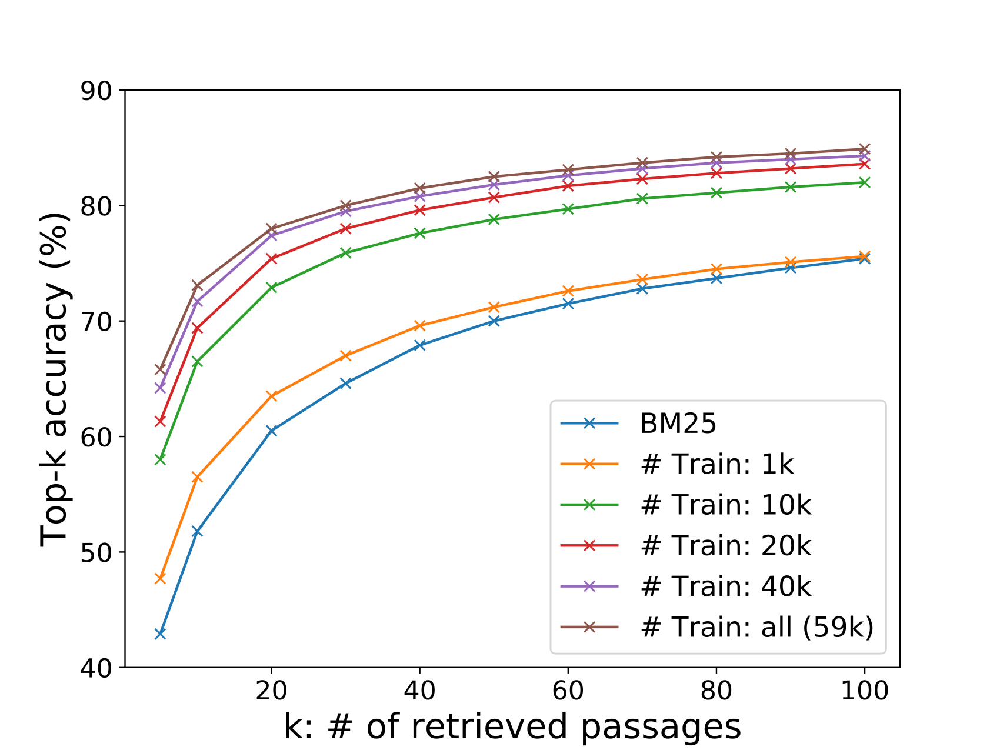

# DPR：面向开放域问答的稠密段落检索

> DPR 用两个独立的 BERT 分别编码问题与段落，借助同批负例和 BM25 难负例训练内积检索，让语义匹配可以直接用于全库召回。
>
> Vladimir Karpukhin 等，**EMNLP 2020**。[正式论文](https://aclanthology.org/2020.emnlp-main.550/) · [arXiv:2004.04906](https://arxiv.org/abs/2004.04906) · [官方代码与模型](https://github.com/facebookresearch/DPR)

## 论文简介

开放域问答需要先从海量文本中找到证据，再由阅读器提取答案。传统 TF-IDF、BM25 依赖词面匹配，难以处理问题和证据之间的同义改写；已有稠密方案则常依赖额外预训练和复杂的检索器—阅读器联合训练。DPR 从预训练 BERT 出发，分别学习问题与段落的单向量表示，以同批其他问题的正段落和 BM25 难负例构造对比目标，离线建立段落向量索引，在线用内积召回。

在 Natural Questions 上，单数据集 DPR 将 Top-20 答案命中率从 BM25 的 59.1% 提高至 78.4%，接入作者的阅读器后取得 41.5% EM。论文的重要结果是：合适的监督与负例组织足以训练出强检索器。不过，这一结论来自英文 Wikipedia 问答；SQuAD 的词面偏置、稀有实体和离线索引成本，都展示了它的适用边界。

## 引言：检索决定阅读器能看到什么

本文研究抽取式开放域问答：系统收到事实型问题，从大语料中找出包含答案的段落，再抽取答案片段。阅读理解模型在给定正确段落时可以表现很好，但移到开放检索条件后常出现明显下降；原因之一是正确证据没有进入候选集合。

BM25 使用倒排索引，效率高，也擅长精确识别罕见词和实体名。然而，问题中的 “bad guy” 与段落中的 “villain” 可能语义相同、词面不同。稠密表示允许模型学习这种匹配关系，并用最大内积搜索（MIPS）高效检索。

作者要回答的问题是：**在已有 BERT 预训练的基础上，只用现成的问题—段落或问题—答案监督，能否训练出优于 BM25 的检索器？** 这里“无需额外预训练”指不再做 ORQA 的 ICT 等检索专用预训练，并非不用预训练语言模型。

ORQA 已证明稠密检索在开放域问答中的价值，但先做 inverse cloze task（从被遮蔽的句子预测其所在文本块），随后联合训练问题编码器和阅读器，段落编码器不随问答监督更新。DPR 选择直接训练两侧编码器，首先把独立的检索任务做好。

## 任务定义与评测单位

把文档切成段落后，语料为 $\mathcal C=\{p_1,\ldots,p_M\}$。检索器接收问题 $q$，返回 $k\ll M$ 个候选段落，再交给阅读器。

**Top-k retrieval accuracy 是“多少问题的前 k 个候选中至少有一个包含答案”的比例。** 它不是前 k 个段落中相关段落所占的比例，也不是最终回答的正确率。原文 Table 2 的 caption 表述容易造成混淆，本文按正文的任务定义解释这一指标。最终问答另用 Exact Match（EM），在轻量文本归一化后比较预测答案与参考答案。

## 方法：可离线索引的双编码器

### 问题与段落分别编码

段落编码器 $E_P$ 和问题编码器 $E_Q$ 是两个独立的 `BERT-base-uncased` 网络，均取 `[CLS]` 的最后层表示，维度为 768。二者分别学习参数，匹配函数为原文式（1）：

$$
s(q,p)=E_Q(q)^\top E_P(p).
$$

这一分解使段落表示不依赖当前问题，可以预先算好。交叉注意力模型虽然表达能力更强，但问题一变就要重新计算问题—段落交互，不适合直接遍历两千多万段落。

推理分成两步：离线对全部段落计算向量并建立 FAISS 索引；在线只编码新问题，再检索内积最大的段落。本文使用的是未要求单位归一化的内积，不能在复现时默认替换成 cosine。

### 训练目标

每个样本包含问题 $q_i$、一个正段落 $p_i^+$ 和若干负段落 $p_{i,j}^-$。损失是正段落在候选集合中的负对数似然，原文式（2）：

$$
\mathcal L_i=-\log
\frac{\exp s(q_i,p_i^+)}
{\exp s(q_i,p_i^+)+\sum_{j=1}^{n}\exp s(q_i,p_{i,j}^-)}.
$$

训练同时更新两个编码器，使正确段落的得分高于竞争段落。原文这一公式没有额外写温度参数，也没有把问题到段落与段落到问题两个方向的损失求平均。

### 负例来自哪里

作者比较三类负例：随机抽取的语料段落；BM25 排名靠前、但不含答案字符串的段落；其他问题对应的标注正段落（原文称 Gold negatives）。最后一种段落只是在当前问题下被当作负例，本身仍是另一个问题的正例。

对一个有 $B$ 个问题及其正段落的 batch，设两侧表示为 $\mathbf Q,\mathbf P\in\mathbb R^{B\times768}$，一次矩阵乘法得到：

$$
\mathbf S=\mathbf Q\mathbf P^\top\in\mathbb R^{B\times B}.
$$

对角线是正确配对，其余项作为负配对。这样只编码 $B$ 个问题与 $B$ 个段落，便能形成 $B^2$ 个得分，每个问题获得 $B-1$ 个负例。

最佳配方在此基础上**为每个问题另取一个 BM25 难负段落，并把这些难负段落也共享给全 batch**。所以 $B=128$ 时，每个问题实际面对 127 个其他正段落加 128 个难负段落，共 255 个负例；不是只在原来的 127 个负例上增加自己对应的那一个。

## 数据与实验设置

### Wikipedia 语料

作者使用 **2018-12-20 英文 Wikipedia**，经 DrQA 的预处理去掉表格、信息框、列表和消歧页，保留正文。每篇文章切成不重叠的 **100-word** 文本块，得到 **21,015,324 个段落**；段落前附文章标题，以 `[SEP]` 分隔。

100 words 是语料切分单位，不等于 100 个 BERT WordPiece。作者的初步实验发现固定长度切分优于自然段，重叠切分未带来优势；这些是本文检索器、阅读器和数据条件下的观察。

### 五个问答数据集

| 数据集 | 问题来源与任务特点 | 原始训练问题 | DPR 过滤后训练问题 | Dev | Test |
| --- | --- | ---: | ---: | ---: | ---: |
| Natural Questions（NQ） | 真实 Google 查询，人工在 Wikipedia 中标答案 | 79,168 | 58,880 | 8,757 | 3,610 |
| TriviaQA | 从 Web 收集的知识问答，本文用 unfiltered 版本 | 78,785 | 60,413 | 8,837 | 11,313 |
| WebQuestions（WQ） | Google Suggest 问题，答案原为 Freebase 实体 | 3,417 | 2,474 | 361 | 2,032 |
| CuratedTREC（TREC） | TREC QA 与其他 Web 来源的事实问答 | 1,353 | 1,125 | 133 | 694 |
| SQuAD v1.1 | 标注者看过 Wikipedia 段落后写问题 | 78,713 | 70,096 | 8,886 | 10,570 |

数据量对应原文 Table 1。NQ、SQuAD 用原始标注上下文去匹配切分后的语料段落；匹配失败的问题丢弃。只有问题—答案对的数据集，则用 BM25 前 100 个候选中排名最高且含答案的段落作为正例；没有命中也丢弃。TriviaQA 原本的 Bing 证据文档不用于这里的正例构建。

SQuAD 并非理想的开放域问答测试：问题在看到段落后撰写，词面重叠较高，而且有些问题离开上下文就不够明确；其来源又仅覆盖五百多篇文章。作者保留它是为了和先前工作比较。

### 训练与比较方法

| 设置 | 原文取值或做法 |
| --- | --- |
| 检索器 batch size | 128；同批 Gold 负例 + 每问题一个 BM25 难负例 |
| 优化器与学习率 | Adam；$10^{-5}$；warm-up 后线性调度 |
| Dropout | 0.1 |
| 最大训练轮数 | NQ / TriviaQA / SQuAD 为 40；WQ / TREC 为 100 |
| Single | 各数据集独立训练检索器 |
| Multi | 合并 NQ / TriviaQA / WQ / TREC；不含 SQuAD |
| BM25 | Lucene；开发集调参后 $b=0.4$、$k_1=0.9$ |
| 混合检索 | BM25、DPR 各取 Top-2000，对并集以 $\mathrm{BM25}(q,p)+1.1s(q,p)$ 重排 |

本文评测的是这五个开放域 QA 数据集，不是后来出现的 BEIR 或 MTEB。

## 段落检索结果

下表保留原文 Table 2 的全部配置；每格为 **Top-20 / Top-100 答案命中率（%）**。

| 训练方式与检索器 | NQ | TriviaQA | WQ | TREC | SQuAD |
| --- | --- | --- | --- | --- | --- |
| BM25，无训练 | 59.1 / 73.7 | 66.9 / 76.7 | 55.0 / 71.1 | 70.9 / 84.1 | 68.8 / 80.0 |
| Single DPR | 78.4 / 85.4 | 79.4 / 85.0 | 73.2 / 81.4 | 79.8 / 89.1 | 63.2 / 77.2 |
| Single BM25+DPR | 76.6 / 83.8 | 79.8 / 84.5 | 71.0 / 80.5 | 85.2 / 92.7 | 71.5 / 81.3 |
| Multi DPR | 79.4 / 86.0 | 78.8 / 84.7 | 75.0 / 82.9 | 89.1 / 93.9 | 51.6 / 67.6 |
| Multi BM25+DPR | 78.0 / 83.9 | 79.9 / 84.4 | 74.7 / 82.3 | 88.5 / 94.1 | 66.2 / 78.6 |

除 SQuAD 外，Single DPR 的 Top-20 比 BM25 高 8.9–19.3 个百分点。NQ 的 59.1→78.4 尤为明显：仅把二十个候选交给阅读器时，语义召回能显著扩大“有正确证据可读”的问题集合。

多数据集训练对小数据集尤其有效：TREC 的 DPR Top-20 从 79.8 提高到 89.1；但 TriviaQA 略降，不能概括为合并数据总会更好。混合检索也并非逐项胜出：它在 TREC、SQuAD 的一些设置中有帮助，在 NQ 上反而下降。固定线性权重下的结果不等于稀疏与稠密信号没有互补性。

## 消融：训练配方比复杂打分更关键

### 样本效率

图中横轴是检索段落数 $k$，纵轴是 Top-k 答案命中率；各条 DPR 曲线分别使用 1k、10k、20k、40k、约 59k 个训练问题，并以 BM25 作参照。只使用 1,000 个训练样本时，DPR 已超过 BM25；增加训练样本后，曲线整体上移。它说明预训练 BERT 的表示可以通过少量检索监督有效适配，不意味着任意新领域的一千条数据都必然足够。

### 同批复用与 BM25 难负例

原文 Table 3，全部在 **NQ 开发集**上测量；`#N` 为每个问题的负例数。

| 负例 | #N | 同批复用 | Top-5 | Top-20 | Top-100 |
| --- | --- | --- | ---: | ---: | ---: |
| Random | 7 | 否 | 47.0 | 64.3 | 77.8 |
| BM25 | 7 | 否 | 50.0 | 63.3 | 74.8 |
| Gold | 7 | 否 | 42.6 | 63.1 | 78.3 |
| Gold | 7 | 是 | 51.1 | 69.1 | 80.8 |
| Gold | 31 | 是 | 52.1 | 70.8 | 82.1 |
| Gold | 127 | 是 | 55.8 | 73.0 | 83.1 |
| Gold + 每问题 1 个 BM25 | 31+32 | 是 | 65.0 | 77.3 | 84.4 |
| Gold + 每问题 2 个 BM25 | 31+64 | 是 | 64.5 | 76.4 | 84.0 |
| Gold + 每问题 1 个 BM25 | 127+128 | 是 | 65.8 | 78.0 | 84.9 |

相同的 7 个 Gold 负例预算下，同批复用把 Top-20 从 63.1 提到 69.1；增加 batch 后，纯同批负例达到 73.0。加入 BM25 难负例后进一步升至 78.0。对于 batch=32，每问题两个 BM25 难负例没有优于一个，因此“更难、更多”不应脱离具体采样配方理解。

### 正例监督与相似度函数

附录 A 在 NQ 开发集比较精确匹配原始标注上下文的正例与远程监督正例。附录的远程监督使用问题和答案共同检索，再取含答案的最高排名 BM25 段落。

| 正例来源 | Top-1 | Top-5 | Top-20 | Top-100 |
| --- | ---: | ---: | ---: | ---: |
| Gold 上下文 | 44.9 | 66.8 | 78.1 | 85.0 |
| 远程监督 | 43.9 | 65.3 | 77.1 | 84.4 |

差距约一个百分点，说明问题—答案对也能提供有效训练信号。这里不能把“段落含答案字符串”当成无噪声的相关性标注。

附录 B 比较内积（DP）、L2 距离与 NLL、triplet loss；triplet 的 margin=1，L2 在 softmax 前取负，其他超参沿用基线。

| 相似度与损失 | Top-1 | Top-5 | Top-20 | Top-100 |
| --- | ---: | ---: | ---: | ---: |
| DP + NLL | 44.9 | 66.8 | 78.1 | 85.0 |
| DP + Triplet | 41.6 | 65.0 | 77.2 | 84.5 |
| L2 + NLL | 43.5 | 64.7 | 76.1 | 83.1 |
| L2 + Triplet | 42.2 | 66.0 | 78.1 | 84.9 |

替换损失和距离没有产生一致的大幅收益。正文还报告 cosine 不如内积和 L2，但未在这张表给出 cosine 的数值。附录实验用了更好的超参设置，不能把其 78.1 与主消融表的 78.0 直接解释成方法增益。

### 跨数据集与定性分析

只在 NQ 训练，直接测试 WQ、TREC，Top-20 分别为 **69.9、86.3**，低于对应的最佳 Multi 模型 75.0、89.1，仍高于 BM25 的 55.0、70.9。这是同一英文 Wikipedia 语料下的跨问答数据集泛化，尚不能替代跨语言、跨领域的评测。

附录 C 的两个例子说明两类检索器的互补：询问英格兰与爱尔兰之间的水域，DPR 能把 “body of water” 与 sea、channel 等语义对应，找到 Irish Sea；询问《权力的游戏》中 “Thoros of Myr” 的扮演者，BM25 则更准确地抓住稀有专名，DPR 错误匹配到另一位演员。

## 运行效率与离线成本

作者在 Intel Xeon E5-2698 v4、512GB 内存服务器上报告：FAISS 内存索引检索 Top-100 达到 **995.0 questions/s**；使用文件索引的 Lucene BM25 为 **23.7 questions/s/CPU thread**。原文脚注给出的 HNSW 参数为每节点 512 个邻居、构建搜索深度 200、查询搜索深度 128。

两项吞吐的线程口径、索引驻留方式不同，应保留原条件；不能据此断言完整 DPR 问答服务在同等资源下普遍快四十多倍，问题编码与阅读器成本也不能由索引吞吐替代。

离线成本则明显增加：2100 万段落在 8 张 GPU 上编码约 **8.8 小时**，单服务器建 FAISS 索引约 **8.5 小时**；Lucene 倒排索引约 **30 分钟**。DPR 以更重的表示计算、存储和建索引换取语义召回能力。

## 问答系统：检索之后仍要选择证据和答案

### 阅读器与训练

阅读器对每个问题—段落做 BERT 交叉编码。设第 $i$ 个输入的 token 表示为 $\mathbf P_i\in\mathbb R^{L\times h}$，用可学习向量产生答案起点、终点概率；用各段落 `[CLS]` 表示产生跨段落选择概率。原文式（3）—（5）可写为：

$$
P_{\mathrm{start},i}(s)=\mathrm{softmax}(\mathbf P_i\mathbf w_{\mathrm{start}})_s,
\qquad
P_{\mathrm{end},i}(t)=\mathrm{softmax}(\mathbf P_i\mathbf w_{\mathrm{end}})_t,
$$

$$
P_{\mathrm{selected}}(i)=\mathrm{softmax}(\widehat{\mathbf P}^{\top}\mathbf w_{\mathrm{selected}})_i,
\qquad
\widehat{\mathbf P}=[\mathbf P_1^{[\mathrm{CLS}]},\ldots,\mathbf P_k^{[\mathrm{CLS}]}].
$$

段落内部的答案跨度得分是起点、终点概率的乘积。最终先选段落选择得分最高的段落，再取其中的最佳答案跨度；段落选择模块也起到重排作用。

训练时从检索 Top-100 中抽取一个正段落和 23 个负段落。目标结合正确段落的选择对数似然，以及正段落内所有正确答案跨度的边缘对数似然，允许同一答案字符串在段落中出现多次。大数据集问题 batch=16，小数据集为 4；Multi 设置下，WQ、TREC 的阅读器从 NQ 阅读器继续微调。全部实验使用 8 张 32GB GPU。

### 最终问答结果

原文 Table 4，指标为测试集 **EM（%）**。上半部分前人结果来自各自论文，模型与训练方案并不完全相同；下半部分 BM25、DPR 使用作者的阅读器框架。

| 训练方式与系统 | NQ | TriviaQA | WQ | TREC | SQuAD |
| --- | ---: | ---: | ---: | ---: | ---: |
| Single，BM25+BERT（Lee 等） | 26.5 | 47.1 | 17.7 | 21.3 | 33.2 |
| Single，ORQA | 33.3 | 45.0 | 36.4 | 30.1 | 20.2 |
| Single，HardEM | 28.1 | 50.9 | — | — | — |
| Single，GraphRetriever | 34.5 | 56.0 | 36.4 | — | — |
| Single，PathRetriever | 32.6 | — | — | — | 56.5 |
| Single，REALM-Wiki | 39.2 | — | 40.2 | 46.8 | — |
| Single，REALM-News | 40.4 | — | 40.7 | 42.9 | — |
| Single，作者 BM25 系统 | 32.6 | 52.4 | 29.9 | 24.9 | 38.1 |
| Single，作者 DPR 系统 | 41.5 | 56.8 | 34.6 | 25.9 | 29.8 |
| Single，作者 BM25+DPR 系统 | 39.0 | 57.0 | 35.2 | 28.0 | 36.7 |
| Multi，作者 DPR 系统 | 41.5 | 56.8 | 42.4 | 49.4 | 24.1 |
| Multi，作者 BM25+DPR 系统 | 38.8 | 57.9 | 41.1 | 50.6 | 35.8 |

较高的检索命中率通常能转化为较高 EM。NQ 用作者的同一阅读器框架时，BM25 的 32.6 提高为 DPR 的 41.5；SQuAD 仍是反例。小数据集的最终提升包含额外数据和阅读器迁移的作用，不能全归到检索器架构上。

在 NQ 上，验证集调参选到 $k=50$；改用 $k=10$，测试 EM 从 41.5 小幅下降到 40.8。作者还报告其设置中把最多 100 个段落放进单张 32GB GPU 的一个 batch 后，阅读器延迟约 20ms，但这依赖输入长度、硬件与批处理条件，不等于吞吐成本不随段落数增长。

### 联合训练的附录实验

附录 D 固定段落编码器，仅更新问题编码器和阅读器，以免训练中反复重建索引。每个问题取 Top-100；batch=16，共享后每个问题有 1600 个候选向量参与检索损失。阅读器仍用 24 个段落，其问题编码器从已训练的 NQ DPR 初始化，阅读器从 BERT-base 初始化。

附录明确报告联合训练与普通分阶段训练在 **NQ 开发集均为 39.8 EM**。正文将联合训练的 39.8 与主结果讨论放在一起容易造成误读；不能拿开发集 39.8 和测试集 41.5 推断联合训练下降了 1.7 分。这个实验支持的是：作者没有观察到联合训练带来额外收益。

## 相关工作、结论与边界

稠密检索与双编码器并非由 DPR 首创：LSA、DSSM、实体检索等已有先例，同批负例也有更早工作。DPR 的贡献是将 BERT 双编码器、有效监督、同批复用和难负例组合成简单而强的开放域问答检索方案，并证明召回收益能传递到回答质量。

与它相邻的路线包括：ORQA、REALM 研究额外预训练和检索—阅读联合学习；ColBERT 用 token 级后期交互增加匹配容量；ANCE 用已有检索器挖掘新的全库难负例；RAG、FiD 将稠密召回与生成模型结合。原文后续版本的相关工作已经讨论了这些联系。

读这篇时应保留三个边界：实验以英文 Wikipedia 的事实问答为中心；答案字符串和同批配对提供的是带假设的相关性监督；单向量语义匹配依然会在稀有词、专名与词面偏置下失败。论文的价值在于建立了一个可研究、可扩展的强基线，而非证明稀疏检索、额外预训练或联合训练从此没有必要。

## 原始资料

- [Karpukhin 等，EMNLP 2020 正式论文](https://aclanthology.org/2020.emnlp-main.550/)：主文、Figure 1、Table 1–7、附录 A–D。
- [arXiv v3](https://arxiv.org/abs/2004.04906v3)：与本文研读对应的后期版本。
- [DPR 官方仓库](https://github.com/facebookresearch/DPR)：训练数据、checkpoint、双编码器和抽取式阅读器实现；仓库中的后续改进模型应与 2020 原文实验区分。
