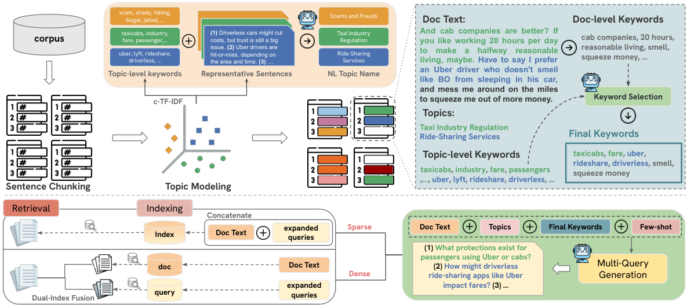

# Doc2Query++ 详解：主题覆盖扩展，稠密侧改成双索引

> **paper**：[Doc2Query++: Topic-Coverage based Document Expansion and its Application to Dense Retrieval via Dual-Index Fusion](https://arxiv.org/abs/2510.09557)（Kuo, Chiu, Ma, Cheng；arXiv:2510.09557v2，2025-10-13）
> **code**：论文附录的匿名仓库 https://anonymous.4open.science/r/doc2queryPlusPlus-41BB/
> **backbone**：LLaMA-3.1-8B-Instruct（vLLM，温度 0.8）；BERTopic + 领域 SBERT；稀疏 BM25（PyTerrier，$k_1=0.9$，$b=0.4$）；稠密 Contriever（`facebook/contriever-msmarco`）+ FAISS 内积
> **date**：2025-10
> **modality**：文本文档扩展；稀疏倒排与稠密双索引
> **languages**：英文 BEIR 五子集

全文逐段中英对照见同目录 [zh.md](zh.md)。本文不重复对照译文，只把继承的流水线、主题覆盖、双索引和五张表的口径写清。数字只取论文表内和正文写出的原值。

**词汇不匹配**：查询用词和相关文档用词不一致，词项匹配会漏召。**文档扩展（DE）**：索引前给文档补预测查询或上下文词项。**查询生成（QG）**：用模型为文档写出用户可能会问的查询。**BM25**：词项倒排打分；本文用 PyTerrier 默认 $k_1=0.9$、$b=0.4$。**BERTopic**：在句向量上用 HDBSCAN 做密度聚类的无监督主题模型，主题个数由数据决定。**HDBSCAN**：基于密度的层次聚类，能标出离群点，并自动决定簇数。**c-TF-IDF**：把同一主题簇里的句子拼成伪文档，在簇之间做 TF-IDF，突出这个主题有、别的主题少的词。**SBERT**：句向量编码器；本文按数据集换领域模型。**KeyBERT**：用文档向量与 n-gram 向量的余弦抽关键词。**MMR（最大边际相关）**：在相关性和与已选词的差异之间折中，$\lambda=0.7$ 偏相关性。**nDCG@10**：前 10 名按位置折扣的归一化累积增益。**MAP**：全列表平均精度的均值。**Recall@100**：相关文档落在前 100 的比例。**双索引融合**：原文嵌入与生成查询嵌入分库存，检索时再加权，避免把查询噪声写进同一个稠密向量。

---

## 先把继承的 Doc2Query 流水线说清

2019 年的 Doc2Query（Nogueira, Yang, Lin, Cho）做的是文档到查询。监督是数据集里已有的（查询，相关文档）对。序列到序列模型读入文档词，写出一条这条文档会回答的查询。训完之后，对语料中每篇文档采样若干预测查询，不加标记地拼到原文后面，重建倒排，检索仍用 BM25。神经计算发生在索引前。可选地再用 BERT 重排。那篇论文在 MS MARCO 上的默认是 top-k 随机采样、每篇 10 条。复制词把关键词在 BM25 里加重，新词补上原文没有的说法，两种一起用才到开发集 MRR@10 的 21.5。RM3 查询扩展在那两个偏精度的集合上是掉点的。

本文相关工作把这条线接下去。同一个 Transformer 后来被换成大得多的 T5，称为 DocT5Query。Doc2Query−− 在生成之后用相关性模型打分，丢掉低于阈值的查询，以减噪声和索引体积。本文实验里的 Doc2Query−− 是：先用 Doc2Query 生成 100 条，再按交叉编码器分数保留前 30%，大约 30 条；过滤模型是 ELECTRA。

实验基线里的 Doc2Query 写的是：复现 Nogueira and Lin，但模型用 T5-base，top-$k$ 采样 $k=10$。2019 年原文的生成器是 base Transformer（OpenNMT），不是 T5。T5 替换写在本文引用的 DocT5Query 短文里。读表时这一行是 T5-base 的文档到查询再拼接。所有方法，包括本文，每篇文档都固定生成 30 条查询，比的是查询内容，不是条数。

形式上都还是同一条扩展式。文档集合 $D=\{d_1,\ldots,d_n\}$，为 $d_i$ 生成 $Q_i=\{q_{i1},\ldots,q_{im}\}$，扩展文档 $d'_i = d_i \cup Q_i$，扩展语料再索引。稀疏检索没有改这个式子。改的是查询从哪来，以及稠密检索还要不要把 $Q_i$ 写进同一个向量。

表 1 用同一篇英国学生贷款帖子看覆盖。文档被标成三个主题：英国学生贷款、债务与投资策略、资产处置。Doc2Query 的三条都挤在还贷：能否用工作还贷、能否从贷款再借、是否必须偿还。Doc2Query−− 滤完之后仍是失业还要不要还。Doc2Query++ 的三条分别落到收入挂钩还款（年收入超过 £15,000）、股息如何影响还债、以及是否卖掉跌超 10% 的股票来还债。后两个侧面是前两种生成碰不到的。

---

## 不受控生成缺的是覆盖，不是再多几条

作者列了三条旧限制。生成不受控时，查询会幻觉、互相重复、主题盖不全。在 MS MARCO 上训练的模型换到 BEIR 会掉。直接把查询拼进文档再编码，会把噪声写进稠密向量；编码器越强，对这种失真越敏感。

用 LLM 做提示可以不在目标域上微调，但朴素提示同样会漏侧面。CCQGen 用学术分类体系强制概念覆盖，在科学检索上有效，开放域没有那套分类体系。本文用 BERTopic 代替固定分类：主题从语料的句向量里长出来。

多生成几条不会自动盖全。第 4.2.6 节在 FiQA-2018 的稀疏检索上把 Doc2Query 的条数从 0 加到 600。nDCG@10 和 Recall@100 大约在 100 条见顶，之后明显下降。Doc2Query++ 只用 30 条，nDCG@10 为 0.2972，高于 Doc2Query 最优点的 0.2902；Recall@100 为 0.6197，高于 0.5981。

---

## 图 1 在讲什么

**图在讲什么。** 左上从语料切句，再进主题建模。放大的一块是 c-TF-IDF：主题级关键词（scam、taxicabs、uber、driverless）、代表句，以及自然语言主题名（Scams and Frauds、Taxi Industry Regulation、Ride-Sharing Services）。右上是一篇关于出租车公司与 Uber 司机的文档。KeyBERT 抽出文档级短语（cab companies、20 hours、smell、squeeze money），和主题级词一起交给关键词选择，得到最终词（taxicabs、fare、uber、rideshare、driverless、smell、squeeze money）。右下把文档、主题名、最终关键词和少样本例子送给多查询生成，一次写出多条，例如乘客使用 Uber 或出租车有什么保护、无人驾驶如何影响车费。左下分成两路。稀疏：文档文本与扩展查询拼接后进一个索引。稠密：原文进 doc 索引，扩展查询进 query 索引，检索时做双索引融合。生成仍是离线的。稠密侧不再把查询和原文编成同一个向量。

---

## 主题从句子长出来，再用 LLM 起名

句子是主题的最小连贯单位，先用 NLTK 的 sent_tokenize 切开。全体句子用领域 SBERT 编成向量。BERTopic 用 HDBSCAN 聚类，簇数 $C$ 不手调。句子按 L2 距离归到最近质心，离群点丢掉：

$$
\phi(\mathbf{z}_s)=\arg\min_{j=1,\ldots,C}\lVert \mathbf{z}_s-\boldsymbol{\mu}_j\rVert_2
$$

文档的主题集是它的句子被分到的主题之并：

$$
T(d)=\bigcup_{s\in S_d}\phi(\mathbf{z}_s)
$$

簇本身没有名字。c-TF-IDF 抽出 top-$M$ 词当临时描述，再取离质心最近的 top-$L$ 句，和这些词一起用少样本提示让 LLM 只写一行 `topic: ` 开头的短标签。实验用默认 $M=10$、$L=3$。附录例 1 把「先卖后买、长期看涨但短期见顶」收成 Short-Term Stock Trading。例 2 到例 4 论文印成省略号。

编码器按数据集换：NFCorpus 用 BioBERT，SCIDOCS 用 SPECTER，SciFact 和 ArguAna 用 all-mpnet-v2，FiQA-2018 用 Fin-MPNET。主题空间是领域里的，不是一套全局主题表。

---

## 主题词会漂，文档词把它拉回来

只拿主题的 top-10 个 c-TF-IDF 词去写查询，会把簇级词误安到单篇文档上。论文的例子：讲股票均线交叉的文档和加密货币文档共享 market、trend、volatility，聚类可能把它放进加密主题，关键词就变成 blockchain、bitcoin、mining、smart contract，LLM 被带离均线。

文档级用 KeyBERT：1–3 元短语按与文档向量的余弦取 top-20，再用 MMR（$\lambda=0.7$）减冗余，得到 $K_d^{\mathrm{doc}}$。主题级词提供新词，文档级词提供文内锚点。候选池是并集 $K_d = K_d^{\mathrm{topic}} \cup K_d^{\mathrm{doc}}$。LLM 再从中选恰好 10 个，丢掉过宽的词，且不能写出候选集以外的词。这一步对应 2019 年「新词和复制词互补」，但选择发生在生成之前。

表 4 不是生成查询，而是把三种来源的 top-10 词直接追加到原文上，用 BM25 看词本身。

| 数据集 | KeyBERT N@10 | KeyBERT R@100 | Topic N@10 | Topic R@100 | LLM N@10 | LLM R@100 |
| --- | ---: | ---: | ---: | ---: | ---: | ---: |
| FiQA-2018 | 0.2663 | 0.5623 | 0.2558 | 0.5690 | 0.2619 | 0.5692 |
| SCIDOCS | 0.1433 | 0.3449 | 0.1323 | 0.3475 | 0.1437 | 0.3569 |
| NFCorpus | 0.3172 | 0.2427 | 0.3141 | 0.2485 | 0.3253 | 0.2464 |
| Arguana | 0.3462 | 0.9450 | 0.3550 | 0.9493 | 0.3554 | 0.9557 |
| Scifact | 0.6791 | 0.9192 | 0.6667 | 0.9107 | 0.6818 | 0.9223 |
| 平均 | 0.35042 | 0.6028 | 0.3448 | 0.605 | 0.35314 | 0.61066 |

KeyBERT 的平均 nDCG@10 高于 Topic（0.35042 对 0.3448），因为文内词加强已有信号。Topic 的平均 Recall@100 略高（0.605 对 0.6028）。5 个里有 4 个数据集上 Topic 的召回高于 KeyBERT；Scifact 不是（0.9107 低于 0.9192）。LLM 两列平均都最高：0.35314 和 0.61066。单格并不处处最高。FiQA 的 nDCG@10 是 KeyBERT 0.2663，高于 LLM 的 0.2619。

---

## 一批三条，直到满 30 条

目标是 $M$ 条查询盖住全部主题，并写进关键词。InPars、Promptagator 一类方法一次一条，没有覆盖约束。CCQGen 靠迭代分类补洞，更贵。本文把文档、主题名、关键词和少样本例子一起送进 LLaMA-3.1-8B-Instruct，每批 $b=3$，直到满 $M$。主实验 $M=30$，所以是 10 次提示。温度 0.8。少样本基线在提示里放 6 对查询–文档。Doc2Query++ 自己的少样本是每个数据集 6 个留出例子，主题和关键词由 BERTopic/KeyBERT 算出，查询人工写成覆盖示范。附录例 1 的三条分别落到定投、何时转到现金或短债、长期持有相对于恐慌卖出。例 2 到例 6 论文印成省略号。生成后不再用分类器过滤。这是和 Doc2Query−− 相反的取舍：那边靠删低分查询减噪声，这边靠生成时的主题和关键词约束。

稀疏侧的消融把约束逐级加上。F 是没有外部约束的少样本提示，F+K 加上关键词，Doc2Query++ 再加主题覆盖。

| 数据集 | F N@10 | F R@100 | F+K N@10 | F+K R@100 | ++ N@10 | ++ R@100 |
| --- | ---: | ---: | ---: | ---: | ---: | ---: |
| FiQA-2018 | 0.2789 | 0.5869 | 0.2854 | 0.5888 | 0.2972 | 0.6197 |
| SCIDOCS | 0.1406 | 0.3323 | 0.1461 | 0.3664 | 0.1568 | 0.3749 |
| NFCorpus | 0.3371 | 0.2531 | 0.3374 | 0.2519 | 0.3415 | 0.2639 |
| Arguana | 0.3304 | 0.9465 | 0.3488 | 0.9622 | 0.3561 | 0.9629 |
| Scifact | 0.6888 | 0.9194 | 0.6871 | 0.9211 | 0.6945 | 0.9248 |

论文说从 F 到 F+K 再到全文，全部数据集单调变好。按表内原数，nDCG@10 在 Scifact 上 F 是 0.6888，F+K 降到 0.6871，再到全文 0.6945；NFCorpus 的 Recall@100 从 F 的 0.2531 降到 F+K 的 0.2519，再到 0.2639。单调性在「全文相对 F」上成立，中间一步不是每一格都升。NFCorpus、SCIDOCS、Arguana、Scifact 的 F 与表 2 少样本稀疏的 N@10、R@100 相同。FiQA 的 F 是 0.2789 / 0.5869，表 2 少样本稀疏是 0.2877 / 0.5864，两格不是同一个数。比较消融时以表 3 为准。

全文相对 F 抬得最明显的是 Arguana 的 nDCG@10（0.3304 到 0.3561）和 FiQA 的 Recall@100（0.5869 到 0.6197）。NFCorpus 的 nDCG@10 只从 0.3371 到 0.3415，关键词那一步几乎不动（0.3374），增益主要来自主题覆盖。

---

## 稀疏仍拼接；稠密拆成两个索引

稀疏检索就是继承来的那一步：查询接在原文后，重建倒排，BM25 照常打。作者认为新词缓解词汇不匹配，稀疏上精度和召回会一起涨。

稠密不能照做。拼接再编码，扩展查询的语义噪声进了文档向量，原文档被稀释。双索引把两边拆开。文本索引只放原文嵌入 $\mathbf{v}_d$。查询索引只放生成查询嵌入，每条链回源文档。用户查询嵌入是 $\mathbf{v}_Q$。相似度可以是点积或余弦；Contriever 实验用 FAISS 内积。

文本路取 top-$n_t$：$S_t(d)=\mathrm{sim}(\mathbf{v}_Q,\mathbf{v}_d)$。查询路取 top-$n_q$。同一文档可能有多条查询进前 $n_q$，用最大池化，不平均；一条都没命中则查询侧分数为 0。融合

$$
S(d)=(1-\alpha)\,S_t(d)+\alpha\,S_q(d),\quad \alpha\in[0,1]
$$

$\alpha=0$ 是纯原文稠密检索，$\alpha=1$ 只用查询索引。主实验 $\alpha=0.5$，$n_t=300$，$n_q=1000$。最大池化的意思是：这篇文档只要有一条扩展查询和用户查询很近，查询侧就给高分，其余较差的查询不会把分数拉低。没被查询索引捞到的文档，退回纯文本分。

---

## 五个 BEIR 子集，不是在 MS MARCO 上再报一次

BEIR 强调域外。本文取五个，规模和任务都不同。

| 子集 | 查询 | 文档 | 任务 |
| --- | ---: | ---: | --- |
| NFCorpus | 323 | 3,633 篇 PubMed 摘要 | 生物医学，NutritionFacts.org 的自然语言问句 |
| SCIDOCS | 1,000 | 25,657 篇论文 | 用摘要当查询做引用预测 |
| FiQA-2018 | 648 | 57,638 段 | 投资者问题，新闻和报告 |
| ArguAna | 1,406 | 8,674 段 | 论点找反论点 |
| SciFact | 300 | 5,183 篇摘要 | 科学主张核查 |

指标是 MAP、nDCG@10、Recall@100。稠密骨干是未在这些子集上微调的 Contriever。三块 RTX A5000，LLaMA 用 vLLM 本地跑，主题精炼、选词、生成查询都走同一模型。

---

## 主表：稀疏五行都是本文最高，稠密有一格不是

表 2 上半是 BM25，下半是 Contriever 加双索引融合。稀疏的不扩展基线是 BM25，稠密的是 Contriever。

稀疏：

| 方法 | NF MAP | NF N@10 | NF R@100 | SCI MAP | SCI N@10 | SCI R@100 | FiQA MAP | FiQA N@10 | FiQA R@100 | Arg MAP | Arg N@10 | Arg R@100 | Fact MAP | Fact N@10 | Fact R@100 |
| --- | ---: | ---: | ---: | ---: | ---: | ---: | ---: | ---: | ---: | ---: | ---: | ---: | ---: | ---: | ---: |
| BM25 | 0.1489 | 0.3223 | 0.2438 | 0.0977 | 0.1430 | 0.3433 | 0.2038 | 0.2466 | 0.5523 | 0.2381 | 0.3437 | 0.9450 | 0.6384 | 0.6776 | 0.9198 |
| Doc2Query | 0.1544 | 0.3338 | 0.2470 | 0.1047 | 0.1495 | 0.3592 | 0.2348 | 0.2786 | 0.5753 | 0.2408 | 0.3475 | 0.9493 | 0.6572 | 0.6927 | 0.9248 |
| Doc2Query−− | 0.1551 | 0.3334 | 0.2495 | 0.1025 | 0.1487 | 0.3586 | 0.2336 | 0.2771 | 0.5811 | 0.2321 | 0.3312 | 0.9429 | 0.6518 | 0.6893 | 0.9186 |
| 零样本 | 0.1519 | 0.3221 | 0.2451 | 0.0976 | 0.1398 | 0.3397 | 0.2381 | 0.2828 | 0.5881 | 0.2463 | 0.3558 | 0.9586 | 0.6529 | 0.6878 | 0.9217 |
| 少样本 | 0.1580 | 0.3371 | 0.2531 | 0.0967 | 0.1406 | 0.3323 | 0.2436 | 0.2877 | 0.5864 | 0.2317 | 0.3304 | 0.9465 | 0.6513 | 0.6888 | 0.9194 |
| 本文 | 0.1602 | 0.3415 | 0.2639 | 0.1095 | 0.1568 | 0.3749 | 0.2488 | 0.2972 | 0.6197 | 0.2487 | 0.3561 | 0.9629 | 0.6641 | 0.6945 | 0.9248 |

稀疏 15 个格子里，本文都是最高，但 SciFact 的 Recall@100 与 Doc2Query 同为 0.9248。相对 BM25，FiQA 的 nDCG@10 从 0.2466 到 0.2972，Recall@100 从 0.5523 到 0.6197，是稀疏上最显眼的一档。SCIDOCS 的 MAP 从 0.0977 到 0.1095。少样本 LLM 在这个集合上反而低于 BM25（MAP 0.0967，Recall@100 0.3323 对 BM25 的 0.3433）：没有主题约束的少样本查询，在引用预测上会伤覆盖。ArguAna 上 Doc2Query−− 的三项都低于 BM25（MAP 0.2321 对 0.2381，N@10 0.3312 对 0.3437，R@100 0.9429 对 0.9450），过滤掉的查询里有这个论证集需要的词。

稠密：

| 方法 | NF MAP | NF N@10 | NF R@100 | SCI MAP | SCI N@10 | SCI R@100 | FiQA MAP | FiQA N@10 | FiQA R@100 | Arg MAP | Arg N@10 | Arg R@100 | Fact MAP | Fact N@10 | Fact R@100 |
| --- | ---: | ---: | ---: | ---: | ---: | ---: | ---: | ---: | ---: | ---: | ---: | ---: | ---: | ---: | ---: |
| Contriever | 0.1618 | 0.3303 | 0.2951 | 0.1022 | 0.1459 | 0.3780 | 0.2748 | 0.3324 | 0.6564 | 0.2295 | 0.3304 | 0.9557 | 0.6218 | 0.6574 | 0.9467 |
| Doc2Query | 0.1612 | 0.3401 | 0.2878 | 0.1097 | 0.1577 | 0.3697 | 0.2789 | 0.3316 | 0.6406 | 0.2373 | 0.3401 | 0.9586 | 0.6390 | 0.6785 | 0.9267 |
| Doc2Query−− | 0.1577 | 0.3353 | 0.2823 | 0.1070 | 0.1559 | 0.3631 | 0.2818 | 0.3339 | 0.6226 | 0.2364 | 0.3387 | 0.9450 | 0.6091 | 0.6498 | 0.8890 |
| 零样本 | 0.1746 | 0.3522 | 0.3026 | 0.1135 | 0.1594 | 0.3905 | 0.3012 | 0.3557 | 0.6764 | 0.2504 | 0.3579 | 0.9714 | 0.6687 | 0.7069 | 0.9417 |
| 少样本 | 0.1779 | 0.3606 | 0.3132 | 0.1177 | 0.1647 | 0.3972 | 0.3028 | 0.3579 | 0.6803 | 0.2510 | 0.3588 | 0.9707 | 0.6746 | 0.7109 | 0.9450 |
| 本文 | 0.1775 | 0.3612 | 0.3212 | 0.1212 | 0.1726 | 0.4141 | 0.3123 | 0.3693 | 0.6818 | 0.2512 | 0.3612 | 0.9736 | 0.6913 | 0.7289 | 0.9583 |

论文写稳定超过全部基线。按原数，稠密 NFCorpus 的 MAP 是少样本 0.1779、本文 0.1775，这一格少样本更高；同数据集的 N@10（0.3612 对 0.3606）和 R@100（0.3212 对 0.3132）仍是本文更高。其余四个数据集的三项都是本文最高。

Doc2Query 对 Doc2Query−−：nDCG@10 除稠密 FiQA 外都是 Doc2Query 更高。稠密 FiQA 的 nDCG@10 是 Doc2Query−− 0.3339，Doc2Query 0.3316，Contriever 自己是 0.3324。过滤在域外常常删掉还有用的词。稠密 SciFact 上 Doc2Query−− 的 Recall@100 掉到 0.8890，低于 Contriever 的 0.9467，也低于 Doc2Query 的 0.9267。Doc2Query 自己的稠密 Recall@100 在 NFCorpus、SCIDOCS、FiQA、SciFact 上也低于不扩展的 Contriever。LLM 查询才把 Recall@100 拉过 Contriever。

稀疏里 Doc2Query 系列常常能和零样本 LLM 打平甚至更好，因为 BM25 要的是词面重叠，T5 会抄关键词。稠密里 LLM 查询整体更高，因为 Contriever 吃的是整句语义。少样本在稠密上稳定高于零样本；稀疏上并不总是，ArguAna 少样本 MAP 0.2317 低于零样本 0.2463，也低于 BM25。上下文学习对稠密对齐更重要，对稀疏没那么关键。

---

## 主题召回：稠密正相关，稀疏会反

主题召回把每条生成查询嵌进去，用余弦硬分到最近的 BERTopic 质心，再和文档的金主题比：

$$
\mathrm{Topic\ Recall}=\frac{\lvert\mathrm{Assigned\ Topics}\cap\mathrm{Gold\ Topics}\rvert}{\lvert\mathrm{Gold\ Topics}\rvert}
$$

图 2 是这个召回和相对骨干检索器的 nDCG@10、Recall@100 增益之间的皮尔逊相关。论文没有给出相关系数或散点坐标。文字结论是：稠密上强正相关。新侧面的词进了向量平均，Contriever 能接住，精度不掉。稀疏上相关变弱或转负。BM25 的词频加权会放大这些新词，倒排里原文信号被稀释，精确重叠比宽扩展更占便宜。同一套覆盖查询，稠密要靠双索引才能用，稀疏则不能无限制地加新词。

---

## 拼接伤稠密；α 是精度和召回的旋钮

表 5 比较不扩展、拼接、双索引。增益定义为（双索引 − 次优）/ 次优，写成百分数。表内每个数据集只有一行，三位小数。双索引列与表 2 里本文稠密结果对齐（FiQA nDCG@10 0.369 对 0.3693，SciFact 0.729 对 0.7289）。不扩展列与 Contriever 对齐（FiQA 0.332 对 0.3324）。拼接列是把生成查询直接编进文档向量，表 2 里没有这列。正文说这一优劣在全部查询生成方法上都成立；印出来的表是每个数据集一行，没有再按方法拆开。

| 数据集 | 不扩展 N@10 | 不扩展 R@100 | 拼接 N@10 | 拼接 R@100 | 双索引 N@10 | 双索引 R@100 | 增益 N@10 | 增益 R@100 |
| --- | ---: | ---: | ---: | ---: | ---: | ---: | ---: | ---: |
| NFCorpus | 0.331 | 0.295 | 0.332 | 0.294 | 0.361 | 0.321 | 8.9 | 8.8 |
| SCIDOCS | 0.146 | 0.374 | 0.154 | 0.399 | 0.173 | 0.414 | 12.1 | 3.8 |
| FiQA-2018 | 0.332 | 0.656 | 0.322 | 0.669 | 0.369 | 0.682 | 11.1 | 1.9 |
| Arguana | 0.330 | 0.956 | 0.352 | 0.971 | 0.361 | 0.974 | 2.6 | 0.2 |
| Scifact | 0.657 | 0.947 | 0.656 | 0.917 | 0.729 | 0.958 | 10.9 | 1.2 |

拼接并不总是比不扩展差。SCIDOCS 拼接的 nDCG@10 0.154 高于不扩展的 0.146，Recall@100 0.399 高于 0.374。FiQA 的 nDCG@10 则是拼接 0.322 低于不扩展 0.332，召回却从 0.656 升到 0.669。SciFact 拼接的 Recall@100 掉到 0.917，低于不扩展的 0.947。双索引在五个数据集的两项上都高于另外两列。nDCG 增益最大的是 SCIDOCS 12.1%，最小的是 ArguAna 2.6%。召回增益最大的是 NFCorpus 8.8%；ArguAna 只有 0.2%，因为不扩展的 Recall@100 已经是 0.956。

图 4 扫 $\alpha$，从 0 到 1，数据集是 SCIDOCS 和 FiQA，方法包括 Doc2Query、Doc2Query−−、零样本、少样本、本文和纯文本（$\alpha=0$）。论文没有逐点列表。正文给出的峰值：FiQA 的 nDCG@10 在 $\alpha\approx 0.3$–$0.5$，SCIDOCS 在 $\alpha\approx 0.5$–$0.6$。$\alpha$ 增大召回上升，但 $\alpha=1$ 时所有方法都掉，文本嵌入的语义深度不能拿掉。主实验取 0.5，落在这个区间里。Doc2Query 和 Doc2Query− 在 $\alpha>0$ 时召回下降，低于纯文本，论文归因于它们的扩展语义多样性不够：查询索引里没有新侧面，融合进去是噪声。

---

## 论文里写到的边界

论文没有单独的局限性一节。正文里实际承认的限制是这些。

稀疏检索吃不消过宽的新词。主题召回和稀疏增益的相关可以是负的，原因是 BM25 的词频加权。覆盖查询在稀疏上的收益因此有顶，图 3 里大约 100 条之后下降。

双索引没有取消文本索引。$\alpha=1$ 全面变差。查询索引是互补信号，不是文档的替代品。

Doc2Query−− 的过滤是域内的。换到 BEIR，删查询常常删掉领域需要的词，ArguAna 稀疏和 SciFact 稠密召回都低于不扩展基线。

主题词单独用会漂到别的簇。均线文档被安上 blockchain 一类词，是方法节自己举的失败方式，所以才要 KeyBERT 和 LLM 再选一次。

分类体系方法覆盖不了开放域。CCQGen 的控制被留下，税则被换成聚类；聚类质量取决于领域 SBERT，换错编码器，主题名和关键词都会偏。

表 2 的「全部超过」在稠密 NFCorpus 的 MAP 上不成立，少样本高 0.0004。表 3 的「单调」在 Scifact 的 nDCG@10 和 NFCorpus 的 Recall@100 上，中间的 F+K 低于 F。

结论把没做的事写成后续：按文档或查询动态调节扩展强度；用检索缺口反过来改主题覆盖；多语言和跨模态还没有测。图 2、图 3、图 4 都没有逐点数值表，相关强度和 $\alpha$ 曲线只能按正文的区间读。
