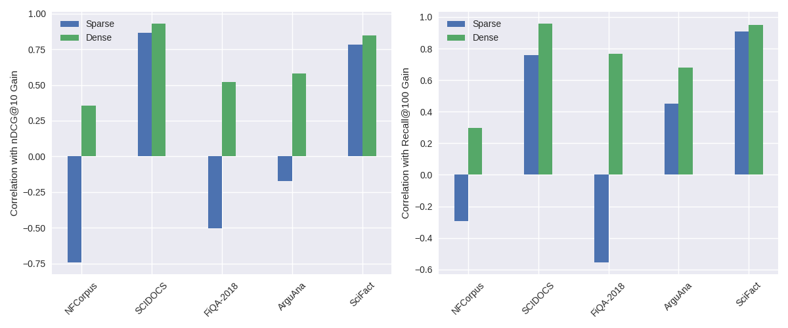
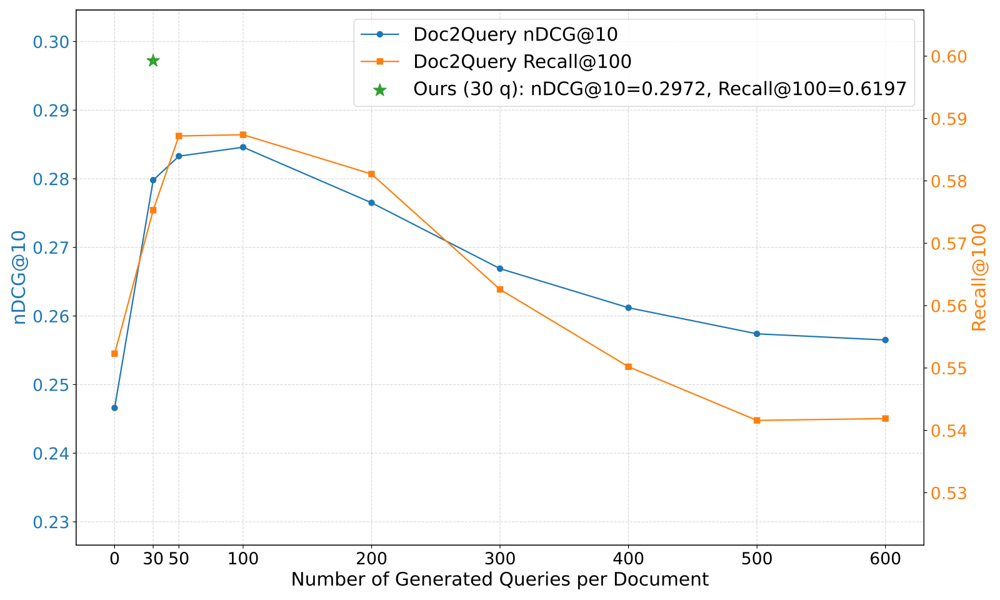
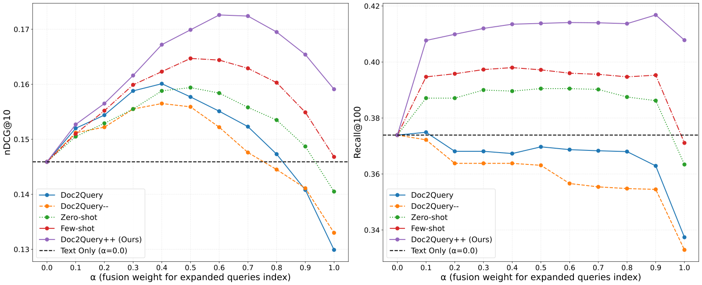
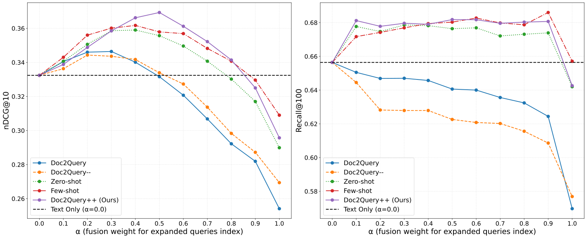

> 原文: [arXiv:2510.09557](https://arxiv.org/abs/2510.09557)（v2，2025-10-13）
> 说明: 中英对照供阅读。英文为论文原文（PDF 转写，公式按论文整理）；中文为对应翻译。图表编号与原文一致。caption 保留英文并附中译。数值原样，未改动。

**预印本：** arXiv:2510.09557v2 [cs.IR]，2025 年 10 月 13 日。

**代码：** 论文附录给出的匿名仓库 https://anonymous.4open.science/r/doc2queryPlusPlus-41BB/

---

# Doc2Query++: Topic-Coverage based Document Expansion and its Application to Dense Retrieval via Dual-Index Fusion

# Doc2Query++：基于主题覆盖的文档扩展及其经双索引融合在稠密检索中的应用

**Authors / 作者：** Tzu-Lin Kuo∗, Wei-Ning Chiu∗, Wei-Yun Ma, Pu-Jen Cheng

∗ Both authors contributed equally to this research. / 两位作者对本研究贡献相同。

**Affiliation / 单位：** Tzu-Lin Kuo、Wei-Ning Chiu、Pu-Jen Cheng：National Taiwan University，台北。Wei-Yun Ma：Academia Sinica，台北。 / 台湾大学；中央研究院。

**Email / 邮箱：** r12922050@ntu.edu.tw；r12922219@ntu.edu.tw；ma@iis.sinica.edu.tw；pjcheng@csie.ntu.edu.tw

**Keywords / 关键词：** Information Retrieval, Document Expansion, Topic Coverage, Query Generation, Dual-Index Fusion / 信息检索、文档扩展、主题覆盖、查询生成、双索引融合

**CCS Concepts：** Information systems → Information retrieval; Document representation; Retrieval effectiveness. / 信息系统 → 信息检索；文档表示；检索效果。

---

## Abstract / 摘要

**EN.** Document expansion (DE) via query generation tackles vocabulary mismatch in sparse retrieval, yet faces limitations: uncontrolled generation producing hallucinated or redundant queries with low diversity; poor generalization from in-domain training (e.g., MS MARCO) to out-of-domain data like BEIR; and noise from concatenation harming dense retrieval. While Large Language Models (LLMs) enable cross-domain query generation, basic prompting lacks control, and taxonomy-based methods rely on domain-specific structures, limiting applicability. To address these challenges, we introduce Doc2Query++, a DE framework that structures query generation by first inferring a document’s latent topics via unsupervised topic modeling for cross-domain applicability, then using hybrid keyword selection to create a diverse and relevant keyword set per document. This guides LLM not only to leverage keywords, which ensure comprehensive topic representation, but also to reduce redundancy through diverse, relevant terms. To prevent noise from query appending in dense retrieval, we propose Dual-Index Fusion strategy that isolates text and query signals, boosting performance in dense settings. Extensive experiments show Doc2Query++ significantly outperforms state-of-the-art baselines, achieving substantial gains in MAP, nDCG@10 and Recall@100 across diverse datasets on both sparse and dense retrieval.

**中.** 用查询生成做文档扩展（document expansion, DE），可以缓解稀疏检索里的词汇不匹配，但仍有局限：生成不受控，会产出幻觉或冗余、多样性低的查询；从域内训练（例如 MS MARCO）到 BEIR 这类域外数据泛化差；直接拼接会给稠密检索带来噪声。大语言模型（LLM）虽能跨域生成查询，但朴素提示缺乏控制，而基于分类体系的方法依赖领域结构，适用范围窄。为此，本文提出 Doc2Query++：先用无监督主题建模推断文档的潜在主题，以便跨域使用，再用混合关键词选择为每篇文档构造多样且相关的关键词集合。这套集合引导 LLM 既利用关键词以保证主题表示完整，又通过多样、相关的词项减少冗余。为避免稠密检索中拼接查询带来的噪声，本文提出双索引融合（Dual-Index Fusion）：把文本信号和查询信号隔开，从而提升稠密设定下的表现。大量实验表明，Doc2Query++ 显著优于当时的最优基线，在多样数据集上、在稀疏与稠密检索中，MAP、nDCG@10 和 Recall@100 都有可观增益。

---

## 1 Introduction / 引言

**EN.** One of the central challenges in information retrieval (IR) is the vocabulary mismatch problem—users often express information needs using terms that differ from those in relevant documents, reducing recall and hindering performance in open-domain settings [20, 53]. Traditional strategies to mitigate this include query expansion, which enriches user queries with related terms from feedback or external resources, and document expansion (DE), which augments documents themselves with predicted queries or contextual terms prior to indexing. While query expansion dominates due to its flexibility—no re-indexing required [38]—DE offers a key advantage: it leverages full-document context for more semantically grounded representations, potentially yielding stable gains over fragile, query-dependent expansions [2, 12, 25].

**中.** 信息检索（IR）的中心挑战之一是词汇不匹配：用户表达信息需求所用的词项，常常和相关文档里的词不同，从而降低召回，并妨碍开放域场景下的效果 [20, 53]。传统缓解办法包括查询扩展——用反馈或外部资源里的相关词丰富用户查询；以及文档扩展（DE）——在索引前用预测查询或上下文词项增强文档本身。查询扩展更流行，因为它灵活，不必重建索引 [38]。DE 的关键好处是：它能利用全文上下文，得到语义上更扎实的表示，相对脆弱、依赖查询的扩展，有可能给出更稳定的增益 [2, 12, 25]。

**EN.** Recent neural advances have revitalized DE through query generation (QG). Doc2Query [38] trains a sequence-to-sequence model on in-domain data (e.g., MS MARCO) to generate synthetic queries per document, appending them for indexing and outperforming baselines like RM3 in sparse retrieval. Doc2Query−− [21] refines this by filtering low-relevance queries, reducing noise and index size. However, these methods face several limitations: (1) uncontrolled generation often produces hallucinated, redundant queries with low diversity and incomplete topic coverage; (2) they generalize poorly from in-domain training to out-of-domain (OOD) benchmarks like BEIR [34, 48]; (3) direct query appending injects semantic noise that degrades dense retrieval performance, as stronger encoders become sensitive to such distortions [51].

**中.** 近期的神经进展通过查询生成（query generation, QG）重新推动了 DE。Doc2Query [38] 在域内数据（例如 MS MARCO）上训练序列到序列模型，为每篇文档生成合成查询并拼接后建索引，在稀疏检索上优于 RM3 等基线。Doc2Query−− [21] 再滤掉低相关查询，以降低噪声和索引规模。这些方法仍有几方面问题：（1）生成不受控，常常产出幻觉、冗余、多样性低、主题覆盖不全的查询；（2）从域内训练到 BEIR 这类域外（out-of-domain, OOD）基准泛化差 [34, 48]；（3）直接拼接查询会注入语义噪声，损害稠密检索，因为更强的编码器对这类失真更敏感 [51]。

**EN.** To address the generalizability issues inherent in prior neural DE methods, we explore prompt-based QG via Large Language Models (LLMs) [8, 14, 28, 45], which offer promising cross-domain capabilities [7, 44]. Yet, prompt-based QG still suffers from uncontrolled output, leading to similar issues of redundancy and omitted document facets [29]. A notable exception is CCQGen [29], which incorporates concept coverage by inferring topics from a predefined academic taxonomy, extracting keywords, and iteratively generating queries to address uncovered concepts—demonstrating gains in scientific retrieval. However, CCQGen’s reliance on domain-specific taxonomies limits its applicability to open-domain IR, where such structures are unavailable or impractical.

**中.** 为处理先前神经 DE 方法固有的泛化问题，作者探索基于 LLM 提示的查询生成 [8, 14, 28, 45]。LLM 有希望的跨域能力 [7, 44]。但基于提示的查询生成仍然输出不受控，同样会出现冗余和漏掉文档侧面的问题 [29]。一个明显的例外是 CCQGen [29]：它从预定义的学术分类体系推断主题、抽取关键词，并迭代生成查询去补未覆盖的概念，在科学检索上有增益。然而 CCQGen 依赖领域分类体系，难以用于开放域 IR——那里往往没有这种结构，或者建这种结构不现实。

**EN.** To overcome these challenges, we introduce Doc2Query++, a unified DE framework that ensures comprehensive topic coverage and balanced term augmentation for effective sparse and dense retrieval. Drawing inspiration from CCQGen’s control mechanisms, we replace fixed taxonomies with unsupervised topic modeling (via BERTopic [24]) to infer latent document topics in a domain-agnostic manner. We then construct a hybrid keyword set—merging topic-derived terms for semantic novelty with document-specific phrases for grounding—and prompt an LLM to generate multiple queries in a single pass that collectively span all topics while incorporating diverse, relevant keywords to minimize lexical overlap. As shown in Table 1, this yields queries that cover underrepresented facets (e.g., "Debt & Investment Strategy"), unlike prior methods that focus narrowly on dominant themes. Furthermore, we extend DE to dense retrieval—where naive appending harms precision—via a Dual-Index Fusion strategy: we maintain separate indices for original document embeddings and generated query embeddings, aggregating signals at inference time with tunable weighting. This isolates noise while harnessing expansion benefits, transforming DE from detrimental to advantageous in dense settings.

**中.** 为克服这些困难，本文提出 Doc2Query++，一套统一的 DE 框架，用全面的主题覆盖和均衡的词项增强，同时服务稀疏与稠密检索。受 CCQGen 控制机制启发，用无监督主题建模（BERTopic [24]）替换固定分类体系，以与领域无关的方式推断文档潜在主题。然后构造混合关键词集：主题派生词提供语义上的新说法，文档特有短语负责把生成拴在原文上。再提示 LLM 一次生成多条查询，合在一起覆盖全部主题，并融入多样、相关的关键词，以减少词汇重叠。如表 1，这样得到的查询能覆盖先前方法忽略的侧面（例如 “Debt & Investment Strategy”，债务与投资策略），而先前方法窄窄地盯着主导主题。进一步，把 DE 扩展到稠密检索——朴素拼接会伤害精度——用双索引融合：分别为原文嵌入和生成查询嵌入维护索引，推理时用可调权重聚合信号。这样把噪声隔开，同时用上扩展的好处，使 DE 在稠密设定里从有害变成有利。

**表 1 / Table 1.** Comparison of generated queries across different methods for the same input document, with per-method topic-coverage. / 同一篇输入文档上，不同方法生成查询的对照，以及各自的主题覆盖。

文档标注的主题：Topic1: UK Student Loan（英国学生贷款）；Topic2: Debt & Investment Strategy（债务与投资策略）；Topic3: Asset Disposal（资产处置）。

文档正文（原文）：I’m surprised no one has picked up on this, but the student loan is an exception to the rule. It’s inflation bound, you only have to pay it back as a percentage of your salary if you earn over £15k... you don’t have to pay it if you lose your job, and it doesn’t affect your ability to get credit. My advice... is: if you have any shares that have lost more than 10% since you bought them... sell them and pay off your debts with those. The rest is down to you – are they making more than 10% a year? If they are, don’t sell them. If your dividends are covering your payments, carry on as you are.

文档正文（中译）：我很惊讶没人指出这一点，但学生贷款是这条规则的例外。它跟通胀挂钩；只有年收入超过 1.5 万英镑，才按工资的一定比例偿还……失业就不必还，也不影响你获得信贷的能力。我的建议是：如果你有些股票自买入后跌幅超过 10%……卖掉它们，用这笔钱还债。其余取决于你——它们每年收益是否超过 10%？如果是，就别卖。如果股息够覆盖你的还款，就保持现状。

| 方法 | 生成查询 |
| --- | --- |
| Doc2Query | \(q_1\) can you pay out student loan with a job? / \(q_2\) can you borrow from student loan? / \(q_3\) do you have to pay student loan back? |
| Doc2Query−− | \(q_1\) can i pay my student loan if i lose my job? / \(q_2\) do student loan have to be paid back if you lose your job? / \(q_3\) can you pay a student loan back? |
| Doc2Query++ (Ours) | \(q_1\) How do income-based repayment plans affect student loan burdens for individuals earning over £15,000 a year? / \(q_2\) How do dividend payments impact debt repayment strategies for investors with fluctuating income streams? / \(q_3\) What are the key factors to consider when deciding whether to sell underperforming shares to pay off debts? |

Doc2Query++ 三条的中译。\(q_1\)：对年收入超过 15,000 英镑的人，基于收入的还款计划如何影响学生贷款负担？\(q_2\)：对收入波动的投资者，股息支付如何影响债务偿还策略？\(q_3\)：在决定是否卖掉表现不佳的股票来还债时，要考虑哪些关键因素？

**EN.** Our key contributions are as follows:

- Topic-aware document expansion: We incorporate explicit topic coverage into neural DE, ensuring generated queries comprehensively represent each document’s semantic structure.
- Unsupervised topic modeling for cross-domain applicability: Leveraging BERTopic, we uncover latent structures without pre-defined taxonomies, enabling adaptation across diverse domains.
- Hybrid keyword selection with LLM prompting: We combine topic-level and document-level signals to guide query generation, balancing lexical specificity and novelty.
- Dense retrieval integration: Addressing degraded dense retrieval performance caused by noise injected by direct query appending [51], our Dual-Index Fusion isolates and fuses query/text embeddings, boosting both precision and recall.

**中.** 主要贡献如下：

- 主题感知的文档扩展：把显式主题覆盖放进神经 DE，使生成查询完整代表每篇文档的语义结构。
- 面向跨域的无监督主题建模：用 BERTopic 在没有预定义分类体系的情况下揭示潜在结构，从而能跨多样领域适配。
- 混合关键词选择加 LLM 提示：结合主题级和文档级信号引导查询生成，平衡词汇上的具体性和新颖性。
- 稠密检索集成：针对直接拼接查询注入噪声、导致稠密检索变差的问题 [51]，双索引融合把查询嵌入和文本嵌入隔开再融合，同时提升精度和召回。

**EN.** Extensive experiments on BEIR subsets of various domains show Doc2Query++ outperforms baselines in MAP, nDCG@10 and Recall@100 in both sparse and dense settings, validating its efficacy across diverse domains.

**中.** 在 BEIR 多个领域子集上的大量实验表明，Doc2Query++ 在稀疏和稠密设定下的 MAP、nDCG@10 和 Recall@100 都优于基线，说明它在多样领域上有效。

---

## 2 Related Works / 相关工作

### 2.1 Document Expansion / 文档扩展

**EN.** Document expansion (DE) addresses vocabulary mismatch by enhancing documents with relevant terms before indexing. For a document collection \(D = \{d_1, d_2, \ldots, d_n\}\), an expansion method generates synthetic queries \(Q_i = \{q_{i1}, q_{i2}, \ldots, q_{im}\}\) for each document \(d_i\). These queries are appended to the original document, forming an expanded document \(d'_i = d_i \cup Q_i\). The resulting expanded corpus \(D' = \{d'_1, d'_2, \ldots, d'_n\}\) is then indexed and used for search.

**中.** 文档扩展（DE）在索引前用相关词项增强文档，以应对词汇不匹配。对文档集合 \(D = \{d_1, d_2, \ldots, d_n\}\)，扩展方法为每篇文档 \(d_i\) 生成合成查询 \(Q_i = \{q_{i1}, q_{i2}, \ldots, q_{im}\}\)。这些查询追加到原文上，形成扩展文档 \(d'_i = d_i \cup Q_i\)。得到的扩展语料 \(D' = \{d'_1, d'_2, \ldots, d'_n\}\) 再被索引并用于检索。

#### 2.1.1 Early Approaches to Document Expansion / 早期文档扩展

**EN.** Early document expansion methods relied on external signals and statistical models. Heuristic approaches leveraged terms from web structures like inbound anchor text and URLs [13, 19, 52], or from user behavior data like historical search queries [40, 46]. A parallel approach used statistical language models to algorithmically generate relevant expansion terms [18, 47].

**中.** 早期文档扩展依赖外部信号和统计模型。启发式做法利用网页结构里的词，例如入链锚文本和 URL [13, 19, 52]，或利用用户行为数据，例如历史搜索查询 [40, 46]。另一路用统计语言模型，用算法生成相关扩展词 [18, 47]。

#### 2.1.2 Neural Model Approaches to Document Expansion / 神经模型文档扩展

**EN.** The advent of neural models has significantly advanced document expansion techniques, shifting from heuristic-based to learning-based methods. Doc2Query [38] used a sequence-to-sequence transformer to produce queries, resulting in modest effectiveness gains over the BM25 baseline. It was later shown that replacing this simple transformer with the much larger T5 model—an approach known as DocT5Query—yielded substantially greater improvements [37]. While the latest large language models like ChatGPT have also been explored for this task, it remains unclear if they outperform established T5-based methods [51]. A key challenge with these generative models is their tendency to include irrelevant or hallucinated terms. To address this, Doc2Query−− [21] adds a filtering mechanism that uses a relevance model to score generated query-document pairs and retain only the queries above a set threshold. However, these methods still lack focus on the nature of generated queries, presenting three key challenges: (1) uncontrolled generation results in redundant concepts, uncovered sections, and high lexical overlap, restricting coverage; (2) document expansion in dense retrieval remains underexplored, with direct concatenation impairing performance [51]; (3) as learning-based approaches trained on in-domain data, they struggle to generalize to out-domain datasets [34]. Our Doc2Query++ addresses these by guiding query generation through topic modeling, keyword extraction, and Dual-Index Fusion.

**中.** 神经模型显著推进了文档扩展，从基于启发式转到基于学习。Doc2Query [38] 用序列到序列 Transformer 产生查询，相对 BM25 基线有适度的效果提升。后来表明，把这个简单 Transformer 换成大得多的 T5——即 DocT5Query——能带来大得多的改进 [37]。最新的大语言模型如 ChatGPT 也被用于这项任务，但它们是否优于已经确立的基于 T5 的方法，仍然不清楚 [51]。这些生成模型的一个关键问题是容易写入无关或幻觉词项。为此，Doc2Query−− [21] 加了一个过滤机制：用相关性模型给生成的查询–文档对打分，只保留高于某阈值的查询。这些方法仍然不关注生成查询的性质，有三个关键挑战：（1）不受控的生成导致概念冗余、章节未覆盖、词汇重叠高，覆盖受限；（2）稠密检索中的文档扩展仍探索不足，直接拼接会损害效果 [51]；（3）作为在域内数据上训练的学习方法，它们难以泛化到域外数据集 [34]。Doc2Query++ 用主题建模、关键词抽取和双索引融合来引导查询生成，以应对这三点。

### 2.2 Prompt-based Query Generation / 基于提示的查询生成

**EN.** The rise of Large Language Models (LLMs), with their robust language understanding, has enabled prompt-based generation of human-like, contextually relevant text without costly task-specific training. Early methods like InPars [5] prompt models with documents to create relevant queries for unsupervised IR datasets, while Promptagator [14] uses few-shot learning with document-query examples to shape output styles. Prompting has evolved, with techniques like pairwise approach, which generates relevant queries followed by less-relevant "hard negatives" to boost retriever training [8]. Despite these advancements, existing prompting struggles to ensure comprehensive coverage of a document’s distinct concepts. CCQGen [29] addresses this in scientific contexts by integrating a control mechanism with a pre-defined academic topic taxonomy, guiding query generation for broader and more diverse concept coverage. However, CCQGen’s fixed taxonomy restricts cross-domain applicability, requiring curation for new fields. Building on our Doc2Query++ framework, this limitation is addressed through unsupervised topic modeling, enabling adaptive, domain-agnostic query generation across diverse contexts.

**中.** 大语言模型语言理解强，使基于提示的生成能够写出像人、且贴合上下文的文本，而不必做昂贵的任务专用训练。早期方法如 InPars [5] 用文档提示模型，为无监督 IR 数据集造相关查询；Promptagator [14] 用文档–查询例子做少样本学习，以约束输出风格。提示方法还在演进，例如成对做法：先生成相关查询，再生成较不相关的「难负例」，以加强检索器训练 [8]。尽管有这些进展，现有提示仍难以保证覆盖一篇文档里彼此不同的概念。CCQGen [29] 在科学场景里把控制机制和预定义学术主题分类体系接在一起，引导查询生成，以得到更广、更多样的概念覆盖。但 CCQGen 的固定分类体系限制跨域使用，新领域需要重新策展。在 Doc2Query++ 框架上，这一限制改由无监督主题建模处理，从而能在多样上下文里做自适应、与领域无关的查询生成。

---

## 3 Doc2Query++ / Doc2Query++

**EN.** We introduce Doc2Query++, a unified DE framework designed to generate queries that satisfy two critical objectives: (1) Comprehensive Topic Coverage: Generated queries should collectively span all thematic areas of a document, ensuring complete topical representation. (2) Balanced Term Augmentation: Queries must reinforce each document’s existing key terms and introduce new, semantically relevant vocabulary to bridge lexical gaps between documents and potential user queries. Doc2Query++ achieves these goals through a structured, four-stage pipeline. Below, we provide a high-level overview of the four stages before detailing their implementation:

**中.** Doc2Query++ 是一套统一的 DE 框架，生成的查询要满足两个关键目标：（1）全面主题覆盖：生成查询合在一起应覆盖文档的全部主题区域，保证主题表示完整。（2）均衡词项增强：查询必须强化每篇文档已有的关键词，并引入新的、语义相关的词汇，以弥合文档和潜在用户查询之间的词汇缺口。Doc2Query++ 用一条有结构的四阶段流水线达到这两个目标。下面先给出四阶段的高层概览，再写实现：

**EN.** (1) Sentence-level Topic Modeling & Representation Refinement: We first perform unsupervised topic modeling by clustering sentence embeddings for each document using BERTopic, identifying its latent topic set and computing initial topic representations and centroids. We then use an LLM to refine these topic representations into concise, human-readable labels via few-shot prompting.

**中.** （1）句子级主题建模与表示精炼：先用 BERTopic 对每篇文档的句向量做聚类，做无监督主题建模，找出潜在主题集合，并计算初始主题表示和质心。再用 LLM 经少样本提示，把这些主题表示精炼成简短、人可读的标签。

**EN.** (2) Keyword Extraction and Selection: We obtain two complementary keyword sets—one capturing high-level themes inferred by topic modeling and one extracting salient in-text phrases directly from each document. After merging these keyword pools into a unified candidate list, we prompt an LLM to select a focused subset that both represents the document’s core topics and injects novel semantic cues.

**中.** （2）关键词抽取与选择：得到两个互补的关键词集——一个捕捉主题建模推断出的高层主题，一个直接从每篇文档抽出显著的文内短语。把这两个词池并成统一候选列表后，提示 LLM 选出一个聚焦子集，既代表文档核心主题，又注入新的语义线索。

**EN.** (3) Topic-Coverage based Query Generation: Leveraging the topic names and focused keyword set from previous stages, we instruct an LLM to generate multiple queries per document in one pass. After generating the query sets, we apply them differently for sparse and dense retrieval methods.

**中.** （3）基于主题覆盖的查询生成：利用前几阶段的主题名和聚焦关键词集，指示 LLM 对每篇文档一次生成多条查询。查询集生成之后，稀疏检索和稠密检索以不同方式使用它们。

**EN.** (4) Sparse and Dense Retrieval with Expansion and Dual-Index Fusion: For sparse retrieval, we follow standard expansion by appending generated queries to document text. For dense retrieval, since naive appending injects semantic noise and harms dense retrievers [51], we address this by proposing the Dual-Index Fusion strategy: maintaining separate indices for original document embeddings and query embeddings, aggregating signals via max-pooling, and fusing scores with a tunable weight.

**中.** （4）带扩展与双索引融合的稀疏和稠密检索：稀疏检索沿用标准扩展，把生成查询追加到文档文本。稠密检索方面，朴素追加会注入语义噪声并伤害稠密检索器 [51]，因此提出双索引融合：为原文嵌入和查询嵌入分别维护索引，用最大池化聚合信号，再用可调权重融合分数。

**EN.** An overview of this pipeline is illustrated in Figure 1, providing a visual summary of the topic modeling, keyword selection, query generation, and Dual-index Fusion components described above.

**中.** 这条流水线的概览见图 1，概括了上面的主题建模、关键词选择、查询生成和双索引融合。

**Caption EN.** Figure 1: Overview of the Doc2Query++ framework. The model infers latent topics via BERTopic, extracts topic- and document-level keywords, and uses them to guide LLM-based query generation. Generated queries are appended for sparse retrieval and fused through Dual-Index Fusion for dense retrieval.

**Caption 中.** 图 1：Doc2Query++ 框架概览。模型用 BERTopic 推断潜在主题，抽取主题级和文档级关键词，并用它们引导基于 LLM 的查询生成。生成查询在稀疏检索中被追加到文档上，在稠密检索中经双索引融合。

### 3.1 Topic Modeling and Representation Refinement / 主题建模与表示精炼

#### 3.1.1 Sentence-level Topic Modeling through BERTopic / 用 BERTopic 做句子级主题建模

**EN.** To capture each document’s latent semantic structure without manual tuning, we adopt an embedding-based clustering approach instantiated by BERTopic. Unlike traditional lexical-based topic-modeling methods [4, 26, 39], BERTopic operates directly on contextualized text embeddings and dynamically infers the optimal number of topics for a given corpus. Since sentences are the natural minimal units that represent coherent topical content, we segment each document at the sentence level before modeling. We use the sent_tokenize function from NLTK [3].

**中.** 为在不手工调参的情况下抓住每篇文档的潜在语义结构，采用由 BERTopic 实现的、基于嵌入的聚类。与传统基于词面的主题模型 [4, 26, 39] 不同，BERTopic 直接在上下文化文本嵌入上工作，并按给定语料动态推断最优主题数。句子是表示连贯主题内容的自然最小单位，因此建模前先把每篇文档按句切开。分句使用 NLTK 的 sent_tokenize [3]。

**EN.** Formally, we consider a corpus \(\mathcal{D} = \{d_1, \ldots, d_N\}\), where each document \(d\) is a set of sentences \(S_d\). We first encode every sentence \(s\) from the overall sentence set \(\mathcal{S} = \bigcup_{d \in \mathcal{D}} S_d\) into an \(m\)-dimensional embedding \(\mathbf{z}_s = f_{\mathrm{enc}}(s)\) using a pre-trained, domain-specific SBERT encoder \(f_{\mathrm{enc}}: \mathcal{S} \rightarrow \mathbb{R}^m\) [41]. Next, BERTopic clusters the sentence embeddings \(\{\mathbf{z}_s\}_{s \in \mathcal{S}}\) via HDBSCAN [35], a density-based algorithm that automatically determines the number of topic clusters, say \(C\). Each cluster \(j \in \{1, \ldots, C\}\) is represented by a centroid vector \(\boldsymbol{\mu}_j\). We then assign each sentence embedding \(\mathbf{z}_s\) to its nearest topic cluster \(\phi(\mathbf{z}_s)\) using L2 distance:

\[
\phi(\mathbf{z}_s) = \arg\min_{j=1,\ldots,C} \lVert \mathbf{z}_s - \boldsymbol{\mu}_j \rVert_2,
\]

excluding any outlier embeddings identified by HDBSCAN. Finally, the topic representation for a document \(d\) is the union of topics assigned to its sentences:

\[
T(d) = \bigcup_{s \in S_d} \phi(\mathbf{z}_s).
\]

**中.** 形式上，语料 \(\mathcal{D} = \{d_1, \ldots, d_N\}\)，每篇文档 \(d\) 是句子集合 \(S_d\)。先用预训练的、领域专用的 SBERT 编码器 \(f_{\mathrm{enc}}: \mathcal{S} \rightarrow \mathbb{R}^m\) [41]，把全体句子集 \(\mathcal{S} = \bigcup_{d \in \mathcal{D}} S_d\) 中的每个句子 \(s\) 编成 \(m\) 维嵌入 \(\mathbf{z}_s = f_{\mathrm{enc}}(s)\)。接着 BERTopic 用 HDBSCAN [35] 对句向量 \(\{\mathbf{z}_s\}_{s \in \mathcal{S}}\) 聚类。HDBSCAN 是基于密度的算法，会自动决定主题簇个数，记为 \(C\)。每个簇 \(j \in \{1, \ldots, C\}\) 用质心向量 \(\boldsymbol{\mu}_j\) 表示。再按 L2 距离把每个句向量 \(\mathbf{z}_s\) 分到最近的主题簇 \(\phi(\mathbf{z}_s)\)：

\[
\phi(\mathbf{z}_s) = \arg\min_{j=1,\ldots,C} \lVert \mathbf{z}_s - \boldsymbol{\mu}_j \rVert_2,
\]

HDBSCAN 标出的离群嵌入除外。最后，文档 \(d\) 的主题表示是其句子被分到的主题之并：

\[
T(d) = \bigcup_{s \in S_d} \phi(\mathbf{z}_s).
\]

**EN.** This unsupervised approach allows us to model a document’s latent topics by leveraging contextual embeddings, ensuring generalizability across diverse domains.

**中.** 这种无监督做法用上下文嵌入刻画文档的潜在主题，从而保证在多样领域上可泛化。

#### 3.1.2 Fine-Tuning Topic Representations via LLM / 用 LLM 精调主题表示

**EN.** Since unsupervised clustering yields topic clusters without explicit labels, we refine them into coherent, human-readable names to better guide the LLM in generating queries that span all specified topics. We achieve this using BERTopic’s class-based TF-IDF (c-TF-IDF) implementation [24], where sentences assigned to each cluster are concatenated into a pseudo-document. Term frequency is computed within each pseudo-document, with inverse document frequency measured across the cluster collection, producing weighted scores that highlight terms both representative of and distinctive to each topic. From these, we select the top-\(M\) keywords as provisional descriptors. Next, we identify the top-\(L\) representative sentences per topic—those whose embeddings are closest to the topic centroid—and feed them, along with the corresponding c-TF-IDF keywords, into the LLM via few-shot prompting (see Appendix A.1) to generate concise, natural-language topic names. In our experiments, we adopt BERTopic’s default settings (\(M = 10\), \(L = 3\)), which yield robust and coherent results.

**中.** 无监督聚类得到的主题簇没有显式标签。作者把它们精炼成连贯、人可读的名字，以便更好地引导 LLM 生成覆盖全部指定主题的查询。做法用 BERTopic 的基于类的 TF-IDF（c-TF-IDF）[24]：分到同一簇的句子拼成一篇伪文档。词频在每篇伪文档内计算，逆文档频率在簇集合上计算，得到的加权分数突出既代表该主题、又将该主题与其他主题区分开的词。从中取 top-\(M\) 关键词作为临时描述。然后为每个主题找出 top-\(L\) 代表句——嵌入离主题质心最近的句子——连同对应的 c-TF-IDF 关键词，经少样本提示送进 LLM（见附录 A.1），生成简短的自然语言主题名。实验采用 BERTopic 默认设置（\(M = 10\)，\(L = 3\)），结果稳健且连贯。

### 3.2 Keyword Extraction and Selection / 关键词抽取与选择

**EN.** Our initial method directly employed the top-10 c-TF–IDF keywords from each document’s inferred topic set to guide query generation. However, this approach introduced substantial noise: many cluster-level keywords—while salient at the corpus level—were irrelevant to individual documents. For example, a document on simple moving average crossover strategies for equity trading shares generic financial terms like “market”, “trend”, and “volatility” with cryptocurrency trading documents, so unsupervised clustering can group it under a crypto-focused topic. This yields extraneous keywords such as “blockchain”, “bitcoin”, “mining”, and “smart contract” for the document, but none of which relate to moving averages or stock markets, which steers the LLM away from the document’s core content.

**中.** 最初的做法是直接用每篇文档推断主题集里的 top-10 个 c-TF-IDF 关键词来引导查询生成。这会引入大量噪声：许多簇级关键词在语料层面很显著，对单篇文档却无关。例如，一篇讲股票交易里简单移动平均交叉策略的文档，会和加密货币交易文档共享 “market”“trend”“volatility” 这类通用金融词，于是无监督聚类可能把它归进以加密货币为中心的主题。这篇文档就会得到 “blockchain”“bitcoin”“mining”“smart contract” 等无关关键词，它们和移动平均或股票市场都无关，从而把 LLM 带离文档的核心内容。

**EN.** To address this, we complement topic-level keywords \(K_d^{\mathrm{topic}}\) with document-level extraction using KeyBERT [23], whose embedding-based mechanism aligns with BERTopic by leveraging SBERT representations to identify semantically meaningful phrases beyond raw token counts. Specifically, we apply KeyBERT to encode each document and its candidate n-grams, ranking them by cosine similarity to the document embedding and generating a top-20 n-grams (n=1–3) per document; to promote diversity and minimize redundancy, we then use Maximal Marginal Relevance (MMR, \(\lambda = 0.7\)), yielding our document-level keywords \(K_d^{\mathrm{doc}}\). Next, let \(K_d^{\mathrm{topic}}\) and \(K_d^{\mathrm{doc}}\) denote the topic- and document-level keywords for document \(d\), respectively. Here, \(K_d^{\mathrm{topic}}\) provides “new-term” signals for broader thematic novelty, while \(K_d^{\mathrm{doc}}\) emphasize salient in-text n-grams reflecting the document’s specific content. Inspired by Lin et al.’s Doc2Query analysis showing gains from both new and copied terms [31], we first form a unified candidate keyword pool:

\[
K_d = K_d^{\mathrm{topic}} \cup K_d^{\mathrm{doc}}.
\]

**中.** 为此，用 KeyBERT [23] 的文档级抽取补上主题级关键词 \(K_d^{\mathrm{topic}}\)。KeyBERT 基于嵌入，和 BERTopic 一样用 SBERT 表示，找出超出原始词频计数的、语义上有意义的短语。具体地，用 KeyBERT 编码每篇文档及其候选 n-gram，按与文档嵌入的余弦相似度排序，每篇文档取 top-20 个 n-gram（n=1–3）；为促进多样性、减少冗余，再用最大边际相关（Maximal Marginal Relevance, MMR，\(\lambda = 0.7\)），得到文档级关键词 \(K_d^{\mathrm{doc}}\)。\(K_d^{\mathrm{topic}}\) 与 \(K_d^{\mathrm{doc}}\) 分别是文档 \(d\) 的主题级和文档级关键词。前者提供「新词」信号，带来更广的主题新颖性；后者强调反映该文档具体内容的显著文内 n-gram。受 Lin 等人对 Doc2Query 的分析启发——新词和复制词都有增益 [31]——先形成统一的候选关键词池：

\[
K_d = K_d^{\mathrm{topic}} \cup K_d^{\mathrm{doc}}.
\]

**EN.** We then instruct an LLM to select a final subset \(\widehat{K}_d \subset K_d\) (with \(\lvert \widehat{K}_d \rvert = 10\)) by asking it to choose the keywords that best align with the document’s core theme (see Appendix A.2 for the prompt). To verify that topic-only, document-only, and hybrid keyword sources each contribute uniquely to retrieval effectiveness, we conduct an ablation study in Section 4.2.3, demonstrating that our LLM-guided fusion outperforms either source used in isolation.

**中.** 然后指示 LLM 选出最终子集 \(\widehat{K}_d \subset K_d\)（\(\lvert \widehat{K}_d \rvert = 10\)），要求它选择最贴合文档核心主题的关键词（提示见附录 A.2）。为验证只用主题词、只用文档词、以及混合来源各自对检索效果有独特贡献，第 4.2.3 节做消融，表明由 LLM 引导的融合优于单独使用任一来源。

### 3.3 Topic-Coverage based Query Generation / 基于主题覆盖的查询生成

**EN.** Given a document \(d\) with its inferred topic set \(T_d\) and keyword list \(K_d\) obtained from above stages, our goal is to generate a set of \(M\) queries that collectively cover all topics in \(T_d\) and incorporate relevant keywords from \(K_d\) to enhance lexical diversity and relevance. Prior LLM-based QG methods [5, 14, 28] typically produce one query at a time without explicit mechanisms for topic coverage, while CCQGen [29] uses iterative classification to enforce coverage, which can be computationally intensive. In contrast, we leverage the LLM’s autoregressive capabilities and contextual understanding to generate queries in batches, ensuring coverage in an efficient manner.

**中.** 给定文档 \(d\)、前面阶段得到的推断主题集 \(T_d\) 和关键词列表 \(K_d\)，目标是生成一组 \(M\) 条查询，合在一起覆盖 \(T_d\) 中的全部主题，并纳入 \(K_d\) 里的相关关键词，以提高词汇多样性和相关性。先前基于 LLM 的查询生成 [5, 14, 28] 通常一次只产一条查询，没有显式的主题覆盖机制；CCQGen [29] 用迭代分类来强制覆盖，计算可能很重。本文则利用 LLM 的自回归能力和上下文理解，按批生成查询，用更省的方式保证覆盖。

**EN.** Specifically, we prompt the LLM with the document text, \(T_d\), and \(K_d\), using a few-shot template that includes \(n\) exemplar (e.g., document-topic-keyword-multi-query tuples) demonstrating how to distribute queries across topics while weaving in keywords (see Appendix A.3 for the full prompt). To balance generation efficiency with coverage control, we generate queries in batches of size \(b = 3\) until reaching \(M\). In qualitative assessments, we observed that single-query generation often leads to incomplete coverage by overlooking remaining topics, whereas our multi-query approach consistently spans all facets, yielding a more faithful semantic representation without the overhead of post-generation filtering or classifiers.

**中.** 具体地，把文档文本、\(T_d\) 和 \(K_d\) 一起提示给 LLM，少样本模板里含 \(n\) 个示例（例如文档–主题–关键词–多查询元组），示范如何把查询分配到各主题上、同时织入关键词（完整提示见附录 A.3）。为平衡生成效率与覆盖控制，按批大小 \(b = 3\) 生成，直到达到 \(M\)。定性观察中，单条查询生成常常漏掉其余主题，覆盖不全；多查询做法则稳定地覆盖全部侧面，语义表示更忠实，也不需要生成后再过滤或加分类器。

### 3.4 Sparse and Dense Retrieval with Expansion and Dual-Index Fusion / 带扩展与双索引融合的稀疏和稠密检索

**EN.** Most prior document-expansion methods target sparse retrieval alone [21, 37, 38]. Accordingly, for sparse retrieval, we also follow this standard document-expansion approach: we concatenate each document’s generated queries to its original text, rebuild the inverted index over this expanded corpus (for example, using BM25), and then perform retrieval as usual. While this approach reliably boosts both recall and precision in sparse retrieval by introducing new terms and mitigating vocabulary mismatch, naively appending expansions degrades dense retrieval effectiveness [51] due to semantic noise injected by expanded queries, which weakens the original document embedding. To address this, we propose a Dual-Index Fusion strategy that decouples expanded queries from raw text. Specifically, let each document \(d\) have \(M\) expanded queries \(q_{d,1}, \ldots, q_{d,M}\) generated through a QG model. We construct two separate indices: (1) text index \(\mathcal{I}_t\) of original document embeddings \(\mathbf{v}_d\) and (2) query index \(\mathcal{I}_q\) of query embeddings \(\mathbf{u}_{d,i}\), each linked back to its source document \(d\). At retrieval time, given a user query \(Q\) with embedding \(\mathbf{v}_Q\), we perform:

**中.** 先前多数文档扩展方法只针对稀疏检索 [21, 37, 38]。因此稀疏检索也沿用这一标准做法：把每篇文档的生成查询拼到原文上，在扩展语料上重建倒排索引（例如用 BM25），再按通常方式检索。引入新词、缓解词汇不匹配，这条路在稀疏检索上能较稳定地同时提高召回和精度；但朴素追加扩展会降低稠密检索效果 [51]，因为扩展查询注入的语义噪声削弱了原文档嵌入。为此提出双索引融合，把扩展查询和原文拆开。设每篇文档 \(d\) 有 QG 模型生成的 \(M\) 条扩展查询 \(q_{d,1}, \ldots, q_{d,M}\)。建两个分开的索引：（1）原文嵌入 \(\mathbf{v}_d\) 的文本索引 \(\mathcal{I}_t\)；（2）查询嵌入 \(\mathbf{u}_{d,i}\) 的查询索引 \(\mathcal{I}_q\)，每条都链回源文档 \(d\)。检索时，给定用户查询 \(Q\) 及其嵌入 \(\mathbf{v}_Q\)，做下面三步：

**EN.** (1) Text retrieval. We query \(\mathcal{I}_t\) to obtain the top–\(n_t\) document candidates

\[
\mathcal{D}_t = \{d^t_1, \ldots, d^t_{n_t}\},
\]

where each document \(d \in \mathcal{D}_t\) is scored by

\[
S_t(d) = \mathrm{sim}(\mathbf{v}_Q, \mathbf{v}_d).
\]

This captures the similarity between the query and the original document embeddings.

**中.** （1）文本检索。查询 \(\mathcal{I}_t\)，得到 top–\(n_t\) 文档候选

\[
\mathcal{D}_t = \{d^t_1, \ldots, d^t_{n_t}\},
\]

其中每篇 \(d \in \mathcal{D}_t\) 的分数为

\[
S_t(d) = \mathrm{sim}(\mathbf{v}_Q, \mathbf{v}_d).
\]

这捕捉的是查询与原文档嵌入之间的相似度。

**EN.** (2) Query retrieval and aggregation. Simultaneously, we query \(\mathcal{I}_q\) to retrieve the top–\(n_q\) expanded-query embeddings nearest to the user query vector \(\mathbf{v}_Q\). Let \(\mathcal{Q} = \{q_1, q_2, \ldots, q_N\}\) denote all generated queries from the entire corpus, where each \(q_j\) has a dense embedding \(\mathbf{u}_j\), and is associated with a source document via a mapping function \(\mathrm{doc}(j)\). Let

\[
H_q = \{j_1, \ldots, j_{n_q}\} \subseteq \{1, \ldots, N\}
\]

be the indices of these retrieved query embeddings (global query indices). For each document \(d\), define the set of retrieved queries originating from \(d\) as:

\[
Q_d = \{ j \in H_q \mid \mathrm{doc}(j) = d \}.
\]

For each \(j \in Q_d\), compute the similarity score:

\[
S_q(d, j) = \mathrm{sim}(\mathbf{v}_Q, \mathbf{u}_j).
\]

Since multiple queries may be retrieved from the same document, we aggregate their relevance using max-pooling:

\[
S_q(d) =
\begin{cases}
\max_{j \in Q_d} S_q(d, j) & \text{if } Q_d \neq \emptyset, \\
0 & \text{if } Q_d = \emptyset.
\end{cases}
\]

i.e., if none of \(d\)’s expanded queries appear in the top–\(n_q\) retrieved set, then \(S_q(d) = 0\).

**中.** （2）查询检索与聚合。同时查询 \(\mathcal{I}_q\)，取出离用户查询向量 \(\mathbf{v}_Q\) 最近的 top–\(n_q\) 条扩展查询嵌入。设 \(\mathcal{Q} = \{q_1, q_2, \ldots, q_N\}\) 为全语料生成的全部查询，每条 \(q_j\) 有稠密嵌入 \(\mathbf{u}_j\)，并通过映射 \(\mathrm{doc}(j)\) 关联到源文档。令

\[
H_q = \{j_1, \ldots, j_{n_q}\} \subseteq \{1, \ldots, N\}
\]

为这些被检索到的查询嵌入的下标（全局查询下标）。对每篇文档 \(d\)，来自 \(d\) 且被检索到的查询集合为

\[
Q_d = \{ j \in H_q \mid \mathrm{doc}(j) = d \}.
\]

对每个 \(j \in Q_d\)，相似度分数为

\[
S_q(d, j) = \mathrm{sim}(\mathbf{v}_Q, \mathbf{u}_j).
\]

同一文档可能有多条查询被检索到，用最大池化聚合相关性：

\[
S_q(d) =
\begin{cases}
\max_{j \in Q_d} S_q(d, j) & \text{若 } Q_d \neq \emptyset, \\
0 & \text{若 } Q_d = \emptyset.
\end{cases}
\]

也就是说，若 \(d\) 的扩展查询一条都没进 top–\(n_q\)，则 \(S_q(d) = 0\)。

**EN.** (3) Score Fusion. Finally, we combine text- and query-based scores into a unified relevance metric:

\[
S(d) = (1 - \alpha)\, S_t(d) + \alpha\, S_q(d), \quad \alpha \in [0, 1].
\]

Here, \(\mathrm{sim}(\cdot, \cdot)\) denotes a similarity function (e.g., dot product or cosine). Setting \(\alpha = 0\) recovers pure text-based dense retrieval, while \(\alpha = 1\) relies solely on query-derived signals.

**中.** （3）分数融合。最后把基于文本和基于查询的分数合成统一的相关性：

\[
S(d) = (1 - \alpha)\, S_t(d) + \alpha\, S_q(d), \quad \alpha \in [0, 1].
\]

\(\mathrm{sim}(\cdot, \cdot)\) 是相似度函数（例如点积或余弦）。\(\alpha = 0\) 退回纯文本稠密检索，\(\alpha = 1\) 只依赖查询侧信号。

**EN.** This Dual-Index Fusion strategy restores and surpasses the performance lost to naive query appending by isolating semantic noise and exploiting query expansions through principled aggregation and fusion. We demonstrate its effectiveness across dense retrieval benchmarks in Section 4.2.4.

**中.** 双索引融合把语义噪声隔开，并通过有原则的聚合与融合利用查询扩展，从而挽回并超过朴素拼接所损失的效果。第 4.2.4 节在稠密检索基准上展示其有效性。

---

## 4 Experiments / 实验

**EN.** Datasets. To assess the generalization of DE methods across diverse domains and retrieval tasks, we evaluate on BEIR [48], a heterogeneous benchmark aggregating 18 public datasets spanning news, science, finance, social media, and more. Unlike prior work focused on in-domain collections like MSMARCO [1] or TREC-CAR [16], BEIR emphasizes out-of-domain transfer, making it ideal for testing cross-domain robustness. We select five representative subsets from BEIR to ensure diversity in domains (biomedical, scientific literature, finance, argumentation, and fact-checking), task types (e.g., full-text retrieval, citation prediction, claim verification), and corpus sizes:

- NFCorpus [6]: Biomedical retrieval with 323 natural language queries from NutritionFacts.org matched to 3,633 PubMed abstracts.
- SCIDOCS [10]: Citation prediction framed as retrieval; 1,000 paper abstracts as queries over 25,657 scientific articles.
- FiQA-2018 [33]: Financial QA with 648 investor questions over 57,638 passages from news and reports.
- ArguAna [49]: Counter-argument retrieval; 1,406 debate arguments as queries over 8,674 snippets.
- SciFact [50]: Scientific claim verification with 300 claims over 5,183 abstracts.

**中.** 数据集。为评估 DE 方法在多样领域和检索任务上的泛化，在 BEIR [48] 上评测。BEIR 是异构基准，汇总 18 个公开数据集，覆盖新闻、科学、金融、社交媒体等。与聚焦 MSMARCO [1] 或 TREC-CAR [16] 等域内集合的先前工作不同，BEIR 强调域外迁移，适合检验跨域稳健性。从 BEIR 中选五个代表子集，以保证领域（生物医学、科学文献、金融、论证、事实核查）、任务类型（例如全文检索、引用预测、主张验证）和语料规模的多样性：

- NFCorpus [6]：生物医学检索。来自 NutritionFacts.org 的 323 条自然语言查询，匹配到 3,633 篇 PubMed 摘要。
- SCIDOCS [10]：把引用预测做成检索。1,000 篇论文摘要作为查询，库为 25,657 篇科学文章。
- FiQA-2018 [33]：金融问答。648 条投资者问题，库为来自新闻和报告的 57,638 个段落。
- ArguAna [49]：反论点检索。1,406 条辩论论点作为查询，库为 8,674 个片段。
- SciFact [50]：科学主张验证。300 条主张，库为 5,183 篇摘要。

**EN.** Metrics. Following BEIR, we employ nDCG@10 (N@10) and Recall@100 (R@100) to evaluate retrieval effectiveness. N@10 weights early-ranked relevant documents higher, normalized for comparability. R@100 measures the proportion of relevant documents in the top 100 results. We also report MAP to balance precision and recall across the full ranked list.

**中.** 指标。遵循 BEIR，用 nDCG@10（文中写作 N@10）和 Recall@100（R@100）评检索效果。N@10 给排得靠前的相关文档更高权重，并做归一化以便比较。R@100 衡量相关文档落在前 100 个结果中的比例。另外报告 MAP，以在整个排序列表上平衡精度和召回。

**EN.** Retrieval. For sparse retrieval, we employ BM25 [43] via PyTerrier [32] with default parameters (\(k_1 = 0.9\), \(b = 0.4\)). Expanded documents are formed by appending generated queries to the original text before indexing. For dense retrieval, we use Contriever [27], an unsupervised dual-encoder pre-trained on large corpora for strong zero-shot performance on BEIR. We encode passages with the facebook/contriever-msmarco checkpoint and index embeddings in FAISS [17] for inner-product search. To mitigate noise from query concatenation, we apply our Dual-Index Fusion strategy (explained in Section 3.4) with \(\alpha = 0.5\), \(n_t = 300\) and \(n_q = 1000\).

**中.** 检索。稀疏检索用 PyTerrier [32] 里的 BM25 [43]，默认参数 \(k_1 = 0.9\)、\(b = 0.4\)。扩展文档是在索引前把生成查询追加到原文上。稠密检索用 Contriever [27]，一个在大语料上预训练的无监督双编码器，在 BEIR 上有较强的零样本表现。用 facebook/contriever-msmarco 检查点编码段落，嵌入放进 FAISS [17] 做内积检索。为减轻查询拼接的噪声，使用第 3.4 节的双索引融合，\(\alpha = 0.5\)，\(n_t = 300\)，\(n_q = 1000\)。

**EN.** Baselines. We compare Doc2Query++ against several document expansion approaches. For fair comparison, all methods generate 30 queries per document. LLM-based methods (including ours) use LLaMA-3.1-8B-Instruct [22] with temperature 0.8 to generate 3 queries per prompt until 30 queries are reached.

**中.** 基线。Doc2Query++ 与若干文档扩展方法比较。为公平比较，所有方法每篇文档都生成 30 条查询。基于 LLM 的方法（含本文）使用 LLaMA-3.1-8B-Instruct [22]，温度 0.8，每次提示生成 3 条查询，直到满 30 条。

**EN.** Doc2Query [38]: popular document expansion technique using seq2seq model trained on MS MARCO to generate synthetic queries and append them to the original document for lexical search. We replicate the setup of Nogueira and Lin [38] to use T5-base model and apply top-\(k\) sampling (\(k = 10\)).

**中.** Doc2Query [38]：常用的文档扩展技术，用在 MS MARCO 上训练的序列到序列模型生成合成查询，并追加到原文档上做词项检索。作者复现 Nogueira and Lin [38] 的设定，使用 T5-base，并做 top-\(k\) 采样（\(k = 10\)）。

**EN.** Doc2Query−− [21]: Extends Doc2Query with ELECTRA [9]-based filtering for low-relevance queries. We generate an initial pool of 100 via Doc2Query, then retain the top 30% (\(\sim\)30) by cross-encoder scores.

**中.** Doc2Query−− [21]：在 Doc2Query 上加基于 ELECTRA [9] 的过滤，去掉低相关查询。先用 Doc2Query 生成 100 条的初始池，再按交叉编码器分数保留前 30%（约 30 条）。

**EN.** Zero-shot LLM: As a necessary baseline—since our work uses an LLM rather than T5—we prompt the LLM with the document to generate queries without examples or filtering.

**中.** 零样本 LLM：必要的基线——因为本文用的是 LLM 而不是 T5——只用文档提示 LLM 生成查询，没有例子，也不过滤。

**EN.** Few-shot LLM: Inspired by Promptagator [14], which demonstrates significant performance gain on 11 BEIR [48] tasks by steering the LLM toward task-specific query distributions, our few-shot baseline adopts the same setup, supplying 6 query-document example pairs in the prompt.

**中.** 少样本 LLM：受 Promptagator [14] 启发。该方法把 LLM 引向任务特定的查询分布，在 11 个 BEIR [48] 任务上有显著提升。本文的少样本基线采用同一设定，在提示里提供 6 对查询–文档例子。

**EN.** Implementation Details. All experiments ran on three NVIDIA RTX A5000 GPUs. We host LLaMA-3.1-8B-Inst [22] locally using vLLM [30], which supports all our prompt-based stages: topic representation fine-tuning, keyword selection, and query generation. For topic modeling, we apply BERTopic [24] with default settings. Keyword extraction employs KeyBERT [23] with defaults, except enabling use_mmr=true for non-redundant keyword selection. Both rely on domain-specific SBERT encoders: BioBERT [15] for NFCorpus, SPECTER [11] for SCIDOCS, all-mpnet-v2 [42] for Scifact and Arguana, and Fin-MPNET [36] for FiQA-2018. For few-shot prompting in Doc2Query++, we sample 6 held-out examples per dataset, derive topics/keywords via BERTopic/KeyBERT, and manually craft queries to illustrate topic coverage.

**中.** 实现细节。全部实验在三块 NVIDIA RTX A5000 GPU 上运行。用 vLLM [30] 在本地托管 LLaMA-3.1-8B-Inst [22]，支撑全部基于提示的阶段：主题表示精调、关键词选择和查询生成。主题建模用 BERTopic [24] 的默认设置。关键词抽取用 KeyBERT [23] 的默认设置，只额外打开 use_mmr=true，以便选出不冗余的关键词。两者都依赖领域专用的 SBERT 编码器：NFCorpus 用 BioBERT [15]，SCIDOCS 用 SPECTER [11]，Scifact 和 Arguana 用 all-mpnet-v2 [42]，FiQA-2018 用 Fin-MPNET [36]。Doc2Query++ 的少样本提示中，每个数据集抽 6 个留出例子，用 BERTopic/KeyBERT 得到主题和关键词，并人工编写查询以示范主题覆盖。

### 4.1 Main Performance Comparison / 主要性能比较

#### 4.1.1 Effectiveness of Doc2Query++ / Doc2Query++ 的效果

**EN.** Table 2 presents the retrieval performance of various DE approaches across both sparse and dense settings. Doc2Query++ consistently achieves superior retrieval performance, robustly outperforming all baselines across datasets and both sparse and dense retrieval settings. This validates the effectiveness and generalizability of our topic coverage-based Query Generation (QG) strategy.

**中.** 表 2 给出多种 DE 方法在稀疏和稠密设定下的检索表现。Doc2Query++ 稳定地取得更优的检索表现，在各数据集、稀疏与稠密两种检索上都稳健地超过全部基线。这验证了基于主题覆盖的查询生成策略的有效性和可泛化性。

**表 2 / Table 2.** Retrieval performance of different document expansion methods on NFCorpus, SCIDOCS, FiQA-2018, Arguana, and Scifact for both sparse (BM25) and Dual-Index Fusion dense (Contriever) retrieval. Best results are shown in bold, and second-best are underlined. / 不同文档扩展方法在 NFCorpus、SCIDOCS、FiQA-2018、Arguana、Scifact 上的检索表现，稀疏为 BM25，稠密为双索引融合下的 Contriever。论文将最优加粗、次优加下划线。下表保留全部原数，不加粗。

稀疏（BM25）：

| Method | NF MAP | NF N@10 | NF R@100 | SCI MAP | SCI N@10 | SCI R@100 | FiQA MAP | FiQA N@10 | FiQA R@100 | Arg MAP | Arg N@10 | Arg R@100 | Fact MAP | Fact N@10 | Fact R@100 |
| --- | ---: | ---: | ---: | ---: | ---: | ---: | ---: | ---: | ---: | ---: | ---: | ---: | ---: | ---: | ---: |
| BM25 | 0.1489 | 0.3223 | 0.2438 | 0.0977 | 0.1430 | 0.3433 | 0.2038 | 0.2466 | 0.5523 | 0.2381 | 0.3437 | 0.9450 | 0.6384 | 0.6776 | 0.9198 |
| Doc2Query | 0.1544 | 0.3338 | 0.2470 | 0.1047 | 0.1495 | 0.3592 | 0.2348 | 0.2786 | 0.5753 | 0.2408 | 0.3475 | 0.9493 | 0.6572 | 0.6927 | 0.9248 |
| Doc2Query−− | 0.1551 | 0.3334 | 0.2495 | 0.1025 | 0.1487 | 0.3586 | 0.2336 | 0.2771 | 0.5811 | 0.2321 | 0.3312 | 0.9429 | 0.6518 | 0.6893 | 0.9186 |
| Zero-Shot LLM | 0.1519 | 0.3221 | 0.2451 | 0.0976 | 0.1398 | 0.3397 | 0.2381 | 0.2828 | 0.5881 | 0.2463 | 0.3558 | 0.9586 | 0.6529 | 0.6878 | 0.9217 |
| Few-Shot LLM | 0.1580 | 0.3371 | 0.2531 | 0.0967 | 0.1406 | 0.3323 | 0.2436 | 0.2877 | 0.5864 | 0.2317 | 0.3304 | 0.9465 | 0.6513 | 0.6888 | 0.9194 |
| Doc2Query++ | 0.1602 | 0.3415 | 0.2639 | 0.1095 | 0.1568 | 0.3749 | 0.2488 | 0.2972 | 0.6197 | 0.2487 | 0.3561 | 0.9629 | 0.6641 | 0.6945 | 0.9248 |

稠密（Contriever + Dual-Index Fusion）：

| Method | NF MAP | NF N@10 | NF R@100 | SCI MAP | SCI N@10 | SCI R@100 | FiQA MAP | FiQA N@10 | FiQA R@100 | Arg MAP | Arg N@10 | Arg R@100 | Fact MAP | Fact N@10 | Fact R@100 |
| --- | ---: | ---: | ---: | ---: | ---: | ---: | ---: | ---: | ---: | ---: | ---: | ---: | ---: | ---: | ---: |
| Contriever | 0.1618 | 0.3303 | 0.2951 | 0.1022 | 0.1459 | 0.3780 | 0.2748 | 0.3324 | 0.6564 | 0.2295 | 0.3304 | 0.9557 | 0.6218 | 0.6574 | 0.9467 |
| Doc2Query | 0.1612 | 0.3401 | 0.2878 | 0.1097 | 0.1577 | 0.3697 | 0.2789 | 0.3316 | 0.6406 | 0.2373 | 0.3401 | 0.9586 | 0.6390 | 0.6785 | 0.9267 |
| Doc2Query−− | 0.1577 | 0.3353 | 0.2823 | 0.1070 | 0.1559 | 0.3631 | 0.2818 | 0.3339 | 0.6226 | 0.2364 | 0.3387 | 0.9450 | 0.6091 | 0.6498 | 0.8890 |
| Zero-Shot LLM | 0.1746 | 0.3522 | 0.3026 | 0.1135 | 0.1594 | 0.3905 | 0.3012 | 0.3557 | 0.6764 | 0.2504 | 0.3579 | 0.9714 | 0.6687 | 0.7069 | 0.9417 |
| Few-Shot LLM | 0.1779 | 0.3606 | 0.3132 | 0.1177 | 0.1647 | 0.3972 | 0.3028 | 0.3579 | 0.6803 | 0.2510 | 0.3588 | 0.9707 | 0.6746 | 0.7109 | 0.9450 |
| Doc2Query++ | 0.1775 | 0.3612 | 0.3212 | 0.1212 | 0.1726 | 0.4141 | 0.3123 | 0.3693 | 0.6818 | 0.2512 | 0.3612 | 0.9736 | 0.6913 | 0.7289 | 0.9583 |

列名缩写：NF = NFCorpus，SCI = SCIDOCS，Arg = Arguana，Fact = Scifact。N@10 = nDCG@10，R@100 = Recall@100。

#### 4.1.2 Analysis of Doc2Query series / Doc2Query 系列的分析

**EN.** When comparing Doc2Query and Doc2Query−−, we find that Doc2Query yields higher nDCG10 across all datasets and retrieval types—except for FiQA-2018 under dense retrieval—highlighting that Doc2Query−−’s filtering mechanism is largely in-domain specific and struggles to generalize. In contrast, Doc2Query retains more diverse and dataset-relevant terms, better supporting domain-sensitive information retrieval.

**中.** 比较 Doc2Query 与 Doc2Query−− 时，Doc2Query 在全部数据集和两种检索上的 nDCG@10 都更高，唯一例外是稠密检索下的 FiQA-2018。这说明 Doc2Query−− 的过滤机制大体上是域内专用的，难以泛化。相对地，Doc2Query 保留了更多样、更贴数据集的词项，更能支持对领域敏感的信息检索。

#### 4.1.3 Analysis Across Retrieval Paradigms / 跨检索范式的分析

**EN.** Analysis across retrieval paradigms reveals a clear trend: LLM-based approaches generally outperform Doc2Query series in the dense setting, suggesting dense retrievers benefit more from the semantically richer, "human-like" queries produced by LLMs over the lexical keyword focus of Doc2Query series. In the sparse setting, Doc2Query series performance is mixed but often competitive with LLMs, suggesting that their emphasis on keyword extraction remains highly useful in the lexical overlap comparison required by sparse retrieval. Crucially, our LLM-based Doc2Query++ maintains its lead in both settings, confirming that its keyword selection and topic coverage process effectively ensures sufficient lexical specificity for strong sparse retrieval without sacrificing semantic richness. Furthermore, Few-shot LLM techniques consistently outperform Zero-shot in dense retrieval. This strongly suggests that dense retrievers benefit from in-context learning [14], which better aligns the generated query semantics with the target dataset’s characteristics, a benefit that is not that critical in the less-sensitive sparse setting.

**中.** 跨检索范式的分析呈现出清楚的趋势：在稠密设定下，基于 LLM 的方法总体上优于 Doc2Query 系列，说明稠密检索器更受益于 LLM 写出的、语义更丰富、更「像人」的查询，而不是 Doc2Query 系列对词面关键词的侧重。在稀疏设定下，Doc2Query 系列表现有好有坏，但常常能与 LLM 一争。这说明它们强调抽关键词，在稀疏检索所要求的词面重叠比较里仍然很有用。关键的是，基于 LLM 的 Doc2Query++ 在两种设定下都保持领先，说明它的关键词选择和主题覆盖既保住了稀疏检索需要的词汇具体性，又没有牺牲语义丰富度。另外，少样本 LLM 在稠密检索上稳定优于零样本。这强烈表明稠密检索器受益于上下文学习 [14]，它让生成查询的语义更贴目标数据集的特点；在不那么敏感的稀疏设定里，这一好处没那么关键。

### 4.2 Study of Doc2Query++ / 对 Doc2Query++ 的研究

#### 4.2.1 Ablation Study / 消融

**EN.** We perform systematic ablation studies to assess the individual contributions of each core module within our proposed method under sparse retrieval. Specifically, we evaluate the retrieval effectiveness across three incremental configurations: (1) Few-shot Prompting (F), which establishes a baseline using a basic prompt format devoid of external constraints; (2) Few-shot + Keyword Guidance (F+K), which enhances the base prompt by incorporating extracted document keywords to lexically anchor the generation; and finally, our full method, (3) Doc2Query++, which extends F+K by integrating Topic Coverage Guidance (derived via BERTopic) to encourage the generation of queries that cover high-level semantic aspects. As shown in Table 3, we observe a consistent and monotonic improvement in retrieval performance from F to F+K to Doc2Query++ across all evaluated datasets. This clear trend supports that both keyword guidance and topic guidance provide complementary and positive contributions to the effectiveness and utility of the generated queries for boosting retrieval performance.

**中.** 在稀疏检索下做系统消融，以评估所提方法里每个核心模块的单独贡献。具体比较三种逐级配置：（1）少样本提示（F），用没有外部约束的基本提示做基线；（2）少样本加关键词引导（F+K），在基本提示里加入抽取出的文档关键词，从词面上锚定生成；（3）完整方法 Doc2Query++，在 F+K 上再加入由 BERTopic 得到的主题覆盖引导，促使生成的查询覆盖高层语义方面。如表 3，在全部评测数据集上，从 F 到 F+K 再到 Doc2Query++，检索表现一致且单调地提高。这一趋势说明关键词引导和主题引导对生成查询的效果和用途是互补的、正向的，都能提高检索表现。

**表 3 / Table 3.** Impact of Keyword and Topic Guidance on Sparse Retrieval. We report nDCG@10 (N@10) and Recall@100 (R@100) for three incremental configurations: F (Few-shot baseline), F+K (F with Keyword Guidance), and Doc2Query++ (F+K with Topic Coverage Guidance). The results confirm the complementary value of both constraints. / 关键词引导与主题引导对稀疏检索的影响。三种逐级配置：F（少样本基线）、F+K（F 加关键词引导）、Doc2Query++（F+K 再加主题覆盖引导）。结果确认两种约束互补。

| Dataset | F N@10 | F R@100 | F+K N@10 | F+K R@100 | Doc2Query++ N@10 | Doc2Query++ R@100 |
| --- | ---: | ---: | ---: | ---: | ---: | ---: |
| FiQA-2018 | 0.2789 | 0.5869 | 0.2854 | 0.5888 | 0.2972 | 0.6197 |
| SCIDOCS | 0.1406 | 0.3323 | 0.1461 | 0.3664 | 0.1568 | 0.3749 |
| NFCorpus | 0.3371 | 0.2531 | 0.3374 | 0.2519 | 0.3415 | 0.2639 |
| Arguana | 0.3304 | 0.9465 | 0.3488 | 0.9622 | 0.3561 | 0.9629 |
| Scifact | 0.6888 | 0.9194 | 0.6871 | 0.9211 | 0.6945 | 0.9248 |

#### 4.2.2 Effectiveness of Topic Coverage / 主题覆盖的效果

**EN.** To better understand the contribution of topic coverage, we analyze how well the generated queries cover the topical content of their source documents and how this affects retrieval performance. Specifically, we compute the correlation between topic recall and retrieval performance gain, measured as nDCG@10 and Recall@100 improvements over the backbone retriever. We measure topic recall by computing the overlap between a document’s gold topics and the topics inferred from its generated queries. Each query is embedded and compared to topic centroids (from BERTopic) using cosine similarity. We hard-assign each query to its nearest centroids, and define recall as:

\[
\mathrm{Topic\ Recall} = \frac{\lvert \mathrm{Assigned\ Topics} \cap \mathrm{Gold\ Topics} \rvert}{\lvert \mathrm{Gold\ Topics} \rvert} \tag{1}
\]

**中.** 为更好理解主题覆盖的贡献，分析生成查询在多大程度上覆盖源文档的主题内容，以及这如何影响检索表现。具体地，计算主题召回与检索性能增益之间的相关。增益是相对骨干检索器的 nDCG@10 和 Recall@100 提升。主题召回是文档的金主题与从其生成查询推断出的主题之间的重叠。每条查询被嵌入后，用余弦相似度与 BERTopic 的主题质心比较。把每条查询硬分到最近的质心，召回定义为：

\[
\mathrm{Topic\ Recall} = \frac{\lvert \mathrm{Assigned\ Topics} \cap \mathrm{Gold\ Topics} \rvert}{\lvert \mathrm{Gold\ Topics} \rvert} \tag{1}
\]

**EN.** As shown in Figure 2, across BEIR subsets, topic recall correlates strongly and positively with performance gains in dense retrieval, as topic coverage enriches embeddings with diverse semantic signals—novel terms from underrepresented facets integrate smoothly via vector averaging in models like Contriever, enhancing latent matches without precision loss. In sparse retrieval, however, correlations weaken or turn negative. We attribute this to BM25’s term-frequency weighting amplifying mismatches from coverage-induced novel vocabulary, diluting original document signals in the inverted index and favoring exact overlaps over broad expansions—a shortfall prior methods exacerbate through uncontrolled generation. Nonetheless, topic recall underscores Doc2Query++’s value in delivering complete expansions, with our Dual-Index Fusion mitigating sparse noise by isolating query contributions, yielding balanced gains across paradigms.

**中.** 如图 2，在各 BEIR 子集上，主题召回与稠密检索的性能增益强正相关。主题覆盖用多样的语义信号丰富嵌入：来自代表性不足侧面的新词，在 Contriever 这类模型里通过向量平均平滑地融进去，增强潜在匹配，同时不损失精度。在稀疏检索里，相关变弱甚至转负。作者归因于 BM25 的词频加权会放大覆盖带来的新词所造成的不匹配，在倒排里稀释原文档信号，并偏向精确重叠而不是宽扩展——先前方法因生成不受控而加重了这一短处。尽管如此，主题召回说明 Doc2Query++ 在给出完整扩展上的价值；双索引融合把查询贡献隔开，从而减轻稀疏侧的噪声，在两种范式上都得到较均衡的增益。

**Caption EN.** Figure 2: Pearson Correlation between topic recall and Retrieval Gain.

**Caption 中.** 图 2：主题召回与检索增益之间的皮尔逊相关。

图 2 为散点/相关图，论文未给出各点坐标或相关系数值的表。

#### 4.2.3 Effectiveness of LLM Keyword Selection / LLM 关键词选择的效果

**EN.** To assess the impact of our hybrid keyword selection strategy, we compare three keyword sources across BEIR subsets: KeyBERT (document-level keyword extraction), Topic (aggregated keywords from BERTopic’s c-TF-IDF per topic), and our LLM-based method, which synthesizes both sources for a balanced keyword set. For each, we append the top-10 selected keywords to the original document before indexing, measuring nDCG@10 (precision-oriented) and Recall@100 (coverage-oriented) on sparse retrieval (BM25) performance.

**中.** 为评估混合关键词选择的影响，在 BEIR 子集上比较三种关键词来源：KeyBERT（文档级关键词抽取）、Topic（按主题聚合的 BERTopic c-TF-IDF 关键词），以及本文基于 LLM 的方法，它综合两种来源得到平衡的关键词集。每种做法都把选出的 top-10 关键词追加到原文档上再索引，在稀疏检索（BM25）上测 nDCG@10（偏精度）和 Recall@100（偏覆盖）。

**EN.** As shown in Table 4, our LLM-based selection yields the highest average scores in both nDCG@10 (0.35314) and Recall@100 (0.61066), outperforming the next best average scores in both precision and recall metrics. These results also clearly validate the underlying motivations of our hybrid strategy by confirming the Precision vs. Recall trade-off in keyword sources: KeyBERT generally outperforms Topic in nDCG@10 (precision), as document-grounded terms reinforce existing signal. Conversely, Topic-based selection outperforms KeyBERT in Recall@100 on most datasets (4 out of 5), demonstrating that topic-level terms introduce necessary diversity and broader vocabulary to boost coverage. Our LLM selection successfully synthesizes these complementary strengths, generating a balanced final keyword set that establishes strong guidance for the subsequent topic-coverage-guided query generation framework.

**中.** 如表 4，基于 LLM 的选择在 nDCG@10（0.35314）和 Recall@100（0.61066）的平均分上都最高，超过精度和召回两项上的次高平均分。结果也验证了混合策略的动机，确认关键词来源上的精度与召回权衡：KeyBERT 在 nDCG@10（精度）上总体上优于 Topic，因为拴在文档上的词会加强已有信号。反过来，基于 Topic 的选择在 5 个数据集中的 4 个上，Recall@100 优于 KeyBERT，说明主题级词引入了必要的多样性和更宽的词汇，从而提高覆盖。LLM 选择成功综合了这些互补长处，生成平衡的最终关键词集，为随后由主题覆盖引导的查询生成提供强引导。

**表 4 / Table 4.** Results on five datasets comparing different Keywords Extraction strategy. / 五个数据集上不同关键词抽取策略的结果。

| Dataset | KeyBERT N@10 | KeyBERT R@100 | Topic N@10 | Topic R@100 | LLM N@10 | LLM R@100 |
| --- | ---: | ---: | ---: | ---: | ---: | ---: |
| FiQA-2018 | 0.2663 | 0.5623 | 0.2558 | 0.5690 | 0.2619 | 0.5692 |
| SCIDOCS | 0.1433 | 0.3449 | 0.1323 | 0.3475 | 0.1437 | 0.3569 |
| NFCorpus | 0.3172 | 0.2427 | 0.3141 | 0.2485 | 0.3253 | 0.2464 |
| Arguana | 0.3462 | 0.9450 | 0.3550 | 0.9493 | 0.3554 | 0.9557 |
| Scifact | 0.6791 | 0.9192 | 0.6667 | 0.9107 | 0.6818 | 0.9223 |
| Avg. | 0.35042 | 0.6028 | 0.3448 | 0.605 | 0.35314 | 0.61066 |

#### 4.2.4 Effectiveness of Dual-Index Fusion / 双索引融合的效果

**EN.** To assess the effectiveness of our proposed Dual-Index Fusion strategy for dense retrieval, we compare two dense indexing strategies for each document expansion method: the Append strategy, which is identical to sparse retrieval document expansion where generated queries are simply concatenated to the original text before encoding, and our proposed Dual-Index Fusion strategy (Section 3.4), which encodes the original text and generated queries independently and aggregates their scores via weighted fusion at retrieval time. As shown in Table 5, the Dual-Index Fusion approach consistently outperforms the simpler Append strategy across all evaluated QG methods, datasets, and metrics. These consistent improvements align with prior work suggesting that naively appending generated queries often degrades strong dense bi-encoders by integrating excessive semantic noise into the original document embeddings [51]. In contrast, Dual-Index Fusion enables more robust retrieval by preserving both the original document and the generated query information independently before aggregating their scores.

**中.** 为评估双索引融合在稠密检索上的效果，对每种文档扩展方法比较两种稠密索引策略。Append（拼接）与稀疏检索的文档扩展相同：编码前把生成查询直接拼到原文上。双索引融合（第 3.4 节）则分别编码原文和生成查询，检索时用加权融合聚合分数。如表 5，在全部评测的查询生成方法、数据集和指标上，双索引融合都稳定优于更简单的拼接。这些一致的提升与先前工作相符：朴素拼接生成查询，常常把过多语义噪声揉进原文档嵌入，从而伤害强的稠密双编码器 [51]。双索引融合则在聚合分数之前，分别保住原文档信息和生成查询信息，检索更稳。

**表 5 / Table 5.** Performance comparison between No-Expansion, Append, and Dual-Index strategies across five datasets. Gain is computed as (Dual-Index − Second Best) / Second Best in percentage. / 五个数据集上无扩展、拼接、双索引三种策略的比较。增益按（双索引 − 次优）/ 次优，以百分比计。论文原文作 “values of Dual-Index - Second Best)/Second Best”。

| Dataset | NoExp N@10 | NoExp R@100 | Append N@10 | Append R@100 | Dual N@10 | Dual R@100 | Gain N@10 (%) | Gain R@100 (%) |
| --- | ---: | ---: | ---: | ---: | ---: | ---: | ---: | ---: |
| NFCorpus | 0.331 | 0.295 | 0.332 | 0.294 | 0.361 | 0.321 | 8.9 | 8.8 |
| SCIDOCS | 0.146 | 0.374 | 0.154 | 0.399 | 0.173 | 0.414 | 12.1 | 3.8 |
| FiQA-2018 | 0.332 | 0.656 | 0.322 | 0.669 | 0.369 | 0.682 | 11.1 | 1.9 |
| Arguana | 0.330 | 0.956 | 0.352 | 0.971 | 0.361 | 0.974 | 2.6 | 0.2 |
| Scifact | 0.657 | 0.947 | 0.656 | 0.917 | 0.729 | 0.958 | 10.9 | 1.2 |

#### 4.2.5 Impact of Fusion Weight on Retrieval Performance / 融合权重对检索表现的影响

**EN.** We conducted an analysis of the fusion weight \(\alpha\) in our Dual-Index Fusion strategy, revealing its critical role in balancing text and query contributions, with detailed results in Figure 4 (Appendix). Precision (nDCG@10) peaks at \(\alpha \approx 0.3\)–\(0.5\) for FiQA and \(\alpha \approx 0.5\)–\(0.6\) for SCIDOCS, declining as query dominance (\(\alpha \rightarrow 1.0\)) undermines ranking accuracy. Recall rises with \(\alpha\), enhancing coverage, but all methods drop at \(\alpha = 1.0\), highlighting text embeddings’ essential semantic depth. This positions \(\alpha\) as a precision–recall tuner, with optimal values (\(\simeq 0.3\)–\(0.6\)) maximizing ranking quality and higher settings boosting recall, suggesting potential for dynamic optimization. Notably, Doc2Query and Doc2Query− show recall declines for \(\alpha > 0\), underperforming text-only baselines due to their expansions’ limited semantic diversity.

**中.** 作者分析了双索引融合里的融合权重 \(\alpha\)，表明它在平衡文本贡献与查询贡献上很关键，细节见图 4（附录）。精度（nDCG@10）在 FiQA 上于 \(\alpha \approx 0.3\)–\(0.5\) 达到峰值，在 SCIDOCS 上于 \(\alpha \approx 0.5\)–\(0.6\) 达到峰值；查询侧占优（\(\alpha \rightarrow 1.0\)）时精度下降，排序准确性被削弱。召回随 \(\alpha\) 上升，覆盖变好，但所有方法在 \(\alpha = 1.0\) 都下降，说明文本嵌入的语义深度不可少。因此 \(\alpha\) 是精度–召回调节器：最优值约在 \(0.3\)–\(0.6\)，排序质量最高；再高则偏向拉高召回，暗示可以做动态优化。值得注意的是，Doc2Query 和 Doc2Query− 在 \(\alpha > 0\) 时召回下降，低于纯文本基线，原因是它们的扩展语义多样性有限。

#### 4.2.6 Effect of Query Quantity on Retrieval Performance / 查询数量对检索表现的影响

**EN.** A key research question we sought to answer is: Why do we need to consider topic coverage when generating queries? Wouldn’t generating more queries eventually cover all aspects of a document? To investigate this, we designed an experiment using the FiQA-2018 dataset under sparse retrieval, scaling the number of Doc2Query-generated queries per document from 0 up to 600 (e.g., 30, 50, 100, 200, etc.).

**中.** 作者要回答的一个关键问题是：生成查询时为什么必须考虑主题覆盖？多生成一些查询，最终不就会覆盖文档的所有方面吗？为此在 FiQA-2018 上、稀疏检索下做实验，把 Doc2Query 为每篇文档生成的查询数从 0 加到 600（例如 30、50、100、200 等）。

**EN.** As shown in Figure 3, both nDCG@10 and Recall@100 increase as more queries are added, peaking at around 100 queries. However, beyond that point, performance drops significantly, revealing a saturation point where excessive queries introduce redundancy or noise rather than improving coverage. In contrast, Doc2Query++ proves that effectiveness is a function of topical breadth, not just query quantity. Our method uses only 30 queries per document, yet outperforms Doc2Query at its optimal point (nDCG@10: 0.2972 vs. 0.2902; Recall@100: 0.6197 vs. 0.5981). Naive scaling cannot substitute for structured, coverage-aware query generation.

**中.** 如图 3，nDCG@10 和 Recall@100 都随查询变多而上升，大约在 100 条时达到峰值。过了这一点，表现明显下降，说明存在饱和：过多查询带来的是冗余或噪声，而不是更好的覆盖。相对地，Doc2Query++ 表明效果取决于主题广度，不只是查询数量。本文每篇文档只用 30 条查询，却超过 Doc2Query 的最优点（nDCG@10：0.2972 对 0.2902；Recall@100：0.6197 对 0.5981）。单纯把数量加大，替代不了有结构、顾及覆盖的查询生成。

**Caption EN.** Figure 3: Retrieval performance (nDCG@10 and Recall@100) on FiQA-2018 with varying numbers of generated queries using Doc2Query. Performance peaks around 100 queries and degrades afterward, while our coverage-aware method (30 queries) outperforms even the best Doc2Query setting.

**Caption 中.** 图 3：在 FiQA-2018 上，用 Doc2Query 改变每篇文档的生成查询数时的检索表现（nDCG@10 与 Recall@100）。表现大约在 100 条时达到峰值，之后下降；顾及覆盖的本文方法（30 条）仍超过 Doc2Query 的最佳设定。

图中标注：Ours (30 q): nDCG@10=0.2972, Recall@100=0.6197。横轴为每篇文档的生成查询数，刻度含 0、30、50、100、200、300、400、500、600。论文未给出曲线上其余点的表。

---

## 5 Conclusion / 结论

**EN.** This work revisits document expansion in the era of LLM, arguing that coverage, not quantity, is the missing dimension in neural expansion. Through Doc2Query++, we demonstrate that structuring query generation around a document’s latent topics fundamentally changes how expansions contribute to retrieval — turning a previously ad-hoc process into one that is interpretable, controllable, and generalizable across domains. Our findings yield several key takeaways for the IR community: (1) Coverage-guided expansion consistently outperforms uncontrolled generation, confirming that diversity and completeness drive retrieval gains; (2) The proposed Dual-Index Fusion reframes expansion for dense models, showing that decoupling text and generated queries converts what was once harmful noise into a complementary retrieval signal; and (3) when guided by topic and keyword, LLMs can act as structured knowledge expanders, suggesting a path toward controllable and domain-agnostic IR augmentation. Beyond performance, Doc2Query++ highlights an important conceptual shift: document expansion need not rely solely on data-driven fine-tuning but can instead be architecturally constrained to ensure semantic completeness.

**中.** 本文在 LLM 时代重新审视文档扩展，主张神经扩展所缺的维度是覆盖，而不是数量。通过 Doc2Query++，作者表明：围绕文档潜在主题来组织查询生成，会根本改变扩展如何贡献于检索——把原先即兴的过程变成可解释、可控制、可跨域泛化的过程。对 IR 社区的要点是：（1）覆盖引导的扩展稳定优于不受控的生成，说明多样性和完整性驱动检索增益；（2）双索引融合为稠密模型重新框定了扩展，把文本和生成查询拆开，就能把曾经有害的噪声变成互补的检索信号；（3）在主题和关键词引导下，LLM 可以充当有结构的知识扩展器，指向可控、与领域无关的 IR 增强。除了性能，Doc2Query++ 标出一个概念转变：文档扩展不必只靠数据驱动的微调，也可以在结构上加约束，以保证语义完整。

**EN.** This principle invites future research on (1) adaptive topic control mechanisms that dynamically adjust expansion according to document or query characteristics and (2) retrieval-informed feedback loops that iteratively refine topic coverage based on observed retrieval gaps. Also, extending these ideas to multilingual and cross-modal settings further offers a compelling test of Doc2Query++’s generality, pushing toward a generation framework that is not only effective but also adaptive and interpretable across retrieval paradigms.

**中.** 这一原则引出后续研究：（1）自适应主题控制，按文档或查询特点动态调整扩展；（2）由检索告知的反馈环，根据观察到的检索缺口迭代改进主题覆盖。把这些想法延伸到多语言和跨模态设定，会是对 Doc2Query++ 一般性的有力检验，推向一种既有效、又能跨检索范式自适应且可解释的生成框架。

---

## Appendix A Full Prompts for Query Generation / 附录 A 查询生成的完整提示

**EN.** Here, we provide all the prompts used in Doc2Query++, including prompts for topic name refinement (described in Section 3.1.2), Keywords Selection (described in Section 3.2), and Topic-Coverage Multi-Query Generation (described in Section 3.3). Furthermore, we provide the fewshot examples of all the datasets used in topic refinement and topic-coverage multi-query generation in the anonymous github. https://anonymous.4open.science/r/doc2queryPlusPlus-41BB/

**中.** 这里给出 Doc2Query++ 使用的全部提示，包括主题名精炼（第 3.1.2 节）、关键词选择（第 3.2 节）和基于主题覆盖的多查询生成（第 3.3 节）。另外，主题精炼和主题覆盖多查询生成在全部数据集上的少样本例子放在匿名 GitHub：https://anonymous.4open.science/r/doc2queryPlusPlus-41BB/

### A.1 Prompt for Topic Name Refinement / 主题名精炼的提示

**EN.** Few-shot Template for Natural Language Topic Name Generation. You will extract a short topic label from given documents and keywords. Here are four examples of topics you created before:

**中.** 自然语言主题名生成的少样本模板。你将从给定文档和关键词中抽出一个短主题标签。下面是你以前创建过的四个主题例子：

**EN.** Example 1. Sample texts from this topic: • But if you believe the price will go down, the only way to buy low and sell high is to sell first and buy later. • With your comment, you have stated that your scenario is that you believe that the stock will go up long term, but you also believe that the stock is at a short-term peak and will drop in the near future. • You believe that the stock is a long-term buy, but for some reason you are guessing that the stock will drop in the short-term. Keywords: stock, the stock price, stock price, stock is, the price, buy, sell, value, share. Topic: Short-Term Stock Trading.

**中.** 例 1。该主题的样例文本：• 如果你认为价格会下跌，低买高卖的唯一办法是先卖后买。• 按你的评论，你的情形是：你认为股票长期会涨，但你也认为它处于短期高点，近期会跌。• 你认为这只股票是长期买入，但出于某种原因你猜它短期会跌。关键词：stock, the stock price, stock price, stock is, the price, buy, sell, value, share。主题：Short-Term Stock Trading（短期股票交易）。

**EN.** Example 2 ... Example 3 ... Example 4 ...

**中.** 例 2、例 3、例 4 在论文中以省略号带过，未印出正文。

**EN.** Your Task. Sample texts from this topic: [DOCUMENTS]. Keywords: [KEYWORDS]. Crucial Output Instruction: You MUST generate a single line as your response. This line MUST start EXACTLY with ‘topic: ‘ (including the space after the colon). Following ‘topic: ‘, provide ONLY the concise topic label. Do NOT add any other text, explanations, numbering, markdown, or any content before or after this single line. Topic:

**中.** 你的任务。该主题的样例文本：[DOCUMENTS]。关键词：[KEYWORDS]。关键输出指令：你必须只生成一行作为回复。这一行必须以 ‘topic: ’ 精确开头（冒号后有一个空格）。在 ‘topic: ’ 之后只给出简短主题标签。不要加任何其他文字、解释、编号、Markdown，也不要在这一行前后加任何内容。Topic:

### A.2 Prompt for Keywords Selection / 关键词选择的提示

**EN.** Prompt Template for Keyword Selection. You will receive a document along with a set of candidate keywords. Your task is to select the keywords that best align with the core theme of the document. Exclude keywords that are too broad or less relevant. You may list up to [final keyword num] keywords, using only the keywords in the candidate keyword set: Document: [DOCUMENT]. Candidate keyword set: [Topic-Level Keywords + Document-Level Keywords]. Final Keywords:

**中.** 关键词选择的提示模板。你会收到一篇文档和一组候选关键词。任务是选出最贴合文档核心主题的关键词。排除过宽或较不相关的关键词。最多列出 [final keyword num] 个关键词，且只能使用候选关键词集里的词。文档：[DOCUMENT]。候选关键词集：[主题级关键词 + 文档级关键词]。最终关键词：

### A.3 Prompt for Topic-Coverage Multi-Query Generation / 主题覆盖多查询生成的提示

**EN.** Few-shot Template for Multi-Query Generation from Document and Keywords. You are an expert assistant in crafting search queries for a given passage that cover specified topics and make use of given keywords. The following are some examples:

**中.** 从文档和关键词做多查询生成的少样本模板。你是专家助手，要为给定段落编写搜索查询，覆盖指定主题并使用给定关键词。下面是一些例子：

**EN.** Example 1. Article: You have a good thing going. One of the luxuries of being invested in an index fund for the long term is that you don’t have to sweat the inevitable short term dips in the market. Instead, look at the opportunity that presents itself on market dips: now your monthly investment is getting in at a lower price. Buy low, sell high. Don’t lose money. These are common mantras for long term investment mentality. 5-8 years is plenty of time – I’d call it medium-term. As you get closer to your goals (2-3 years out) you should start slowly moving money out of your index fund and start dollar cost averaging out into cash or short-term bonds (but that’s another question). Keep putting money in, wait, and sell high. If it’s not high, wait another year or two to buy the house. A lot of people do the opposite for their entire lives: buying high, panic selling on the dips, then buying again when it goes up. That’s bad! I recommend a search on dollar cost averaging, which is exactly what you are doing right now with your monthly investments. Topics: Index-fund investing, Dollar-cost averaging, Investment horizon planning. Keywords: index fund, long-term investment, market dips, "buy low, sell high", "don’t lose money", medium-term horizon (5–8 years), cash/short-term bonds, panic selling, monthly contributions, dollar cost averaging. Generated Queries: • How does dollar cost averaging help with index fund investing during market dips? • When should I transition from index funds to cash or short-term bonds for medium-term goals? • What are the benefits of long-term investment strategy versus panic selling during market downturns?

**中.** 例 1。文章大意：长期持有指数基金的好处之一，是不必为市场不可避免的短期下跌焦虑；下跌时定投是在更低价格买入。低买高卖、别亏钱，是长期投资的口头禅。5–8 年作者称为中期。离目标还有 2–3 年时，应开始把钱慢慢移出指数基金，定投式地转到现金或短期债券。继续投入，等高了再卖；如果还没高，就再等一两年再买房。很多人一辈子反过来做：高买、下跌时恐慌卖出、涨了再买。作者建议去了解美元成本平均，也就是你现在每月投资正在做的事。主题：Index-fund investing（指数基金投资）、Dollar-cost averaging（美元成本平均）、Investment horizon planning（投资期限规划）。关键词：index fund, long-term investment, market dips, "buy low, sell high", "don’t lose money", medium-term horizon (5–8 years), cash/short-term bonds, panic selling, monthly contributions, dollar cost averaging。生成查询：• 市场下跌时，美元成本平均如何帮助指数基金投资？• 为中期目标，何时应从指数基金转到现金或短期债券？• 长期投资策略相对于市场下跌时恐慌卖出有什么好处？

**EN.** Example 2 ... Example 3 ... Example 4 ... Example 5 ... Example 6 ...

**中.** 例 2 至例 6 在论文中以省略号带过，未印出正文。少样本实例另见上述匿名仓库。

**EN.** Your Task. Now generate 3 relevant queries for this passage that collectively cover specified topics by using given keywords: Passage: <document \(d\)>. Topics: <topics \(T_d\)>. Keywords: <keywords \(K_d\)>. Queries:

**中.** 你的任务。现在为这段文字生成 3 条相关查询，用给定关键词合在一起覆盖指定主题。段落：<文档 \(d\)>。主题：<主题 \(T_d\)>。关键词：<关键词 \(K_d\)>。查询：

**Caption EN.** Figure 4: Impact of fusion weight \(\alpha\) on retrieval performance across different document expansion methods.

**Caption 中.** 图 4：融合权重 \(\alpha\) 对不同文档扩展方法检索表现的影响。

图 4 分 (a) SCIDOCS 与 (b) FiQA-2018。每组含 nDCG@10 与 Recall@100 两条纵轴，横轴是扩展查询索引的融合权重，从 0.0 到 1.0。

---

## References / 参考文献

正文引用编号与论文一致。下列为原文条目；中文是题名对照，不是改写后的引文。

1. Payal Bajaj, Daniel Campos, Nick Craswell, Li Deng, Jianfeng Gao, Xiaodong Liu, Rangan Majumder, Andrew McNamara, Bhaskar Mitra, Tri Nguyen, et al. 2016. Ms marco: A human generated machine reading comprehension dataset. arXiv preprint arXiv:1611.09268 (2016).  
   **中.** MS MARCO：人工构造的机器阅读理解数据集。
2. Bodo Billerbeck and Justin Zobel. 2004. Questioning query expansion: An examination of behaviour and parameters. In Proceedings of the 15th Australasian database conference-Volume 27. 69–76.  
   **中.** 质疑查询扩展：对行为与参数的考察。
3. Steven Bird and Edward Loper. 2004. NLTK: The Natural Language Toolkit. In Proceedings of the ACL Interactive Poster and Demonstration Sessions. Association for Computational Linguistics, Barcelona, Spain, 214–217. https://aclanthology.org/P04-3031/  
   **中.** NLTK：自然语言工具包。
4. David M. Blei, Andrew Y. Ng, and Michael I. Jordan. 2003. Latent dirichlet allocation. J. Mach. Learn. Res. 3, null (March 2003), 993–1022.  
   **中.** 潜在狄利克雷分配。
5. Luiz Bonifacio, Hugo Abonizio, Marzieh Fadaee, and Rodrigo Nogueira. 2022. Inpars: Unsupervised dataset generation for information retrieval. In Proceedings of the 45th International ACM SIGIR Conference on Research and Development in Information Retrieval. 2387–2392.  
   **中.** InPars：面向信息检索的无监督数据生成。
6. Vera Boteva, Demian Gholipour, Artem Sokolov, and Stefan Riezler. 2016. A full-text learning to rank dataset for medical information retrieval. In European Conference on Information Retrieval. Springer, 716–722.  
   **中.** 面向医学信息检索的全文学习排序数据集。
7. Tom Brown, Benjamin Mann, Nick Ryder, Melanie Subbiah, Jared D Kaplan, Prafulla Dhariwal, Arvind Neelakantan, Pranav Shyam, Girish Sastry, Amanda Askell, et al. 2020. Language models are few-shot learners. Advances in neural information processing systems 33 (2020), 1877–1901.  
   **中.** 语言模型是少样本学习者。
8. Aditi Chaudhary, Karthik Raman, and Michael Bendersky. 2023. It’s All Relative!–A Synthetic Query Generation Approach for Improving Zero-Shot Relevance Prediction. arXiv preprint arXiv:2311.07930 (2023).  
   **中.** 都是相对的：用合成查询生成改进零样本相关性预测。
9. Kevin Clark, Minh-Thang Luong, Quoc V Le, and Christopher D Manning. 2020. Electra: Pre-training text encoders as discriminators rather than generators. arXiv preprint arXiv:2003.10555 (2020).  
   **中.** ELECTRA：把文本编码器预训练成判别器而不是生成器。
10. Arman Cohan, Sergey Feldman, Iz Beltagy, Doug Downey, and Daniel S Weld. 2020. Specter: Document-level representation learning using citation-informed transformers. arXiv preprint arXiv:2004.07180 (2020).  
    **中.** SPECTER：用引用信息训练 Transformer 做文档级表示。
11. Arman Cohan, Sergey Feldman, Iz Beltagy, Doug Downey, and Daniel S. Weld. 2020. SPECTER: Document-level Representation Learning using Citation-informed Transformers. In ACL.  
    **中.** SPECTER：用引用信息做文档级表示学习（ACL 版本）。
12. Kevyn Collins-Thompson. 2009. Reducing the risk of query expansion via robust constrained optimization. In Proceedings of the 18th ACM Conference on Information and Knowledge Management. New York, NY, USA, 837–846. doi:10.1145/1645953.1646059  
    **中.** 用稳健约束优化降低查询扩展的风险。
13. Nick Craswell, David Hawking, and Stephen Robertson. 2001. Effective site finding using link anchor information. In Proceedings of the 24th annual international ACM SIGIR conference on Research and development in information retrieval. 250–257.  
    **中.** 用链接锚信息有效寻找站点。
14. Zhuyun Dai, Vincent Y Zhao, Ji Ma, Yi Luan, Jianmo Ni, Jing Lu, Anton Bakalov, Kelvin Guu, Keith B Hall, and Ming-Wei Chang. 2022. Promptagator: Few-shot dense retrieval from 8 examples. arXiv preprint arXiv:2209.11755 (2022).  
    **中.** Promptagator：用 8 个例子做少样本稠密检索。
15. Pritam Deka, Anna Jurek-Loughrey, et al. 2022. Evidence Extraction to Validate Medical Claims in Fake News Detection. In International Conference on Health Information Science. Springer, 3–15.  
    **中.** 在虚假新闻检测中抽取证据以验证医学主张。
16. Laura Dietz, Manisha Verma, Filip Radlinski, and Nick Craswell. 2017. TREC Complex Answer Retrieval Overview. In TREC.  
    **中.** TREC 复杂答案检索概述。
17. Matthijs Douze, Alexandr Guzhva, Chengqi Deng, Jeff Johnson, Gergely Szilvasy, Pierre-Emmanuel Mazaré, Maria Lomeli, Lucas Hosseini, and Hervé Jégou. 2024. The Faiss library. (2024). arXiv:2401.08281 [cs.LG]  
    **中.** Faiss 库。
18. Miles Efron, Peter Organisciak, and Katrina Fenlon. 2012. Improving retrieval of short texts through document expansion. In Proceedings of the 35th international ACM SIGIR conference on Research and development in information retrieval. 911–920.  
    **中.** 用文档扩展改进短文本检索。
19. Nadav Eiron and Kevin S McCurley. 2003. Analysis of anchor text for web search. In Proceedings of the 26th annual international ACM SIGIR conference on Research and development in informaion retrieval. 459–460.  
    **中.** 面向网页搜索的锚文本分析。
20. George W. Furnas, Thomas K. Landauer, Louis M. Gomez, and Susan T. Dumais. 1987. The vocabulary problem in human-system communication. Commun. ACM 30, 11 (1987), 964–971.  
    **中.** 人机沟通中的词汇问题。
21. Mitko Gospodinov, Sean MacAvaney, and Craig Macdonald. 2023. Doc2Query–: when less is more. In European Conference on Information Retrieval. Springer, 414–422.  
    **中.** Doc2Query−：少即是多。
22. Aaron Grattafiori, Abhimanyu Dubey, Abhinav Jauhri, Abhinav Pandey, Abhishek Kadian, Ahmad Al-Dahle, Aiesha Letman, Akhil Mathur, Alan Schelten, Alex Vaughan, et al. 2024. The llama 3 herd of models. arXiv preprint arXiv:2407.21783 (2024).  
    **中.** Llama 3 模型族。
23. Maarten Grootendorst. 2020. KeyBERT: Minimal keyword extraction with BERT. doi:10.5281/zenodo.4461265  
    **中.** KeyBERT：用 BERT 做极简关键词抽取。
24. Maarten Grootendorst. 2022. BERTopic: Neural topic modeling with a class-based TF-IDF procedure. arXiv preprint arXiv:2203.05794 (2022).  
    **中.** BERTopic：用基于类的 TF-IDF 做神经主题建模。
25. Ben He and Iadh Ounis. 2009. Studying Query Expansion Effectiveness. In Advances in Information Retrieval. Springer Berlin Heidelberg, 611–619.  
    **中.** 研究查询扩展的有效性。
26. Thomas Hofmann. 2013. Probabilistic latent semantic analysis. arXiv preprint arXiv:1301.6705 (2013).  
    **中.** 概率潜在语义分析。
27. Gautier Izacard, Mathilde Caron, Lucas Hosseini, Sebastian Riedel, Piotr Bojanowski, Armand Joulin, and Edouard Grave. 2021. Unsupervised dense information retrieval with contrastive learning. arXiv preprint arXiv:2112.09118 (2021).  
    **中.** 用对比学习做无监督稠密信息检索。
28. Vitor Jeronymo, Luiz Bonifacio, Hugo Abonizio, Marzieh Fadaee, Roberto Lotufo, Jakub Zavrel, and Rodrigo Nogueira. 2023. Inpars-v2: Large language models as efficient dataset generators for information retrieval. arXiv preprint arXiv:2301.01820 (2023).  
    **中.** InPars-v2：把大语言模型当作信息检索的高效数据生成器。
29. SeongKu Kang, Bowen Jin, Wonbin Kweon, Yu Zhang, Dongha Lee, Jiawei Han, and Hwanjo Yu. 2025. Improving scientific document retrieval with concept coverage-based query set generation. In Proceedings of the Eighteenth ACM International Conference on Web Search and Data Mining. 895–904.  
    **中.** 用基于概念覆盖的查询集生成改进科学文档检索。
30. Woosuk Kwon, Zhuohan Li, Siyuan Zhuang, Ying Sheng, Lianmin Zheng, Cody Hao Yu, Joseph Gonzalez, Hao Zhang, and Ion Stoica. 2023. Efficient memory management for large language model serving with pagedattention. In Proceedings of the 29th symposium on operating systems principles. 611–626.  
    **中.** 用 PagedAttention 为大语言模型服务做高效内存管理。
31. Jimmy Lin, Rodrigo Nogueira, and Andrew Yates. 2022. Pretrained transformers for text ranking: Bert and beyond. Springer Nature.  
    **中.** 用于文本排序的预训练 Transformer：BERT 及其后。
32. Craig Macdonald and Nicola Tonellotto. 2020. Declarative Experimentation in Information Retrieval using PyTerrier. In Proceedings of ICTIR 2020.  
    **中.** 用 PyTerrier 做信息检索中的声明式实验。
33. Macedo Maia, Siegfried Handschuh, André Freitas, Brian Davis, Ross McDermott, Manel Zarrouk, and Alexandra Balahur. 2018. Www’18 open challenge: financial opinion mining and question answering. In Companion proceedings of the the web conference 2018. 1941–1942.  
    **中.** WWW 2018 开放挑战：金融观点挖掘与问答。
34. Watheq Mansour, Shengyao Zhuang, Guido Zuccon, and Joel Mackenzie. 2024. Revisiting document expansion and filtering for effective first-stage retrieval. In Proceedings of the 47th international ACM SIGIR conference on Research and Development in information retrieval. 186–196.  
    **中.** 重访文档扩展与过滤，以改进一阶段检索。
35. Leland McInnes and John Healy. 2017. Accelerated hierarchical density based clustering. In 2017 IEEE international conference on data mining workshops (ICDMW). IEEE, 33–42.  
    **中.** 加速的层次密度聚类。
36. mukaj. 2024. mukaj/fin-mpnet-base. https://huggingface.co/mukaj/fin-mpnet-base  
    **中.** 金融领域的 MPNet 基座模型卡。
37. Rodrigo Nogueira, Jimmy Lin, and AI Epistemic. 2019. From doc2query to docTTTTTquery. Online preprint 6, 2 (2019).  
    **中.** 从 doc2query 到 docTTTTTquery。
38. Rodrigo Nogueira, Wei Yang, Jimmy Lin, and Kyunghyun Cho. 2019. Document expansion by query prediction. arXiv preprint arXiv:1904.08375 (2019).  
    **中.** 用查询预测做文档扩展。
39. Christos H Papadimitriou, Hisao Tamaki, Prabhakar Raghavan, and Santosh Vempala. 1998. Latent semantic indexing: A probabilistic analysis. In Proceedings of the seventeenth ACM SIGACT-SIGMOD-SIGART symposium on Principles of database systems. 159–168.  
    **中.** 潜在语义索引的概率分析。
40. Jeremy Pickens, Matthew Cooper, and Gene Golovchinsky. 2010. Reverted indexing for feedback and expansion. In Proceedings of the 19th ACM international conference on Information and knowledge management. 1049–1058.  
    **中.** 用于反馈与扩展的反向索引。
41. Nils Reimers and Iryna Gurevych. 2019. Sentence-BERT: Sentence Embeddings using Siamese BERT-Networks. In Proceedings of the 2019 Conference on Empirical Methods in Natural Language Processing. https://arxiv.org/abs/1908.10084  
    **中.** Sentence-BERT：用孪生 BERT 网络做句向量。
42. Nils Reimers and Iryna Gurevych. 2021. sentence-transformers/all-mpnet-base-v2. https://huggingface.co/sentence-transformers/all-mpnet-base-v2  
    **中.** all-mpnet-base-v2 句向量模型。
43. S. E. Robertson and S. Walker. 1994. Some Simple Effective Approximations to the 2-Poisson Model for Probabilistic Weighted Retrieval. In SIGIR ’94. Springer London, 232–241.  
    **中.** 对概率加权检索中 2-泊松模型的若干简单有效近似。
44. Victor Sanh, Albert Webson, Colin Raffel, Stephen H Bach, Lintang Sutawika, Zaid Alyafeai, Antoine Chaffin, Arnaud Stiegler, Teven Le Scao, Arun Raja, et al. 2021. Multitask prompted training enables zero-shot task generalization. arXiv preprint arXiv:2110.08207 (2021).  
    **中.** 多任务提示训练使零样本任务泛化成为可能。
45. Sonal Sannigrahi, Thiago Fraga-Silva, Youssef Oualil, and Christophe Van Gysel. 2024. Synthetic query generation using large language models for virtual assistants. In Proceedings of the 47th International ACM SIGIR Conference on Research and Development in Information Retrieval. 2837–2841.  
    **中.** 用大语言模型为虚拟助手做合成查询生成。
46. Falk Scholer, Hugh E Williams, and Andrew Turpin. 2004. Query association surrogates for web search. Journal of the American Society for Information Science and Technology 55, 7 (2004), 637–650.  
    **中.** 用查询关联作为网页搜索的替代表示。
47. Tao Tao, Xuanhui Wang, Qiaozhu Mei, and ChengXiang Zhai. 2006. Language model information retrieval with document expansion. In Proceedings of the Human Language Technology Conference of the NAACL, Main Conference. 407–414.  
    **中.** 带文档扩展的语言模型信息检索。
48. Nandan Thakur, Nils Reimers, Andreas Rücklé, Abhishek Srivastava, and Iryna Gurevych. 2021. Beir: A heterogenous benchmark for zero-shot evaluation of information retrieval models. arXiv preprint arXiv:2104.08663 (2021).  
    **中.** BEIR：信息检索模型零样本评测的异构基准。
49. Henning Wachsmuth, Shahbaz Syed, and Benno Stein. 2018. Retrieval of the best counterargument without prior topic knowledge. In Proceedings of the 56th Annual Meeting of the Association for Computational Linguistics (Volume 1: Long Papers). 241–251.  
    **中.** 在没有先验主题知识的情况下检索最佳反论点。
50. David Wadden, Shanchuan Lin, Kyle Lo, Lucy Lu Wang, Madeleine van Zuylen, Arman Cohan, and Hannaneh Hajishirzi. 2020. Fact or fiction: Verifying scientific claims. arXiv preprint arXiv:2004.14974 (2020).  
    **中.** 事实还是虚构：验证科学主张。
51. Orion Weller, Kyle Lo, David Wadden, Dawn Lawrie, Benjamin Van Durme, Arman Cohan, and Luca Soldaini. 2023. When do generative query and document expansions fail? a comprehensive study across methods, retrievers, and datasets. arXiv preprint arXiv:2309.08541 (2023).  
    **中.** 生成式查询扩展和文档扩展何时失败：跨方法、检索器与数据集的综合研究。
52. THW Westerveld, Wessel Kraaij, and Djoerd Hiemstra. 2002. Retrieving web pages using content, links, urls and anchors. In Tenth Text REtrieval Conference, TREC-10 2001. NIST, 663–672.  
    **中.** 用内容、链接、URL 和锚文本检索网页。
53. Le Zhao and Jamie Callan. 2010. Term necessity prediction. In Proceedings of the 19th ACM international conference on Information and knowledge management. 259–268.  
    **中.** 词项必要性预测。

