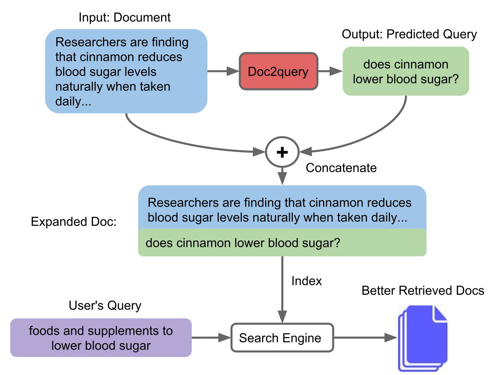
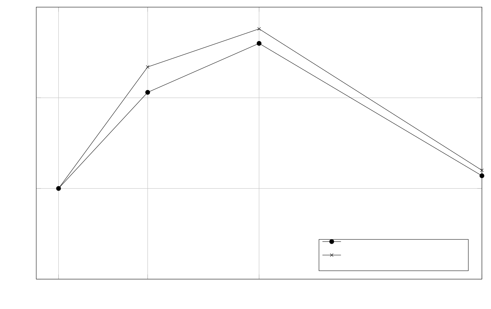

> 原文: [arXiv:1904.08375](https://arxiv.org/abs/1904.08375)（v2，2019-09-25）
> 说明: 中英对照供阅读。英文为论文原文（PDF 转写，公式按论文整理）；中文为对应翻译。图表编号与原文一致。caption 保留英文并附中译。数值原样，未改动。

**预印本：** arXiv:1904.08375v2 [cs.IR]，2019 年 9 月 25 日。

**代码：** https://github.com/nyu-dl/dl4ir-doc2query

---

# Document Expansion by Query Prediction

# 用查询预测做文档扩展

**Authors / 作者：** Rodrigo Nogueira1, Wei Yang2, Jimmy Lin2, and Kyunghyun Cho3,4,5,6

**Affiliation / 单位：**

1. Tandon School of Engineering, New York University / 纽约大学坦登工程学院
2. David R. Cheriton School of Computer Science, University of Waterloo / 滑铁卢大学 David R. Cheriton 计算机科学学院
3. Courant Institute of Mathematical Sciences, New York University / 纽约大学柯朗数学科学研究所
4. Center for Data Science, New York University / 纽约大学数据科学中心
5. Facebook AI Research / Facebook 人工智能研究
6. CIFAR Azrieli Global Scholar / CIFAR Azrieli 全球学者

---

## Abstract / 摘要

**EN.** One technique to improve the retrieval effectiveness of a search engine is to expand documents with terms that are related or representative of the documents’ content. From the perspective of a question answering system, this might comprise questions the document can potentially answer. Following this observation, we propose a simple method that predicts which queries will be issued for a given document and then expands it with those predictions with a vanilla sequence-to-sequence model, trained using datasets consisting of pairs of query and relevant documents. By combining our method with a highly-effective re-ranking component, we achieve the state of the art in two retrieval tasks. In a latency-critical regime, retrieval results alone (without re-ranking) approach the effectiveness of more computationally expensive neural re-rankers but are much faster.

**中.** 提高搜索引擎检索效果的一种做法，是用与文档内容相关、或能代表文档内容的词项去扩展文档。从问答系统的角度看，这些词项可以是该文档可能回答的问题。顺着这一观察，本文提出一种简单方法：预测给定文档会被哪些查询命中，再用一个普通的序列到序列模型，把这些预测拼进文档。模型在由（查询，相关文档）对构成的数据集上训练。把该方法与一个很强的重排组件合在一起，在两项检索任务上达到当时最优。在对延迟敏感的设定下，只靠检索结果（不做重排）就能接近更贵的神经重排器的效果，但快得多。

**EN.** Code to reproduce experiments and trained models can be found at https://github.com/nyu-dl/dl4ir-doc2query.

**中.** 复现实验的代码和训练好的模型见 https://github.com/nyu-dl/dl4ir-doc2query 。

---

## 1 Introduction / 引言

**EN.** The “vocabulary mismatch” problem, where users use query terms that differ from those used in relevant documents, is one of the central challenges in information retrieval. Prior to the advent of neural retrieval models, this problem has most often been tackled using query expansion techniques, where an initial round of retrieval can provide useful terms to augment the original query. Continuous vector space representations and neural networks, however, no longer depend on discrete one-hot representations, and thus offer an exciting new approach to tackling this challenge.

**中.** 「词汇不匹配」——用户用的查询词和相关文档里的用词不一样——是信息检索的核心难题之一。神经检索模型出现之前，这个问题大多靠查询扩展处理：先做一轮检索，再用反馈里有用的词去扩充原查询。连续向量空间表示和神经网络不再依赖离散的 one-hot 表示，因此给这个难题提供了一条新的路。

**EN.** Despite the potential of neural models to match documents at the semantic level for improved ranking, most scalable search engines use exact term match between queries and documents to perform initial retrieval. Query expansion is about enriching the query representation while holding the document representation static. In this paper, we explore an alternative approach based on enriching the document representation (prior to indexing). Focusing on question answering, we train a sequence-to-sequence model, that given a document, generates possible questions that the document might answer. An overview of the proposed method is shown in Figure 1.

**中.** 尽管神经模型有望在语义层面匹配文档、从而改进排序，多数可扩展搜索引擎仍用查询与文档之间的精确词项匹配做初检。查询扩展是在文档表示不动的前提下丰富查询表示。本文探索另一条路：在建索引之前丰富文档表示。面向问答，作者训练一个序列到序列模型：给定文档，生成它可能回答的问题。方法概览见图 1。

**Caption EN.** Figure 1: Given a document, our Doc2query model predicts a query, which is appended to the document. Expansion is applied to all documents in the corpus, which are then indexed and searched as before.

**Caption 中.** 图 1：给定一篇文档，Doc2query 模型预测一条查询，并把它追加到文档上。扩展施加到语料中的全部文档，然后按原来的方式索引和检索。

**EN.** We view this work as having several contributions: This is the first successful application of document expansion using neural networks that we are aware of. On the recent MS MARCO dataset (Bajaj et al., 2016), our approach is competitive with the best results on the official leaderboard, and we report the best-known results on TREC CAR (Dietz et al., 2017). We further show that document expansion is more effective than query expansion on these two datasets. We accomplish this with relatively simple models using existing open-source toolkits, which allows easy replication of our results. Document expansion also presents another major advantage, since the enrichment is performed prior to indexing: Although retrieved output can be further re-ranked using a neural model to greatly enhance effectiveness, the output can also be returned as-is. These results already yield a noticeable improvement in effectiveness over a “bag of words” baseline without the need to apply expensive and slow neural network inference at retrieval time.

**中.** 作者认为本文有几项贡献：据他们所知，这是第一次成功地用神经网络做文档扩展。在当时较新的 MS MARCO 数据集（Bajaj et al., 2016）上，该方法与官方榜单上的最好结果有竞争力；在 TREC CAR（Dietz et al., 2017）上，报告了当时已知的最好结果。他们进一步表明，在这两个数据集上文档扩展比查询扩展更有效。做到这一点用的是相对简单的模型，基于已有开源工具包，便于复现。文档扩展还有另一大好处：扩充发生在建索引之前。检索结果仍可以用神经模型再重排，从而大幅提高效果；也可以原样返回。这些结果相对「词袋」基线已经有明显提升，却不必在检索时做昂贵、缓慢的神经网络推理。

---

## 2 Related Work / 相关工作

**EN.** Prior to the advent of continuous vector space representations and neural ranking models, information retrieval techniques were mostly limited to keyword matching (i.e., “one-hot” representations). Alternatives such as latent semantic indexing (Deerwester et al., 1990) and its various successors never really gained significant traction. Approaches to tackling the vocabulary mismatch problem within these constraints include relevance feedback (Rocchio, 1971), query expansion (Voorhees, 1994; Xu and Croft, 2000), and modeling term relationships using statistical translation (Berger and Lafferty, 1999). These techniques share in their focus on enhancing query representations to better match documents.

**中.** 在连续向量空间表示和神经排序模型出现之前，信息检索技术大多限于关键词匹配（也就是 “one-hot” 表示）。潜在语义索引（Deerwester et al., 1990）及其后继方法从未真正流行起来。在这些约束下处理词汇不匹配的做法包括：相关反馈（Rocchio, 1971）、查询扩展（Voorhees, 1994; Xu and Croft, 2000），以及用统计翻译刻画词项关系（Berger and Lafferty, 1999）。这些技术的共同点是：增强查询表示，以便更好地匹配文档。

**EN.** In this work, we adopt the alternative approach of enriching document representations (Tao et al., 2006; Pickens et al., 2010; Efron et al., 2012), which works particularly well for speech (Singhal and Pereira, 1999) and multi-lingual retrieval, where terms are noisy. Document expansion techniques have been less popular with IR researchers because they are less amenable to rapid experimentation. The corpus needs to be re-indexed every time the expansion technique changes (typically, a costly process); in contrast, manipulations to query representations can happen at retrieval time (and hence are much faster). The success of document expansion has also been mixed; for example, Billerbeck and Zobel (2005) explore both query expansion and document expansion in the same framework and conclude that the former is consistently more effective.

**中.** 本文采取另一条路：丰富文档表示（Tao et al., 2006; Pickens et al., 2010; Efron et al., 2012）。这条路在语音检索（Singhal and Pereira, 1999）和多语言检索上特别好用，因为那些场景里词项很噪。文档扩展在 IR 研究者中不太流行，因为它不便于快速做实验。扩展技术一变，整个语料就得重建索引，通常很贵；查询表示的改动则可以发生在检索时，因而快得多。文档扩展的成败也不稳定。例如 Billerbeck and Zobel (2005) 在同一框架里比较查询扩展和文档扩展，结论是前者一直更有效。

**EN.** A new generation of neural ranking models offer solutions to the vocabulary mismatch problem based on continuous word representations and the ability to learn highly non-linear models of relevance; see recent overviews by Onal et al. (2018) and Mitra and Craswell (2019a). However, due to the size of most corpora and the impracticality of applying inference over every document in response to a query, nearly all implementations today deploy neural networks as re-rankers over initial candidate sets retrieved using standard inverted indexes and a term-based ranking model such as BM25 (Robertson et al., 1994). Our work fits into this broad approach, where we take advantage of neural networks to augment document representations prior to indexing; term-based retrieval then happens exactly as before. Of course, retrieved results can still be re-ranked by a state-of-the-art neural model (Nogueira and Cho, 2019), but the output of term-based ranking already appears to be quite good. In other words, our document expansion approach can leverage neural networks without their high inference-time costs.

**中.** 新一代神经排序模型用连续词表示、以及学习高度非线性相关性模型的能力，来应对词汇不匹配；近期综述见 Onal et al. (2018) 与 Mitra and Craswell (2019a)。然而，多数语料很大，不可能对一条查询在每篇文档上做推理，所以当时几乎所有实现都把神经网络用作重排器：先用标准倒排索引和 BM25 这类基于词项的排序模型（Robertson et al., 1994）取出初始候选，再在候选上重排。本文落在这条大路线里，但用神经网络在建索引之前增强文档表示；之后的词项检索与原来完全一样。检索结果当然仍可以用当时最好的神经模型再重排（Nogueira and Cho, 2019），但仅词项排序的输出看起来已经相当好。换句话说，这种文档扩展可以用上神经网络，却不必付出它们在推理时的高成本。

---

## 3 Method: Doc2query / 方法：Doc2query

**EN.** Our proposed method, which we call “Doc2query”, proceeds as follows: For each document, the task is to predict a set of queries for which that document will be relevant. Given a dataset of (query, relevant document) pairs, we use a sequence-to-sequence transformer model (Vaswani et al., 2017) that takes as an input the document terms and produces a query. The document and target query are segmented using BPE (Sennrich et al., 2015) after being tokenized with the Moses tokenizer. To avoid excessive memory usage, we truncate each document to 400 tokens and queries to 100 tokens. Architecture and training details of our transformer model are described in Appendix A.

**中.** 本文的方法称为 “Doc2query”，做法如下。对每篇文档，任务是预测一组查询，使得该文档对这些查询是相关的。给定由（查询，相关文档）对构成的数据集，使用序列到序列的 Transformer 模型（Vaswani et al., 2017）：输入文档词项，输出一条查询。文档和目标查询先用 Moses 分词器分词，再用 BPE（Sennrich et al., 2015）切分。为避免内存过大，每篇文档截断到 400 个 token，查询截断到 100 个 token。Transformer 的结构和训练细节见附录 A。

**EN.** Once the model is trained, we predict 10 queries using top-k random sampling (Fan et al., 2018) and append them to each document in the corpus. We do not put any special markup to distinguish the original document text from the predicted queries. The expanded documents are indexed, and we retrieve a ranked list of documents for each query using BM25 (Robertson et al., 1994). We optionally re-rank these retrieved documents using BERT (Devlin et al., 2018) as described by Nogueira and Cho (2019).

**中.** 模型训好之后，用 top-k 随机采样（Fan et al., 2018）为每篇文档预测 10 条查询，并追加到语料中的该文档上。原文和预测查询之间不加任何特殊标记。扩展后的文档建索引，对每条查询用 BM25（Robertson et al., 1994）取出排序后的文档列表。可选地，再按 Nogueira and Cho (2019) 的做法，用 BERT（Devlin et al., 2018）重排这些文档。

---

## 4 Experimental Setup / 实验设置

**EN.** To train and evaluate the models, we use the following two datasets:

**中.** 训练和评测使用下面两个数据集：

**EN.** MS MARCO (Bajaj et al., 2016) is a passage re-ranking dataset with 8.8M passages obtained from the top-10 results retrieved by the Bing search engine (from 1M queries). The training set contains approximately 500k pairs of query and relevant documents. Each query has one relevant passage, on average. The development and test sets contain approximately 6,900 queries each, but relevance labels are made public only for the development set.

**中.** MS MARCO（Bajaj et al., 2016）是段落重排数据集，含 880 万段落，来自必应搜索引擎对 100 万条查询检索出的 top-10 结果。训练集大约有 50 万对（查询，相关文档）。平均每条查询有一个相关段落。开发集和测试集各约 6,900 条查询，但相关性标签只公开了开发集。

**EN.** TREC-CAR (Dietz et al., 2017) is a dataset where the input query is the concatenation of a Wikipedia article title with the title of one of its sections. The ground-truth documents are the paragraphs within that section. The corpus consists of all English Wikipedia paragraphs except the abstracts. The released dataset has five predefined folds, and we use the first four as a training set (approx. 3M queries), and the remaining as a validation set (approx. 700k queries). The test set is the same as the one used to evaluate submissions to TREC-CAR 2017 (approx. 2,250 queries).

**中.** TREC-CAR（Dietz et al., 2017）里，输入查询是维基百科文章标题与其中一个章节标题的拼接。真实文档是该章节内的段落。语料是全部英文维基百科段落，摘要除外。发布的数据有五个预定义折，作者用前四折作训练集（约 300 万查询），剩下一折作验证集（约 70 万查询）。测试集与评测 TREC-CAR 2017 提交所用的测试集相同（约 2,250 条查询）。

**EN.** We evaluate the following ranking methods:

**中.** 评测下列排序方法：

**EN.** BM25: We use the Anserini open-source IR toolkit (Yang et al., 2017, 2018) to index the original (non-expanded) documents and BM25 to rank the passages. During evaluation, we use the top-1000 re-ranked passages.

**中.** BM25：用开源 IR 工具包 Anserini（Yang et al., 2017, 2018）索引原始（未扩展）文档，并用 BM25 给段落排序。评测时使用重排后的 top-1000 段落。

**EN.** BM25 + Doc2query: We first expand the documents using the proposed Doc2query method. We then index and rank the expanded documents exactly as in the BM25 method above.

**中.** BM25 + Doc2query：先用本文的 Doc2query 扩展文档，再按上面 BM25 方法完全相同的方式索引并排序扩展后的文档。

**EN.** RM3: To compare document expansion with query expansion, we applied the RM3 query expansion technique (Abdul-Jaleel et al., 2004). We apply query expansion to both unexpanded documents (BM25 + RM3) as well as the expanded documents (BM25 + Doc2query + RM3).

**中.** RM3：为比较文档扩展与查询扩展，使用 RM3 查询扩展（Abdul-Jaleel et al., 2004）。查询扩展既施加在未扩展文档上（BM25 + RM3），也施加在已扩展文档上（BM25 + Doc2query + RM3）。

**EN.** BM25 + BERT: We index and retrieve documents as in the BM25 condition and further re-rank the documents with BERT as described in Nogueira and Cho (2019).

**中.** BM25 + BERT：按 BM25 条件索引并检索文档，再按 Nogueira and Cho (2019) 用 BERT 重排。

**EN.** BM25 + Doc2query + BERT: We expand, index, and retrieve documents as in the BM25 + Doc2query condition and further re-rank the documents with BERT.

**中.** BM25 + Doc2query + BERT：按 BM25 + Doc2query 条件扩展、索引并检索文档，再用 BERT 重排。

**EN.** To evaluate the effectiveness of the methods on MS MARCO, we use its official metric, mean reciprocal rank of the top-10 documents (MRR@10). For TREC-CAR, we use mean average precision (MAP).

**中.** 在 MS MARCO 上用官方指标：前 10 篇文档的平均倒数排名（MRR@10）。在 TREC-CAR 上用平均精度均值（MAP）。

---

## 5 Results / 结果

**EN.** Results on both datasets are shown in Table 1. BM25 is the baseline. Document expansion with our method (BM25 + Doc2query) improves retrieval effectiveness by ∼15% for both datasets. When we combine document expansion with a state-of-the-art re-ranker (BM25 + Doc2query + BERT), we achieve the best-known results to date on TREC CAR; for MS MARCO, we are near the state of the art. The top leaderboard entries do not come with system descriptions, and so it is not possible to compare our approach with theirs. Our full re-ranking condition (BM25 + Doc2query + BERT) beats BM25 + BERT alone, which verifies that the contribution of Doc2query is indeed orthogonal to that from post-indexing re-ranking.

**中.** 两个数据集的结果见表 1。BM25 是基线。用本文方法做文档扩展（BM25 + Doc2query）在两个数据集上都把检索效果提高约 15%。把文档扩展与当时最好的重排器合在一起（BM25 + Doc2query + BERT）时，在 TREC CAR 上达到当时已知最好结果；在 MS MARCO 上接近当时最优。榜单最上面的条目没有系统描述，因此无法把本文方法与那些系统比较。完整重排条件（BM25 + Doc2query + BERT）优于单独的 BM25 + BERT，说明 Doc2query 的贡献与索引后重排的贡献确实是正交的。

**表 1 / Table 1.** Main results on TREC-CAR and MS MARCO datasets. / TREC-CAR 与 MS MARCO 上的主要结果。

| Method / 方法 | TREC-CAR MAP | MS MARCO MRR@10 Test | MS MARCO MRR@10 Dev | Retrieval Time (ms/query) / 检索时间（毫秒/查询） |
| --- | ---: | ---: | ---: | ---: |
| Single Duet v2 (Mitra and Craswell, 2019b) | — | 24.5 | 24.3 | 650⋆ |
| Co-PACRR♠ (MacAvaney et al., 2017) | 14.8 | — | — | — |
| BM25 | 15.3 | 18.6 | 18.4 | 50 |
| BM25 + RM3 | 12.7 | — | 16.7 | 250 |
| BM25 + Doc2query (Ours) | 18.3 | 21.8 | 21.5 | 90 |
| BM25 + Doc2query + RM3 (Ours) | 15.5 | — | 20.0 | 350 |
| BM25 + BERT (Nogueira and Cho, 2019) | 34.8 | 35.9 | 36.5 | 3400† |
| BM25 + Doc2query + BERT (Ours) | 36.5 | 36.8 | 37.5 | 3500† |

**EN.** ⋆ Our measurement, in which Duet v2 takes 600ms per query, and BM25 retrieval takes 50ms. ♠ Best submission of TREC-CAR 2017. † We use Google’s TPUs to re-rank with BERT.

**中.** ⋆ 作者自己的测量：Duet v2 每条查询 600 ms，BM25 检索 50 ms。♠ TREC-CAR 2017 的最佳提交。† 用 Google 的 TPU 做 BERT 重排。

**EN.** Where exactly are these better scores coming from? We show in Table 2 examples of queries produced by our Doc2query model trained on MS MARCO. We notice that the model tends to copy some words from the input document (e.g., Washington DC, River, chromosome), meaning that it can effectively perform term re-weighting (i.e., increasing the importance of key terms). Nevertheless, the model also produces words not present in the input document (e.g., weather, relationship), which can be characterized as expansion by synonyms and other related terms.

**中.** 这些更好的分数到底从哪来？表 2 给出在 MS MARCO 上训练的 Doc2query 所产生的查询例子。模型倾向于从输入文档里抄一些词（例如 Washington DC、River、chromosome），这意味着它能做词项再加权，也就是提高关键词的重要性。同时，模型也会写出输入文档里没有的词（例如 weather、relationship），这可以看成用同义词和其他相关词做扩展。

**表 2 / Table 2.** Examples of query predictions on MS MARCO compared to real user queries. / MS MARCO 上的查询预测例子，并与真实用户查询对照。

| | Example 1 | Example 2 | Example 3 |
| --- | --- | --- | --- |
| Input Document | July is the hottest month in Washington DC with an average temperature of 27C (80F) and the coldest is January at 4C (38F) with the most daily sunshine hours at 9 in July. The wettest month is May with an average of 100mm of rain. | The Delaware River flows through Philadelphia into the Delaware Bay. It flows through and aqueduct in the Roundout Reservoir and then flows through Philadelphia and New Jersey before emptying into the Delaware Bay. | sex chromosome - (genetics) a chromosome that determines the sex of an individual; mammals normally have two sex chromosomes chromosome - a threadlike strand of DNA in the cell nucleus that carries the genes in a linear order; humans have 22 chromosome pairs plus two sex chromosomes. |
| Predicted Query | weather in washington dc | what river flows through delaware | what is the relationship between genes and chromosomes |
| Target Query | what is the temperature in washington | where does the delaware river start and end | which chromosome controls sex characteristics |

例 1 中译。输入文档：华盛顿特区最热的月份是七月，平均气温 27C（80F）；最冷的是一月，4C（38F）；七月每天日照时数最多，为 9 小时。最湿的月份是五月，平均降雨 100mm。预测查询：weather in washington dc。目标查询：what is the temperature in washington。

例 2 中译。输入文档：特拉华河流经费城进入特拉华湾。它流经 Roundout 水库中的渡槽（原文作 flows through and aqueduct），再流经费城和新泽西，然后汇入特拉华湾。预测查询：what river flows through delaware。目标查询：where does the delaware river start and end。

例 3 中译。输入文档：性染色体——（遗传学）决定个体性别的染色体；哺乳动物通常有两条性染色体。染色体——细胞核中线状的 DNA 链，按线性顺序携带基因；人类有 22 对染色体再加两条性染色体。预测查询：what is the relationship between genes and chromosomes。目标查询：which chromosome controls sex characteristics。

**EN.** To quantify this analysis, we measured the proportion of predicted words that exist (copied) vs. not-exist (new) in the original document. Excluding stop words, which corresponds to 51% of the predicted query words, we found that 31% are new while the rest (69%) are copied. If we expand MS MARCO documents using only new words and retrieve the development set queries with BM25, we obtain an MRR@10 of 18.8 (as opposed to 18.4 when indexing with original documents). Expanding with copied words gives an MRR@10 of 19.7. We achieve a higher MRR@10 of 21.5 when documents are expanded with both types of words, showing that they are complementary.

**中.** 为把上述分析量化，作者统计预测词里有多少出现在原文中（复制），有多少不出现（新词）。去掉停用词——停用词占预测查询词的 51%——之后，31% 是新词，其余 69% 是复制词。若只用新词扩展 MS MARCO 文档，再用 BM25 检索开发集查询，MRR@10 为 18.8（用原始文档索引时是 18.4）。只用复制词扩展，MRR@10 为 19.7。两种词一起扩展时 MRR@10 达到 21.5，说明二者互补。

**EN.** Further analyses show that one source of improvement comes from having more relevant documents for the re-ranker to consider. We find that the Recall@1000 of the MS MARCO development set increased from 85.3 (BM25) to 89.3 (BM25 + Doc2query). Results show that BERT is indeed able to identify these correct answers from the improved candidate pool and bring them to the top of the ranked list, thus improving the overall MRR.

**中.** 进一步的分析表明，提升的一个来源是重排器能看到更多相关文档。MS MARCO 开发集的 Recall@1000 从 85.3（BM25）升到 89.3（BM25 + Doc2query）。结果表明 BERT 确实能从变好的候选池里认出这些正确答案，并把它们放到排序列表的前面，从而提高整体 MRR。

**EN.** As a contrastive condition, we find that query expansion with RM3 hurts in both datasets, whether applied to the unexpanded corpus (BM25 + RM3) or the expanded version (BM25 + Doc2query + RM3). This is a somewhat surprising result because query expansion usually improves effectiveness in document retrieval, but this can likely be explained by the fact that both MS MARCO and CAR are precision oriented. This result shows that document expansion can be more effective than query expansion, most likely because there are more signals to exploit as documents are much longer.

**中.** 作为对照，RM3 查询扩展在两个数据集上都有害，无论加在未扩展语料上（BM25 + RM3）还是加在已扩展版本上（BM25 + Doc2query + RM3）。这有些出人意料，因为查询扩展通常会提高文档检索的效果；作者认为原因是 MS MARCO 和 CAR 都偏向精度。这一结果说明文档扩展可以比查询扩展更有效，很可能是因为文档长得多，可利用的信号更多。

**EN.** Finally, for production retrieval systems, latency is often an important factor. Our method without a re-ranker (BM25 + Doc2query) adds a small latency increase over baseline BM25 (50 ms vs. 90 ms) but is approximately seven times faster than a neural re-ranker that has a three points higher MRR@10 (Single Duet v2, which is presented as a baseline in MS MARCO by the organizers). For certain operating scenarios, this tradeoff in quality for speed might be worthwhile.

**中.** 最后，对生产检索系统，延迟常常很重要。不加重排器的本文方法（BM25 + Doc2query）相对基线 BM25 只增加一点延迟（50 ms 对 90 ms），但大约比一个 MRR@10 高出三个点的神经重排器快七倍（Single Duet v2，由组织者作为 MS MARCO 的基线给出）。在某些运行场景里，用一点质量换速度是值得的。

---

## 6 Conclusion / 结论

**EN.** We present the first successful use of document expansion based on neural networks. Document expansion holds substantial promise for neural models because documents are much longer and thus contain richer input signals. Furthermore, the general approach allows developers to shift the computational costs of neural network inference from retrieval to indexing.

**中.** 本文给出基于神经网络的文档扩展的第一次成功使用。文档扩展对神经模型很有希望，因为文档长得多，输入信号更丰富。而且，这一总路线让开发者可以把神经网络推理的计算成本从检索阶段挪到索引阶段。

**EN.** Our implementation is based on integrating three open-source toolkits: OpenNMT (Klein et al., 2017), Anserini, and TensorFlow BERT. The relative simplicity of our approach aids in the reproducibility of our results and paves the way for further improvements in document expansion.

**中.** 实现基于三个开源工具包的集成：OpenNMT（Klein et al., 2017）、Anserini 和 TensorFlow BERT。方法相对简单，有助于结果可复现，也为文档扩展的进一步改进铺路。

---

## Acknowledgments / 致谢

**EN.** KC thanks support by NVIDIA and CIFAR and was partly supported by Samsung Advanced Institute of Technology (Next Generation Deep Learning: from pattern recognition to AI) and Samsung Electronics (Improving Deep Learning using Latent Structure). JL thanks support by the Natural Sciences and Engineering Research Council (NSERC) of Canada.

**中.** KC 感谢 NVIDIA 与 CIFAR 的支持，并部分受三星高等研究院（下一代深度学习：从模式识别到 AI）和三星电子（用潜在结构改进深度学习）资助。JL 感谢加拿大自然科学与工程研究理事会（NSERC）的支持。

---

## Appendix A Architecture and Training Details / 附录 A 结构与训练细节

**EN.** The architecture of our transformer model is identical to the base model described in Vaswani et al. (2017), which has 6 layers for both encoder and decoder, 512 hidden units in each layer, 8 attention heads and 2048 hidden units in the feed-forward layers. We train with a batch size of 4096 tokens for a maximum of 30 epochs. We use Adam (Kingma and Ba, 2014) with a learning rate of $10^{-3}$, $\beta_1 = 0.9$, $\beta_2 = 0.998$, L2 weight decay of 0.01, learning rate warmup over the first 8,000 steps, and linear decay of the learning rate. We use a dropout probability of 0.1 in all layers. Our implementation uses the OpenNMT framework (Klein et al., 2017); training takes place on four V100 GPUs. To avoid overfitting, we monitor the BLEU scores of the training and development sets and stop training when their difference is larger than four points.

**中.** Transformer 的结构与 Vaswani et al. (2017) 的 base 模型相同：编码器和解码器各 6 层，每层 512 个隐单元，8 个注意力头，前馈层 2048 个隐单元。训练批大小为 4096 个 token，最多 30 个 epoch。优化器为 Adam（Kingma and Ba, 2014），学习率 $10^{-3}$，$\beta_1 = 0.9$，$\beta_2 = 0.998$，L2 权重衰减 0.01，前 8,000 步做学习率预热，之后学习率线性衰减。所有层的 dropout 概率为 0.1。实现使用 OpenNMT 框架（Klein et al., 2017）；训练在四块 V100 GPU 上进行。为避免过拟合，监控训练集和开发集的 BLEU，二者相差超过四个点时停止训练。

---

## Appendix B Evaluating Various Decoding Schemes / 附录 B 评测不同解码方案

**EN.** Here we investigate how different decoding schemes used to produce queries affect the retrieval effectiveness. We experiment with two decoding methods: beam search and top-k random sampling with different beam sizes (number of generated hypotheses). Results are shown in Figure 2. Top-k random sampling is slightly better than beam search across all beam sizes, and we observed a peak in the retrieval effectiveness when 10 queries are appended to the document. We conjecture that this peak occurs because too few queries yield insufficient diversity (fewer semantic matches) while too many queries introduce noise and reduce the contributions of the original text to the document representation.

**中.** 这里考察不同的查询解码方案如何影响检索效果。实验比较两种解码：束搜索，以及不同束宽（生成假设的条数）下的 top-k 随机采样。结果见图 2。在所有束宽上，top-k 随机采样都略好于束搜索；往文档上追加 10 条查询时，检索效果达到峰值。作者猜想峰值的原因是：查询太少则多样性不够（语义匹配更少），查询太多则引入噪声，并削弱原文对文档表示的贡献。

**Caption EN.** Figure 2: Retrieval effectiveness on the development set of MS MARCO when using different decoding methods to produce queries. On the x-axis, we vary the number of predicted queries that are appended to the original documents.

**Caption 中.** 图 2：用不同解码方法产生查询时，MS MARCO 开发集上的检索效果。横轴是追加到原文档上的预测查询条数。

图 2 为折线，横轴为生成查询条数（束宽）1、5、10、20，纵轴为 MRR@10，两条曲线为 Beam Search 与 Top-k Random Sampling。图中标出的读数是 21.5。论文正文只陈述：top-k 随机采样在各束宽上略优，10 条查询时达到峰值。

---

## References / 参考文献

正文为作者–年份引用。下列为原文条目；中文是题名对照，不是改写后的引文。

Nasreen Abdul-Jaleel, James Allan, W. Bruce Croft, Fernando Diaz, Leah Larkey, Xiaoyan Li, Donald Metzler, Mark D. Smucker, Trevor Strohman, Howard Turtle, and Courtney Wade. 2004. UMass at TREC 2004: Novelty and HARD. In Proceedings of the Thirteenth Text REtrieval Conference (TREC 2004). Gaithersburg, Maryland.  
**中.** TREC 2004 上 UMass 的 Novelty 与 HARD 参赛系统。

Payal Bajaj, Daniel Campos, Nick Craswell, Li Deng, Jianfeng Gao, Xiaodong Liu, Rangan Majumder, Andrew McNamara, Bhaskar Mitra, Tri Nguyen, Mir Rosenberg, Xia Song, Alina Stoica, Saurabh Tiwary, and Tong Wang. 2016. MS MARCO: A Human Generated MAchine Reading COmprehension Dataset. arXiv:1611.09268 (2016).  
**中.** MS MARCO：人工构造的机器阅读理解数据集。

Adam Berger and John Lafferty. 1999. Information Retrieval as Statistical Translation. In Proceedings of the 22nd Annual International ACM SIGIR Conference on Research and Development in Information Retrieval (SIGIR 1999). 222–229.  
**中.** 把信息检索当作统计翻译。

Bodo Billerbeck and Justin Zobel. 2005. Document Expansion versus Query Expansion for Ad-hoc Retrieval. In Proceedings of the 10th Australasian Document Computing Symposium. 34–41.  
**中.** 即席检索中的文档扩展与查询扩展之比较。

Scott Deerwester, Susan T. Dumais, George W. Furnas, Thomas K. Landauer, and Richard Harshman. 1990. Indexing by Latent Semantic Analysis. Journal of the Association for Information Science 41, 6 (1990), 391–407.  
**中.** 用潜在语义分析做索引。

Jacob Devlin, Ming-Wei Chang, Kenton Lee, and Kristina Toutanova. 2018. BERT: Pre-training of Deep Bidirectional Transformers for Language Understanding. arXiv:1810.04805 (2018).  
**中.** BERT：面向语言理解的深度双向 Transformer 预训练。

Laura Dietz, Manisha Verma, Filip Radlinski, and Nick Craswell. 2017. TREC Complex Answer Retrieval Overview. In Proceedings of the Twenty-Sixth Text REtrieval Conference (TREC 2017).  
**中.** TREC 复杂答案检索概述。

Miles Efron, Peter Organisciak, and Katrina Fenlon. 2012. Improving Retrieval of Short Texts Through Document Expansion. In Proceedings of the 35th international ACM SIGIR conference on Research and development in information retrieval (SIGIR 2012). 911–920.  
**中.** 用文档扩展改进短文本检索。

Angela Fan, Mike Lewis, and Yann Dauphin. 2018. Hierarchical Neural Story Generation. arXiv:1805.04833 (2018).  
**中.** 层次化神经故事生成。

Diederik P. Kingma and Jimmy Ba. 2014. Adam: A Method for Stochastic Optimization. arXiv:1412.6980 (2014).  
**中.** Adam：一种随机优化方法。

Guillaume Klein, Yoon Kim, Yuntian Deng, Jean Senellart, and Alexander M. Rush. 2017. OpenNMT: Open-Source Toolkit for Neural Machine Translation. In Proc. ACL. https://doi.org/10.18653/v1/P17-4012  
**中.** OpenNMT：神经机器翻译的开源工具包。

Sean MacAvaney, Andrew Yates, and Kai Hui. 2017. Contextualized PACRR for complex answer retrieval. In Proceedings of TREC.  
**中.** 用于复杂答案检索的上下文化 PACRR。

Bhaskar Mitra and Nick Craswell. 2019a. An Introduction to Neural Information Retrieval. Foundations and Trends in Information Retrieval 13, 1 (2019), 1–126.  
**中.** 神经信息检索导论。

Bhaskar Mitra and Nick Craswell. 2019b. An Updated Duet Model for Passage Re-ranking. arXiv:1903.07666 (2019).  
**中.** 用于段落重排的更新版 Duet 模型。

Rodrigo Nogueira and Kyunghyun Cho. 2019. Passage Re-ranking with BERT. arXiv:1901.04085 (2019).  
**中.** 用 BERT 做段落重排。

Kezban Dilek Onal, Ye Zhang, Ismail Sengor Altingovde, Md Mustafizur Rahman, Pinar Karagoz, Alex Braylan, Brandon Dang, Heng-Lu Chang, Henna Kim, Quinten Mcnamara, Aaron Angert, Edward Banner, Vivek Khetan, Tyler Mcdonnell, An Thanh Nguyen, Dan Xu, Byron C. Wallace, Maarten Rijke, and Matthew Lease. 2018. Neural Information Retrieval: At the End of the Early Years. Information Retrieval 21, 2-3 (June 2018), 111–182.  
**中.** 神经信息检索：早期阶段的结束。

Jeremy Pickens, Matthew Cooper, and Gene Golovchinsky. 2010. Reverted Indexing for Feedback and Expansion. In Proceedings of the 19th ACM International Conference on Information and Knowledge Management (CIKM 2010). 1049–1058.  
**中.** 用于反馈与扩展的反向索引。

Stephen E. Robertson, Steve Walker, Susan Jones, Micheline Hancock-Beaulieu, and Mike Gatford. 1994. Okapi at TREC-3. In Proceedings of the 3rd Text REtrieval Conference (TREC-3). Gaithersburg, Maryland, 109–126.  
**中.** Okapi 在 TREC-3 上的系统。

Joseph John Rocchio. 1971. Relevance Feedback in Information Retrieval. In The SMART Retrieval System—Experiments in Automatic Document Processing, Gerard Salton (Ed.). Prentice-Hall, Englewood Cliffs, New Jersey, 313–323.  
**中.** 信息检索中的相关反馈。

Rico Sennrich, Barry Haddow, and Alexandra Birch. 2015. Neural Machine Translation of Rare Words with Subword Units. arXiv:1508.07909 (2015).  
**中.** 用子词单元做稀有词的神经机器翻译。

Amit Singhal and Fernando Pereira. 1999. Document Expansion for Speech Retrieval. In Proceedings of the 22nd Annual International ACM SIGIR Conference on Research and Development in Information Retrieval (SIGIR 1999). 34–41.  
**中.** 面向语音检索的文档扩展。

Tao Tao, Xuanhui Wang, Qiaozhu Mei, and ChengXiang Zhai. 2006. Language Model Information Retrieval with Document Expansion. In Proceedings of the main conference on Human Language Technology Conference of the North American Chapter of the Association of Computational Linguistics. 407–414.  
**中.** 带文档扩展的语言模型信息检索。

Ashish Vaswani, Noam Shazeer, Niki Parmar, Jakob Uszkoreit, Llion Jones, Aidan N. Gomez, Łukasz Kaiser, and Illia Polosukhin. 2017. Attention Is All You Need. In Advances in Neural Information Processing Systems. 5998–6008.  
**中.** 注意力就是你所需要的全部。

Ellen M. Voorhees. 1994. Query Expansion Using Lexical-Semantic Relations. In Proceedings of the 17th Annual International ACM SIGIR Conference on Research and Development in Information Retrieval (SIGIR 1994). 61–69.  
**中.** 用词汇语义关系做查询扩展。

Jinxi Xu and W. Bruce Croft. 2000. Improving the Effectiveness of Information Retrieval with Local Context Analysis. ACM Transactions on Information Systems 18, 1 (2000), 79–112.  
**中.** 用局部上下文分析提高信息检索效果。

Peilin Yang, Hui Fang, and Jimmy Lin. 2017. Anserini: Enabling the Use of Lucene for Information Retrieval Research. In Proceedings of the 40th International ACM SIGIR Conference on Research and Development in Information Retrieval (SIGIR 2017). 1253–1256.  
**中.** Anserini：让 Lucene 能用于信息检索研究。

Peilin Yang, Hui Fang, and Jimmy Lin. 2018. Anserini: Reproducible Ranking Baselines Using Lucene. Journal of Data and Information Quality 10, 4 (2018), Article 16.  
**中.** Anserini：用 Lucene 做可复现的排序基线。
