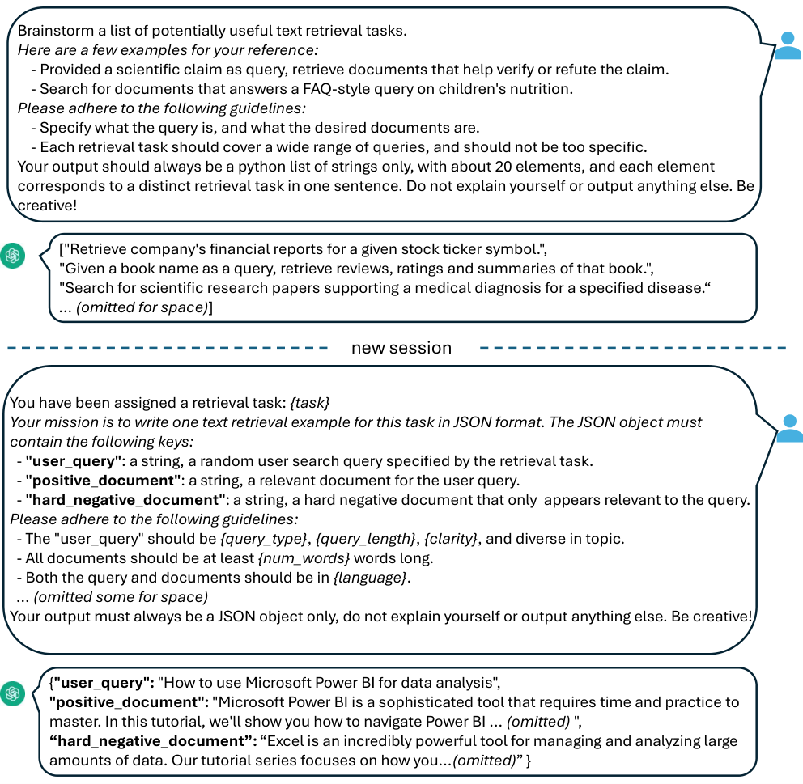
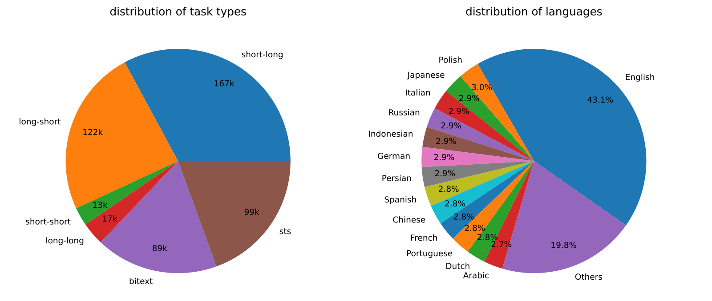

# E5-Mistral 合成数据详解：两步 Prompt 配方

> **paper**：[Improving Text Embeddings with Large Language Models](https://arxiv.org/abs/2401.00368)（Wang et al.；Microsoft；ACL 2024；arXiv:2401.00368）
> **全文双语笔记**：同目录 [zh.md](zh.md)（请勿与本文混淆；本文只深挖合成数据方法）
> **code**：https://github.com/microsoft/unilm/tree/master/e5
> **date**：arXiv v3，2024-05-31
> **modality**：文本嵌入（检索 / STS / 分类等 MTEB 任务）
> **languages**：合成数据覆盖 93 种语言
> **焦点**：GPT-4/3.5 两步合成配方 → decoder-only（Mistral-7B）对比微调 → 纯合成 vs 合成+标注

后续 GritLM / NV-Embed / SFR 等冲榜谱系的横向拆解，见《[LLM-Embedding冲榜路线](../LLM-Embedding冲榜路线_E5Mistral-NVEmbed-GritLM-SFR-Arctic-Stella.md)》中「E5-Mistral：合成数据点火者」一节；本文不做那些模型的对照表。

---

## 一句话定位

**E5-Mistral** 证明：用专有 LLM **两步 prompt** 造出覆盖大量任务与语言的 (instruction, query, positive, hard negative) 合成数据后，对 **Mistral-7B** 做标准对比微调（**EOS pooling**），**不到 1k step**、甚至 **纯合成无标注**，就能在 BEIR / MTEB 上达到强嵌入表现；再混入标注数据则刷新当时 SOTA。

| 项 | 内容 |
| --- | --- |
| 数据发动机 | GPT-4（为主）+ GPT-3.5-Turbo：约 500k 例、150k 独特指令 |
| 训练骨干 | Mistral-7B，LoRA rank 16，InfoNCE，$\tau=0.02$ |
| 池化 | 序列末尾 **[EOS]** 隐状态 |
| 宣称 | 纯合成 MTEB 平均 63.1；full data 66.6（相对前 SOTA +2.4） |

---

## 术语先对齐

- **instruction（指令）**：加在 query 前的一句话任务定义，形如 `Instruct: {task_definition}\nQuery: {q}`。合成数据里的 `task_definition` 来自 brainstorm；标注集则手工写。**document 端不加指令**，便于预先建库、只换 query 侧任务。
- **contrastive loss（对比损失）**：这里指标准 **InfoNCE**：拉近 query 与正文档，推远 in-batch 负例与 hard negative；相似度用温度缩放余弦。
- **hard negative（难负例）**：看起来可能相关、实则不应匹配的文档。本文要求 LLM **在同一条 JSON 里**与正例一起生成，定义为 “a hard negative document that only appears relevant to the query”。
- **EOS pooling**：在 query / document 末尾追加 `[EOS]`，取最后一层该位置向量作为嵌入（decoder-only 常见做法）。
- **distribution / coverage（覆盖）**：相对「固定网页锚文本弱监督」，合成配方用任务 brainstorm + 多模板 placeholder，主动拉高任务类型与语言覆盖。

---

## 为何要合成，而不是弱监督预训练

既往 SOTA（E5 / BGE 等）多为：数十亿弱监督对对比预训练 → 少量标注微调。问题包括：流水线重、人工数据任务与语言覆盖窄、骨干多为小 encoder。本文论点：像 Mistral 这类已在大规模网页数据上预训练过的 LLM，**额外的对比预训练收益很小**；关键是用高多样性合成数据做 **单阶段** 对比微调。

与 Doc2query / InPars / Promptagator 等「给定无标注文档再造 query」不同：本文 **不依赖任何未标注文档或 query**，完全由 LLM 按任务定义生成三元组，以换取更大任务多样性。

---

## 数据配方：先分类，再两步 Prompt

为提升多样性，先把嵌入任务分成若干组，再对每组套不同模板。

### 非对称任务（Asymmetric）

Query 与 document **语义相关但不是转述**。按长度再拆四类：short-long、long-short、short-short、long-long。典型 short-long：短查询 + 长文档（商用搜索常见）。**每类都用两步 prompt**。

### 对称任务（Symmetric）

语义相近、表面形式不同：单语 STS、bitext retrieval。任务定义直接，**省略 brainstorm**，只用生成步。

### 两步策略（方法核心）

**图 1（原文 Figure 1）：用 GPT-4 生成合成数据的两步 prompt 示例。** 上半：要求 brainstorm 约 20 条潜在文本检索任务（Python 字符串列表）。下半：给定 `{task}`，要求只输出 JSON，含 `user_query`、`positive_document`、`hard_negative_document`；`{query_type}` / `{query_length}` / `{clarity}` / `{num_words}` / `{language}` 等从预设集合采样。示例里正例是 Power BI 教程，难负例是 Excel 数据分析教程——主题相邻但答非所问。

**图在讲什么。** 左列是「任务池」怎么来的，右列是「一条训练样本」怎么来的。硬负例与正例 **同一次 JSON 生成**：模型被明确要求写出「看起来相关」的干扰文档，而不是事后用 BM25/ANN 挖；这样对比学习一开始就见到细粒度混淆。

作者在初步实验中试过 **单步** 同时生成任务定义与 query–document，多样性不如两步。

### 同 JSON 里生成 hard negative 的用意

Prompt 原文要求：`"hard_negative_document": a string, a hard negative document that only appears relevant to the query.`  
即：表面相关、实质不满足查询。训练时它与 in-batch 负例一起进入 InfoNCE 分母，迫使嵌入区分「词面/主题相近」与「真正可回答」。相对「先检索再挖难负」，同会话生成的难负例与正例共享同一任务语境，难度由生成模型按指令构造，不依赖当前（尚未训好的）嵌入模型。

### 质量控制与规模

- 不符合预定 JSON 的样本丢弃；按精确字符串匹配去重。
- 约 **500k** 例、**150k** 独特指令；约 **25%** GPT-3.5-Turbo、其余 GPT-4；总消耗约 **180M** token；覆盖 **93** 种语言（语言列表参考 XLM-R，高资源加权）；底部约 75 种低资源语言平均约 **1k** 例/语。
- GPT-3.5 部分不完全遵守模板，但整体可用，混入有正收益。

任务类型量级（原文 Figure 2）：short-long 167k、long-short 122k、STS 99k、bitext 89k、long-long 17k、short-short 13k。

---

## 训练：指令 + EOS + InfoNCE

给定正对 $(q^+, d^+)$，先构造带指令的 query：

$$
q^+_{\mathrm{inst}} = \texttt{Instruct: \{task\_definition\}} \backslash\texttt{n} \texttt{Query: }\{q^+\}
$$

合成数据的 `task_definition` 用 brainstorm 结果；MS-MARCO 等则手工任务描述。Query / document 末尾加 `[EOS]`，取末层 EOS 向量为 $h_{q}, h_{d}$。

损失为对 in-batch 负例与 hard negative 的 InfoNCE；匹配函数为温度缩放余弦，$\tau=0.02$。

实现要点（原文实验设定）：以 Mistral-7B 为初始化，按 RankLLaMA 配方用 **LoRA（rank 16）** 微调约 **1 epoch**；配合 gradient checkpointing、混合精度、DeepSpeed ZeRO-3。全文强调整个训练过程 **少于 1k steps**。

数据设定对照：

| 设定 | 数据 | MTEB 英文子集平均（表 1） |
| --- | --- | ---: |
| synthetic data only | 仅合成 | 63.1 |
| synthetic + msmarco | 合成 + MS-MARCO | 64.5 |
| full data | 合成 + 13 个公开集（采样后约 1.8M 例） | **66.6** |

纯合成时检索类 Retr. 为 46.9，加标注后升至 56.9——**标注主要抬检索**；分类类在纯合成已接近打满（78.2 → 78.5）。

---

## 方法启示（合成数据视角）

1. **任务多样性先于弱监督规模**：brainstorm 出几十万种任务定义，比单一「短查长文」弱监督更能撑起通用嵌入。
2. **难负例写进生成契约**：同一 JSON 强制「看似相关」，对比信号从第一条样本就存在。
3. **指令只挂 query**：document 可预索引；serving 换任务只改 query 前缀。
4. **强 LLM 骨干可跳过对比预训练**：用合成数据单阶段微调即可；后续冲榜工作多在此配方上叠加 pooling / 难负例策略 / 任务混合（见冲榜路线文，不在此展开）。

---

## 已核实数字速查

| 数字 | 出处含义 |
| --- | --- |
| \<1k steps | 摘要：仅用合成数据且少于 1k 训练步可达强嵌入 |
| 500k / 150k | 合成例数 / 独特指令数 |
| 93 语言；180M token | 覆盖与 API 消耗 |
| $\tau=0.02$；LoRA 16 | 对比温度与微调 rank |
| MTEB 63.1 / 66.6 | 纯合成 vs full data 平均分 |
