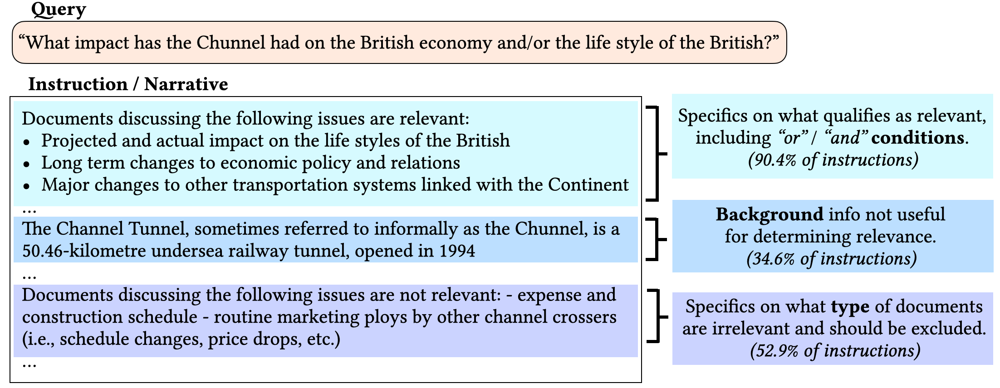
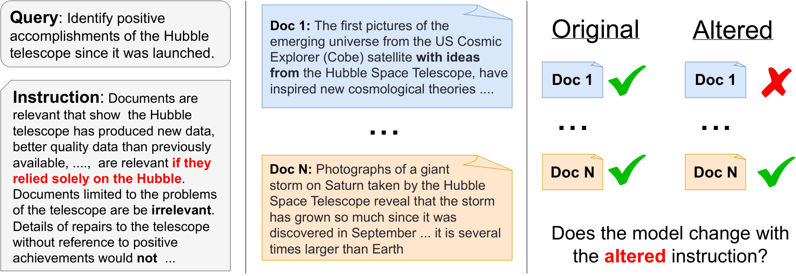
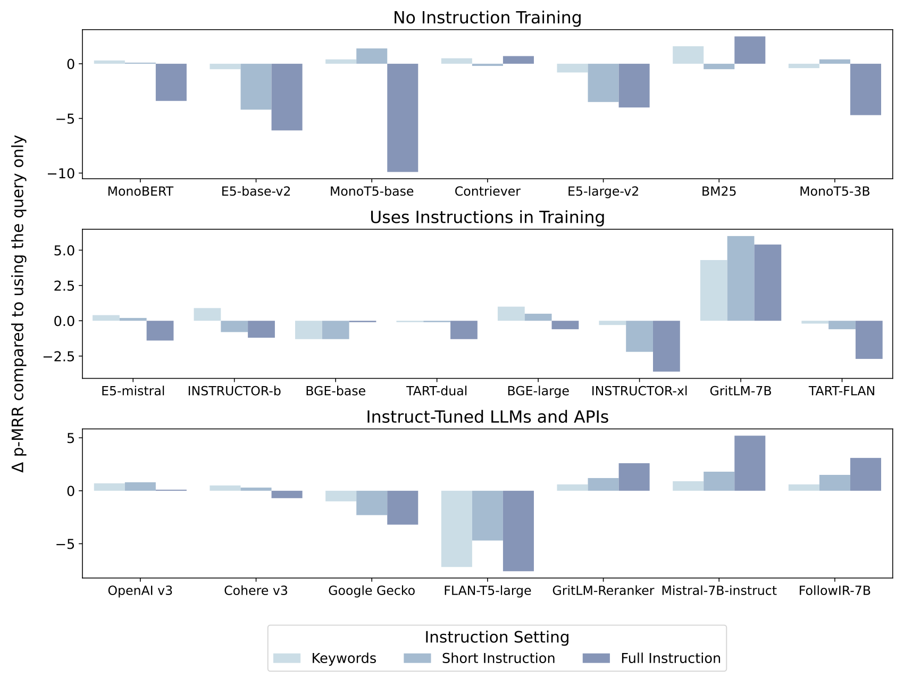

# FollowIR：检索模型是否真的遵循指令

> 固定查询，只修改“什么文档才算相关”的自然语言条件，观察排序能否正确改变，并用真实 TREC 指令训练更会遵循要求的重排模型。
>
> [FollowIR: Evaluating and Teaching Information Retrieval Models to Follow Instructions](https://arxiv.org/abs/2403.15246v3) · 2024 · [项目与代码](https://github.com/jhu-clsp/FollowIR) · [补充解读](FollowIR解读.md)

## 摘要

很多 embedding 模型支持在查询前加一句指令，但常用指令只是“检索回答这个问题的段落”，同一数据集的所有查询基本共用一条。这样的训练和传统检索分数，不能证明模型理解了“只要讨论经济影响，排除施工成本”等复杂条件。FollowIR 将专业检索评测员使用的 TREC narratives 转为模型指令，通过人工修改相关性定义，建立成对评测。

论文发现，许多检索模型即使普通排名成绩较好，面对条件改变仍主要匹配关键词。基于 Mistral-7B-Instruct 微调的 FollowIR-7B 同时改善常规检索指标和指令遵循指标。但它主要在控制候选的重排设定下评估，并不是一个可离线缓存文档向量的新双塔模型。

## 引言

TREC 组织者会为人工评测员提供查询及 narrative，明确哪些情况相关、哪些不相关。模型通常只得到短查询，忽略这部分信息。以海底隧道为例，用户可能希望找长期经济和运输影响，但排除仅讲建设过程的文档。指令中还可能包含背景、否定和多个约束，不能当作一袋补充关键词。

图中把相关性限定、背景说明与排除条件分别标出。若模型只增加主题词权重，可能反而偏爱被明确排除的内容。论文与 INSTRUCTOR、E5-Mistral 等工作的区别，主要在于**明确测试指令变化应引发的相关性变化**。

## 相关工作

### TREC 评测

TREC 通过汇集多个检索系统的候选进行人工判断，并给评测员 narrative 说明相关性条件。FollowIR 将这些条件同时交给模型。

### 语言模型指令学习

InstructGPT、FLAN 等研究对复杂新指令的泛化。检索模型虽然采用这些模型作为骨干，训练目标仍多集中于主题相似性。

### 检索中的指令

INSTRUCTOR、TART、E5-Mistral 等常对一个数据集共用简短任务提示；并行工作 InstructIR 偏向生成的用户背景和最差指令鲁棒性。本文使用专业指令、人工重标和成对条件变化，直接测量排序是否响应相关性定义。

## 构建 FollowIR

评测来源为 TREC Robust04、Common Core17 和 News21，分别来自新闻档案、纽约时报和华盛顿邮报语料。这些集合有相对充分的人工判断，每条查询通常有数百乃至上千篇已判文档。

两位专家把原指令变得更具体，使部分原相关文档变为不相关，同时不引入新相关文档。这样只需重判原先的相关集合，避免重新标注全库。最终表中有 Robust04 52、Core17 20、News21 32 条查询；对应修改后平均指令长度约 75.2、53.5、46.9 个英文词。

为了避免检索器本身召回质量影响“遵循指令”测量，候选池包含所有相关文档及五个模型选出的高分负例。文档切成 400 词片段、重叠 200 词，采用 MaxP 选代表片段。这是受控的候选重排实验，不应将结果直接解读为百万级全库检索性能。

图中原本相关、但被新条件排除的文档应下降。比较时查询主题保持不变，因此能更直接区分“识别主题”与“服从细粒度条件”。

| 集合 | 修改后查询数 | 平均指令词数 | 平均相关文档/查询 |
|---|---:|---:|---:|
| Robust04 | 52 | 75.2 | 19.8 |
| Core17 | 20 | 53.5 | 32.7 |
| News21 | 32 | 46.9 | 19.2 |

原文表 1 的修改后统计。相关定义收窄，使每查询相关文档数下降；查询总量较小，但每查询有较多文档判断。

### 评测指标

普通排名质量采用 Robust04/Core17 的 MAP 和 News21 的 nDCG@5。另定义 **p-MRR**，针对相关性从正转负的文档，测量其在修改指令后是否下移。

设原排名为 $r_o$、新排名为 $r_n$，单文档 reciprocal rank 为 $1/r$，可把原文定义写为：

$$
p(r_o,r_n)=
\begin{cases}
\frac{r_n}{r_o}-1,&r_n<r_o,\\
1-\frac{r_o}{r_n},&r_n\ge r_o.
\end{cases}
$$

应该被排除的文档排名下降时得正分，反而上升得负分，没变化得零分；先在每条查询内部平均，再对查询宏平均，避免相关文档多的查询占过大权重。该指标关注变化方向和相对幅度，不替代整体排名质量。

## 评估指令遵循

### 评测设置

作者分四组比较：未按指令训练的检索器（BM25、Contriever、E5-v2、MonoBERT/MonoT5）；接受过任务指令训练的检索器（INSTRUCTOR、BGE、E5-Mistral、GritLM、TART）；商业 embedding API；没有检索专门训练的指令 LM。最后一组以 true/false 的输出概率比较查询、指令、文档的相关性。

### 结果
论文比较不带指令的 BM25、Contriever、E5-v2、MonoBERT/MonoT5；指令检索模型 INSTRUCTOR、BGE、E5-Mistral、GritLM、TART；商业 API 模型；以及以相关性判断方式使用的指令语言模型。下表是原文三集合平均值，数值均按论文展示尺度乘 100；“普通分数”混合 MAP 与 nDCG，不是一个统一数据集的 nDCG。

| 模型 | 普通分数 | p-MRR |
|---|---:|---:|
| BM25 | 13.2 | −2.1 |
| E5-base-v2 | 16.1 | −3.9 |
| INSTRUCTOR-xl | 20.9 | −2.8 |
| E5-Mistral | 23.1 | −3.5 |
| GritLM-7B（embedding） | 24.6 | 约 0.0 |
| OpenAI v3 Large（当时版本） | 25.3 | −2.7 |
| Google Gecko（当时版本） | 25.3 | +2.3 |
| Mistral-7B-Instruct | 23.4 | +10.1 |
| FollowIR-7B | 24.8 | +12.2 |

普通检索成绩与指令遵循没有必然对应关系。指令 LM 往往能更好地判断条件变化，但某些模型普通检索成绩较差；不能只挑 p-MRR 一项宣称全面最好。商业 API 的结果也只是论文测试时的快照。

### 分析

作者从指令长度、词序与关键词替换等角度进行消融。将完整指令缩减为主题关键词后，一些检索模型仍有接近的成绩；在 SciFact、NFCorpus、FiQA 上，替换为少量关键词常常只产生小幅变化。这支持它们较多利用主题和领域提示，而非精确处理完整条件。

图中的干预针对同一指令的不同表达信息，帮助解释“支持 instruction 参数”和“理解长指令”之间的差距。论文还观察到较大模型或专门接受指令训练的模型更容易得到正向 p-MRR；这是所测模型的经验趋势，不是 3B 参数的硬阈值定律。

原文表 3 的 BEIR 干预把模型原有短指令替换为领域关键词。多数模型变化接近一个分数点，例如 Contriever 在 SciFact 为 +.4、NFCorpus 为 .0；E5-Mistral 在 SciFact 为 −5.1、FiQA 为 −6.5，变化较大。这说明不同模型对指令格式的依赖仍有差别。

## 教授指令遵循

收集不属于评测集的 **1,836 对 TREC query–narrative**。用 GPT-3.5-Turbo-1106 按条件生成相关和不相关文档，再用 Mistral-7B-Instruct-v0.2 检查生成标签，过滤不一致样本并平衡正负。最终约 1,800 条训练实例，覆盖约 1,200 个不同 query/instruction 对。

在 Mistral-7B-Instruct-v0.2 上使用 Llama-Factory 与 LoRA 微调，学习给定 query、instruction、document 的相关性判断。模型属于**指令感知重排器**，不能将它的输入格式直接替换进独立文档 embedding 索引。

与基模型相比，普通指标约相对提升 6.0%，p-MRR 相对提升 20.8%。在另一个 InstructIR 评测中，Robustness@10 从 35.3 到 71.5，提供了跨评测的补充证据。

## 结论

FollowIR 将指令遵循与常规检索质量分别测量，发现较高检索分数不保证对条件变化作出正确响应。专业 narratives 与成对重标提供了可研究的评测；少量长指令训练则改善了 Mistral 基线。

## 局限

FollowIR 的核心贡献首先是测量框架，其次是一个可训练的基线。局限包括查询量较小、新闻语料占主导、人工修改以收窄条件为主，以及重排候选池与真实全库搜索的差别。训练数据也含生成及模型过滤误差。论文证明有针对性的监督能改善遵循指令，并未证明模型能可靠执行任意逻辑约束。

## 附录

附录保留训练设置、评测提示模板、加入 narrative 前后常规分数，以及关键词替换的具体词表。这些材料说明提示格式与候选构造属于实验定义，不能只复制模型名称就假设结果可比。
