# GME: Improving Universal Multimodal Retrieval by Multimodal LLMs / 全文中英对照

> 来源：[arXiv:2412.16855v2](https://arxiv.org/abs/2412.16855v2)。英文段落后紧接中文，覆盖所取 HTML 版本的主文、附录、图表、脚注与参考文献；公式、数字表和书目信息共用。中文以机器初译为底稿，进行了术语整理与结构核对，尚未逐句人工审定；遇到歧义请以紧邻英文和原论文为准。 本文对照整理基于仓库原有论文副本，原作版权归所列作者。

## Authors and affiliations / 作者与机构

Xin Zhang Affiliation: The Hong Kong Polytechnic University Email: linzhang.zx@alibaba-inc.com Yanzhao Zhang [^footnotex1] Affiliation: Tongyi Lab, Alibaba Group Email: zhangyanzhao.zyz@alibaba-inc.com Wen Xie [^footnotex2] Affiliation: Tongyi Lab, Alibaba Group Email: dingkun.ldk@alibaba-inc.com Mingxin Li Affiliation: Tongyi Lab, Alibaba Group Ziqi Dai Affiliation: Tongyi Lab, Alibaba Group Dingkun Long Affiliation: Tongyi Lab, Alibaba Group Pengjun Xie Affiliation: Tongyi Lab, Alibaba Group Meishan Zhang [^footnotex3] Wenjie Li Affiliation: The Hong Kong Polytechnic University Min Zhang Affiliation: Soochow University [https://hf.co/Alibaba-NLP/gme-Qwen2-VL-2B-Instruct](https://hf.co/Alibaba-NLP/gme-Qwen2-VL-2B-Instruct)

## Abstract / 摘要

**EN.** Universal Multimodal Retrieval (UMR) aims to enable search across various modalities using a unified model, where queries and candidates can consist of pure text, images, or a combination of both. Previous work has attempted to adopt multimodal large language models (MLLMs) to realize UMR using only text data. However, our preliminary experiments demonstrate that more diverse multimodal training data can further unlock the potential of MLLMs. Despite its effectiveness, the existing multimodal training data is highly imbalanced in terms of modality, which motivates us to develop a training data synthesis pipeline and construct a large-scale, high-quality fused-modal training dataset. Based on the synthetic training data, we develop the General Multimodal Embedder (GME), an MLLM-based dense retriever designed for UMR. Furthermore, we construct a comprehensive UMR Benchmark (UMRB) to evaluate the effectiveness of our approach. Experimental results show that our method achieves state-of-the-art performance among existing UMR methods. Last, we provide in-depth analyses of model scaling and training strategies, and perform ablation studies on both the model and synthetic data.

**中.** 通用多模态检索 (UMR) 旨在使用统一模型实现跨各种模态的搜索，其中查询和候选可以由纯文本、图像或两者的组合组成。先前的工作尝试采用多模态大语言模型（MLLM）仅使用文本数据来实现 UMR。然而，我们的初步实验表明，更多样化的多模态训练数据可以进一步释放 MLLM 的潜力。尽管其有效，但现有的多模态训练数据在模态方面高度不平衡，这促使我们开发训练数据合成管道并构建大规模、高质量的融合模态训练数据集。基于合成训练数据，我们开发了通用多模态嵌入器（GME），这是一种专为 UMR 设计的基于 MLLM 的稠密检索器。此外，我们构建了一个全面的 UMR 基准（UMRB）来评估我们方法的有效性。实验结果表明，我们的方法在现有 UMR 方法中实现了最先进的性能。最后，我们对模型扩展和训练策略进行深入分析，并对模型和合成数据进行消融研究。

## Introduction / 简介

**EN.** The growth of multimedia applications necessitates retrieval models that extend beyond traditional text-to-text and text-to-image search [ 75 ] . In Universal Multimodal Retrieval (UMR) tasks, both queries and candidates can exist in any modality [ 39 ] . Compared to addressing this challenge with separate uni-modal and cross-modal retrievers in a divide-and-conquer pipeline [ 4 ] , a unified retriever is a more viable option in terms of usability and scalability. Using the dense retrieval paradigm (also known as embedding-based retrieval) [ 25 ] , a unified model can be trained to project inputs from various modalities into a shared embedding space [ 75 , 74 , 22 ] . In this space, similarity scores are computed between the embeddings of queries and the retrieval collection, facilitating the efficient ranking of the top- $k$ candidates. To achieve this, some previous studies have primarily focused on two approaches: (1) designing feature fusion mechanisms for cross-modal retrievers based on the CLIP architecture [ 39 , 66 ] , and (2) incorporating visual plugin modules into optimized text embedding models to achieve unified multimodal representations [ 75 , 74 ] .

**中.** 多媒体应用的增长需要超越传统文本到文本和文本到图像搜索的检索模型[75]。在通用多模态检索（UMR）任务中，查询和候选都可以以任何模态存在[39]。与在分而治之的管道中使用单独的单模态和跨模态检索器来解决这一挑战相比[4]，就可用性和可扩展性而言，统一检索器是更可行的选择。使用稠密检索范式（也称为基于嵌入的检索）[25]，可以训练统一模型将来自各种模态的输入投影到共享嵌入空间中[75,74,22]。在此空间中，计算查询嵌入和检索集合之间的相似性分数，从而有助于对顶级 $k$ 候选进行有效排名。为了实现这一目标，之前的一些研究主要集中在两种方法：（1）基于 CLIP 架构设计跨模态检索器的特征融合机制 [39, 66]，（2）将视觉插件模块合并到优化的文本嵌入模型中以实现统一的多模态表示 [75, 74]。

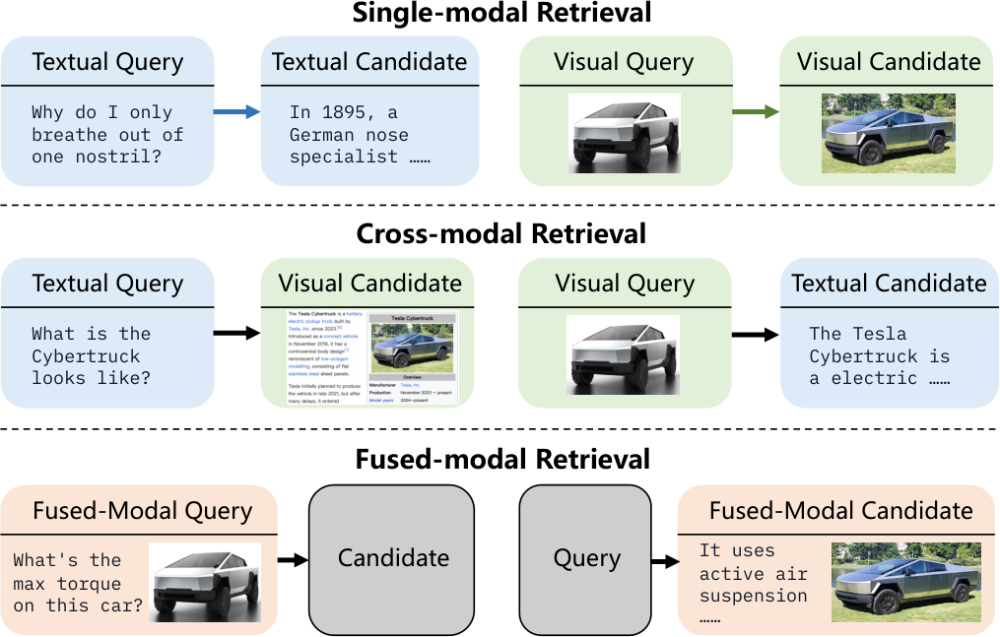

**EN.** Figure 1 : Illustration of different retrieval settings in our universal multimodal retrieval task. Blocks with black borders represent data in arbitrary modalities, i.e . text-only, image-only or fused.

**中.** 图 1：我们的通用多模式检索任务中不同检索设置的图示。带有黑色边框的块代表任意形式的数据，即纯文本、纯图像或融合。

**EN.** Recently, researchers have turned to exploring Multimodal Large Language Models (MLLMs) [ 35 , 65 ] in UMR. For example, it is shown that training MLLMs with text data alone can generate universal multimodal embeddings with respectable retrieval performance [ 22 ] . However, modality-limited training may fail to fully demonstrate the potential of MLLMs in UMR. We believe that incorporating multimodal data composition (as shown in Figure 1 ) could further enhance the model performance and generalization. Moreover, visual documents ( i.e . document screenshots) are increasingly important in UMR tasks, as they not only simplify the pipelines of diverse Retrieval-Augmented Generation (RAG) applications, but also mitigate information loss during modality conversion [ 41 , 12 ] . However, current UMR models primarily target natural images, neglecting support for this scenario (Table 1 ).

**中.** 最近，研究人员转向探索 UMR 中的多模态大语言模型 (MLLM) [35, 65]。例如，研究表明，仅使用文本数据训练 MLLM 可以生成具有可观检索性能的通用多模态嵌入 [22]。然而，模态限制的训练可能无法充分展示 MLLM 在 UMR 中的潜力。我们相信，结合多模态数据组合（如图 1 所示）可以进一步增强模型性能和泛化能力。此外，视觉文档（即文档屏幕截图）在 UMR 任务中变得越来越重要，因为它们不仅简化了各种检索增强生成（RAG）应用程序的流程，而且还减少了模态转换期间的信息丢失[41, 12]。然而，当前的UMR模型主要针对自然图像，忽略了对这种场景的支持（表1）。

| Methods 方法 | Modeling 造型 | Modeling 造型 | Retrieval Setting 检索设置 | Retrieval Setting 检索设置 | Retrieval Setting 检索设置 |
| --- | --- | --- | --- | --- | --- |
| Methods 方法 | Approach 方法 | Training 培训 | S&C | Fused 熔断器 | VD 血管病 |
| UniVL-DR [ 39 ] | CLIP Feat. Fusion 剪辑壮举。融合 | Cross-modal 跨模式 | ✓ | ✗ | ✗ |
| UniIR [ 66 ] | CLIP Score Fusion CLIP 分数融合 | Multimodal 多式联运 | ✓ | ✓ | ✗ |
| UniIR [ 66 ] | BLIP Feat. Fusion BLIP壮举。融合 | Multimodal 多式联运 | ✓ | ✓ | ✗ |
| MARVEL [ 75 ] 漫威 [ 75 ] | Text Enc.+Plugin 文本编码+插件 | Cross-modal 跨模式 | ✓ | ✗ | ✗ |
| VISTA [ 74 ] 远景 [ 74 ] | Text Enc.+Plugin 文本编码+插件 | Multimodal 多式联运 | ✓ | ✓ | ✗ |
| E5-V [ 22 ] | MLLM | Text-only 纯文本 | ✓ | ✓ | ✗ |
| GME (Ours) GME（我们的） | MLLM | Multimodal 多式联运 | ✓ | ✓ | ✓ |

**EN.** Table 1 : Comparison of UMR studies. Feat. and Enc. are abbreviations for “Feature” and “Encoder”. S&C , Fused , and VD denote the retrieval setting of single-modal & cross-modal, fused-modal, and retrieving visual documents ( e.g . PDF screenshots), respectively. The setting explaination is in Figure 1 .

**中.** 表 1：UMR 研究的比较。壮举。和 Enc。是“特征”和“编码器”的缩写。 S&C 、 Fused 和 VD 分别表示单模态和跨模态、融合模态和检索可视文档（例如 PDF 屏幕截图）的检索设置。设置说明如图1。

**EN.** To address the aforementioned challenges, we propose the G eneral M ultimodal E mbedder ( GME ), an instruction-based embedding framework utilizing MLLMs as the backbone. GME enables retrieval across various modalities in the unified paradigm, including text, images, visual documents, and fused-modal [^footnote1] ( i.e . image-text composed) contents. Our framework is underpinned by two key techniques: (1) A strategically optimized training data composition for UMR. We categorize UMR tasks into three types: single-modal, cross-modal, and fused-modal (Figure 1 ). Through extensive experimentation, we analyze how different compositions affect performance (Figure 3 ) and demonstrate that a balanced mixture of all types yields optimal results. (2) An efficient fused-modal data synthesis pipeline. Recognizing the under-representation of fused-modal data and its potential impact on training effectiveness, we develop a streamlined data synthesis pipeline (§ 4.2 ). This approach has successfully generated a comprehensive dataset of 1.1M fused-modal pairs, significantly enhancing our training and model capabilities.

**中.** 为了解决上述挑战，我们提出了通用多模态嵌入器（GME），这是一种利用 MLLM 作为骨干的基于指令的嵌入框架。 GME 能够在统一范式中跨各种模态进行检索，包括文本、图像、视觉文档和融合模态 [^footnote1]（即图像文本组合）内容。我们的框架以两项关键技术为基础：（1）针对 UMR 进行战略优化的训练数据组合。我们将 UMR 任务分为三种类型：单模态、跨模态和融合模态（图 1）。通过广泛的实验，我们分析了不同的成分如何影响性能（图 3），并证明所有类型的平衡混合物可产生最佳结果。 (2) 高效的融合模式数据合成管道。认识到融合模式数据的代表性不足及其对培训效果的潜在影响，我们开发了一个简化的数据合成管道（第 4.2 节）。这种方法成功生成了 110 万个融合模态对的综合数据集，显着增强了我们的训练和模型能力。

**EN.** To evaluate the effectiveness of our framework, we compile a comprehensive UMR B enchmark, namely UMRB . This benchmark encompasses tasks from widely recognized retrieval benchmarks in text [ 55 ] , multimodal [ 66 ] , and visual document retrieval [ 12 ] , as well as our newly processed fused-modal retrieval data. We build our models on top of the strong Qwen2-VL series MLLMs [ 65 ] and train them on our constructed dataset. Experimental results demonstrate that our model achieves state-of-the-art performance on UMRB. Additionally, we perform in-depth analyses on model scaling, training strategies, and ablation of our synthetic data. Our key contributions are:

**中.** 为了评估我们框架的有效性，我们编制了一个全面的 UMR B 基准，即 UMRB 。该基准包含文本[55]、多模态[66]和视觉文档检索[12]中广泛认可的检索基准的任务，以及我们新处理的融合模态检索数据。我们在强大的 Qwen2-VL 系列 MLLM [65] 之上构建模型，并在我们构建的数据集上训练它们。实验结果表明，我们的模型在 UMRB 上实现了最先进的性能。此外，我们还对模型扩展、训练策略和合成数据的消融进行深入分析。我们的主要贡献是：

**EN.** We explore strategies to adapt MLLMs into UMR models, and present GME , a powerful embedding model capable of retrieving candidates across different modalities. GME is the first UMR model to deliver visual document retrieval performance on par with specialized models.

**中.** 我们探索了将 MLLM 适应 UMR 模型的策略，并提出了 GME，这是一种强大的嵌入模型，能够跨不同模式检索候选者。 GME 是第一个提供与专用模型相当的可视化文档检索性能的 UMR 模型。

**EN.** We propose a novel data synthesis pipeline for constructing large-scale, fused-modal training data to encounter the scarcity of such training data. This pipeline is more efficient than previous approaches and can be easily extended to other domains.

**中.** 我们提出了一种新颖的数据合成管道，用于构建大规模的融合模式训练数据，以解决此类训练数据的稀缺问题。该管道比以前的方法更有效，并且可以轻松扩展到其他领域。

**EN.** We compile the UMR benchmark, UMRB , to evaluate a broader range of retrieval tasks compared to existing benchmarks. UMRB categorizes tasks into three types: single-modal, cross-modal, and fused-modal, and offers a comprehensive performance evaluation across them.

**中.** 我们编译了 UMR 基准 UMRB ，以评估与现有基准相比更广泛的检索任务。 UMRB 将任务分为三种类型：单模态、跨模态和融合模态，并提供对它们的全面绩效评估。

## Related Work / 相关工作

#### Multimodal Large Language Models / 多模态大语言模型

**EN.** The emergence of Large Language Models (LLMs) has driven significant progress in natural language processing [ 3 , 49 ] , leading to the development of Multimodal LLMs that extend these capabilities to handle multimodal information. Prominent MLLMs such as GPT-4V [ 48 ] , LLaVa [ 35 , 36 ] , Qwen-VL [ 65 ] , InternVL [ 7 ] and MiniCPM-V [ 71 ] have shown promising advancements in multimodal information understanding and reasoning. Typically, an MLLM consists of an LLM, a vision encoder, and a projector that bridges the two components by transforming raw multimodal inputs into vectors compatible with the LLM [ 72 ] .

**中.** 大型语言模型 (LLM) 的出现推动了自然语言处理领域的重大进步 [3, 49]，从而导致了多模态 LLM 的发展，扩展了这些能力以处理多模态信息。著名的 MLLM，如 GPT-4V [48]、LLaVa [35, 36]、Qwen-VL [65]、InternVL [7] 和 MiniCPM-V [71] 在多模态信息理解和推理方面表现出了有希望的进展。通常，MLLM 由 LLM、视觉编码器和投影仪组成，投影仪通过将原始多模态输入转换为与 LLM 兼容的向量来桥接这两个组件 [72]。

#### Multimodal Retrieval / 多模态检索

**EN.** Early multimodal retrieval tasks focused on single-modal [ 73 ] or cross-modal retrieval [ 61 ] . Recently, the expansion of multimedia applications and multimodal retrieval-augmented generation (RAG) by MLLMs has created a need for unified multimodal retrieval models for complex scenarios. Existing approaches largely utilize pre-trained models such as CLIP [ 51 ] or BLIP [ 29 ] for multimodal embedding. For instance, UniVL-DR [ 39 ] and UniIR [ 66 ] initially encode images and texts separately using CLIP or BLIP encoders, followed by fusion strategies like score fusion to integrate features from both modalities. Additionally, VISTA [ 74 ] and MARVEL [ 75 ] employ pre-trained text embedding models enhanced with visual plugins to encode composite image-text candidates. However, these methods are typically designed for specific tasks like multimodal document retrieval and lack flexibility to handle diverse multimodal retrieval tasks.

**中.** 早期的多模态检索任务集中于单模态[73]或跨模态检索[61]。最近，多媒体应用的扩展和 MLLM 的多模态检索增强生成（RAG）产生了对复杂场景的统一多模态检索模型的需求。现有方法主要利用预先训练的模型，例如 CLIP [51] 或 BLIP [29] 进行多模态嵌入。例如，UniVL-DR [39] 和 UniIR [66] 最初使用 CLIP 或 BLIP 编码器分别对图像和文本进行编码，然后采用得分融合等融合策略来整合两种模态的特征。此外，VISTA [74] 和 MARVEL [75] 采用通过视觉插件增强的预训练文本嵌入模型来编码复合图像文本候选。然而，这些方法通常是针对多模式文档检索等特定任务而设计的，缺乏处理不同多模式检索任务的灵活性。

**EN.** Concurrent with our work, E5-V [ 22 ] and VLM2VEC [ 23 ] propose fine-tuning MLLMs on single-text (NLI [ 14 ] ) or vision-centric relevance data, demonstrating their transferability to multimodal retrieval. In this paper, we are the first to explore the fine-tuning of an MLLM-based universal multimodal retriever that can address both visual retrieval tasks and maintain strong text-to-text retrieval capabilities. Moreover, we are the first to extend a unified retrieval model to handle not only natural image retrieval but also text-rich image retrieval [ 12 ] .

**中.** 与我们的工作同时，E5-V [22] 和 VLM2VEC [23] 提出在单文本（NLI [14]）或以视觉为中心的相关数据上微调 MLLM，证明它们可转移到多模态检索。在本文中，我们首次探索了基于 MLLM 的通用多模态检索器的微调，该检索器可以解决视觉检索任务并保持强大的文本到文本检索功能。此外，我们是第一个扩展统一检索模型的人，不仅可以处理自然图像检索，还可以处理富含文本的图像检索[12]。

#### Embedding Models with Pre-trained Language Models / 使用预先训练的语言模型嵌入模型

**EN.** With the advancement of pre-trained Language Models, research in both pure text and Vision-Language Models has focused on building representation models based on these pre-trained language models. In the text retrieval domain, state-of-the-art text embedding models such as Contriver [ 21 ] , E5 [ 62 ] , GTE [ 31 ] , and BGE [ 68 ] are all built upon pre-trained language models and have demonstrated impressive generalization and robust performance in text retrieval tasks. Recently, leveraging LLMs combined with supervised fine-tuning (SFT), researchers have developed unified text representation models that fully utilize the text understanding capabilities of LLMs, resulting in models with enhanced performance and generalization [ 63 , 31 , 28 ] . These models typically process user text inputs through LLMs, using the hidden states from the final transformer layer—either through pooling or by selecting the last token—as the final representation. Inspired by the success of universal text embedding models based on text LLMs, researchers have begun to explore the construction of unified multimodal retrieval models using MLLMs [ 22 , 23 ] . In this paper, we aim to demonstrate through systematic experiments that constructing a truly universal multimodal retrieval model using MLLMs is feasible.

**中.** 随着预训练语言模型的进步，纯文本和视觉语言模型的研究都集中在基于这些预训练语言模型构建表示模型。在文本检索领域，最先进的文本嵌入模型，如 Contriver [21]、E5 [62]、GTE [31] 和 BGE [68] 都建立在预先训练的语言模型的基础上，并且在文本检索任务中表现出了令人印象深刻的泛化和鲁棒的性能。最近，研究人员利用法学硕士与监督微调（SFT）相结合，开发了统一的文本表示模型，充分利用法学硕士的文本理解能力，从而提高了模型的性能和泛化能力[63,31,28]。这些模型通常通过 LLM 处理用户文本输入，使用最终转换器层的隐藏状态（通过池化或选择最后一个标记）作为最终表示。受到基于文本LLM的通用文本嵌入模型成功的启发，研究人员开始探索使用MLLM构建统一的多模态检索模型[22, 23]。在本文中，我们旨在通过系统实验证明使用 MLLM 构建真正通用的多模态检索模型是可行的。

## Universal Multimodal Retrieval / 通用多模态检索

**EN.** Current UMR sub-tasks can be categorized into three types based on the modalities of the query and the candidate:

**中.** 根据查询和候选的模式，当前的 UMR 子任务可以分为三种类型：

**EN.** Single-Modal Retrieval : Both the query and the candidate belong to the same modality, such as text-to-text (T $\rightarrow$ T) or image-to-image (I $\rightarrow$ I) retrieval scenarios.

**中.** 单模态检索：查询和候选都属于同一模态，例如文本到文本（T $\rightarrow$ T）或图像到图像（I $\rightarrow$ I）检索场景。

**EN.** Cross-Modal Retrieval : The query and the candidate belong to different modalities, typically text-to-image (T $\rightarrow$ I) retrieval. Unlike most prior work that focuses on natural-style image retrieval, we also consider the retrieval of rich-text images (e.g., images converted from scholarly PDFs). We denote this scenario as text-to-visual document (T $\rightarrow$ VD) retrieval.

**中.** 跨模态检索：查询和候选属于不同模态，通常是文本到图像（T $\rightarrow$ I）检索。与大多数关注自然风格图像检索的先前工作不同，我们还考虑了富文本图像的检索（例如，从学术 PDF 转换的图像）。我们将此场景表示为文本到视觉文档 (T $\rightarrow$ VD) 检索。

**EN.** Fused-Modal Retrieval : More complicated retrieval tasks involve mixed modalities in queries, candidates, or both. For example, in EVQA [ 46 ] , both queries and candidates combine text and images.

**中.** 融合模态检索：更复杂的检索任务涉及查询、候选或两者的混合模态。例如，在 EVQA [46] 中，查询和候选都结合了文本和图像。

**EN.** The visualization of these settings refers to Figure 1 .

**中.** 这些设置的可视化请参见图 1。

| Class 班级 | Task 任务 | Datasets 数据集 |
| --- | --- | --- |
| Single- Modal (17) 单模态 (17) | T $\rightarrow$ T (16) | ArguAna [ 59 ] Climate-FEVER [ 11 ] CQADupStack [ 18 ] DBPedia [ 17 ] FEVER [ 56 ] FiQA2018 [ 42 ] HotpotQA [ 70 ] MSMARCO [ 47 ] NFCorpus [ 2 ] NQ [ 26 ] Quora [^footnote2] SCIDOCS [ 8 ] SciFact [ 60 ] Touche2020 [ 1 ] TRECCOVID [ 58 ] WebQA [ 4 ] |
| Single- Modal (17) 单模态 (17) | I $\rightarrow$ I (1) | Nights [ 13 ] 夜晚 [ 13 ] |
| Cross- Modal (18) 跨模式 (18) | T $\rightarrow$ I (4) | VisualNews [ 34 ] Fashion200k [ 16 ] MSCOCO [ 32 ] Flickr30k [ 50 ] |
| Cross- Modal (18) 跨模式 (18) | T $\rightarrow$ VD (10) | TAT-DQA [ 76 ] ArxivQA [ 30 ] DocVQA [ 44 ] InfoVQA [ 45 ] Shift Project † Artificial Intelligence † Government Reports † Healthcare Industry † Energy † TabFQuad † TAT-DQA [ 76 ] ArxivQA [ 30 ] DocVQA [ 44 ] InfoVQA [ 45 ] 转变项目 † 人工智能 † 政府报告 † 医疗保健行业 † 能源 † TabFQuad † |
| Cross- Modal (18) 跨模式 (18) | I $\rightarrow$ T (4) | VisualNews [ 34 ] Fashion200K [ 16 ] MSCOCO [ 32 ] Flickr30k [ 50 ] |
| Fused- Modal (12) 熔融-莫代尔 (12) | T $\rightarrow$ IT (2) | WebQA [ 4 ] EDIS [ 37 ] |
| Fused- Modal (12) 熔融-莫代尔 (12) | IT $\rightarrow$ T (5) | OVEN [ 20 ] INFOSEEK [ 6 ] ReMuQ [ 40 ] OKVQA [ 43 ] LLaVA [ 33 ] 烤箱 [20] INFOSEEK [6] ReMuQ [40] OKVQA [43] LLaVA [33] |
| Fused- Modal (12) 熔融-莫代尔 (12) | IT $\rightarrow$ I (2) | FashionIQ [ 67 ] CIRR [ 38 ] |
| Fused- Modal (12) 熔融-莫代尔 (12) | IT $\rightarrow$ IT (3) | OVEN [ 20 ] EVQA [ 46 ] INFOSEEK [ 6 ] 烤箱 [ 20 ] EVQA [ 46 ] INFOSEEK [ 6 ] |

**EN.** Table 2 : An overview of tasks and datasets in our UMRB. $\dagger$ means that they all originate from [ 12 ] .

**中.** 表 2：我们的 UMRB 中的任务和数据集概述。 $\dagger$表示它们都源自[12]。

### Universal Multimodal Retrieval Benchmark / 通用多模式检索基准

**EN.** Based on the aforementioned classification principles, we introduce a new benchmark to comprehensively assess the performance of UMR models. This benchmark comprises 47 evaluation datasets that cover a broad spectrum of multimodal retrieval tasks, and we name it the Universal Multimodal Retrieval Benchmark (UMRB). These evaluation datasets primarily originate from previously constructed datasets tailored for each sub-scenario or sub-task. Specifically, UMRB includes: (1) The BEIR [ 55 ] benchmark for text-to-text retrieval scenarios; (2) The M-BEIR [ 66 ] dataset for vision-centric retrieval scenarios; (3) Additional fused-modal datasets that not cover by M-BEIR; and (4) text-to-visual document search datasets, such as ViDoRe [ 12 ] , to extend the coverage of our benchmark and ensure a comprehensive evaluation of model universality. A detailed list of the UMRB datasets is presented in Table 2 .

**中.** 基于上述分类原则，我们引入了一个新的基准来综合评估UMR模型的性能。该基准包含 47 个评估数据集，涵盖广泛的多模态检索任务，我们将其命名为通用多模态检索基准 (UMRB)。这些评估数据集主要源自先前为每个子场景或子任务定制的构建数据集。具体来说，UMRB包括：（1）文本到文本检索场景的BEIR[55]基准； （2）用于以视觉为中心的检索场景的M-BEIR[66]数据集； (3) M-BEIR 未涵盖的其他融合模态数据集； （4）文本到视觉文档搜索数据集，例如 ViDoRe [12]，以扩展我们基准的覆盖范围并确保对模型通用性的全面评估。表 2 列出了 UMRB 数据集的详细列表。

**EN.** Given the extensive size of UMRB, to expedite our experimental validation and analysis, we have sampled a subset of datasets from each category, constituting a smaller dataset named UMRB-Partial. This subset retains $39\%$ of the total datasets while maintaining evaluation richness. More detailed statistical information about UMRB-Partial can be found in Appendix Table 6 .

**中.** 鉴于 UMRB 的规模庞大，为了加快我们的实验验证和分析，我们从每个类别中抽取了一个数据集子集，构成了一个名为 UMRB-Partial 的较小数据集。该子集保留了总数据集的 $39\%$，同时保持了评估的丰富性。有关 UMRB-Partial 的更详细统计信息可以在附录表 6 中找到。

## Method / 方法

**EN.** In this section, we present the training framework for developing the General Multimodal Embedder (GME) model. We describe the contrastive learning approach used to train the embedding model. Building on this, we conduct detailed experiments to determine the optimal balance of training data type. Specifically, our experiments demonstrate that diverse data type mixtures significantly enhances the model’s ability to perform retrieval across various modalities. Lastly, recognizing the scarcity of high-quality fused-modal training data, we propose a novel method for automatically synthesizing large-scale, high-quality training data using MLLM.

**中.** 在本节中，我们介绍用于开发通用多模态嵌入器（GME）模型的训练框架。我们描述了用于训练嵌入模型的对比学习方法。在此基础上，我们进行了详细的实验，以确定训练数据类型的最佳平衡。具体来说，我们的实验表明，不同的数据类型混合显着增强了模型跨各种模式执行检索的能力。最后，认识到高质量融合模态训练数据的稀缺性，我们提出了一种使用 MLLM 自动合成大规模高质量训练数据的新方法。

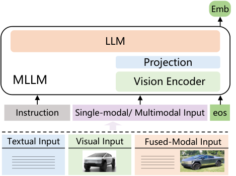

**EN.** Figure 2 : The GME model architecture. Emb denotes the embedding of the input content.

**中.** 图 2：GME 模型架构。 emb表示输入内容的嵌入。

### GME: General Multimodal Embedder / GME：通用多模式包埋机

#### Model Architecture / 模型架构

**EN.** We employ a MLLM as the foundation for GME. This model can accept images, text, or image-text pairs as input. Inspired by previous research on text embedding [ 31 , 63 ] , we use the final hidden state of the last token as the representation (or embedding) for the input. Although pre-trained MLLMs possess strong multimodal understanding capabilities, their original training objectives are not optimized for representation learning. Therefore, task-specific fine-tuning (or alignment) is necessary to enhance the model’s representational capacity. Contrastive learning has been shown to effectively train LLMs and MLLMs to produce retrieval embeddings [ 31 , 22 ] .

**中.** 我们采用 MLLM 作为 GME 的基础。该模型可以接受图像、文本或图像文本对作为输入。受到之前文本嵌入研究的启发 [31, 63]，我们使用最后一个标记的最终隐藏状态作为输入的表示（或嵌入）。尽管预训练的 MLLM 具有强大的多模态理解能力，但其原始训练目标并未针对表示学习进行优化。因此，有必要针对特定​​任务进行微调（或对齐）以增强模型的表征能力。对比学习已被证明可以有效地训练 LLM 和 MLLM 来生成检索嵌入 [31, 22]。

#### Contrastive Learning / 对比学习

**EN.** In our contrastive learning setup, each training instance comprises a query $q$ , a relevant candidate $c$ , and a set of irrelevant candidates $\{c_{1}^{-},c_{2}^{-},\ldots,c_{K}^{-}\}$ . Both $q$ and $c$ can be text, images, or image-text pairs, allowing the model to handle diverse data modalities. To tailor the model to various downstream retrieval tasks, we incorporate an instruction tuning method by including a tailored instructional text $i$ with each retrieval task. For example, for the Visual Question Answering (VQA) task, the instruction could be: “Retrieve a passage that provides an answer to the given query about the image” guiding the model on how to process and interpret the query for specific objectives.

**中.** 在我们的对比学习设置中，每个训练实例包含一个查询 $q$ 、一个相关候选 $c$ 和一组不相关候选 $\{c_{1}^{-},c_{2}^{-},\ldots,c_{K}^{-}\}$ 。 $q$ 和 $c$ 都可以是文本、图像或图像文本对，允许模型处理不同的数据模式。为了使模型适合各种下游检索任务，我们通过在每个检索任务中包含定制的指导文本 $i$ 来结合指令调整方法。例如，对于视觉问答 (VQA) 任务，指令可以是：“检索为给定的图像查询提供答案的段落”，指导模型如何处理和解释特定目标的查询。

**EN.** During training, we input $q$ and instruction $i$ into the model to obtain the query representation $e_{q}$ . Similarly, each candidate $c$ is input into the model to obtain its representation $e_{c}$ . The training objective minimizes the cosine distance between $e_{q}$ and $e_{c}$ for relevant pairs while maximizing the distance between $e_{q}$ and $e_{c^{-}}$ for irrelevant pairs. Cosine similarity is employed to measure the directional alignment between embeddings, effectively capturing semantic similarities irrespective of their magnitudes.

**中.** 在训练过程中，我们将 $q$ 和指令 $i$ 输入到模型中以获得查询表示 $e_{q}$ 。类似地，将每个候选 $c$ 输入到模型中以获得其表示 $e_{c}$ 。训练目标最小化相关对的 $e_{q}$ 和 $e_{c}$ 之间的余弦距离，同时最大化不相关对的 $e_{q}$ 和 $e_{c^{-}}$ 之间的距离。余弦相似度用于测量嵌入之间的方向对齐，有效地捕获语义相似度，无论其大小如何。

**EN.** The optimization process utilizes the InfoNCE loss function [ 57 ] , defined as:

**中.** 优化过程利用 InfoNCE 损失函数 [57]，定义为：

$$
\mathcal{L}=-\log\frac{\exp\left(cos(e_{q},e_{c}^{+})/\tau\right)}{\exp\left(cos(e_{q},e_{c}^{+})/\tau\right)+\sum\limits_{i=1}^{K}\exp\left(cos(e_{q},e_{c_{i}^{-}})/\tau\right)}
$$

**EN.** where $\tau$ is the temperature parameter that scales the cosine similarities to control the distribution’s concentration. This approach ensures that the model effectively learns to distinguish relevant from irrelevant information across different modalities, thereby enhancing its performance in multimodal retrieval tasks.

**中.** 其中 $\tau$ 是缩放余弦相似度以控制分布浓度的温度参数。这种方法确保模型有效地学习区分不同模态的相关信息和不相关信息，从而提高其在多模态检索任务中的性能。

#### Hard Negatives / 难负例

**EN.** The quality and diversity of negative samples are essential for improving contrastive learning [ 53 ] . Inspired by ANCE [ 69 ] , we employ a two-stage training strategy: (1) Initial Training: We first train the model using randomly selected negative candidates, resulting in Model $M_{1}$ . (2) Hard Negative Mining and Continue Training: Using $M_{1}$ , we retrieve the top $K$ candidates for each query and select non-relevant candidates from them as hard negatives. We then use these hard negatives to further train $M_{1}$ , refining it into the final model. This ensures that the model can learn from both easily distinguishable and more challenging examples, thereby enhancing performance.

**中.** 负样本的质量和多样性对于提高对比学习至关重要[53]。受 ANCE [69] 的启发，我们采用两阶段训练策略：（1）初始训练：我们首先使用随机选择的负候选者训练模型，得到模型 $M_{1}$ 。 (2) 难负例挖掘和继续训练：使用 $M_{1}$ ，我们检索每个查询的顶级 $K$ 候选者，并从中选择不相关的候选者作为难负例。然后，我们使用这些难负例进一步训练 $M_{1}$ ，将其细化为最终模型。这确保了模型可以从易于区分和更具挑战性的示例中学习，从而提高性能。

#### Training Data Composition / 训练数据构成

**EN.** A critical factor in multimodal representation learning is the composition of training data. Although previous studies like [ 22 ] have demonstrated that MLLMs can develop multimodal representation capabilities after being fine-tuned on single-modal data, the effect of data diversity on model performance remains unclear. Therefore, we compare the performance of models trained with different data combinations across various retrieval scenarios within our classification principle. Specifically, we used four types of training data: single-modal (including T $\rightarrow$ T and I $\rightarrow$ I), cross-modal (including T $\rightarrow$ VD and T $\rightarrow$ I), fused-modal training data (including IT $\rightarrow$ IT), and a mixed dataset combining the first three types. These different training data types result in a total of six models.

**中.** 多模态表示学习的一个关键因素是训练数据的组成。尽管之前的研究如[22]已经证明MLLM在对单模态数据进行微调后可以开发多模态表示能力，但数据多样性对模型性能的影响仍不清楚。因此，我们在分类原则内比较了在各种检索场景中使用不同数据组合训练的模型的性能。具体来说，我们使用了四种类型的训练数据：单模态（包括 T $\rightarrow$ T 和 I $\rightarrow$ I）、跨模态（包括 T $\rightarrow$ VD 和 T $\rightarrow$ I）、融合模态训练数据（包括 IT $\rightarrow$ IT）以及结合前三种类型的混合数据集。这些不同的训练数据类型总共产生了六个模型。

**EN.** For single-modal data, we utilized the T $\rightarrow$ T dataset from MSMARCO [ 47 ] and the I $\rightarrow$ I dataset from ImageNet [ 10 ] , treating images within the same category as positive matches and those from different categories as negatives. For cross-modal data, we employed T $\rightarrow$ I pairs from the LAION [ 54 ] dataset and T $\rightarrow$ VD pairs from the Docmatix [ 27 ] dataset. For fused-modal data, we use the EVQA [ 46 ] dataset (IT $\rightarrow$ IT). For each subcategory, we randomly sampled 100,000 training instances to train the models independently. For the mixed dataset, we uniformly sampled 20,000 instances from each of the five datasets to train the final model, ensuring fair and reliable comparative experimental results. The performance of these six models on the UMRB-Partial test dataset is presented in Figure 3 .

**中.** 对于单模态数据，我们利用来自 MSMARCO [47] 的 T $\rightarrow$ T 数据集和来自 ImageNet [10] 的 I $\rightarrow$ I 数据集，将同一类别内的图像视为正匹配，将不同类别的图像视为负匹配。对于跨模态数据，我们采用了来自 LAION [54] 数据集的 T $\rightarrow$ I 对和来自 Docmatix [27] 数据集的 T $\rightarrow$ VD 对。对于融合模态数据，我们使用 EVQA [46] 数据集 (IT $\rightarrow$ IT)。对于每个子类别，我们随机采样了 100,000 个训练实例来独立训练模型。对于混合数据集，我们从五个数据集中均匀采样了 20,000 个实例来训练最终模型，确保比较实验结果公平可靠。这六个模型在 UMRB-Partial 测试数据集上的性能如图 3 所示。

**EN.** The results indicate that: (1) Models trained on single data types excel in corresponding retrieval tasks. For instance, models trained on T $\rightarrow$ T data performed best in text retrieval tasks. [^footnote3] (2) A balanced mix of different data types enhanced performance across various settings. This suggests that increasing the diversity of training modalities effectively improves the model’s overall retrieval capabilities.

**中.** 结果表明：（1）在单一数据类型上训练的模型在相应的检索任务中表现出色。例如，在 T $\rightarrow$ T 数据上训练的模型在文本检索任务中表现最佳。 [^footnote3] (2) 不同数据类型的均衡组合增强了各种设置的性能。这表明增加训练方式的多样性可以有效提高模型的整体检索能力。

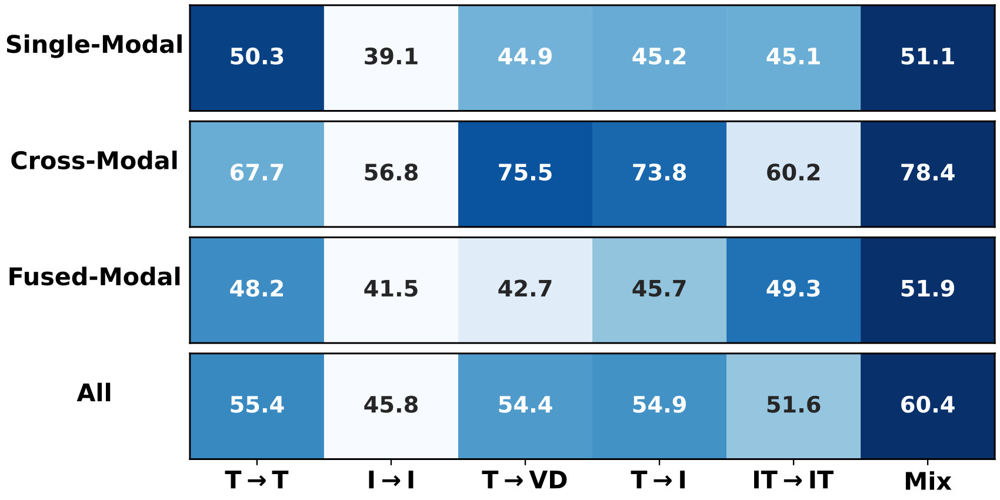

**EN.** Figure 3 : Impact of training data on multimodal retrieval tasks.

**中.** 图 3：训练数据对多模式检索任务的影响。

**EN.** The above analysis highlights the importance of adequately representing each data type in training datasets to develop models that meet the requirements of universal multi-modal retrieval. During data collection, we observed that single-modal and cross-modal data are abundant, with over ten million training instances available. In contrast, fused-modal data remains limited. Common fused-modal training datasets such as EVQA [ 46 ] , INFOSEEK [ 6 ] , and CIRR [ 38 ] collectively contain fewer than one million instances. Additionally, these existing fused-modal datasets cover only a limited range of domains. Thus, efficiently supplementing high-quality fused-modal training data is essential. To address this challenge, we propose leveraging the generative capabilities of LLMs and MLLMs to synthesize additional training data.

**中.** 上述分析强调了充分表示训练数据集中的每种数据类型以开发满足通用多模态检索要求的模型的重要性。在数据收集过程中，我们观察到单模态和跨模态数据非常丰富，可用的训练实例超过千万个。相比之下，融合模式数据仍然有限。常见的融合模态训练数据集（例如 EVQA [46]、INFOSEEK [6] 和 CIRR [38]）总共包含不到一百万个实例。此外，这些现有的融合模式数据集仅涵盖有限的领域。因此，有效补充高质量的融合模态训练数据至关重要。为了应对这一挑战，我们建议利用 LLM 和 MLLM 的生成能力来合成额外的训练数据。

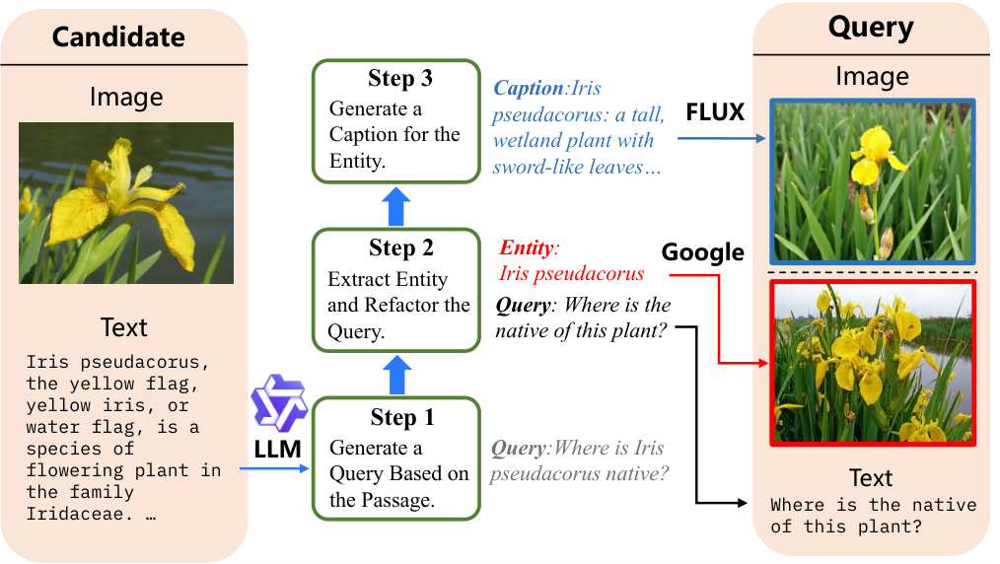

**EN.** Figure 4 : Pipeline for synthesizing fused-modal training data.

**中.** 图 4：合成融合模式训练数据的流程。

### Fused-Modal Data Synthesis / 融合模态数据合成

**EN.** To efficiently synthesize high-quality data while minimizing manual intervention, we adopt a strategy similar to Doc2Query [ 15 ] . However, our approach differs in that we aim to generate fuse-modal candidate-to-query relevance data instead of single-modality, text-based relevance pairs. This requires obtaining high-quality candidates that include both image and text content. We primarily extracted such data from Wikipedia paragraphs [^footnote4] . Additionally, to enhance the domain diversity of the candidate data, we employed a domain classification model [^footnote5] to perform fine-grained classification of Wikipedia data into categories such as animals and plants. We then uniformly sampled from these categories and retained data with classification confidence scores above 0.5. Ultimately, we obtained 313,284 candidate entries, each containing both text and image content.

**中.** 为了有效地合成高质量数据，同时最大限度地减少人工干预，我们采用了类似于 Doc2Query [15] 的策略。然而，我们的方法的不同之处在于，我们的目标是生成融合模态候选查询相关性数据，而不是单模态、基于文本的相关性对。这需要获得包含图像和文本内容的高质量候选内容。我们主要从维基百科段落 [^footnote4] 中提取此类数据。此外，为了增强候选数据的领域多样性，我们采用领域分类模型 [^footnote5] 对维基百科数据进行细粒度分类，分为动物和植物等类别。然后，我们从这些类别中均匀采样，并保留分类置信度得分高于 0.5 的数据。最终，我们获得了 313,284 个候选条目，每个条目都包含文本和图像内容。

**EN.** Based on the prepared data, the overall synthesis pipeline (Figure 4 ) could be divided into the following steps:

**中.** 根据准备好的数据，整个合成流程（图4）可以分为以下步骤：

**EN.** $\bullet$ Doc2Query Generation : The passage content from each candidate is input into an LLM [^footnote6] using a prompt to generate a natural query. To ensure the quality of the generated queries, we built a vector index of all passage contents using a text vector retrieval model [^footnote7] . Each generated query is then used to retrieve the corresponding passage from this collection. If the passage associated with the query is not within the top 20 retrieved items, the query is considered low quality due to low relevance and is discarded. In this step, we discarded 1.2% of the total generated queries. This process allows us to construct T $\rightarrow$ IT training data.

**中.** $\bullet$ Doc2Query 生成：使用提示将每个候选人的段落内容输入到 LLM [^footnote6] 中，以生成自然查询。为了确保生成的查询的质量，我们使用文本向量检索模型 [^footnote7] 构建了所有段落内容的向量索引。然后使用每个生成的查询从该集合中检索相应的段落。如果与查询相关的段落不在检索到的前 20 个项目内，则该查询由于相关性较低而被视为低质量并被丢弃。在此步骤中，我们丢弃了生成的查询总数的 1.2%。此过程使我们能够构建 T $\rightarrow$ IT 培训数据。

**EN.** $\bullet$ Entity Extraction and Query Rewrite : We aim for the synthesized queries to include both texts and images (i.e., IT $\rightarrow$ IT type). To achieve this, we leverage entity extraction followed by image retrieval for the extracted entities and caption generation to supplement the image data on the query side. Specifically, for each generated query $q$ from the first step, we prompt the LLM to extract entities from it with the text passage as reference, and then rewrite the original query into $q^{\prime}$ . For example, the query “Where is Iris pseudacorus native?” is transformed by the model to the rewritten query ”Where is the native habitat of this plant?” with the entity ”Iris pseudacorus” extracted. We then seek images that match this entity and combine them with the rewritten query $q^{\prime}$ to form the final fuse-modal query.

**中.** $\bullet$ 实体提取和查询重写：我们的目标是合成查询包含文本和图像（即 IT $\rightarrow$ IT 类型）。为了实现这一目标，我们利用实体提取，然后对提取的实体进行图像检索，并生成标题来补充查询端的图像数据。具体来说，对于第一步生成的每个查询 $q$ ，我们提示 LLM 以文本段落为参考从中提取实体，然后将原始查询重写为 $q^{\prime}$ 。例如，查询“Iris pseudacorus 原产地在哪里？”被模型转换为重写的查询“这种植物的原生栖息地在哪里？”提取实体“Iris pseudacorus”。然后，我们寻找与该实体匹配的图像，并将它们与重写的查询 $q^{\prime}$ 组合起来，形成最终的融合模式查询。

**EN.** $\bullet$ Image Retrieval and Generation : We explore two methods for obtaining images. The first method uses the Google Image Search API [^footnote8] to retrieve images matching the entity terms, retaining the top five results. The second method involves generating images using a text-to-image model [^footnote9] . Specifically, we first use the LLM to generate a caption suitable for image generation based on the entity and the passage of the generated query, then input this caption into the text-to-image generation model to create the corresponding image. This approach allows us to quickly and efficiently obtain high-quality, diverse images. The synthesized results can also be assembled into IT $\rightarrow$ IT retrieval type data.

**中.** $\bullet$ 图像检索和生成：我们探索两种获取图像的方法。第一种方法使用 Google 图像搜索 API [^footnote8] 检索与实体术语匹配的图像，保留前 5 个结果。第二种方法涉及使用文本到图像模型 [^footnote9] 生成图像。具体来说，我们首先使用LLM根据实体和生成的查询段落生成适合图像生成的标题，然后将该标题输入到文本到图像生成模型中以创建相应的图像。这种方法使我们能够快速有效地获得高质量、多样化的图像。合成结果还可以组装成IT $\rightarrow$ IT检索类型数据。

**EN.** $\bullet$ Data Filtering : To ensure the quality of the synthesized data, we perform filtering [ 9 ] on the final dataset. We observe that images generated by the FLUX model have consistent quality, whereas images retrieved via the Google Image Search API often include noisy data. Therefore, for images obtained through the Google Image Search API, we use the CLIP model [^footnote10] to assess image-caption relevance. Images with a relevance score below $0.2$ were filtered out.

**中.** $\bullet$ 数据过滤：为了确保合成数据的质量，我们对最终数据集进行过滤[9]。我们观察到，由 FLUX 模型生成的图像具有一致的质量，而通过 Google 图像搜索 API 检索的图像通常包含噪声数据。因此，对于通过Google图像搜索API获取的图像，我们使用CLIP模型[^footnote10]来评估图像标题相关性。相关性得分低于 $0.2$ 的图像被过滤掉。

**EN.** Through the synthesis pipeline, we produce 1,135,000 high-quality fuse-modal training data entries (including T $\rightarrow$ IT and IT $\rightarrow$ IT types). After filtering, we retain 1,102,000 entries, resulting in a data loss rate of $2.9\%$ . The entire process consumed 600 A100 GPU hours. Detailed descriptions of all prompts used in the data synthesis pipeline and examples of the synthesized data are provided in the Appendix § 10 .

**中.** 通过合成管道，我们生成了 1,135,000 个高质量的融合模态训练数据条目（包括 T $\rightarrow$ IT 和 IT $\rightarrow$ IT 类型）。过滤后，我们保留了 1,102,000 个条目，导致数据丢失率为 $2.9\%$ 。整个过程消耗了600个A100 GPU小时。附录§ 10 中提供了数据合成管道中使用的所有提示的详细说明以及合成数据的示例。

| UMRB | Size 尺寸 | Single-Modal 单模态 | Single-Modal 单模态 | Cross-Modal 跨模式 | Cross-Modal 跨模式 | Cross-Modal 跨模式 | Fused-Modal 融合模态 | Fused-Modal 融合模态 | Fused-Modal 融合模态 | Fused-Modal 融合模态 | Avg. 平均。 |
| --- | --- | --- | --- | --- | --- | --- | --- | --- | --- | --- | --- |
| Task (#Datasets) 任务（#Datasets） |  | T $\rightarrow$ T (16) | I $\rightarrow$ I (1) | T $\rightarrow$ I (4) | T $\rightarrow$ VD (10) | I $\rightarrow$ T (4) | T $\rightarrow$ IT (2) | IT $\rightarrow$ T (5) | IT $\rightarrow$ I (2) | IT $\rightarrow$ IT (3) | (47) |
| VISTA [ 74 ] 远景 [ 74 ] | 0.2B | 55.15 | 31.98 | 32.88 | 10.12 | 31.23 | 45.81 | 53.32 | 8.97 | 26.26 | 37.32 |
| CLIP-SF [ 66 ] 剪辑-SF [ 66 ] | 0.4B | 39.75 | 31.42 | 59.05 | 24.09 | 62.95 | 66.41 | 53.32 | 34.90 | 55.65 | 43.66 |
| One-Peace [ 64 ] 和平 [ 64 ] | 4B | 43.54 | 31.27 | 61.38 | 42.9 | 65.59 | 42.72 | 28.29 | 6.73 | 23.41 | 42.01 |
| DSE [ 41 ] 经济发展局 [ 41 ] | 4.2B | 48.94 | 27.92 | 40.75 | 78.21 | 52.54 | 49.62 | 35.44 | 8.36 | 40.18 | 50.04 |
| E5-V [ 22 ] | 8.4B | 52.41 | 27.36 | 46.56 | 41.22 | 47.95 | 54.13 | 32.90 | 23.17 | 7.23 | 42.52 |
| GME -Qwen2VL-2B GME-Qwen2VL-2B | 2.2B | 55.93 | 29.86 | 57.36 | 87.84 | 61.93 | 76.47 | 64.58 | 37.02 | 66.47 | 64.45 |
| GME -Qwen2VL-7B GME-Qwen2VL-7B | 8.2B | 58.19 | 31.89 | 61.35 | 89.92 | 65.83 | 80.94 | 66.18 | 42.56 | 73.62 | 67.44 |

**EN.** Table 3 : Results of different models on our benchmark. Following previous works [ 55 , 66 , 12 ] , we present NDCG@10 scores for T $\rightarrow$ T tasks, excluding the WebQA dataset. For T $\rightarrow$ VD tasks, we provide NDCG@5 scores. For the Fashion200K, FashionIQ and OKVQA datasets, we report Recall@10 scores, while for all other datasets, we report Recall@5 scores.

**中.** 表 3：不同模型在我们的基准测试中的结果。继之前的工作[55、66、12]之后，我们给出了 T $\rightarrow$ T 任务的 NDCG@10 分数，不包括 WebQA 数据集。对于 T $\rightarrow$ VD 任务，我们提供 NDCG@5 分数。对于 Fashion200K、FashionIQ 和 OKVQA 数据集，我们报告 Recall@10 分数，而对于所有其他数据集，我们报告 Recall@5 分数。

## Experiments / 实验

### Settings / 设置

#### Training Data / 训练数据

**EN.** Building on the findings from § 4.1 , we train our model using a diverse dataset of 8 million instances spanning various retrieval modalities. For single-modal retrieval tasks, we utilize datasets including MSMARCO [ 47 ] , NQ [ 26 ] , HotpotQA [ 70 ] , TriviaQA [ 24 ] , SQuAD [ 52 ] , FEVER [ 56 ] , and AllNLI for SimCSE [ 14 ] , selecting a total of 1 million entries. From ImageNet [ 10 ] , we extract 1 million image-to-image training instances, designating images within the same class as positive samples and others as negative samples. For cross-modal retrieval tasks, we incorporate 2 million entries from the LAION [ 54 ] , MSCOCO [ 32 ] , and Docmatix [ 27 ] datasets. Additionally, for fused-modal retrieval tasks, we include a total of 2 million instances: $1.1$ million synthesized by us, and the remaining from the M-BEIR [ 66 ] training data.

**中.** 基于第 4.1 节的发现，我们使用涵盖各种检索模式的 800 万个实例的多样化数据集来训练我们的模型。对于单模态检索任务，我们使用包括 MSMARCO [47]、NQ [26]、HotpotQA [70]、TriviaQA [24]、SQuAD [52]、FEVER [56] 和 AllNLI for SimCSE [14] 在内的数据集，总共选择 100 万个条目。从ImageNet [10]中，我们提取了100万个图像到图像的训练实例，将同一类内的图像指定为正样本，将其他图像指定为负样本。对于跨模态检索任务，我们合并了来自 LAION [54]、MSCOCO [32] 和 Docmatix [27] 数据集的 200 万个条目。此外，对于融合模式检索任务，我们总共包含 200 万个实例：我们合成的 $1.1$ 万个，其余来自 M-BEIR [66] 训练数据。

#### Training Configuration / 训练配置

**EN.** We use Qwen2-VL [ 65 ] model series as the backbone for our MLLM, conducting training on models with both 2 billion (2B) and 7 billion (7B) parameters. Our training utilizes Low-Rank Adaptation (LoRA) [ 19 ] with a rank of 8, a learning rate of 1e-4, and a temperature setting of 0.03. To manage the varying number of visual tokens required by Qwen2-VL for different image resolutions and maintain training efficiency, we limit the maximum number of visual tokens per image to 1,024.

**中.** 我们使用 Qwen2-VL [65] 模型系列作为 MLLM 的骨干，对具有 20 亿（2B）和 70 亿（7B）参数的模型进行训练。我们的训练采用低秩适配（LoRA）[19]，等级为 8，学习率为 1e-4，温度设置为 0.03。为了管理 Qwen2-VL 对于不同图像分辨率所需的不同数量的视觉标记并保持训练效率，我们将每个图像的最大视觉标记数量限制为 1,024。

**EN.** For data with images, we set the maximum text length to 1,800 tokens, using a batch size of 128 for the 2B model and 32 for the 7B model. For text-only data, the maximum length was set to 512 tokens, with batch size of 512 for the 2B model and 128 for the 7B model. Each training sample included 8 negative examples. To conserve GPU memory, we employ gradient checkpointing [ 5 ] and train the model using bfloat16 precision. All training was conducted on eight NVIDIA A100 GPUs, each with 80GB of memory.

**中.** 对于带有图像的数据，我们将最大文本长度设置为 1,800 个标记，2B 模型的批量大小为 128，7B 模型的批量大小为 32。对于纯文本数据，最大长度设置为 512 个标记，2B 模型的批量大小为 512，7B 模型的批量大小为 128。每个训练样本包含 8 个负例。为了节省 GPU 内存，我们采用梯度检查点 [5] 并使用 bfloat16 精度训练模型。所有训练均在 8 个 NVIDIA A100 GPU 上进行，每个 GPU 具有 80GB 内存。

#### Baselines / 基线

**EN.** We compare our method against four types of retrieval systems: (1) Previous representative UMR models, for example, VISTA [ 74 ] for text encoder based, and E5-V [ 22 ] for MLLM based; (2) Powerful multimodal representation (embedding) models, i.e . One-Peace [ 64 ] , which supports modalities beyond text and image and hence could also be tested on our UMRB ; (3) Recent visual document retrieval models, namely DSE [ 41 ] ; and (4) the classic cross-modal pipeline, CLIP score-fusion, denoted as CLIP-SF, which provides top-tier cross-modal performance. We exclude comparisons with state-of-the-art text retrieval models as VISTA demonstrates comparable performance levels.

**中.** 我们将我们的方法与四种类型的检索系统进行比较：（1）以前的代表性 UMR 模型，例如基于文本编码器的 VISTA [74]，以及基于 MLLM 的 E5-V [22]； (2) 强大的多模态表示（嵌入）模型，即One-Peace [64]，它支持文本和图像之外的模式，因此也可以在我们的 UMRB 上进行测试； (3)最近的视觉文档检索模型，即DSE[41]； (4)经典的跨模态管道，CLIP分数融合，表示为CLIP-SF，它提供顶级的跨模态性能。我们排除了与最先进的文本检索模型的比较，因为 VISTA 表现出了可比的性能水平。

### Main Results / 主要结果

**EN.** Table 3 presents the evaluation results of the baseline systems alongside our proposed GME . Scores are averaged across each sub-task and categorized by retrieval modality type: single-modal, cross-modal, and fused-modal. Additionally, the overall micro-average score on the UMRB is in the last column. First, focusing on the average scores, our smaller model, i.e . GME-Qwen2-VL-2B , already outperforms the previous state-of-the-art UMR model (VISTA [ 74 ] ). The larger model, i.e . GME-Qwen2-VL-7B , further enhances this performance, demonstrating the effectiveness of our approach in handling UMR tasks.

**中.** 表 3 列出了基线系统以及我们提出的 GME 的评估结果。对每个子任务的分数进行平均，并按检索模态类型进行分类：单模态、跨模态和融合模态。此外，UMRB 的整体微平均分数位于最后一列。首先，关注平均分数，我们的较小模型，即GME-Qwen2-VL-2B 已经优于之前最先进的 UMR 模型（VISTA [74]）。较大的模型，即GME-Qwen2-VL-7B 进一步增强了这种性能，证明了我们的方法在处理 UMR 任务方面的有效性。

**EN.** Second, our models outperform smaller methods such as VISTA (million-level parameters) and One-Peace (4B parameters). The larger MLLM baseline, E5-V [ 22 ] (8B parameters), performs well in text-dominated tasks (e.g., T $\rightarrow$ T) but falls short in other areas. This indicates that training with multimodal data is crucial for achieving superior performance in UMR tasks. Our training data provides a stronger foundation for future advancements.

**中.** 其次，我们的模型优于 VISTA（百万级参数）和 One-Peace（4B 参数）等较小的方法。较大的 MLLM 基线 E5-V [22]（8B 参数）在文本主导的任务中表现良好（例如 T $\rightarrow$ T），但在其他领域表现不佳。这表明多模态数据训练对于在 UMR 任务中实现卓越性能至关重要。我们的培训数据为未来的进步提供了更坚实的基础。

**EN.** Next, the cross-modal pipeline CLIP-SF outperforms UMR models like VISTA, E5-V, and One-Peace. For VISTA and E5-V, the performance gap is likely due to limitations in their text-modality bounds: VISTA is constrained by the text embedding space of its fixed backbone, and E5-V is limited by text-only training. One-Peace’s modality alignment-centered modeling may not be optimized for fused-modal content. In contrast, our models are specifically designed to handle fused-modal data, resulting in significantly better performance compared to the baselines. Although our training data includes several previously constructed fused-modal datasets, the contribution of our generated fused-modal training data will be discussed in § 5.3 .

**中.** 其次，跨模式管道 CLIP-SF 的性能优于 VISTA、E5-V 和 One-Peace 等 UMR 模型。对于 VISTA 和 E5-V，性能差距可能是由于其文本模态边界的限制：VISTA 受到其固定主干的文本嵌入空间的限制，而 E5-V 受到纯文本训练的限制。 One-Peace 的以模态对齐为中心的建模可能未针对融合模态内容进行优化。相比之下，我们的模型是专门为处理融合模态数据而设计的，与基线相比，性能显着提高。尽管我们的训练数据包括几个先前构建的融合模态数据集，但我们生成的融合模态训练数据的贡献将在第 5.3 节中讨论。

**EN.** Finally, we compare with the recent visual document retrieval model DSE [ 41 ] , specialized for the T $\rightarrow$ VD task within the Cross-Modal group, which has approximately 4B parameters. Our models are competitive with or exceed the performance of this task-specific baseline, demonstrating the feasibility and promise of integrating visual document retrieval into a unified retriever framework.

**中.** 最后，我们与最近的视觉文档检索模型 DSE [41] 进行比较，该模型专门用于跨模态组中的 T $\rightarrow$ VD 任务，该模型具有大约 4B 个参数。我们的模型与特定任务基线的性能相媲美或超过，证明了将视觉文档检索集成到统一检索器框架中的可行性和前景。

### Analyses / 分析

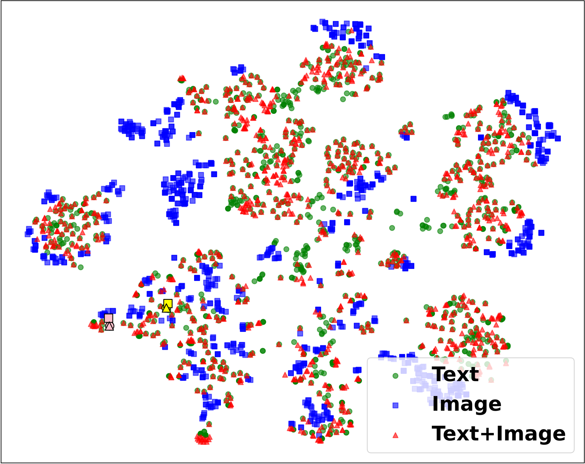

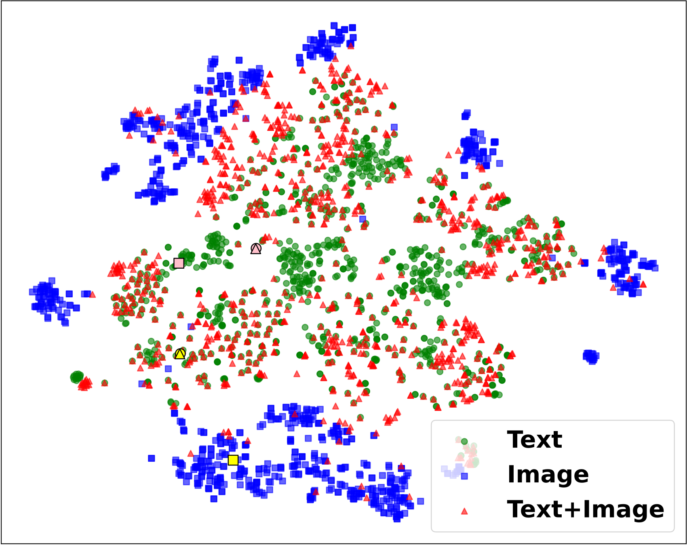

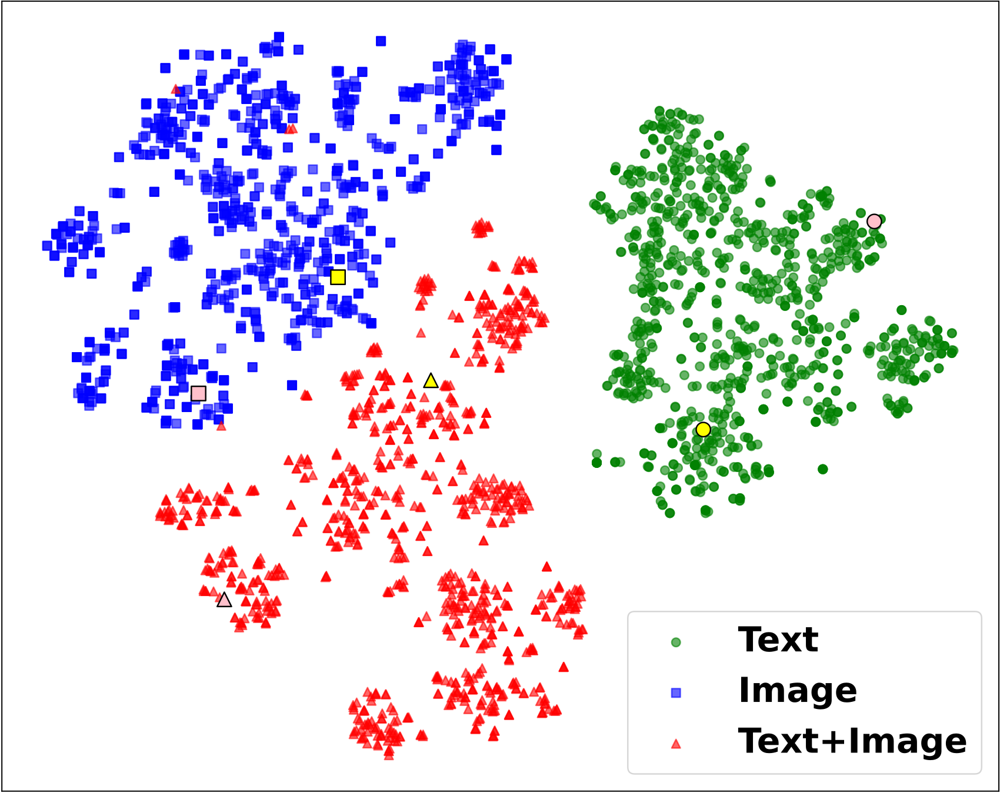

**EN.** Figure 5 : Visualization of the embeddings in a 2D plot by T-SNE. Left: Our GME, Middle: VISTA, Right: CLIP. We use instances from Encyclopedia VQA and highlight two semantic groups with yellow and pink labels, respectively. Please zoom in to view them.

**中.** 图 5：T-SNE 在 2D 绘图中可视化嵌入。左：我们的 GME，中：VISTA，右：CLIP。我们使用百科全书 VQA 中的实例，并分别用黄色和粉色标签突出显示两个语义组。请放大查看它们。

#### Are the Produced Embeddings Modality Universal? / 生成的嵌入模态是否通用？

**EN.** Given our the impressive performance of our model, we assess the quality of its embeddings. Specifically, we investigate whether the embeddings are modality-universal meaning that embeddings representing the same semantic content across different modalities are closely clustered in the embedding space, or if they remain in separate sub-spaces tailored for each modality-specific task. To probe this question, we sample 1000 instances from the EVQA dataset and visualize their embeddings of different modalities by t-SNE, as shown in Figure 5 . We also highlight two semantic close groups with yellow and pink labels, respectively. We can observe that the embeddings from CLIP are distinctly separated by modality, whereas the embeddings from our model are intermingled and organized semantically. Meanwhile, the points from the same semantic group are closely clustered. This demonstrates that our model effectively generates modality-universal representations, enhancing its applicability across various UMR tasks.

**中.** 鉴于我们的模型令人印象深刻的性能，我们评估了其嵌入的质量。具体来说，我们研究嵌入是否是模态通用的，这意味着跨不同模态表示相同语义内容的嵌入紧密地聚集在嵌入空间中，或者它们是否保留在为每个模态特定任务定制的单独子空间中。为了探究这个问题，我们从 EVQA 数据集中采样了 1000 个实例，并通过 t-SNE 可视化它们不同模态的嵌入，如图 5 所示。我们还分别用黄色和粉色标签突出显示两个语义接近的组。我们可以观察到 CLIP 中的嵌入按模态明显分开，而我们模型中的嵌入则在语义上混合和组织。同时，来自同一语义组的点紧密聚集。这表明我们的模型有效地生成了模态通用表示，增强了其在各种 UMR 任务中的适用性。

| Setting 设置 | Single 单人 | Cross 克罗斯 | Fused 熔断器 | Average 平均 |
| --- | --- | --- | --- | --- |
| w/ EVQA 带EVQA | 45.13 | 60.21 | 49.32 | 51.55 |
| w/ Gen ${}_{\text{Flux}}$ 带 ${}_{\text{Flux}}$ 代 | 46.27 | 61.19 | 51.46 | 52.97 |
| w/ Gen ${}_{\text{Google}}$ 带 ${}_{\text{Google}}$ 代 | 47.08 | 61.35 | 52.01 | 53.48 |

**EN.** Table 4 : Results of GME-Qwen2-VL-2B trained with different generated datasets and evaluated on UMRB-Partial.

**中.** 表 4：GME-Qwen2-VL-2B 使用不同生成的数据集进行训练并在 UMRB-Partial 上进行评估的结果。

#### Ablation Study on Synthetic Fused-Modal Data / 合成融合模态数据的消融研究

**EN.** We propose an efficient data synthesis pipeline (§ 4.2 ) and generate large-scale fused-modal pairs to support model training. After witnessing the state-of-the-art performance of our model, it is natural to question the contribution of this synthetic data to the overall performance. To this end, we conduct an ablation study using three parallel training datasets, each comprising 100,000 pairs: original EVQA data, synthetic data with Google-retrieved images (Gen Google ), and synthetic data with FLUX-generated images (Gen Flux ). We train three models with identical parameters on these datasets and evaluate their performance on UMRB-Partial, with results shown in Table 4 . Both synthetic datasets outperform the original EVQA data, indicating the high quality of our synthesized data. Although Google-retrieved images achieved marginally better performance than FLUX-generated images, the difference is minor and acceptable given the potential limitations of the Google Search API for rapid, large-scale dataset generation.

**中.** 我们提出了一种高效的数据合成管道（第 4.2 节）并生成大规模融合模态对以支持模型训练。在目睹了我们模型的最先进性能之后，很自然地会质疑这些合成数据对整体性能的贡献。为此，我们使用三个并行训练数据集进行消融研究，每个训练数据集包含 100,000 对：原始 EVQA 数据、带有 Google 检索图像的合成数据 (Gen Google ) 以及带有 FLUX 生成图像的合成数据 (Gen Flux )。我们在这些数据集上训练具有相同参数的三个模型，并评估它们在 UMRB-Partial 上的性能，结果如表 4 所示。两个合成数据集均优于原始 EVQA 数据，表明我们合成数据的高质量。尽管 Google 检索的图像比 FLUX 生成的图像获得了稍微更好的性能，但考虑到 Google Search API 对于快速、大规模数据集生成的潜在限制，差异很小并且可以接受。

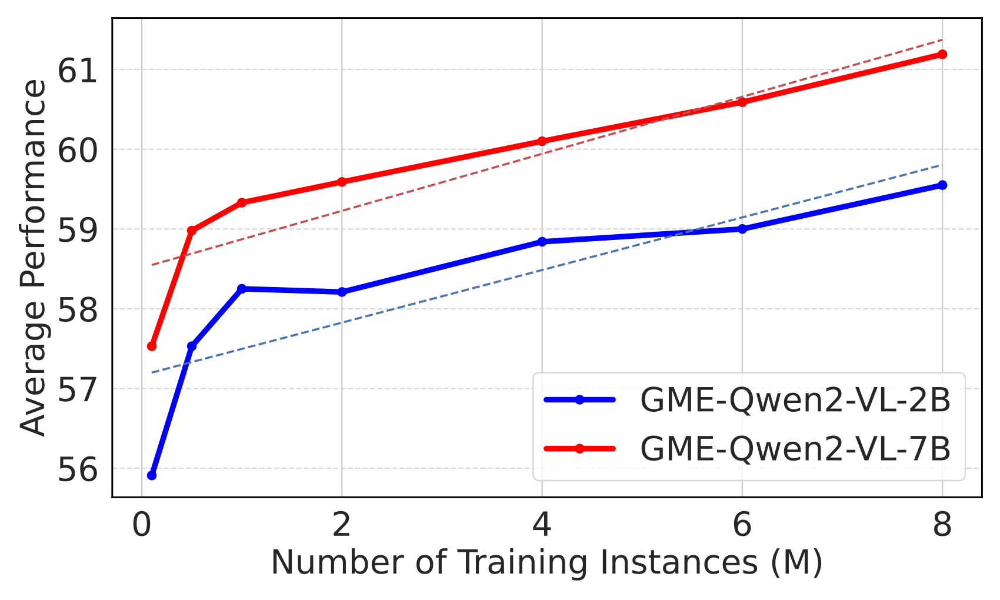

**EN.** Figure 6 : Average Performance of GME-Qwen2-VL-2B (Blue) and GME-Qwen2-VL-7B (Red) on UMRB-Partial, trained with varying numbers of training instances.

**中.** 图 6：GME-Qwen2-VL-2B（蓝色）和 GME-Qwen2-VL-7B（红色）在 UMRB-Partial 上的平均性能，使用不同数量的训练实例进行训练。

#### Training Scaling Law / 训练缩放法则

**EN.** Our approach is primarily data-centric, constructing a diverse training dataset of approximately $8$ million samples across various UMR settings (§ 5.1 ). Training on such a large-scale dataset demands significant computational resources and time. Therefore, we explored the training scaling law by examining how model performance evolves with increasing training steps. Due to the time-consuming nature of evaluating certain retrieval tasks, we assessed performance on our UMRB-Partial dataset for faster evaluation. Figure 6 illustrates the performance progression of our 2B and 7B models on UMRB-Partial during training. Both models exhibit linear performance improvements as training continues, suggesting that extended training could yield further benefits. However, due to time constraints, we halted current training. Future work will investigate longer training periods to enhance model performance further.

**中.** 我们的方法主要以数据为中心，在各种 UMR 设置中构建约 $8$ 百万个样本的多样化训练数据集（第 5.1 节）。对如此大规模的数据集进行训练需要大量的计算资源和时间。因此，我们通过研究模型性能如何随着训练步骤的增加而演变，从而探索训练缩放法则。由于评估某些检索任务非常耗时，我们评估了 UMRB-Partial 数据集的性能，以便更快地进行评估。图 6 说明了我们的 2B 和 7B 模型在训练期间在 UMRB-Partial 上的性能进展。随着训练的继续，这两种模型都表现出线性性能改进，这表明扩展训练可以带来更多好处。但由于时间限制，我们暂停了目前的培训。未来的工作将研究更长的训练周期，以进一步提高模型性能。

#### Ablation Study on Modeling / 建模消融研究

**EN.** We conduct an ablation study to investigate the effectiveness of different design choices of GME . We consider the following three aspects: (1) Fine-tuning strategy. Our final models are trained by LoRA with rank 8. We compare with other rank values and full fine-tuning. The results in the first group of Table 5 show that LoRA with rank 8 yields the best performance. (2) Training data organization. We compare models trained without hard negative mining. The second group of Table 5 demonstrates that the removal of hard negatives led to performance declines, indicating that it is essential for effective retrieval model training. (3) Retrieval instructions. We compare models trained without retrieval instructions. The third group shows that retrieval instructions are crucial for better UMR. (4) Modeling techniques. Our final models are in the casual attention mode and use the EOS token state as the embedding, hence we compare the performance of the model trained with mean pooling and the bi-directional attention mechanism. The last group of Table 5 shows that these alternative settings negatively impact performance.

**中.** 我们进行了一项消融研究，以调查 GME 不同设计选择的有效性。我们考虑以下三个方面：（1）微调策略。我们的最终模型由 LoRA 训练，等级为 8。我们与其他等级值进行比较并进行全面微调。表 5 第一组的结果表明，等级 8 的 LoRA 性能最佳。 (2)训练数据组织。我们比较没有硬负挖掘训练的模型。表5的第二组表明，去除难负例会导致性能下降，这表明它对于有效的检索模型训练至关重要。 (3)检索说明。我们比较在没有检索指令的情况下训练的模型。第三组表明检索指令对于更好的 UMR 至关重要。 (4)建模技术。我们的最终模型处于随意注意力模式，并使用 EOS 代币状态作为嵌入，因此我们比较了使用均值池和双向注意力机制训练的模型的性能。表 5 的最后一组显示这些替代设置会对性能产生负面影响。

| Setting 设置 | Single 单人 | Cross 克罗斯 | Fused 熔断器 | Average 平均 |
| --- | --- | --- | --- | --- |
| Fine-tuning strategy 微调策略 | Fine-tuning strategy 微调策略 | Fine-tuning strategy 微调策略 | Fine-tuning strategy 微调策略 | Fine-tuning strategy 微调策略 |
| LoRA r=8 洛拉r=8 | 48.09 | 78.39 | 51.88 | 59.45 |
| LoRA r=16 洛拉r=16 | 47.86 | 78.63 | 51.42 | 59.30 |
| LoRA r=32 洛拉r=32 | 47.85 | 78.55 | 50.48 | 58.96 |
| LoRA r=64 洛拉 r=64 | 47.65 | 78.61 | 51.09 | 59.11 |
| Full training 全程培训 | 43.16 | 75.79 | 49.28 | 56.07 |
| Training data organization 训练数据组织 | Training data organization 训练数据组织 | Training data organization 训练数据组织 | Training data organization 训练数据组织 | Training data organization 训练数据组织 |
| w/o hard-negative 无硬阴性 | 47.55 | 78.01 | 50.95 | 58.83 |
| Retrieval Setting 检索设置 | Retrieval Setting 检索设置 | Retrieval Setting 检索设置 | Retrieval Setting 检索设置 | Retrieval Setting 检索设置 |
| w/o Instruction 无说明 | 46.82 | 78.10 | 49.09 | 58.00 |
| Model Design 模型设计 | Model Design 模型设计 | Model Design 模型设计 | Model Design 模型设计 | Model Design 模型设计 |
| w/ mean pooling 带平均池化 | 47.86 | 77.95 | 51.33 | 59.04 |
| w/ bi-attention 带双向注意力 | 46.55 | 76.78 | 49.54 | 57.62 |

**EN.** Table 5 : Results of the ablation study on Qwen2-VL-2B. All models are trained using 100,000 instances, consistent with the experimental setup described in Section 4.1 .

**中.** 表5：Qwen2-VL-2B 消融研究的结果。所有模型均使用 100,000 个实例进行训练，与第 4.1 节中描述的实验设置一致。

## Conclusion / 结论

**EN.** In this work, we target the universal multimodal retrieval (UMR) problem. We begin by systematically categorizing current UMR tasks, proposing a comprehensive classification framework. Based on this, we explore ways to further improve MLLM-based UMR models, suggesting the GME model. The GME models are trained using contrastive learning loss on a diverse set of multimodal data settings, while also extending support for visual retrieval. Additionally, to overcome limitations in existing UMR evaluation benchmarks, we compiled a new comprehensive benchmark (i.e., UMRB) by integrating multiple data sources. This benchmark effectively balances existing UMR tasks with the increasingly important text and visual document retrieval tasks, enabling a more thorough assessment of UMR model performance. We evaluate existing UMR models and our proposed GME model on UMRB, finding that our model achieves state-of-the-art performance. We also conducted various analyses to validate the effectiveness of our methods and enhance our understanding of them. Our benchmark, models, and other materials are open-source at [https://hf.co/Alibaba-NLP/gme-Qwen2-VL-7B-Instruct](https://hf.co/Alibaba-NLP/gme-Qwen2-VL-7B-Instruct) .

**中.** 在这项工作中，我们的目标是通用多模态检索（UMR）问题。我们首先对当前的 UMR 任务进行系统分类，提出一个全面的分类框架。在此基础上，我们探索了进一步改进基于MLLM的UMR模型的方法，提出了GME模型。 GME 模型使用一组不同的多模态数据设置上的对比学习损失进行训练，同时还扩展了对视觉检索的支持。此外，为了克服现有 UMR 评估基准的局限性，我们通过整合多个数据源编制了新的综合基准（即 UMRB）。该基准测试有效地平衡了现有的 UMR 任务与日益重要的文本和视觉文档检索任务，从而能够更全面地评估 UMR 模型性能。我们在 UMRB 上评估现有的 UMR 模型和我们提出的 GME 模型，发现我们的模型实现了最先进的性能。我们还进行了各种分析来验证我们方法的有效性并增强我们对它们的理解。我们的基准、模型和其他材料在 [https://hf.co/Alibaba-NLP/gme-Qwen2-VL-7B-Instruct](https://hf.co/Alibaba-NLP/gme-Qwen2-VL-7B-Instruct) 上开源。

## Acknowledgments / 致谢

**EN.** This work receives partial support from the Natural Science Foundation of China (under Grant 624B2048) and Research Grant Council of Hong Kong (PolyU/15209724).

**中.** 这项工作得到了中国自然科学基金委员会（拨款624B2048）和香港研究资助局（PolyU/15209724）的部分支持。

## References / 参考文献

- [1] Alexander Bondarenko, Maik Fröbe, Meriem Beloucif, Lukas Gienapp, Yamen Ajjour, Alexander Panchenko, Chris Biemann, Benno Stein, Henning Wachsmuth, Martin Potthast, and Matthias Hagen. Overview of touché 2020: Argument retrieval - extended abstract. In Experimental IR Meets Multilinguality, Multimodality, and Interaction - CLEF 2020 , pages 384–395. Springer, 2020.

- [2] Vera Boteva, Demian Gholipour Ghalandari, Artem Sokolov, and Stefan Riezler. A full-text learning to rank dataset for medical information retrieval. In Advances in Information Retrieval - 38th European Conference on IR Research, ECIR 2016, Padua, Italy , pages 716–722. Springer, 2016.

- [3] Tom B. Brown, Benjamin Mann, Nick Ryder, Melanie Subbiah, Jared Kaplan, Prafulla Dhariwal, Arvind Neelakantan, Pranav Shyam, Girish Sastry, Amanda Askell, Sandhini Agarwal, Ariel Herbert-Voss, Gretchen Krueger, Tom Henighan, Rewon Child, Aditya Ramesh, Daniel M. Ziegler, Jeffrey Wu, Clemens Winter, Christopher Hesse, Mark Chen, Eric Sigler, Mateusz Litwin, Scott Gray, Benjamin Chess, Jack Clark, Christopher Berner, Sam McCandlish, Alec Radford, Ilya Sutskever, and Dario Amodei. Language models are few-shot learners. In Advances in Neural Information Processing Systems 33: Annual Conference on Neural Information Processing Systems 2020, NeurIPS 2020, December 6-12, 2020, virtual , 2020.

- [4] Yingshan Chang, Guihong Cao, Mridu Narang, Jianfeng Gao, Hisami Suzuki, and Yonatan Bisk. Webqa: Multihop and multimodal QA. In IEEE/CVF Conference on Computer Vision and Pattern Recognition , pages 16474–16483, 2022.

- [5] Tianqi Chen, Bing Xu, Chiyuan Zhang, and Carlos Guestrin. Training deep nets with sublinear memory cost. CoRR , abs/1604.06174, 2016.

- [6] Yang Chen, Hexiang Hu, Yi Luan, Haitian Sun, Soravit Changpinyo, Alan Ritter, and Ming-Wei Chang. Can pre-trained vision and language models answer visual information-seeking questions? In Proceedings of the 2023 Conference on Empirical Methods in Natural Language Processing , pages 14948–14968, Singapore, 2023. Association for Computational Linguistics.

- [7] Zhe Chen, Weiyun Wang, Hao Tian, Shenglong Ye, Zhangwei Gao, Erfei Cui, Wenwen Tong, Kongzhi Hu, Jiapeng Luo, Zheng Ma, et al. How far are we to gpt-4v? closing the gap to commercial multimodal models with open-source suites. Science China Information Sciences , 67(12):220101, 2024.

- [8] Arman Cohan, Sergey Feldman, Iz Beltagy, Doug Downey, and Daniel Weld. SPECTER: Document-level representation learning using citation-informed transformers. In Proceedings of the 58th Annual Meeting of the Association for Computational Linguistics , pages 2270–2282, Online, 2020. Association for Computational Linguistics.

- [9] Zhuyun Dai, Vincent Y. Zhao, Ji Ma, Yi Luan, Jianmo Ni, Jing Lu, Anton Bakalov, Kelvin Guu, Keith B. Hall, and Ming-Wei Chang. Promptagator: Few-shot dense retrieval from 8 examples. In The Eleventh International Conference on Learning Representations, ICLR 2023, Kigali, Rwanda, May 1-5, 2023 . OpenReview.net, 2023.

- [10] Jia Deng, Wei Dong, Richard Socher, Li-Jia Li, Kai Li, and Li Fei-Fei. Imagenet: A large-scale hierarchical image database. In 2009 IEEE Computer Society Conference on Computer Vision and Pattern Recognition, Miami, USA , pages 248–255. IEEE Computer Society, 2009.

- [11] Thomas Diggelmann, Jordan L. Boyd-Graber, Jannis Bulian, Massimiliano Ciaramita, and Markus Leippold. CLIMATE-FEVER: A dataset for verification of real-world climate claims. CoRR , abs/2012.00614, 2020.

- [12] Manuel Faysse, Hugues Sibille, Tony Wu, Bilel Omrani, Gautier Viaud, Céline Hudelot, and Pierre Colombo. Colpali: Efficient document retrieval with vision language models. In The Thirteenth International Conference on Learning Representations , 2025.

- [13] Stephanie Fu, Netanel Yakir Tamir, Shobhita Sundaram, Lucy Chai, Richard Zhang, Tali Dekel, and Phillip Isola. Dreamsim: Learning new dimensions of human visual similarity using synthetic data. In Thirty-seventh Conference on Neural Information Processing Systems , 2023.

- [14] Tianyu Gao, Xingcheng Yao, and Danqi Chen. SimCSE: Simple contrastive learning of sentence embeddings. In Proceedings of the 2021 Conference on Empirical Methods in Natural Language Processing , pages 6894–6910, Online and Punta Cana, Dominican Republic, 2021. Association for Computational Linguistics.

- [15] Mitko Gospodinov, Sean MacAvaney, and Craig Macdonald. Doc2query-: When less is more. In Advances in Information Retrieval - 45th European Conference on Information Retrieval, ECIR 2023 , pages 414–422, Dublin, Ireland, 2023. Springer.

- [16] Xintong Han, Zuxuan Wu, Phoenix X. Huang, Xiao Zhang, Menglong Zhu, Yuan Li, Yang Zhao, and Larry S. Davis. Automatic spatially-aware fashion concept discovery. In IEEE International Conference on Computer Vision, ICCV 2017 , pages 1472–1480, Venice, Italy, 2017. IEEE Computer Society.

- [17] Faegheh Hasibi, Fedor Nikolaev, Chenyan Xiong, Krisztian Balog, Svein Erik Bratsberg, Alexander Kotov, and Jamie Callan. Dbpedia-entity v2: A test collection for entity search. In Proceedings of the 40th International ACM SIGIR Conference on Research and Development in Information Retrieval , page 1265–1268, New York, NY, USA, 2017. Association for Computing Machinery.

- [18] Doris Hoogeveen, Karin M. Verspoor, and Timothy Baldwin. Cqadupstack: A benchmark data set for community question-answering research. In Proceedings of the 20th Australasian Document Computing Symposium , New York, NY, USA, 2015. Association for Computing Machinery.

- [19] Edward J Hu, yelong shen, Phillip Wallis, Zeyuan Allen-Zhu, Yuanzhi Li, Shean Wang, Lu Wang, and Weizhu Chen. LoRA: Low-rank adaptation of large language models. In International Conference on Learning Representations , 2022.

- [20] Hexiang Hu, Yi Luan, Yang Chen, Urvashi Khandelwal, Mandar Joshi, Kenton Lee, Kristina Toutanova, and Ming-Wei Chang. Open-domain visual entity recognition: Towards recognizing millions of wikipedia entities. In IEEE/CVF International Conference on Computer Vision, ICCV 2023 , pages 12031–12041, Paris, France, 2023. IEEE.

- [21] Gautier Izacard, Mathilde Caron, Lucas Hosseini, Sebastian Riedel, Piotr Bojanowski, Armand Joulin, and Edouard Grave. Unsupervised dense information retrieval with contrastive learning. Transactions on Machine Learning Research , 2022.

- [22] Ting Jiang, Minghui Song, Zihan Zhang, Haizhen Huang, Weiwei Deng, Feng Sun, Qi Zhang, Deqing Wang, and Fuzhen Zhuang. E5-V: universal embeddings with multimodal large language models. CoRR , abs/2407.12580, 2024.

- [23] Ziyan Jiang, Rui Meng, Xinyi Yang, Semih Yavuz, Yingbo Zhou, and Wenhu Chen. VLM2vec: Training vision-language models for massive multimodal embedding tasks. In The Thirteenth International Conference on Learning Representations , 2025.

- [24] Mandar Joshi, Eunsol Choi, Daniel Weld, and Luke Zettlemoyer. TriviaQA: A large scale distantly supervised challenge dataset for reading comprehension. In Proceedings of the 55th Annual Meeting of the Association for Computational Linguistics (Volume 1: Long Papers) , pages 1601–1611, Vancouver, Canada, 2017. Association for Computational Linguistics.

- [25] Vladimir Karpukhin, Barlas Oguz, Sewon Min, Patrick Lewis, Ledell Wu, Sergey Edunov, Danqi Chen, and Wen-tau Yih. Dense passage retrieval for open-domain question answering. In Proceedings of the 2020 Conference on Empirical Methods in Natural Language Processing (EMNLP) , pages 6769–6781, Online, 2020. Association for Computational Linguistics.

- [26] Tom Kwiatkowski, Jennimaria Palomaki, Olivia Redfield, Michael Collins, Ankur Parikh, Chris Alberti, Danielle Epstein, Illia Polosukhin, Jacob Devlin, Kenton Lee, Kristina Toutanova, Llion Jones, Matthew Kelcey, Ming-Wei Chang, Andrew M. Dai, Jakob Uszkoreit, Quoc Le, and Slav Petrov. Natural questions: A benchmark for question answering research. Transactions of the Association for Computational Linguistics , 7:452–466, 2019.

- [27] Hugo Laurençon, Andrés Marafioti, Victor Sanh, and Leo Tronchon. Building and better understanding vision-language models: insights and future directions. In Workshop on Responsibly Building the Next Generation of Multimodal Foundational Models , 2024.

- [28] Chankyu Lee, Rajarshi Roy, Mengyao Xu, Jonathan Raiman, Mohammad Shoeybi, Bryan Catanzaro, and Wei Ping. NV-embed: Improved techniques for training LLMs as generalist embedding models. In The Thirteenth International Conference on Learning Representations , 2025.

- [29] Junnan Li, Dongxu Li, Caiming Xiong, and Steven C. H. Hoi. BLIP: bootstrapping language-image pre-training for unified vision-language understanding and generation. In International Conference on Machine Learning, ICML 2022 , pages 12888–12900, Baltimore, Maryland, USA, 2022. PMLR.

- [30] Lei Li, Yuqi Wang, Runxin Xu, Peiyi Wang, Xiachong Feng, Lingpeng Kong, and Qi Liu. Multimodal ArXiv: A dataset for improving scientific comprehension of large vision-language models. In Proceedings of the 62nd Annual Meeting of the Association for Computational Linguistics (Volume 1: Long Papers) , pages 14369–14387, Bangkok, Thailand, 2024. Association for Computational Linguistics.

- [31] Zehan Li, Xin Zhang, Yanzhao Zhang, Dingkun Long, Pengjun Xie, and Meishan Zhang. Towards general text embeddings with multi-stage contrastive learning. CoRR , abs/2308.03281, 2023.

- [32] Tsung-Yi Lin, Michael Maire, Serge J. Belongie, James Hays, Pietro Perona, Deva Ramanan, Piotr Dollár, and C. Lawrence Zitnick. Microsoft COCO: common objects in context. In 13th European Conference on Computer Vision, ECCV 2014 , pages 740–755, Zurich, Switzerland, 2014. Springer.

- [33] Weizhe Lin, Jingbiao Mei, Jinghong Chen, and Bill Byrne. PreFLMR: Scaling up fine-grained late-interaction multi-modal retrievers. In Proceedings of the 62nd Annual Meeting of the Association for Computational Linguistics (Volume 1: Long Papers) , pages 5294–5316, Bangkok, Thailand, 2024. Association for Computational Linguistics.

- [34] Fuxiao Liu, Yinghan Wang, Tianlu Wang, and Vicente Ordonez. Visual news: Benchmark and challenges in news image captioning. In Proceedings of the 2021 Conference on Empirical Methods in Natural Language Processing , pages 6761–6771, Online and Punta Cana, Dominican Republic, 2021a. Association for Computational Linguistics.

- [35] Haotian Liu, Chunyuan Li, Qingyang Wu, and Yong Jae Lee. Visual instruction tuning. In Thirty-seventh Conference on Neural Information Processing Systems , 2023a.

- [36] Haotian Liu, Chunyuan Li, Yuheng Li, Bo Li, Yuanhan Zhang, Sheng Shen, and Yong Jae Lee. Llava-next: Improved reasoning, ocr, and world knowledge, 2024.

- [37] Siqi Liu, Weixi Feng, Tsu-Jui Fu, Wenhu Chen, and William Wang. EDIS: Entity-driven image search over multimodal web content. In Proceedings of the 2023 Conference on Empirical Methods in Natural Language Processing , pages 4877–4894, Singapore, 2023b. Association for Computational Linguistics.

- [38] Zheyuan Liu, Cristian Rodriguez Opazo, Damien Teney, and Stephen Gould. Image retrieval on real-life images with pre-trained vision-and-language models. In 2021 IEEE/CVF International Conference on Computer Vision, ICCV 2021 , pages 2105–2114, Montreal, Canada, 2021b. IEEE.

- [39] Zhenghao Liu, Chenyan Xiong, Yuanhuiyi Lv, Zhiyuan Liu, and Ge Yu. Universal vision-language dense retrieval: Learning a unified representation space for multi-modal retrieval. In The Eleventh International Conference on Learning Representations , 2023c.

- [40] Man Luo, Zhiyuan Fang, Tejas Gokhale, Yezhou Yang, and Chitta Baral. End-to-end knowledge retrieval with multi-modal queries. In Proceedings of the 61st Annual Meeting of the Association for Computational Linguistics (Volume 1: Long Papers) , pages 8573–8589, Toronto, Canada, 2023. Association for Computational Linguistics.

- [41] Xueguang Ma, Sheng-Chieh Lin, Minghan Li, Wenhu Chen, and Jimmy Lin. Unifying multimodal retrieval via document screenshot embedding. In Proceedings of the 2024 Conference on Empirical Methods in Natural Language Processing , pages 6492–6505, Miami, Florida, USA, 2024. Association for Computational Linguistics.

- [42] Macedo Maia, Siegfried Handschuh, André Freitas, Brian Davis, Ross McDermott, Manel Zarrouk, and Alexandra Balahur. Www’18 open challenge: Financial opinion mining and question answering. In Companion of the The Web Conference 2018 on The Web Conference 2018 , pages 1941–1942, Lyon, France, 2018. ACM.

- [43] Kenneth Marino, Mohammad Rastegari, Ali Farhadi, and Roozbeh Mottaghi. OK-VQA: A visual question answering benchmark requiring external knowledge. In IEEE Conference on Computer Vision and Pattern Recognition, CVPR 2019 , pages 3195–3204, Long Beach, CA, USA, 2019. Computer Vision Foundation / IEEE.

- [44] Minesh Mathew, Dimosthenis Karatzas, and C. V. Jawahar. Docvqa: A dataset for VQA on document images. In IEEE Winter Conference on Applications of Computer Vision, WACV 2021 , pages 2199–2208, Waikoloa, HI, USA, 2021. IEEE.

- [45] Minesh Mathew, Viraj Bagal, Rubèn Tito, Dimosthenis Karatzas, Ernest Valveny, and C. V. Jawahar. Infographicvqa. In IEEE/CVF Winter Conference on Applications of Computer Vision, WACV 2022, Waikoloa, HI, USA, January 3-8, 2022 , pages 2582–2591. IEEE, 2022.

- [46] Thomas Mensink, Jasper R. R. Uijlings, Lluís Castrejón, Arushi Goel, Felipe Cadar, Howard Zhou, Fei Sha, André Araújo, and Vittorio Ferrari. Encyclopedic VQA: visual questions about detailed properties of fine-grained categories. In IEEE/CVF International Conference on Computer Vision, ICCV 2023 , pages 3090–3101, Paris, France, 2023. IEEE.

- [47] Tri Nguyen, Mir Rosenberg, Xia Song, Jianfeng Gao, Saurabh Tiwary, Rangan Majumder, and Li Deng. MS MARCO: A human generated machine reading comprehension dataset. In Proceedings of the Workshop on Cognitive Computation: Integrating neural and symbolic approaches 2016 , Barcelona, Spain, 2016. CEUR-WS.org.

- [48] OpenAI. Gpt-4v(ision) system card, 2023a.

- [49] OpenAI. GPT-4 technical report. CoRR , abs/2303.08774, 2023b.

- [50] Bryan A. Plummer, Liwei Wang, Chris M. Cervantes, Juan C. Caicedo, Julia Hockenmaier, and Svetlana Lazebnik. Flickr30k entities: Collecting region-to-phrase correspondences for richer image-to-sentence models. In 2015 IEEE International Conference on Computer Vision, ICCV 2015 , pages 2641–2649, Santiago, Chile, 2015. IEEE Computer Society.

- [51] Alec Radford, Jong Wook Kim, Chris Hallacy, Aditya Ramesh, Gabriel Goh, Sandhini Agarwal, Girish Sastry, Amanda Askell, Pamela Mishkin, Jack Clark, Gretchen Krueger, and Ilya Sutskever. Learning transferable visual models from natural language supervision. In Proceedings of the 38th International Conference on Machine Learning, ICML 2021 , pages 8748–8763. PMLR, 2021.

- [52] Pranav Rajpurkar, Jian Zhang, Konstantin Lopyrev, and Percy Liang. SQuAD: 100,000+ questions for machine comprehension of text. In Proceedings of the 2016 Conference on Empirical Methods in Natural Language Processing , pages 2383–2392, Austin, Texas, 2016. Association for Computational Linguistics.

- [53] Joshua David Robinson, Ching-Yao Chuang, Suvrit Sra, and Stefanie Jegelka. Contrastive learning with hard negative samples. In International Conference on Learning Representations , 2021.

- [54] Christoph Schuhmann, Romain Beaumont, Richard Vencu, Cade W Gordon, Ross Wightman, Mehdi Cherti, Theo Coombes, Aarush Katta, Clayton Mullis, Mitchell Wortsman, Patrick Schramowski, Srivatsa R Kundurthy, Katherine Crowson, Ludwig Schmidt, Robert Kaczmarczyk, and Jenia Jitsev. LAION-5b: An open large-scale dataset for training next generation image-text models. In Thirty-sixth Conference on Neural Information Processing Systems: Datasets and Benchmarks Track , 2022.

- [55] Nandan Thakur, Nils Reimers, Andreas Rücklé, Abhishek Srivastava, and Iryna Gurevych. BEIR: A heterogeneous benchmark for zero-shot evaluation of information retrieval models. In Thirty-fifth Conference on Neural Information Processing Systems Datasets and Benchmarks Track (Round 2) , 2021.

- [56] James Thorne, Andreas Vlachos, Christos Christodoulopoulos, and Arpit Mittal. FEVER: a large-scale dataset for fact extraction and VERification. In Proceedings of the 2018 Conference of the North American Chapter of the Association for Computational Linguistics: Human Language Technologies, Volume 1 (Long Papers) , pages 809–819, New Orleans, Louisiana, 2018. Association for Computational Linguistics.

- [57] Aäron van den Oord, Yazhe Li, and Oriol Vinyals. Representation learning with contrastive predictive coding. CoRR , abs/1807.03748, 2018.

- [58] Ellen Voorhees, Tasmeer Alam, Steven Bedrick, Dina Demner-Fushman, William R. Hersh, Kyle Lo, Kirk Roberts, Ian Soboroff, and Lucy Lu Wang. Trec-covid: constructing a pandemic information retrieval test collection. SIGIR Forum , 54(1), 2021.

- [59] Henning Wachsmuth, Shahbaz Syed, and Benno Stein. Retrieval of the best counterargument without prior topic knowledge. In Proceedings of the 56th Annual Meeting of the Association for Computational Linguistics (Volume 1: Long Papers) , pages 241–251, Melbourne, Australia, 2018. Association for Computational Linguistics.

- [60] David Wadden, Shanchuan Lin, Kyle Lo, Lucy Lu Wang, Madeleine van Zuylen, Arman Cohan, and Hannaneh Hajishirzi. Fact or fiction: Verifying scientific claims. In Proceedings of the 2020 Conference on Empirical Methods in Natural Language Processing (EMNLP) , pages 7534–7550, Online, 2020. Association for Computational Linguistics.

- [61] Kaiye Wang, Qiyue Yin, Wei Wang, Shu Wu, and Liang Wang. A comprehensive survey on cross-modal retrieval. CoRR , abs/1607.06215, 2016.

- [62] Liang Wang, Nan Yang, Xiaolong Huang, Binxing Jiao, Linjun Yang, Daxin Jiang, Rangan Majumder, and Furu Wei. Text embeddings by weakly-supervised contrastive pre-training. CoRR , abs/2212.03533, 2022.

- [63] Liang Wang, Nan Yang, Xiaolong Huang, Linjun Yang, Rangan Majumder, and Furu Wei. Improving text embeddings with large language models. In Proceedings of the 62nd Annual Meeting of the Association for Computational Linguistics (Volume 1: Long Papers) , pages 11897–11916, Bangkok, Thailand, 2024a. Association for Computational Linguistics.

- [64] Peng Wang, Shijie Wang, Junyang Lin, Shuai Bai, Xiaohuan Zhou, Jingren Zhou, Xinggang Wang, and Chang Zhou. ONE-PEACE: exploring one general representation model toward unlimited modalities. CoRR , abs/2305.11172, 2023.

- [65] Peng Wang, Shuai Bai, Sinan Tan, Shijie Wang, Zhihao Fan, Jinze Bai, Keqin Chen, Xuejing Liu, Jialin Wang, Wenbin Ge, Yang Fan, Kai Dang, Mengfei Du, Xuancheng Ren, Rui Men, Dayiheng Liu, Chang Zhou, Jingren Zhou, and Junyang Lin. Qwen2-vl: Enhancing vision-language model’s perception of the world at any resolution. CoRR , abs/2409.12191, 2024b.

- [66] Cong Wei, Yang Chen, Haonan Chen, Hexiang Hu, Ge Zhang, Jie Fu, Alan Ritter, and Wenhu Chen. Uniir: Training and benchmarking universal multimodal information retrievers. In 18th European Conference on Computer Vision , page 387–404, Milan, Italy, 2024. Springer-Verlag.

- [67] Hui Wu, Yupeng Gao, Xiaoxiao Guo, Ziad Al-Halah, Steven Rennie, Kristen Grauman, and Rogério Feris. Fashion IQ: A new dataset towards retrieving images by natural language feedback. In IEEE Conference on Computer Vision and Pattern Recognition, CVPR 2021 , pages 11307–11317. Computer Vision Foundation / IEEE, 2021.

- [68] Shitao Xiao, Zheng Liu, Peitian Zhang, Niklas Muennighoff, Defu Lian, and Jian-Yun Nie. C-pack: Packed resources for general chinese embeddings. In Proceedings of the 47th International ACM SIGIR Conference on Research and Development in Information Retrieval , page 641–649, New York, NY, USA, 2024. Association for Computing Machinery.

- [69] Lee Xiong, Chenyan Xiong, Ye Li, Kwok-Fung Tang, Jialin Liu, Paul N. Bennett, Junaid Ahmed, and Arnold Overwijk. Approximate nearest neighbor negative contrastive learning for dense text retrieval. In 9th International Conference on Learning Representations , 2021.

- [70] Zhilin Yang, Peng Qi, Saizheng Zhang, Yoshua Bengio, William Cohen, Ruslan Salakhutdinov, and Christopher D. Manning. HotpotQA: A dataset for diverse, explainable multi-hop question answering. In Proceedings of the 2018 Conference on Empirical Methods in Natural Language Processing , pages 2369–2380, Brussels, Belgium, 2018. Association for Computational Linguistics.

- [71] Yuan Yao, Tianyu Yu, Ao Zhang, Chongyi Wang, Junbo Cui, Hongji Zhu, Tianchi Cai, Haoyu Li, Weilin Zhao, Zhihui He, Qianyu Chen, Huarong Zhou, Zhensheng Zou, Haoye Zhang, Shengding Hu, Zhi Zheng, Jie Zhou, Jie Cai, Xu Han, Guoyang Zeng, Dahai Li, Zhiyuan Liu, and Maosong Sun. Minicpm-v: A GPT-4V level MLLM on your phone. CoRR , abs/2408.01800, 2024.

- [72] Shukang Yin, Chaoyou Fu, Sirui Zhao, Ke Li, Xing Sun, Tong Xu, and Enhong Chen. A survey on multimodal large language models. National Science Review , 11(12), 2024.

- [73] Wayne Xin Zhao, Jing Liu, Ruiyang Ren, and Ji-Rong Wen. Dense text retrieval based on pretrained language models: A survey. ACM Trans. Inf. Syst. , 42(4):89:1–89:60, 2024.

- [74] Junjie Zhou, Zheng Liu, Shitao Xiao, Bo Zhao, and Yongping Xiong. VISTA: Visualized text embedding for universal multi-modal retrieval. In Proceedings of the 62nd Annual Meeting of the Association for Computational Linguistics (Volume 1: Long Papers) , pages 3185–3200, Bangkok, Thailand, 2024a. Association for Computational Linguistics.

- [75] Tianshuo Zhou, Sen Mei, Xinze Li, Zhenghao Liu, Chenyan Xiong, Zhiyuan Liu, Yu Gu, and Ge Yu. MARVEL: Unlocking the multi-modal capability of dense retrieval via visual module plugin. In Proceedings of the 62nd Annual Meeting of the Association for Computational Linguistics (Volume 1: Long Papers) , pages 14608–14624, Bangkok, Thailand, 2024b. Association for Computational Linguistics.

- [76] Fengbin Zhu, Wenqiang Lei, Fuli Feng, Chao Wang, Haozhou Zhang, and Tat-Seng Chua. Towards complex document understanding by discrete reasoning. In MM ’22: The 30th ACM International Conference on Multimedia, Lisboa, Portugal, October 10 - 14, 2022 , pages 4857–4866. ACM, 2022.

## Appendix / 附录

## UMRB Details / UMRB 详情

| Name 名称 | Type 类型 | Categ. 类别。 | Eval 评估 | Candidates 候选人 | Eval Query 评估查询 | Eval Candidate 评估候选者 | In partial 部分 |
| --- | --- | --- | --- | --- | --- | --- | --- |
|  |  |  | Samples 样品 | Nums 数字 | avg. chars 平均。字符 | avg. chars 平均。字符 |  |
| ArguAna 阿尔古阿纳 | Single-Modal 单模态 | T $\rightarrow$ T | 10,080 | 1,406 | 192.98 | 166.80 | True 真实 |
| Climate-FEVER 气候狂热 | Single-Modal 单模态 | T $\rightarrow$ T | 1,535 | 5,416,593 | 20.13 | 84.76 | False 错误 |
| CQADupStack | Single-Modal 单模态 | T $\rightarrow$ T | 13,145 | 457,199 | 8.59 | 129.09 | False 错误 |
| DBPedia 数据库百科 | Single-Modal 单模态 | T $\rightarrow$ T | 400 | 4,635,922 | 5.39 | 49.68 | False 错误 |
| FEVER 发烧 | Single-Modal 单模态 | T $\rightarrow$ T | 6,666 | 5,416,568 | 8.13 | 84.76 | False 错误 |
| FiQA2018 | Single-Modal 单模态 | T $\rightarrow$ T | 648 | 57,638 | 10.77 | 132.32 | False 错误 |
| HotpotQA 火锅QA | Single-Modal 单模态 | T $\rightarrow$ T | 7,405 | 5,233,329 | 17.61 | 46.30 | False 错误 |
| MSMARCO 玛莎可 | Single-Modal 单模态 | T $\rightarrow$ T | 6,980 | 8,841,823 | 5.96 | 55.98 | False 错误 |
| NFCorpus NFC语料库 | Single-Modal 单模态 | T $\rightarrow$ T | 323 | 3,633 | 3.30 | 232.26 | True 真实 |
| NQ 网Q | Single-Modal 单模态 | T $\rightarrow$ T | 3,452 | 2,681,468 | 9.16 | 78.88 | False 错误 |
| Quora 知乎 | Single-Modal 单模态 | T $\rightarrow$ T | 10,000 | 522,931 | 9.53 | 11.44 | True 真实 |
| SCIDOCS | Single-Modal 单模态 | T $\rightarrow$ T | 1,000 | 25,657 | 9.38 | 176.19 | True 真实 |
| SciFact 科学事实 | Single-Modal 单模态 | T $\rightarrow$ T | 300 | 5,183 | 12.37 | 213.63 | False 错误 |
| Touche2020 触摸2020 | Single-Modal 单模态 | T $\rightarrow$ T | 49 | 382,545 | 6.55 | 292.37 | False 错误 |
| TRECCOVID 特雷克新冠病毒 | Single-Modal 单模态 | T $\rightarrow$ T | 50 | 171,332 | 10.60 | 160.77 | True 真实 |
| WebQA 网络质量保证 | Single-Modal 单模态 | T $\rightarrow$ T | 2,455 | 544,457 | 18.58 | 37.67 | False 错误 |
| Nights 夜晚 | Single-Modal 单模态 | I $\rightarrow$ I | 2,120 | 40,038 | - | - | True 真实 |
| VisualNews 视觉新闻 | Cross-Modal 跨模式 | T $\rightarrow$ I | 19,995 | 542,246 | 18.78 | - | False 错误 |
| Fashion200k 时尚20万 | Cross-Modal 跨模式 | T $\rightarrow$ I | 1,719 | 201,824 | 4.89 | - | False 错误 |
| MSCOCO 莫斯科可可 | Cross-Modal 跨模式 | T $\rightarrow$ I | 24,809 | 5,000 | 10.43 | - | True 真实 |
| Flickr30k | Cross-Modal 跨模式 | T $\rightarrow$ I | 5,000 | 1,000 | 12.33 | - | True 真实 |
| TAT-DQA | Cross-Modal 跨模式 | T $\rightarrow$ VD | 1,646 | 277 | 12.44 | - | False 错误 |
| ArxivQA | Cross-Modal 跨模式 | T $\rightarrow$ VD | 500 | 500 | 17.12 | - | False 错误 |
| DocVQA 文档VQA | Cross-Modal 跨模式 | T $\rightarrow$ VD | 451 | 500 | 8.23 | - | True 真实 |
| InfoVQA 信息质量保证 | Cross-Modal 跨模式 | T $\rightarrow$ VD | 494 | 500 | 11.29 | - | False 错误 |
| Shift Project 轮班项目 | Cross-Modal 跨模式 | T $\rightarrow$ VD | 100 | 1,000 | 16.01 | - | True 真实 |
| Artificial Intelligence 人工智能 | Cross-Modal 跨模式 | T $\rightarrow$ VD | 100 | 968 | 12.3 | - | False 错误 |
| Government Reports 政府报告 | Cross-Modal 跨模式 | T $\rightarrow$ VD | 100 | 972 | 12.62 | - | False 错误 |
| Healthcare Industry 医疗保健行业 | Cross-Modal 跨模式 | T $\rightarrow$ VD | 100 | 965 | 12.56 | - | False 错误 |
| Energy 能源 | Cross-Modal 跨模式 | T $\rightarrow$ VD | 100 | 977 | 13.49 | - | False 错误 |
| TabFQuad TabF四边形 | Cross-Modal 跨模式 | T $\rightarrow$ VD | 280 | 70 | 16.49 | - | False 错误 |
| VisualNews 视觉新闻 | Cross-Modal 跨模式 | I $\rightarrow$ T | 20,000 | 537,568 | - | 18.53 | False 错误 |
| Fashion200k 时尚20万 | Cross-Modal 跨模式 | I $\rightarrow$ T | 4,889 | 61,707 | - | 4.95 | False 错误 |
| MSCOCO 莫斯科可可 | Cross-Modal 跨模式 | I $\rightarrow$ T | 5,000 | 24,809 | - | 10.43 | True 真实 |
| Flickr30k | Cross-Modal 跨模式 | I $\rightarrow$ T | 1,000 | 5,000 | - | 12.33 | True 真实 |
| WebQA 网络质量保证 | Fused-Modal 融合模态 | T $\rightarrow$ IT | 2,511 | 403,196 | 16.43 | 12.83 | False 错误 |
| EDIS 电子数据显示系统 | Fused-Modal 融合模态 | T $\rightarrow$ IT | 3,241 | 1,047,067 | 20.07 | 15.53 | False 错误 |
| OVEN 烤箱 | Fused-Modal 融合模态 | IT $\rightarrow$ T | 50,004 | 676,667 | 6.52 | 82.13 | False 错误 |
| INFOSEEK 信息搜索 | Fused-Modal 融合模态 | IT $\rightarrow$ T | 11,323 | 611,651 | 8.76 | 91.49 | False 错误 |
| ReMuQ 雷穆Q | Fused-Modal 融合模态 | IT $\rightarrow$ T | 3,609 | 138,794 | 13.82 | 34.26 | True 真实 |
| OKVQA 好的VQA | Fused-Modal 融合模态 | IT $\rightarrow$ T | 5,046 | 114,516 | 8.09 | 102.55 | True 真实 |
| LLaVA 拉瓦 | Fused-Modal 融合模态 | IT $\rightarrow$ T | 5,120 | 5,994 | 10.70 | 90.65 | True 真实 |
| FashionIQ 时尚智商 | Fused-Modal 融合模态 | IT $\rightarrow$ I | 6,003 | 74,381 | 11.70 | - | True 真实 |
| CIRR | Fused-Modal 融合模态 | IT $\rightarrow$ I | 4,170 | 21,551 | 11.01 | - | True 真实 |
| OVEN 烤箱 | Fused-Modal 融合模态 | IT $\rightarrow$ IT | 14,741 | 335,135 | 5.91 | 94.76 | True 真实 |
| EVQA 评估质量保证 | Fused-Modal 融合模态 | IT $\rightarrow$ IT | 3,743 | 68,313 | 9.38 | 211.12 | False 错误 |
| INFOSEEK 信息搜索 | Fused-Modal 融合模态 | IT $\rightarrow$ IT | 17,593 | 481,782 | 7.94 | 96.00 | False 错误 |

**EN.** Table 6 : Tasks in UMRB. We counted the number of datasets under each task type and the number of evaluation instances in the dataset, the size of the candidate set, and the average length of the text.

**中.** 表 6：UMRB 中的任务。我们统计了每个任务类型下的数据集数量以及数据集中评估实例的数量、候选集的大小以及文本的平均长度。

**EN.** Table 6 summarizes all UMRB tasks along with their statistics. Table 14 provides examples of different task types. Below is a brief description of each dataset included in the UMRB.

**中.** 表 6 总结了所有 UMRB 任务及其统计数据。表 14 提供了不同任务类型的示例。以下是 UMRB 中包含的每个数据集的简要描述。

### Single-Modal Tasks / 单模态任务

#### WebQA [ 4 ] / 网络质量保证 [4]

**EN.** This dataset is derived from Wikipedia. In the T $\rightarrow$ T setup, both the query and candidate are text. The objective is to find a Wikipedia paragraph that answers the question. We have used 2,455 samples as the test set.

**中.** 该数据集来自维基百科。在 T $\rightarrow$ T 设置中，查询和候选都是文本。目标是找到可以回答问题的维基百科段落。我们使用了 2,455 个样本作为测试集。

#### Nights [ 13 ] / 夜晚 [ 13 ]

**EN.** This dataset contains human judgments on the similarity of various image pairs, where both the query and candidate are images. The task is to identify an image that resembles the provided query image. We included 2,120 samples in our UMRB.

**中.** 该数据集包含人类对各种图像对相似性的判断，其中查询和候选都是图像。任务是识别与所提供的查询图像相似的图像。我们在 UMRB 中包含了 2,120 个样本。

#### ArguAna, ClimateFEVER, CQADupstack, DBPedia, FEVER, FiQA2018, HotpotQA, MSMARCO, NFCorpus, NQ, Quora, SCIDOCS, SciFact, Touche2020 and TRECCOVID / ArguAna、ClimateFEVER、CQADupstack、DBPedia、FEVER、FiQA2018、HotpotQA、MSMARCO、NFCorpus、NQ、Quora、SCIDOCS、SciFact、Touche2020 和 TRECCOVID

**EN.** For these datasets, we use the processed versions from BEIR [ 55 ] .

**中.** 对于这些数据集，我们使用 BEIR [55] 的处理版本。

### Cross-Modal Tasks / 跨模式任务

#### VisualNews [ 34 ] / 视觉新闻 [ 34 ]

**EN.** This dataset focuses on the news domain and consists of pairs of news headlines and associated images. In UMRB, this dataset can be transformed into two tasks: retrieving the corresponding image based on the news headline (T $\rightarrow$ I) and retrieving the corresponding news headline based on the image (I $\rightarrow$ T). We utilized 19,995 and 20,000 samples to construct the test set.

**中.** 该数据集专注于新闻领域，由成对的新闻标题和相关图像组成。在UMRB中，这个数据集可以转化为两个任务：根据新闻标题检索对应的图像（T $\rightarrow$ I）和根据图像检索对应的新闻标题（I $\rightarrow$ T）。我们使用 19,995 和 20,000 个样本来构建测试集。

#### Fashion200k [ 16 ] / 时尚200k [ 16 ]

**EN.** This dataset includes pairs of images and product descriptions. In total, we have 1,719 instances for the task T $\rightarrow$ I and 4,889 instances for the task I $\rightarrow$ T for evaluation.

**中.** 该数据集包括成对的图像和产品描述。总共，我们有 1,719 个任务 T $\rightarrow$ I 实例和 4,889 个任务 I $\rightarrow$ T 实例进行评估。

#### MSCOCO [ 32 ]

**EN.** This dataset is a well-known image caption dataset. Similar to VisualNews, it is converted into two tasks: “I $\rightarrow$ T”, which retrieves the caption given an image and “T $\rightarrow$ I”, which retrieves the image given a caption.

**中.** 该数据集是著名的图像标题数据集。与 VisualNews 类似，它被转换为两个任务：“I $\rightarrow$ T”，它检索给定图像的标题；“T $\rightarrow$ I”，它检索给定标题的图像。

#### Flickr30k [ 50 ]

**EN.** This dataset consists of images paired with detailed textual descriptions. We have a total of 1,000 instances for the I $\rightarrow$ T task and 5,000 instances for the T $\rightarrow$ I task available for evaluation.

**中.** 该数据集由图像和详细的文本描述组成。我们总共有 1,000 个 I $\rightarrow$ T 任务实例和 5,000 个 T $\rightarrow$ I 任务实例可供评估。

#### TAT-DQA, ArxivQA, DocVQA, InfoVQA, Shift Project, Artificial Intelligence, Government Reports, Healthcare Industry, Energy, TabFQuad / TAT-DQA、ArxivQA、DocVQA、InfoVQA、Shift Project、人工智能、政府报告、医疗保健行业、能源、TabFQuad

**EN.** These datasets constitute the retrieval task of T $\rightarrow$ VD. Their queries are standard questions, and the candidates are document screenshots. For these datasets, we used the processed versions from ViDoRe [ 12 ] .

**中.** 这些数据集构成了T $\rightarrow$ VD的检索任务。他们的询问是标准问题，候选人是文档截图。对于这些数据集，我们使用 ViDoRe [12] 的处理版本。

### Fused-Modal Tasks / 融合模态任务

#### WebQA [ 4 ] / 网络质量保证 [4]

**EN.** Similar to WebQA in the Single-Modal setting, this dataset is also derived from Wikipedia, but in the T $\rightarrow$ IT setup, the candidates consist of images and text. The task is to find a Wikipedia paragraph with accompanying text and images to answer a specific question. There are 2,511 samples in the evaluation set.

**中.** 与单模态设置中的 WebQA 类似，该数据集也源自维基百科，但在 T $\rightarrow$ IT 设置中，候选数据由图像和文本组成。任务是找到带有文本和图像的维基百科段落来回答特定问题。评估集中有2,511个样本。

#### EDIS [ 37 ] / 电子数据显示系统 [ 37 ]

**EN.** This dataset involves the cross-modal image search within the news domain. The queries are texts containing entities and events, with candidates consisting of news images and their accompanying headlines. The task requires the model to comprehend both entities and events from the text queries and retrieve the corresponding image and headline.

**中.** 该数据集涉及新闻领域内的跨模态图像搜索。查询是包含实体和事件的文本，候选内容由新闻图像及其随附的标题组成。该任务要求模型理解文本查询中的实体和事件，并检索相应的图像和标题。

#### OVEN [ 20 ] / 烤箱 [ 20 ]

**EN.** The dataset is sourced from Wikipedia, where a query consists of an image and a question related to the image. The candidates are the Wikipedia title along with the first 100 tokens of its summary. If the associated Wikipedia content includes images, it constitutes an IT $\rightarrow$ IT task; otherwise, it forms an IT $\rightarrow$ T task. In the evaluation, we have 14,741 samples for the IT $\rightarrow$ IT task and 50,004 samples for the IT $\rightarrow$ T task.

**中.** 该数据集来自维基百科，其中查询由图像和与图像相关的问题组成。候选者是维基百科标题及其摘要的前 100 个标记。如果关联的维基百科内容包含图像，则构成IT $\rightarrow$ IT任务；否则，形成 IT $\rightarrow$ T 任务。在评估中，我们为 IT $\rightarrow$ IT 任务提供了 14,741 个样本，为 IT $\rightarrow$ T 任务提供了 50,004 个样本。

#### INFOSEEK [ 6 ] / 信息搜索 [ 6 ]

**EN.** This dataset is similar to OVEN, with queries consisting of images alongside text questions. The candidates are Wikipedia snippets of 100 tokens containing the exact answers. This dataset also encompasses two tasks: for the IT $\rightarrow$ IT and IT $\rightarrow$ T tasks, we used 17,593 and 11,323 samples, respectively.

**中.** 该数据集与 OVEN 类似，查询由图像和文本问题组成。候选者是包含确切答案的 100 个标记的维基百科片段。该数据集还包含两个任务：对于 IT $\rightarrow$ IT 和 IT $\rightarrow$ T 任务，我们分别使用了 17,593 个和 11,323 个样本。

#### ReMuQ [ 40 ]

**EN.** The dataset is augmented from the WebQA questions by adding images to create new multimodal queries along with a large text corpus. For evaluation, we used 3,609 instances from this dataset.

**中.** 通过添加图像来创建新的多模式查询以及大型文本语料库，该数据集是根据 WebQA 问题进行扩充的。为了进行评估，我们使用了该数据集中的 3,609 个实例。

#### OKVQA [ 43 ]

**EN.** This dataset includes visual questions that require external knowledge to answer. It is structured as an IT $\rightarrow$ T retrieval task, where queries consist of visual questions containing images and text, with candidates being external knowledge sources that can assist in answering the questions.

**中.** 该数据集包含需要外部知识才能回答的视觉问题。它的结构为 IT $\rightarrow$ T 检索任务，其中查询由包含图像和文本的视觉问题组成，候选者是可以帮助回答问题的外部知识源。

#### LLaVA [ 33 ] / 拉瓦 [ 33 ]

**EN.** This dataset contains high-quality conversations about an image generated by GPT-3.5, involving exchanges between a human and an AI assistant. The queries comprise questions and instructions sent by humans to the AI assistant, which include both images and text, while the candidates are the AI assistant’s replies. We utilized 5,120 samples from this dataset in the UMRB evaluation.

**中.** 该数据集包含有关 GPT-3.5 生成的图像的高质量对话，涉及人类和人工智能助手之间的交流。这些查询包括人类发送给人工智能助手的问题和指令，其中包括图像和文本，而候选者是人工智能助手的答复。我们在 UMRB 评估中使用了该数据集中的 5,120 个样本。

#### FashionIQ [ 67 ] / 时尚智商 [ 67 ]

**EN.** This dataset features images of fashion products along with crowd-sourced descriptions that highlight the differences between these products. Each query consists of an image and a modification sentence that describes changes to the given image, with the retrieval target being the specified image. In the UMRB evaluation, we used 6,003 samples from this dataset.

**中.** 该数据集包含时尚产品的图像以及突出这些产品之间差异的众包描述。每个查询由一张图像和一个描述给定图像变化的修改语句组成，检索目标是指定图像。在 UMRB 评估中，我们使用了该数据集中的 6,003 个样本。

#### CIRR [ 38 ]

**EN.** Similar to FashionIQ, CIRR can also be used for composed image retrieval. It involves pairs of real-life reference and target images in each test case, along with a modification sentence detailing the differences between the two images. For the UMRB evaluation, we utilized 4,170 samples from this dataset.

**中.** 与 FashionIQ 类似，CIRR 也可用于组合图像检索。它涉及每个测试用例中的成对的现实生活参考图像和目标图像，以及详细说明两个图像之间差异的修改语句。对于 UMRB 评估，我们使用了该数据集中的 4,170 个样本。

#### EVQA [ 46 ] / 评估质量保证 [ 46 ]

**EN.** This dataset is akin to INFOSEEK, with the key distinction being that the retrieval target of EVQA is a complete Wikipedia paragraph with a maximum length of several thousand tokens. We used 3,743 samples for evaluation, eliminating multi-hop issues present in the original test set. We selected Wikipedia paragraphs from the original dataset as candidates and supplemented them with images. Images native to each paragraph were included when available; otherwise, the first image from the article was utilized due to its typically representative nature.

**中.** 该数据集类似于 INFOSEEK，主要区别在于 EVQA 的检索目标是完整的维基百科段落，最大长度为数千个标记。我们使用 3,743 个样本进行评估，消除了原始测试集中存在的多跳问题。我们从原始数据集中选择维基百科段落作为候选，并用图像对其进行补充。如果可用，则包含每个段落的原生图像；否则，由于其典型的代表性，因此使用了文章中的第一张图片。

### UMRB-Partial / UMRB-部分

**EN.** The full UMRB dataset consists of 47 subtasks, approximately 200,000 evaluation instances, and 40 million candidates, resulting in a significant overhead when testing the model. During our experiments with the GME-7B model, a full evaluation required approximately 400 A100*80G GPU hours. To facilitate development and verification, we created a smaller benchmark by condensing the complete UMRB, which we refer to as UMRB-Partial . Column 8 of Table 6 indicates whether a dataset is included in UMRB-Partial . Testing the GME-7B model on UMRB-Partial reduced the evaluation time from 400 A100*80G GPU hours to 80 A100*80G GPU hours.

**中.** 完整的 UMRB 数据集由 47 个子任务、大约 200,000 个评估实例和 4000 万个候选者组成，导致测试模型时产生巨大的开销。在我们使用 GME-7B 模型进行实验期间，完整的评估需要大约 400 个 A100*80G GPU 小时。为了便于开发和验证，我们通过压缩完整的 UMRB 创建了一个较小的基准，我们将其称为 UMRB-Partial 。表 6 的第 8 列指示数据集是否包含在 UMRB-Partial 中。在 UMRB-Partial 上测试 GME-7B 模型将评估时间从 400 A100*80G GPU 小时减少到 80 A100*80G GPU 小时。

## Results Details / 结果详情

**EN.** In this section, we present the detailed scores achieved by our GME and the baseline models on various tasks. Additionally, we provide results from other benchmarks, including BEIR, M-BEIR, and ViDoRe.

**中.** 在本节中，我们将介绍 GME 取得的详细分数以及各种任务的基线模型。此外，我们还提供其他基准测试的结果，包括 BEIR、M-BEIR 和 ViDoRe。

| Type 类型 | Task 任务 | Dataset 数据集 | VISTA 维斯塔 | CLIP-SF 夹子SF | One-Peace 一和平 | DSE 经济发展局 | E5-V | GME-2B | GME-7B |
| --- | --- | --- | --- | --- | --- | --- | --- | --- | --- |
| Single- Modal 单模态 | T $\rightarrow$ T | ArguAna 阿尔古阿纳 | 63.61 | 52.45 | 32.93 | 53.46 | 54.28 | 63.18 | 72.11 |
| Single- Modal 单模态 | T $\rightarrow$ T | Climate-FEVER 气候狂热 | 31.17 | 20.00 | 20.27 | 19.79 | 21.64 | 41.08 | 48.36 |
| Single- Modal 单模态 | T $\rightarrow$ T | CQADupStack | 42.35 | 30.61 | 41.32 | 36.51 | 41.69 | 39.06 | 42.16 |
| Single- Modal 单模态 | T $\rightarrow$ T | DBPedia 数据库百科 | 40.77 | 26.37 | 32.43 | 40.75 | 38.78 | 41.00 | 46.30 |
| Single- Modal 单模态 | T $\rightarrow$ T | FEVER 发烧 | 86.29 | 50.58 | 51.91 | 80.12 | 78.99 | 92.06 | 93.81 |
| Single- Modal 单模态 | T $\rightarrow$ T | FiQA2018 | 40.65 | 22.14 | 36.79 | 36.2 | 45.41 | 43.8 | 63.23 |
| Single- Modal 单模态 | T $\rightarrow$ T | HotpotQA 火锅QA | 72.6 | 41.33 | 46.51 | 70.79 | 60.88 | 65.3 | 68.18 |
| Single- Modal 单模态 | T $\rightarrow$ T | MSMARCO 玛莎可 | 41.35 | 22.15 | 36.55 | 37.73 | 41.23 | 40.61 | 42.93 |
| Single- Modal 单模态 | T $\rightarrow$ T | NFCorpus NFC语料库 | 37.39 | 27.05 | 31.6 | 32.82 | 36.97 | 38.84 | 36.95 |
| Single- Modal 单模态 | T $\rightarrow$ T | NQ 网Q | 54.15 | 25.45 | 42.87 | 52.97 | 51.58 | 54.52 | 56.08 |
| Single- Modal 单模态 | T $\rightarrow$ T | Quora 知乎 | 88.90 | 81.63 | 87.46 | 85.84 | 87.6 | 88.12 | 89.67 |
| Single- Modal 单模态 | T $\rightarrow$ T | SCIDOCS | 21.73 | 14.75 | 21.64 | 15.66 | 22.36 | 22.94 | 26.35 |
| Single- Modal 单模态 | T $\rightarrow$ T | SciFact 科学事实 | 74.04 | 55.98 | 64.51 | 68.97 | 72.75 | 74.19 | 82.43 |
| Single- Modal 单模态 | T $\rightarrow$ T | Touche2020 触摸2020 | 25.7 | 17.47 | 16.90 | 14.50 | 21.61 | 26.57 | 22.55 |
| Single- Modal 单模态 | T $\rightarrow$ T | TRECCOVID 特雷克新冠病毒 | 77.90 | 63.61 | 69.28 | 52.98 | 72.85 | 71.73 | 77.49 |
| Single- Modal 单模态 | T $\rightarrow$ T | WebQA 网络质量保证 | 83.80 | 84.44 | 63.67 | 83.95 | 89.94 | 94.34 | 94.34 |
| Single- Modal 单模态 | I $\rightarrow$ I | Nights 夜晚 | 24.43 | 31.42 | 31.27 | 27.36 | 27.92 | 30.61 | 30.57 |
| Cross- Modal 跨模式 | T $\rightarrow$ I | VisualNews 视觉新闻 | 5.77 | 42.80 | 48.95 | 14.12 | 29.46 | 39.20 | 46.27 |
| Cross- Modal 跨模式 | T $\rightarrow$ I | Fashion200k 时尚20万 | 3.08 | 18.38 | 32.34 | 3.08 | 3.78 | 23.50 | 27.64 |
| Cross- Modal 跨模式 | T $\rightarrow$ I | MSCOCO 莫斯科可可 | 47.97 | 80.75 | 71.45 | 74.62 | 52.38 | 76.22 | 79.77 |
| Cross- Modal 跨模式 | T $\rightarrow$ I | Flickr30k | 74.68 | 94.28 | 92.78 | 94.42 | 77.38 | 94.5 | 97.38 |
| Cross- Modal 跨模式 | T $\rightarrow$ VD | TAT-DQA | 2.05 | 5.49 | 14.44 | 49.01 | 9.08 | 57.88 | 64.06 |
| Cross- Modal 跨模式 | T $\rightarrow$ VD | ArxivQA | 10.30 | 24.10 | 43.94 | 78.17 | 41.16 | 81.41 | 82.55 |
| Cross- Modal 跨模式 | T $\rightarrow$ VD | DocVQA 文档VQA | 8.01 | 11.80 | 23.48 | 45.83 | 24.37 | 46.86 | 49.34 |
| Cross- Modal 跨模式 | T $\rightarrow$ VD | InfoVQA 信息质量保证 | 30.02 | 48.78 | 59.97 | 82.06 | 49.5 | 84.97 | 88.79 |
| Cross- Modal 跨模式 | T $\rightarrow$ VD | Shift Project 轮班项目 | 3.26 | 6.06 | 17.02 | 69.84 | 13.16 | 77.94 | 83.5 |
| Cross- Modal 跨模式 | T $\rightarrow$ VD | Artificial Intelligence 人工智能 | 7.34 | 28.64 | 45.41 | 96.88 | 46.18 | 95.75 | 98.02 |
| Cross- Modal 跨模式 | T $\rightarrow$ VD | Government Reports 政府报告 | 6.90 | 34.67 | 55.98 | 92.04 | 53.05 | 92.05 | 94.05 |
| Cross- Modal 跨模式 | T $\rightarrow$ VD | Healthcare Industry 医疗保健行业 | 9.39 | 32.64 | 59.55 | 96.35 | 59.61 | 96.08 | 97.29 |
| Cross- Modal 跨模式 | T $\rightarrow$ VD | Energy 能源 | 11.05 | 27.19 | 53.21 | 92.62 | 56.77 | 89.17 | 93.09 |
| Cross- Modal 跨模式 | T $\rightarrow$ VD | TabFQuad TabF四边形 | 13.08 | 21.53 | 57.05 | 79.29 | 58.22 | 91.79 | 94.92 |
| Cross- Modal 跨模式 | I $\rightarrow$ T | VisualNews 视觉新闻 | 2.79 | 42.67 | 47.27 | 8.74 | 29.54 | 38.21 | 47.16 |
| Cross- Modal 跨模式 | I $\rightarrow$ T | Fashion200k 时尚20万 | 4.72 | 18.10 | 30.89 | 3.91 | 4.62 | 26.61 | 31.05 |
| Cross- Modal 跨模式 | I $\rightarrow$ T | MSCOCO 莫斯科可可 | 48.92 | 91.94 | 85.6 | 82.06 | 86.4 | 85.18 | 85.92 |
| Cross- Modal 跨模式 | I $\rightarrow$ T | Flickr30k | 68.50 | 99.11 | 98.60 | 97.11 | 89.62 | 99.00 | 98.9 |
| Fused- Modal 融合模态 | T $\rightarrow$ IT | WebQA 网络质量保证 | 54.84 | 78.42 | 32.42 | 66.99 | 49.62 | 82.24 | 84.11 |
| Fused- Modal 融合模态 | T $\rightarrow$ IT | EDIS 电子数据显示系统 | 36.78 | 54.09 | 53.01 | 41.26 | 49.62 | 68.10 | 77.40 |
| Fused- Modal 融合模态 | IT $\rightarrow$ T | OVEN 烤箱 | 22.32 | 45.98 | 23.69 | 0.38 | 14.4 | 59.67 | 64.13 |
| Fused- Modal 融合模态 | IT $\rightarrow$ T | INFOSEEK 信息搜索 | 18.53 | 27.58 | 20.05 | 3.06 | 12.69 | 39.22 | 34.67 |
| Fused- Modal 融合模态 | IT $\rightarrow$ T | ReMuQ 雷穆Q | 76.20 | 83.71 | 26.41 | 94.60 | 52.15 | 96.73 | 95.48 |
| Fused- Modal 融合模态 | IT $\rightarrow$ T | OKVQA 好的VQA | 17.14 | 17.44 | 9.67 | 13.28 | 16.71 | 30.08 | 32.61 |
| Fused- Modal 融合模态 | IT $\rightarrow$ T | LLaVA 拉瓦 | 72.81 | 91.91 | 51.64 | 53.18 | 77.48 | 98.93 | 98.18 |
| Fused- Modal 融合模态 | IT $\rightarrow$ I | FashionIQ 时尚智商 | 3.28 | 24.54 | 2.93 | 9.81 | 3.73 | 26.34 | 29.89 |
| Fused- Modal 融合模态 | IT $\rightarrow$ I | CIRR | 14.65 | 45.25 | 10.53 | 36.52 | 13.19 | 47.70 | 51.79 |
| Fused- Modal 融合模态 | IT $\rightarrow$ IT | OVEN 烤箱 | 27.77 | 68.83 | 30.56 | 0.39 | 54.46 | 78.96 | 83.05 |
| Fused- Modal 融合模态 | IT $\rightarrow$ IT | EVQA 评估质量保证 | 28.75 | 40.08 | 16.64 | 15.34 | 26.39 | 77.32 | 79.88 |
| Fused- Modal 融合模态 | IT $\rightarrow$ IT | INFOSEEK 信息搜索 | 22.27 | 49.05 | 23.32 | 5.96 | 39.69 | 41.14 | 31.58 |
| Avg. 平均。 |  |  | 37.32 | 43.66 | 42.01 | 50.04 | 42.52 | 63.42 | 65.87 |

**EN.** Table 7 : The detailed results of the baselines and our GME on UMRB. Following previous works [ 55 , 66 , 12 ] , we present NDCG@10 scores for T $\rightarrow$ T tasks, excluding the WebQA dataset. For T $\rightarrow$ VD tasks, we provide NDCG@5 scores. For the Fashion200K, FashionIQ and OKVQA datasets, we report Recall@10 scores, while for all other datasets, we report Recall@5 scores.

**中.** 表 7：UMRB 上的基线和 GME 的详细结果。继之前的工作[55、66、12]之后，我们给出了 T $\rightarrow$ T 任务的 NDCG@10 分数，不包括 WebQA 数据集。对于 T $\rightarrow$ VD 任务，我们提供 NDCG@5 分数。对于 Fashion200K、FashionIQ 和 OKVQA 数据集，我们报告 Recall@10 分数，而对于所有其他数据集，我们报告 Recall@5 分数。

### Detailed Results on UMRB / UMRB 的详细结果

**EN.** Table 7 presents the detailed evaluation results of the baseline systems alongside our GME on UMRB tasks. First, focusing on the average scores, our smaller model, i.e . GME-Qwen2-VL-2B , already outperforms the previous state-of-the-art UMR model (VISTA). The larger model, i.e . GME-Qwen2-VL-7B , further enhances this performance. In addition, focusing on specific scores on different datasets, our GME achieves state-of-the-art performance on each dataset except the Nights dataset. VISTA and CLIP-SF scored highly on the Nights dataset, likely due to their use of independent image and text encoders for cross-modal retrieval. In the I $\rightarrow$ I task, these models relied solely on the image encoder for encoding without cross-modal alignment, which may explain their superior performance on the Nights dataset.

**中.** 表 7 展示了基线系统以及我们的 GME 在 UMRB 任务上的详细评估结果。首先，关注平均分数，我们的较小模型，即GME-Qwen2-VL-2B 的性能已经优于之前最先进的 UMR 模型 (VISTA)。较大的模型，即GME-Qwen2-VL-7B，进一步增强了这一性能。此外，我们的 GME 专注于不同数据集上的特定分数，在除 Nights 数据集之外的每个数据集上都实现了最先进的性能。 VISTA 和 CLIP-SF 在 Nights 数据集上得分很高，这可能是由于它们使用独立的图像和文本编码器进行跨模态检索。在 I $\rightarrow$ I 任务中，这些模型仅依赖图像编码器进行编码，无需跨模态对齐，这也许可以解释它们在 Nights 数据集上的卓越性能。

| Type 类型 | Task 任务 | Dataset 数据集 | T $\rightarrow$ T | I $\rightarrow$ I | T $\rightarrow$ VD | T $\rightarrow$ I | IT $\rightarrow$ IT | Mix 混合 |
| --- | --- | --- | --- | --- | --- | --- | --- | --- |
| Single- Modal 单模态 | T $\rightarrow$ T | Arguan 阿尔古安 | 56.25 | 43.51 | 56.73 | 33.53 | 53.22 | 56.22 |
| Single- Modal 单模态 | T $\rightarrow$ T | NFCorpus NFC语料库 | 35.23 | 28.89 | 33.23 | 33.18 | 30.48 | 35.76 |
| Single- Modal 单模态 | T $\rightarrow$ T | Quora 知乎 | 87.82 | 74.37 | 86.32 | 86.43 | 85.2 | 87.4 |
| Single- Modal 单模态 | T $\rightarrow$ T | SCIDOCS | 19.07 | 11.82 | 17.51 | 17.2 | 16.93 | 19.88 |
| Single- Modal 单模态 | T $\rightarrow$ T | TRECCOVID 特雷克新冠病毒 | 75.57 | 47.89 | 50.89 | 72.37 | 58.92 | 76.38 |
| Single- Modal 单模态 | I $\rightarrow$ I | Nights 夜晚 | 27.97 | 28.11 | 24.9 | 28.53 | 26.04 | 30.85 |
| Cross- Modal 跨模式 | T $\rightarrow$ I | MSCOCO 莫斯科可可 | 59.7 | 59.41 | 63.67 | 76.91 | 44.97 | 75.3 |
| Cross- Modal 跨模式 | T $\rightarrow$ I | Flickr30k | 83.92 | 65.52 | 87.32 | 93.18 | 74.52 | 93.06 |
| Cross- Modal 跨模式 | T $\rightarrow$ VD | DocVQA 文档VQA | 35.8 | 24.24 | 48.38 | 40.58 | 28.05 | 45.62 |
| Cross- Modal 跨模式 | T $\rightarrow$ VD | Shift Project 轮班项目 | 57.86 | 45.47 | 77.08 | 50.36 | 53.12 | 74.84 |
| Cross- Modal 跨模式 | I $\rightarrow$ T | MSCOCO 莫斯科可可 | 74.72 | 63.82 | 80.46 | 84.64 | 70.48 | 84.24 |
| Cross- Modal 跨模式 | I $\rightarrow$ T | Flickr30k | 94.1 | 82.5 | 96.3 | 97.2 | 90.1 | 97.5 |
| Fused- Modal 融合模态 | IT $\rightarrow$ T | LLaVA 拉瓦 | 92.75 | 89.05 | 86.02 | 89.24 | 88.73 | 95.02 |
| Fused- Modal 融合模态 | IT $\rightarrow$ T | ReMuQ 雷穆Q | 89.61 | 85.47 | 76.45 | 85.12 | 86.73 | 89.75 |
| Fused- Modal 融合模态 | IT $\rightarrow$ T | OKVQA 好的VQA | 24.55 | 16.6 | 15.78 | 16.92 | 18.57 | 20.23 |
| Fused- Modal 融合模态 | IT $\rightarrow$ I | FashionIQ 时尚智商 | 5.53 | 4.2 | 5.43 | 8.86 | 11.08 | 11.89 |
| Fused- Modal 融合模态 | IT $\rightarrow$ I | CIRR | 17.24 | 15.04 | 15.42 | 17.5 | 25.71 | 29.86 |
| Fused- Modal 融合模态 | IT $\rightarrow$ IT | OVEN 烤箱 | 59.81 | 38.42 | 57.31 | 56.69 | 65.08 | 63.04 |
| Avg. 平均。 |  |  | 55.42 | 45.80 | 54.50 | 54.91 | 51.55 | 60.38 |

**EN.** Table 8 : Performance of models trained on different data types on UMRB-partial. We present NDCG@10 scores for T $\rightarrow$ T tasks. For T $\rightarrow$ VD tasks, we provide NDCG@5 scores. For the FashionIQ dataset, we report Recall@10 scores, while for all other datasets, we report Recall@5 scores.

**中.** 表 8：在 UMRB-partial 上针对不同数据类型训练的模型的性能。我们提供 T $\rightarrow$ T 任务的 NDCG@10 分数。对于 T $\rightarrow$ VD 任务，我们提供 NDCG@5 分数。对于 FashionIQ 数据集，我们报告 Recall@10 分数，而对于所有其他数据集，我们报告 Recall@5 分数。

### Detailed Results on UMRB-Partial / UMRB-Partial 的详细结果

**EN.** Figure 3 of main paper illustrates our exploration of the training data, as discussed in Section 4.2, with specific results presented in Table 8 . This table details the scores of our models trained on six data types: T $\rightarrow$ T, I $\rightarrow$ I, T $\rightarrow$ VD, T $\rightarrow$ I, IT $\rightarrow$ IT, and Mix across various tasks. We find that the model trained on mixed data performs the best.

**中.** 主论文的图 3 说明了我们对训练数据的探索，如第 4.2 节所述，具体结果如表 8 所示。该表详细介绍了我们在六种数据类型上训练的模型的得分：T $\rightarrow$ T、I $\rightarrow$ I、T $\rightarrow$ VD、T $\rightarrow$ I、IT $\rightarrow$ IT 和跨各种任务的混合。我们发现在混合数据上训练的模型表现最好。

| BEIR 贝尔 | Avg. 平均。 | Argu- Ana 阿尔古阿纳 | Cli- mate- Fever 气候-发烧 | CQA- Dup- Stack CQA-双栈 | DB- Pedia DB-百科 | Fever 发烧 | FiQA 质量保证协会 | Hotpot- QA 火锅-QA | MS MAR- CO 马可女士 | NF- Corpus NF-语料库 | NQ 网Q | Quora 知乎 | Sci- docs 科学文档 | Sci- fact 科学事实 | Touche- 2020 触摸 - 2020 | Trec- Covid 特雷克-科维德 |  |
| --- | --- | --- | --- | --- | --- | --- | --- | --- | --- | --- | --- | --- | --- | --- | --- | --- | --- |
| Text Embedder 文本嵌入器 | Text Embedder 文本嵌入器 | Text Embedder 文本嵌入器 | Text Embedder 文本嵌入器 | Text Embedder 文本嵌入器 | Text Embedder 文本嵌入器 | Text Embedder 文本嵌入器 | Text Embedder 文本嵌入器 | Text Embedder 文本嵌入器 | Text Embedder 文本嵌入器 | Text Embedder 文本嵌入器 | Text Embedder 文本嵌入器 | Text Embedder 文本嵌入器 | Text Embedder 文本嵌入器 | Text Embedder 文本嵌入器 | Text Embedder 文本嵌入器 | Text Embedder 文本嵌入器 | Text Embedder 文本嵌入器 |
| gte-Qwen2-7B-instruct gte-Qwen2-7B-指令 | 60.25 | 64.27 | 45.88 | 46.43 | 52.42 | 95.11 | 62.03 | 73.08 | 45.98 | 40.6 | 67 | 90.09 | 28.91 | 79.06 | 30.57 | 82.26 |  |
| NV-Embed-v1 NV-嵌入-v1 | 59.36 | 68.2 | 34.72 | 50.51 | 48.29 | 87.77 | 63.1 | 79.92 | 46.49 | 38.04 | 71.22 | 89.21 | 20.19 | 78.43 | 28.38 | 85.88 |  |
| gte-Qwen2-1.5B-instruct gte-Qwen2-1.5B-指令 | 58.29 | 69.72 | 42.91 | 44.76 | 48.69 | 91.57 | 54.7 | 68.95 | 43.36 | 39.34 | 64 | 89.64 | 24.98 | 78.44 | 27.89 | 85.38 |  |
| voyage-large-2-instruct 航次大 2 指令 | 58.28 | 64.06 | 32.65 | 46.6 | 46.03 | 91.47 | 59.76 | 70.86 | 40.6 | 40.32 | 65.92 | 87.4 | 24.32 | 79.99 | 39.16 | 85.07 |  |
| neural-embedding-v1 神经嵌入-v1 | 58.12 | 67.21 | 32.3 | 49.11 | 48.05 | 89.46 | 58.94 | 78.87 | 42 | 42.6 | 68.36 | 89.02 | 27.69 | 78.82 | 24.06 | 75.33 |  |
| GritLM-7B 砂砾LM-7B | 57.41 | 63.24 | 30.91 | 49.42 | 46.6 | 82.74 | 59.95 | 79.4 | 41.96 | 40.89 | 70.3 | 89.47 | 24.41 | 79.17 | 27.93 | 74.8 |  |
| e5-mistral-7b-instruct e5-米斯特拉尔-7b-指令 | 56.89 | 61.88 | 38.35 | 42.97 | 48.89 | 87.84 | 56.59 | 75.72 | 43.06 | 38.62 | 63.53 | 89.61 | 16.3 | 76.41 | 26.39 | 87.25 |  |
| google-gecko 谷歌壁虎 | 55.7 | 62.18 | 33.21 | 48.89 | 47.12 | 86.96 | 59.24 | 71.33 | 32.58 | 40.33 | 61.28 | 88.18 | 20.34 | 75.42 | 25.86 | 82.62 |  |
| text-embedding-3-large 文本嵌入 3-large | 55.44 | 58.05 | 30.27 | 47.54 | 44.76 | 87.94 | 55 | 71.58 | 40.24 | 42.07 | 61.27 | 89.05 | 23.11 | 77.77 | 23.35 | 79.56 |  |
| gte-en-large-v1.5 | 57.91 | 72.11 | 48.36 | 42.16 | 46.3 | 93.81 | 63.23 | 68.18 | 42.93 | 36.95 | 56.08 | 89.67 | 26.35 | 82.43 | 22.55 | 77.49 |  |
| gte-en-base-v1.5 | 54.09 | 63.49 | 40.36 | 39.52 | 39.9 | 94.81 | 48.65 | 67.75 | 42.62 | 35.88 | 52.96 | 88.42 | 21.92 | 76.77 | 25.22 | 73.13 |  |
| Multimodal Embedder 多模式包埋机 | Multimodal Embedder 多模式包埋机 | Multimodal Embedder 多模式包埋机 | Multimodal Embedder 多模式包埋机 | Multimodal Embedder 多模式包埋机 | Multimodal Embedder 多模式包埋机 | Multimodal Embedder 多模式包埋机 | Multimodal Embedder 多模式包埋机 | Multimodal Embedder 多模式包埋机 | Multimodal Embedder 多模式包埋机 | Multimodal Embedder 多模式包埋机 | Multimodal Embedder 多模式包埋机 | Multimodal Embedder 多模式包埋机 | Multimodal Embedder 多模式包埋机 | Multimodal Embedder 多模式包埋机 | Multimodal Embedder 多模式包埋机 | Multimodal Embedder 多模式包埋机 | Multimodal Embedder 多模式包埋机 |
| VISTA 维斯塔 | 53.24 | 63.61 | 31.17 | 42.35 | 40.77 | 86.29 | 40.65 | 72.6 | 41.35 | 37.39 | 54.15 | 88.9 | 21.73 | 74.04 | 25.7 | 77.9 |  |
| CLIP-SF 夹子SF | 36.77 | 52.45 | 20 | 30.61 | 26.37 | 50.58 | 22.14 | 41.33 | 22.15 | 27.05 | 25.45 | 81.63 | 14.75 | 55.98 | 17.47 | 63.60 |  |
| One-Peace 一和平 | 42.19 | 32.93 | 20.27 | 41.32 | 32.43 | 51.91 | 36.79 | 46.51 | 36.55 | 31.6 | 42.87 | 87.46 | 21.64 | 64.51 | 16.9 | 69.28 |  |
| DSE 经济发展局 | 46.60 | 53.46 | 19.79 | 36.51 | 40.75 | 80.12 | 36.2 | 70.79 | 37.73 | 32.82 | 52.97 | 85.84 | 15.66 | 68.97 | 14.50 | 52.98 |  |
| E5-V | 49.91 | 54.28 | 21.64 | 41.69 | 38.78 | 78.99 | 45.41 | 60.88 | 41.23 | 36.97 | 51.58 | 87.6 | 22.36 | 72.75 | 21.61 | 72.85 |  |
| GME-Qwen2-VL-2B | 53.31 | 61.52 | 42.3 | 38.13 | 46.31 | 92.6 | 45.3 | 72.93 | 40.88 | 37.2 | 60.01 | 87.24 | 23.17 | 63.82 | 29.06 | 59.24 |  |
| GME-Qwen2-VL-7B | 55.68 | 64.60 | 45.38 | 41.66 | 50.78 | 94.27 | 57.14 | 79.21 | 42.38 | 38.40 | 67.74 | 88.05 | 27.38 | 62.31 | 23.26 | 52.6 |  |

**EN.** Table 9 : BEIR benchmark [ 55 ] nDCG@10 scores. We include top models from MTEB Retrieval English leaderboard.

**中.** 表 9：BEIR 基准 [55] nDCG@10 分数。我们收录了 MTEB 检索英语排行榜的顶级模特。

### Detailed Results on BEIR / BEIR 的详细结果

**EN.** BEIR is a heterogeneous benchmark containing diverse text IR tasks. We utilize BEIR to compare the performance of our GME with other text embedders on T $\rightarrow$ T tasks. Table 9 presents the detailed evaluation nDCG@10 scores for pure text embedders and multimodal embedders on T $\rightarrow$ T tasks. Except for our GME, other multimodal embedders do not match the performance of pure text embedders on text retrieval tasks, including those like E5-V that are fine-tuned exclusively on text data.

**中.** BEIR 是一个包含多种文本 IR 任务的异构基准测试。我们利用 BEIR 来比较 GME 与其他文本嵌入器在 T $\rightarrow$ T 任务上的性能。表 9 列出了纯文本嵌入器和多模态嵌入器在 T $\rightarrow$ T 任务上的详细评估 nDCG@10 分数。除了我们的 GME 之外，其他多模式嵌入器在文本检索任务上的性能无法与纯文本嵌入器相媲美，包括像 E5-V 这样专门针对文本数据进行微调的嵌入器。

**EN.** Naturally, pure text embedding models of the same model size still outperform multimodal embedding models in pure text retrieval tasks. For example, the score of the gte-Qwen2-7B-instruct model is 60.25, while the GME-Qwen2-VL-7B model, with the same model scale, scores 55.63. Although both models share the same text LLM, incorporating or extending multimodal capabilities leads to additional compromises in pure text performance. Minimizing this kind of loss remains an important research question.

**中.** 当然，在纯文本检索任务中，相同模型大小的纯文本嵌入模型仍然优于多模态嵌入模型。例如，gte-Qwen2-7B-instruct 模型的得分为 60.25，而具有相同模型规模的 GME-Qwen2-VL-7B 模型得分为 55.63。尽管两种模型共享相同的文本 LLM，但合并或扩展多模式功能会导致纯文本性能的额外妥协。最大限度地减少这种损失仍然是一个重要的研究问题。

| MBEIR | Avg. 平均。 | q t $\rightarrow$ $c_{i}$ | q t $\rightarrow$ $c_{i}$ | q t $\rightarrow$ $c_{i}$ | $q_{t}$ $\rightarrow$ $c_{t}$ | $q_{t}$ $\rightarrow$ ( $c_{i}$ , $c_{t}$ ) | $q_{t}$ $\rightarrow$ ( $c_{i}$ , $c_{t}$ ) | $q_{i}$ $\rightarrow$ $c_{t}$ | $q_{i}$ $\rightarrow$ $c_{t}$ | $q_{i}$ $\rightarrow$ $c_{t}$ | $q_{i}$ $\rightarrow$ $c_{i}$ | ( $q_{i}$ , $q_{t}$ ) $\rightarrow$ $c_{t}$ | ( $q_{i}$ , $q_{t}$ ) $\rightarrow$ $c_{t}$ | ( $q_{i}$ , $q_{t}$ ) $\rightarrow$ $c_{i}$ | ( $q_{i}$ , $q_{t}$ ) $\rightarrow$ $c_{i}$ | ( $q_{i}$ , $q_{t}$ ) $\rightarrow$ ( $c_{i}$ , $c_{t}$ ) | ( $q_{i}$ , $q_{t}$ ) $\rightarrow$ ( $c_{i}$ , $c_{t}$ ) |  |
| --- | --- | --- | --- | --- | --- | --- | --- | --- | --- | --- | --- | --- | --- | --- | --- | --- | --- | --- |
| MBEIR | Avg. 平均。 | Visual- News 视觉新闻 | MS- COCO MS-可可 | Fashion- 200K 时尚- 200K | Web- QA 网络质量保证 | EDIS 电子数据显示系统 | Web- QA 网络质量保证 | Visual- News 视觉新闻 | MS- COCO MS-可可 | Fashion- 200K 时尚- 200K | NIGHTS 夜晚 | OVEN 烤箱 | Info- Seek 信息搜寻 | Fashion- IQ 时尚智商 | CIRR | OVEN 烤箱 | Info- Seek 信息搜寻 |  |
| CLIP 剪辑 | 32.5 | 43.3 | 61.1 | 6.6 | 36.2 | 43.3 | 45.1 | 41.3 | 79.0 | 7.7 | 26.1 | 24.2 | 20.5 | 7.0 | 13.2 | 38.8 | 26.4 |  |
| SigLIP 西格利普 | 37.2 | 30.1 | 75.7 | 36.5 | 39.8 | 27.0 | 43.5 | 30.8 | 88.2 | 34.2 | 28.9 | 29.7 | 25.1 | 14.4 | 22.7 | 41.7 | 27.4 |  |
| BLIP | 26.8 | 16.4 | 74.4 | 15.9 | 44.9 | 26.8 | 20.3 | 17.2 | 83.2 | 19.9 | 27.4 | 16.1 | 10.2 | 2.3 | 10.6 | 27.4 | 16.6 |  |
| BLIP2 | 24.8 | 16.7 | 63.8 | 14.0 | 38.6 | 26.9 | 24.5 | 15.0 | 80.0 | 14.2 | 25.4 | 12.2 | 5.5 | 4.4 | 11.8 | 27.3 | 15.8 |  |
| VISTA 维斯塔 | 26.37 | 5.77 | 47.97 | 3.08 | 83.80 | 36.78 | 54.84 | 2.79 | 48.92 | 4.72 | 24.43 | 22.32 | 18.53 | 3.28 | 14.65 | 27.77 | 22.27 |  |
| CLIP-SF 夹子SF | 50.26 | 42.80 | 80.75 | 18.38 | 84.44 | 54.09 | 78.42 | 42.67 | 91.94 | 18.10 | 31.42 | 45.98 | 27.58 | 24.53 | 45.25 | 68.83 | 49.05 |  |
| One-Peace 一和平 | 38.00 | 48.95 | 71.45 | 32.34 | 63.67 | 53.01 | 32.42 | 47.27 | 85.60 | 30.89 | 31.27 | 23.69 | 20.05 | 2.93 | 10.53 | 30.56 | 23.32 |  |
| DSE 经济发展局 | 28.89 | 14.12 | 74.62 | 3.08 | 83.95 | 41.26 | 66.99 | 8.74 | 82.06 | 3.91 | 27.36 | 0.38 | 3.06 | 9.81 | 36.52 | 0.39 | 5.96 |  |
| E5-V | 35.09 | 29.46 | 52.38 | 3.78 | 89.94 | 49.62 | 49.62 | 29.54 | 86.40 | 4.62 | 27.92 | 14.40 | 12.69 | 3.73 | 13.19 | 54.46 | 39.69 |  |
| GME-Qwen2-VL-2B | 53.54 | 38.85 | 71.82 | 25.83 | 95.19 | 70.32 | 83.15 | 38.32 | 84.12 | 27.57 | 29.86 | 58.17 | 39.06 | 27.5 | 46.83 | 75.98 | 44.21 |  |
| GME-Qwen2-VL-7B | 54.50 | 46.54 | 75.14 | 31.82 | 95.85 | 77.29 | 84.59 | 45.54 | 64.90 | 34.20 | 31.89 | 63.41 | 43.14 | 31.43 | 53.69 | 80.30 | 58.80 |  |

**EN.** Table 10 : Results of M-BEIR benchmark [ 66 ] . For the Fashion200K and FashionIQ datasets, we report Recall@10 scores, while for all other datasets, we report Recall@5 scores.

**中.** 表 10：M-BEIR 基准测试结果 [66]。对于 Fashion200K 和 FashionIQ 数据集，我们报告 Recall@10 分数，而对于所有其他数据集，我们报告 Recall@5 分数。

### Detailed Results on M-BEIR / M-BEIR 的详细结果

**EN.** M-BEIR, a multimodal benchmark for IR, serves as a comprehensive large-scale retrieval benchmark designed to evaluate multimodal retrieval models. As shown in Table 10 , we report Recall@10 scores for the Fashion200K and FashionIQ datasets, while Recall@5 scores are provided for all other datasets. In M-BEIR, our GME continues to demonstrate state-of-the-art performance, underscoring the effectiveness of our approach.

**中.** M-BEIR 是 IR 的多模态基准，作为综合性大规模检索基准，旨在评估多模态检索模型。如表 10 所示，我们报告了 Fashion200K 和 FashionIQ 数据集的 Recall@10 分数，而为所有其他数据集提供了 Recall@5 分数。在 M-BEIR 中，我们的 GME 继续展示最先进的性能，强调了我们方法的有效性。

|  | ArxivQ | DocQ 文档Q | InfoQ 信息Q | TabF 标签F | TATQ | Shift 转变 | AI 人工智能 | Energy 能源 | Gov. 政府。 | Health. 健康。 | Avg. 平均。 |
| --- | --- | --- | --- | --- | --- | --- | --- | --- | --- | --- | --- |
| BM25 Text + Captioning BM25 文本 + 字幕 | 40.1 | 38.4 | 70.0 | 35.4 | 61.5 | 60.9 | 88.0 | 84.7 | 82.7 | 89.2 | 65.1 |
| BGE-M3 Text + Captioning BGE-M3 文本 + 字幕 | 35.7 | 32.9 | 71.9 | 69.1 | 43.8 | 73.1 | 88.8 | 83.3 | 80.4 | 91.3 | 67.0 |
| Jina-CLIP 吉纳-CLIP | 25.4 | 11.9 | 35.5 | 20.2 | 3.3 | 3.8 | 15.2 | 19.7 | 21.4 | 20.8 | 17.7 |
| Nomic-vision 规则愿景 | 17.1 | 10.7 | 30.1 | 16.3 | 2.7 | 1.1 | 12.9 | 10.9 | 11.4 | 15.7 | 12.9 |
| SigLIP (Vanilla) SigLIP（原版） | 43.2 | 30.3 | 64.1 | 58.1 | 26.2 | 18.7 | 62.5 | 65.7 | 66.1 | 79.1 | 51.4 |
| ColPali 巴利山口 | 79.1 | 54.4 | 81.8 | 83.9 | 65.8 | 73.2 | 96.2 | 91.0 | 92.7 | 94.4 | 81.3 |
| VISTA 维斯塔 | 10.3 | 8.01 | 30.02 | 13.08 | 2.05 | 3.26 | 7.14 | 11.05 | 6.9 | 9.39 | 10.12 |
| CLIP-SF 夹子SF | 24.1 | 11.8 | 48.78 | 21.53 | 5.49 | 6.06 | 28.64 | 27.19 | 34.67 | 32.64 | 24.09 |
| One-Peace 一和平 | 43.94 | 23.48 | 59.97 | 57.05 | 13.44 | 17.02 | 45.41 | 53.21 | 55.98 | 59.5 | 42.9 |
| DSE 经济发展局 | 78.17 | 45.83 | 82.06 | 79.29 | 49.01 | 69.84 | 96.89 | 92.62 | 92.04 | 96.35 | 78.21 |
| E5-V | 41.16 | 24.37 | 49.5 | 58.22 | 9.08 | 13.26 | 46.18 | 57.77 | 53.05 | 59.61 | 41.22 |
| GME-Qwen2-VL-2B | 83.91 | 54.57 | 91.11 | 94.61 | 71.05 | 94.29 | 99.02 | 93.15 | 97.89 | 98.89 | 87.84 |
| GME-Qwen2-VL-7B | 87.58 | 56.63 | 92.39 | 94.58 | 76.12 | 97.26 | 99.63 | 95.89 | 99.5 | 99.63 | 89.92 |

**EN.** Table 11 : Comprehensive evaluation of baseline models and our GME on ViDoRe . Results are presented using NDCG@5 metrics.

**中.** 表 11：ViDoRe 上基线模型和 GME 的综合评估。结果使用 NDCG@5 指标呈现。

### Detailed Results on ViDoRe / ViDoRe 的详细结果

**EN.** ViDoRe represents the Visual Document Retrieval Benchmark, encompassing various page-level screenshot retrieval tasks. This benchmark includes the T $\rightarrow$ VD tasks within our UMRB. Table 11 presents the detailed nDCG@5 scores for our GME and other models. Our smaller model, i.e . GME-Qwen2-VL-2B , surpasses the previous state-of-the-art model (ColPali), which was exclusively trained on this dataset for this specific task. The larger model, i.e . GME-Qwen2-VL-7B , further improves upon this performance.

**中.** ViDoRe 代表视觉文档检索基准，涵盖各种页面级屏幕截图检索任务。该基准测试包括我们 UMRB 内的 T $\rightarrow$ VD 任务。表 11 列出了我们的 GME 和其他模型的详细 nDCG@5 分数。我们的较小模型，即GME-Qwen2-VL-2B 超越了之前最先进的模型 (ColPali)，该模型专门针对该特定任务在该数据集上进行了训练。较大的模型，即GME-Qwen2-VL-7B 进一步改进了这一性能。

## Experiment Details / 实验详情

| Hyper-param 超参数 | GME-Qwen2-VL-2B | GME-Qwen2-VL-7B |
| --- | --- | --- |
| Number of Params 参数数量 | 2B | 8.2B |
| Number of Layers 层数 | 28 | 28 |
| Hidden Size 隐藏尺寸 | 1536 | 3584 |
| FFN Inner Size FFN 内部尺寸 | 3072 | 3072 |
| Number of Attention Heads 注意力头数量 | 12 | 28 |
| Vision Depth 视野深度 | 32 | 32 |
| Vision Embed_dim 视觉嵌入_dim | 1280 | 1280 |
| Vision Patch_size 视觉补丁大小 | 14 | 14 |
| Temperature 温度 | 0.03 | 0.03 |
| Learning Rate Decay 学习率衰减 | Linear 线性 | Linear 线性 |
| Adam $\epsilon$ 亚当 $\epsilon$ | 1e-4 | 1e-4 |
| Adam $\beta_{1}$ 亚当 $\beta_{1}$ | 0.9 | 0.9 |
| Adam $\beta_{2}$ 亚当 $\beta_{2}$ | 0.98 | 0.98 |
| Gradient Clipping 渐变剪裁 | 0.0 | 0.0 |
| Precision 精度 | PyTorch BF16 AMP | PyTorch BF16 AMP |
| Max Length 最大长度 | 1800 | 1800 |
| Batch Size 批量大小 | 128 | 32 |
| Warm-up Ratio 预热比率 | 0.06 | 0.06 |

**EN.** Table 12 : GME training hyper-parameters.

**中.** 表 12：GME 训练超参数。

### Training Details / 培训详情

**EN.** Our GME models (both 2B and 7B) are initialized using the Qwen2-VL [ 65 ] model series. We employ the transformers library for training in BF16 precision. The training utilizes Low-Rank Adaptation (LoRA) [ 19 ] with a rank of 8. We apply a decoupled AdamW optimizer with a learning rate and a weight decay of 1e-4. Additional hyperparameters are detailed in Table 12 .

**中.** 我们的 GME 模型（2B 和 7B）使用 Qwen2-VL [65] 模型系列进行初始化。我们使用 Transformer 库进行 BF16 精度训练。训练使用等级为 8 的低秩适配 (LoRA) [19]。我们应用学习率和权重衰减为 1e-4 的解耦 AdamW 优化器。表 12 详细介绍了其他超参数。

**EN.** In our contrastive learning approach, we develop dense multimodal representation models (embedders) that utilize the [EOS] hidden state as the embedding of the input. The temperature for contrastive learning is set to 0.03. For each query, we include one positive candidate along with eight hard negative candidates.

**中.** 在我们的对比学习方法中，我们开发了密集的多模态表示模型（嵌入器），它利用 [EOS] 隐藏状态作为输入的嵌入。对比学习的温度设置为0.03。对于每个查询，我们包括一个正候选和八个硬负候选。

| Task 任务 | Dataset 数据集 | Query Instruction 查询说明 |
| --- | --- | --- |
| T $\rightarrow$ T | ArguAna 阿尔古阿纳 | Given a claim, find documents that refute the claim. 给定一个主张，找到反驳该主张的文件。 |
| T $\rightarrow$ T | Climate-FEVER 气候狂热 | Given a claim about climate change, retrieve documents that support orrefute the claim. 给出有关气候变化的主张，检索支持或反驳该主张的文件。 |
| T $\rightarrow$ T | CQADupStack | Given a question, retrieve detailed question descriptions from Stackexchange that are duplicates to the given question. 给定一个问题，从 Stackexchange 检索与给定问题重复的详细问题描述。 |
| T $\rightarrow$ T | DBPedia 数据库百科 | Given a query, retrieve relevant entity descriptions from DBPedia. 给定一个查询，从 DBPedia 检索相关实体描述。 |
| T $\rightarrow$ T | FEVER 发烧 | Given a claim, retrieve documents that support or refute the claim. 给定一个主张，检索支持或反驳该主张的文档。 |
| T $\rightarrow$ T | FiQA2018 | Given a financial question, retrieve user replies that best answer the question. 给定一个财务问题，检索最能回答该问题的用户回复。 |
| T $\rightarrow$ T | HotpotQA 火锅QA | Given a multi-hop question, retrieve documents that can help answer the question. 给定一个多跳问题，检索可以帮助回答该问题的文档。 |
| T $\rightarrow$ T | MSMARCO 玛莎可 | Given a web search query, retrieve relevant passages that answer the query. 给定一个网络搜索查询，检索回答该查询的相关段落。 |
| T $\rightarrow$ T | NFCorpus NFC语料库 | Given a question, retrieve relevant documents that best answer the question. 给定一个问题，检索最能回答该问题的相关文档。 |
| T $\rightarrow$ T | NQ 网Q | Given a question, retrieve Wikipedia passages that answer the question. 给定一个问题，检索回答该问题的维基百科段落。 |
| T $\rightarrow$ T | Quora 知乎 | Given a question, retrieve questions that are semantically equivalentto the given question. 给定一个问题，检索在语义上与给定问题等效的问题。 |
| T $\rightarrow$ T | SCIDOCS | Given a scientific paper title, retrieve paper abstracts that are cited bythe given paper. 给定科学论文标题，检索给定论文引用的论文摘要。 |
| T $\rightarrow$ T | SciFact 科学事实 | Given a scientific claim, retrieve documents that support or refute theclaim. 给定一个科学主张，检索支持或反驳该主张的文件。 |
| T $\rightarrow$ T | Touche2020 触摸2020 | Given a question, retrieve detailed and persuasive arguments that answer the question. 给定一个问题，检索回答该问题的详细且有说服力的论据。 |
| T $\rightarrow$ T | TRECCOVID 特雷克新冠病毒 | Given a query on COVID-19, retrieve documents that answer the query. 给定有关 COVID-19 的查询，检索回答该查询的文档。 |
| T $\rightarrow$ T | WebQA 网络质量保证 | Retrieve passages from Wikipedia that provide answers to the following question. 从维基百科检索为以下问题提供答案的段落。 |
| I $\rightarrow$ I | Nights 夜晚 | Find a day-to-day image that looks similar to the provided image. 查找与所提供的图像相似的日常图像。 |
| T $\rightarrow$ I | VisualNews 视觉新闻 | Identify the news-related image in line with the described event. 识别与所描述的事件相符的新闻相关图像。 |
| T $\rightarrow$ I | Fashion200k 时尚20万 | Based on the following fashion description, retrieve the best matching image. 根据以下时尚描述，检索最匹配的图像。 |
| T $\rightarrow$ I | MSCOCO 莫斯科可可 | Identify the image showcasing the described everyday scene. 识别展示所描述的日常场景的图像。 |
| T $\rightarrow$ I | Flickr30k | Find an image that matches the given caption. 查找与给定标题匹配的图像。 |
| T $\rightarrow$ VD | TAT-DQA | Find a screenshot that relevant to the user’s question. 查找与用户问题相关的屏幕截图。 |
| T $\rightarrow$ VD | ArxivQA | Find a screenshot that relevant to the user’s question. 查找与用户问题相关的屏幕截图。 |
| T $\rightarrow$ VD | DocVQA 文档VQA | Find a screenshot that relevant to the user’s question. 查找与用户问题相关的屏幕截图。 |
| T $\rightarrow$ VD | InfoVQA 信息质量保证 | Find a screenshot that relevant to the user’s question. 查找与用户问题相关的屏幕截图。 |
| T $\rightarrow$ VD | Shift Project 轮班项目 | Find a screenshot that relevant to the user’s question. 查找与用户问题相关的屏幕截图。 |
| T $\rightarrow$ VD | Artificial Intelligence 人工智能 | Find a screenshot that relevant to the user’s question. 查找与用户问题相关的屏幕截图。 |
| T $\rightarrow$ VD | Government Reports 政府报告 | Find a screenshot that relevant to the user’s question. 查找与用户问题相关的屏幕截图。 |
| T $\rightarrow$ VD | Healthcare Industry 医疗保健行业 | Find a screenshot that relevant to the user’s question. 查找与用户问题相关的屏幕截图。 |
| T $\rightarrow$ VD | Energy 能源 | Find a screenshot that relevant to the user’s question. 查找与用户问题相关的屏幕截图。 |
| T $\rightarrow$ VD | TabFQuad TabF四边形 | Find a screenshot that relevant to the user’s question. 查找与用户问题相关的屏幕截图。 |
| I $\rightarrow$ T | VisualNews 视觉新闻 | Find a caption for the news in the given photo. 找到给定照片中新闻的标题。 |
| I $\rightarrow$ T | Fashion200k 时尚20万 | Find a product description for the fashion item in the image. 查找图像中时尚单品的产品说明。 |
| I $\rightarrow$ T | MSCOCO 莫斯科可可 | Find an image caption describing the following everyday image. 找到描述以下日常图像的图像标题。 |
| I $\rightarrow$ T | Flickr30k | Find an image caption describing the following image. 找到描述以下图像的图像标题。 |
| T $\rightarrow$ IT | WebQA 网络质量保证 | Find a Wikipedia image that answers this question. 查找可以回答此问题的维基百科图像。 |
| T $\rightarrow$ IT | EDIS 电子数据显示系统 | Identify the news photo for the given caption. 识别给定标题的新闻照片。 |
| IT $\rightarrow$ T | OVEN 烤箱 | Retrieve a Wikipedia paragraph that provides an answer to the given query about the image. 检索维基百科段落，该段落提供有关图像的给定查询的答案。 |
| IT $\rightarrow$ T | INFOSEEK 信息搜索 | Retrieve a Wikipedia paragraph that provides an answer to the given query about the image. 检索维基百科段落，该段落提供有关图像的给定查询的答案。 |
| IT $\rightarrow$ T | ReMuQ 雷穆Q | Retrieve a fact-based paragraph that provides an answer to the given query about the image. 检索基于事实的段落，为有关图像的给定查询提供答案。 |
| IT $\rightarrow$ T | OKVQA 好的VQA | Retrieve documents that provide an answer to the question alongside the image. 检索与图像一起提供问题答案的文档。 |
| IT $\rightarrow$ T | LLaVA 拉瓦 | Provide a specific decription of the image along with the following question. 提供图像的具体描述以及以下问题。 |
| IT $\rightarrow$ I | FashionIQ 时尚智商 | Find a fashion image that aligns with the reference image and style note. 找到与参考图像和风格注释相符的时尚图像。 |
| IT $\rightarrow$ I | CIRR | Retrieve a day-to-day image that aligns with the modification instructions of the provided image. 检索与所提供图像的修改说明一致的日常图像。 |
| IT $\rightarrow$ IT | OVEN 烤箱 | Retrieve a Wikipedia image-description pair that provides evidence for the question of this image. 检索维基百科图像描述对，为该图像的问题提供证据。 |
| IT $\rightarrow$ IT | INFOSEEK 信息搜索 | Retrieve a Wikipedia image-description pair that provides evidence for the question of this image. 检索维基百科图像描述对，为该图像的问题提供证据。 |
| IT $\rightarrow$ IT | EVQA 评估质量保证 | Obtain illustrated documents that correspond to the inquiry alongside the provided image. 获取与查询相对应的带插图的文档以及所提供的图像。 |

**EN.** Table 13 : The instructions for different tasks, we only use the instructions for query encoding.

**中.** 表13：针对不同任务的指令，我们仅使用查询编码的指令。

### Instructions / 使用说明

**EN.** The complete UMRB consists of 47 tasks, each with distinct retrieval candidates and varying domains. Even within the same dataset, retrieval candidates can differ based on task types. For example, the WebQA dataset aims to retrieve textual candidates for T $\rightarrow$ T tasks, which is different from retrieving a combination of image and text candidates for T $\rightarrow$ IT tasks.

**中.** 完整的 UMRB 由 47 个任务组成，每个任务都有不同的检索候选者和不同的领域。即使在同一数据集中，检索候选也可能根据任务类型而有所不同。例如，WebQA 数据集旨在检索 T $\rightarrow$ T 任务的文本候选，这与检索 T $\rightarrow$ IT 任务的图像和文本候选的组合不同。

**EN.** We have designed specific instructions tailored for each task to guide the model in effectively completing the retrieval process. The detailed instructions are provided in Table 13 .

**中.** 我们为每项任务设计了具体的指令，以指导模型有效地完成检索过程。表 13 提供了详细说明。

## Fused-Modal Data Synthesis Details / 融合模态数据合成详细信息

**EN.** We utilize doc2query to synthesize data. However, our goal is to generate fused-modal candidate-to-query relevance data rather than single-modality, text-based relevance pairs.

**中.** 我们利用 doc2query 来合成数据。然而，我们的目标是生成融合模态候选查询相关数据，而不是单模态、基于文本的相关对。

### Prompts / 提示

#### Step 1: / 步骤一：

**EN.** In the first step of data synthesis, we prompt the large language model (LLM) to generate a natural question and answer based on a selected passage. The specific prompt is illustrated in Figure 7 . This process leverages in-context learning (ICL) to guide the LLM in producing outputs that align with our requirements.

**中.** 在数据合成的第一步中，我们提示大语言模型（LLM）根据选定的段落生成自然的问题和答案。具体提示如图7所示。此过程利用情境学习（ICL）来指导法学硕士产生符合我们要求的输出。

#### Step 2: / 步骤2：

**EN.** In step 2, we provide the LLM with the passage and the natural question generated in step 1. The LLM is then prompted to extract the main entity from the question and refactor the question accordingly. Figure 8 presents the prompt used in this step. In subsequent steps, the extracted entity will be replaced by the corresponding image, which, when combined with the reconstructed question, will form a fused-modal query.

**中.** 在步骤2中，我们向LLM提供步骤1中生成的段落和自然问题。然后提示LLM从问题中提取主要实体并相应地重构问题。图 8 显示了此步骤中使用的提示。在后续步骤中，提取的实体将被相应的图像替换，当与重建的问题结合时，将形成融合模态查询。

#### Step 3: / 步骤3：

**EN.** In step 3, we replace the entity with an image, which can be sourced in two ways. The first method involves prompting the LLM to generate a caption for the entity based on the provided entity and passage, after which the caption is fed into FLUX to generate images. The second method retrieves the entity by utilizing the Google Image Retrieval API. Figure 9 illustrates the caption generation prompt for this step.

**中.** 在步骤 3 中，我们用图像替换实体，图像可以通过两种方式获取。第一种方法涉及提示法学硕士根据提供的实体和段落为实体生成标题，然后将标题输入 FLUX 以生成图像。第二种方法利用 Google Image Retrieval API 检索实体。图 9 说明了此步骤的标题生成提示。

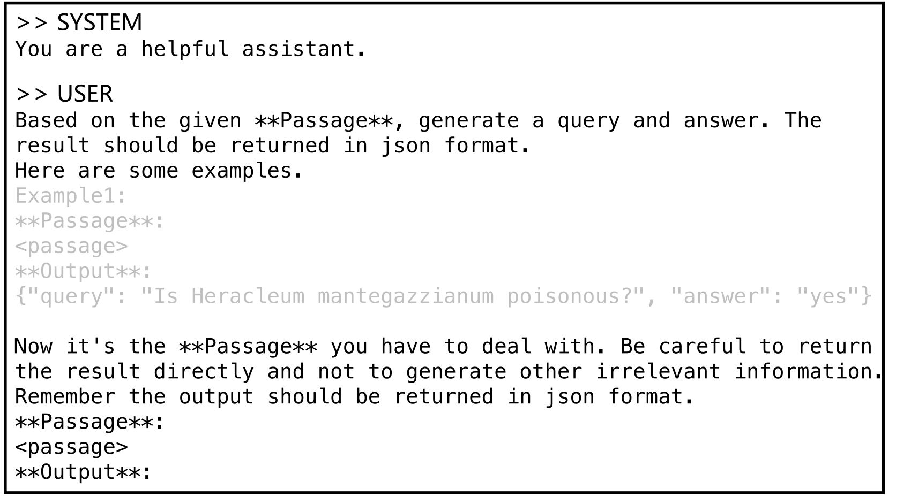

**EN.** Figure 7 : Fused-Modal Data Synthesis Step 1 Prompt.

**中.** 图 7：融合模态数据合成步骤 1 提示。

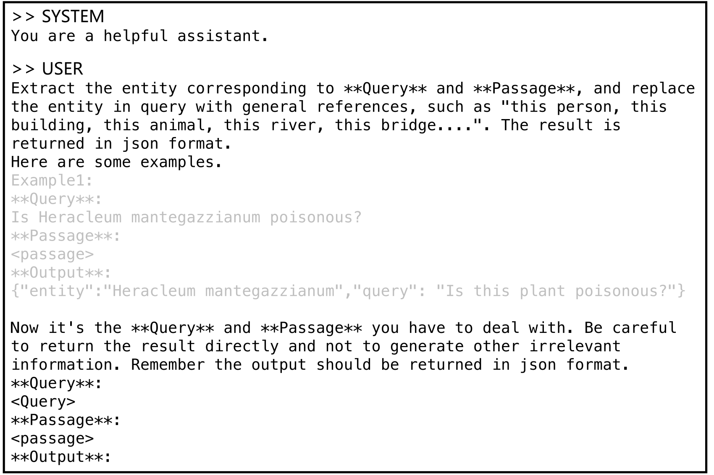

**EN.** Figure 8 : Fused-Modal Data Synthesis Step 2 Prompt.

**中.** 图 8：融合模态数据合成步骤 2 提示。

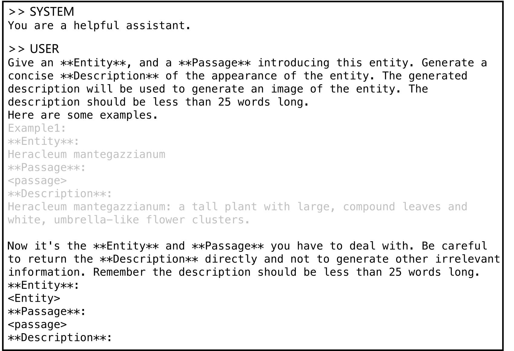

**EN.** Figure 9 : Fused-Modal Data Synthesis Step 3 Prompt.

**中.** 图 9：融合模态数据合成步骤 3 提示。

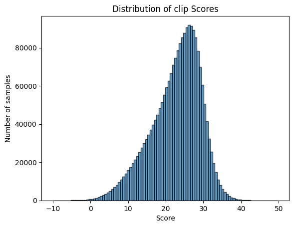

**EN.** Figure 10 : The distribution of relevance scores for all the images searched by Google and captions.

**中.** 图 10：Google 搜索的所有图像和标题的相关性得分分布。

### Filter / 过滤器

**EN.** Two filtering methods are implemented to ensure the quality of the synthesized data. First, a text retrieval model is utilized to evaluate unreconstructed queries and their corresponding passages. We follow the framework of Promptagator [ 9 ] ; a query is deemed unqualified if the passage that generated it does not appear within the top 20 search results. Second, for images obtained through the Google Image Search API, we employ the CLIP model to assess image-caption relevance. Images with a relevance score below 0.2 are filtered out.

**中.** 采用两种过滤方法来确保合成数据的质量。首先，利用文本检索模型来评估未重构的查询及其相应的段落。我们遵循Promptagator [9]的框架；如果生成查询的段落未出现在前 20 个搜索结果中，则该查询将被视为不合格。其次，对于通过 Google 图像搜索 API 获取的图像，我们采用 CLIP 模型来评估图像标题相关性。相关性得分低于 0.2 的图像将被过滤掉。

**EN.** Why is the threshold score set to 0.2? The relevance scores of all images searched via Google and the corresponding captions we have collected are presented in Figure 10 . We select the median score of 0.2 to ensure image quality while also ensuring that most text queries have sufficient images to pair with.

**中.** 为什么阈值设置为0.2？通过 Google 搜索的所有图像的相关性得分以及我们收集的相应标题如图 10 所示。我们选择中值分数 0.2 以确保图像质量，同时也确保大多数文本查询有足够的图像进行配对。

| Type 类型 | Task 任务 | Query Text 查询文本 | Query Image 查询图片 | Target Text 目标文本 | Target Image 目标图像 |
| --- | --- | --- | --- | --- | --- |
| Single-Modal 单模态 | T $\rightarrow$ T | where is whitemarsh island? 怀特马什岛在哪里？ | - | Whitemarsh Island, Georgia Whitemarsh Island, Georgia. Whitemarsh Island (pronounced WIT-marsh) is a census-designated place (CDP) in Chatham County, Georgia, United States. The population was 6,792 at the 2010 census. It is part of the Savannah Metropolitan Statistical Area. The communities of Whitemarsh Island are a relatively affluent suburb of Savannah. 乔治亚州怀特马什岛 乔治亚州怀特马什岛。怀特马什岛（发音为 WIT-marsh）是位于美国佐治亚州查塔姆县的一个人口普查指定地区 (CDP)。 2010 年人口普查人口为 6,792 人。它是萨凡纳大都会统计区的一部分。怀特马什岛的社区是萨凡纳相对富裕的郊区。 | - |
| Single-Modal 单模态 | I $\rightarrow$ I | - |  | - |  |
| Cross-Modal 跨模式 | T $\rightarrow$ I | Multicolor boutique amy black leather look biker jacket. 多色精品艾米黑色皮革外观机车夹克。 | - | - |  |
| Cross-Modal 跨模式 | T $\rightarrow$ VD | Based on the graph, what is the impact of correcting for fspec not equal to 1 on the surface density trend? 根据该图，修正 fspec 不等于 1 对表面密度趋势有何影响？ | - | - |  |
| Cross-Modal 跨模式 | I $\rightarrow$ T |  | - | Indian National Congress Vice President Rahul Gandhi addresses the special plenary session of Confederation of Indian Industr in New Delhi on April 4 2013. 印度国大党副主席拉胡尔·甘地于 2013 年 4 月 4 日在新德里举行的印度工业联合会特别全体会议上发表讲话。 | - |
| Fused-Modal 融合模态 | T $\rightarrow$ IT | Does a Minnetonka Rhododendron flower have petals in a cup shape? 明尼唐卡杜鹃花的花瓣是杯形的吗？ | - | 2020-05-08 15 17 05 Minnetonka Rhododendron flower along Tranquility Court in the Franklin Farm section of Oak Hill, Fairfax County, Virginia Minnetonka Rhododendron flower along Tranquility Court in the Franklin Farm section of Oak Hill, Fairfax County, Virginia. 2020-05-08 15 17 05 明尼唐卡杜鹃花沿着弗吉尼亚州费尔法克斯县橡树山富兰克林农场部分的宁静庭院开花 明尼唐卡杜鹃花沿着弗吉尼亚州费尔法克斯县橡树山富兰克林农场部分的宁静庭院开花。 |  |
| Fused-Modal 融合模态 | IT $\rightarrow$ T | What is this plant named after? 这种植物以什么命名？ |  | Kalmia. Kalmia is a genus of about ten species of evergreen shrubs from 0.2–5 m tall, in the family Ericaceae. They are native to North America … saw it during his travels in Carolina, and after his return to England in. 卡尔米亚。 Kalmia 是杜鹃花科约 10 种常绿灌木的属，高 0.2-5 m。它们原产于北美……在他在卡罗来纳州旅行期间以及在他返回英国后看到了它。 | - |
| Fused-Modal 融合模态 | IT $\rightarrow$ I | Is shiny and silver with shorter sleeves and fit and flare. 闪亮的银色，短袖，合身，喇叭形。 |  | - |  |
| Fused-Modal 融合模态 | IT $\rightarrow$ IT | Is this plant poisonous? 这种植物有毒吗？ |  | Heracleum mantegazzianum, commonly known as giant hogweed, is a monocarpic perennial herbaceous plant in the carrot family Apiaceae …These serious reactions are due to the furanocoumarin derivatives in the leaves, roots, stems, flowers, and seeds of the plant. Consequently, it is considered to be a noxious weed in many jurisdictions. Heracleum mantegazzianum，俗称大猪草，是胡萝卜科伞形科的单果多年生草本植物……这些严重的反应是由于该植物的叶、根、茎、花和种子中含有呋喃香豆素衍生物所致。因此，在许多司法管辖区，它被认为是一种有毒杂草。 |  |

**EN.** Table 14 : Data examples in diffierent task type. Due to the limitations of the table, we have cropped the displayed text.

**中.** 表 14：不同任务类型的数据示例。由于表格的限制，我们对显示的文本进行了裁剪。

### Examples of synthetic data / 合成数据示例

**EN.** Table 15 illustrates passages from 15 domains and the fused modal queries generated by applying the synthesis flow. “FLUX image” refers to images generated by the Vincennes diagram model FLUX.1-dev, whereas “Google image” indicates images from Google Image retrieval.

**中.** 表 15 说明了来自 15 个领域的段落以及通过应用合成流程生成的融合模态查询。 “FLUX image”是指由 Vincennes 图模型 FLUX.1-dev 生成的图像，而“Google image”是指来自 Google Image 检索的图像。

| Domain 域名 | Candidate Image 候选人形象 | Candidate Text 候选文本 | FLUX Image 通量图像 | Google Image 谷歌图片 | Query Text 查询文本 |
| --- | --- | --- | --- | --- | --- |
| animal 动物 |  | The golden poison frog is the most poisonous animal on the planet; these frogs produce deadly alkaloid batrachotoxins in their skin glands as a defense against predators. To become poisoned a predator generally must attempt to consume the frog, … has modified sodium channels unaffected by batrachotoxin. 金毒蛙是地球上最毒的动物；这些青蛙的皮腺中会产生致命的生物碱蝙蝠毒素，以防御捕食者。为了中毒，捕食者通常必须尝试吃掉青蛙，……已经改变了不受箭毒毒素影响的钠通道。 |  |  | What is the primary defense mechanism of this animal? 这种动物的主要防御机制是什么？ |
| architecture 建筑学 |  | Neoclassical buildings are characterized by their magnificence of scale, the prominent use of columns, the use of geometric forms and symmetry, …Samriddhi Bhavan,…National library of India, Kolkata 新古典主义建筑的特点是规模宏大、柱子的突出使用、几何形式和对称性的使用，…Samriddhi Bhavan，…印度国家图书馆，加尔各答 |  |  | What are some examples of this style in Indian public buildings? 印度公共建筑中有哪些这种风格的例子？ |
| artwork 艺术品 |  | ”Finding Peace Under Pressure: A Close Look at the new Butterfly of Peace”. The Houston Museum of Natural Science. Retrieved 2021-07-05.”Aurora Butterfly of Peace on Display at Smithsonian”. The Gemmological Association of Great Britain. Retrieved 2021-07-05. “在压力下寻找和平：仔细观察新的和平蝴蝶”。休斯顿自然科学博物馆。检索于 2021 年 7 月 5 日。“史密森尼博物馆展出的极光和平蝴蝶”。英国宝石学协会。检索日期：2021 年 7 月 5 日。 |  |  | Where was this display shown? 该显示在哪里显示？ |
| currency 货币 |  | The euro was founded on 1 January 1999, when it became the currency of over 300 million people in Europe. For the first three years of its existence it was an… Slovenia joined the Eurozone in 2007, Cyprus and Malta in 2008, Slovakia in 2009, Estonia in 2011 and Latvia on 1 January 2014. 欧元于 1999 年 1 月 1 日成立，当时它成为欧洲 3 亿多人的货币。在其成立的前三年，斯洛文尼亚于 2007 年加入欧元区，塞浦路斯和马耳他于 2008 年加入，斯洛伐克于 2009 年加入，爱沙尼亚于 2011 年加入，拉脱维亚于 2014 年 1 月 1 日加入。 |  |  | When did this currency become available? 这种货币什么时候可用？ |
| entertainment 娱乐 |  | Thomas Middleditch as Richard Hendricks, a coder and founder/CEO of Pied Piper.T.J. Miller as Erlich Bachman (seasons 1–4), an Chris Diamantopoulos as Russ Hanneman …a brash, loud and fiery billionaire investor who provides Pied Piper with their Series A. 托马斯·米德蒂奇 饰 Richard Hendricks，一名程序员，也是 Pied Piper.T.J. 的创始人/首席执行官。米勒饰演埃利希·巴赫曼（第 1-4 季），克里斯·迪亚曼托普洛斯饰演拉斯·汉尼曼……一位傲慢、大声、火热的亿万富翁投资者，为花衣魔笛手提供了 A 轮融资。 |  |  | Who is the CEO of this company in the TV series Silicon Valley? 电视剧《硅谷》中这家公司的CEO是谁？ |
| food 食物 |  | An Italian beef sandwich features thin slices of seasoned roast beef, dripping with meat juices, on a dense, long Italian-style roll, believed to have originated in Chicago, where its history … Despite the name, it is almost completely unknown in Italy. 意大利牛肉三明治的特点是薄薄的调味烤牛肉片，滴着肉汁，放在一个浓密的意大利风格的长卷上，据信起源于芝加哥，它的历史……尽管有这个名字，但它在意大利几乎完全不为人所知。 |  |  | What city is this sandwich believed to have originated in? 据信这种三明治起源于哪个城市？ |
| language 语言 |  | In the early 6th century BCE, the Neo-Babylonian Empire conquered the ancient Kingdom of Judah, destroying much of Jerusalem and exiling its population far to the East in Babylon. During …details on Hebrew and Aramaic in the gospels.) 公元前六世纪初，新巴比伦帝国征服了古代犹大王国，摧毁了耶路撒冷的大部分地区，并将其人口流放到遥远东方的巴比伦。在……福音书中有关希伯来语和阿拉姆语的详细信息。） |  |  | What languages were spoken in this region during the Roman period? 罗马时期该地区使用什么语言？ |
| literature 文学 |  | The Adventures of Huckleberry Finn (1973), by Robert James Dixson – a simplified version Big River: The Adventures of Huckleberry Finn, a 1985 … Classics imprint was released in November 2017. 罗伯特·詹姆斯·迪克森 (Robert James Dixson) 的《哈克贝利·费恩历险记》(1973) – 简化版《大河：哈克贝利·费恩历险记》，1985 年的……经典版本于 2017 年 11 月发行。 |  |  | What form of media was this book adapted into in 1985? 这本书在1985年被改编成什么形式的媒体？ |
| mythology 神话 |  | Throughout India, on contemporary poster art, Ganesha is portrayed with Sarasvati (goddess of culture and art) or Lakshmi (goddess of luck and prosperity) or both. Ganesha, Lakshmi and Sarswati … to be the brother of Sarasvati and Lakshmi. 在整个印度，在当代海报艺术中，甘尼萨被描绘成萨拉斯瓦蒂（文化和艺术女神）或拉克什米（幸运和繁荣女神）或两者兼而有之。伽内什、拉克希米和萨斯瓦蒂……成为萨拉斯瓦蒂和拉克希米的兄弟。 |  |  | What is the relationship between this deity and Sarasvati in Maharashtra? 这位神祇与马哈拉施特拉邦的萨拉斯瓦蒂 (Sarasvati) 有何关系？ |
| organization 组织 |  | During World War II, ARC operated the American Red Cross Clubmobile Service to provide servicemen with food, entertainment and ”a connection home.” In a …During the Vietnam War 627 American women served in the ARC Supplemental Recreation Overseas Program. At the invitation 第二次世界大战期间，ARC 运营美国红十字会移动俱乐部服务，为军人提供食物、娱乐和“连接之家”。在…越南战争期间，627 名美国妇女参加了 ARC 海外补充娱乐计划。应邀 |  |  | What service did this organization provide to boost soldier morale during the Vietnam War? 在越南战争期间，该组织为提高士兵士气提供了哪些服务？ |
| person 人 |  | Runnels later re-emerged in 1998, under her real name, as the on-screen girlfriend of Val Venis. When Runnels claimed to be pregnant with Venis’ baby, he dumped her… broke up by July, when Jacqueline Moore became frustrated with Runnels’ infatuation with Meat. 1998 年，鲁内尔斯以真名重新出现，饰演瓦尔·韦尼斯 (Val Venis) 的银幕女友。当鲁内尔斯声称怀上了维尼斯的孩子时，他抛弃了她……七月分手，当时杰奎琳·摩尔对鲁内尔斯对肉的迷恋感到沮丧。 |  |  | Who did this person claim to be pregnant with in 1998? 这个人在1998年声称怀了谁？ |
| pharmaceutical 制药 |  | DHA-paclitaxel (or Taxoprexin) is an investigational drug (from Protarga Inc) made by linking paclitaxel to docosahexaenoic acid (DHA), a fatty acid that is easily …may be able to treat more types of cancer than Taxol has been able to treat. DHA-紫杉醇（或紫杉醇）是一种研究药物（来自 Protarga Inc），通过将紫杉醇与二十二碳六烯酸 (DHA) 连接而成，二十二碳六烯酸 (DHA) 是一种脂肪酸，很容易……可能能够治疗比紫杉醇能够治疗的更多类型的癌症。 |  |  | What is the advantage of this drug over paclitaxel? 该药与紫杉醇相比有何优势？ |
| plant 植物 |  | The species was first described as Salpiglossis integrifolia by William Jackson Hooker in 1831. It was transferred to the genus Petunia as P. integrifolia by Hans Schinz and Albert Thellung… ranges, with P. inflata growing in more northern areas. 该物种于 1831 年首次被 William Jackson Hooker 描述为 Salpiglosssis integrifolia。它被 Hans Schinz 和 Albert Thellung… 范围转移到矮牵牛属，命名为 P. integrifolia…，P. infata 生长在更北部的地区。 |  |  | What was the original genus of this plant? 这种植物的原始属是什么？ |
| sport 运动 |  | The Columbia University Lions are the collective athletic teams and their members from Columbia University, an Ivy League institution in New York City, United States. The current director of athletics is Peter Pilling. 哥伦比亚大学雄狮队是来自美国纽约市常春藤盟校哥伦比亚大学的集体运动队及其成员。现任田径总监是彼得·皮林。 |  |  | What is the name of the athletic teams from this university? 这所大学的运动队叫什么名字？ |
| vehicle 车辆 |  | A specialized Lexus LS 460 is used in a warehouse-sized driving simulator at Toyota’s Higashifuji Technical Center in Shizuoka, Japan. This vehicle is mounted … automotive safety features in a secure environment. 日本静冈丰田东富士技术中心的仓库大小的驾驶模拟器中使用了一台专门的雷克萨斯 LS 460。该车辆在安全环境中安装了……汽车安全功能。 |  |  | What is the purpose of this driving simulator at Toyota’s Higashifuji Technical Center? 丰田东富士技术中心的这个驾驶模拟器的用途是什么？ |

**EN.** Table 15 : Examples of synthetic data. Due to the limitations of the table, we have cropped the displayed text.

**中.** 表 15：合成数据示例。由于表格的限制，我们对显示的文本进行了裁剪。

## Limitations / 局限性

**EN.** In this work, we present a benchmark for training and testing Universal Multimodal Retrieval (UMR). To better accomplish this task, we explore strategies for adapting Multimodal Large Language Models (MLLMs) into UMR models, presenting GME, a powerful embedding model capable of retrieving candidates across different modalities. However, this work has its limitations, which are outlined below:

**中.** 在这项工作中，我们提出了训练和测试通用多模态检索（UMR）的基准。为了更好地完成这项任务，我们探索了将多模态大型语言模型 (MLLM) 融入 UMR 模型的策略，提出了 GME，这是一个强大的嵌入模型，能够跨不同模态检索候选者。然而，这项工作有其局限性，概述如下：

#### Single Image Limit / 单张图片限制

**EN.** In MLLMs, one image is converted into a very large number of visual tokens. In Qwen2-VL, we limit the number of visual tokens to 1024. Due to model training efficiency and a lack of relevant data, our queries and candidates in UMRB only retain a single image. Thus, performance on interleaved data (where multiple images and texts are mixed together) cannot be assessed.

**中.** 在 MLLM 中，一张图像被转换为大量的视觉标记。在 Qwen2-VL 中，我们将视觉标记的数量限制为 1024。由于模型训练效率和缺乏相关数据，我们在 UMRB 中的查询和候选仅保留单个图像。因此，无法评估交错数据（多个图像和文本混合在一起）的性能。

#### Single Language Limit / 单一语言限制

**EN.** Although the backbone of our model, Qwen2-VL, supports multiple languages, we only utilized a single language, English, during the training and testing processes of our GME. Consequently, performance in other languages could not be evaluated.

**中.** 尽管我们模型的骨干 Qwen2-VL 支持多种语言，但我们在 GME 的训练和测试过程中仅使用了一种语言，即英语。因此，无法评估其他语言的性能。

## Footnotes / 脚注

[^footnote1]: **EN.** We use fuse-modal instead of multimodal to denote the data that contains both text and image to disambiguate from the UMR task. **中.** 我们使用融合模态而不是多模态来表示包含文本和图像的数据，以消除 UMR 任务的歧义。

[^footnote2]: **EN.** More details can be found at [Quora Dataset Release: Question Pairs](https://www.quora.com/q/quoradata/First-Quora-Dataset-Release-Question-Pairs) . **中.** 更多详情可参见【Quora数据集发布：问题对】(https://www.quora.com/q/quoradata/First-Quora-Dataset-Release-Question-Pairs)。

[^footnote3]: **EN.** Detail results are shown in the Appendix Table 8 . **中.** 详细结果见附表8。

[^footnote4]: **EN.** [github.com/google-research-datasets/wit/blob/main/wikiweb2m.md](https://github.com/google-research-datasets/wit/blob/main/wikiweb2m.md) **中.** [github.com/google-research-datasets/wit/blob/main/wikiweb2m.md](https://github.com/google-research-datasets/wit/blob/main/wikiweb2m.md)

[^footnote5]: **EN.** [hf.co/facebook/bart-large-mnlifacebook](https://hf.co/facebook/bart-large-mnlifacebook) **中.** [hf.co/facebook/bart-large-mnlifacebook](https://hf.co/facebook/bart-large-mnlifacebook)

[^footnote6]: **EN.** In the entire pipeline, we utilize [Qwen2.5-72B-Instruct](https://huggingface.co/Qwen/Qwen2.5-72B-Instruct) as our LLM. **中.** 在整个流程中，我们利用 [Qwen2.5-72B-Instruct](https://huggingface.co/Qwen/Qwen2.5-72B-Instruct) 作为我们的法学硕士。

[^footnote7]: **EN.** [hf.co/Alibaba-NLP/gte-Qwen2-1.5B-instruct](https://huggingface.co/Alibaba-NLP/gte-Qwen2-1.5B-instruct) **中.** [hf.co/Alibaba-NLP/gte-Qwen2-1.5B-instruct](https://huggingface.co/Alibaba-NLP/gte-Qwen2-1.5B-instruct)

[^footnote8]: **EN.** [https://serpapi.com/google-images-api](https://serpapi.com/google-images-api) **中.** [https://serpapi.com/google-images-api](https://serpapi.com/google-images-api)

[^footnote9]: **EN.** [https://hf.co/black-forest-labs/FLUX.1-dev](https://huggingface.co/black-forest-labs/FLUX.1-dev) **中.** [https://hf.co/black-forest-labs/FLUX.1-dev](https://huggingface.co/black-forest-labs/FLUX.1-dev)

[^footnote10]: **EN.** [https://hf.co/openai/clip-vit-large-patch14](https://huggingface.co/openai/clip-vit-large-patch14) **中.** [https://hf.co/openai/clip-vit-large-patch14](https://huggingface.co/openai/clip-vit-large-patch14)
