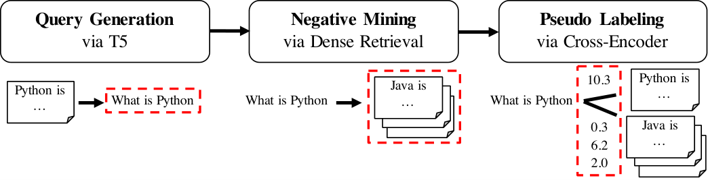
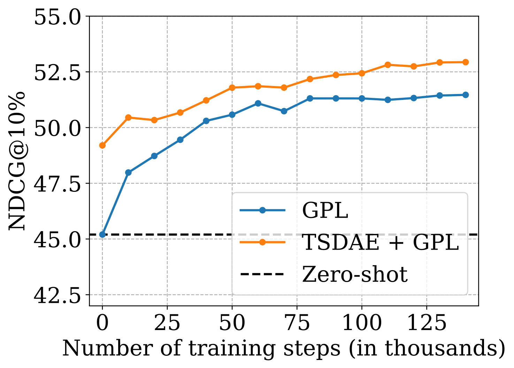
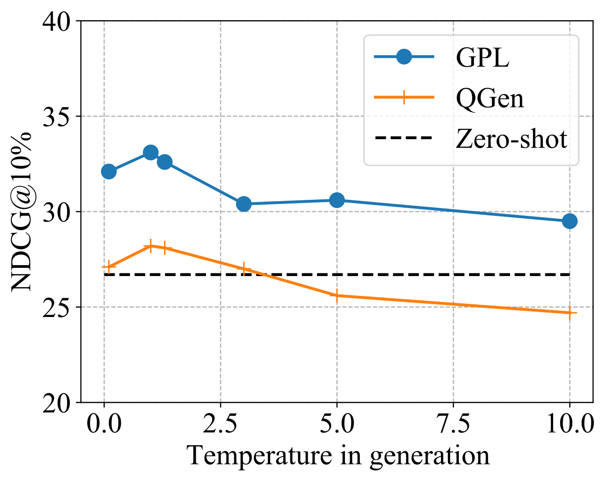

> 原文: [arXiv:2112.07577](https://arxiv.org/abs/2112.07577)（v3，2022-04-25）
> 说明: 中英对照供阅读。英文为论文原文（PDF 转写，公式按论文整理）；中文为对应翻译。图表编号与原文一致。caption 保留英文并附中译。数值原样，未改动。

**预印本：** arXiv:2112.07577v3 [cs.CL]，2022 年 4 月 25 日。

**代码：** https://github.com/UKPLab/gpl

---

# GPL: Generative Pseudo Labeling for Unsupervised Domain Adaptation of Dense Retrieval

# GPL：面向稠密检索无监督域适应的生成式伪标签

**Authors / 作者：** Kexin Wang1, Nandan Thakur2∗, Nils Reimers3, Iryna Gurevych1

∗ Contributions made during the stay at the UKP Lab. / 贡献主要在 UKP Lab 访学期间完成。

**Affiliation / 单位：** 1 Ubiquitous Knowledge Processing Lab, Technical University of Darmstadt；2 University of Waterloo；3 Hugging Face

**Website / 网站：** https://www.ukp.tu-darmstadt.de

---

## Abstract / 摘要

**EN.** Dense retrieval approaches can overcome the lexical gap and lead to significantly improved search results. However, they require large amounts of training data which is not available for most domains. As shown in previous work (Thakur et al., 2021b), the performance of dense retrievers severely degrades under a domain shift. This limits the usage of dense retrieval approaches to only a few domains with large training datasets.

**中.** 稠密检索方法能够跨越词汇鸿沟，显著改进搜索结果。但它们需要大量训练数据，而多数领域并没有这些数据。如既往工作（Thakur et al., 2021b）所示，稠密检索器在域偏移下性能会严重下降。这把稠密检索的使用限制在少数拥有大规模训练集的领域。

**EN.** In this paper, we propose the novel unsupervised domain adaptation method Generative Pseudo Labeling (GPL), which combines a query generator with pseudo labeling from a cross-encoder. On six representative domain-specialized datasets, we find the proposed GPL can outperform an out-of-the-box state-of-the-art dense retrieval approach by up to 9.3 points nDCG@10. GPL requires less (unlabeled) data from the target domain and is more robust in its training than previous methods.

**中.** 本文提出新的无监督域适应方法生成式伪标签（Generative Pseudo Labeling, GPL）：把查询生成器与来自交叉编码器的伪标签结合起来。在六个有代表性的领域专用数据集上，本文提出的 GPL 相对开箱即用的先进稠密检索方法，最高可高出 9.3 点 nDCG@10。相对既往方法，GPL 需要的目标域（无标注）数据更少，训练也更稳健。

**EN.** We further investigate the role of six recent pre-training methods in the scenario of domain adaptation for retrieval tasks, where only three could yield improved results. The best approach, TSDAE (Wang et al., 2021) can be combined with GPL, yielding another average improvement of 1.4 points nDCG@10 across the six tasks. The code and the models are available1.

**中.** 作者进一步考察六种近期预训练方法在检索任务域适应场景中的作用，其中只有三种能带来提升。最佳方法 TSDAE（Wang et al., 2021）可以与 GPL 组合，在六个任务上再平均提升 1.4 点 nDCG@10。代码与模型已公开1。

1 https://github.com/UKPLab/gpl

---

## 1 Introduction / 引言

**EN.** Information Retrieval (IR) is a central component of many natural language applications. Traditionally, lexical methods (Robertson et al., 1994) have been used to search through text content. However, these methods suffer from the lexical gap (Berger et al., 2000) and are not able to recognize synonyms and distinguish between ambiguous words.

**中.** 信息检索（Information Retrieval, IR）是许多自然语言应用的核心组件。传统上使用词法方法（Robertson et al., 1994）在文本中搜索。但这些方法受词汇鸿沟（Berger et al., 2000）制约，无法识别同义词，也无法区分歧义词。

**EN.** Recently, information retrieval methods based on dense vector spaces have become popular to address these challenges. These dense retrieval methods map queries and passages2 to a shared, dense vector space and retrieve relevant hits by nearest-neighbor search. Significant improvement over traditional approaches has been shown for various tasks (Karpukhin et al., 2020; Xiong et al., 2021). This method is also adapted increasingly by industry to enhance the search functionalities of various applications (Choi et al., 2020; Huang et al., 2020).

**中.** 近来，基于稠密向量空间的信息检索方法流行起来，用以应对这些困难。这类稠密检索方法把查询和段落2映射到共享的稠密向量空间，用最近邻搜索取回相关命中。多种任务上已相对传统方法显示出显著提升（Karpukhin et al., 2020; Xiong et al., 2021）。工业界也越来越多地采用这一方法，以增强各类应用的搜索功能（Choi et al., 2020; Huang et al., 2020）。

2 We use passage to refer to text of any length. / 文中用 passage（段落）指任意长度的文本。

**EN.** However, as shown in Thakur et al. (2021b), dense retrieval methods require large amounts of training data to work well.3 Most importantly, dense retrieval methods are extremely sensitive to domain shifts: Models trained on MS MARCO perform rather poorly for questions for COVID-19 scientific literature (Wang et al., 2020; Voorhees et al., 2021). The MS MARCO dataset was created before COVID-19, hence, it does not include any COVID-19 related topics and models did not learn how to represent this topic well in a vector space.

**中.** 然而，如 Thakur et al.（2021b）所示，稠密检索方法需要大量训练数据才能表现好。3 更关键的是，稠密检索对域偏移极为敏感：在 MS MARCO 上训练的模型，对 COVID-19 科学文献上的问题表现相当差（Wang et al., 2020; Voorhees et al., 2021）。MS MARCO 创建于 COVID-19 之前，因此不含任何与 COVID-19 相关的主题，模型也没有学会如何在向量空间中好好表示这一主题。

3 For reference, the popular MS MARCO dataset (Nguyen et al., 2016) has about 500k training instances; the Natural Questions dataset (Kwiatkowski et al., 2019) has more than 100k training instances. / 作为参照，常用的 MS MARCO 数据集（Nguyen et al., 2016）约有 50 万条训练实例；Natural Questions 数据集（Kwiatkowski et al., 2019）超过 10 万条训练实例。

**EN.** In this work, we present Generative Pseudo Labeling (GPL), an unsupervised domain adaptation technique for dense retrieval models (see Figure 1). For a collection of paragraphs from the desired domain, we use an existing pre-trained T5 encoder-decoder to generate suitable queries. For each generated query, we retrieve the most similar paragraphs using an existing dense retrieval model which will serve as negative passages. Finally, we use an existing cross-encoder to score each (query, passage)-pair and train a dense retrieval model on these generated, pseudo-labeled queries using MarginMSE-Loss (Hofstätter et al., 2020).

**中.** 本文提出生成式伪标签（Generative Pseudo Labeling, GPL），一种面向稠密检索模型的无监督域适应技术（见图 1）。对目标领域的一段段落集合，用已有的预训练 T5 编码器–解码器生成合适的查询。对每条生成的查询，用已有稠密检索模型取回最相似的段落，作为负段落。最后，用已有交叉编码器为每个（查询，段落）对打分，并用 MarginMSE 损失（Hofstätter et al., 2020）在这些生成的、带伪标签的查询上训练稠密检索模型。

**Caption EN.** Figure 1: Generative Pseudo Labeling (GPL) for training domain-adapted dense retriever. First, synthetic queries are generated for each passage from the target corpus. Then, the generated queries are used for mining negative passages. Finally, the query-passage pairs are labeled by a cross-encoder and used to train the domain-adapted dense retriever. The output at each step is marked with dashed boxes.

**Caption 中.** 图 1：生成式伪标签（GPL），用于训练域适应的稠密检索器。首先，为目标语料中的每个段落生成合成查询。然后，用生成的查询挖掘负段落。最后，由交叉编码器为查询–段落对标注，并用来训练域适应的稠密检索器。每一步的输出用虚线框标出。

**EN.** We use publicly available models for query generation, negative mining, and the cross-encoder, which have been trained on the MS MARCO dataset (Nguyen et al., 2016), a large-scale dataset from Bing search logs combined with relevant passages from diverse web sources. We evaluate GPL on six representative domain-specific datasets from the BeIR benchmark (Thakur et al., 2021b). GPL improves the performance by up to 9.3 points nDCG@10 compared to state-of-the-art model trained solely on MS MARCO. Compared to the previous state-of-the-art domain-adaption method QGen (Ma et al., 2021; Thakur et al., 2021b), GPL improves the performance by up to 4.5 nDCG@10 points. Training with GPL is easy, fast, and data efficient.

**中.** 查询生成、负例挖掘和交叉编码器都使用公开模型，这些模型在 MS MARCO 数据集（Nguyen et al., 2016）上训练。MS MARCO 是来自 Bing 搜索日志、并配以来自多种网页来源的相关段落的大规模数据集。作者在 BeIR 基准（Thakur et al., 2021b）的六个有代表性的领域专用数据集上评测 GPL。相对只在 MS MARCO 上训练的先进模型，GPL 最高提升 9.3 点 nDCG@10。相对此前的先进域适应方法 QGen（Ma et al., 2021; Thakur et al., 2021b），GPL 最高提升 4.5 点 nDCG@10。用 GPL 训练简单、快速，并且数据高效。

**EN.** We further analyze the role of six recent pre-training methods in the scenario of domain adaptation for retrieval tasks. The best approach is TSDAE (Wang et al., 2021), that outperforms the second best approach, Masked Language Modeling (Devlin et al., 2019) on average by 2.5 points nDCG@10. TSDAE can be combined with GPL, yielding another average improvement of 1.4 point nDCG@10.

**中.** 作者进一步分析六种近期预训练方法在检索任务域适应场景中的作用。最佳方法是 TSDAE（Wang et al., 2021），平均比次优方法掩码语言建模（Masked Language Modeling；Devlin et al., 2019）高 2.5 点 nDCG@10。TSDAE 可以与 GPL 组合，再平均提升 1.4 点 nDCG@10。

---

## 2 Related Work / 相关工作

### Pre-Training based Domain Adaptation / 基于预训练的域适应

**EN.** The most common domain adaption technique for transformer models is domain-adaptive pre-training (Gururangan et al., 2020), which continues pre-training on in-domain data before fine-tuning with labeled data. However, for retrieval it is often difficult to get in-domain labeled data and models are be applied in a zero-shot setting on a given corpus. Besides Masked Language Modeling (MLM) (Devlin et al., 2019), different pre-trained strategies specifically for dense retrieval methods have been proposed. Inverse Cloze Task (ICT) (Lee et al., 2019) generates query-passage pair by randomly selecting one sentence from the passage as the query and the other part as the paired passage. ConDensor (CD) (Gao and Callan, 2021) applies MLM on top of the CLS token embedding from the final layer and the other context embeddings from a previous layer to force the model to learn meaningful CLS representation. SimCSE (Gao et al., 2021a; Liu et al., 2021) passes the same input twice through the network with different dropout masks and minimizes the distance of the resulting embeddings, while Contrastive Tension (CT) (Carlsson et al., 2021) passes the input through two different models. TSDAE (Wang et al., 2021) uses a denoising auto-encoder architecture with bottleneck: Words from the input text are removed and passed through an encoder to generate a fixed-sized embedding. A decoder must reconstruct the original text without noise. As we show in Appendix E, just using these unsupervised techniques is not sufficient and the resulting models perform poorly.

**中.** Transformer 模型最常见的域适应技术是域自适应预训练（Gururangan et al., 2020）：在用标注数据微调之前，先在域内数据上继续预训练。但对检索而言，往往很难拿到域内标注数据，模型常以零样本方式直接用在给定语料上。除掩码语言建模（MLM）（Devlin et al., 2019）外，还提出了多种专门面向稠密检索的预训练策略。逆完形任务（Inverse Cloze Task, ICT）（Lee et al., 2019）随机从段落中选一句作为查询，其余部分作为配对段落，从而生成查询–段落对。ConDensor（CD）（Gao and Callan, 2021）在最后一层的 CLS 词元嵌入以及更早一层的其他上下文嵌入上做 MLM，迫使模型学到有意义的 CLS 表示。SimCSE（Gao et al., 2021a; Liu et al., 2021）把同一输入以不同 dropout 掩码过网络两次，并最小化所得嵌入的距离；对比张力（Contrastive Tension, CT）（Carlsson et al., 2021）则把输入送进两个不同的模型。TSDAE（Wang et al., 2021）使用带瓶颈的去噪自编码器：从输入文本中去掉一些词，送进编码器得到固定大小的嵌入，解码器必须在没有噪声的条件下重建原文。如附录 E 所示，只用这些无监督技术并不够，得到的模型表现很差。

**EN.** So far, ICT and CD have only been studied on in-domain performance, i.e. a large in-domain labeled dataset is available which is used for subsequent supervised fine-tuning. SimCSE, CT, and TSDAE have been only studied for unsupervised sentence embedding learning. As our results show in Appendix E, they do not work at all for purely unsupervised dense retrieval.

**中.** 迄今为止，ICT 和 CD 只在域内性能上被研究过，也就是已有大规模域内标注数据，随后用于监督微调。SimCSE、CT 和 TSDAE 只在无监督句子嵌入学习上被研究过。如附录 E 的结果所示，它们对纯粹的无监督稠密检索完全不起作用。

**EN.** If these pre-training approaches can be used for unsupervised domain adaptation for dense retrieval was so far unclear. In this work, we transfer the setup from Wang et al. (2021) to dense retrieval and first pre-train on the target corpus, followed by supervised training on labeled data from MS MARCO (Nguyen et al., 2016). Performance is then measured on the target corpus.

**中.** 这些预训练方法能否用于稠密检索的无监督域适应，此前并不清楚。本文把 Wang et al.（2021）的设定迁到稠密检索：先在目标语料上预训练，再在来自 MS MARCO（Nguyen et al., 2016）的标注数据上做监督训练。性能随后在目标语料上测量。

### Query Generation / 查询生成

**EN.** Query generation has been used to improve retrieval performances. Doc2query (Nogueira et al., 2019a,b) expands passages with predicted queries, generated by a trained encoder-decoder model, and uses traditional BM25 lexical search. This performed well in the zero-shot retrieval benchmark BeIR (Thakur et al., 2021b). Ma et al. (2021) proposes QGen, that uses a query generator trained on general domain data to synthesize domain-targeted queries for the target corpus, on which a dense retriever is trained from scratch. As a concurrent work, Liang et al. (2019) also proposes the similar method. Following this idea, Thakur et al. (2021b) views QGen as a post-training method to adapt powerful MS MARCO retrievers to the target domains.

**中.** 查询生成已被用来提升检索性能。Doc2query（Nogueira et al., 2019a,b）用训练好的编码器–解码器生成预测查询，把段落扩展开，再使用传统 BM25 词法搜索。这一做法在零样本检索基准 BeIR（Thakur et al., 2021b）上表现良好。Ma et al.（2021）提出 QGen：用在通用领域数据上训练的查询生成器，为目标语料合成面向该领域的查询，并在其上从零训练稠密检索器。同期工作 Liang et al.（2019）也提出了类似方法。顺着这一想法，Thakur et al.（2021b）把 QGen 看成后训练方法，用来把强大的 MS MARCO 检索器适配到目标领域。

**EN.** Despite the success of QGen, previous methods only consider the cross-entropy loss with in-batch negatives, which provides coarse-grained relevance and thus limits the performance. In this work, we show that extending this approach by using pseudo-labels from a cross-encoder together with hard negatives can boost the performance by several points nDCG@10.

**中.** 尽管 QGen 取得了成功，既往方法只考虑带批内负例的交叉熵损失。这种损失只提供粗粒度相关性，因而限制了性能。本文表明：用交叉编码器的伪标签加上难负例来扩展这一做法，可以把性能再抬高数点 nDCG@10。

### Other Methods / 其他方法

**EN.** Recently, Xin et al. (2021) proposes MoDIR to use Domain Adversarial Training (DAT) (Ganin et al., 2016) for unsupervised domain adaptation of dense retrievers. MoDIR trains models by generating domain invariant representations to attack a domain classifier. However, as argued in Karouzos et al. (2021), DAT trains models by minimizing the distance between representations from different domains and such learning objective can result in bad embedding space and unstable performance. For sentiment classification, Karouzos et al. (2021) proposes UDALM based on multiple stages of training. UDALM first applies MLM training on the target domain; and it then applies multi-task learning on the target domain with MLM and on the source domain with a supervised objective. However, as shown in section 5, we find this method cannot yield improvement for retrieval tasks.

**中.** 近来，Xin et al.（2021）提出 MoDIR，用域对抗训练（Domain Adversarial Training, DAT）（Ganin et al., 2016）做稠密检索器的无监督域适应。MoDIR 通过生成域不变表示去攻击一个域分类器来训练模型。然而，如 Karouzos et al.（2021）所论，DAT 通过最小化不同域表示之间的距离来训练模型，这样的学习目标可能导致糟糕的嵌入空间和不稳定的性能。针对情感分类，Karouzos et al.（2021）提出基于多阶段训练的 UDALM。UDALM 先在目标域上做 MLM 训练；然后在目标域上用 MLM、在源域上用监督目标做多任务学习。然而，如第 5 节所示，作者发现这一方法不能给检索任务带来提升。

### Pseudo Labeling and Cross-Encoders / 伪标签与交叉编码器

**EN.** Bi-Encoders map queries and passage independently to a shared vector space from which the query-passage similarity is computed. In contrast, cross-encoders (Humeau et al., 2020) work on the concatenation of the query and passage and predict a relevance score using cross-attention between query and passage. This can be used in a re-ranking setup (Nogueira and Cho, 2019), where the relevancy is predicted for all query-passage-pairs for a small candidate set. Previous work has shown that cross-encoders achieve much higher performances (Thakur et al., 2021a; Hofstätter et al., 2020; Ren et al., 2021) and are less prone to domain shifts (Thakur et al., 2021b). But cross-encoders come with an extremely high computational overhead, making them less suited for a production setting. Transferring knowledge from cross-encoder to bi-encoders have been shown previous for sentence embeddings (Thakur et al., 2021a) and for dense retrieval: Hofstätter et al. (2020) predict cross-encoder scores for (query, positive)-pairs and (query, negative)-pairs and learns a bi-encoder to predict the margin between the two scores. This has been shown highly effective for in-domain dense retrieval.

**中.** 双编码器把查询和段落各自独立地映射到共享向量空间，再在该空间中计算查询–段落相似度。与之相对，交叉编码器（Humeau et al., 2020）作用在查询与段落的拼接上，用查询与段落之间的交叉注意力预测相关性分数。这可以用在重排设定（Nogueira and Cho, 2019）中：对一个小候选集里的全部查询–段落对预测相关性。既往工作表明，交叉编码器取得高得多的性能（Thakur et al., 2021a; Hofstätter et al., 2020; Ren et al., 2021），并且更不容易受域偏移影响（Thakur et al., 2021b）。但交叉编码器的计算开销极高，不太适合生产环境。把知识从交叉编码器迁移到双编码器，此前已在句子嵌入（Thakur et al., 2021a）和稠密检索上展示过：Hofstätter et al.（2020）为（查询，正例）对和（查询，负例）对预测交叉编码器分数，并让双编码器去预测这两个分数之间的间隔（margin）。这一做法对域内稠密检索已被证明非常有效。

---

## 3 Method / 方法

**EN.** This section describes our proposed Generative Pseudo Labeling (GPL) method for the unsupervised domain adaptation of dense retrievers. Figure 1 illustrates the idea of GPL.

**中.** 本节描述本文提出的生成式伪标签（GPL）方法，用于稠密检索器的无监督域适应。图 1 说明了 GPL 的想法。

**EN.** For a given target corpus, we generate for each passage three queries (cf. Table 3) using an T5-encoder-decoder model (Raffel et al., 2020). For each of the generated queries, we use an existing retrieval system to retrieve 50 negative passages. Dense retrieval with a pre-existing model was slightly more effective than BM25 lexical retrieval (cf. Appendix A). For each (query, positive, negative)-tuple we compute the margin \(\delta = \mathrm{CE}(Q, P^{+}) - \mathrm{CE}(Q, P^{-})\) with CE the score as predicted by a cross-encoder, \(Q\) the query and \(P^{+} / P^{-}\) the positive / negative passage.

**中.** 对给定的目标语料，用一个 T5 编码器–解码器模型（Raffel et al., 2020）为每个段落生成三条查询（参见表 3）。对每条生成的查询，用已有检索系统检索 50 个负段落。用已有模型做稠密检索，比 BM25 词法检索略更有效（参见附录 A）。对每个（查询，正例，负例）三元组，计算间隔 \(\delta = \mathrm{CE}(Q, P^{+}) - \mathrm{CE}(Q, P^{-})\)，其中 CE 是交叉编码器预测的分数，\(Q\) 是查询，\(P^{+} / P^{-}\) 是正段落 / 负段落。

**EN.** We use the synthetic dataset \(\mathcal{D}_{\mathrm{GPL}} = \{(Q_i, P_i, P_i^{-}, \delta_i)\}_i\) with the MarginMSE loss (Hofstätter et al., 2020) for training a domain-adapted dense retriever that maps queries and passages into the shared vector space.

**中.** 作者使用合成数据集 \(\mathcal{D}_{\mathrm{GPL}} = \{(Q_i, P_i, P_i^{-}, \delta_i)\}_i\)，以 MarginMSE 损失（Hofstätter et al., 2020）训练一个域适应的稠密检索器，把查询和段落映射到共享向量空间。

**EN.** Our method requires from the target domain just an unlabeled collection of passages. Further, we use use pre-existing T5- and cross-encoder models that have been trained on the MS MARCO passages dataset.

**中.** 本方法对目标域的要求只是一份无标注的段落集合。此外，作者使用已有的、在 MS MARCO 段落数据集上训练过的 T5 模型和交叉编码器模型。

### Query Generation / 查询生成

**EN.** To enable supervised training on the target corpus, synthetic queries can be generated for the target passages using a query generator trained on a different, existing dataset like MS MARCO. Previous work QGen (Ma et al., 2021) used the simple MultipleNegativesRanking (MNRL) loss (Henderson et al., 2017; van den Oord et al., 2018) with in-batch negatives to train the model:

**中.** 为了能在目标语料上做监督训练，可以用在另一个已有数据集（如 MS MARCO）上训练的查询生成器，为目标段落生成合成查询。既往工作 QGen（Ma et al., 2021）使用简单的多负例排序损失（MultipleNegativesRanking, MNRL）（Henderson et al., 2017; van den Oord et al., 2018），配以批内负例来训练模型：

$$
\mathcal{L}_{\mathrm{MNRL}}(\theta) = -\frac{1}{M}\sum_{i=0}^{M-1}\log\frac{\exp\big(\tau\cdot\sigma(f_{\theta}(Q_i), f_{\theta}(P_i))\big)}{\sum_{j=0}^{M-1}\exp\big(\tau\cdot\sigma(f_{\theta}(Q_i), f_{\theta}(P_j))\big)}
$$

**EN.** where \(P_i\) is a relevant passage for \(Q_i\); \(\sigma\) is a certain similarity function for vectors; \(\tau\) controls the sharpness of the softmax normalization; \(M\) is the batch size.

**中.** 其中 \(P_i\) 是 \(Q_i\) 的相关段落；\(\sigma\) 是某种向量相似度函数；\(\tau\) 控制 softmax 归一化的锐度；\(M\) 是批大小。

### MarginMSE loss / MarginMSE 损失

**EN.** MarginMSE loss: MultipleNegativesRanking loss considers only the coarse relationship between queries and passages, i.e. the matching passage is considered as relevant while all other passages are considered irrelevant. However, the query encoder is not without flaws and might generate queries that are not answerable by the passage. Further, other passages might actually be relevant as well for a given query, which is especially the case if training is done with hard negatives as we do it for GPL.

**中.** MarginMSE 损失：多负例排序损失只考虑查询与段落之间的粗关系，即匹配上的段落被视为相关，其余所有段落都被视为不相关。然而查询编码器并非没有缺陷，可能生成段落回答不了的查询。此外，对给定查询，其他段落实际上也可能相关；若像 GPL 这样用难负例训练，这种情况尤其常见。

**EN.** In contrast, MarginMSE loss (Hofstätter et al., 2020) uses a powerful cross-encoder to soft-label (query, passage) pairs. It then teaches the dense retriever to mimic the score margin between the positive and negative query-passage pairs. Formally,

**中.** 与之相对，MarginMSE 损失（Hofstätter et al., 2020）用一个强的交叉编码器给（查询，段落）对做软标注。然后它教稠密检索器去模仿正、负查询–段落对之间的分数间隔。形式上，

$$
\mathcal{L}_{\mathrm{MarginMSE}}(\theta) = -\frac{1}{M}\sum_{i=0}^{M-1}\big|\hat{\delta}_i - \delta_i\big|^2 \tag{1}
$$

**EN.** where \(\hat{\delta}_i\) is the corresponding score margin of the student dense retriever, i.e. \(\hat{\delta}_i = f_{\theta}(Q_i)^{\top} f_{\theta}(P_i) - f_{\theta}(Q_i)^{\top} f_{\theta}(P_i^{-})\). Here the dot-product is usually used due to the infinite range of the cross-encoder scores.

**中.** 其中 \(\hat{\delta}_i\) 是学生稠密检索器对应的分数间隔，即 \(\hat{\delta}_i = f_{\theta}(Q_i)^{\top} f_{\theta}(P_i) - f_{\theta}(Q_i)^{\top} f_{\theta}(P_i^{-})\)。这里通常使用点积，因为交叉编码器分数的取值范围是无穷的。

教师间隔（正文中的定义，与上式中的 \(\delta_i\) 对应）：

$$
\delta = \mathrm{CE}(Q, P^{+}) - \mathrm{CE}(Q, P^{-})
$$

**EN.** This loss is a critical component of GPL, as it solves two major issues from the previous QGen method: A badly generated query for a given passage will get a low score from the cross-encoder, hence, we do not expect the dense retriever to put the query and passage close in the vector space. A false negative will lead to a high score from the cross-encoder, hence, we do not force the dense retriever to assign a large distance between the corresponding embeddings. In section 6.3, we show that GPL is a lot more robust to badly generated queries than the previous QGen method.

**中.** 这一损失是 GPL 的关键组成部分，因为它解决了既往 QGen 方法的两个主要问题：对给定段落，生成得很差的查询会从交叉编码器得到低分，因此不指望稠密检索器把该查询和该段落在向量空间中放得很近。假负例会从交叉编码器得到高分，因此不强迫稠密检索器在对应嵌入之间赋予很大的距离。在第 6.3 节，作者表明 GPL 对生成得很差的查询比既往 QGen 方法稳健得多。

---

## 4 Experiments / 实验

**EN.** In this section, we describe the experimental setup, the datasets used and the baselines for comparison.

**中.** 本节描述实验设置、所用数据集以及用于比较的基线。

### 4.1 Experimental Setup / 实验设置

**EN.** We use the MS MARCO passage ranking dataset (Nguyen et al., 2016) as the data from the source domain. It has 8.8M passages and 532.8K query-passage pairs labeled as relevant in the training set. As Table 1 shows, a state-of-the-art dense retrieval model, achieving an MRR@10 of 33.2 points on the MS MARCO passage ranking dataset, performs poorly on the six selected domain-specific retrieval datasets when compared to simple BM25 lexical search.

**中.** 源域数据使用 MS MARCO 段落排序数据集（Nguyen et al., 2016）。它有 880 万段落，训练集中有 53.28 万对被标为相关的查询–段落对。如表 1 所示，一个在 MS MARCO 段落排序数据集上 MRR@10 达到 33.2 点的先进稠密检索模型，在六个选定的领域专用检索数据集上，相对简单的 BM25 词法搜索表现很差。

**EN.** We use the DistilBERT (Sanh et al., 2019) for all the experiments. We use the concatenation of the title and the body text as the input passage for all the models. We use a maximum sequence length of 350 with mean pooling and dot-product similarity by default. For QGen, we use the default setting in Thakur et al. (2021b): 1-epoch training and batch size 75. For GPL, we train the models with 140k training steps and batch size 32. To generate queries for both QGen and GPL, we use the DocT5Query (Nogueira et al., 2019a) generator trained on MS MARCO and generate queries4 using nucleus sampling with temperature 1.0, \(k = 25\) and \(p = 0.95\). To retrieve hard negatives for both GPL and the zero-shot setting of MS MARCO training, we use two dense retrievers with cosine-similarity trained on MS MARCO: msmarco-distilbert-base-v3 and msmarco-MiniLM-L-6-v3 from Sentence-Transformers5. The zero-shot performance of these two dense retrievers are available in Appendix B. We retrieve 50 negatives using each retriever and uniformly sample one negative passage and one positive passage for each training query to form one training example. For pseudo labeling, we use the ms-marco-MiniLM-L-6-v26 cross-encoder. For all the pre-training methods (e.g. TSDAE and MLM), we train the models for 100K training steps and with batch size 8.

**中.** 全部实验使用 DistilBERT（Sanh et al., 2019）。所有模型都把标题与正文的拼接当作输入段落。默认最大序列长度为 350，均值池化，点积相似度。对 QGen，使用 Thakur et al.（2021b）的默认设置：训练 1 个 epoch，批大小 75。对 GPL，以 14 万训练步、批大小 32 训练模型。为 QGen 和 GPL 生成查询时，使用在 MS MARCO 上训练的 DocT5Query（Nogueira et al., 2019a）生成器，并以温度 1.0、\(k = 25\)、\(p = 0.95\) 的 nucleus sampling 生成查询4。为 GPL 以及 MS MARCO 训练的零样本设定检索难负例时，使用两个在 MS MARCO 上以余弦相似度训练的稠密检索器：来自 Sentence-Transformers5 的 msmarco-distilbert-base-v3 和 msmarco-MiniLM-L-6-v3。这两个稠密检索器的零样本性能见附录 B。每个检索器检索 50 个负例，并对每条训练查询均匀采样一个负段落和一个正段落，组成一条训练样本。伪标签使用 ms-marco-MiniLM-L-6-v26 交叉编码器。对所有预训练方法（例如 TSDAE 和 MLM），以 10 万训练步、批大小 8 训练模型。

4 We use the script from BeIR at https://github.com/UKPLab/beir. / 使用 BeIR 的脚本：https://github.com/UKPLab/beir 。

5 https://github.com/UKPLab/sentence-transformers

6 https://huggingface.co/cross-encoder/ms-marco-MiniLM-L-6-v2

**EN.** As shown in Section 6, small corpora require more generated queries and for large corpora, a small down-sampled subset (e.g. 50K) is enough for good performance. Based on these findings, we adjust the number of generated queries per passage \(q_{\mathrm{avg.}}\) and the corpus size \(|C|\) to make the total number of generated queries equal to a fixed number, 250K, i.e. \(q_{\mathrm{avg.}} \times |C| = 250\mathrm{K}\). In detail, we first set \(q_{\mathrm{avg.}} \ge 3\) and uniformly down-sample the corpus if \(3 \times |C| > 250\mathrm{K}\); then we calculate \(q_{\mathrm{avg.}} = \lceil 250\mathrm{K}/|C|\rceil\). For example, the \(q_{\mathrm{avg.}}\) values for FiQA (original size = 57.6K) and Robust04 (original size = 528.2K) are 5 and 3, resp. and the Robust04 corpus is down-sampled to 83.3K. QGen and GPL share the generated queries for fair comparision.

**中.** 如第 6 节所示，小语料需要更多生成查询；对大语料，一个较小的下采样子集（例如 5 万）就足以取得好性能。基于这些发现，作者调整每段生成查询数 \(q_{\mathrm{avg.}}\) 和语料规模 \(|C|\)，使生成查询总数等于一个固定数 250K，即 \(q_{\mathrm{avg.}} \times |C| = 250\mathrm{K}\)。具体而言，先设 \(q_{\mathrm{avg.}} \ge 3\)，若 \(3 \times |C| > 250\mathrm{K}\) 则对语料做均匀下采样；然后计算 \(q_{\mathrm{avg.}} = \lceil 250\mathrm{K}/|C|\rceil\)。例如，FiQA（原始规模 = 57.6K）和 Robust04（原始规模 = 528.2K）的 \(q_{\mathrm{avg.}}\) 分别为 5 和 3，并且 Robust04 语料被下采样到 83.3K。为公平比较，QGen 与 GPL 共用同一批生成查询。

### 4.2 Evaluation / 评测

**EN.** As our methods focus on domain adaptation to specialized domains, we selected six domain-specific text retrieval tasks from the BeIR benchmark (Thakur et al., 2021b): FiQA (financial domain) (Maia et al., 2018), SciFact (scientific papers) (Wadden et al., 2020), BioASQ (biomedical Q&A) (Tsatsaronis et al., 2015), TREC-COVID (scientific papers on COVID-19) (Roberts et al., 2020), CQADupStack (12 StackExchange subforums) (Hoogeveen et al., 2015) and Robust04 (news articles) (Voorhees, 2005). These selected datasets each contain a corpus with a rather specific language and can thus act as a suitable test bed for domain adaptation.

**中.** 由于方法聚焦于向专门领域做域适应，作者从 BeIR 基准（Thakur et al., 2021b）中选取六个领域专用文本检索任务：FiQA（金融领域）（Maia et al., 2018）、SciFact（科学论文）（Wadden et al., 2020）、BioASQ（生物医学问答）（Tsatsaronis et al., 2015）、TREC-COVID（关于 COVID-19 的科学论文）（Roberts et al., 2020）、CQADupStack（12 个 StackExchange 子论坛）（Hoogeveen et al., 2015）以及 Robust04（新闻文章）（Voorhees, 2005）。这些数据集各自包含语言相当专门的语料，因而适合作为域适应的测试台。

**EN.** The detailed information for all the target datasets is available at Appendix C. We make modification on BioASQ and TREC-COVID. For efficient training and evaluation on BioASQ, we randomly remove irrelevant passages to make the final corpus size to 1M. In TREC-COVID, the original corpus has many documents with a missing abstract. The retrieval systems that were used to create the annotation pool for TREC-COVID often ignored such documents, leading to a strong annotation bias for these documents. Hence, we removed all documents with a missing abstract from the corpus. The evaluation results on the original BioASQ and TREC-COVID are available at Appendix D. Evaluation is done using nDCG@10.

**中.** 全部目标数据集的详细信息见附录 C。作者对 BioASQ 和 TREC-COVID 做了改动。为使 BioASQ 的训练与评测更高效，随机删去不相关段落，使最终语料规模为 100 万。TREC-COVID 的原始语料中有许多文档缺少摘要。用来构建 TREC-COVID 标注池的检索系统常常忽略这类文档，从而导致对这些文档的强烈标注偏差。因此，作者从语料中删去所有缺少摘要的文档。原始 BioASQ 与 TREC-COVID 上的评测结果见附录 D。评测指标为 nDCG@10。

### 4.3 Baselines / 基线

**EN.** Zero-Shot Models: We apply supervised training on MS MARCO or PAQ (Lewis et al., 2021) and evaluate the trained retrievers on the target datasets. (a) MS MARCO represents a distilbert-base dense retrieval model trained with MarginMSE on the MS MARCO dataset with batch-size 75 for 70k steps. (b) PAQ (Oguz et al., 2021) represents MNRL training on the PAQ dataset. (c) PAQ + MS MARCO represents MNRL training on PAQ followed by MarginMSE training on MS MARCO. (d) TSDAEMS MARCO represents TSDAE (Wang et al., 2021) pre-training on MS MARCO followed by MarginMSE training on MS MARCO. (e) BM25 system based on lexical matching from Elasticsearch7.

**中.** 零样本模型：在 MS MARCO 或 PAQ（Lewis et al., 2021）上做监督训练，再在目标数据集上评测训练好的检索器。(a) MS MARCO 表示一个 distilbert-base 稠密检索模型，在 MS MARCO 数据集上用 MarginMSE、批大小 75、训练 7 万步。(b) PAQ（Oguz et al., 2021）表示在 PAQ 数据集上做 MNRL 训练。(c) PAQ + MS MARCO 表示先在 PAQ 上做 MNRL 训练，再在 MS MARCO 上做 MarginMSE 训练。(d) TSDAEMS MARCO 表示先在 MS MARCO 上做 TSDAE（Wang et al., 2021）预训练，再在 MS MARCO 上做 MarginMSE 训练。(e) 基于 Elasticsearch7 词法匹配的 BM25 系统。

7 https://www.elastic.co

**EN.** Previous Domain Adaptation Methods: We include two previous unsupervised domain adaptation methods, UDALM (Karouzos et al., 2021) and MoDIR (Xin et al., 2021). For UDALM, we apply MLM training on the target corpus and then apply the multi-task training of MarginMSE training on MS MARCO and MLM training on the target corpus. For MoDIR, it starts from the ANCE checkpoint and apply domain adversarial training on MS MARCO and the target dataset. As of writing, the training code of MoDIR is not public, but domain adapted models for 5 out of 6 datasets have been released by the authors.

**中.** 既往域适应方法：纳入两种既往无监督域适应方法，UDALM（Karouzos et al., 2021）和 MoDIR（Xin et al., 2021）。对 UDALM，先在目标语料上做 MLM 训练，再做多任务训练：在 MS MARCO 上做 MarginMSE 训练，同时在目标语料上做 MLM 训练。对 MoDIR，从 ANCE 检查点出发，在 MS MARCO 和目标数据集上做域对抗训练。截至写作时，MoDIR 的训练代码未公开，但作者已发布六个数据集中五个的域适应模型。

**EN.** Pre-Training based Domain Adaptation: We follow the setup proposed in Wang et al. (2021) on domain-adapted pre-training: We pre-train the dense retrievers with different methods on the target corpus and then continue to train the models on MS MARCO with MarginMSE loss. The pre-training methods consist of: (a) CD (Gao and Callan, 2021) extracts the hidden representations from an intermediate layer and applies MLM on the CLS token representation and these extracted hidden representations8. (b) SimCSE (Gao et al., 2021b; Liu et al., 2021) simply encode the same text twice with different dropout masks in combination with MNRL loss. (c) CT (Carlsson et al., 2021) is similar to SimCSE but it uses two independent encoders to encode a pair of text. (d) MLM (Devlin et al., 2019) uses the default setting in original paper, where 15% tokens in a text are sampled to be masked and are needed to be predicted. (e) ICT (Lee et al., 2019) uniformly samples one sentence from a passage as the pseudo query to that passage and uses MNRL loss on the synthetic data. We follow the setting in Lee et al. (2019) and masked out the selected sentence 90% of the time. (f) TSDAE (Wang et al., 2021) uses a denoising autoencoder to pre-train the dense retrievers with 60% random tokens deleted in the input texts.

**中.** 基于预训练的域适应：遵循 Wang et al.（2021）提出的域适应预训练设定：用不同方法在目标语料上预训练稠密检索器，然后继续在 MS MARCO 上用 MarginMSE 损失训练模型。预训练方法包括：(a) CD（Gao and Callan, 2021）从中间层抽出隐藏表示，并在 CLS 词元表示和这些抽出的隐藏表示上做 MLM8。(b) SimCSE（Gao et al., 2021b; Liu et al., 2021）把同一文本以不同 dropout 掩码编码两次，并配合 MNRL 损失。(c) CT（Carlsson et al., 2021）与 SimCSE 类似，但用两个独立编码器编码一对文本。(d) MLM（Devlin et al., 2019）使用原论文的默认设置：文本中 15% 的词元被采样掩盖并需要被预测。(e) ICT（Lee et al., 2019）从段落中均匀采样一句作为该段落的伪查询，并在合成数据上使用 MNRL 损失。作者遵循 Lee et al.（2019）的设置，90% 的时间把选中的句子掩盖掉。(f) TSDAE（Wang et al., 2021）用去噪自编码器预训练稠密检索器，输入文本中随机删除 60% 的词元。

8 CD can only be applied with CLS pooling. / CD 只能与 CLS 池化一起使用。

**EN.** Generation-based Domain Adaptation: We use the training script9 from Thakur et al. (2021b) to train QGen models with the default setting. Cosine similarity is used and the models are fine-tuned for 1 epoch with MNRL. The default QGen is trained with in-batch negatives. For a fair comparison, we also test QGen with hard negatives as used in GPL, noted as QGen (w/ Hard Negatives). Further, we test the combination of TSDAE and QGen (TSDAE + QGen).

**中.** 基于生成的域适应：使用 Thakur et al.（2021b）的训练脚本9，按默认设置训练 QGen 模型。使用余弦相似度，模型用 MNRL 微调 1 个 epoch。默认 QGen 用批内负例训练。为公平比较，也测试使用与 GPL 相同难负例的 QGen，记为 QGen (w/ Hard Negatives)。此外，测试 TSDAE 与 QGen 的组合（TSDAE + QGen）。

9 https://github.com/UKPLab/beir

**EN.** Re-Ranking with Cross-Encoders: We also include results of the powerful but inefficient re-ranking methods for reference. Three retrievers for the first-phrase retrieval are tested: BM25 from Elasticsearch, the zero-shot MS MARCO retriever and the enhanced GPL retriever by TSDAE pre-training. We use the cross-encoder ms-marco-MiniLM-L-6-v2 from Sentence-Transformers, which is also for pseudo labeling for GPL.

**中.** 用交叉编码器重排：也列入强大但低效的重排方法结果，供参照。一阶段检索测试三种检索器：Elasticsearch 的 BM25、零样本 MS MARCO 检索器，以及经 TSDAE 预训练增强的 GPL 检索器。交叉编码器使用 Sentence-Transformers 的 ms-marco-MiniLM-L-6-v2，它同样用于 GPL 的伪标签。

| Method | FiQA | SciFact | BioASQ | TRECC. | CQADup. | Robust04 | Avg. |
| --- | ---: | ---: | ---: | ---: | ---: | ---: | ---: |
| **Zero-Shot Models** | | | | | | | |
| MS MARCO | 26.7 | 57.1 | 52.9 | 66.1 | 29.6 | 39.0 | 45.2 |
| PAQ | 15.2 | 53.3 | 44.0 | 23.8 | 24.5 | 31.9 | 32.1 |
| PAQ + MS MARCO | 26.7 | 57.6 | 53.8 | 63.4 | 30.6 | 37.2 | 44.9 |
| TSDAEMS MARCO | 26.7 | 55.5 | 51.4 | 65.6 | 30.5 | 36.6 | 44.4 |
| BM25 | 23.9 | 66.1 | 70.7 | 60.1 | 31.5 | 38.7 | 48.5 |
| **Previous Domain Adaptation Methods** | | | | | | | |
| UDALM | 23.3 | 33.6 | 33.1 | 57.1 | 24.6 | 26.3 | 33.0 |
| MoDIR | 29.6 | 50.2 | 47.9 | 66.0 | 29.7 | – | – |
| **Pre-Training based Domain Adaptation: Target → MS MARCO** | | | | | | | |
| CT | 28.3 | 55.6 | 49.9 | 63.8 | 30.5 | 35.9 | 44.0 |
| CD | 27.0 | 62.7 | 47.7 | 65.4 | 30.6 | 34.5 | 44.7 |
| SimCSE | 26.7 | 55.0 | 53.2 | 68.3 | 29.0 | 37.9 | 45.0 |
| ICT | 27.0 | 58.3 | 55.3 | 69.7 | 31.3 | 37.4 | 46.5 |
| MLM | 30.2 | 60.0 | 51.3 | 69.5 | 30.4 | 38.8 | 46.7 |
| TSDAE | 29.3 | 62.8 | 55.5 | **76.1** | 31.8 | 39.4 | 49.2 |
| **Generation-based Domain Adaptation (Previous State-of-the-Art)** | | | | | | | |
| QGen | 28.7 | 63.8 | 56.5 | 72.4 | 33.0 | 38.1 | 48.8 |
| QGen (w/ Hard Negatives) | 26.0 | 59.6 | 57.7 | 65.0 | 33.2 | 36.5 | 46.3 |
| TSDAE + QGen (Ours) | 31.4 | 66.7 | 58.1 | 72.6 | **35.3** | 37.4 | 50.3 |
| **Proposed Method: Generative Pseudo Labeling** | | | | | | | |
| GPL | 32.8 | 66.4 | 61.0 | 72.6 | 34.5 | 41.4 | 51.5 |
| TSDAE + GPL | **34.4** | **68.9** | **61.6** | 74.6 | 35.1 | **43.0** | **52.9** |
| **Re-Ranking with Cross-Encoders (Upper Bound, Inefficient at Inference)** | | | | | | | |
| BM25 + CE | 33.1 | 67.6 | 72.8 | 71.2 | 36.8 | 46.7 | 54.7 |
| MS MARCO + CE | 33.0 | 66.9 | 57.4 | 65.1 | 36.9 | 44.7 | 50.7 |
| TSDAE + GPL + CE | 36.4 | 68.3 | 68.0 | 71.4 | 38.1 | 48.3 | 55.1 |

**Caption EN.** Table 1: Evaluation using nDCG@10. The best results of the single-stage dense retrievers are bold. TRECC. and CQADup. are short for TREC-COVID and CQADupStack. Our proposed GPL significantly outperforms other domain adaptation methods. For the first time, we investigate the TSDAE pre-training in domain adaptation for dense retrieval and find it can significantly improve both QGen and GPL. The results on the full 18 BeIR datasets can be found at Appendix D.

**Caption 中.** 表 1：用 nDCG@10 评测。单阶段稠密检索器的最佳结果加粗。TRECC. 与 CQADup. 分别是 TREC-COVID 与 CQADupStack 的简称。本文提出的 GPL 显著优于其他域适应方法。作者首次在稠密检索域适应中考察 TSDAE 预训练，发现它能显著改进 QGen 和 GPL。全部 18 个 BeIR 数据集上的结果见附录 D。

---

## 5 Results / 结果

### Pre-Training based Domain Adaptation / 基于预训练的域适应

**EN.** The results are shown in Table 1. Compared with the zero-shot MS MARCO model, TSDAE, MLM and ICT can improve the performance if we first pre-train on the target corpus and then perform supervised training on MS MARCO. Among them, TSDAE is the most effective method, outperforming the zero-shot baseline by 4.0 points nDCG@10 on average. CD, CT and SimCSE are not able to adapt to the domains in a pre-training setup and achieve a performance worse than the zero-shot model.

**中.** 结果见表 1。相对零样本 MS MARCO 模型，若先在目标语料上预训练、再在 MS MARCO 上做监督训练，TSDAE、MLM 和 ICT 能够提升性能。其中 TSDAE 最有效，平均比零样本基线高 4.0 点 nDCG@10。CD、CT 和 SimCSE 在这一预训练设定下不能适配到这些领域，性能差于零样本模型。

**EN.** To ensure that TSDAE actually learns domain specific terminology, we include TSDAEMS MARCO in our experiments: Here, we performed TSDAE pre-training on the MS MARCO dataset followed by supervised learning on MS MARCO. This performs slightly weaker than the zero-shot MS MARCO model.

**中.** 为确认 TSDAE 确实学到了领域专门术语，实验中纳入 TSDAEMS MARCO：在 MS MARCO 数据集上做 TSDAE 预训练，再在 MS MARCO 上做监督学习。其表现略弱于零样本 MS MARCO 模型。

**EN.** We also tested the pre-training methods without any supervised training on MS MARCO. We find all of them fail miserably compared as shown in Appendix E.

**中.** 作者也测试了不做任何 MS MARCO 监督训练的预训练方法。如附录 E 所示，它们全部惨败。

### Previous Domain Adaptation Methods / 既往域适应方法

**EN.** We test MoDIR on the datasets except Robust0410. MoDIR performs on-par with our zero-shot MS MARCO model on FiQA, TREC-COVID and CQADupStack, while it performs much weaker on SciFact and BioASQ. An improved training setup with MoDIR could improve the results.

**中.** 除 Robust04 外10，作者在各数据集上测试 MoDIR。MoDIR 在 FiQA、TREC-COVID 和 CQADupStack 上与零样本 MS MARCO 模型相当，而在 SciFact 和 BioASQ 上弱得多。改进 MoDIR 的训练设定有可能改善结果。

10 The original author did not train the model on Robust04 and the code is also not available. / 原作者未在 Robust04 上训练该模型，代码亦不可得。

**EN.** We also test UDALM, which first does MLM pre-training on the target corpus, and then runs multitask learning with MLM objective and supervised training on MS MARCO. The results show that UDALM in this case greatly harms the performance by 12.2 points in average, when compared with the MLM-pre-training approach. We suppose this is because unlike text classification, the dense retrieval models usually do not have an additional task head and the direct MLM training conflicts with the supervised training.

**中.** 作者也测试 UDALM：先在目标语料上做 MLM 预训练，再以 MLM 目标与 MS MARCO 上的监督训练做多任务学习。结果显示，此情形下 UDALM 相对 MLM 预训练方法平均严重损害性能 12.2 点。作者推测，这是因为与文本分类不同，稠密检索模型通常没有额外的任务头，直接的 MLM 训练与监督训练相冲突。

### Generation-based Domain Adaptation / 基于生成的域适应

**EN.** The results show that the previous best method, QGen, can successfully adapt the MS MARCO models to the new domains, improving the performance on average by 3.6 points. It performs on par with TSDAE-based domain-adaptive pre-training. Combining TSDAE with QGen can further improve the performance by 1.5 points.

**中.** 结果显示，此前最好的方法 QGen 能成功把 MS MARCO 模型适配到新领域，平均提升 3.6 点。它与基于 TSDAE 的域自适应预训练相当。把 TSDAE 与 QGen 组合还能再提升 1.5 点。

**EN.** When using QGen with hard negatives instead of random in-batch negatives, the performance decreases by 2.5 points in average. QGen is sensitive to false negatives, i.e. negative passage that are actually relevant for the query. This is a common issue for hard negative mining. GPL solves this issue by using the cross-encoder to determine the distance between the query and a passage. We give more analysis in section 7.

**中.** 当 QGen 改用难负例而不是随机批内负例时，性能平均下降 2.5 点。QGen 对假负例敏感，即那些对查询实际上相关的负段落。这是难负例挖掘的常见问题。GPL 用交叉编码器来决定查询与段落之间的距离，从而解决这一问题。更多分析见第 7 节。

### Generative Pseudo Labeling (GPL, proposed method) / 生成式伪标签（GPL，本文方法）

**EN.** We find GPL is significantly better on almost all the datasets compared to the other tested method, outperforming QGen by up to 4.5 points (on BioASQ) and in average by 2.7 points. One exception is TREC-COVID, but as this dataset has just 50 test queries, so this difference can be due to noise.

**中.** 作者发现，相对其他被测方法，GPL 在几乎所有数据集上都显著更好：相对 QGen 最高高出 4.5 点（在 BioASQ 上），平均高出 2.7 点。一个例外是 TREC-COVID，但该数据集只有 50 条测试查询，因此这一差异可能来自噪声。

**Caption EN.** Figure 2: Influence of the number training steps on the averaged performance. The performance of GPL begins to be saturated after 100K steps. TSDAE helps improve the performance during the whole training stage.

**Caption 中.** 图 2：训练步数对平均性能的影响。GPL 的性能在约 10 万步之后开始饱和。TSDAE 在整个训练阶段都有助于提升性能。

**EN.** As a further enhancement, we find that TSDAE-based domain-adaptive pre-training combined with GPL (i.e. TSDAE + GPL) can further improve the performance on all the datasets, achieving the new state-of-the-art result of 52.9 nDCG@10 points in average. It outperforms the out-of-the-box MS MARCO model 7.7 points on average.

**中.** 作为进一步增强，作者发现基于 TSDAE 的域自适应预训练与 GPL 组合（即 TSDAE + GPL）能在所有数据集上进一步提升性能，达到新的先进结果：平均 52.9 点 nDCG@10。它平均高出开箱即用的 MS MARCO 模型 7.7 点。

**EN.** For the results of GPL on the full 18 BeIR datasets, please refer to Appendix D.

**中.** GPL 在全部 18 个 BeIR 数据集上的结果请见附录 D。

### Re-ranking with Cross-Encoders / 用交叉编码器重排

**EN.** Cross-encoders perform well in a zero-shot setting and outperform dense retrieval approaches significantly (Thakur et al., 2021b), but they come with a significant computational cost at inference. TSDAE and GPL can narrow but not fully close the performance gap. Due to the much lower computational costs at inference, the TSDAE + GPL model would be preferable in a production setting.

**中.** 交叉编码器在零样本设定下表现良好，并显著优于稠密检索方法（Thakur et al., 2021b），但推理时计算代价很大。TSDAE 与 GPL 能缩小但不能完全填上这一性能差距。由于推理计算代价低得多，生产环境中更宜选用 TSDAE + GPL 模型。

---

## 6 Analysis / 分析

**EN.** In this section, we analyze the influence of training steps, corpus size, query generation and choices of starting checkpoints on GPL.

**中.** 本节分析训练步数、语料规模、查询生成以及起始检查点的选择对 GPL 的影响。

### 6.1 Influence of Training Steps / 训练步数的影响

**EN.** We first analyze the influence of the number of training steps on the model performance. We evaluate the models every 10K training steps and end the training after 140K steps. The results for the change of averaged performance on all the datasets are shown in Figure 2. We find the performance of GPL begins to be saturated after around 100K steps. With the TSDAE pre-training, the performance can be improved consistently during the whole training stage. For reference, training a distilbert-base model for 100k steps takes about 9.6 hours on a single V100 GPU.

**中.** 首先分析训练步数对模型性能的影响。每 1 万训练步评测一次模型，训练在 14 万步后结束。全部数据集上平均性能的变化见图 2。作者发现 GPL 的性能在大约 10 万步之后开始饱和。有了 TSDAE 预训练，性能可以在整个训练阶段持续提升。作为参照，在单块 V100 GPU 上把 distilbert-base 模型训练 10 万步大约需要 9.6 小时。

### 6.2 Influence of Corpus Size / 语料规模的影响

**EN.** We next analyze the influence of different corpus sizes. We use Robust04 for this analysis, since it has a relatively large size. We sample 1K, 10K, 50K and 250K passages from the whole corpus independently to form small corpora and train QGen and GPL on the same small corpus. The results are shown in Table 2. We find with more than 10K passages, GPL can already significantly outperform the zero-shot baseline by 2.4 NDCG@10 points; with more than 50K passages, the performance begins to saturate. On the other hand, QGen falls behind the zero-shot baseline for each corpus size.

**中.** 接下来分析不同语料规模的影响。这一分析使用 Robust04，因为它规模相对较大。从全语料中独立采样 1K、10K、50K 和 250K 段落构成小语料，并在同一小语料上训练 QGen 和 GPL。结果见表 2。作者发现，段落超过 1 万时，GPL 已经能显著超出零样本基线 2.4 点 NDCG@10；段落超过 5 万时，性能开始饱和。另一方面，在每一种语料规模上，QGen 都落后于零样本基线。

| Method | 1K | 10K | 50K | 250K | 528K |
| --- | ---: | ---: | ---: | ---: | ---: |
| QGen | 35.5 | 36.5 | 38.7 | 37.5 | 37.0 |
| GPL | 37.6 | 41.4 | 42.5 | 41.4 | 41.3 |
| Zero-shot | | | | | 39.0 |

**Caption EN.** Table 2: Influence of corpus size on performance on Robust04. The full size is 528K. GPL can achieve the best performance with as little as 50K passages.

**Caption 中.** 表 2：语料规模对 Robust04 性能的影响。全量规模为 528K。GPL 只需少至 5 万段落即可达到最佳性能。原文 Zero-shot 一格只印 39.0，作为全量语料上的对照，不随采样规模重复测量。

### 6.3 Robustness against Query Generation / 对查询生成的稳健性

**EN.** Next, we study how the query generation influences the model performance. First, we train QGen and GPL on SciFact, FiQA and Robust04, with 1 up to 50 generated Queries Per Passage (QPP). The results are shown in Table 3. We observe that smaller corpora, e.g. SciFact (size = 5.2K) and FiQA (size = 57.6K) require more generated queries per passage than the large one, Robust04 (size = 528.2K). For example, GPL needs QPP equal to around 50, 5 and 1 for SciFact, FiQA and Robust04, resp. to achieve the optimal performance.

**中.** 接下来研究查询生成如何影响模型性能。首先在 SciFact、FiQA 和 Robust04 上训练 QGen 和 GPL，每段生成查询数（Queries Per Passage, QPP）从 1 直到 50。结果见表 3。作者观察到，较小的语料，例如 SciFact（规模 = 5.2K）和 FiQA（规模 = 57.6K），比大语料 Robust04（规模 = 528.2K）需要更多的每段生成查询。例如，GPL 在 SciFact、FiQA 和 Robust04 上分别需要 QPP 约为 50、5 和 1，才能达到最优性能。

| Dataset | Method | 1 | 2 | 3 | 5 | 10 | 25 | 50 |
| --- | --- | ---: | ---: | ---: | ---: | ---: | ---: | ---: |
| SciFact (5.2K) | QGen | 56.7 | 59.6 | 60.2 | 59.9 | 61.5 | 62.2 | 63.7 |
| SciFact (5.2K) | GPL | 61.7 | 63.2 | 63.8 | 64.7 | 66.8 | 66.9 | 67.9 |
| SciFact (5.2K) | Zero-shot | | | | 57.1 | | | |
| FiQA (57.6K) | QGen | 27.3 | 28.1 | 27.8 | 28.5 | 29.3 | 31.1 | 31.8 |
| FiQA (57.6K) | GPL | 31.5 | 32.2 | 32.3 | 32.8 | 33.0 | 33.5 | 33.5 |
| FiQA (57.6K) | Zero-shot | | | | 26.7 | | | |
| Robust04 (528.2K) | QGen | 37.9 | 38.7 | 37.0 | 37.3 | 38.2 | 37.7 | 37.7 |
| Robust04 (528.2K) | GPL | 42.0 | 41.3 | 41.4 | 41.2 | 40.9 | 41.2 | 40.6 |
| Robust04 (528.2K) | Zero-shot | | | | 39.0 | | | |

**Caption EN.** Table 3: Influence of number of generated Queries Per Passage (QPP) on the performance on SciFact, FiQA and Robust04. Corpus size is labeled under each dataset name. Smaller corpora, e.g. SciFact and FiQA require larger QPP to achieve the optimal performance.

**Caption 中.** 表 3：每段生成查询数（QPP）对 SciFact、FiQA 和 Robust04 性能的影响。语料规模标在各数据集名称下。较小的语料，例如 SciFact 和 FiQA，需要更大的 QPP 才能达到最优性能。原文 Zero-shot 一格横跨各 QPP 列，只印一个分数。

**EN.** The temperature plays an important role in nucleus sampling, higher values make the generated queries more diverse, but of lower quality. We train QGen and GPL on FiQA with different temperatures: 0.1, 1, 1.3, 3, 5 and 10. Examples of generated queries are available in Appendix F. We generated 3 queries per passage. The results are shown in Figure 3. We find the performance of QGen and GPL both peaks at 1.0. With a higher temperature, the next-token distribution will be flatter and more diverse queries, but of lower quality, will be generated. With high temperatures, the generated queries have nearly no relationship to the passage. QGen will perform poorly in these cases, worse than the zero-shot model. In contrast, GPL performs still well even when the generates queries are of such low quality.

**中.** 温度在 nucleus sampling 中起重要作用：更高的值使生成查询更多样，但质量更低。作者在 FiQA 上以不同温度训练 QGen 和 GPL：0.1、1、1.3、3、5 和 10。生成查询的例子见附录 F。每段生成 3 条查询。结果见图 3。作者发现 QGen 和 GPL 的性能都在 1.0 处达到峰值。温度更高时，下一词元分布更平，会生成更多样但质量更低的查询。在高温度下，生成查询与段落几乎没有关系。此时 QGen 会表现很差，差于零样本模型。与之相对，即便生成查询质量如此之低，GPL 仍然表现良好。

**Caption EN.** Figure 3: Influence of the temperature in generation on the performance on FiQA. A higher temperature means more diverse queries but of lower quality. GPL can still yield around 3.0-point improvement over the zero-shot baseline with high temperature value of 10.0, where the generated queries have nearly no connection to the passages.

**Caption 中.** 图 3：生成温度对 FiQA 性能的影响。更高的温度意味着查询更多样，但质量更低。即便温度高达 10.0、生成查询与段落几乎没有联系，GPL 相对零样本基线仍能带来大约 3.0 点的提升。

### 6.4 Sensitivity to Starting Checkpoints / 对起始检查点的敏感度

**EN.** We also analyze the influence of initialization on GPL. In the default setting, we start from a distilbert-model supervised on MS MARCO using MarginMSE loss. We also evaluate to directly fine-tune a distilbert-model using QGen, GPL and TSDAE + GPL. The performance averaged on all the datasets are shown in Table 4. We find the MS MARCO training has relatively small effect on the performance of GPL (with 0.3-point difference in average), while QGen highly relies on the choice of the initialization checkpoint (with 1.9-point difference in average).

**中.** 作者也分析初始化对 GPL 的影响。默认设定从在 MS MARCO 上用 MarginMSE 损失监督过的 distilbert 模型出发。也评测直接用 QGen、GPL 和 TSDAE + GPL 微调一个 distilbert 模型。全部数据集上的平均性能见表 4。作者发现 MS MARCO 训练对 GPL 的性能影响相对较小（平均相差 0.3 点），而 QGen 高度依赖初始化检查点的选择（平均相差 1.9 点）。

| Method | Distilbert | MS MARCO |
| --- | ---: | ---: |
| QGen | 46.9 | 48.8 |
| TSDAE + QGen (Ours) | 49.6 | 50.3 |
| GPL | 51.2 | 51.5 |
| TSDAE + GPL | 52.3 | 52.9 |
| Zero-shot | – | 45.2 |

**Caption EN.** Table 4: Influence of initialization checkpoint on performance in average. GPL yields similar performance when starting from different checkpoints.

**Caption 中.** 表 4：初始化检查点对平均性能的影响。GPL 从不同检查点出发时得到相近的性能。

---

## 7 Case Study: Fine-Grained Labels / 案例研究：细粒度标签

**EN.** GPL uses continuous pseudo labels from a cross-encoder, which can provide more fine-grained information and is more informative than the simple 0-1 labels as in QGen. In this section, we give a more detailed insight into it by a case study.

**中.** GPL 使用来自交叉编码器的连续伪标签，能提供更细粒度的信息，比 QGen 中简单的 0-1 标签更有信息量。本节用一个案例更细致地说明这一点。

**EN.** One example from FiQA is shown in Table 5. The generated query for the positive passage asks for the definition of “futures contract”. Negative 1 and 2 only mention futures contract without explaining the term (with low GPL labels below 2.0), while Negative 3 gives the required definition (with high GPL label 8.2). As an interesting case, Negative 4 gives a partial explanation of the term (with medium GPL label 6.9). GPL assigns suitable fine-grained labels to different negative passages. In contrast, QGen simply labels all of them as 0, i.e. as irrelevant. Such difference explains the advantage of GPL over QGen and why using hard negatives harms the performance of QGen in Table 1.

**中.** 表 5 给出 FiQA 中的一个例子。为正段落生成的查询询问 “futures contract” 的定义。负例 1 和 2 只提到 futures contract，并不解释该术语（GPL 标签较低，低于 2.0），而负例 3 给出了所需定义（GPL 标签较高，为 8.2）。一个有意思的情形是，负例 4 对该术语给出了部分解释（GPL 标签中等，为 6.9）。GPL 给不同负段落赋予合适的细粒度标签。与之相对，QGen 只是把它们全部标为 0，即不相关。这一差别解释了 GPL 相对 QGen 的优势，也解释了为何在表 1 中使用难负例会损害 QGen 的性能。

| Item | Text | GPL | QGen |
| --- | --- | ---: | ---: |
| Query | what is futures contract | – | – |
| Positive | Futures contracts are a member of a larger class of financial assets called derivatives ... | 10.3 | 1 |
| Negative 1 | ... Anyway in this one example the s&p 500 futures contract has an "initial margin" of $19,250, meaning ... | 2.0 | 0 |
| Negative 2 | ... but the moment you exercise you must have $5,940 in a margin account to actually use the futures contract ... | 0.3 | 0 |
| Negative 3 | ... a futures contract is simply a contract that requires party A to buy a given amount of a commodity from party B at a specified price... | 8.2 | 0 |
| Negative 4 | ... A futures contract commits two parties to a buy/sell of the underlying securities, but ... | 6.9 | 0 |

**Caption EN.** Table 5: Examples of the labels assigned to different query-passage pairs in FiQA by GPL and QGen. The key term "futures contract" are marked in bold. QGen uses only 0-1 scores. GPL uses raw logits, which can be any value between positive and negative infinity.

**Caption 中.** 表 5：GPL 与 QGen 在 FiQA 中赋予不同查询–段落对的标签示例。关键术语 “futures contract” 在原文中以粗体标出。QGen 只用 0-1 分数。GPL 使用原始 logits，取值可以是正无穷与负无穷之间的任意值。

---

## 8 Conclusion / 结论

**EN.** In this work we propose GPL, a novel unsupervised domain adaptation method for dense retrieval models. It generates queries for a target corpus and pseudo labels these with a cross-encoders. Pseudo-labeling overcomes two important short-comings of previous methods: Not all generated queries are of high quality and pseudo-labels efficiently detects those. Further, training with mined hard negatives is possible as the pseudo labels performs efficient denoising.

**中.** 本文提出 GPL，一种面向稠密检索模型的新无监督域适应方法。它为目标语料生成查询，并用交叉编码器给这些查询打伪标签。伪标签克服了既往方法的两个重要短处：并非所有生成查询都是高质量的，而伪标签能有效地发现那些低质量查询。此外，由于伪标签能有效去噪，用挖到的难负例来训练成为可能。

**EN.** We observe GPL performs well on all the datasets and significantly outperforms other approaches. As a limitation, GPL requires a relatively complex training setup and future work can focus on simplify this training pipeline.

**中.** 作者观察到 GPL 在所有数据集上表现良好，并显著优于其他方法。作为局限，GPL 需要相对复杂的训练设定，未来工作可以聚焦于简化这一训练流水线。

**EN.** In this work, we also evaluated different pre-training strategies in a domain-adaptive pre-training setup: We first pre-trained on the target domain, then performed supervised training on MS MARCO. ICT and MLM were able to yield a small improvement (by <=1.5 nDCG@10 points on average), while TSDAE was able to yield a significant improvement of 4 nDCG@10 points on average. Other approaches degraded the performance.

**中.** 本文也在域自适应预训练设定下评测了不同预训练策略：先在目标域上预训练，再在 MS MARCO 上做监督训练。ICT 和 MLM 能带来小幅提升（平均不超过 1.5 点 nDCG@10），而 TSDAE 能带来平均 4 点 nDCG@10 的显著提升。其他方法则使性能下降。

---

## Acknowledgments / 致谢

**EN.** This work has been funded by the German Research Foundation (DFG) as part of the UKP-SQuARE project (grant GU 798/29-1).

**中.** 本工作由德国研究基金会（DFG）作为 UKP-SQuARE 项目的一部分资助（资助号 GU 798/29-1）。

---

## References / 参考文献

**EN.** Adam L. Berger, Rich Caruana, David Cohn, Dayne Freitag, and Vibhu O. Mittal. 2000. Bridging the lexical chasm: statistical approaches to answer-finding. In SIGIR 2000, pages 192–199. ACM.

**中.** 跨越词汇鸿沟：面向答案寻找的统计方法。

**EN.** Fredrik Carlsson, Amaru Cuba Gyllensten, Evangelia Gogoulou, Erik Ylipää Hellqvist, and Magnus Sahlgren. 2021. Semantic re-tuning with contrastive tension. In International Conference on Learning Representations.

**中.** 用对比张力做语义再调。

**EN.** Jason Ingyu Choi, Surya Kallumadi, Bhaskar Mitra, Eugene Agichtein, and Faizan Javed. 2020. Semantic product search for matching structured product catalogs in e-commerce. arXiv preprint arXiv:2008.08180.

**中.** 面向电商结构化商品目录匹配的语义商品搜索。

**EN.** Jacob Devlin, Ming-Wei Chang, Kenton Lee, and Kristina Toutanova. 2019. BERT: pre-training of deep bidirectional transformers for language understanding. In NAACL-HLT 2019, pages 4171–4186. Association for Computational Linguistics.

**中.** BERT：面向语言理解的深度双向 Transformer 预训练。

**EN.** Yaroslav Ganin, Evgeniya Ustinova, Hana Ajakan, Pascal Germain, Hugo Larochelle, François Laviolette, Mario Marchand, and Victor S. Lempitsky. 2016. Domain-adversarial training of neural networks. J. Mach. Learn. Res., 17:59:1–59:35.

**中.** 神经网络的域对抗训练。

**EN.** Luyu Gao and Jamie Callan. 2021. Condenser: a pre-training architecture for dense retrieval. In EMNLP 2021, pages 981–993. Association for Computational Linguistics.

**中.** Condenser：面向稠密检索的预训练架构。

**EN.** Tianyu Gao, Xingcheng Yao, and Danqi Chen. 2021a. SimCSE: Simple contrastive learning of sentence embeddings. In EMNLP 2021, pages 6894–6910. Association for Computational Linguistics.

**中.** SimCSE：句子嵌入的简单对比学习。

**EN.** Tianyu Gao, Xingcheng Yao, and Danqi Chen. 2021b. SimCSE: Simple contrastive learning of sentence embeddings. In EMNLP 2021, pages 6894–6910. Association for Computational Linguistics.

**中.** SimCSE：句子嵌入的简单对比学习（PDF 参考文献中与 2021a 重复列出）。

**EN.** Suchin Gururangan, Ana Marasović, Swabha Swayamdipta, Kyle Lo, Iz Beltagy, Doug Downey, and Noah A. Smith. 2020. Don’t stop pretraining: Adapt language models to domains and tasks. In ACL 2020, pages 8342–8360. Association for Computational Linguistics.

**中.** 别停下预训练：把语言模型适配到领域与任务。

**EN.** Matthew L. Henderson, Rami Al-Rfou, Brian Strope, Yun-Hsuan Sung, László Lukács, Ruiqi Guo, Sanjiv Kumar, Balint Miklos, and Ray Kurzweil. 2017. Efficient natural language response suggestion for smart reply. arXiv preprint arXiv:1705.00652.

**中.** 面向智能回复的高效自然语言回复建议。

**EN.** Sebastian Hofstätter, Sophia Althammer, Michael Schröder, Mete Sertkan, and Allan Hanbury. 2020. Improving efficient neural ranking models with cross-architecture knowledge distillation. arXiv preprint arXiv:2010.02666.

**中.** 用跨架构知识蒸馏改进高效神经排序模型。

**EN.** Sebastian Hofstätter, Sheng-Chieh Lin, Jheng-Hong Yang, Jimmy Lin, and Allan Hanbury. 2021. Efficiently teaching an effective dense retriever with balanced topic aware sampling. In SIGIR 2021, pages 113–122. ACM.

**中.** 用平衡的主题感知采样高效教会一个有效的稠密检索器。

**EN.** Doris Hoogeveen, Karin M. Verspoor, and Timothy Baldwin. 2015. CQADupStack: A benchmark data set for community question-answering research. In Proceedings of the 20th Australasian Document Computing Symposium, pages 1–8.

**中.** CQADupStack：社区问答研究的基准数据集。

**EN.** Jui-Ting Huang, Ashish Sharma, Shuying Sun, Li Xia, David Zhang, Philip Pronin, Janani Padmanabhan, Giuseppe Ottaviano, and Linjun Yang. 2020. Embedding-based retrieval in Facebook search. In KDD 2020, pages 2553–2561. ACM.

**中.** Facebook 搜索中基于嵌入的检索。

**EN.** Samuel Humeau, Kurt Shuster, Marie-Anne Lachaux, and Jason Weston. 2020. Poly-encoders: Architectures and pre-training strategies for fast and accurate multi-sentence scoring. In ICLR 2020.

**中.** Poly-encoder：面向快速准确多句打分的架构与预训练策略。

**EN.** Constantinos Karouzos, Georgios Paraskevopoulos, and Alexandros Potamianos. 2021. UDALM: Unsupervised domain adaptation through language modeling. In NAACL-HLT 2021, pages 2579–2590. Association for Computational Linguistics.

**中.** UDALM：通过语言建模做无监督域适应。

**EN.** Vladimir Karpukhin, Barlas Oguz, Sewon Min, Patrick Lewis, Ledell Wu, Sergey Edunov, Danqi Chen, and Wen-tau Yih. 2020. Dense passage retrieval for open-domain question answering. In EMNLP 2020, pages 6769–6781. Association for Computational Linguistics.

**中.** 面向开放域问答的稠密段落检索。

**EN.** Tom Kwiatkowski, Jennimaria Palomaki, Olivia Redfield, Michael Collins, Ankur Parikh, Chris Alberti, Danielle Epstein, Illia Polosukhin, Jacob Devlin, Kenton Lee, Kristina Toutanova, Llion Jones, Matthew Kelcey, Ming-Wei Chang, Andrew M. Dai, Jakob Uszkoreit, Quoc Le, and Slav Petrov. 2019. Natural questions: A benchmark for question answering research. Transactions of the Association for Computational Linguistics, 7:453–466.

**中.** Natural Questions：问答研究基准。

**EN.** Kenton Lee, Ming-Wei Chang, and Kristina Toutanova. 2019. Latent retrieval for weakly supervised open domain question answering. In ACL 2019, pages 6086–6096. Association for Computational Linguistics.

**中.** 面向弱监督开放域问答的潜在检索。

**EN.** Patrick S. H. Lewis, Yuxiang Wu, Linqing Liu, Pasquale Minervini, Heinrich Küttler, Aleksandra Piktus, Pontus Stenetorp, and Sebastian Riedel. 2021. PAQ: 65 million probably-asked questions and what you can do with them. arXiv preprint arXiv:2102.07033.

**中.** PAQ：6500 万条可能被问到的问题，以及能用它们做什么。

**EN.** Davis Liang, Peng Xu, Siamak Shakeri, Cicero Nogueira dos Santos, Ramesh Nallapati, Zhiheng Huang, and Bing Xiang. 2019. Embedding-based zero-shot retrieval through query generation. arXiv preprint arXiv:2009.10270.

**中.** 通过查询生成做基于嵌入的零样本检索。

**EN.** Fangyu Liu, Ivan Vulić, Anna Korhonen, and Nigel Collier. 2021. Fast, effective, and self-supervised: Transforming masked language models into universal lexical and sentence encoders. In EMNLP 2021, pages 1442–1459. Association for Computational Linguistics.

**中.** 快速、有效且自监督：把掩码语言模型变成通用词法与句子编码器。

**EN.** Kyle Lo, Lucy Lu Wang, Mark Neumann, Rodney Kinney, and Daniel Weld. 2020. S2ORC: The Semantic Scholar open research corpus. In ACL 2020, pages 4969–4983. Association for Computational Linguistics.

**中.** S2ORC：语义学者开放研究语料。

**EN.** Ji Ma, Ivan Korotkov, Yinfei Yang, Keith Hall, and Ryan McDonald. 2021. Zero-shot neural passage retrieval via domain-targeted synthetic question generation. In EACL 2021, pages 1075–1088. Association for Computational Linguistics.

**中.** 通过领域定向的合成问题生成做零样本神经段落检索。

**EN.** Macedo Maia, Siegfried Handschuh, André Freitas, Brian Davis, Ross McDermott, Manel Zarrouk, and Alexandra Balahur. 2018. WWW’18 open challenge: Financial opinion mining and question answering. In Companion Proceedings of The Web Conference 2018, pages 1941–1942.

**中.** WWW’18 开放挑战：金融观点挖掘与问答。

**EN.** Tri Nguyen, Mir Rosenberg, Xia Song, Jianfeng Gao, Saurabh Tiwary, Rangan Majumder, and Li Deng. 2016. MS MARCO: A human generated machine reading comprehension dataset. In Proceedings of the Workshop on Cognitive Computation: Integrating neural and symbolic approaches 2016, volume 1773 of CEUR Workshop Proceedings. CEUR-WS.org.

**中.** MS MARCO：人工生成的机器阅读理解数据集。

**EN.** Rodrigo Nogueira and Kyunghyun Cho. 2019. Passage re-ranking with BERT. arXiv preprint arXiv:1901.04085.

**中.** 用 BERT 做段落重排。

**EN.** Rodrigo Nogueira, Jimmy Lin, and AI Epistemic. 2019a. From doc2query to docTTTTTquery. Online preprint.

**中.** 从 doc2query 到 docTTTTTquery。

**EN.** Rodrigo Nogueira, Wei Yang, Jimmy Lin, and Kyunghyun Cho. 2019b. Document expansion by query prediction. arXiv preprint arXiv:1904.08375.

**中.** 用查询预测做文档扩展。

**EN.** Barlas Oguz, Kushal Lakhotia, Anchit Gupta, Patrick S. H. Lewis, Vladimir Karpukhin, Aleksandra Piktus, Xilun Chen, Sebastian Riedel, Wen-tau Yih, Sonal Gupta, and Yashar Mehdad. 2021. Domain-matched pre-training tasks for dense retrieval. arXiv preprint arXiv:2107.13602.

**中.** 面向稠密检索的领域匹配预训练任务。

**EN.** Colin Raffel, Noam Shazeer, Adam Roberts, Katherine Lee, Sharan Narang, Michael Matena, Yanqi Zhou, Wei Li, and Peter J. Liu. 2020. Exploring the limits of transfer learning with a unified text-to-text transformer. Journal of Machine Learning Research, 21(140):1–67.

**中.** 探索统一文本到文本 Transformer 的迁移学习极限。

**EN.** Ruiyang Ren, Yingqi Qu, Jing Liu, Wayne Xin Zhao, QiaoQiao She, Hua Wu, Haifeng Wang, and Ji-Rong Wen. 2021. RocketQAv2: A joint training method for dense passage retrieval and passage re-ranking. In EMNLP 2021, pages 2825–2835. Association for Computational Linguistics.

**中.** RocketQAv2：稠密段落检索与段落重排的联合训练方法。

**EN.** Kirk Roberts, Tasmeer Alam, Steven Bedrick, Dina Demner-Fushman, Kyle Lo, Ian Soboroff, Ellen Voorhees, Lucy Lu Wang, and William R. Hersh. 2020. TREC-COVID: rationale and structure of an information retrieval shared task for COVID-19. Journal of the American Medical Informatics Association, 27(9):1431–1436.

**中.** TREC-COVID：一项 COVID-19 信息检索共享任务的动机与结构。

**EN.** Stephen E. Robertson, Steve Walker, Susan Jones, Micheline Hancock-Beaulieu, and Mike Gatford. 1994. Okapi at TREC-3. In TREC 1994, pages 109–126. National Institute of Standards and Technology (NIST).

**中.** Okapi 在 TREC-3。

**EN.** Victor Sanh, Lysandre Debut, Julien Chaumond, and Thomas Wolf. 2019. DistilBERT, a distilled version of BERT: smaller, faster, cheaper and lighter. arXiv preprint arXiv:1910.01108.

**中.** DistilBERT：BERT 的蒸馏版，更小、更快、更便宜、更轻。

**EN.** Nandan Thakur, Nils Reimers, Johannes Daxenberger, and Iryna Gurevych. 2021a. Augmented SBERT: Data augmentation method for improving bi-encoders for pairwise sentence scoring tasks. In NAACL-HLT 2021, pages 296–310. Association for Computational Linguistics.

**中.** Augmented SBERT：改进双编码器成对句子打分的数据增强方法。

**EN.** Nandan Thakur, Nils Reimers, Andreas Rücklé, Abhishek Srivastava, and Iryna Gurevych. 2021b. BEIR: A heterogeneous benchmark for zero-shot evaluation of information retrieval models. In Thirty-fifth Conference on Neural Information Processing Systems Datasets and Benchmarks Track (Round 2).

**中.** BEIR：信息检索模型零样本评测的异质基准。

**EN.** George Tsatsaronis, Georgios Balikas, Prodromos Malakasiotis, Ioannis Partalas, Matthias Zschunke, Michael R. Alvers, Dirk Weissenborn, Anastasia Krithara, Sergios Petridis, Dimitris Polychronopoulos, et al. 2015. An overview of the BIOASQ large-scale biomedical semantic indexing and question answering competition. BMC Bioinformatics, 16(1):138.

**中.** BIOASQ 大规模生物医学语义索引与问答竞赛综述。

**EN.** Aäron van den Oord, Yazhe Li, and Oriol Vinyals. 2018. Representation learning with contrastive predictive coding. CoRR, abs/1807.03748.

**中.** 用对比预测编码做表示学习。

**EN.** Ellen Voorhees. 2005. Overview of the TREC 2004 robust retrieval track. Special Publication (NIST SP), National Institute of Standards and Technology, Gaithersburg, MD.

**中.** TREC 2004 鲁棒检索赛道综述。

**EN.** Ellen Voorhees, Tasmeer Alam, Steven Bedrick, Dina Demner-Fushman, William R. Hersh, Kyle Lo, Kirk Roberts, Ian Soboroff, and Lucy Lu Wang. 2021. TREC-COVID: Constructing a pandemic information retrieval test collection. SIGIR Forum, 54(1).

**中.** TREC-COVID：构建一个疫情信息检索测试集。

**EN.** David Wadden, Shanchuan Lin, Kyle Lo, Lucy Lu Wang, Madeleine van Zuylen, Arman Cohan, and Hannaneh Hajishirzi. 2020. Fact or fiction: Verifying scientific claims. In EMNLP 2020, pages 7534–7550. Association for Computational Linguistics.

**中.** 事实还是虚构：验证科学主张。

**EN.** Kexin Wang, Nils Reimers, and Iryna Gurevych. 2021. TSDAE: Using transformer-based sequential denoising auto-encoder for unsupervised sentence embedding learning. In Findings of EMNLP 2021, pages 671–688. Association for Computational Linguistics.

**中.** TSDAE：用基于 Transformer 的序列去噪自编码器做无监督句子嵌入学习。

**EN.** Lucy Lu Wang, Kyle Lo, Yoganand Chandrasekhar, Russell Reas, Jiangjiang Yang, Doug Burdick, Darrin Eide, Kathryn Funk, Yannis Katsis, Rodney Michael Kinney, Yunyao Li, Ziyang Liu, William Merrill, Paul Mooney, Dewey A. Murdick, Devvret Rishi, Jerry Sheehan, Zhihong Shen, Brandon Stilson, Alex D. Wade, Kuansan Wang, Nancy Xin Ru Wang, Christopher Wilhelm, Boya Xie, Douglas M. Raymond, Daniel S. Weld, Oren Etzioni, and Sebastian Kohlmeier. 2020. CORD-19: The COVID-19 open research dataset. In Proceedings of the 1st Workshop on NLP for COVID-19 at ACL 2020.

**中.** CORD-19：COVID-19 开放研究数据集。

**EN.** Ji Xin, Chenyan Xiong, Ashwin Srinivasan, Ankita Sharma, Damien Jose, and Paul N. Bennett. 2021. Zero-shot dense retrieval with momentum adversarial domain invariant representations. arXiv preprint arXiv:2110.07581.

**中.** 用动量对抗的域不变表示做零样本稠密检索。

**EN.** Lee Xiong, Chenyan Xiong, Ye Li, Kwok-Fung Tang, Jialin Liu, Paul N. Bennett, Junaid Ahmed, and Arnold Overwijk. 2021. Approximate nearest neighbor negative contrastive learning for dense text retrieval. In ICLR 2021.

**中.** 面向稠密文本检索的近似最近邻负例对比学习。

---

## A Performance of Using Different Retrievers for Negative Mining in GPL / 附录 A：GPL 中用不同检索器挖掘负例的性能

**EN.** The performance of using different retrievers (BM25, dense and BM25 + dense) for mining hard negatives in GPL is shown in Table 6. The results show GPL performs best when using hard negatives mined by dense retrievers.

**中.** 在 GPL 中用不同检索器（BM25、稠密、以及 BM25 + 稠密）挖掘难负例的性能见表 6。结果显示，使用稠密检索器挖到的难负例时，GPL 表现最好。

| Method | FiQA | SciFact | BioASQ | TRECC. | CQADup. | Robust04 | Avg. |
| --- | ---: | ---: | ---: | ---: | ---: | ---: | ---: |
| GPL (w/ BM25 + dense) | 32.9 | 64.4 | 61.1 | 68.6 | 33.8 | 41.3 | 50.4 |
| GPL (w/ BM25) | 31.1 | 60.9 | 57.8 | 67.5 | 33.5 | 35.9 | 47.8 |
| GPL (w/ dense) | 32.8 | 66.4 | 61.0 | 72.6 | 34.5 | 41.4 | 51.5 |
| MS MARCO | 26.7 | 57.1 | 52.9 | 66.1 | 29.6 | 39.0 | 45.2 |

**Caption EN.** Table 6: Performance (nDCG@10) of using different retrievers for hard-negative mining in GPL. The scores of the baseline MS MARCO and the scores of GPL with dense retrievers are copied from Table 1.

**Caption 中.** 表 6：GPL 中用不同检索器做难负例挖掘的性能（nDCG@10）。基线 MS MARCO 的分数，以及使用稠密检索器的 GPL 的分数，复制自表 1。

---

## B Performance of the Zero-Shot Retrievers in Hard-Negative Mining / 附录 B：难负例挖掘中零样本检索器的性能

**EN.** The performance of directly using the zero-shot retrievers for hard-negative mining in GPL is shown in Table 7. Compared with the strong baseline (MS MARCO in Table 7) trained with MarginMSE, msmarco-distilbert-base-v3 and msmarco-MiniLM-L-6-v3 are much worse in terms of zero-shot generalization on each dataset. This comparison supports GPL can indeed train powerful domain-adapted dense retrievers with minimum reliance on choices of the retrievers for hard-negative mining.

**中.** 直接使用这些零样本检索器、并在 GPL 中做难负例挖掘时它们自身的性能见表 7。相对用 MarginMSE 训练的强基线（表 7 中的 MS MARCO），msmarco-distilbert-base-v3 和 msmarco-MiniLM-L-6-v3 在每个数据集上的零样本泛化都差得多。这一比较支持：GPL 确实能训练出强大的域适应稠密检索器，并且对难负例挖掘所用检索器的选择依赖很小。

| Method | FiQA | SciFact | BioASQ | TRECC. | CQADup. | Robust04 | Avg. |
| --- | ---: | ---: | ---: | ---: | ---: | ---: | ---: |
| msmarco-distilbert-base-v3 | 24.0 | 52.3 | 45.6 | 61.1 | 24.3 | 30.6 | 39.7 |
| msmarco-MiniLM-L-6-v3 | 23.3 | 48.8 | 41.9 | 57.9 | 24.3 | 28.5 | 37.5 |
| MS MARCO | 26.7 | 57.1 | 52.9 | 66.1 | 29.6 | 39.0 | 45.2 |

**Caption EN.** Table 7: Performance (nDCG@10) of different zero-shot retrievers. msmarco-distilbert-base-v3 and msmarco-MiniLM-L-6-v3 are used in GPL for hard-negative mining. The scores of the baseline MS MARCO are copied from Table 1.

**Caption 中.** 表 7：不同零样本检索器的性能（nDCG@10）。msmarco-distilbert-base-v3 与 msmarco-MiniLM-L-6-v3 在 GPL 中用于难负例挖掘。基线 MS MARCO 的分数复制自表 1。

---

## C Target Datasets / 附录 C：目标数据集

**EN.** FiQA is for the task of opinion question answering over financial data. It contains 648 queries and 5.8K passages from StackExchange posts under the Investment topic in the period between 2009 and 2017. The labels are binary (relevant or irrelevant) and there are 2.6 passages in average labeled as relevant for each query.

**中.** FiQA 是金融数据上的观点问答任务。它包含 648 条查询，以及 2009 年至 2017 年间 StackExchange 上 Investment 话题帖子中的 5.8K 段落。标签是二值的（相关或不相关），每条查询平均有 2.6 个段落被标为相关。

**EN.** SciFact is for the task of verifying scientific claims using evidence from the abstracts of the scientific papers. It contains 300 queries and 5.2K passages built from S2ORC (Lo et al., 2020), a publicly-available corpus of millions of scientific articles. The labels are binary and there are 1.1 passages in average labeled as relevant for each query.

**中.** SciFact 是用科学论文摘要中的证据来验证科学主张的任务。它包含 300 条查询和 5.2K 段落，构建自 S2ORC（Lo et al., 2020），一份公开的、含数百万篇科学文章的语料。标签是二值的，每条查询平均有 1.1 个段落被标为相关。

**EN.** BioASQ is for the task of biomedical question answering. It originally contains 500 queries and 15M articles from PubMed11. The labels are binary and it has 4.7 passages in average labeled as relevant for each query. For efficient training and evaluation, we randomly remove irrelevant passages to make the final corpus size to 1M.

**中.** BioASQ 是生物医学问答任务。它原本包含 500 条查询和来自 PubMed11 的 1500 万篇文章。标签是二值的，每条查询平均有 4.7 个段落被标为相关。为使训练与评测更高效，作者随机删去不相关段落，使最终语料规模为 100 万。

11 https://pubmed.ncbi.nlm.nih.gov/

**EN.** TREC-COVID is an ad-hoc search challenge for scientific articles related to COVID-19 based on the CORD-19 dataset (Wang et al., 2020). It originally contains 50 queries and 171K documents. The original corpus has many documents with only a title and an empty body. We remove such documents and the final corpus size is 129.2K. The labels in TREC-COVID are 3-level (i.e. 0, 1 and 2) and there are 430.8 passages in average labeled as 1 or 2 in the clean-up version.

**中.** TREC-COVID 是基于 CORD-19 数据集（Wang et al., 2020）的、与 COVID-19 相关的科学文章即时搜索挑战。它原本包含 50 条查询和 17.1 万篇文档。原始语料中有许多文档只有标题、正文为空。作者删去这类文档，最终语料规模为 12.92 万。TREC-COVID 的标签是 3 级（即 0、1 和 2），在清理后的版本中，每条查询平均有 430.8 个段落被标为 1 或 2。

**EN.** CQADupStack is a dataset for community question-answering, built from 12 StackExchange subforums: Android, English, Gaming, Gis, Mathematica, Physics, Programmers, Stats, Tex, Unix, Webmasters and WordPress. The task is to retrieve duplicate question posts with both a title and a body text given a post title. It has 13.1K queries and 457.2k passages. The labels are binary and there are 1.4 passages in average labeled as relevant for each query. As in Thakur et al. (2021b), the average score of the 12 sub-tasks is reported.

**中.** CQADupStack 是社区问答数据集，构建自 12 个 StackExchange 子论坛：Android、English、Gaming、Gis、Mathematica、Physics、Programmers、Stats、Tex、Unix、Webmasters 和 WordPress。任务是给定帖子标题，检索同时带有标题和正文的重复问题帖。它有 1.31 万条查询和 45.72 万段落。标签是二值的，每条查询平均有 1.4 个段落被标为相关。如 Thakur et al.（2021b）那样，报告 12 个子任务的平均分。

**EN.** Robust04 is a dataset for news retrieval focusing on poorly performing topics. It has 249 queries and 528.2K passages. The labels are 3-level and there are in average 69.9 passages labeled as relevant for each query.

**中.** Robust04 是聚焦于表现不佳主题的新闻检索数据集。它有 249 条查询和 52.82 万段落。标签是 3 级的，每条查询平均有 69.9 个段落被标为相关。

**EN.** The detailed statistics of these target datasets are shown in Table 8.

**中.** 这些目标数据集的详细统计见表 8。

| Dataset | Domain | Title | Relevancy | #Queries | #Passages | PPQ | Query Len. | Passage Len. |
| --- | --- | --- | ---: | ---: | ---: | ---: | ---: | ---: |
| FiQA | Financial | ✗ | Binary | 648 | 57.6K | 2.6 | 10.8 | 132.2 |
| SciFact | Scientific | ✓ | Binary | 300 | 5.2K | 1.1 | 12.4 | 213.6 |
| BioASQ | Bio-Medical | ✓ | Binary | 500 | 1.0M | 4.7 | 8.1 | 204.1 |
| BioASQ∗ | Bio-Medical | ✓ | Binary | 500 | 14.9M | 4.7 | 8.1 | 202.6 |
| TREC-COVID | Bio-Medical | ✓ | 3-Level | 50 | 129.2K | 430.8 | 10.6 | 210.3 |
| TREC-COVID∗ | Bio-Medical | ✓ | 3-Level | 50 | 171.3K | 493.5 | 10.6 | 160.8 |
| CQADupStack | Forum | ✓ | Binary | 13,145 | 457.2K | 1.4 | 8.6 | 129.1 |
| Robust04 | News | ✗ | 3-Level | 249 | 528.2K | 69.9 | 15.3 | 466.4 |

**Caption EN.** Table 8: Statistics of the target datasets used in the experiments. Column Title indicates whether there is (✓) a title for each passage or not (✗). Column PPQ represents number of Passages Per Query. Query/passage lengths are counted in words. Symbol ∗ marks the original version from the BeIR benchmark (Thakur et al., 2021b).

**Caption 中.** 表 8：实验所用目标数据集的统计。Title 列表示每个段落是否有标题（✓ 有，✗ 无）。PPQ 列表示每条查询的段落数（Passages Per Query）。查询 / 段落长度按词计数。符号 ∗ 标记来自 BeIR 基准（Thakur et al., 2021b）的原始版本。

**EN.** We also evaluate the models trained in this work on the original version of BioASQ and TREC-COVID datasets from BeIR (Thakur et al., 2021b). The results are shown in Table 9.

**中.** 作者也在来自 BeIR（Thakur et al., 2021b）的 BioASQ 与 TREC-COVID 原始版本上评测本文训练的模型。结果见表 9。

---

## D Results on full BeIR / 附录 D：全部 BeIR 上的结果

**EN.** We also evaluate the models on all the 18 BeIR datasets. We include DocT5Query (Nogueira et al., 2019a), the strong baseline based on document expansion with the T5 query generator (also used in GPL for query generation) + BM25 (Anserini). We also include the powerful zero-shot model TAS-B (Hofstätter et al., 2021), which is trained on MS MARCO with advanced knowledge-distillation techniques into comparison. Viewing TAS-B as the base model and also the negative miner, we apply QGen and GPL on top of them, resulting in TAS-B + QGen and TAS-B + GPL, resp.

**中.** 作者也在全部 18 个 BeIR 数据集上评测这些模型。纳入 DocT5Query（Nogueira et al., 2019a）：用 T5 查询生成器做文档扩展（GPL 的查询生成也用它）再加 BM25（Anserini）的强基线。也纳入强大的零样本模型 TAS-B（Hofstätter et al., 2021）作比较，它在 MS MARCO 上用高级知识蒸馏技术训练。把 TAS-B 同时当作基座模型和负例挖掘器，在其上施加 QGen 和 GPL，分别得到 TAS-B + QGen 和 TAS-B + GPL。

**EN.** The results are shown in Table 9. We find both DocT5Query and BM25 (Anserini) outperform MS MARCO, TSDAE and QGen, in terms of both average performance and average rank. QGen struggles to beat MS MARCO, the zero-shot baseline and it even significantly harms the performance on many datasets, e.g. TREC-COVID, FEVER, HotpotQA, NQ. Thakur et al. (2021b) also observes the same issue, claiming that the bad generation quality on these corpora is the key to the failure of QGen. On the other hand, GPL significantly outperforms these baselines above, achieving average rank 5.2 and can consistently improve the performance over the zero-shot model on all the datasets. For TSDAE, TSDAE + QGen and TSDAE + GPL, the conclusion remains the same as in the main paper.

**中.** 结果见表 9。作者发现，无论平均性能还是平均排名，DocT5Query 和 BM25（Anserini）都优于 MS MARCO、TSDAE 和 QGen。QGen 难以打败零样本基线 MS MARCO，甚至在许多数据集上显著损害性能，例如 TREC-COVID、FEVER、HotpotQA、NQ。Thakur et al.（2021b）也观察到同一问题，并称这些语料上生成质量差是 QGen 失败的关键。另一方面，GPL 显著优于上述基线，平均排名为 5.2，并且能在所有数据集上相对零样本模型持续提升性能。对 TSDAE、TSDAE + QGen 和 TSDAE + GPL，结论与正文一致。

**EN.** For the powerful zero-shot model TAS-B, it outperforms QGen and performs on par with TSDAE + QGen. When building on top of TAS-B, GPL can also yield significant performance gain by up-to 21.5 nDCG@10 points (on TREC-COVID) and 4.6 nDCG@10 points on average. This TAS-B + GPL model performs the best over all these retriever models, achieving the averaged rank equal to 3.2. However, when applying QGen on top of TAS-B, it cannot improve the overall performance but also harms the individual performance on many datasets, instead.

**中.** 对强大的零样本模型 TAS-B，它优于 QGen，并与 TSDAE + QGen 相当。建在 TAS-B 之上时，GPL 也能带来显著性能增益：最高 21.5 点 nDCG@10（在 TREC-COVID 上），平均 4.6 点 nDCG@10。这一 TAS-B + GPL 模型在所有这些检索模型中表现最好，平均排名为 3.2。然而，把 QGen 加在 TAS-B 之上时，它不能改善总体性能，反而损害许多数据集上的个别性能。

| Dataset | BM25 (Anserini) | DocT5Query | MS MARCO | TSDAE | QGen | TSDAE + QGen (Ours) | GPL | TSDAE + GPL | TAS-B | TAS-B + QGen | TAS-B + GPL | BM25 + CE (Upperbound) |
| --- | ---: | ---: | ---: | ---: | ---: | ---: | ---: | ---: | ---: | ---: | ---: | ---: |
| FiQA | 23.6 | 29.1 | 26.7 | 29.3 | 28.7 | 31.4 | 32.8 | 34.4 | 29.8 | 30.1 | 34.4 | 34.7 |
| SciFact | 66.5 | 67.5 | 57.1 | 62.8 | 63.8 | 66.7 | 66.4 | 68.9 | 63.5 | 65.3 | 67.4 | 68.8 |
| BioASQ∗ | 46.5 | 43.1 | 33.6 | 37.3 | 36.9 | 38.5 | 41.2 | 40.9 | 36.2 | 38.5 | 44.2 | 52.3 |
| TRECC.∗ | 65.6 | 71.3 | 66.1 | 70.8 | 56.0 | 58.4 | 71.8 | 74.9 | 48.5 | 56.6 | 70.0 | 75.7 |
| CQADup. | 29.9 | 32.5 | 29.6 | 31.8 | 33.0 | 35.3 | 34.5 | 35.1 | 31.5 | 33.7 | 35.7 | 37.0 |
| Robust04 | 40.8 | 43.7 | 39.0 | 39.4 | 38.1 | 37.4 | 41.4 | 43.0 | 42.4 | 39.4 | 43.7 | 47.5 |
| ArguAna | 41.4† | 46.9† | 33.9 | 37.5 | 52.4 | 54.7 | 48.3 | 51.2 | 43.4 | 51.8 | 55.7 | 41.7† |
| Climate-F. | 21.3 | 20.1 | 20.0 | 16.8 | 22.5 | 22.6 | 22.7 | 22.2 | 22.1 | 24.4 | 23.5 | 25.3 |
| DBPedia | 31.3 | 33.1 | 34.2 | 35.4 | 33.1 | 33.2 | 36.1 | 36.1 | 38.4 | 32.7 | 38.4 | 40.9 |
| FEVER | 75.3 | 71.4 | 76.5 | 64.0 | 63.8 | 64.2 | 77.9 | 78.6 | 69.5 | 63.9 | 75.9 | 81.9 |
| HotpotQA | 60.3 | 58.0 | 55.4 | 63.8 | 51.4 | 52.2 | 56.5 | 57.2 | 58.4 | 52.0 | 58.2 | 70.7 |
| NFCorpus | 32.5 | 32.8 | 27.7 | 31.2 | 31.4 | 33.7 | 34.2 | 33.9 | 31.9 | 33.4 | 34.5 | 35.0 |
| NQ | 32.9 | 39.9 | 45.6 | 47.1 | 35.4 | 34.6 | 46.7 | 47.1 | 46.3 | 36.3 | 48.3 | 53.3 |
| Quora | 78.9 | 80.2 | 81.2 | 83.3 | 85.0 | 85.7 | 83.2 | 83.1 | 83.5 | 85.3 | 83.6 | 82.5 |
| SciDocs | 15.8 | 16.2 | 13.6 | 15.4 | 15.5 | 17.1 | 16.1 | 16.8 | 14.9 | 16.4 | 16.9 | 16.6 |
| Signal-1M | 33.0 | 30.7 | 24.4 | 25.9 | 26.8 | 26.8 | 26.5 | 27.6 | 28.9 | 26.6 | 27.6 | 33.8 |
| TRECN. | 39.8 | 42.0 | 36.0 | 35.0 | 36.0 | 38.3 | 40.7 | 41.5 | 37.7 | 38.0 | 42.1 | 43.1 |
| Touché20 | 36.7 | 34.7 | 19.6 | 21.8 | 17.1 | 17.2 | 23.1 | 23.5 | 16.2 | 17.5 | 25.5 | 27.1 |
| Avg. | 42.9 | 44.1 | 40.0 | 41.6 | 40.4 | 41.6 | 44.5 | 45.3 | 41.3 | 41.2 | 45.9 | 48.2 |
| Avg. Rank | 7.6 | 6.2 | 9.8 | 8.2 | 8.9 | 6.5 | 5.2 | 4.2 | 7.8 | 7.3 | 3.2 | 2.4 |

**Caption EN.** Table 9: Performance (nDCG@10) on all the original 18 BeIR datasets. The results of MS MARCO, TSDAE, QGen, TSDAE + QGen, GPL and TSDAE + GPL on FiQA, SciFact, CQADupStack and Robust04 are copied from Table 1. The results of BM25, DocT5Query and BM25 + CE come from Thakur et al. (2021b). † marks correction over the original scores, where identical IDs between queries and passages are removed. TRECN. is short for TREC-NEWS. Avg. Rank is the average over the rank of the performance on each dataset over the different models (the lower, the better).

**Caption 中.** 表 9：全部原始 18 个 BeIR 数据集上的性能（nDCG@10）。MS MARCO、TSDAE、QGen、TSDAE + QGen、GPL 和 TSDAE + GPL 在 FiQA、SciFact、CQADupStack 和 Robust04 上的结果复制自表 1。BM25、DocT5Query 和 BM25 + CE 的结果来自 Thakur et al.（2021b）。† 标记相对原始分数的更正：去掉了查询与段落之间相同的 ID。TRECN. 是 TREC-NEWS 的简称。Avg. Rank 是各模型在每个数据集上的名次的平均（越低越好）。

---

## E Performance of Unsupervised Pre-Training / 附录 E：无监督预训练的性能

**EN.** The performance of the unsupervised pre-training methods without access to the MS MARCO data is shown in Table 10. We find ICT is the best method, achieving highest scores on all the datasets. However, all the unsupervised pre-training methods cannot directly yield improvement in performance compared with the zero-shot baseline.

**中.** 无法使用 MS MARCO 数据时，无监督预训练方法的性能见表 10。作者发现 ICT 是最好的方法，在所有数据集上取得最高分。然而，相对零样本基线，所有无监督预训练方法都不能直接带来性能提升。

| Method | FiQA | SciFact | BioASQ | TRECC. | CQADup. | Robust04 | Avg. |
| --- | ---: | ---: | ---: | ---: | ---: | ---: | ---: |
| CD | 6.6 | 0.6 | 0.3 | 9.8 | 8.1 | 3.8 | 4.9 |
| CT | 0.2 | 0.7 | 0.0 | 2.5 | 0.9 | 0.0 | 0.7 |
| MLM | 5.4 | 27.8 | 4.7 | 16.0 | 8.5 | 6.1 | 11.4 |
| TSDAE | 7.8 | 37.2 | 6.9 | 9.4 | 14.3 | 10.1 | 14.3 |
| SimCSE | 5.5 | 25.0 | 13.1 | 26.0 | 14.6 | 9.8 | 15.7 |
| ICT | 10.2 | 42.6 | 39.0 | 47.5 | 23.0 | 16.5 | 29.8 |
| MS MARCO | 26.7 | 57.1 | 52.9 | 66.1 | 29.6 | 39.0 | 45.2 |

**Caption EN.** Table 10: Performance (nDCG@10) of unsupervised pre-training methods with only access to the target corpus as the training data. The scores of the zero-shot baseline MS MARCO are copied from Table 1.

**Caption 中.** 表 10：只以目标语料为训练数据的无监督预训练方法的性能（nDCG@10）。零样本基线 MS MARCO 的分数复制自表 1。

---

## F Examples of Generated Queries under Different Temperatures / 附录 F：不同温度下生成查询的例子

**EN.** The generation temperature controls the sharpness of the next-token distribution. The examples for one passage from FiQA are shown in Table 11. Higher temperature results in longer and less duplicate queries under more risk of generating non-sense texts.

**中.** 生成温度控制下一词元分布的锐度。来自 FiQA 的一个段落的例子见表 11。更高的温度得到更长、更少重复的查询，同时也更有生成无意义文本的风险。

| Item | Text | Pseudo Label |
| --- | --- | ---: |
| Input Passage | You can never use a health FSA for individual health insurance premiums. Moreover, FSA plan sponsors can limit what they are will to reimburse. While you can’t use a health FSA for premiums, you could previously use a 125 cafeteria plan to pay premiums, but it had to be a separate election from the health FSA. However, under N. 2013-54, even using a cafeteria plan to pay for indivdiual premiums is effectively prohibited. | – |
| Temperature 0.1 | can you use a cafeteria plan for premiums | 9.1 |
| Temperature 0.1 | can you use a cafeteria plan for premiums | 9.1 |
| Temperature 0.1 | can you use a cafeteria plan for premiums | 9.1 |
| Temperature 1.0 | can i use my fsa to pay for a health plan | 9.7 |
| Temperature 1.0 | can i use my health fsa for an individual health plan? | 9.9 |
| Temperature 1.0 | can fsa pay premiums | 9.2 |
| Temperature 3.0 | cafe a number cafe plan is used by | −10.5 |
| Temperature 3.0 | what type of benefits do the health savings accounts cover when applying for medical terms health insurance | −7.2 |
| Temperature 3.0 | why can’t an individual file medical premium on their insurance account with an fsa plan instead of healthcare policy. | 6.0 |
| Temperature 5.0 | which one does not apply after an emergency medical | −11.1 |
| Temperature 5.0 | is medicare cafe used exclusively as plan funds (health savings account | −7.2 |
| Temperature 5.0 | how soon to transfer coffee bean fses to healthcare | −11.0 |
| Temperature 10.0 | will employer limit premiums reimbursement on healthcare expenses with caeatla cafetaril and capetarians account on my employer ca. plans and deductible accounts a.f,haaq and asfrhnta, | −2.5 |
| Temperature 10.0 | kfi what is allowed as personal health account or ca | −10.2 |
| Temperature 10.0 | do people put funds back to buy plan plans before claiming an deductible without the provider or insurance cover f/f associator funds of the person you elect? healthfin depto of benefit benefits deduct all oe premiumto payer for individual care | −4.5 |

**Caption EN.** Table 11: Examples of generated queries under different temperature value for a passage from FiQA.

**Caption 中.** 表 11：FiQA 中一个段落在不同温度取值下生成查询的例子。
