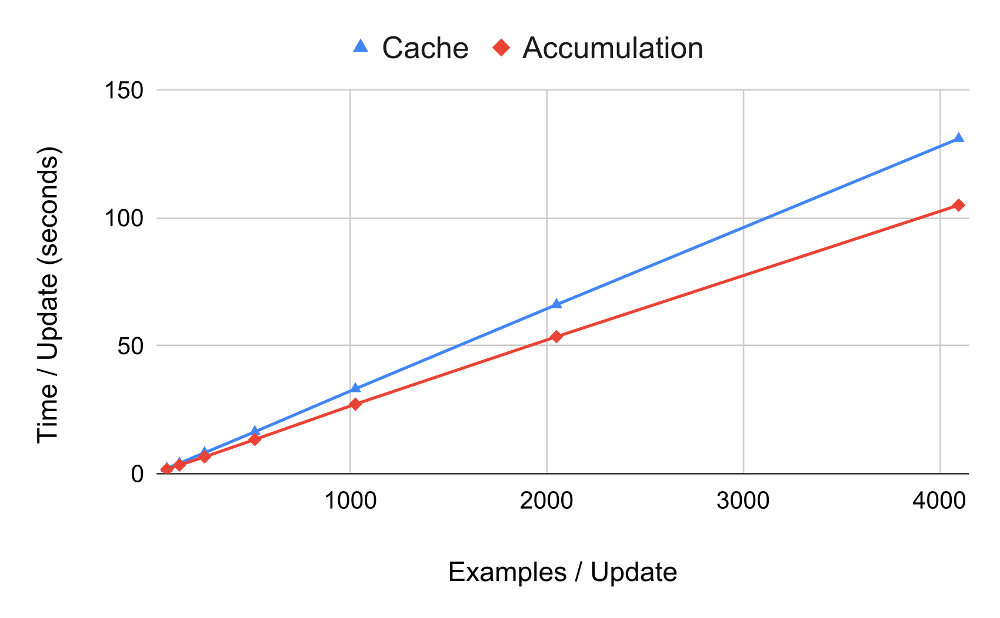

# Scaling Deep Contrastive Learning Batch Size under Memory Limited Setup / 全文中英对照

> 来源：[arXiv:2101.06983v2](https://arxiv.org/abs/2101.06983v2)。英文段落后紧接中文，覆盖所取 HTML 版本的主文、附录、图表、脚注与参考文献；公式、数字表和书目信息共用。中文以机器初译为底稿，进行了术语整理与结构核对，尚未逐句人工审定；遇到歧义请以紧邻英文和原论文为准。 原作版权归所列作者，许可见 [原作许可](https://creativecommons.org/licenses/by/4.0/)；中文译文与版式改写在该许可条件下提供（涉及 SA 时沿用相同许可，涉及 NC 时仅限非商业使用）。

## Authors and affiliations / 作者与机构

Luyu Gao Affiliation: Language Technologies Institute, Carnegie Mellon University Affiliation: {luyug, callan}@cs.cmu.edu Yunyi Zhang Affiliation: Department of Computer Science, University of Illinois Urbana-Champaign Affiliation: {yzhan238, hanj}@illionis.edu Jiawei Han Affiliation: Department of Computer Science, University of Illinois Urbana-Champaign Affiliation: {yzhan238, hanj}@illionis.edu Jamie Callan Affiliation: Language Technologies Institute, Carnegie Mellon University Affiliation: {luyug, callan}@cs.cmu.edu

## Abstract / 摘要

**EN.** Contrastive learning has been applied successfully to learn vector representations of text. Previous research demonstrated that learning high-quality representations benefits from batch-wise contrastive loss with a large number of negatives. In practice, the technique of in-batch negative is used, where for each example in a batch, other batch examples’ positives will be taken as its negatives, avoiding encoding extra negatives. This, however, still conditions each example’s loss on all batch examples and requires fitting the entire large batch into GPU memory. This paper introduces a gradient caching technique that decouples backpropagation between contrastive loss and the encoder, removing encoder backward pass data dependency along the batch dimension. As a result, gradients can be computed for one subset of the batch at a time, leading to almost constant memory usage. [^footnote1]

**中.** 对比学习已成功应用于学习文本的向量表示。先前的研究表明，学习高质量的表示受益于具有大量负数的批量对比损失。在实践中，使用了批内负例技术，其中对于批次中的每个示例，其他批次示例的正例将被视为其负例，从而避免编码额外的负例。然而，这仍然会限制每个示例在所有批次示例上的损失，并且需要将整个大批次放入 GPU 内存中。本文介绍了一种梯度缓存技术，该技术可解耦对比损失和编码器之间的反向传播，从而消除编码器沿批量维度向后传递数据的依赖性。因此，一次可以计算批次的一个子集的梯度​​，从而导致几乎恒定的内存使用量。 [^footnote1]

## Introduction / 简介

**EN.** Contrastive learning learns to encode data into an embedding space such that related data points have closer representations and unrelated ones have further apart ones. Recent works in NLP adopt deep neural nets as encoders and use unsupervised contrastive learning on sentence representation Giorgi et al. (2020) , text retrieval Lee et al. (2019) , and language model pre-training tasks Wu et al. (2020) . Supervised contrastive learning Khosla et al. (2020) has also been shown effective in training dense retrievers Karpukhin et al. (2020) ; Qu et al. (2020) . These works typically use batch-wise contrastive loss, sharing target texts as in-batch negatives. With such a technique, previous works have empirically shown that larger batches help learn better representations. However, computing loss and updating model parameters with respect to a big batch require encoding all batch data and storing all activation, so batch size is limited by total available GPU memory. This limits application and research of contrastive learning methods under memory limited setup, e.g. academia. For example, Lee et al. (2019) pre-train a BERT Devlin et al. (2019) passage encoder with a batch size of 4096 while a high-end commercial GPU RTX 2080ti can only fit a batch of 8. The gradient accumulation technique, splitting a large batch into chunks and summing gradients across several backwards, cannot emulate a large batch as each smaller chunk has fewer in-batch negatives.

**中.** 对比学习学习将数据编码到嵌入空间中，使得相关数据点具有更接近的表示，而不相关的数据点具有更远的表示。 NLP 领域的最新工作采用深度神经网络作为编码器，并在句子表示上使用无监督对比学习 Giorgi 等人。 (2020)，文本检索 Lee 等人。 (2019) 和语言模型预训练任务 Wu 等人。 （2020）。监督对比学习 Khosla 等人。 Karpukhin 等人（2020）在训练密集猎犬方面也被证明是有效的。 (2020);曲等人。 （2020）。这些作品通常使用批量对比损失，将目标文本共享为批量负片。通过这种技术，之前的工作已经根据经验表明，较大的批次有助于学习更好的表示。然而，针对大批量的计算损失和更新模型参数需要对所有批量数据进行编码并存储所有激活，因此批量大小受到总可用 GPU 内存的限制。这限制了内存有限设置下对比学习方法的应用和研究，例如学术界。例如，李等人。 (2019) 预训练 BERT Devlin 等人。 (2019) 通道编码器的批量大小为 4096，而高端商用 GPU RTX 2080ti 只能容纳 8 个批量。梯度累积技术将大批量分成块并在多个向后求和梯度，无法模拟大批量，因为每个较小的块具有较少的批内负数。

**EN.** In this paper, we present a simple technique that thresholds peak memory usage for contrastive learning to almost constant regardless of the batch size. For deep contrastive learning, the memory bottlenecks are at the deep neural network based encoder. We observe that we can separate the back-propagation process of contrastive loss into two parts, from loss to representation, and from representation to model parameter, with the latter being independent across batch examples given the former, detailed in subsection 3.2 . We then show in subsection 3.3 that by separately pre-computing the representations’ gradient and store them in a cache, we can break the update of the encoder into multiple sub-updates that can fit into the GPU memory. This pre-computation of gradients allows our method to produce the exact same gradient update as training with large batch. Experiments show that with about 20% increase in runtime, our technique enables a single consumer-grade GPU to reproduce the state-of-the-art large batch trained models that used to require multiple professional GPUs.

**中.** 在本文中，我们提出了一种简单的技术，将对比学习的峰值内存使用阈值设置为几乎恒定，无论批量大小如何。对于深度对比学习，内存瓶颈在于基于深度神经网络的编码器。我们观察到，我们可以将对比损失的反向传播过程分为两部分，从损失到表示，以及从表示到模型参数，考虑到前者，后者在批次示例中是独立的，详见第 3.2 小节。然后我们在第 3.3 小节中展示，通过单独预先计算表示的梯度并将其存储在缓存中，我们可以将编码器的更新分解为多个可以放入 GPU 内存的子更新。这种梯度的预计算使我们的方法能够产生与大批量训练完全相同的梯度更新。实验表明，我们的技术使运行时间增加了约 20%，使单个消费级 GPU 能够重现过去需要多个专业 GPU 的最先进的大批量训练模型。

## Related Work / 相关工作

#### Contrastive Learning / 对比学习

**EN.** First introduced for probablistic language modeling Mnih and Teh (2012) , Noise Contrastive Estimation (NCE) was later used by Word2Vec Mikolov et al. (2013) to learn word embedding. Recent works use contrastive learning to unsupervisedly pre-train Lee et al. (2019) ; Chang et al. (2020) as well as supervisedly train dense retriever Karpukhin et al. (2020) , where contrastive loss is used to estimate retrieval probability over the entire corpus. Inspired by SimCLR Chen et al. (2020) , constrastive learning is used to learn better sentence representation Giorgi et al. (2020) and pre-trained language model Wu et al. (2020) .

**中.** 噪声对比估计 (NCE) 最初被引入用于概率语言建模 Mnih 和 Teh (2012)，后来被 Word2Vec Mikolov 等人使用。 （2013）学习词嵌入。最近的作品使用对比学习来无监督地预训练 Lee 等人。 (2019);张等人。 （2020）以及监督训练密集型猎犬 Karpukhin 等人。 (2020)，其中对比损失用于估计整个语料库的检索概率。受到 SimCLR Chen 等人的启发。 (2020)，对比学习用于学习更好的句子表示 Giorgi 等人。 (2020) 和预训练语言模型 Wu 等人。 （2020）。

#### Deep Network Memory Reduction / 深度网络内存减少

**EN.** Many existing techniques deal with large and deep models. The gradient checkpoint method attempts to emulate training deep networks by training shallower layers and connecting them with gradient checkpoints and re-computation Chen et al. (2016) . Some methods also use reversible activation functions, allowing internal activation in the network to be recovered throughout back propagation Gomez et al. (2017) ; MacKay et al. (2018) . However, their effectiveness as part of contrastive encoders has not been confirmed. Recent work also attempts to remove the redundancy in optimizer tracked parameters on each GPU Rajbhandari et al. (2020) . Compared with the aforementioned methods, our method is designed for scaling over the batch size dimension for contrastive learning.

**中.** 许多现有技术处理大型和深度模型。梯度检查点方法试图通过训练较浅的层并将它们与梯度检查点连接并重新计算来模拟训练深层网络。 （2016）。一些方法还使用可逆激活函数，允许网络中的内部激活在整个反向传播过程中恢复 Gomez 等人。 (2017);麦凯等人。 （2018）。然而，它们作为对比编码器一部分的有效性尚未得到证实。最近的工作还尝试消除每个 GPU 上优化器跟踪参数中的冗余 Rajbhandari 等人。 （2020）。与上述方法相比，我们的方法旨在扩展批量大小维度以进行对比学习。

## Methodologies / 方法论

**EN.** In this section, we formally introduce the notations for contrastive loss and analyze the difficulties of using it on limited hardware. We then show how we can use a Gradient Cache technique to factor the loss so that large batch gradient update can be broken into several sub-updates.

**中.** 在本节中，我们正式介绍对比损失的符号，并分析在有限的硬件上使用它的困难。然后，我们展示如何使用梯度缓存技术来分解损失，以便将大批量梯度更新分解为多个子更新。

### Preliminaries / 预赛

**EN.** Under a general formulation, given two classes of data $\mathcal{S},\mathcal{T}$ , we want to learn encoders $f$ and $g$ for each such that, given $s\in\mathcal{S},t\in\mathcal{T}$ , encoded representations $f(s)$ and $g(t)$ are close if related and far apart if not related by some distance measurement. For large $\mathcal{S}$ and $\mathcal{T}$ and deep neural network based $f$ and $g$ , direct training is not tractable, so a common approach is to use a contrastive loss: sample anchors $S\subset\mathcal{S}$ and targets $T\subset\mathcal{T}$ as a training batch, where each element $s_{i}\in S$ has a related element $t_{r_{i}}\in T$ as well as zero or more specially sampled hard negatives. The rest of the random samples in $T$ will be used as in-batch negatives. Define loss based on dot product as follows:

**中.** 在一般公式下，给定两类数据 $\mathcal{S},\mathcal{T}$ ，我们希望为每类数据学习编码器 $f$ 和 $g$ ，这样，给定 $s\in\mathcal{S},t\in\mathcal{T}$ ，编码表示 $f(s)$ 和 $g(t)$ 如果相关，则接近，如果通过某种距离测量不相关，则相距较远。对于大型 $\mathcal{S}$ 和 $\mathcal{T}$ 以及基于 $f$ 和 $g$ 的深度神经网络，直接训练不易处理，因此常见的方法是使用对比损失：样本锚点 $S\subset\mathcal{S}$ 和目标 $T\subset\mathcal{T}$ 作为训练批次，其中每个元素 $s_{i}\in S$ 都有一个相关元素$t_{r_{i}}\in T$ 以及零个或多个专门采样的难负例。 $T$ 中的其余随机样本将用作批次内负样本。基于点积的损失定义如下：

$$
\mathcal{L}=-\frac{1}{|S|}\sum_{s_{i}\in S}\log\frac{exp(f(s_{i})^{\top}g(t_{r_{i}})/\tau)}{\sum_{t_{j}\in T}exp(f(s_{i})^{\intercal}g(t_{j})/\tau)}\tag{1}
$$

**EN.** where each summation term depends on the entire set $T$ and requires fitting all of them into memory.

**中.** 其中每个求和项取决于整个集合 $T$ 并且需要将它们全部拟合到内存中。

**EN.** We set temperature $\tau=1$ in the following discussion for simplicity as in general it only adds a constant multiplier to the gradient.

**中.** 为了简单起见，我们在下面的讨论中设置温度 $\tau=1$，因为通常它只向梯度添加一个常数乘数。

### Analysis of Computation / 计算分析

**EN.** In this section, we give a mathematical analysis of contrastive loss computation and its gradient. We show that the back propagation process can be divided into two parts, from loss to representation, and from representation to encoder model. The separation then enables us to devise a technique that removes data dependency in encoder parameter update. Suppose the function $f$ is parameterized with $\Theta$ and $g$ is parameterized with $\Lambda$ .

**中.** 在本节中，我们对对比损失计算及其梯度进行数学分析。我们证明反向传播过程可以分为两个部分，从损失到表示，以及从表示到编码器模型。这种分离使我们能够设计一种技术来消除编码器参数更新中的数据依赖性。假设函数 $f$ 用 $\Theta$ 参数化， $g$ 用 $\Lambda$ 参数化。

$$
\displaystyle\frac{\partial\mathcal{L}}{\partial\Theta} \displaystyle=\sum_{s_{i}\in S}\frac{\partial\mathcal{L}}{\partial f(s_{i})}\frac{\partial f(s_{i})}{\partial\Theta}\tag{2}
$$

$$
\displaystyle\frac{\partial\mathcal{L}}{\partial\Lambda} \displaystyle=\sum_{t_{j}\in T}\frac{\partial\mathcal{L}}{\partial g(t_{j})}\frac{\partial g(t_{j})}{\partial\Lambda}\tag{3}
$$

**EN.** As an extra notation, denote normalized similarity,

**中.** 作为额外的符号，表示标准化相似度，

$$
p_{ij}=\frac{exp(f(s_{i})^{\intercal}g(t_{j}))}{\sum_{t\in T}exp(f(s_{i})^{\intercal}g(t))}\tag{4}
$$

**EN.** We note that the summation term for a particular $s_{i}$ or $t_{i}$ is a function of the batch, as,

**中.** 我们注意到，特定 $s_{i}$ 或 $t_{i}$ 的求和项是批次的函数，如下所示：

$$
\displaystyle\frac{\partial\mathcal{L}}{\partial f(s_{i})} \displaystyle=-\frac{1}{|S|}\left(g(t_{r_{i}})-\sum_{t_{j}\in T}p_{ij}g(t_{j})\right),\tag{5}
$$

$$
\displaystyle\frac{\partial\mathcal{L}}{\partial g(t_{j})} \displaystyle=-\frac{1}{|S|}\left(\epsilon_{j}-\sum_{s_{i}\in S}p_{ij}f(s_{i})\right),\tag{6}
$$

**EN.** where

**中.** 哪里

$$
\epsilon_{j}=\begin{cases}f(s_{k})&\text{if}\;\exists\;k\;\text{s.t.}\;r_{k}=j\\
0&\text{otherwise}\end{cases}\tag{7}
$$

**EN.** which prohibits the use of gradient accumulation. We make two observations here:

**中.** 这禁止使用梯度累积。我们在这里提出两个观察：

**EN.** The partial derivative $\frac{\partial f(s_{i})}{\partial\Theta}$ depends only on $s_{i}$ and $\Theta$ while $\frac{\partial g(t_{j})}{\partial\Lambda}$ depends only on $t_{j}$ and $\Lambda$ ; and

**中.** 偏导数 $\frac{\partial f(s_{i})}{\partial\Theta}$ 仅取决于 $s_{i}$ 和 $\Theta$，而 $\frac{\partial g(t_{j})}{\partial\Lambda}$ 仅取决于 $t_{j}$ 和 $\Lambda$ ；和

**EN.** Computing partial derivatives $\frac{\partial\mathcal{L}}{\partial f(s_{i})}$ and $\frac{\partial\mathcal{L}}{\partial g(t_{j})}$ requires only encoded representations, but not $\Theta$ or $\Lambda$ .

**中.** 计算偏导数 $\frac{\partial\mathcal{L}}{\partial f(s_{i})}$ 和 $\frac{\partial\mathcal{L}}{\partial g(t_{j})}$ 仅需要编码表示，而不需要 $\Theta$ 或 $\Lambda$ 。

**EN.** These observations mean back propagation of $f(s_{i})$ for data $s_{i}$ can be run independently with its own computation graph and activation if the numerical value of the partial derivative $\frac{\partial\mathcal{L}}{\partial s_{i}}$ is known. Meanwhile the derivation of $\frac{\partial\mathcal{L}}{\partial s_{i}}$ requires only numerical values of two sets of representation vectors $F=\{f(s_{1}),f(s_{2}),..,f(s_{|S|})\}$ and $G=\{g(t_{1}),g(t_{2}),...,g(t_{|T|})\}$ . A similar argument holds true for $g$ , where we can use representation vectors to compute $\frac{\partial\mathcal{L}}{\partial t_{j}}$ and back propagate for each $g(t_{j})$ independently. In the next section, we will describe how to scale up batch size by pre-computing these representation vectors.

**中.** 这些观察结果意味着，如果偏导数 $\frac{\partial\mathcal{L}}{\partial s_{i}}$ 的数值已知，则数据 $s_{i}$ 的 $f(s_{i})$ 反向传播可以通过其自己的计算图和激活独立运行。同时$\frac{\partial\mathcal{L}}{\partial s_{i}}$的推导只需要两组表示向量$F=\{f(s_{1}),f(s_{2}),..,f(s_{|S|})\}$和$G=\{g(t_{1}),g(t_{2}),...,g(t_{|T|})\}$的数值。类似的论点也适用于 $g$ ，我们可以使用表示向量来计算 $\frac{\partial\mathcal{L}}{\partial t_{j}}$ 并独立地反向传播每个 $g(t_{j})$ 。在下一节中，我们将描述如何通过预先计算这些表示向量来扩大批量大小。

### Gradient Cache Technique / 梯度缓存技术

**EN.** Given a large batch that does not fit into the available GPU memory for training, we first divide it into a set of sub-batches each of which can fit into memory for gradient computation, denoted as $\mathbb{S}=\{\hat{S}_{1},\hat{S}_{2},..\},\mathbb{T}=\{\hat{T}_{1},\hat{T}_{2},..\}$ . The full-batch gradient update is computed by the following steps.

**中.** 给定一个大批次，不适合用于训练的可用 GPU 内存，我们首先将其分成一组子批次，每个子批次都可以放入内存中进行梯度计算，表示为 $\mathbb{S}=\{\hat{S}_{1},\hat{S}_{2},..\},\mathbb{T}=\{\hat{T}_{1},\hat{T}_{2},..\}$ 。全批量梯度更新通过以下步骤计算。

#### Step1: Graph-less Forward / Step1：无图转发

**EN.** Before gradient computation, we first run an extra encoder forward pass for each batch instance to get its representation. Importantly, this forward pass runs without constructing the computation graph. We collect and store all representations computed.

**中.** 在梯度计算之前，我们首先对每个批处理实例运行额外的编码器前向传递以获得其表示。重要的是，此前向传递无需构建计算图即可运行。我们收集并存储计算出的所有表示。

#### Step2: Representation Gradient Computation and Caching / Step2：表示梯度计算和缓存

**EN.** We then compute the contrastive loss for the batch based on the representation from Step1 and have a corresponding computation graph constructed. Despite the mathematical derivation, automatic differentiation system is used in actual implementation, which automatically supports variations of contrastive loss. A backward pass is then run to populate gradients for each representation. Note that the encoder is not included in this gradient computation. Let $\mathbf{u}_{i}=\frac{\partial\mathcal{L}}{\partial f(s_{i})}$ and $\mathbf{v}_{i}=\frac{\partial\mathcal{L}}{\partial g(t_{i})}$ , we take these gradient tensors and store them as a Representation Gradient Cache , $[\mathbf{u}_{1},\mathbf{u}_{2},..,\mathbf{v}_{1},\mathbf{v}_{2},..]$ .

**中.** 然后，我们根据步骤 1 的表示计算批次的对比损失，并构建相应的计算图。尽管是数学推导，但在实际实现中使用了自动微分系统，自动支持对比损失的变化。然后运行向后传递来填充每个表示的梯度。请注意，编码器不包含在该梯度计算中。让$\mathbf{u}_{i}=\frac{\partial\mathcal{L}}{\partial f(s_{i})}$和$\mathbf{v}_{i}=\frac{\partial\mathcal{L}}{\partial g(t_{i})}$，我们将这些梯度张量存储为表示梯度缓存，$[\mathbf{u}_{1},\mathbf{u}_{2},..,\mathbf{v}_{1},\mathbf{v}_{2},..]$。

#### Step3: Sub-batch Gradient Accumulation / Step3：子批次梯度累加

**EN.** We run encoder forward one sub-batch at a time to compute representations and build the corresponding computation graph. We take the sub-batch’s representation gradients from the cache and run back propagation through the encoder. Gradients are accumulated for encoder parameters across all sub-batches. Effectively for $f$ we have,

**中.** 我们一次向前运行一个子批次的编码器来计算表示并构建相应的计算图。我们从缓存中获取子批次的表示梯度，并通过编码器运行反向传播。累积所有子批次的编码器参数的梯度。对于 $f$ 我们有效的是，

$$
\displaystyle\begin{split}\frac{\partial\mathcal{L}}{\partial\Theta}&=\sum_{\hat{S}_{j}\in\mathbb{S}}\sum_{s_{i}\in\hat{S}_{j}}\frac{\partial\mathcal{L}}{\partial f(s_{i})}\frac{\partial f(s_{i})}{\partial\Theta}\\
&=\sum_{\hat{S}_{j}\in\mathbb{S}}\sum_{s_{i}\in\hat{S}_{j}}\mathbf{u}_{i}\frac{\partial f(s_{i})}{\partial\Theta}\end{split}\tag{8}
$$

**EN.** where the outer summation enumerates each sub-batch and the entire internal summation corresponds to one step of accumulation. Similarly, for $g$ , gradients accumulate based on,

**中.** 其中外部求和枚举了每个子批次，整个内部求和对应于一个累加步骤。类似地，对于 $g$ ，梯度累积基于：

$$
\frac{\partial\mathcal{L}}{\partial\Lambda}=\sum_{\hat{T}_{j}\in\mathbb{T}}\sum_{t_{i}\in\hat{T}_{j}}\mathbf{v}_{i}\frac{\partial g(t_{i})}{\partial\Lambda}\tag{9}
$$

**EN.** Here we can see the equivalence with direct large batch update by combining the two summations.

**中.** 在这里，我们可以通过组合两个求和来看到与直接大批量更新的等价性。

#### Step4: Optimization / 第四步：优化

**EN.** When all sub-batches are processed, we can step the optimizer to update model parameters as if the full batch is processed in a single forward-backward pass.

**中.** 当所有子批次都处理完毕后，我们可以逐步优化器来更新模型参数，就像在单个前向-后向传递中处理整个批次一样。

**EN.** Compared to directly updating with the full batch, which requires memory linear to the number of examples, our method fixes the number of examples in each encoder gradient computation to be the size of sub-batch and therefore requires constant memory for encoder forward-backward pass. The extra data pieces introduced by our method that remain persistent across steps are the representations and their corresponding gradients with the former turned into the latter after representation gradient computation. Consequently, in a general case with data from $S$ and $T$ each represented with $d$ dimension vectors, we only need to store $(|S|d+|T|d)$ floating points in the cache on top of the computation graph. To remind our readers, this is several orders smaller than million-size model parameters.

**中.** 与直接使用全批次进行更新相比，这需要与示例数量成线性关系的内存，我们的方法将每个编码器梯度计算中的示例数量固定为子批次的大小，因此需要恒定的内存用于编码器前向-后向传递。我们的方法引入的跨步骤保持不变的额外数据片段是表示及其相应的梯度，在表示梯度计算后前者变成了后者。因此，在一般情况下，来自 $S$ 和 $T$ 的数据均用 $d$ 维度向量表示，我们只需将 $(|S|d+|T|d)$ 浮点存储在计算图顶部的缓存中。提醒读者，这比百万级模型参数小几个数量级。

### Multi-GPU Training / 多GPU训练

**EN.** When training on multiple GPUs, we need to compute the gradients with all examples across all GPUs. This requires a single additional cross GPU communication after Step1 when all representations are computed. We use an all-gather operation to make all representations available on all GPUs. Denote $F^{n},G^{n}$ representations on $n$ -th GPU and a total of N device. Step2 runs with gathered representations $F^{\text{all}}=F^{1}\cup..\cup F^{N}$ and $G^{\text{all}}=G^{1}\cup..\cup G^{N}$ . While $F^{\text{all}}$ and $G^{\text{all}}$ are used to compute loss, the $n$ -th GPU only computes gradient of its local representations $F^{n},G^{n}$ and stores them into cache. No communication happens in Step3 , when each GPU independently computes gradient for local representations. Step4 will then perform gradient reduction across GPUs as with standard parallel training.

**中.** 在多个 GPU 上进行训练时，我们需要使用所有 GPU 上的所有示例来计算梯度。当计算所有表示时，这需要在第 1 步之后进行一次额外的跨 GPU 通信。我们使用全收集操作来使所有表示在所有 GPU 上可用。表示 $F^{n},G^{n}$ 在 $n$ 个 GPU 和总共 N 个设备上的表示。 Step2 使用收集的表示 $F^{\text{all}}=F^{1}\cup..\cup F^{N}$ 和 $G^{\text{all}}=G^{1}\cup..\cup G^{N}$ 运行。虽然 $F^{\text{all}}$ 和 $G^{\text{all}}$ 用于计算损失，但 $n$ GPU 仅计算其本地表示 $F^{n},G^{n}$ 的梯度并将其存储到缓存中。当每个 GPU 独立计算局部表示的梯度时，在 Step3 中不会发生任何通信。然后，Step4 将像标准并行训练一样在 GPU 上执行梯度下降。

## Experiments / 实验

**EN.** To examine the reliability and computation cost of our method, we implement our method into dense passage retriever (DPR; Karpukhin et al. (2020) ) [^footnote2] . We use gradient cache to compute DPR’s supervised contrastive loss on a single GPU. Following DPR paper, we measure top hit accuracy on the Natural Question Dataset Kwiatkowski et al. (2019) for different methods. We then examine the training speed of various batch sizes.

**中.** 为了检查我们方法的可靠性和计算成本，我们将我们的方法实现到密集段落检索器（DPR；Karpukhin 等人（2020））[^footnote2] 中。我们使用梯度缓存在单个 GPU 上计算 DPR 的监督对比损失。在 DPR 论文之后，我们测量了自然问题数据集 Kwiatkowski 等人的最高命中准确度。 （2019）不同的方法。然后我们检查不同批量大小的训练速度。

| Method 方法 | Top-5 前5名 | Top-20 前20名 | Top-100 前100名 |
| --- | --- | --- | --- |
| DPR | - | 78.4 | 85.4 |
| Sequential 顺序 | 59.3 | 71.9 | 80.9 |
| Accumulation 积累 | 64.3 | 77.2 | 84.9 |
| Cache 缓存 | 68.6 | 79.3 | 86.0 |
| - BSZ = 512 | 68.3 | 79.9 | 86.6 |

**EN.** Table 1: Retrieval: We compare top-5/20/100 hit accuracy of small batch update (Sequential), accumulated small batch (Accumulation) and gradient cache (Cache) systems with DPR reference.

**中.** 表1：检索：我们将小批量更新（Sequential）、累积小批量（Accumulation）和梯度缓存（Cache）系统的top-5/20/100命中精度与DPR参考进行比较。

### Retrieval Accuracy / 检索准确率

#### Compared Systems / 比较系统

**EN.** 1) DPR : the reference number taken from the original paper trained on 8 GPUs, 2) Sequential : update with max batch size that fits into 1 GPU, 3) Accumulation : similar to Sequential but accumulate gradients and update until number of examples matches DPR setup, 4) Cache : training with DPR setup using our gradient cache on 1 GPU. We attempted to run with gradient checkpointing but found it cannot scale to standard DPR batch size on our hardware.

**中.** 1) DPR：参考数字取自在 8 个 GPU 上训练的原始论文，2) 顺序：使用适合 1 个 GPU 的最大批量大小进行更新，3) 累积：与顺序类似，但累积梯度并更新，直到示例数量与 DPR 设置匹配，4) 缓存：在 1 个 GPU 上使用我们的梯度缓存进行 DPR 设置训练。我们尝试使用梯度检查点运行，但发现它无法在我们的硬件上扩展到标准 DPR 批量大小。

#### Implementations / 实施

**EN.** All runs start with the same random seed and follow DPR training hyperparameters except batch size. Cache uses a batch size of 128 same as DPR and runs with a sub-batch size of 16 for questions and 8 for passages. We also run Cache with a batch size of 512 (BSZ=512) to examine the behavior of even larger batches. Sequential uses a batch size of 8, the largest that fits into memory. Accumulation will accumulate 16 of size-8 batches. Each question is paired with a positive and a BM25 negative passage. All experiments use a single RTX 2080ti.

**中.** 所有运行都以相同的随机种子开始，并遵循 DPR 训练超参数（批量大小除外）。 Cache 使用与 DPR 相同的批量大小 128，并以 16 个问题的子批量大小和 8 个段落的子批量大小运行。我们还运行批量大小为 512 (BSZ=512) 的缓存，以检查更大批量的行为。 Sequential 使用的批量大小为 8，这是内存中可以容纳的最大批量大小。累积将累积 16 个 8 批次。每个问题都配有一个积极的段落和一个 BM25 消极的段落。所有实验均使用单个 RTX 2080ti。

#### Results / 结果

**EN.** Accuracy results are shown in Table 1 . We observe that Cache performs better than DPR reference due to randomness in training. Further increasing batch size to 512 can bring in some advantage at top 20/100. Accumulation and Sequential results confirm the importance of a bigger batch and more negatives. For Accumulation which tries to match the batch size but has fewer negatives, we see a drop in performance which is larger towards the top. In the sequential case, a smaller batch incurs higher variance, and the performance further drops. In summary, our Cache method improves over standard methods and matches the performance of large batch training.

**中.** 准确度结果如表1所示。我们观察到，由于训练的随机性，Cache 的性能优于 DPR 参考。进一步将批量大小增加到 512 可以在前 20/100 中带来一些优势。累积和序贯结果证实了更大批次和更多负片的重要性。对于尝试匹配批量大小但负数较少的累加，我们看到性能下降，越往上越严重。在顺序情况下，较小的批次会产生较高的方差，并且性能进一步下降。总之，我们的 Cache 方法比标准方法有所改进，并且与大批量训练的性能相匹配。

**EN.** Figure 1: We compare training speed versus the number of examples per update for gradient cache (Cache) and gradient accumulation (Accumulation).

**中.** 图 1：我们比较梯度缓存 (Cache) 和梯度积累 (Accumulation) 的训练速度与每次更新的示例数量。

### Training Speed / 训练速度

**EN.** In Figure 1 , we compare update speed of gradient cache and accumulation with per update example number of $\{64,128,256,512,1024,2048,4096\}$ . We observe gradient cache method can steadily scale up to larger batch update and uses 20% more time for representation pre-computation. This extra cost enables it to create an update of a much larger batch critical for the best performance, as shown by previous experiments and many early works. While the original DPR reports a training time of roughly one day on 8 V100 GPUs, in practice, with improved data loading, our gradient cache code can train a dense retriever in a practical 31 hours on a single RTX2080ti. We also find gradient checkpoint only runs up to batch of 64 and consumes twice the amount of time than accumulation [^footnote3] .

**中.** 在图1中，我们将梯度缓存和累积的更新速度与$\{64,128,256,512,1024,2048,4096\}$的每次更新示例数量进行比较。我们观察到梯度缓存方法可以稳定地扩展到更大的批量更新，并且使用 20% 的时间进行表示预计算。正如之前的实验和许多早期工作所表明的那样，这种额外的成本使其能够创建对最佳性能至关重要的更大批次的更新。虽然原始 DPR 报告在 8 个 V100 GPU 上的训练时间约为一天，但实际上，通过改进数据加载，我们的梯度缓存代码可以在单个 RTX2080ti 上在实际 31 小时内训练稠密检索器。我们还发现梯度检查点最多只能运行 64 个批次，并且消耗的时间是累积 [^footnote3] 的两倍。

## Extend to Deep Distance Function / 扩展到深距离函数

**EN.** Previous discussion assumes a simple parameter-less dot product similarity. In general it can also be deep distance function $\Phi$ richly parameterized by $\Omega$ , formally,

**中.** 前面的讨论假设了简单的无参数点积相似性。一般来说，它也可以是由 $\Omega$ 丰富参数化的深度距离函数 $\Phi$ ，形式上，

$$
d_{ij}=d(s_{i},t_{j})=\Phi(f(s_{i}),g(t_{j}))\tag{10}
$$

**EN.** This can still scale by introducing an extra Distance Gradient Cache . In the first forward we collect all representations as well as all distances. We compute loss with $d_{ij}$ s and back propagate to get $w_{ij}=\frac{\partial\mathcal{L}}{\partial d_{ij}}$ , and store them in Distance Gradient Cache, $[w_{00},w_{01},..,w_{10},..]$ . We can then update $\Omega$ in a sub-batch manner,

**中.** 这仍然可以通过引入额外的距离梯度缓存来扩展。在第一个转发中，我们收集所有表示以及所有距离。我们使用 $d_{ij}$ 计算损失并反向传播以获得 $w_{ij}=\frac{\partial\mathcal{L}}{\partial d_{ij}}$ ，并将它们存储在距离梯度缓存 $[w_{00},w_{01},..,w_{10},..]$ 中。然后我们可以分批更新$\Omega$，

$$
\frac{\partial\mathcal{L}}{\partial\Omega}=\sum_{\hat{S}\in\mathbb{S}}\sum_{\hat{T}\in\mathbb{T}}\sum_{s_{i}\in\hat{S}}\sum_{t_{j}\in\hat{T}}w_{ij}\frac{\partial\Phi(f(s_{i}),g(t_{j}))}{\partial\Omega}\tag{11}
$$

**EN.** Additionally, we simultaneously compute with the constructed computation graph $\frac{\partial d_{ij}}{\partial f(s_{i})}$ and $\frac{\partial d_{ij}}{\partial g(t_{j})}$ and accumulate across batches,

**中.** 此外，我们同时使用构建的计算图$\frac{\partial d_{ij}}{\partial f(s_{i})}$和$\frac{\partial d_{ij}}{\partial g(t_{j})}$进行计算并跨批次进行累积，

$$
\mathbf{u}_{i}=\frac{\partial\mathcal{L}}{\partial f(s_{i})}=\sum_{j}w_{ij}\frac{\partial d_{ij}}{\partial f(s_{i})}\tag{12}
$$

**EN.** and,

**中.** 并且，

$$
\mathbf{v}_{j}=\frac{\partial\mathcal{L}}{\partial g(t_{j})}=\sum_{i}w_{ij}\frac{\partial d_{ij}}{\partial g(t_{j})}\tag{13}
$$

**EN.** with which we can build up the Representation Gradient Cache. When all representations’ gradients are computed and stored, encoder gradient can be computed with Step3 described in subsection 3.3 . In philosophy this method links up two caches. Note this covers early interaction $f(s)=s,g(t)=t$ as a special case.

**中.** 我们可以用它来构建表示梯度缓存。当所有表示的梯度被计算和存储时，编码器梯度可以用第3.3小节中描述的步骤3来计算。从原理上讲，该方法连接两个缓存。请注意，这涵盖了早期交互 $f(s)=s,g(t)=t$ 作为一个特例。

## Conclusion / 结论

**EN.** In this paper, we introduce a gradient cache technique that breaks GPU memory limitations for large batch contrastive learning. We propose to construct a representation gradient cache that removes in-batch data dependency in encoder optimization. Our method produces the exact same gradient update as training with a large batch. We show the method is efficient and capable of preserving accuracy on resource-limited hardware. We believe a critical contribution of our work is providing a large population in the NLP community with access to batch-wise contrastive learning. While many previous works come from people with industry-grade hardware, researchers with limited hardware can now use our technique to reproduce state-of-the-art models and further advance the research without being constrained by available GPU memory.

**中.** 在本文中，我们介绍了一种梯度缓存技术，该技术打破了大批量对比学习的 GPU 内存限制。我们建议构建一个表示梯度缓存，以消除编码器优化中的批量数据依赖性。我们的方法产生与大批量训练完全相同的梯度更新。我们证明了该方法是有效的，并且能够在资源有限的硬件上保持准确性。我们相信我们工作的一个重要贡献是为 NLP 社区中的大量人员提供批量对比学习的机会。虽然之前的许多工作都来自拥有工业级硬件的人，但硬件有限的研究人员现在可以使用我们的技术来重现最先进的模型并进一步推进研究，而不受可用 GPU 内存的限制。

## Acknowledgments / 致谢

**EN.** The authors would like to thank Zhuyun Dai and Chenyan Xiong for comments on the paper, and the anonymous reviewers for their reviews.

**中.** 作者衷心感谢戴竹云和熊晨燕对本文的评论，以及匿名审稿人的审阅。

## References / 参考文献

- Chang et al. (2020) Wei-Cheng Chang, Felix X. Yu, Yin-Wen Chang, Yiming Yang, and Sanjiv Kumar. 2020. [Pre-training tasks for embedding-based large-scale retrieval](https://openreview.net/forum?id=rkg-mA4FDr) . In 8th International Conference on Learning Representations, ICLR 2020, Addis Ababa, Ethiopia, April 26-30, 2020 . OpenReview.net.

- Chen et al. (2016) T. Chen, B. Xu, C. Zhang, and Carlos Guestrin. 2016. Training deep nets with sublinear memory cost. ArXiv , abs/1604.06174.

- Chen et al. (2020) Ting Chen, Simon Kornblith, Mohammad Norouzi, and Geoffrey E. Hinton. 2020. A simple framework for contrastive learning of visual representations. ArXiv , abs/2002.05709.

- Devlin et al. (2019) Jacob Devlin, Ming-Wei Chang, Kenton Lee, and Kristina Toutanova. 2019. [BERT: Pre-training of deep bidirectional transformers for language understanding](https://doi.org/10.18653/v1/N19-1423) . In Proceedings of the 2019 Conference of the North American Chapter of the Association for Computational Linguistics: Human Language Technologies, Volume 1 (Long and Short Papers) , pages 4171–4186, Minneapolis, Minnesota. Association for Computational Linguistics.

- Giorgi et al. (2020) John Michael Giorgi, Osvald Nitski, Gary D Bader, and Bo Wang. 2020. Declutr: Deep contrastive learning for unsupervised textual representations. ArXiv , abs/2006.03659.

- Gomez et al. (2017) Aidan N. Gomez, Mengye Ren, R. Urtasun, and Roger B. Grosse. 2017. The reversible residual network: Backpropagation without storing activations. In NIPS .

- Karpukhin et al. (2020) Vladimir Karpukhin, Barlas Oguz, Sewon Min, Patrick Lewis, Ledell Wu, Sergey Edunov, Danqi Chen, and Wen-tau Yih. 2020. [Dense passage retrieval for open-domain question answering](https://doi.org/10.18653/v1/2020.emnlp-main.550) . In Proceedings of the 2020 Conference on Empirical Methods in Natural Language Processing (EMNLP) , pages 6769–6781, Online. Association for Computational Linguistics.

- Khosla et al. (2020) Prannay Khosla, Piotr Teterwak, Chen Wang, Aaron Sarna, Yonglong Tian, Phillip Isola, Aaron Maschinot, Ce Liu, and Dilip Krishnan. 2020. Supervised contrastive learning. arXiv preprint arXiv:2004.11362 .

- Kwiatkowski et al. (2019) T. Kwiatkowski, J. Palomaki, Olivia Redfield, Michael Collins, Ankur P. Parikh, C. Alberti, D. Epstein, Illia Polosukhin, J. Devlin, Kenton Lee, Kristina Toutanova, Llion Jones, Matthew Kelcey, Ming-Wei Chang, Andrew M. Dai, Jakob Uszkoreit, Q. Le, and Slav Petrov. 2019. Natural questions: A benchmark for question answering research. Transactions of the Association for Computational Linguistics , 7:453–466.

- Lee et al. (2019) Kenton Lee, Ming-Wei Chang, and Kristina Toutanova. 2019. [Latent retrieval for weakly supervised open domain question answering](https://doi.org/10.18653/v1/P19-1612) . In Proceedings of the 57th Annual Meeting of the Association for Computational Linguistics , pages 6086–6096, Florence, Italy. Association for Computational Linguistics.

- MacKay et al. (2018) Matthew MacKay, Paul Vicol, Jimmy Ba, and Roger B. Grosse. 2018. Reversible recurrent neural networks. In NeurIPS .

- Mikolov et al. (2013) Tomas Mikolov, Ilya Sutskever, Kai Chen, G. Corrado, and J. Dean. 2013. Distributed representations of words and phrases and their compositionality. In NIPS .

- Mnih and Teh (2012) A. Mnih and Y. Teh. 2012. A fast and simple algorithm for training neural probabilistic language models. In ICML .

- Qu et al. (2020) Yingqi Qu, Yuchen Ding, Jing Liu, Kai Liu, Ruiyang Ren, Xin Zhao, Daxiang Dong, Hua Wu, and Haifeng Wang. 2020. [Rocketqa: An optimized training approach to dense passage retrieval for open-domain question answering](http://arxiv.org/abs/2010.08191) .

- Rajbhandari et al. (2020) Samyam Rajbhandari, Jeff Rasley, Olatunji Ruwase, and Yuxiong He. 2020. [Zero: Memory optimizations toward training trillion parameter models](http://arxiv.org/abs/1910.02054) .

- Wu et al. (2020) Z. Wu, Sinong Wang, Jiatao Gu, Madian Khabsa, Fei Sun, and Hao Ma. 2020. Clear: Contrastive learning for sentence representation. ArXiv , abs/2012.15466.

## Footnotes / 脚注

[^footnote1]: **EN.** Our code is at [github.com/luyug/GradCache](http://github.com/luyug/GradCache) . **中.** 我们的代码位于 [github.com/luyug/GradCache](http://github.com/luyug/GradCache) 。

[^footnote2]: **EN.** Our implementation is at: [https://github.com/luyug/GC-DPR](https://github.com/luyug/GC-DPR) **中.** 我们的实现位于：[https://github.com/luyug/GC-DPR](https://github.com/luyug/GC-DPR)

[^footnote3]: **EN.** We used the gradient checkpoint implemented in Huggingface transformers package **中.** 我们使用 Huggingface Transformers 包中实现的梯度检查点
