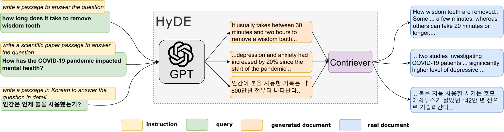

# HyDE：用假想文档构造零样本检索向量

> 先让指令语言模型写出“可能回答查询的文档”，再用无监督对比编码器把它映射到真实文档的向量空间中进行检索。
>
> Luyu Gao、Xueguang Ma、Jimmy Lin、Jamie Callan · ACL 2023 · [论文](https://aclanthology.org/2023.acl-long.99/) · [arXiv v1](https://arxiv.org/abs/2212.10496v1) · [代码](https://github.com/texttron/hyde)

## 论文简介

没有领域相关性标注时，直接把查询与文档编码成向量，不容易学到“这个短问题应该匹配哪种长文档”。HyDE 把这部分相关性建模交给指令语言模型：根据查询生成一篇假想相关文档，再用 Contriever 编码，去现有文档索引中寻找邻居。生成文本允许有不准确细节，因为它只是检索中介，最终返回的仍是真实语料。

论文在 TREC DL、六个 BEIR 任务和四种 Mr.TyDi 语言上改善了无监督 Contriever，多项成绩接近接受大量相关性监督的检索器。收益依赖生成模型和任务提示，在线生成也带来延迟；所谓稠密表示“过滤幻觉”是机制解释和经验观察，不能保证消除错误事实的影响。

## 背景与问题定义

有监督双塔通过 query–document 标签学习相关性。无监督对比编码器更自然地学习文本—文本语义相似，却不一定知道查询所需要的答案形式。HyDE 不新增目标任务的检索训练，而是把 query 转成文档式文本，尽量将检索变成同一文档空间里的邻居搜索。

相关工作包括无监督 Contriever、带标注的 DPR/ANCE，以及文档扩展和生成式检索增强。与离线 Doc2Query 为每篇文档造查询不同，HyDE 在**查询时**生成假想文档；索引中的真实文档表示可以保持不变。

## 方法流程

黄色部分是任务提示，绿色是查询，红色是生成的假想文档，蓝色是真实检索结果。生成文本不直接作为答案交给用户，而是形成用于寻找真实证据的向量。

设指令语言模型为 $g$，无监督对比编码器为 $f$。对查询 $q$ 和任务指令 $I$，采样假想文档 $\hat d_i\sim g(\cdot\mid q,I)$：

$$
v_q\approx\frac1N\sum_{i=1}^{N}f(\hat d_i),\qquad
s(q,d)=v_q^\top f(d).
$$

论文还考虑把原查询也作为一种假设加入平均：

$$
v_q=\frac{f(q)+\sum_i f(\hat d_i)}{N+1}.
$$

平均是在**向量空间**中进行，不是把多篇生成文本全部拼成一篇长文。原文用期望解释这一估计，并假设查询相关表示近似单峰；对于含糊查询，多种解释的平均可能不理想，作者将歧义与多样性留作后续研究。

## 为什么允许假想文档不完全真实

生成模型的职责是提供可能相关的内容结构、概念和表达方式，而不是给出已经验证的答案。编码器把丰富文本压缩成向量，作者认为这种信息瓶颈能忽略部分具体细节，使检索落到真实语料邻域。

这个过程并没有事实验证器。错误实体或主题若占主导，向量仍可能被带偏。论文的结论是特定实验中整体检索质量改善，不是“编码后幻觉必然被消除”。

## 实现与评测设置

主要生成器为 **text-davinci-003（InstructGPT）**，temperature 0.7；英文使用 Contriever，非英文使用 mContriever，检索工具为 Pyserini。每个数据集使用与任务匹配的提示，例如回答问题的段落、支持／反驳论点的文本、金融讨论或百科式描述。具体措辞在附录给出。

评测分三组：TREC DL19/20 基于 MS MARCO，比较 MAP、nDCG@10、Recall@1000；BEIR 子集包括 SciFact、ArguAna、TREC-COVID、FiQA、DBPedia、TREC-NEWS，覆盖科学验证、反论证、医学、金融、实体和新闻；Mr.TyDi 采用斯瓦希里语、韩语、日语、孟加拉语。

最关键的对照是同一 Contriever 直接编码查询：它与 HyDE 共用文档向量空间，差别集中在查询向量构造。另列 BM25 和使用过相关性监督的 DPR、ANCE、Contriever-FT，明确监督条件不一致。

## 英文检索结果

| 方法 | DL19 nDCG@10 | DL19 R@1000 | DL20 nDCG@10 | DL20 R@1000 |
|---|---:|---:|---:|---:|
| BM25 | 50.6 | 75.0 | 48.0 | 78.6 |
| Contriever | 44.5 | 74.6 | 42.1 | 75.4 |
| HyDE | 61.3 | 88.0 | 57.9 | 84.4 |
| DPR（有监督参照） | 62.2 | 76.9 | 65.3 | 81.4 |
| Contriever-FT（有监督参照） | 62.1 | 83.6 | 63.2 | 85.8 |

HyDE 显著改善无监督基线，DL19 的召回甚至超过这里的有监督参照，但 DL20 的前排精度仍低于 Contriever-FT。召回和前排排序应分别看。

| BEIR 任务 | Contriever nDCG@10 | HyDE | BM25 |
|---|---:|---:|---:|
| SciFact | 64.9 | 69.1 | 67.9 |
| ArguAna | 37.9 | 46.6 | 39.7 |
| TREC-COVID | 27.3 | 59.3 | 59.5 |
| FiQA | 24.5 | 27.3 | 23.6 |
| DBPedia | 29.2 | 36.8 | 31.8 |
| TREC-NEWS | 34.8 | 44.0 | 39.5 |

所有六项都改善 Contriever，但医学任务仍略低于 BM25。有监督 Contriever-FT 在 FiQA、DBPedia 上更强；作者讨论了任务提示可能不够具体这一因素，未将其作为已验证的唯一原因。

## 多语结果与组件消融

Mr.TyDi 四语上，HyDE 的 MRR@100 分别为 41.7、30.6、30.7、41.3；mContriever 为 38.3、22.3、19.5、35.3。改进存在，但接受监督的 mContriever-FT 仍达到 51.2、34.2、32.4、42.3。语言覆盖同时受生成器与编码器影响。

替换生成器时，FLAN-T5-xxl 11B、Cohere 52B 和 InstructGPT 175B 都能改善无监督 Contriever；DL19 nDCG@10 分别为 48.9、53.8、61.3。但模型规模、训练数据和指令训练方式共同变化，不能据此推导纯粹的参数缩放规律。

把已经监督微调的 Contriever-FT 接入 HyDE，较弱生成器有时反而降分；较强 InstructGPT 则在 DL19/20 达到 67.4/63.5。说明 HyDE 的价值最清晰地体现在缺标签情形，并非任何强检索器前加生成都必然更好。

## 附录、结论与局限

附录逐任务列出生成指令以及对应假想文档和检索示例，强调要生成符合任务的文档形式，而不是固定“回答问题”模板套所有数据集。样例只用于说明流程，不能当作大规模错误率统计。

HyDE 不更新文档编码器即可改造查询端，在低监督场景具有吸引力。其边界包括额外生成成本、对提示和生成模型的依赖、歧义查询平均风险、领域知识不足和非英语能力差异。历史 API 模型可能已不可直接使用，今天替换模型应重新评估，不沿用原文分数。
