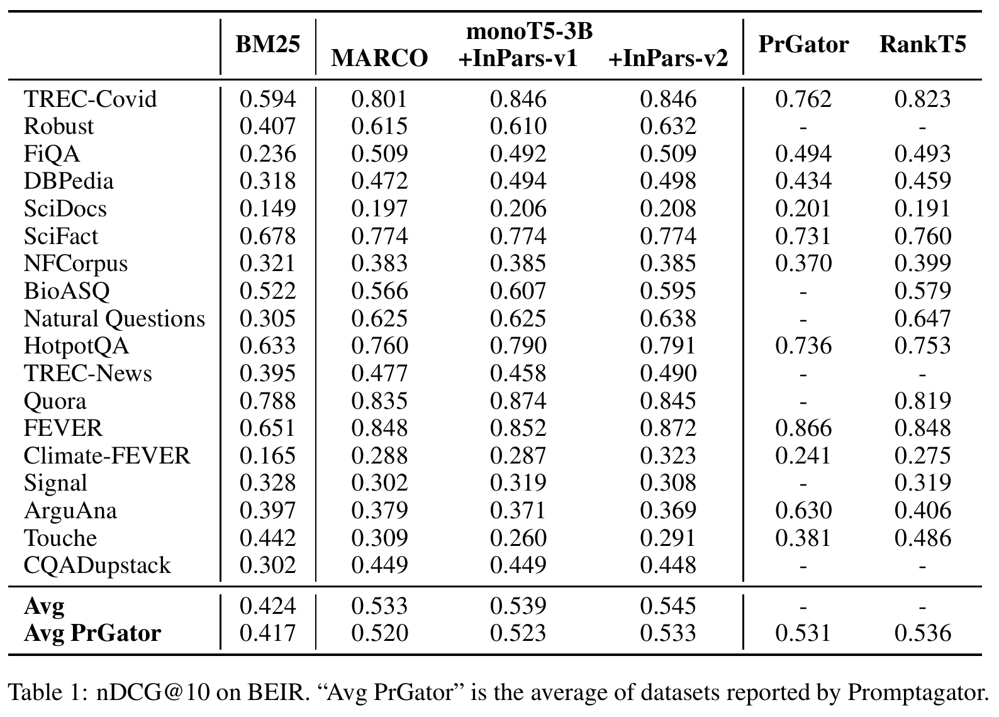

# InPars-v2 补充解读：谁来判断合成数据的质量

> **核心理解**：v2 将“生成得自然”与“检索上相关”分开，让生成器提供候选、相关性教师决定保留哪些候选。
>
> 以下是基于 [InPars-v2](https://arxiv.org/abs/2301.01820v4) 的补充分析。论文设置与完整结果见[论文精炼版](InPars-v2详解.md)；推导、例子与实践建议不属于作者额外报告的实验。

## 为什么一个重排器能改进训练数据

前作的筛选分数来自生成过程：一条问题在给定提示和文档之后有多容易写出来。v2 使用的分数来自相关性模型：这篇文档对这个问题是否相关。

以介绍某种药物的文档为例，“这是什么药？”可能非常容易生成，却没有交代药物名称、适用条件或用户的信息需求。相关性教师有机会筛掉与文档不匹配的问题，但它也未必会排斥所有过于宽泛的问题。这一修改让筛选目标更接近最终任务，仍不等于验证了问题的真实性、答案完整性与全部检索关系。

可以用一个解释性表达式理解筛选后的数据：

$$
p_{\mathrm{keep}}(q,d)\propto p_D(d)\,p_G(q\mid d,t)\,\mathbf 1[s_T(q,d)\ge c].
$$

这里 $s_T$ 是教师相关性分数，$c$ 对应当前候选池的 top-K 截断边界。这不是原文公式；原实验采用贪心解码。表达式只是突出：最终数据同时受文档采样、生成偏好和教师偏好约束。

## 教师与最终模型同源，为什么还可能有收益

过滤器和最终重排器都从 MS MARCO monoT5-3B 出发，看起来像“用自己选出的数据再训练自己”。它仍可能带来新信号，因为新增的是**目标语料中的文本与查询组合**：教师未必在原训练中见过这些文档，而 GPT-J 可以生成新的提问方式。

但这种机制也有边界。如果教师对目标任务的相关性理解有系统偏差，top-K 会偏向教师已经认可的样本。通过者更容易被保留，教师不熟悉却实际有用的查询可能被排除。论文没有测量教师分数与人工质量的逐例相关程度，不能仅凭下游平均上涨就声称噪声已被完全消除。

因此，v2 可以理解为**监督起点上的合成领域适配**。目标集合没有人工查询标注，不代表整个系统没有监督来源；MS MARCO 同时参与提示示范、过滤器训练和学生初始化。

## 为什么论点检索暴露了任务定义问题

问答式检索通常希望文档回答一个问题；反论点检索却可能希望文档提出相反立场。主题相关、能够回答、语义相似、支持或反驳，并不是同一种相关性关系。

v2 沿用固定 MS MARCO 风格示范，生成和过滤都可能更偏向一般问题–答案关系。这与 ArguAna、Touche 的弱结果相容，但论文没有单独消融来确定偏差主要来自提示、教师还是学生。

作者在 ArguAna 上用专用提示得到超过 10 个点的初步改善，说明**重新定义生成任务值得尝试**；它没有证明只改提示即可追平所有专用系统。迁移到新任务时，应先明确要检索什么关系，再选择示范和质量标准。

## 怎样读全量平均与共同子集平均

**表格原图**：上部是不同任务，下部是 Avg 与 Avg PrGator。两行平均覆盖的集合不同，另两种方法又有未报告的单元格；这是解释“领先”时必须保留的比较条件。

全量 18 集合的 v2 平均为 0.545，优于相同监督起点及 v1。共同子集上 v2 为 0.533，与 Promptagator 的 0.531、RankT5 的 0.536 接近。结果说明整套 v2 流程有效，但不能从缺失的全量结果推断对所有方法全面获胜。

同样，平均上涨不意味着每个任务都改善。Quora、BioASQ、Signal 的 v2 低于 v1，论点检索还低于 BM25。实际系统若主要处理其中一种任务，宏平均并不是最直接的选型依据。

## 开放权重改善了什么，成本又在哪里

GPT-J 替换商业 API 的直接价值是生成步骤可在自有环境执行，模型、数据与训练代码也更易追溯。开放权重并不消除算力成本：论文中生成 10 万查询约需 30 A100 小时，过滤约需 1.5 TPU v3-8 小时，最终微调不到 10 分钟。不同设备的小时数不能直接相加成统一 GPU 预算，但生成显然是重要阶段。

这也意味着线上与离线成本应分开计算。生成器只在造数据时运行，线上仍对 BM25 的候选做 monoT5 重排；若扩展语料或重新生成查询，主要增加离线预算，而增加线上候选深度则增加每次查询的重排工作。

## 值得进一步验证的方向

要区分两个改动的贡献，最直接的是固定同一批语料，交叉比较生成器与过滤器；原报告没有给出这样的完整消融。还可分别检查教师分数最高的样本是否过于重复、泛问题是否造成假负例，以及保留率变化是否改善目标任务。

这些是由方法结构引出的验证方向，不是本文已经实现的功能。v2 的 BM25 负例策略仍可能把实际相关文档当成负例，也没有训练稠密召回器；将合成数据用于新检索架构，需要单独验证。

## 参考资料

- [InPars-v2 原论文](https://arxiv.org/abs/2301.01820v4)
- [作者实现与公开材料](https://github.com/zetaalphavector/InPars/tree/master/legacy/inpars-v2)
- [论文精炼版](InPars-v2详解.md)
