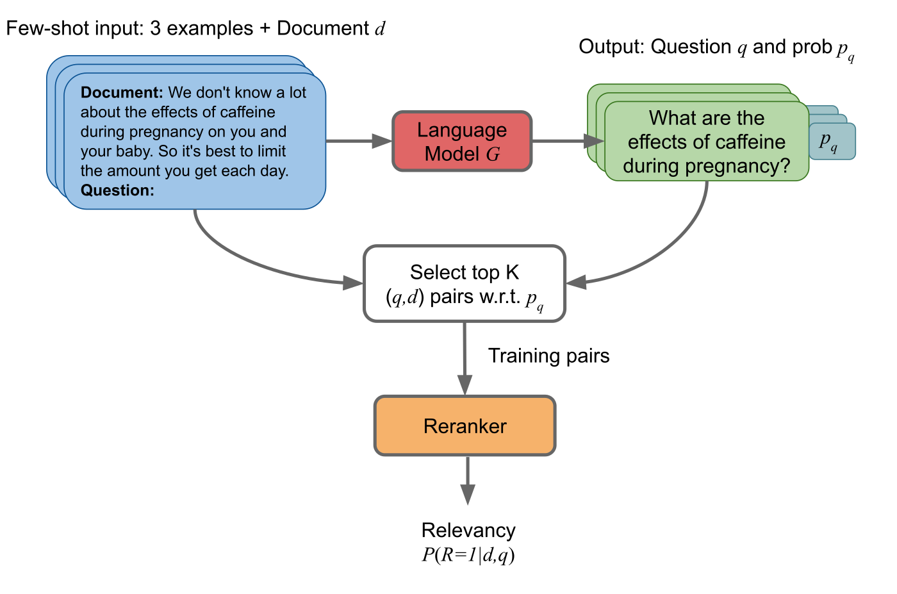
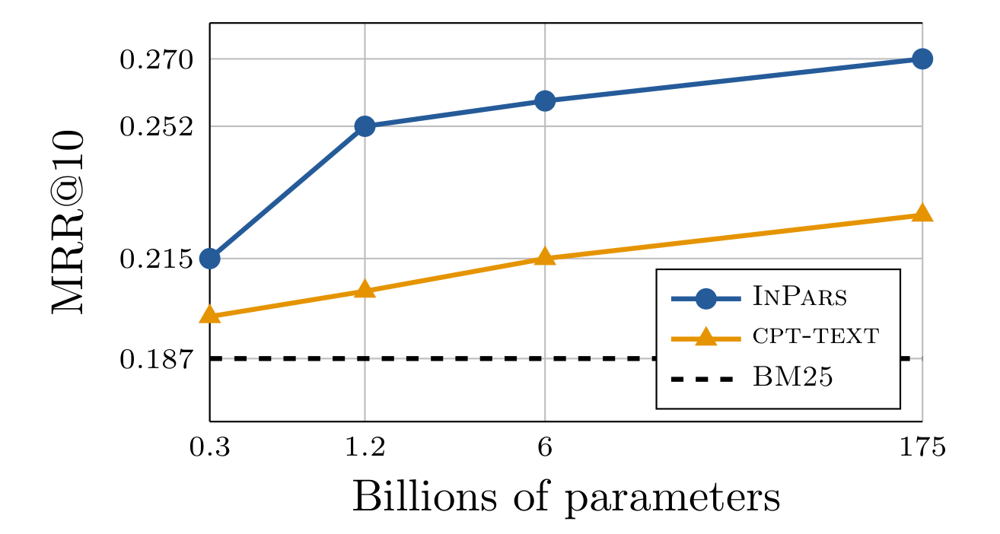

# InPars 详解：三次示范造查询，小重排器去打分

> **paper**：[InPars: Data Augmentation for Information Retrieval using Large Language Models](https://arxiv.org/abs/2202.05144)（Bonifacio, Abonizio, Fadaee, Nogueira；全体贡献相等）
> **venue**：arXiv:2202.05144v1 [cs.CL]，2022-02-10
> **backbone**：生成侧 GPT-3 Curie（文中推断约 6B）；排序侧 monoT5-base（220M）与 monoT5-3B；一阶段 BM25（Pyserini）
> **date**：2022-02
> **modality**：文本检索 / 重排（合成 query–document）
> **languages**：英文评测集（MS MARCO、TREC-DL 2020、Robust04、BEIR 版 NQ、TREC-COVID）

全文逐段中英对照见同目录 [zh.md](zh.md)。本文把生成、过滤、负例、monoT5 训练和两张主表的口径写清，数字只取论文表内与图中原值。

**少样本提示（few-shot prompting）**：提示里放少量完整的「文档 → 问题」示范，再换上一篇新文档，让冻结的大模型接着写问题。本文 $N=3$，前缀对所有文档相同，所以人工标注规模和合成规模是解开的。**合成查询（synthetic query）**：模型根据文档写出的问题，不是用户日志。与源文档配对后当作正例。**$p_q$**：生成这条查询时，各 token 对数概率的平均；用来丢掉模型自己也不确信的问题。**GBQ（Guided by Bad Questions）**：在提示里同时给出「坏问题」和更贴全文的「好问题」，只把好问题留下。**monoT5**：把 T5 改成交叉编码器重排器，查询和文档拼进同一序列，输出相关性。**交叉编码器（cross-encoder）** 让查询和文档互相看见；**双编码器（bi-encoder）** 两边分开编码，靠向量近邻检索。**BM25**：词袋稀疏打分。本文用它做两件事：推理时取 top-1000；训练时对合成查询取 top-1000，再随机抽一篇当负例。

---

## 这篇实际在做什么

大模型直接当重排器太贵。一条查询要对约 1000 篇候选各做一次前向。2022 年 2 月，OpenAI 最大模型按每 1000 token 收费 0.06 美元；候选若各含 250 token，朴素重排约 15 美元一条查询。稠密检索虽然查询时只编码查询，但建库时每篇文档仍要一次前向，十亿参数模型同样不适合当检索器。

InPars 的做法是把大模型留在离线：用 3 条人工示范，从语料文档写出查询，按 $p_q$ 留下 1 万对正例，用 BM25 挖负例，再微调 220M 或 3B 的 monoT5。线上仍是 BM25 召回 1000 篇，再由这个小重排器打分。名字 InPars 是 Inquisitive Parrots for Search。

| 项 | 论文设定 |
| --- | --- |
| 生成器 | GPT-3 Curie；温度 0（贪心）；最多 64 token，遇换行停止 |
| 示范 | 固定 3 条，来自 MS MARCO；前缀不随文档变 |
| 抽样 | 每集合 100,000 篇；不足 300 字符则重抽；有标题则标题接正文 |
| 正例过滤 | 按 $p_q$ 留 top $K=10{,}000$ |
| 负例 | 合成查询的 BM25 top-1000 里随机 1 篇 |
| 重排器 | monoT5-220M 与 3B；学习率 $10^{-3}$；batch 128，正负各半；156 步（约 1 epoch）；3 个种子平均 |
| 推理 | Pyserini BM25 top-1000，再 monoT5；输入最长 512，输出 2 个 token |
| 主结果搭配 | MS MARCO / TREC-DL 用 Vanilla；Robust04 / NQ / TREC-COVID 用域内文档 + GBQ |

不做目标语料上的继续预训练，也不改损失函数。作者指出，因此这套数据也可以喂给非神经检索算法；本文实验只训了重排器。

---

## 为什么生成概率要先平均再截断

给定文档 $d$ 和固定前缀 $t$，模型 $G(t,d)$ 自回归写出 $q$。对的质量用平均对数概率：

$$
p_q = \frac{1}{|q|}\sum_{i=1}^{|q|}\log p(q_i \mid t, d, q_{<i})
$$

除以长度是为了不让短句只因 token 少而占便宜。10 万对里只留最高的 1 万。第 6.3 节的对照是：若 10 万条全部拿去微调，MS MARCO 的 MRR@10 比 top-$K$ 过滤低 4 个点。作者只在 MS MARCO 上量了这个差距，以免用其他测试集来挑过滤阈值，从而保持方法在那些集合上仍是无监督的。过滤因此是方法的一部分。

负例不另请模型。合成查询丢给 BM25，在本集合取 1000 篇，随机抽一篇 $d^{-}$。重排器是二分类，学的是这篇文档对这条查询是否相关。这批负例来自 BM25 的前列，比全库随机负例更硬，但仍是随机抽一篇，不是多轮自挖掘。

---

## 两种提示，以及它们为什么不能混用

**图在讲什么。** 左上是 few-shot 输入：3 条已有的文档–问题，再接新文档。中间语言模型吐出问题 $q$ 和概率 $p_q$。下方按 $p_q$ 取 top-$K$ 对，送进重排器估计 $P(R{=}1 \mid d, q)$。读者应看到线上打分的是右下角的重排器，不是生成问题的那个大模型。

图 2 把两种提示并排放。两边的三篇示范文档相同，差别在标签。

Vanilla 把 MS MARCO 的真实相关问题标成 Good Question，另写一条更泛的 Bad Question 作对照，但生成时模型要续写的是 Good Question。GBQ 则把 MS MARCO 原问题放在 “Relevant Query” 的位置，而那条原问题在 Vanilla 里恰恰是被标成坏问题的那条。例如咖啡因那篇：Vanilla 希望写出 “孕妇可以摄入多少咖啡因”；MS MARCO 原问题是 “孕期喝一点咖啡因可以吗”。GBQ 把后者当作要避开的风格，逼模型写更依赖整段上下文的问法。第四个例子把 `{document_text}` 换成抽到的文档。GBQ 对每篇文档会同时吐出好问题和坏问题，训练对只留好问题。

因此主实验的搭配是固定的：MS MARCO 和 TREC-DL 的查询风格就是 MS MARCO，用 Vanilla；Robust04、NQ、TREC-COVID 要域适应，用该集合自己的文档加 GBQ。表 3 的新闻例子把差别说得很具体。对金泳三那篇，Vanilla 问 “总统对朝鲜的立场”，GBQ 补上 “韩国总统”。对商品市场那篇，Vanilla 问 “黄金价格是多少”（文中有多个价格，许多文档都能答），GBQ 问 “商品基金对金属价格有什么影响”，这才用到 Merrill Lynch 分析师那一句。表 4、表 5 是 GBQ 在 TREC-COVID 和 NQ 上吐出的坏问题与好问题：坏问题常常只抓住标题里的一个实体（“COVID-19 是什么”“变装是什么”“国家橄榄球联赛是什么”），好问题试图覆盖整段，但也好不到哪去——青少年饮食那篇的“好问题”仍是 “COVID-19 是什么以及它如何影响青少年”，并没有问到封控与饮食。

生成 10 万条问题，Curie、不论哪种提示，花费 100–300 美元。温度 0 的贪心是默认；温度 1.0 的采样和 $p=0.95$ 的 top-p 在最终检索指标上没有看到显著差异。

公开 API 上的四个模型，作者按 Neelakantan et al. (2022) 的图推断规模：Ada 300M、Babbage 1.2B、Curie 6B、Davinci 175B。原文第二处把 Babbage 误写成 Baggage。Davinci 更贵，检索指标只边际更好，所以全文数字都来自 Curie 生成的问题。

---

## 重排器怎么训，长文档怎么切

每个集合一份模型，训练数据就是该集合造出来的合成对。monoT5-220M 和 3B，恒定学习率 $10^{-3}$，batch 128 且正负各半，固定 156 步，大约一个 epoch。不看验证集停训，是为了少调超参。步数少的副作用是：例子的顺序能让最终指标差到两个点，所以报三个种子的平均。单块 TPU v3-8 上，base 和 3B 都是几分钟。11B 没做。

输入上限 512 token，输出两个 token（目标词加结束符）。MS MARCO 段落都不超长。NQ 和 TREC-COVID 的文档经常被截断。

Robust04 是新闻长文档，整篇送进 Transformer 的二次注意力吃不消。微调和推理都用改过的 MaxP：10 句窗口、步长 5，每个窗口独立打相关性，文档分数取窗口最大值。不用 BM25 的原分数去融合。

另有一组对照是 OpenAI Search API，直接重排 BM25 的前 100 篇。API 内部是否在 IR 数据上微调过、用什么提示、和 cpt-text 什么关系，OpenAI 不说。用 Davinci 时，TREC-DL 2020 大约每 1000 对 5.85 美元；在 MS MARCO 开发集上把 Davinci 当重排器大约 6.3k 美元，所以表 1 里这些格子是 `$`。作者用 Curie 做过一次重排 1000 篇而不是 100 篇：TREC-DL 2020 的 nDCG@10 从 0.5422 到 0.5602，将近两个点。因此表 1 里 OpenAI 各行若也看 1000 篇，数字大概还会更高。比较时要记住：InPars 重排的是 1000 篇，OpenAI 行重排的是 100 篇。

---

## 五个集合在测什么

| 集合 | 查询规模 | 语料 | 本文要看的点 |
| --- | --- | --- | --- |
| MS MARCO | 训练约 50 万对；开发集约 6,900 | 880 万段落 | 平均每查询 1 篇人工相关段落；指标 MRR@10 |
| TREC-DL 2020 | 54 条查询 | 与 MS MARCO 相同 | 每查询判定文档更多；MAP 与 nDCG@10 |
| Robust04 | 249 条 | 52.8 万新闻文档 | 平均每查询 1250.6 篇已判定文档；MAP 与 nDCG@20 |
| NQ（BEIR） | 开发集 3,452 | 260 万维基段落 | 平均 1.21 篇相关文档；nDCG@10 |
| TREC-COVID | 50 条 | 17.1 万篇 COVID-19 文献 | 平均 1,326 篇已判定文档；主题新，许多预训练模型没见过 |

MS MARCO 测试集不公开，所以 MARCO 列是开发集。

---

## 表 1：无监督能超过 BM25，加上 MS MARCO 才在两个集合上到当时最好

无监督 InPars 是第 7、8 行，模型没看过 MS MARCO 的人工标注，只看合成对。

| 行 | 模型 | MARCO MRR@10 | TREC-DL nDCG@10 | Robust04 nDCG@20 | NQ | TREC-COVID |
| --- | --- | ---: | ---: | ---: | ---: | ---: |
| (1) | BM25 | 0.1874 | 0.4876 | 0.4240 | 0.3290 | 0.6880 |
| (8) | InPars monoT5-3B | 0.2967 | 0.6612 | 0.5181 | 0.5133 | 0.7835 |
| (5) | OpenAI Curie，重排 100 篇 | \$ | 0.5422 | 0.5053 | 0.4171 | 0.7251 |
| (15) | monoT5-3B，只在 MS MARCO 上训 | 0.3980 | 0.7508 | 0.6091 | 0.6334 | 0.7948 |
| (16) | 第 15 行再在域内合成数据上训 | 0.3894 | 0.7439 | 0.6227 | 0.6297 | 0.8471 |

第 8 行在五个集合上都高于 BM25。在 TREC-DL 的 nDCG@10 上，3B 的 0.6612 高于重排 100 篇的 Curie 0.5422 和 Davinci 0.5366，尽管那些模型更大。无监督 cpt-text 在 MS MARCO 上只有 0.2270，在 TREC-COVID 上 0.4270，低于 BM25 的 0.6880；无监督 Contriever 在 NQ / TREC-COVID 上是 0.2580 / 0.2740，也低于 BM25。

作者给了三个原因。交叉编码器能看查询和文档的交互，零样本比双编码器稳，这和 Thakur et al. (2021) 一致。合成问题比从文中切句子更像真实查询。新问题和模型原本不会用到的文档合在一起，训练集更多样。

第 16 行从第 15 行出发，再在域内合成问题上微调。Robust04 的 nDCG@20 从 0.6091 到 0.6227，MAP 从 0.3876 到 0.3967；TREC-COVID 从 0.7948 到 0.8471。这两格是文中说的两个迁移集合上的当时最优。PARADE 在 Robust04 上有 nDCG@20 0.6127，但那是在 Robust04 标注上微调的，本文不把它放进零样本比较。TREC-COVID 的主题新，增益更说明生成在做领域适配，而不只是复述 MS MARCO。

NQ 上第 16 行 0.6297，略低于只训 MS MARCO 的 0.6334。MS MARCO 本身从 0.3980 降到 0.3894，TREC-DL 的 nDCG@10 从 0.7508 降到 0.7439。作者的解释是：合成段落常常是脚注、广告、多主题段落，不在原来那 53 万人工相关对的分布里；已经在 53 万同分布标注上训过的模型，再吃 1 万条分布不同的合成例，会伤到同分布测试。

脚注还规定了第 14–16 行的监督起点并不完全一样：TREC-DL 和 MS MARCO 上，起点模型在 MS MARCO 训了 10 个 epoch；其余数据集的起点只训 1 个 epoch，因为这样零样本更好（Pradeep et al., 2020a）。读第 16 行时，域外集合的增益是在「MS MARCO 只训 1 epoch」的起点上叠上去的。

---

## 表 2：域内加 GBQ，只有 3B 稳定吃到

| | 文档来源 | 提示 | MARCO | TREC-DL nDCG@10 | Robust04 nDCG@20 | NQ | TREC-COVID |
| --- | --- | --- | ---: | ---: | ---: | ---: | ---: |
| 220M | Marco | Vanilla | 0.2585 | 0.5764 | 0.4017 | 0.3755 | 0.6727 |
| 220M | In-domain | GBQ | 0.2279 | 0.5451 | 0.4268 | 0.3354 | 0.6666 |
| 3B | Marco | Vanilla | 0.2967 | 0.6612 | 0.5478 | 0.4870 | 0.7606 |
| 3B | In-domain | GBQ | 0.2819 | 0.6255 | 0.5181 | 0.5134 | 0.7835 |

MS MARCO 与 TREC-DL 的语料就是 MS MARCO，所以 “域内” 和 “Marco” 在这两列上不是两种语料，只是提示和抽样不同。这两列上 Vanilla 都更高。Robust04、NQ、TREC-COVID 上，主表第 7、8 行采用的是域内 + GBQ 那一行（220M 的 NQ 0.3354、TREC-COVID 0.6666；3B 的 Robust04 nDCG@20 0.5181、NQ 0.5133 对表 2 的 0.5134、TREC-COVID 0.7835）。

3B 从域内例子受益，NQ 和 TREC-COVID 上域内 GBQ 高于 Marco Vanilla。Robust04 上 3B 反而是 Marco Vanilla 更高（nDCG@20 0.5478 对 0.5181），但主表仍报告域内 GBQ 的 0.5181，因为搭配是事先按初步实验定的，不是按测试集挑每一格的最大值。220M 没有稳定的胜者：域内 GBQ 在 Robust04 上更好（0.4268 对 0.4017），在 NQ 和 TREC-COVID 上更差。初步实验里，GBQ 配域内文档好于 Vanilla；GBQ 配 MS MARCO 文档只有边际增益，所以没有把 GBQ 用到 Marco 列的主结果上。

---

## 生成模型变大，重排指标涨得很慢

图 3 的横轴是对数刻度的参数量：0.3、1.2、6、175（十亿）。重排器始终是 monoT5-220M，变的只是造问题的 GPT-3。图上画出的 MRR@10：

| 十亿参数 | InPars | cpt-text | BM25 |
| ---: | ---: | ---: | ---: |
| 0.3 | 0.2150 | 0.199 | 0.1874 |
| 1.2 | 0.2515 | 0.206 | 0.1874 |
| 6 | 0.2585 | 0.215 | 0.1874 |
| 175 | 0.2701 | 0.227 | 0.1874 |

从 Curie（6B，0.2585）到 Davinci（175B，0.2701）只涨约 0.012。6B 那个点就是表 1 第 7 行。cpt-text 的 175B 点 0.227 对应表 1 第 3 行的 0.2270。BM25 是 0.1874 的水平线。假设是：大模型写出的问题更贴这一段，而不是许多段落都能答的泛问题；泛问题会让重排器把“其实相关的其他段落”当成负例。OpenAI Search 那几行里，Curie 在多数格子上高于 Davinci，规模和检索效果不是同一条单调曲线。

---

## GPT-3 像是没背下 MS MARCO

OpenAI 不说 GPT-3 有没有在监督 IR 数据上微调。作者用字符串重合来间接看。Davinci 的 93,200 条不重复问题里，5,285 条出现在 MS MARCO 的约 100 万问题中，不到 5.7%，而且多为单实体问句（“what is the fda” 这类）。另外，从训练集或开发集里被标成相关的 6,396 篇文档上生成的问题，只有 725 条落在 MS MARCO 标准答案里，不到 12%。更小模型类似。这不能证明训练语料里完全没有 MS MARCO，只能说明模型没有把它背下来。

---

## 局限

论文自己列出四件没做的事：合成数据没拿去训稠密检索器；坏问题没有当负例；合成规模停在每个集合 1 万对正例，没有扩到百万；正例筛选只有平均对数概率，没有更精细的选择。

实验里还能看见的限制：MS MARCO 和 TREC-DL 上，合成数据叠在 53 万人工对之后会掉点；220M 吃不下域内 GBQ；Curie 造 10 万条要 100–300 美元，而且模型不开放权重；每个集合单独一份重排器，不是一个模型打全部域；156 步的顺序敏感让单次运行最多差两个点；OpenAI 行只重排 100 篇，和 InPars 的 1000 篇不是同一召回深度。表 4、表 5 里不少“好问题”仍然很泛，过滤只能丢掉低 $p_q$，并不能保证留下来的问题真用到了全文。

可以单独记住的四点：大模型只负责离线造查询；正例按生成概率截到 1 万，不截断会在 MS MARCO 上掉 4 个 MRR@10 点；域外用 GBQ 加本集合文档，域内 MS MARCO 用 Vanilla；线上跑的是 BM25 加 monoT5，不是 GPT-3。
