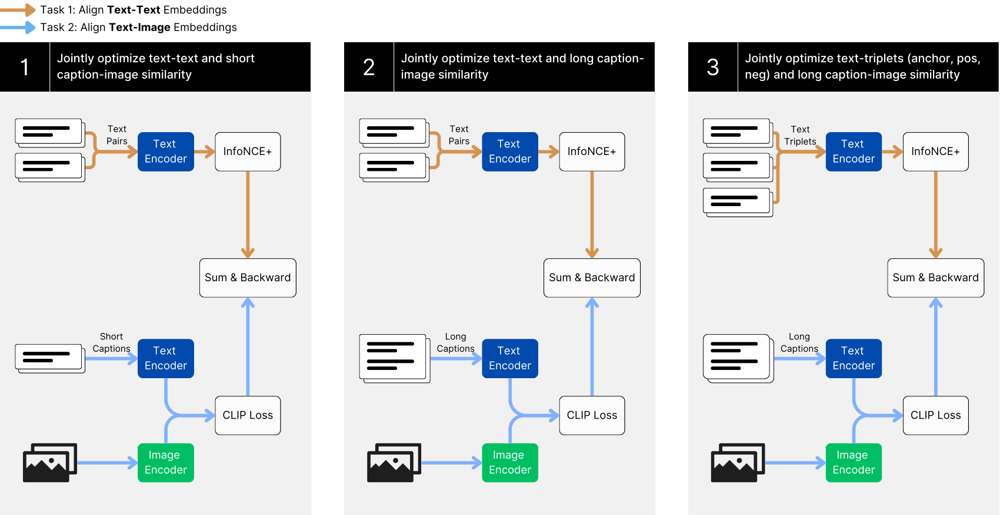

# Jina CLIP: Your CLIP Model Is Also Your Text Retriever / 全文中英对照

> 来源：[arXiv:2405.20204v2](https://arxiv.org/abs/2405.20204v2)。英文段落后紧接中文，覆盖所取 HTML 版本的主文、附录、图表、脚注与参考文献；公式、数字表和书目信息共用。中文以机器初译为底稿，进行了术语整理与结构核对，尚未逐句人工审定；遇到歧义请以紧邻英文和原论文为准。 原作版权归所列作者，许可见 [原作许可](http://creativecommons.org/licenses/by/4.0/)；中文译文与版式改写在该许可条件下提供（涉及 SA 时沿用相同许可，涉及 NC 时仅限非商业使用）。

## Authors and affiliations / 作者与机构

Andreas Koukounas Affiliation: Jina AI GmbH, Ohlauer Str. 43, 10999 Berlin, Germany Georgios Mastrapas Affiliation: Jina AI GmbH, Ohlauer Str. 43, 10999 Berlin, Germany Michael Günther Affiliation: Jina AI GmbH, Ohlauer Str. 43, 10999 Berlin, Germany Bo Wang Affiliation: Jina AI GmbH, Ohlauer Str. 43, 10999 Berlin, Germany Scott Martens Affiliation: Jina AI GmbH, Ohlauer Str. 43, 10999 Berlin, Germany Isabelle Mohr Affiliation: Jina AI GmbH, Ohlauer Str. 43, 10999 Berlin, Germany Saba Sturua Affiliation: Jina AI GmbH, Ohlauer Str. 43, 10999 Berlin, Germany Mohammad Kalim Akram Affiliation: Jina AI GmbH, Ohlauer Str. 43, 10999 Berlin, Germany Joan Fontanals Martínez Affiliation: Jina AI GmbH, Ohlauer Str. 43, 10999 Berlin, Germany Saahil Ognawala Affiliation: Jina AI GmbH, Ohlauer Str. 43, 10999 Berlin, Germany Susana Guzman Affiliation: Jina AI GmbH, Ohlauer Str. 43, 10999 Berlin, Germany Maximilian Werk Affiliation: Jina AI GmbH, Ohlauer Str. 43, 10999 Berlin, Germany Nan Wang Affiliation: Jina AI GmbH, Ohlauer Str. 43, 10999 Berlin, Germany Han Xiao Affiliation: Jina AI GmbH, Ohlauer Str. 43, 10999 Berlin, Germany Correspondence to: research@jina.ai

## Abstract / 摘要

**EN.** Contrastive Language-Image Pretraining (CLIP) is widely used to train models to align images and texts in a common embedding space by mapping them to fixed-sized vectors. These models are key to multimodal information retrieval and related tasks. However, CLIP models generally underperform in text-only tasks compared to specialized text models. This creates inefficiencies for information retrieval systems that keep separate embeddings and models for text-only and multimodal tasks. We propose a novel, multi-task contrastive training method to address this issue, which we use to train the [jina-clip-v1](https://huggingface.co/jinaai/jina-clip-v1) model and achieve the state-of-the-art performance on both text-image and text-text retrieval tasks.

**中.** 对比语言图像预训练 (CLIP) 广泛用于训练模型，通过将图像和文本映射到固定大小的向量，在公共嵌入空间中对齐图像和文本。这些模型是多模式信息检索和相关任务的关键。然而，与专门的文本模型相比，CLIP 模型在纯文本任务中通常表现不佳。这会导致信息检索系统效率低下，这些系统为纯文本和多模式任务保留单独的嵌入和模型。我们提出了一种新颖的多任务对比训练方法来解决这个问题，我们用它来训练 [jina-clip-v1](https://huggingface.co/jinaai/jina-clip-v1) 模型，并在文本-图像和文本-文本检索任务上实现最先进的性能。

#### Keywords: / 关键词：

**EN.** Machine Learning, ICML, CLIP, Embeddings, Multimodal, Retrieval

**中.** 机器学习、ICML、CLIP、嵌入、多模态、检索

## Introduction / 简介

**EN.** Text-image contrastively trained models, such as CLIP ( Radford et al., 2021 ) , create an aligned representation space for images and texts by leveraging pairs of images and their corresponding captions. Similarly, text-text contrastively trained models, like [jina-embeddings-v2](https://huggingface.co/jinaai/jina-embeddings-v2-base-en) ( Günther et al., 2023 ) , construct a representation space for semantically similar texts using pairs of related texts such as question/answer pairs, query/document pairs, or other text pairs with known semantic relationships.

**中.** 文本-图像对比训练模型，例如 CLIP (Radford et al., 2021)，通过利用图像对及其相应的标题为图像和文本创建对齐的表示空间。类似地，文本-文本对比训练模型，例如 [jina-embeddings-v2](https://huggingface.co/jinaai/jina-embeddings-v2-base-en) (Günther et al., 2023)，使用相关文本对（例如问题/答案对、查询/文档对或具有已知语义关系的其他文本对）构建语义相似文本的表示空间。

**EN.** Because image captions are typically very short, CLIP-style models trained with them only support short text context lengths. They struggle to capture the richer information in longer texts, and as a result, perform poorly on text-only tasks. Our empirical study (Table 1 ) demonstrates that OpenAI’s CLIP underperforms in all text retrieval tasks. This poses problems for many applications that use larger text inputs, like text-image retrieval, multimodal retrieval augmented generation ( Zhao et al., 2023 ) and image generation.

**中.** 由于图像标题通常非常短，因此用它们训练的 CLIP 样式模型仅支持短文本上下文长度。他们很难在较长的文本中捕获更丰富的信息，因此在纯文本任务上表现不佳。我们的实证研究（表 1）表明 OpenAI 的 CLIP 在所有文本检索任务中都表现不佳。这给许多使用较大文本输入的应用程序带来了问题，例如文本图像检索、多模态检索增强生成（Zhao et al., 2023）和图像生成。

**EN.** In this paper, we present and demonstrate the effectiveness of a novel approach to contrastive training with large-scale image-caption pairs and text pairs. We jointly optimize for representation alignment of both text-image and text-text pairs, enabling the model to perform well at both kinds of tasks. Due to the lack of available multimodal multi-target datasets (e.g. text-text-image triplets) we use different datasets for each class of task and jointly train for both.

**中.** 在本文中，我们提出并证明了一种使用大规模图像标题对和文本对进行对比训练的新方法的有效性。我们共同优化文本-图像和文本-文本对的表示对齐，使模型能够在这两种任务中表现良好。由于缺乏可用的多模态多目标数据集（例如文本-文本-图像三元组），我们对每一类任务使用不同的数据集，并对两者进行联合训练。

**EN.** The resulting model, [jina-clip-v1](https://huggingface.co/jinaai/jina-clip-v1) , performs comparably to EVA-CLIP ( Sun et al., 2023 ) on the cross-modal CLIP Benchmark [^footnote1] , while the text encoder by itself performs as well as similar models on MTEB Benchmark tasks ( Muennighoff et al., 2023 ) .

**中.** 生成的模型 [jina-clip-v1](https://huggingface.co/jinaai/jina-clip-v1) 在跨模式 CLIP 基准 [^footnote1] 上的性能与 EVA-CLIP (Sun et al., 2023) 相当，而文本编码器本身在 MTEB Benchmark 任务上的性能与类似模型一样好 (Muennighoff et al., 2023)。

**EN.** Figure 1: The training paradigm of [jina-clip-v1](https://huggingface.co/jinaai/jina-clip-v1) , jointly optimizing text-image and text-text matching.

**中.** 图1：[jina-clip-v1](https://huggingface.co/jinaai/jina-clip-v1)的训练范例，联合优化文本-图像和文本-文本匹配。

## Related Work / 相关工作

**EN.** Contrastive learning for text embeddings is well-established for training models for text-based information retrieval, semantic textual similarity, text clustering, and re-ranking. Reimers & Gurevych (2019) propose a dual encoder architecture for pairwise text similarity training. Ni et al. (2022) demonstrate that the dual-encoder architecture scales efficiently. Wang et al. (2022) and Günther et al. (2023) develop multi-stage training methods incorporating hard negatives . Mohr et al. (2024) bring textual similarity scores directly into the training. Günther et al. (2023) and Chen et al. (2024) extend text embedding models’ maximum input length to 8,192 tokens.

**中.** 文本嵌入的对比学习对于基于文本的信息检索、语义文本相似性、文本聚类和重新排序的训练模型已经很成熟。 Reimers & Gurevych (2019) 提出了一种用于成对文本相似性训练的双编码器架构。倪等人。 (2022) 证明了双编码器架构可以有效地扩展。王等人。 (2022) 和 Günther 等人。 (2023) 开发结合难负例的多阶段训练方法。莫尔等人。 (2024) 将文本相似度分数直接引入训练中。冈瑟等人。 （2023）和陈等人。 (2024) 将文本嵌入模型的最大输入长度扩展到 8,192 个标记。

**EN.** Contrastive text-image pre-training has become increasingly popular since Radford et al. (2021) proposed the CLIP (Contrastive Language-Image Pre-training) paradigm. Numerous follow-up studies have sought to improve text-image training. Zhai et al. (2022) introduce locked image tuning (LiT), which involves fixing the weights of a trained image encoder and training a text encoder to align with its image representations. Kossen et al. (2023) generalize the LiT paradigm to a more flexible Three Tower architecture. Zhai et al. (2023) propose a modified sigmoid loss function for contrastive learning, demonstrating better performance on relatively small batch sizes. Cherti et al. (2023) and Sun et al. (2023) explore different setups for text-image training, including variations in datasets, model size, and hyperparameters. Zhang et al. (2024) empirically determine that the effective context length of CLIP is less than 20 tokens and propose an algorithm to stretch the positional encoding, improving performance on longer texts. Sun et al. (2024) scale up the EVA-CLIP architecture to 18B parameters.

**中.** 自 Radford 等人提出以来，对比文本图像预训练变得越来越流行。 (2021)提出了CLIP（对比语言-图像预训练）范式。许多后续研究都试图改进文本图像训练。翟等人。 (2022) 引入锁定图像调整 (LiT)，其中涉及固定经过训练的图像编码器的权重并训练文本编码器以与其图像表示对齐。科森等人。 (2023) 将 LiT 范式推广到更灵活的三塔架构。翟等人。 (2023) 提出了一种用于对比学习的改进的 sigmoid 损失函数，在相对较小的批量大小上展示了更好的性能。切尔蒂等人。 （2023）和孙等人。 (2023) 探索文本图像训练的不同设置，包括数据集、模型大小和超参数的变化。张等人。 (2024) 根据经验确定 CLIP 的有效上下文长度小于 20 个标记，并提出了一种拉伸位置编码的算法，从而提高了较长文本的性能。孙等人。 (2024) 将 EVA-CLIP 架构扩展到 18B 参数。

**EN.** Furthermore, a growing number of large datasets, such as YFCC100M ( Thomee et al., 2016 ) , LAION-5B ( Schuhmann et al., 2022 ) , and curated datasets like ShareGPT4v ( Chen et al., 2023 ) help to constantly improve the performance of CLIP-like models.

**中.** 此外，越来越多的大型数据集，例如 YFCC100M（Thomee 等人，2016）、LAION-5B（Schuhmann 等人，2022）以及 ShareGPT4v（Chen 等人，2023）等精选数据集有助于不断提高类 CLIP 模型的性能。

## Model Architecture / 模型架构

**EN.** We use the same dual encoder architecture introduced in the original CLIP ( Radford et al., 2021 ) . It comprises a text encoder and an image encoder that generate representations of identical dimensionality.

**中.** 我们使用原始 CLIP 中引入的相同双编码器架构（Radford 等人，2021）。它包括生成相同维度表示的文本编码器和图像编码器。

**EN.** The text encoder uses the JinaBERT architecture ( Günther et al., 2023 ) , a BERT variant that integrates AliBi ( Press et al., 2021 ) to support longer texts. We pre-train the model using the Masked Language Modeling objective from the original BERT model ( Devlin et al., 2019 ) . Experimental results indicate that this yields superior final performance compared to starting from a text embedding model that has already been fully trained using contrastive learning.

**中.** 文本编码器使用 JinaBERT 架构（Günther 等人，2023），这是一种集成 AliBi（Press 等人，2021）以支持更长文本的 BERT 变体。我们使用原始 BERT 模型中的 Masked Language Modeling 目标对模型进行预训练（Devlin 等人，2019）。实验结果表明，与从已经使用对比学习充分训练的文本嵌入模型开始相比，这会产生更出色的最终性能。

**EN.** For the image encoder, we use the EVA02 architecture ( Fang et al., 2023 ) . To keep the model size comparable to the text encoder, we select the base variant and initialize our model with the EVA02 pre-trained weights. Our experiments show that EVA02 significantly outperforms comparable image encoders like DinoV2 ( Oquab et al., 2024 ) and ViT B/16 models from OpenCLIP ( Ilharco et al., 2021 ) .

**中.** 对于图像编码器，我们使用 EVA02 架构（Fang et al., 2023）。为了保持模型大小与文本编码器相当，我们选择基本变体并使用 EVA02 预训练权重初始化我们的模型。我们的实验表明，EVA02 的性能显着优于 DinoV2（Oquab 等人，2024）和 OpenCLIP 中的 ViTB/16 模型（Ilharco 等人，2021）等同类图像编码器。

## Training / 培训

**EN.** Figure 1 illustrates our multi-task, three-stage training approach. This method jointly optimizes the model to perform two tasks: text-image matching and text-text matching.

**中.** 图 1 说明了我们的多任务、三阶段训练方法。该方法联合优化模型以执行两个任务：文本-图像匹配和文本-文本匹配。

**EN.** To achieve text retrieval performance on par with state-of-the-art text embedding models, we employ a multi-stage training paradigm, similar to what Wang et al. (2022) and Günther et al. (2023) propose. This paradigm introduces a second training stage, analogous to conventional fine-tuning stages, that makes use of small high-quality datasets with hard negatives to improve performance on embedding tasks.

**中.** 为了实现与最先进的文本嵌入模型相当的文本检索性能，我们采用了多阶段训练范例，类似于 Wang 等人的方法。 (2022) 和 Günther 等人。 （2023）提议。该范例引入了第二个训练阶段，类似于传统的微调阶段，它利用具有难负例的小型高质量数据集来提高嵌入任务的性能。

**EN.** We complement the two stages with text-image pairs for a two-task two-stage training pipeline. To address the short effective context length of CLIP-like models, we introduce an intermediate stage for training on long captions. Due to limited availability of public data, we rely on AI-generated long textual descriptions for this stage. The reasoning behind opting for a separate stage is two-fold: a) because of the dataset size difference, integrating this data into the pre-training stage will limit its impact, and b) using the triplet fine-tuning stage for long caption training will limit the effect of hard negatives, as the model is not yet able to effectively process long contexts.

**中.** 我们用文本图像对来补充这两个阶段，以实现两个任务的两阶段训练管道。为了解决类似 CLIP 模型的有效上下文长度短的问题，我们引入了一个中间阶段来训练长标题。由于公共数据的可用性有限，我们在此阶段依赖人工智能生成的长文本描述。选择单独阶段的原因有两个：a）由于数据集大小的差异，将这些数据集成到预训练阶段将限制其影响；b）使用三元组微调阶段进行长标题训练将限制难负例的影响，因为模型尚无法有效处理长上下文。

**EN.** The result is a three-stage training process with two tasks in each stage:

**中.** 结果是一个三阶段的训练过程，每个阶段有两个任务：

**EN.** Stage 1 focuses on learning to align image and text representations while minimizing losses in text-text performance. To this end, we train on large-scale and weakly supervised text-image and text-text pair datasets.

**中.** 第一阶段的重点是学习对齐图像和文本表示，同时最大限度地减少文本-文本性能的损失。为此，我们在大规模且弱监督的文本-图像和文本-文本对数据集上进行训练。

**EN.** Stage 2 presents longer, synthetic image captions to the model while continuing to train with text-text pairs.

**中.** 第 2 阶段向模型提供更长的合成图像标题，同时继续使用文本对进行训练。

**EN.** Stage 3 uses hard negatives to further improve the text encoder in separating relevant from irrelevant text. To maintain text-image alignment, we continue training on long image captions.

**中.** 第 3 阶段使用难负例进一步改进文本编码器，以区分相关文本和不相关文本。为了保持文本-图像对齐，我们继续对长图像标题进行训练。

### Data Preparation / 数据准备

**EN.** Our text pair corpus $\mathbb{C}^{\mathit{text}}_{\mathit{pairs}}$ consists of data from a diverse collection of 40 text-pair datasets, similar to the corpus used in Günther et al. (2023) .

**中.** 我们的文本对语料库 $\mathbb{C}^{\mathit{text}}_{\mathit{pairs}}$ 由来自 40 个文本对数据集的不同集合的数据组成，类似于 Günther 等人使用的语料库。 （2023）。

**EN.** For text-image training in Stage 1, we use LAION-400M ( Schuhmann et al., 2021 ) as our corpus $\mathbb{C}^{\mathit{img(s)}}_{\mathit{pairs}}$ . LAION-400M contains 400M image-text pairs derived from Common Crawl and is widely used for multimodal training.

**中.** 对于第一阶段的文本图像训练，我们使用 LAION-400M (Schuhmann et al., 2021) 作为我们的语料库 $\mathbb{C}^{\mathit{img(s)}}_{\mathit{pairs}}$ 。 LAION-400M包含源自Common Crawl的400M图像文本对，广泛用于多模态训练。

**EN.** In Stages 2 and 3, we use the ShareGPT4V ( Chen et al., 2023 ) dataset as our $\mathbb{C}^{\mathit{img(l)}}_{\mathit{pairs}}$ corpus. This dataset contains approximately 100K synthetic captions generated with GPT4v ( OpenAI, 2023 ) and an additional 1.1M long captions generated by a large captioning model trained on the original GPT4v generated output. This comes to a total of roughly 1.2M image captions. It would be interesting to investigate the impact of AI-generated data on performance, but that is outside the scope of this work.

**中.** 在第 2 阶段和第 3 阶段，我们使用 ShareGPT4V（Chen 等人，2023）数据集作为我们的 $\mathbb{C}^{\mathit{img(l)}}_{\mathit{pairs}}$ 语料库。该数据集包含使用 GPT4v（OpenAI，2023）生成的大约 100K 合成字幕，以及由在原始 GPT4v 生成的输出上训练的大型字幕模型生成的额外 110 万长字幕。这总共大约有 120 万个图像标题。研究人工智能生成的数据对性能的影响会很有趣，但这超出了本工作的范围。

**EN.** Finally, in Stage 3, we use a triplet text corpus $\mathbb{C}^{\mathit{text}}_{\mathit{triplets}}$ that includes hard negatives. This corpus combines data from MSMarco ( Bajaj et al., 2016 ) , Natural Questions (NQ) ( Kwiatkowski et al., 2019 ) , HotpotQA ( Yang et al., 2018 ) and the Natural Language Inference (NLI) dataset ( Bowman et al., 2015 ) . Each training batch contains one annotated positive and seven negative items. We select hard negatives using text retrieval models to emphasize relevance in text triplets, except for NLI where negatives are chosen randomly.

**中.** 最后，在第 3 阶段，我们使用包含硬否定的三元组文本语料库 $\mathbb{C}^{\mathit{text}}_{\mathit{triplets}}$。该语料库结合了来自 MSMarco（Bajaj 等人，2016）、自然问题（NQ）（Kwiatkowski 等人，2019）、HotpotQA（Yang 等人，2018）和自然语言推理（NLI）数据集（Bowman 等人，2015）的数据。每个训练批次包含一个带注释的正项和七个负项。我们使用文本检索模型选择硬否定，以强调文本三元组中的相关性，但 NLI 除外，其中否定是随机选择的。

### Loss Functions / 损失函数

**EN.** All three stages employ a joint loss function that combines two InfoNCE loss functions ( Van den Oord et al., 2018 ) . For the text pairs in stage 1 and stage 2, we use the $\mathcal{L}_{\mathrm{nce}}$ loss function of pairs of text embeddings $(\bf{q},\bf{p})\sim\mathbf{B}$ within a batch $\mathbf{B}\subset\mathbb{D}^{\mathrm{pairs}}$ . This function evaluates the cosine similarity $cos(\bf{q},\bf{p})$ between a given query $q$ and its corresponding target $p$ , relative to the similarity of all other targets in the batch. We sum the loss in both directions to preserve the symmetry of similarity measures:

**中.** 所有三个阶段都采用联合损失函数，该函数结合了两个 InfoNCE 损失函数（Van den Oord 等人，2018）。对于阶段 1 和阶段 2 中的文本对，我们使用批次 $\mathbf{B}\subset\mathbb{D}^{\mathrm{pairs}}$ 中的文本嵌入对 $(\bf{q},\bf{p})\sim\mathbf{B}$ 的 $\mathcal{L}_{\mathrm{nce}}$ 损失函数。此函数评估给定查询 $q$ 与其相应目标 $p$ 之间相对于批次中所有其他目标的相似度的余弦相似度 $cos(\bf{q},\bf{p})$ 。我们对两个方向的损失求和以保持相似性度量的对称性：

$$
\begin{aligned}\displaystyle\mathcal{L}_{\mathrm{nce}}(\mathbf{B}):=\mathcal{L}_{\mathrm{nce}}^{\longrightarrow}(\mathbf{B})+\mathcal{L}_{\mathrm{nce}}^{\longleftarrow}(\mathbf{B}),\text{ with} \\ \displaystyle\mathcal{L}_{\mathrm{nce}}^{\longrightarrow}(\mathbf{B}):=\mathbb{E}_{(\bf{q},\bf{p})\sim\mathbf{B}}\left[-\ln\frac{e^{cos(\bf{q},\bf{p})/\tau}}{\sum\limits_{i=1}^{k}e^{cos(\bf{q},\bf{p_{i}})/\tau}}\right] \\ \displaystyle\mathcal{L}_{\mathrm{nce}}^{\longleftarrow}(\mathbf{B}):=\mathbb{E}_{(\bf{q},p)\sim\mathbf{B}}\left[-\ln\frac{e^{cos(\bf{p},\bf{q})/\tau}}{\sum\limits_{i=1}^{k}e^{cos(\bf{p},\bf{q_{i}})/\tau}}\right]\end{aligned}\tag{1}
$$

**EN.** The constant temperature parameter $\tau$ influences how the loss function weighs minor differences in the similarity scores ( Wang & Liu, 2021 ) . In accordance with related work ( Günther et al., 2023 ) , we choose $\tau=0.05$ .

**中.** 恒温参数 $\tau$ 影响损失函数如何权衡相似度分数中的微小差异（Wang & Liu，2021）。根据相关工作（Günther等，2023），我们选择$\tau=0.05$。

**EN.** Similarly, we apply $\mathcal{L}_{\mathrm{nce}}$ to pairs of caption and image embeddings $(\bf{c},\bf{i})\sim\mathbf{B}$ in batches $\mathbf{B}\subset\mathbb{D}^{\mathrm{img}}$ to obtain loss values for text-image matching. For text-image training, $\tau$ is trainable, following the default behaviour in the OpenCLIP framework ( Ilharco et al., 2021 ) .

**中.** 类似地，我们将 $\mathcal{L}_{\mathrm{nce}}$ 批量应用于成对的标题和图像嵌入 $(\bf{c},\bf{i})\sim\mathbf{B}$ $\mathbf{B}\subset\mathbb{D}^{\mathrm{img}}$ 以获得文本图像匹配的损失值。对于文本图像训练，$\tau$ 是可训练的，遵循 OpenCLIP 框架中的默认行为（Ilharco 等人，2021）。

**EN.** For text-text training in stage 3, we use text embeddings from the triplet database $(\bf{q},\bf{p},\bf{n_{1}}...,\bf{n_{7}})\sim\mathbf{B}$ drawn in batches $\mathbf{B}\subset\mathbb{D}^{\mathrm{triplets}}$ . Recall that these consist of a query $\bf{q}$ , a positive match $\bf{p}$ , and seven negatives $\bf{n_{1}}...,\bf{n_{7}}$ . We employ an extended version of the $\mathcal{L}_{\mathrm{nce}}$ loss, denoted here as $\mathcal{L}_{\mathrm{nce}^{+}}$ , in Equation ( 2 ). Similar to $\mathcal{L}_{\mathrm{nce}}$ , this loss function is bidirectional but incorporates additional negatives when pairing queries with passages:

**中.** 对于第 3 阶段的文本-文本训练，我们使用从三元组数据库 $(\bf{q},\bf{p},\bf{n_{1}}...,\bf{n_{7}})\sim\mathbf{B}$ 中批量提取的文本嵌入 $\mathbf{B}\subset\mathbb{D}^{\mathrm{triplets}}$ 。回想一下，这些由查询 $\bf{q}$ 、正匹配 $\bf{p}$ 和七个负匹配 $\bf{n_{1}}...,\bf{n_{7}}$ 组成。我们采用 $\mathcal{L}_{\mathrm{nce}}$ 损失的扩展版本，在等式（2）中表示为 $\mathcal{L}_{\mathrm{nce}^{+}}$ 。与 $\mathcal{L}_{\mathrm{nce}}$ 类似，此损失函数是双向的，但在将查询与段落配对时包含额外的否定：

$$
\begin{aligned}\displaystyle\mathcal{L}_{\mathrm{nce}^{+}}(\mathbf{B}):= \\ \displaystyle\;\;\;\;\;\mathbb{E}_{r\sim\mathbf{B}}\Bigg[-\ln\frac{e^{cos(\bf{q},\bf{p})/\tau}}{\sum\limits_{i=1}^{k}\Big[e^{cos(\bf{q},p_{i})/\tau}+\sum\limits_{j=1}^{7}e^{cos(\bf{q},\bf{n_{j,i}})/\tau}\Big]}\Bigg] \\ \displaystyle\,+\mathbb{E}_{r\sim\mathbf{B}}\Bigg[-\ln\frac{e^{cos(\bf{p},\bf{q})/\tau}}{\sum\limits_{i=1}^{k}e^{cos(\bf{p},\bf{q_{i}})/\tau}}\Bigg] \\ \displaystyle\text{with}\;r=(\bf{q},\bf{p},\bf{n_{1}},\ldots,\bf{n_{7}}).\end{aligned}\tag{2}
$$

### Training Steps / 训练步骤

**EN.** In each stage, the text and image encoders are applied to inputs from the corpora described in Section 4.1 and the training uses the following combinations of loss functions:

**中.** 在每个阶段，文本和图像编码器应用于第 4.1 节中描述的语料库的输入，并且训练使用以下损失函数组合：

$$
\begin{aligned}\displaystyle\mathcal{L}_{1}(\mathbf{B_{\mathit{text;s}}},\mathbf{B_{\mathit{img;s}}}):=\mathcal{L}_{\mathrm{nce}}(\mathbf{B_{\mathit{text;s}}})+\mathcal{L}_{\mathrm{nce}}(\mathbf{B_{\mathit{img;s}}}) \\ \displaystyle\mathcal{L}_{2}(\mathbf{B_{\mathit{text;l}}},\mathbf{B_{\mathit{img;l}}}):=\mathcal{L}_{\mathrm{nce}}(\mathbf{B_{\mathit{text;l}}})+\mathcal{L}_{\mathrm{nce}}(\mathbf{B_{\mathit{img;l}}}) \\ \displaystyle\mathcal{L}_{3}(\mathbf{B_{\mathit{text3}}},\mathbf{B_{\mathit{img;l}}}):=\mathcal{L}_{\mathrm{nce}}(\mathbf{B_{\mathit{text3}}})+\mathcal{L}_{\mathrm{nce}^{+}}(\mathbf{B_{\mathit{img;l}}})\end{aligned}\tag{3}
$$

**EN.** For stage 1, $\mathbf{B_{\mathit{text;s}}}$ is obtained from $\mathbb{C}^{\mathit{text}}_{\mathit{pairs}}$ by truncating the text values during tokenization to $77$ tokens as in Radford et al. (2021) . This enables us to use very large batches of size $32,768$ . $\mathbf{B_{\mathit{img;s}}}$ is obtained from $\mathbb{C}^{\mathit{img(s)}}_{\mathit{pairs}}$ with the same truncation, albeit most captions in this corpus are short.

**中.** 对于第 1 阶段，$\mathbf{B_{\mathit{text;s}}}$ 是通过在标记化期间将文本值截断为 $77$ 标记从 $\mathbb{C}^{\mathit{text}}_{\mathit{pairs}}$ 获得的，如 Radford 等人所述。 （2021）。这使我们能够使用大批量的 $32,768$ 。 $\mathbf{B_{\mathit{img;s}}}$ 是从 $\mathbb{C}^{\mathit{img(s)}}_{\mathit{pairs}}$ 获得的，具有相同的截断，尽管该语料库中的大多数标题都很短。

**EN.** For stage 2, $\mathbb{C}^{\mathit{text}}_{\mathit{pairs}}$ is used again. However, text values are truncated to 512 tokens in this case, and as a result a smaller batch size of $8,192$ is used. The text image pairs $\mathbf{B_{\mathit{img;l}}}$ are selected from $\mathbb{C}^{\mathit{img(l)}}_{\mathit{pairs}}$ . During this stage, text-text and text-image retrieval improves by adding synthetic data with longer captions to the training.

**中.** 对于阶段 2，再次使用 $\mathbb{C}^{\mathit{text}}_{\mathit{pairs}}$。然而，在这种情况下，文本值被截断为 512 个标记，因此使用了较小的批量大小 $8,192$。文本图像对 $\mathbf{B_{\mathit{img;l}}}$ 选自 $\mathbb{C}^{\mathit{img(l)}}_{\mathit{pairs}}$ 。在此阶段，通过在训练中添加具有较长标题的合成数据来改进文本-文本和文本-图像检索。

**EN.** The last stage uses text triplets from $\mathbb{C}^{\mathit{text}}_{\mathit{triplets}}$ and the text-image batches $\mathbf{B_{\mathit{img;l}}}$ as in stage 2. This focused fine-tuning using text triplets and hard negatives brings text-text performance up to competitive levels with specialized text-only models. Training settings as well as training times for each stage are given in detail in Appendix table 2 .

**中.** 最后一个阶段使用来自 $\mathbb{C}^{\mathit{text}}_{\mathit{triplets}}$ 的文本三元组和文本图像批次 $\mathbf{B_{\mathit{img;l}}}$，如阶段 2 所示。这种使用文本三元组和难负例的集中微调使文本-文本性能达到与专门的纯文本模型竞争的水平。各阶段的训练设置以及训练时间详见附表2。

## Evaluation / 评价

| Benchmark 基准测试 | CLIP Benchmark CLIP 基准 | CLIP Benchmark CLIP 基准 | MTEB | MTEB | MTEB | MTEB |
| --- | --- | --- | --- | --- | --- | --- |
| Task Type 任务类型 | Zero-Shot Retrieval 零样本检索 | Zero-Shot Retrieval 零样本检索 | Retrieval 检索 | Retrieval 检索 | STS 超导系统 | Avg MTEB Score 平均 MTEB 分数 |
| Model - Metric 型号 - 公制 | txt-img r@5 | img-txt r@5 | r@5 | ndcg@10 | spearman 矛兵 | score 分数 |
| OpenAI CLIP ViT B/16 | 75.62 | 88.12 | 15.88 | 17.63 | 66.22 | 43.95 |
| EVA-CLIP ViT B/16 EVA 夹 ViT B/16 | 82.15 | 90.59 | 22.92 | 26.03 | 69.62 | 47.64 |
| LongCLIP ViT B/16 | 81.72 | 90.79 | 25.96 | 28.76 | 68.57 | 47.71 |
| [jina-embeddings-v2](https://huggingface.co/jinaai/jina-embeddings-v2-base-en) [jina-嵌入-v2](https://huggingface.co/jinaai/jina-embeddings-v2-base-en) | - | - | 42.56 | 47.85 | 80.70 | 60.38 |
| [jina-clip-v1](https://huggingface.co/jinaai/jina-clip-v1) stage 1 [jina-clip-v1](https://huggingface.co/jinaai/jina-clip-v1) 第 1 阶段 | 78.05 | 86.95 | 36.29 | 39.52 | 77.96 | 56.51 |
| [jina-clip-v1](https://huggingface.co/jinaai/jina-clip-v1) stage 2 [jina-clip-v1](https://huggingface.co/jinaai/jina-clip-v1) 第 2 阶段 | 81.86 | 90.59 | 36.80 | 40.44 | 78.33 | 57.19 |
| [jina-clip-v1](https://huggingface.co/jinaai/jina-clip-v1) | 80.31 | 89.91 | 43.05 | 48.33 | 80.92 | 60.12 |

**EN.** Table 1: Evaluation results on CLIP Benchmark and MTEB

**中.** 表1：CLIP Benchmark和MTEB的评估结果

**EN.** We evaluate our model’s performance on text-only tasks, image-only tasks, and cross-modal tasks with both text and images. Table 1 shows the results of tests comparing [jina-clip-v1](https://huggingface.co/jinaai/jina-clip-v1) to OpenAI CLIP ( Radford et al., 2021 ) , EVA-CLIP ( Sun et al., 2023 ) , and LongCLIP ViT B/16 ( Zhang et al., 2024 ) models. Additionally, for text retrieval performance, we include a comparison with [jina-embeddings-v2](https://huggingface.co/jinaai/jina-embeddings-v2-base-en) . These results demonstrate our model’s high performance across all benchmarks.

**中.** 我们评估模型在纯文本任务、纯图像任务以及包含文本和图像的跨模式任务上的性能。表 1 显示了 [jina-clip-v1](https://huggingface.co/jinaai/jina-clip-v1) 与 OpenAI CLIP (Radford et al., 2021)、EVA-CLIP (Sun et al., 2023) 和 LongCLIP ViTB/16 (Zhang et al., 2024) 模型的测试结果。此外，对于文本检索性能，我们还与 [jina-embeddings-v2](https://huggingface.co/jinaai/jina-embeddings-v2-base-en) 进行了比较。这些结果证明了我们的模型在所有基准测试中的高性能。

**EN.** To evaluate the model’s cross-modal performance, we use the CLIP Benchmark which includes zero-shot image-classification and zero-shot cross-modal retrieval tasks. For zero-shot image-text and text-image information retrieval, we evaluate using Flickr8k ( Hodosh et al., 2013 ) , Flickr30K ( Young et al., 2014 ) and MSCOCO Captions ( Chen et al., 2015 ) , which are all included in CLIP Benchmark. [jina-clip-v1](https://huggingface.co/jinaai/jina-clip-v1) achieves an average Recall@5 of 85.8% across all retrieval benchmarks, outperforming OpenAI’s CLIP model and performing on par with EVA-CLIP.

**中.** 为了评估模型的跨模态性能，我们使用 CLIP 基准，其中包括零样本图像分类和零样本跨模态检索任务。对于零样本图像文本和文本图像信息检索，我们使用 Flickr8k (Hodosh et al., 2013)、Flickr30K (Young et al., 2014) 和 MSCOCO Captions (Chen et al., 2015) 进行评估，这些都包含在 CLIP Benchmark 中。 [jina-clip-v1](https://huggingface.co/jinaai/jina-clip-v1) 在所有检索基准中实现了 85.8% 的平均 Recall@5，优于 OpenAI 的 CLIP 模型，并与 EVA-CLIP 相当。

**EN.** To evaluate [jina-clip-v1](https://huggingface.co/jinaai/jina-clip-v1) ’s text encoder, we use the Massive Text Embedding Benchmark (MTEB) ( Muennighoff et al., 2023 ) , which includes eight tasks involving 58 datasets. CLIP-like models generally perform poorly on text embedding tasks, particularly information retrieval. However, [jina-clip-v1](https://huggingface.co/jinaai/jina-clip-v1) competes closely with top-tier text-only embedding models, achieving an average score of 60.12%. This improves on other CLIP models by roughly 15% overall and 22% in retrieval tasks. Detailed results are provided in the appendix.

**中.** 为了评估 [jina-clip-v1](https://huggingface.co/jinaai/jina-clip-v1) 的文本编码器，我们使用大规模文本嵌入基准 (MTEB) (Muennighoff et al., 2023)，其中包括涉及 58 个数据集的 8 个任务。类 CLIP 模型通常在文本嵌入任务（尤其是信息检索）上表现不佳。然而，[jina-clip-v1](https://huggingface.co/jinaai/jina-clip-v1) 与顶级纯文本嵌入模型竞争激烈，平均得分为 60.12%。这比其他 CLIP 模型总体提高了大约 15%，在检索任务中提高了 22%。详细结果在附录中提供。

## Conclusion / 结论

**EN.** We have presented a multi-task, three-stage training method that enables multimodal models to retain high levels of performance on text-only tasks. The model we produced using this method, [jina-clip-v1](https://huggingface.co/jinaai/jina-clip-v1) , exhibits strong performance in cross-modal tasks like text-image retrieval and excels in tasks like semantic textual similarity and text retrieval. This result confirms that unified multimodal models can replace separate models for different task modalities, with large potential savings for applications. This model is currently limited to English-language texts due to limited multilingual resources. Future work will focus on extending this work to multilingual contexts.

**中.** 我们提出了一种多任务、三阶段训练方法，使多模态模型能够在纯文本任务上保持高水平的性能。我们使用这种方法生成的模型 [jina-clip-v1](https://huggingface.co/jinaai/jina-clip-v1) 在文本图像检索等跨模态任务中表现出强大的性能，并且在语义文本相似性和文本检索等任务中表现出色。这一结果证实，统一的多模式模型可以取代不同任务模式的单独模型，为应用程序带来巨大的潜在节省。由于多语言资源有限，该模型目前仅限于英语文本。未来的工作将侧重于将这项工作扩展到多语言环境。

## References / 参考文献

- Bajaj et al. (2016) Bajaj, P., Campos, D., Craswell, N., Deng, L., Gao, J., Liu, X., Majumder, R., McNamara, A., Mitra, B., Nguyen, T., et al. MS MARCO: A Human Generated MAchine Reading COmprehension Dataset. arXiv preprint arXiv:1611.09268 , 2016. URL [https://arxiv.org/abs/1611.09268](https://arxiv.org/abs/1611.09268) .

- Bowman et al. (2015) Bowman, S., Angeli, G., Potts, C., and Manning, C. D. A large annotated corpus for learning natural language inference. In Proceedings of the 2015 Conference on Empirical Methods in Natural Language Processing , pp. 632–642, 2015. doi: 10.18653/v1/D15-1075 . URL [https://aclanthology.org/D15-1075](https://aclanthology.org/D15-1075) .

- Chen et al. (2024) Chen, J., Xiao, S., Zhang, P., Luo, K., Lian, D., and Liu, Z. BGE M3-Embedding: Multi-Lingual, Multi-Functionality, Multi-Granularity Text Embeddings Through Self-Knowledge Distillation. arXiv preprint arXiv:2402.03216 , 2024. URL [https://arxiv.org/abs/2402.03216](https://arxiv.org/abs/2402.03216) .

- Chen et al. (2023) Chen, L., Li, J., Dong, X., Zhang, P., He, C., Wang, J., Zhao, F., and Lin, D. ShareGPT4V: Improving Large Multi-Modal Models with Better Captions. arXiv preprint arXiv:2311.12793 , 2023. URL [https://arxiv.org/abs/2311.12793](https://arxiv.org/abs/2311.12793) .

- Chen et al. (2015) Chen, X., Fang, H., Lin, T., Vedantam, R., Gupta, S., Dollár, P., and Zitnick, C. L. Microsoft COCO Captions: Data Collection and Evaluation Server. arXiv preprint arXiv:1504.00325 , 2015. URL [http://arxiv.org/abs/1504.00325](http://arxiv.org/abs/1504.00325) .

- Cherti et al. (2023) Cherti, M., Beaumont, R., Wightman, R., Wortsman, M., Ilharco, G., Gordon, C., Schuhmann, C., Schmidt, L., and Jitsev, J. Reproducible Scaling Laws for Contrastive Language-Image Learning. In 2023 IEEE/CVF Conference on Computer Vision and Pattern Recognition (CVPR) , pp. 2818–2829, 2023. doi: 10.1109/CVPR52729.2023.00276 . URL [https://doi.ieeecomputersociety.org/10.1109/CVPR52729.2023.00276](https://doi.ieeecomputersociety.org/10.1109/CVPR52729.2023.00276) .

- Devlin et al. (2019) Devlin, J., Chang, M., Lee, K., and Toutanova, K. BERT: Pre-training of Deep Bidirectional Transformers for Language Understanding. In Burstein, J., Doran, C., and Solorio, T. (eds.), Proceedings of the 2019 Conference of the North American Chapter of the Association for Computational Linguistics: Human Language Technologies, NAACL-HLT 2019 , pp. 4171–4186. Association for Computational Linguistics, 2019. doi: 10.18653/V1/N19-1423 . URL [https://doi.org/10.18653/v1/n19-1423](https://doi.org/10.18653/v1/n19-1423) .

- Fang et al. (2023) Fang, Y., Sun, Q., Wang, X., Huang, T., Wang, X., and Cao, Y. EVA-02: A Visual Representation for Neon Genesis. arXiv preprint arXiv:2303.11331 , 2023. URL [https://arxiv.org/abs/2303.11331](https://arxiv.org/abs/2303.11331) .

- Günther et al. (2023) Günther, M., Mastrapas, G., Wang, B., Xiao, H., and Geuter, J. Jina Embeddings: A Novel Set of High-Performance Sentence Embedding Models. In Tan, L., Milajevs, D., Chauhan, G., Gwinnup, J., and Rippeth, E. (eds.), Proceedings of the 3rd Workshop for Natural Language Processing Open Source Software (NLP-OSS 2023) , pp. 8–18, Singapore, 2023. Association for Computational Linguistics. doi: 10.18653/v1/2023.nlposs-1.2 . URL [https://aclanthology.org/2023.nlposs-1.2](https://aclanthology.org/2023.nlposs-1.2) .

- Günther et al. (2023) Günther, M., Ong, J., Mohr, I., Abdessalem, A., Abel, T., Akram, M. K., Guzman, S., Mastrapas, G., Sturua, S., Wang, B., Werk, M., Wang, N., and Xiao, H. Jina Embeddings 2: 8192-Token General-Purpose Text Embeddings for Long Documents. arXiv preprint arXiv:2310.19923 , 2023. URL [https://arxiv.org/abs/2310.19923](https://arxiv.org/abs/2310.19923) .

- Hodosh et al. (2013) Hodosh, M., Young, P., and Hockenmaier, J. Framing Image Description as a Ranking Task: Data, Models and Evaluation Metrics. Journal of Artificial Intelligence Research , 47:853–899, 2013. doi: 10.1613/jair.3994 . URL [https://www.jair.org/index.php/jair/article/view/10833](https://www.jair.org/index.php/jair/article/view/10833) .

- Ilharco et al. (2021) Ilharco, G., Wortsman, M., Wightman, R., Gordon, C., Carlini, N., Taori, R., Dave, A., Shankar, V., Namkoong, H., Miller, J., Hajishirzi, H., Farhadi, A., and Schmidt, L. OpenCLIP (0.1) . Zenodo, 2021. doi: 10.5281/zenodo.5143773 . URL [https://doi.org/10.5281/zenodo.5143773](https://doi.org/10.5281/zenodo.5143773) . Software.

- Kossen et al. (2023) Kossen, J., Collier, M., Mustafa, B., Wang, X., Zhai, X., Beyer, L., Steiner, A., Berent, J., Jenatton, R., and Kokiopoulou, E. Three Towers: Flexible Contrastive Learning with Pretrained Image Models. arXiv preprint arXiv:2305.16999 , 2023. URL [https://arxiv.org/abs/2305.16999](https://arxiv.org/abs/2305.16999) .

- Kwiatkowski et al. (2019) Kwiatkowski, T., Palomaki, J., Redfield, O., Collins, M., Parikh, A., Alberti, C., Epstein, D., Polosukhin, I., Kelcey, M., Devlin, J., Lee, K., Toutanova, K. N., Jones, L., Chang, M.-W., Dai, A., Uszkoreit, J., Le, Q., and Petrov, S. Natural Questions: a Benchmark for Question Answering Research. Transactions of the Association of Computational Linguistics , 7:452–466, 2019. doi: 10.1162/tacl_a_00276 . URL [https://aclanthology.org/Q19-1026](https://aclanthology.org/Q19-1026) .

- Loshchilov & Hutter (2017) Loshchilov, I. and Hutter, F. Fixing Weight Decay Regularization in Adam. arXiv preprint arXiv:1711.05101v1 , 2017. URL [https://arxiv.org/abs/1711.05101v1](https://arxiv.org/abs/1711.05101v1) .

- Mohr et al. (2024) Mohr, I., Krimmel, M., Sturua, S., Akram, M. K., Koukounas, A., Günther, M., Mastrapas, G., Ravishankar, V., Martínez, J. F., Wang, F., Liu, Q., Yu, Z., Fu, J., Ognawala, S., Guzman, S., Wang, B., Werk, M., Wang, N., and Xiao, H. Multi-Task Contrastive Learning for 8192-Token Bilingual Text Embeddings. arXiv preprint arXiv:2310.19923 , 2024. URL [https://arxiv.org/abs/2402.17016](https://arxiv.org/abs/2402.17016) .

- Muennighoff et al. (2023) Muennighoff, N., Tazi, N., Magne, L., and Reimers, N. MTEB: Massive Text Embedding Benchmark. pp. 2014–2037, 2023. doi: 10.18653/v1/2023.eacl-main.148 . URL [https://aclanthology.org/2023.eacl-main.148](https://aclanthology.org/2023.eacl-main.148) .

- Ni et al. (2022) Ni, J., Qu, C., Lu, J., Dai, Z., Ábrego, G. H., Ma, J., Zhao, V. Y., Luan, Y., Hall, K. B., Chang, M., and Yang, Y. Large Dual Encoders Are Generalizable Retrievers. In Proceedings of the 2022 Conference on Empirical Methods in Natural Language Processing, EMNLP 2022 , pp. 9844–9855, 2022. doi: 10.18653/V1/2022.EMNLP-MAIN.669 . URL [https://doi.org/10.18653/v1/2022.emnlp-main.669](https://doi.org/10.18653/v1/2022.emnlp-main.669) .

- OpenAI (2023) OpenAI. GPT-4 Technical Report. arXiv preprint arXiv:2303.08774 , 2023. URL [https://arxiv.org/abs/2303.08774](https://arxiv.org/abs/2303.08774) .

- Oquab et al. (2024) Oquab, M., Darcet, T., Moutakanni, T., Vo, H., Szafraniec, M., Khalidov, V., Fernandez, P., Haziza, D., Massa, F., El-Nouby, A., Assran, M., Ballas, N., Galuba, W., Howes, R., Huang, P.-Y., Li, S.-W., Misra, I., Rabbat, M., Sharma, V., Synnaeve, G., Xu, H., Jegou, H., Mairal, J., Labatut, P., Joulin, A., and Bojanowski, P. DINOv2: Learning Robust Visual Features without Supervision. arXiv preprint arXiv:2304.07193 , 2024. URL [https://arxiv.org/abs/2304.07193](https://arxiv.org/abs/2304.07193) .

- Press et al. (2021) Press, O., Smith, N. A., and Lewis, M. Train Short, Test Long: Attention with Linear Biases Enables Input Length Extrapolation. arXiv preprint arXiv:2108.12409 , 2021. URL [https://arxiv.org/abs/2108.12409](https://arxiv.org/abs/2108.12409) .

- Radford et al. (2021) Radford, A., Kim, J. W., Hallacy, C., Ramesh, A., Goh, G., Agarwal, S., Sastry, G., Askell, A., Mishkin, P., Clark, J., Krueger, G., and Sutskever, I. Learning Transferable Visual Models From Natural Language Supervision. pp. 8748–8763, 2021. URL [https://proceedings.mlr.press/v139/radford21a.html](https://proceedings.mlr.press/v139/radford21a.html) .

- Reimers & Gurevych (2019) Reimers, N. and Gurevych, I. Sentence-BERT: Sentence Embeddings using Siamese BERT-Networks. In Inui, K., Jiang, J., Ng, V., and Wan, X. (eds.), Proceedings of the 2019 Conference on Empirical Methods in Natural Language Processing , pp. 3980–3990. Association for Computational Linguistics, 2019. doi: 10.18653/V1/D19-1410 . URL [https://doi.org/10.18653/v1/D19-1410](https://doi.org/10.18653/v1/D19-1410) .

- Schuhmann et al. (2021) Schuhmann, C., Vencu, R., Beaumont, R., Kaczmarczyk, R., Mullis, C., Katta, A., Coombes, T., Jitsev, J., and Komatsuzaki, A. LAION-400M: Open Dataset of CLIP-Filtered 400 Million Image-Text Pairs. arXiv preprint arXiv:2111.02114 , 2021. URL [https://arxiv.org/abs/2111.02114](https://arxiv.org/abs/2111.02114) .

- Schuhmann et al. (2022) Schuhmann, C., Beaumont, R., Vencu, R., Gordon, C. W., Wightman, R., Cherti, M., Coombes, T., Katta, A., Mullis, C., Wortsman, M., Schramowski, P., Kundurthy, S. R., Crowson, K., Schmidt, L., Kaczmarczyk, R., and Jitsev, J. LAION-5B: An open large-scale dataset for training next generation image-text models. In Koyejo, S., Mohamed, S., Agarwal, A., Belgrave, D., Cho, K., and Oh, A. (eds.), Advances in Neural Information Processing Systems 35 (NeurIPS 2022) Datasets and Benchmarks Track , volume 35, pp. 25278–25294, 2022.

- Sun et al. (2023) Sun, Q., Fang, Y., Wu, L., Wang, X., and Cao, Y. EVA-CLIP: Improved Training Techniques for CLIP at Scale. arXiv preprint arXiv:2303.15389 , 2023. URL [https://arxiv.org/abs/2303.15389](https://arxiv.org/abs/2303.15389) .

- Sun et al. (2024) Sun, Q., Wang, J., Yu, Q., Cui, Y., Zhang, F., Zhang, X., and Wang, X. EVA-CLIP-18B: Scaling CLIP to 18 Billion Parameters. arXiv preprint arXiv:2402.04252 , 2024. URL [https://arxiv.org/abs/2402.04252](https://arxiv.org/abs/2402.04252) .

- Thomee et al. (2016) Thomee, B., Shamma, D. A., Friedland, G., Elizalde, B., Ni, K., Poland, D., Borth, D., and Li, L. YFCC100M: The New Data in Multimedia Research. Communications of the ACM , 59(2):64–73, 2016. doi: 10.1145/2812802 . URL [https://doi.org/10.1145/2812802](https://doi.org/10.1145/2812802) .

- Van den Oord et al. (2018) Van den Oord, A., Li, Y., and Vinyals, O. Representation Learning with Contrastive Predictive Coding. arXiv preprint arXiv:1807.03748 , 2018. URL [http://arxiv.org/abs/1807.03748](http://arxiv.org/abs/1807.03748) .

- Wang & Liu (2021) Wang, F. and Liu, H. Understanding the Behaviour of Contrastive Loss. In 2021 IEEE/CVF Conference on Computer Vision and Pattern Recognition (CVPR) , pp. 2495–2504, 2021. doi: 10.1109/CVPR46437.2021.00252 . URL [https://ieeexplore.ieee.org/document/9577669](https://ieeexplore.ieee.org/document/9577669) .

- Wang et al. (2022) Wang, L., Yang, N., Huang, X., Jiao, B., Yang, L., Jiang, D., Majumder, R., and Wei, F. Text Embeddings by Weakly-Supervised Contrastive Pre-training. arXiv preprint arXiv:2212.03533 , 2022. URL [https://arxiv.org/abs/2212.03533](https://arxiv.org/abs/2212.03533) .

- Yang et al. (2018) Yang, Z., Qi, P., Zhang, S., Bengio, Y., Cohen, W. W., Salakhutdinov, R., and Manning, C. D. HotpotQA: A Dataset for Diverse, Explainable Multi-hop Question Answering. In Riloff, E., Chiang, D., Hockenmaier, J., and Tsujii, J. (eds.), Proceedings of the 2018 Conference on Empirical Methods in Natural Language Processing, EMNLP 2018 , pp. 2369–2380, 2018. doi: 10.18653/V1/D18-1259 . URL [https://doi.org/10.18653/v1/d18-1259](https://doi.org/10.18653/v1/d18-1259) .

- Young et al. (2014) Young, P., Lai, A., Hodosh, M., and Hockenmaier, J. From image descriptions to visual denotations: New similarity metrics for semantic inference over event descriptions. Transactions of the Association for Computational Linguistics , 2:67–78, 2014. doi: 10.1162/tacl_a_00166 . URL [https://aclanthology.org/Q14-1006](https://aclanthology.org/Q14-1006) .

- Zhai et al. (2022) Zhai, X., Wang, X., Mustafa, B., Steiner, A., Keysers, D., Kolesnikov, A., and Beyer, L. LiT: Zero-Shot Transfer with Locked-image text Tuning. In IEEE/CVF Conference on Computer Vision and Pattern Recognition, CVPR 2022 , pp. 18102–18112. IEEE, 2022. doi: 10.1109/CVPR52688.2022.01759 . URL [https://doi.org/10.1109/CVPR52688.2022.01759](https://doi.org/10.1109/CVPR52688.2022.01759) .

- Zhai et al. (2023) Zhai, X., Mustafa, B., Kolesnikov, A., and Beyer, L. Sigmoid Loss for Language Image Pre-Training. arXiv preprint arXiv:2303.15343 , 2023. URL [https://arxiv.org/abs/2303.15343](https://arxiv.org/abs/2303.15343) .

- Zhang et al. (2024) Zhang, B., Zhang, P., Dong, X., Zang, Y., and Wang, J. Long-CLIP: Unlocking the Long-Text Capability of CLIP. arXiv preprint arXiv:2403.15378 , 2024. URL [https://arxiv.org/abs/2403.15378](https://arxiv.org/abs/2403.15378) .

- Zhao et al. (2023) Zhao, R., Chen, H., Wang, W., Jiao, F., Long, D. X., Qin, C., Ding, B., Guo, X., Li, M., Li, X., and Joty, S. Retrieving Multimodal Information for Augmented Generation: A Survey. In Findings of the Association for Computational Linguistics: EMNLP 2023 , pp. 4736–4756, 2023. doi: 10.18653/V1/2023.FINDINGS-EMNLP.314 . URL [https://doi.org/10.18653/v1/2023.findings-emnlp.314](https://doi.org/10.18653/v1/2023.findings-emnlp.314) .

## Appendix / 附录

| Parameter 参数 | Stage 1 第一阶段 | Stage 2 第二阶段 | Stage 3 第三阶段 |
| --- | --- | --- | --- |
| Image encoder weights init 图像编码器权重初始化 | EVA02 ViT B/16 | Stage 1 第一阶段 | Stage 2 第二阶段 |
| Text encoder weights init. 文本编码器权重初始化。 | JinaBERT v2 吉娜伯特 v2 | Stage 1 第一阶段 | Stage 2 第二阶段 |
| Peak learning rate 峰值学习率 | 1e-4 | 5e-6 | 1e-6 |
| Image-text pairs batch size 图像-文本对批量大小 | $32,768$ | $8,192$ | $1,024$ |
| Text pairs batch size 文本对批量大小 | $32,768$ | $8,192$ | $1,024$ |
| Total steps 总步数 | $60,000$ | $1,500$ | $7,000$ |
| Max sequence length 最大序列长度 | $77$ | $512$ | $512$ |
| Image-text pairs samples seen 看到的图像-文本对样本 | 2B | 12M | 7M |
| Text pairs samples seen 看到的文本对样本 | 2B | 12M | 7M |
| Number of GPUs - H100s 80GB GPU 数量 - H100s 80GB | 8 | 8 | 8 |
| Training time including evaluations 培训时间包括评估 | 180h | 3h | 4h30m |
| Learning rate schedule 学习率表 | cosine decay 余弦衰减 | cosine decay 余弦衰减 | cosine decay 余弦衰减 |
| Optimizer 优化器 | AdamW ( Loshchilov & Hutter, 2017 ) AdamW（Loshchilov & Hutter，2017） | AdamW ( Loshchilov & Hutter, 2017 ) AdamW（Loshchilov & Hutter，2017） | AdamW ( Loshchilov & Hutter, 2017 ) AdamW（Loshchilov & Hutter，2017） |
| Optimizer hyper-parameters 优化器超参数 | $\beta_{1},\beta_{2},\epsilon=0.9,0.98,1e-6$ | $\beta_{1},\beta_{2},\epsilon=0.9,0.98,1e-6$ | $\beta_{1},\beta_{2},\epsilon=0.9,0.98,1e-6$ |
| Weight decay 重量衰减 | 0.025 | 0.025 | 0.025 |
| Input resolution 输入分辨率 | (224, 224) | (224, 224) | (224, 224) |
| Patch size 贴片尺寸 | (16, 16) | (16, 16) | (16, 16) |
| Numerical precision 数值精度 | AMP | AMP | AMP |

**EN.** Table 2: Training settings on each stage

**中.** 表2：各阶段训练设置

| Dataset - Model 数据集 - 模型 | JinaCLIP 吉娜CLIP | JinaCLIP stage 1 JinaCLIP 第一阶段 | JinaCLIP stage 2 JinaCLIP 第 2 阶段 | OpenAI CLIP ViT B/16 | EVA-CLIP ViT B/16 EVA 夹 ViT B/16 | LongCLIP ViT B/16 |
| --- | --- | --- | --- | --- | --- | --- |
| Zero-shot Image Retrieval - Recall@5 [%] 零样本图像检索 - Recall@5 [%] | Zero-shot Image Retrieval - Recall@5 [%] 零样本图像检索 - Recall@5 [%] | Zero-shot Image Retrieval - Recall@5 [%] 零样本图像检索 - Recall@5 [%] | Zero-shot Image Retrieval - Recall@5 [%] 零样本图像检索 - Recall@5 [%] | Zero-shot Image Retrieval - Recall@5 [%] 零样本图像检索 - Recall@5 [%] | Zero-shot Image Retrieval - Recall@5 [%] 零样本图像检索 - Recall@5 [%] | Zero-shot Image Retrieval - Recall@5 [%] 零样本图像检索 - Recall@5 [%] |
| Average 平均 | 80.31 | 78.05 | 81.86 | 75.62 | 82.15 | 81.72 |
| Flickr30k | 89.02 | 86.88 | 89.80 | 85.60 | 91.10 | 90.46 |
| Flickr8k | 85.50 | 84.18 | 87.26 | 82.84 | 88.50 | 88.40 |
| MSCOCO 莫斯科可可 | 66.42 | 63.11 | 68.54 | 58.42 | 66.85 | 66.31 |
| Zero-shot Text Retrieval - Recall@5 [%] 零样本文本检索 - Recall@5 [%] | Zero-shot Text Retrieval - Recall@5 [%] 零样本文本检索 - Recall@5 [%] | Zero-shot Text Retrieval - Recall@5 [%] 零样本文本检索 - Recall@5 [%] | Zero-shot Text Retrieval - Recall@5 [%] 零样本文本检索 - Recall@5 [%] | Zero-shot Text Retrieval - Recall@5 [%] 零样本文本检索 - Recall@5 [%] | Zero-shot Text Retrieval - Recall@5 [%] 零样本文本检索 - Recall@5 [%] | Zero-shot Text Retrieval - Recall@5 [%] 零样本文本检索 - Recall@5 [%] |
| Average 平均 | 89.91 | 86.95 | 90.59 | 88.12 | 90.59 | 90.79 |
| Flickr30k | 96.50 | 93.80 | 96.10 | 96.20 | 96.60 | 98.00 |
| Flickr8k | 94.20 | 90.90 | 94.20 | 91.40 | 94.60 | 94.00 |
| MSCOCO 莫斯科可可 | 79.02 | 76.14 | 81.38 | 76.76 | 80.58 | 80.38 |
| Image Classification - Accuracy@1 [%] 图像分类 - 准确度@1 [%] | Image Classification - Accuracy@1 [%] 图像分类 - 准确度@1 [%] | Image Classification - Accuracy@1 [%] 图像分类 - 准确度@1 [%] | Image Classification - Accuracy@1 [%] 图像分类 - 准确度@1 [%] | Image Classification - Accuracy@1 [%] 图像分类 - 准确度@1 [%] | Image Classification - Accuracy@1 [%] 图像分类 - 准确度@1 [%] | Image Classification - Accuracy@1 [%] 图像分类 - 准确度@1 [%] |
| Average 平均 | 43.28 | 46.74 | 45.39 | 46.16 | 48.70 | 46.67 |
| Cars 汽车 | 68.03 | 76.89 | 69.39 | 64.73 | 78.56 | 59.17 |
| Country211 国家211 | 13.45 | 15.69 | 13.68 | 22.85 | 21.34 | 20.28 |
| Fer2013 2013年费 | 49.07 | 38.45 | 47.55 | 46.18 | 51.17 | 47.80 |
| Fgvc-aircraft FGVC-飞机 | 11.49 | 13.71 | 11.19 | 24.27 | 25.11 | 22.56 |
| Gtsrb 甘草酸 | 38.70 | 41.93 | 39.77 | 43.58 | 46.33 | 42.93 |
| Imagenet-a 图像网-a | 29.92 | 33.20 | 30.68 | 49.93 | 53.89 | 46.84 |
| Imagenet-o | 33.40 | 32.40 | 34.00 | 42.25 | 34.10 | 42.65 |
| Imagenet-r | 73.66 | 76.07 | 74.00 | 77.69 | 82.42 | 76.63 |
| Imagenet1k 图像网1k | 59.08 | 64.16 | 59.81 | 68.32 | 74.75 | 66.84 |
| Imagenet-sketch Imagenet-草图 | 45.04 | 49.33 | 45.90 | 48.25 | 57.70 | 47.12 |
| Imagenetv2 图像网络v2 | 51.37 | 55.71 | 52.21 | 61.95 | 66.98 | 60.17 |
| Mnist 姆尼斯特 | 48.07 | 59.42 | 48.05 | 51.71 | 47.16 | 71.84 |
| Objectnet 对象网 | 45.41 | 51.74 | 45.61 | 55.35 | 62.29 | 50.79 |
| Renderedsst2 渲染的sst2 | 59.14 | 60.90 | 60.30 | 60.68 | 54.15 | 59.31 |
| Stl10 斯特尔10 | 97.89 | 98.19 | 97.96 | 98.28 | 99.49 | 98.41 |
| Sun397 孙397 | 65.92 | 68.47 | 65.95 | 64.37 | 70.62 | 68.73 |
| Voc2007 VOC2007 | 72.83 | 76.02 | 75.63 | 78.34 | 80.17 | 75.35 |
| Voc2007-multilabel (mean-average-precision [%]) Voc2007-多标签（平均值-平均精度 [%]） | 80.62 | 77.94 | 76.80 | 78.91 | 83.08 | 81.95 |
| Vtab/caltech101 Vtab/加州理工学院101 | 82.68 | 84.58 | 83.06 | 82.19 | 82.78 | 82.63 |
| Vtab/cifar10 | 93.49 | 92.68 | 93.83 | 90.78 | 98.46 | 91.22 |
| Vtab/cifar100 | 72.08 | 72.62 | 72.67 | 66.94 | 87.72 | 69.17 |
| Vtab/clevr-closest-object-distance Vtab/clevr 最近物体距离 | 15.61 | 17.29 | 15.45 | 15.83 | 15.72 | 15.90 |
| Vtab/clevr-count-all | 22.35 | 21.53 | 23.49 | 21.09 | 21.27 | 20.71 |
| Vtab/diabetic-retinopathy Vtab/糖尿病视网膜病变 | 2.82 | 73.30 | 73.47 | 3.44 | 14.19 | 10.99 |
| Vtab/dmlab Vtab/DMLAB | 19.53 | 21.51 | 18.59 | 15.49 | 14.67 | 15.45 |
| Vtab/dsprites-label-orientation Vtab/dsprites 标签方向 | 2.44 | 3.33 | 2.86 | 2.34 | 1.94 | 1.12 |
| Vtab/dsprites-label-x-position Vtab/dsprites-标签-x-位置 | 3.07 | 2.85 | 3.14 | 2.95 | 3.11 | 3.15 |
| Vtab/dsprites-label-y-position Vtab/dsprites-标签-y-位置 | 3.17 | 3.28 | 3.17 | 3.11 | 3.21 | 3.16 |
| Vtab/dtd | 55.43 | 56.86 | 55.11 | 44.89 | 52.82 | 45.27 |
| Vtab/eurosat Vtab/欧洲卫星 | 49.52 | 47.00 | 48.35 | 55.93 | 66.33 | 60.44 |
| Vtab/flowers Vtab/鲜花 | 59.62 | 65.05 | 59.93 | 71.13 | 75.75 | 69.85 |
| Vtab/kitti-closest-vehicle-distance Vtab/kitti-最近车辆距离 | 22.93 | 15.89 | 25.04 | 26.44 | 22.08 | 34.60 |
| Vtab/pcam | 55.54 | 55.79 | 53.30 | 50.72 | 50.95 | 52.55 |
| Vtab/pets Vtab/宠物 | 80.98 | 86.97 | 80.59 | 89.04 | 92.10 | 89.21 |
| Vtab/resisc45 | 55.46 | 57.89 | 54.67 | 58.27 | 60.37 | 60.63 |
| Vtab/smallnorb-label-azimuth Vtab/smallnorb 标签方位角 | 5.40 | 5.09 | 5.14 | 5.21 | 4.96 | 5.14 |
| Vtab/smallnorb-label-elevation Vtab/smallnorb-标签高程 | 11.31 | 10.98 | 11.24 | 12.17 | 9.79 | 10.59 |
| Vtab/svhn | 25.46 | 22.47 | 24.55 | 31.20 | 17.65 | 27.65 |

**EN.** Table 3: Detailed performance on the CLIP Benchmark

**中.** 表 3：CLIP 基准测试的详细性能

| Model 型号 | CF | CL 化学发光 | PC 电脑 | RR | RT | STS 超导系统 | SM | Average 平均 |
| --- | --- | --- | --- | --- | --- | --- | --- | --- |
| OpenAI CLIP ViT B/16 | 60.11 | 35.49 | 71.68 | 46.54 | 17.13 | 66.22 | 29.47 | 43.95 |
| EVA-CLIP ViT B/16 EVA 夹 ViT B/16 | 60.96 | 37.67 | 74.91 | 47.91 | 25.41 | 69.62 | 28.39 | 47.64 |
| LongCLIP ViT B/16 | 61.72 | 35.20 | 73.15 | 47.03 | 28.05 | 68.57 | 29.58 | 47.71 |
| [jina-embeddings-v2](https://huggingface.co/jinaai/jina-embeddings-v2-base-en) [jina-嵌入-v2](https://huggingface.co/jinaai/jina-embeddings-v2-base-en) | 73.45 | 41.74 | 85.38 | 56.98 | 47.85 | 80.70 | 31.60 | 60.38 |
| [jina-clip-v1](https://huggingface.co/jinaai/jina-clip-v1) stage 1 [jina-clip-v1](https://huggingface.co/jinaai/jina-clip-v1) 第 1 阶段 | 67.54 | 44.57 | 78.07 | 56.99 | 39.52 | 77.96 | 29.51 | 56.51 |
| [jina-clip-v1](https://huggingface.co/jinaai/jina-clip-v1) stage 2 [jina-clip-v1](https://huggingface.co/jinaai/jina-clip-v1) 第 2 阶段 | 69.45 | 43.76 | 80.03 | 57.26 | 40.44 | 78.33 | 29.09 | 57.19 |
| [jina-clip-v1](https://huggingface.co/jinaai/jina-clip-v1) | 72.05 | 41.74 | 83.85 | 56.79 | 48.33 | 80.92 | 30.49 | 60.12 |

**EN.** Table 4: Performance of [jina-clip-v1](https://huggingface.co/jinaai/jina-clip-v1) on MTEB Benchmark

**中.** 表 4：[jina-clip-v1](https://huggingface.co/jinaai/jina-clip-v1) 在 MTEB Benchmark 上的性能

|  | Accuracy [%] 准确度[%] | Accuracy [%] 准确度[%] | Accuracy [%] 准确度[%] | Accuracy [%] 准确度[%] | Accuracy [%] 准确度[%] | Accuracy [%] 准确度[%] | Accuracy [%] 准确度[%] |
| --- | --- | --- | --- | --- | --- | --- | --- |
| Dataset - Model 数据集 - 模型 | JinaCLIP 吉娜CLIP | Jina Embeddings-v2 Jina 嵌入-v2 | JinaCLIP stage 1 JinaCLIP 第一阶段 | JinaCLIP stage 2 JinaCLIP 第 2 阶段 | OpenAI CLIP ViT B/16 | EVA-CLIP ViT B/16 EVA 夹 ViT B/16 | LongCLIP ViT B/16 |
| Average Classification 平均分类 | 72.05 | 73.45 | 67.54 | 69.45 | 60.11 | 60.96 | 61.72 |
| AmazonCounterfactualClassification 亚马逊反事实分类 | 68.16 | 74.73 | 59.85 | 60.78 | 59.58 | 60.92 | 60.76 |
| AmazonPolarityClassification 亚马逊极性分类 | 96.23 | 88.54 | 93.23 | 95.95 | 63.42 | 63.32 | 64.26 |
| AmazonReviewsClassification 亚马逊评论分类 | 44.54 | 45.26 | 42.26 | 43.25 | 29.39 | 31.33 | 31.65 |
| Banking77Classification 银行77分类 | 83.94 | 84.01 | 82.82 | 83.25 | 73.31 | 74.42 | 74.79 |
| EmotionClassification 情绪分类 | 47.07 | 48.77 | 41.16 | 41.24 | 34.58 | 32.65 | 37.11 |
| ImdbClassification Imdb 分类 | 91.75 | 79.44 | 86.02 | 93.50 | 58.66 | 57.29 | 57.53 |
| MTOPDomainClassification MTOP域分类 | 92.67 | 95.68 | 89.62 | 90.01 | 87.97 | 92.10 | 89.88 |
| MTOPIntentClassification MTOP意图分类 | 64.58 | 83.15 | 58.74 | 60.44 | 63.36 | 65.76 | 65.98 |
| MassiveIntentClassification 大规模意图分类 | 69.51 | 71.93 | 65.60 | 66.47 | 64.19 | 65.22 | 65.80 |
| MassiveScenarioClassification 海量场景分类 | 74.44 | 74.49 | 74.54 | 74.82 | 73.18 | 73.14 | 74.11 |
| ToxicConversationsClassification 有毒对话分类 | 70.47 | 73.35 | 60.50 | 66.72 | 63.52 | 63.44 | 67.13 |
| TweetSentimentExtractionClassification 推文情感提取分类 | 61.22 | 62.06 | 56.15 | 56.97 | 50.12 | 51.96 | 51.70 |

**EN.** Table 5: Detailed performance on the MTEB Classification tasks

**中.** 表 5：MTEB 分类任务的详细表现

|  | $\mathcal{V}$ measure $\mathcal{V}$测量 | $\mathcal{V}$ measure $\mathcal{V}$测量 | $\mathcal{V}$ measure $\mathcal{V}$测量 | $\mathcal{V}$ measure $\mathcal{V}$测量 | $\mathcal{V}$ measure $\mathcal{V}$测量 | $\mathcal{V}$ measure $\mathcal{V}$测量 | $\mathcal{V}$ measure $\mathcal{V}$测量 |
| --- | --- | --- | --- | --- | --- | --- | --- |
| Dataset - Model 数据集 - 模型 | JinaCLIP 吉娜CLIP | Jina Embeddings-v2 Jina 嵌入-v2 | JinaCLIP stage 1 JinaCLIP 第一阶段 | JinaCLIP stage 2 JinaCLIP 第 2 阶段 | OpenAI CLIP ViT B/16 | EVA-CLIP ViT B/16 EVA 夹 ViT B/16 | LongCLIP ViT B/16 |
| Average Clustering 平均聚类 | 41.74 | 41.74 | 44.57 | 43.76 | 35.49 | 37.67 | 35.20 |
| ArxivClusteringP2P Arxiv集群P2P | 44.81 | 45.39 | 46.26 | 45.32 | 31.86 | 34.03 | 32.81 |
| ArxivClusteringS2S Arxiv集群S2S | 37.81 | 36.68 | 39.55 | 39.26 | 27.34 | 26.75 | 26.81 |
| BiorxivClusteringP2P Biorxiv聚类P2P | 34.74 | 37.05 | 38.80 | 36.20 | 31.27 | 31.03 | 30.07 |
| BiorxivClusteringS2S Biorxiv聚类S2S | 30.78 | 30.16 | 34.53 | 34.21 | 27.63 | 27.09 | 25.35 |
| MedrxivClusteringP2P Medrxiv集群P2P | 30.82 | 32.41 | 33.41 | 31.54 | 29.27 | 29.36 | 30.30 |
| MedrxivClusteringS2S Medrxiv集群S2S | 27.64 | 28.09 | 31.54 | 31.30 | 27.17 | 26.34 | 26.72 |
| RedditClustering Reddit集群 | 56.21 | 53.05 | 59.22 | 59.09 | 42.94 | 49.94 | 42.94 |
| RedditClusteringP2P Reddit集群P2P | 58.43 | 60.31 | 58.42 | 57.94 | 52.82 | 58.02 | 50.69 |
| StackExchangeClustering StackExchange集群 | 60.35 | 58.52 | 64.16 | 63.40 | 52.44 | 57.93 | 53.25 |
| StackExchangeClusteringP2P StackExchange集群P2P | 33.46 | 34.96 | 33.86 | 33.02 | 30.01 | 32.53 | 31.06 |
| TwentyNewsgroupsClustering 二十新闻组集群 | 44.08 | 42.47 | 50.50 | 50.12 | 37.61 | 41.33 | 37.18 |

**EN.** Table 6: Detailed performance on the MTEB Clustering tasks

**中.** 表 6：MTEB 集群任务的详细性能

|  | Average precision based on cosine similarity 基于余弦相似度的平均精度 | Average precision based on cosine similarity 基于余弦相似度的平均精度 | Average precision based on cosine similarity 基于余弦相似度的平均精度 | Average precision based on cosine similarity 基于余弦相似度的平均精度 | Average precision based on cosine similarity 基于余弦相似度的平均精度 | Average precision based on cosine similarity 基于余弦相似度的平均精度 | Average precision based on cosine similarity 基于余弦相似度的平均精度 |
| --- | --- | --- | --- | --- | --- | --- | --- |
| Dataset - Model 数据集 - 模型 | JinaCLIP 吉娜CLIP | Jina Embeddings-v2 Jina 嵌入-v2 | JinaCLIP stage 1 JinaCLIP 第一阶段 | JinaCLIP stage 2 JinaCLIP 第 2 阶段 | OpenAI CLIP ViT B/16 | EVA-CLIP ViT B/16 EVA 夹 ViT B/16 | LongCLIP ViT B/16 |
| Average Pair Classification 平均对分类 | 83.85 | 85.38 | 78.07 | 80.03 | 71.68 | 74.91 | 73.15 |
| SprintDuplicateQuestions Sprint重复问题 | 94.17 | 95.30 | 89.42 | 90.32 | 87.33 | 90.20 | 89.05 |
| TwitterSemEval2015 | 71.18 | 74.74 | 62.08 | 66.39 | 53.04 | 55.36 | 55.21 |
| TwitterURLCorpus TwitterURL语料库 | 86.20 | 86.09 | 82.70 | 83.38 | 74.68 | 79.18 | 75.19 |

**EN.** Table 7: Detailed performance on the MTEB Pair-Classification tasks

**中.** 表 7：MTEB 对分类任务的详细表现

|  | mAP@10 地图@10 | mAP@10 地图@10 | mAP@10 地图@10 | mAP@10 地图@10 | mAP@10 地图@10 | mAP@10 地图@10 | mAP@10 地图@10 |
| --- | --- | --- | --- | --- | --- | --- | --- |
| Dataset - Model 数据集 - 模型 | JinaCLIP 吉娜CLIP | Jina Embeddings-v2 Jina 嵌入-v2 | JinaCLIP stage 1 JinaCLIP 第一阶段 | JinaCLIP stage 2 JinaCLIP 第 2 阶段 | OpenAI CLIP ViT B1/6 | EVA-CLIP ViT B/16 EVA 夹 ViT B/16 | LongCLIP ViT B/16 |
| Average Reranking 平均重新排名 | 56.79 | 56.98 | 56.99 | 57.26 | 46.54 | 47.91 | 47.03 |
| AskUbuntuDupQuestions 询问UbuntuDup问题 | 61.73 | 62.25 | 61.26 | 61.65 | 51.23 | 52.22 | 52.57 |
| MindSmallReranking MindSmall重新排名 | 31.21 | 30.54 | 31.42 | 31.88 | 26.42 | 28.00 | 26.93 |
| SciDocsRR 科学文档RR | 81.76 | 83.10 | 83.77 | 83.58 | 71.05 | 70.80 | 70.61 |
| StackOverflowDupQuestions StackOverflowDup问题 | 52.47 | 52.05 | 51.50 | 51.93 | 37.44 | 40.61 | 38.01 |

**EN.** Table 8: Detailed performance on the MTEB ReRanking tasks

**中.** 表 8：MTEB ReRanking 任务的详细表现

|  | nDCG@10 | nDCG@10 | nDCG@10 | nDCG@10 | nDCG@10 | nDCG@10 | nDCG@10 |
| --- | --- | --- | --- | --- | --- | --- | --- |
| Dataset - Model 数据集 - 模型 | JinaCLIP 吉娜CLIP | Jina Embeddings-v2 Jina 嵌入-v2 | JinaCLIP stage 1 JinaCLIP 第一阶段 | JinaCLIP stage 2 JinaCLIP 第 2 阶段 | OpenAI CLIP ViT B/16 | EVA-CLIP ViT B/16 EVA 夹 ViT B/16 | LongCLIP ViT B/16 |
| Average Retrieval 平均检索率 | 48.33 | 47.85 | 39.52 | 40.44 | 17.13 | 25.41 | 28.05 |
| ArguAna 阿尔古阿纳 | 49.36 | 44.18 | 39.53 | 48.26 | 15.51 | 23.49 | 32.01 |
| ClimateFEVER 气候狂热 | 24.81 | 23.53 | 20.38 | 16.92 | 3.68 | 19.60 | 14.24 |
| CQADupstackRetrieval CQADupstack检索 | 40.92 | 39.34 | 35.97 | 39.18 | 10.18 | 16.72 | 18.23 |
| DBPedia 数据库百科 | 36.64 | 35.05 | 28.41 | 30.33 | 14.94 | 25.42 | 27.17 |
| FEVER 发烧 | 76.28 | 72.33 | 57.50 | 46.72 | 33.45 | 59.26 | 63.54 |
| FiQA2018 | 38.27 | 41.58 | 36.11 | 38.10 | 5.78 | 7.33 | 11.17 |
| HotpotQA 火锅QA | 61.89 | 61.38 | 40.24 | 43.87 | 9.30 | 21.54 | 33.61 |
| MSMARCO 玛莎可 | 36.91 | 40.92 | 25.85 | 27.60 | 9.36 | 13.76 | 17.53 |
| NFCorpus NFC语料库 | 33.52 | 32.45 | 31.65 | 32.17 | 16.44 | 21.83 | 27.21 |
| NQ 网Q | 58.09 | 60.04 | 40.07 | 41.23 | 5.28 | 10.89 | 21.20 |
| QuoraRetrieval Quora检索 | 87.88 | 88.20 | 81.55 | 84.32 | 76.63 | 82.32 | 78.31 |
| SCIDOCS | 20.24 | 19.86 | 20.06 | 20.20 | 3.46 | 7.40 | 9.24 |
| SciFact 科学事实 | 67.34 | 66.68 | 68.77 | 67.85 | 26.29 | 34.84 | 34.77 |
| TRECCOVID 特雷克新冠病毒 | 71.61 | 65.91 | 49.26 | 52.15 | 22.60 | 30.43 | 26.42 |
| Touche2020 触摸2020 | 21.15 | 26.24 | 17.46 | 17.64 | 4.10 | 6.35 | 6.14 |

**EN.** Table 9: Detailed performance on the MTEB Retrieval tasks

**中.** 表 9：MTEB 检索任务的详细性能

|  | Recall@5 召回@5 | Recall@5 召回@5 | Recall@5 召回@5 | Recall@5 召回@5 | Recall@5 召回@5 | Recall@5 召回@5 | Recall@5 召回@5 |
| --- | --- | --- | --- | --- | --- | --- | --- |
| Dataset - Model 数据集 - 模型 | JinaCLIP 吉娜CLIP | Jina Embeddings-v2 Jina 嵌入-v2 | JinaCLIP stage 1 JinaCLIP 第一阶段 | JinaCLIP stage 2 JinaCLIP 第 2 阶段 | OpenAI CLIP ViT B/16 | EVA-CLIP ViT B/16 EVA 夹 ViT B/16 | LongCLIP ViT B/16 |
| Average - R@5 平均 - R@5 | 43.05 | 42.56 | 36.29 | 36.80 | 15.88 | 22.92 | 25.96 |
| ArguAna 阿尔古阿纳 | 62.37 | 53.62 | 48.01 | 59.74 | 18.77 | 27.60 | 37.98 |
| CQADupstackRetrieval CQADupstack检索 | 44.80 | 43.24 | 40.23 | 43.19 | 11.47 | 18.61 | 20.26 |
| ClimateFEVER 气候狂热 | 23.73 | 22.26 | 19.80 | 16.33 | 3.38 | 18.57 | 13.33 |
| DBPedia 数据库百科 | 17.82 | 16.61 | 15.37 | 15.71 | 6.78 | 11.42 | 12.62 |
| FEVER 发烧 | 85.93 | 81.67 | 69.75 | 57.61 | 40.62 | 68.57 | 74.02 |
| FiQA2018 | 38.18 | 39.36 | 34.80 | 36.36 | 5.83 | 7.69 | 11.41 |
| HotpotQA 火锅QA | 58.95 | 58.55 | 38.18 | 41.96 | 8.99 | 20.71 | 31.61 |
| MSMARCO 玛莎可 | 46.16 | 49.73 | 32.57 | 34.04 | 11.73 | 16.85 | 21.59 |
| NFCorpus NFC语料库 | 13.04 | 12.41 | 12.67 | 12.93 | 5.98 | 7.69 | 9.21 |
| NQ 网Q | 67.36 | 70.37 | 48.89 | 50.01 | 6.31 | 12.69 | 25.68 |
| QuoraRetrieval Quora检索 | 91.33 | 91.69 | 85.21 | 88.06 | 80.54 | 86.21 | 82.31 |
| SCIDOCS | 14.85 | 14.64 | 14.86 | 14.73 | 2.57 | 5.16 | 6.51 |
| SciFact 科学事实 | 72.11 | 73.27 | 74.94 | 73.79 | 33.08 | 38.89 | 40.34 |
| TRECCOVID 特雷克新冠病毒 | 1.04 | 1.01 | 0.74 | 0.78 | 0.32 | 0.47 | 0.46 |
| Touche2020 触摸2020 | 8.04 | 9.99 | 8.39 | 6.79 | 1.79 | 2.67 | 2.10 |

**EN.** Table 10: Detailed performance on MTEB Retrieval tasks - Recall@5

**中.** 表 10：MTEB 检索任务的详细性能 - Recall@5

|  | Spearman correlation based on cosine similarity 基于余弦相似度的Spearman相关 | Spearman correlation based on cosine similarity 基于余弦相似度的Spearman相关 | Spearman correlation based on cosine similarity 基于余弦相似度的Spearman相关 | Spearman correlation based on cosine similarity 基于余弦相似度的Spearman相关 | Spearman correlation based on cosine similarity 基于余弦相似度的Spearman相关 | Spearman correlation based on cosine similarity 基于余弦相似度的Spearman相关 | Spearman correlation based on cosine similarity 基于余弦相似度的Spearman相关 |
| --- | --- | --- | --- | --- | --- | --- | --- |
| Dataset - Model 数据集 - 模型 | JinaCLIP 吉娜CLIP | Jina Embeddings-v2 Jina 嵌入-v2 | JinaCLIP stage 1 JinaCLIP 第一阶段 | JinaCLIP stage 2 JinaCLIP 第 2 阶段 | OpenAI CLIP ViT B/16 | EVA-CLIP ViT B/16 EVA 夹 ViT B/16 | LongCLIP ViT B/16 |
| Average STS 平均STS | 80.92 | 80.70 | 77.96 | 78.33 | 66.22 | 69.62 | 68.57 |
| BIOSSES | 83.75 | 81.23 | 83.32 | 83.74 | 67.78 | 71.18 | 70.44 |
| SICK-R | 78.95 | 79.65 | 76.76 | 76.77 | 69.08 | 73.72 | 72.59 |
| STS12 | 73.52 | 74.27 | 69.52 | 70.97 | 72.07 | 70.19 | 72.63 |
| STS13 | 83.24 | 84.18 | 78.03 | 78.15 | 64.44 | 63.02 | 66.25 |
| STS14 | 78.68 | 78.81 | 72.44 | 73.20 | 55.71 | 59.98 | 58.66 |
| STS15 | 87.46 | 87.55 | 84.39 | 84.51 | 65.37 | 73.12 | 68.81 |
| STS16 | 83.77 | 85.35 | 78.70 | 79.27 | 72.44 | 74.74 | 72.43 |
| STS17 | 89.77 | 88.88 | 88.44 | 88.10 | 77.23 | 81.90 | 79.72 |
| STS22 | 65.15 | 62.20 | 66.45 | 66.64 | 53.63 | 59.33 | 55.60 |
| STSBenchmark STS基准测试 | 84.93 | 84.84 | 81.57 | 81.96 | 64.40 | 69.01 | 68.55 |

**EN.** Table 11: Detailed performance on the MTEB STS tasks

**中.** 表 11：MTEB STS 任务的详细性能

|  | Spearman correlation based on cosine similarity 基于余弦相似度的Spearman相关 | Spearman correlation based on cosine similarity 基于余弦相似度的Spearman相关 | Spearman correlation based on cosine similarity 基于余弦相似度的Spearman相关 | Spearman correlation based on cosine similarity 基于余弦相似度的Spearman相关 | Spearman correlation based on cosine similarity 基于余弦相似度的Spearman相关 | Spearman correlation based on cosine similarity 基于余弦相似度的Spearman相关 | Spearman correlation based on cosine similarity 基于余弦相似度的Spearman相关 |
| --- | --- | --- | --- | --- | --- | --- | --- |
| Dataset - Model 数据集 - 模型 | JinaCLIP 吉娜CLIP | Jina Embeddings-v2 Jina 嵌入-v2 | JinaCLIP stage 1 JinaCLIP 第一阶段 | JinaCLIP stage 2 JinaCLIP 第 2 阶段 | OpenAI CLIP ViT B/16 | EVA-CLIP ViT B/16 EVA 夹 ViT B/16 | LongCLIP ViT B/16 |
| SummEval 总结评估 | 30.49 | 31.60 | 29.51 | 29.09 | 29.47 | 28.39 | 29.58 |

**EN.** Table 12: Detailed performance on the MTEB Summarization tasks

**中.** 表 12：MTEB 摘要任务的详细表现

## Footnotes / 脚注

[^id2]: **EN.** Equal contribution **中.** 平等贡献

[^footnote1]: **EN.** [https://github.com/LAION-AI/CLIP_benchmark](https://github.com/LAION-AI/CLIP_benchmark) **中.** [https://github.com/LAION-AI/CLIP_benchmark](https://github.com/LAION-AI/CLIP_benchmark)
