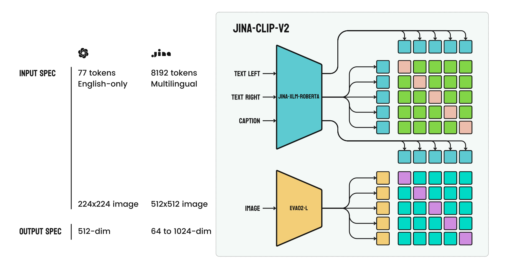
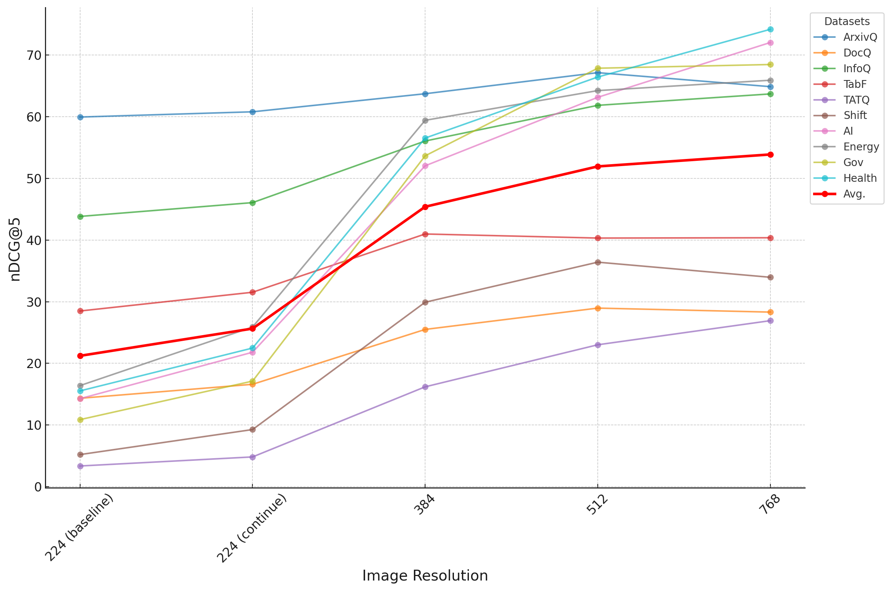

# Jina-CLIP v2：多语言、视觉文档与可截断的统一表示

> 延续文文与图文联合训练，加入多语言数据、逐步提高图像分辨率，并对多种向量前缀共同施加 MRL 损失。
>
> [jina-clip-v2: Multilingual Multimodal Embeddings for Text and Images](https://arxiv.org/abs/2412.08802v2) · 2024 · [官方模型](https://huggingface.co/jinaai/jina-clip-v2)

## 论文简介

Jina-CLIP v1 让图文模型也能做文本检索，但仍以英语、自然图和固定维数为主，面对包含文字、表格与图表的页面时表现有限。v2 将文本塔换成多语言 Jina-XLM-RoBERTa，视觉塔扩大为 EVA02-L/14，并在三阶段训练中加入多语言图文、文档图像和长描述；分辨率逐步升至 512，同时训练多个向量前缀。

模型在多语跨模态、STS 与视觉文档检索上显著优于 v1，1024 维缩至 256 维时许多指标仅小幅变化。但纯文本检索仍通常落后于 Jina embeddings v3，最后阶段也存在图文与文文任务的取舍。论文因此同时展示了统一表示的实用性与多任务优化的边界。

## 架构与相关工作

视觉语言对比训练从 CLIP 延续而来；LiT、NLLB-CLIP 等探索冻结视觉塔或引入多语言文本塔；MRL 允许向量按嵌套前缀使用。本文仍是独立双塔单向量模型，不采用 ColPali 式 patch MaxSim。

文本塔使用 mean pooling，图像塔使用 CLS pooling，均输出 1024 维。图中两种输入最终各成为一个向量；高分辨率增加的是编码时的视觉信息，不会直接增加每条索引记录的向量数量。

| 规格 | 文本塔 | 图像塔 |
|---|---|---|
| 初始化 | Jina-XLM-RoBERTa | EVA02-L/14 |
| 参数 | 561M | 304M |
| 输入 | 最长 8192 token | 512×512 |
| 层数 | 24 | 24 |
| 位置/注意力 | RoPE、FlashAttention 2 | 2D RoPE、xFormers |

总参数约 865M。骨干预训练支持的 89 种语言、本文对比训练数据涉及的 30 种语言，以及实际评测语言范围，是不同口径。

## 数据构建

文本对与含 1 正、7 负的文本三元组沿用 Jina v3 数据体系，覆盖 30 种语言。大规模短图文数据包括从 DFN 抽样的约 **4 亿英语对**，以及 CommonPool 中经过语言、长宽比、最短五词描述与多语 SigLIP 相似度筛选后得到的约 **4 亿非英语对**。

视觉文档来源包括 DocVQA、TAT-DQA、InfographicsVQA、SciGraphQA、ArXivQA/ArXivCAP、WIT 与 ViDoRe 合成训练集。QA 样本将问题与答案拼接成页面描述；WIT 长描述组合图注、标题、页面和章节介绍。另为 4 万张图像生成 30 语言描述，得到约 **120 万多语长描述**。图像数与描述条数不能混用。

## 三阶段训练与损失

| 阶段 | 数据与目标 | 长度及分辨率 |
|---|---|---|
| 初始对齐 | 文本对＋大规模短图文对 | 77 token，224²；末段升至 384² |
| 长描述适应 | 文本对＋长图文对 | 512 token，384² |
| 难负例精调 | 文本三元组＋长图文对 | 图像升至 512² |

第一阶段 batch 16,384，在 8 张 H100 上约十天。提升分辨率时进行位置表示插值。文文和图文任务分别计算双向 InfoNCE，再相加更新；第三阶段仅将文本损失扩展为含显式负例的形式。

令 $z^{(m)}=\operatorname{normalize}(z_{1:m})$，MRL 对

$$
\mathcal M=\{64,128,256,512,768,1024\},\qquad
\mathcal L_{MRL}=\sum_{m\in\mathcal M}\mathcal L_{stage}(z_q^{(m)},z_d^{(m)})
$$

共同优化。前缀训练使低维表示也可用，不能理解为每个坐标具有独立且严格排序的语义重要性。

## 跨模态与纯文本评测

英语图文检索使用 Flickr30K、COCO；多语使用 Crossmodal-3600 和 XTD10，以双向 R@5 衡量配对检索。表中最终模型与阶段 2 的比较如下：

| 模型 | 英语文→图 / 图→文 | Crossmodal-3600 文→图 / 图→文 |
|---|---:|---:|
| Jina-CLIP v1 | 77.75 / 87.65 | 16.93 / 19.82 |
| NLLB-SigLIP-large | 81.54 / 88.15 | 82.07 / 80.16 |
| v2 阶段 2 | 79.81 / 89.57 | 84.13 / 84.12 |
| v2 最终 | 79.09 / 89.73 | 81.43 / 83.23 |

最终阶段偏重文本难负例，多数跨模态指标略降。不同论文对 v1 的基准汇总范围不同，本表只比较本篇同一评测。

文本侧 MTEB 表 3 中，v2 的英语/中文/日语检索 nDCG@10 为 **46.46/60.47/65.48**，Jina embeddings v3 为 **48.34/64.27/68.47**。STS 则更接近，部分语言 v2 更高。文文检索与 STS 要分开看，不能由其中一项推断通用文本质量。

## 视觉文档检索与分辨率消融

ViDoRe 包含扫描件、财报、信息图、科学图和主题报告，测试查询是否找到对应页面。平均 nDCG@5：v1 **17.72**、NLLB-SigLIP-large **46.55**、SigLIP-So400M **51.4**、v2 **52.65**。v2 各阶段为 37.37→47.76→52.65。

论文引言的“提高 35%”容易混淆：表中 52.65−17.72 为 **34.93 个百分点**，并不是相对提高 35%。这些是单向量 CLIP 族的比较，不表示超过多向量 ColPali。

从同一个阶段 1 checkpoint 出发，各训练 3500 步。224²→384² 使平均 nDCG@5 从 0.256 到 0.454；再升至 512² 仍有收益，但 512²→768² 增加约 2.25 倍 patch 数，仅再提高约 0.019。作者据此选择 512² 的成本折中；此实验不是直接比较不同阶段成品。

## MRL 与统一 batch 的分析

表 5 中 1024→256 维时，英语文→图 R@5 为 79.10→78.32，英语文本检索 nDCG@10 为 49.33→48.67，STS 为 81.29→81.24。128/64 维下降更明显。该表采用 EN Classic MTEB 子集，不能把 49.33 与前面的 46.46 当成同一评测设置的矛盾。

作者还测试把文文、图文和图像增强对混入一个统一 batch，用共同温度的单一 InfoNCE 训练。早期有收益，后续跨模态表现却不如任务分开的方案；学习温度约停在 0.02，分任务方案可继续到约 0.015。作者将其解释为模态间信息量与难负例惩罚需求不同，但这是一种经验解释，不是所有混合训练都失败的定理。

## 结论与局限

本文的增量来自多语数据、视觉文档训练、分辨率课程和 MRL 的组合。附录保留逐语言、逐数据集结果及各维数对照，显示平均分背后的差异。模型仍将整页压成一个向量，细粒度文本和局部区域可能丢失；多任务训练存在冲突，混合模态检索的校准也未完全解决。选择维数或分辨率应以目标任务曲线为依据。
