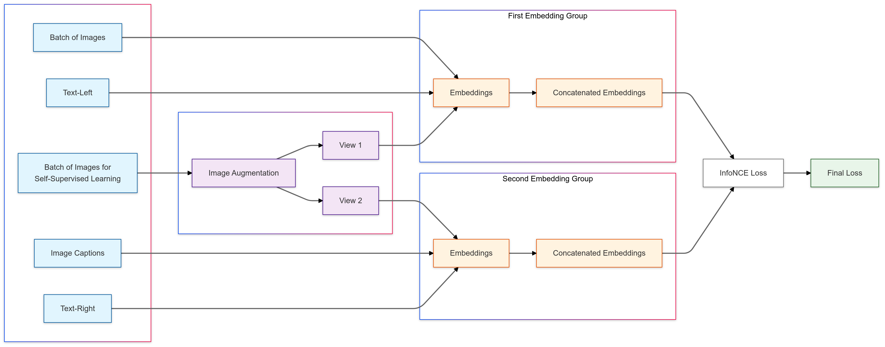

# jina-clip-v2: Multilingual Multimodal Embeddings for Text and Images / 全文中英对照

> 来源：[arXiv:2412.08802v2](https://arxiv.org/abs/2412.08802v2)。英文段落后紧接中文，覆盖所取 HTML 版本的主文、附录、图表、脚注与参考文献；公式、数字表和书目信息共用。中文以机器初译为底稿，进行了术语整理与结构核对，尚未逐句人工审定；遇到歧义请以紧邻英文和原论文为准。 原作版权归所列作者，许可见 [原作许可](http://creativecommons.org/licenses/by-nc-sa/4.0/)；中文译文与版式改写在该许可条件下提供（涉及 SA 时沿用相同许可，涉及 NC 时仅限非商业使用）。

## Authors and affiliations / 作者与机构

Andreas Koukounas Georgios Mastrapas * Sedigheh Eslami Bo Wang Mohammad Kalim Akram Michael Günther Isabelle Mohr Saba Sturua Nan Wang Han Xiao Jina AI GmbH, Prinzessinnenstr. 19-20, 10969 Berlin, Germany research@jina.ai [^id3]

## Abstract / 摘要

**EN.** Contrastive Language-Image Pretraining (CLIP) has been widely used for crossmodal information retrieval and multimodal understanding tasks. However, CLIP models are mainly optimized for crossmodal vision-language tasks and underperform in single-mode text tasks. Moreover, these models are often trained on English datasets and therefore lack multilingual understanding. Additionally, from a visual understanding perspective, previous CLIP-based models exhibit insufficient understanding of visually rich documents. In this work, we propose [jina-clip-v2](https://huggingface.co/jinaai/jina-clip-v2) , a contrastive vision-language model trained on text pairs, triplets and image-text pairs via a multi-task and multi-stage contrastive learning paradigm in order to support both text-only and crossmodal tasks. We employ a multilingual text encoder and expand the training dataset to include multilingual texts from 29 non-English languages, including Hindi, Chinese, German, French, and others, as well as images of visually-rich documents. We evaluate the model’s performance and show that [jina-clip-v2](https://huggingface.co/jinaai/jina-clip-v2) achieves notable improvements over state-of-the-art CLIP-based models in zero-shot text-only retrieval, semantic textual similarity, and crossmodal retrieval tasks in both English and multilingual settings. [jina-clip-v2](https://huggingface.co/jinaai/jina-clip-v2) also provides for flexibility in embedding dimensionality, enabling users to select the granularity of the representations. [jina-clip-v2](https://huggingface.co/jinaai/jina-clip-v2) is publicly available at [https://huggingface.co/jinaai/jina-clip-v2](https://huggingface.co/jinaai/jina-clip-v2) .

**中.** 对比语言图像预训练（CLIP）已广泛用于跨模态信息检索和多模态理解任务。然而，CLIP 模型主要针对跨模式视觉语言任务进行优化，在单模式文本任务中表现不佳。此外，这些模型通常是在英语数据集上进行训练的，因此缺乏多语言理解。此外，从视觉理解的角度来看，之前基于 CLIP 的模型对视觉丰富的文档的理解不足。在这项工作中，我们提出了 [jina-clip-v2](https://huggingface.co/jinaai/jina-clip-v2)，这是一种通过多任务和多阶段对比学习范例在文本对、三元组和图像文本对上进行训练的对比视觉语言模型，以支持纯文本和跨模式任务。我们采用多语言文本编码器，并将训练数据集扩展为包含 29 种非英语语言的多语言文本，包括印地语、中文、德语、法语等，以及视觉丰富的文档图像。我们评估了该模型的性能，结果表明，[jina-clip-v2](https://huggingface.co/jinaai/jina-clip-v2) 在英语和多语言设置中的零样本纯文本检索、语义文本相似性和跨模式检索任务方面，比最先进的基于 CLIP 的模型取得了显着改进。 [jina-clip-v2](https://huggingface.co/jinaai/jina-clip-v2) 还提供了嵌入维度的灵活性，使用户能够选择表示的粒度。 [jina-clip-v2](https://huggingface.co/jinaai/jina-clip-v2) 可在 [https://huggingface.co/jinaai/jina-clip-v2](https://huggingface.co/jinaai/jina-clip-v2) 上公开获取。

## Introduction / 简介

**EN.** Contrastive text-image pretraining is a well-known architecture and training framework for building robust text-image alignment models ( Radford et al., 2021 ; Zhai et al., 2023 ; Sun et al., 2023 ) . These models are particularly effective for tasks like crossmodal retrieval and zero-shot classification, demonstrating strong generalization capabilities. However, although CLIP models produce general-purpose embeddings for both texts and images, they are woefully inadequate as a source of text embeddings ( Koukounas et al., 2024 ) . We believe this is due to the training regimen of CLIP models, which are typically trained with short and information-poor image captions ( Zhang et al., 2024a ) and omit standard techniques for finetuning meaningful text embeddings, e.g. training using hard negatives ( Gillick et al., 2019 ; Qu et al., 2021 ) .

**中.** 对比文本图像预训练是一种众所周知的架构和训练框架，用于构建鲁棒的文本图像对齐模型（Radford et al., 2021；Zhai et al., 2023；Sun et al., 2023）。这些模型对于跨模态检索和零样本分类等任务特别有效，表现出强大的泛化能力。然而，尽管 CLIP 模型为文本和图像生成通用嵌入，但它们作为文本嵌入的来源远远不够（Koukounas 等人，2024）。我们认为这是由于 CLIP 模型的训练方案所致，该模型通常使用简短且信息贫乏的图像标题进行训练（Zhang et al., 2024a），并省略了用于微调有意义的文本嵌入的标准技术，例如使用难负例进行训练（Gillick 等人，2019；Qu 等人，2021）。

**EN.** To overcome these limitations, Koukounas et al. (2024) introduced a multi-task, multi-stage contrastive learning approach to simultaneously align text-text and text-image embeddings. This method involved three stages: optimizing text-text and text-image embeddings for short image-caption and text-text pairs (stage 1), refining alignment using long text-text pairs and detailed image-caption pairs (stage 2), and further enhancing performance with text triplets containing hard negatives and detailed image-caption pairs (stage 3). The resulting model, [jina-clip-v1](https://huggingface.co/jinaai/jina-clip-v1) , achieves strong performance on both the crossmodal CLIP Benchmark [^footnote1] and the text embedding MTEB Benchmark ( Muennighoff et al., 2023 ) . Despite its strengths, [jina-clip-v1](https://huggingface.co/jinaai/jina-clip-v1) ( Koukounas et al., 2024 ) has several limitations. First, it is an English-only model, which makes it unsuitable for multilingual document retrieval. Second, [jina-clip-v1](https://huggingface.co/jinaai/jina-clip-v1) struggles with visually-rich images, e.g. those containing text, tables, graphs, and diagrams ( Faysse et al., 2024 ) . Moreover, [jina-clip-v1](https://huggingface.co/jinaai/jina-clip-v1) only supports fixed length embeddings, which can be wasteful when embedding vectors are much larger than required for a task ( Kusupati et al., 2024 ) .

**中.** 为了克服这些限制，Koukounas 等人。 (2024) 引入了一种多任务、多阶段对比学习方法来同时对齐文本-文本和文本-图像嵌入。该方法涉及三个阶段：优化短图像标题和文本文本对的文本-文本和文本-图像嵌入（阶段1），使用长文本-文本对和详细图像标题对细化对齐（阶段2），以及使用包含难负例和详细图像标题对的文本三元组进一步增强性能（阶段3）。生成的模型 [jina-clip-v1](https://huggingface.co/jinaai/jina-clip-v1) 在跨模式 CLIP 基准 [^footnote1] 和文本嵌入 MTEB 基准上均实现了出色的性能（Muennighoff 等人，2023）。尽管有其优点，[jina-clip-v1](https://huggingface.co/jinaai/jina-clip-v1) (Koukounas et al., 2024) 也有一些局限性。首先，它是纯英文模型，这使得它不适合多语言文档检索。其次，[jina-clip-v1](https://huggingface.co/jinaai/jina-clip-v1) 难以处理视觉丰富的图像，例如包含文本、表格、图表和图表的内容（Faysse 等人，2024）。此外，[jina-clip-v1](https://huggingface.co/jinaai/jina-clip-v1) 仅支持固定长度嵌入，当嵌入向量远大于任务所需时，这可能会造成浪费 (Kusupati et al., 2024)。

**EN.** To address these challenges, we propose several enhancements to the pretraining scheme. For multilingual support, our approach uses a multilingual language model ( Conneau et al., 2020 ) to initialize the text encoder, and incorporates multilingual text-image and text-text pairs during training. To improve performance on visually complex documents, we gradually increase image resolution during pretraining and use multimodal training pairs with complex visual structures. Finally, to enable users to select the granularity of their representations, we employ Matryoshka Representation Learning ( Kusupati et al., 2024 ) and enable dimensional truncation on the output vectors with minimal performance degradation.

**中.** 为了应对这些挑战，我们提出了对预训练方案的一些改进。对于多语言支持，我们的方法使用多语言语言模型（Conneau et al., 2020）来初始化文本编码器，并在训练期间合并多语言文本-图像和文本-文本对。为了提高视觉复杂文档的性能，我们在预训练期间逐渐提高图像分辨率，并使用具有复杂视觉结构的多模态训练对。最后，为了使用户能够选择其表示的粒度，我们采用 Matryoshka 表示学习（Kusupati 等人，2024）并在输出向量上进行维度截断，同时性能下降最小。

**EN.** Figure 1: [jina-clip-v2](https://huggingface.co/jinaai/jina-clip-v2) combines a text encoder (Jina XLM-RoBERTa, 561M parameters) and a vision encoder (EVA02-L14, 304M parameters) for a total of 865M parameters.

**中.** 图1：[jina-clip-v2](https://huggingface.co/jinaai/jina-clip-v2)结合了文本编码器(Jina XLM-RoBERTa，561M参数)和视觉编码器(EVA02-L14，304M参数)，总共865M参数。

**EN.** The resulting model, [jina-clip-v2](https://huggingface.co/jinaai/jina-clip-v2) depicted in Figure 1 , not only achieves competitive performance on crossmodal retrieval benchmarks against multilingual state-of-the-art models like NLLB-CLIP ( Visheratin, 2023b ) but also performs comparably to dedicated multilingual text embedding models like [jina-embeddings-v3](https://huggingface.co/jinaai/jina-embeddings-v3) ( Sturua et al., 2024 ) on the retrieval and semantic textual similarity (STS) tasks of the MTEB benchmark ( Muennighoff et al., 2023 ) . Moreover, due to the inclusion of visually rich training data and the progressive increase in image resolution, [jina-clip-v2](https://huggingface.co/jinaai/jina-clip-v2) demonstrates significantly improved performance on ViDoRe, a benchmark for visually rich document retrieval ( Faysse et al., 2024 ) , compared to [jina-clip-v1](https://huggingface.co/jinaai/jina-clip-v1) . In summary, our contributions are the following:

**中.** 图 1 所示的最终模型 [jina-clip-v2](https://huggingface.co/jinaai/jina-clip-v2) 不仅在跨模式检索基准上与 NLLB-CLIP (Visheratin, 2023b) 等多语言最先进模型相比实现了具有竞争力的性能，而且与专用多语言文本嵌入模型（如[jina-embeddings-v3](https://huggingface.co/jinaai/jina-embeddings-v3) (Sturua et al., 2024) 关于 MTEB 基准的检索和语义文本相似性 (STS) 任务 (Muennighoff et al., 2023)。此外，由于包含视觉丰富的训练数据和图像分辨率的逐步提高，与 [jina-clip-v1](https://huggingface.co/jinaai/jina-clip-v1) 相比，[jina-clip-v2](https://huggingface.co/jinaai/jina-clip-v2) 在 ViDoRe（视觉丰富的文档检索基准（Faysse 等人，2024））上表现出显着提高的性能。总之，我们的贡献如下：

**EN.** 1.

**中.** 1.

**EN.** Support for multiple languages . [jina-clip-v2](https://huggingface.co/jinaai/jina-clip-v2) achieves up to 67% higher scores on multilingual crossmodal performance, up to 60% on multilingual Retrieval performance and up to 43% on multilingual STS, compared [jina-clip-v1](https://huggingface.co/jinaai/jina-clip-v1) .

**中.** 支持多种语言。与 [jina-clip-v1](https://huggingface.co/jinaai/jina-clip-v1) 相比，[jina-clip-v2](https://huggingface.co/jinaai/jina-clip-v2) 在多语言跨模式性能方面的得分提高了 67%，在多语言检索性能方面得分提高了 60%，在多语言 STS 方面得分提高了 43%。

**EN.** 2.

**中.** 2.

**EN.** Improved performance on visual document retrieval . [jina-clip-v2](https://huggingface.co/jinaai/jina-clip-v2) ’s scores are 35% higher on the ViDoRe benchmark ( Faysse et al., 2024 ) compared to [jina-clip-v1](https://huggingface.co/jinaai/jina-clip-v1) .

**中.** 改进了视觉文档检索的性能。与 [jina-clip-v1](https://huggingface.co/jinaai/jina-clip-v1) 相比，[jina-clip-v2](https://huggingface.co/jinaai/jina-clip-v2) 在 ViDoRe 基准 (Faysse et al., 2024) 上的得分高出 35%。

**EN.** 3.

**中.** 3.

**EN.** Flexible embedding dimensionality . Truncating [jina-clip-v2](https://huggingface.co/jinaai/jina-clip-v2) embeddings by up to 75% (from 1,024 dimensions down to 256) reduces performance by <1%.

**中.** 灵活的嵌入维数。将 [jina-clip-v2](https://huggingface.co/jinaai/jina-clip-v2) 嵌入截断高达 75%（从 1,024 维减少到 256）会使性能降低 <1%。

## Related Work / 相关工作

**EN.** Previous work ( Jia et al., 2021 ; Li et al., 2021 ; Radford et al., 2021 ; Zhang et al., 2022 ) pioneered dual-encoder architectures trained contrastively on image-text pairs, demonstrating impressive zero-shot performance and laying the groundwork for pretrained vision-language models. Building on this foundation, Zhai et al. (2023) proposed an alternative and more efficient sigmoid objective, while Sun et al. (2023) optimized the model’s dimensions and scaled up both dataset and model sizes, achieving state-of-the-art performance on crossmodal tasks. Koukounas et al. (2024) enhanced a CLIP-based retriever with strong text-to-text and crossmodal retrieval capabilities, however, their work fails to address retrieval scenarios involving candidate pools with heterogeneous modalities, due to the modality gap ( Liang et al., 2022 ; Eslami & de Melo, 2024 ) and the modality bias ( Lin et al., 2024 ) . To mitigate the modality bias, Lin et al. (2024) finetuned a multimodal LLM with modality-aware hard-negative mining, creating a universal multimodal retriever and maintaining competitive text-to-text retrieval performance across diverse tasks. In this work, we build on the training strategy proposed by Koukounas et al. (2024) and train our model using a text-to-text as well as a text-to-image contrastive InfoNCE ( Van den Oord et al., 2018 ) loss.

**中.** 之前的工作（Jia et al., 2021；Li et al., 2021；Radford et al., 2021；Zhang et al., 2022）开创了在图像-文本对上进行对比训练的双编码器架构，展示了令人印象深刻的零样本性能，并为预训练的视觉语言模型奠定了基础。在此基础上，Zhai 等人。 (2023) 提出了一种替代且更有效的 sigmoid 目标，而 Sun 等人。 (2023) 优化了模型的维度并扩大了数据集和模型的大小，在跨模式任务上实现了最先进的性能。库库纳斯等人。 (2024) 增强了基于 CLIP 的检索器，具有强大的文本到文本和跨模态检索能力，然而，由于模态差距 (Liang et al., 2022; Eslami & de Melo, 2024) 和模态偏差 (Lin et al., 2024)，他们的工作未能解决涉及具有异构模态的候选池的检索场景。为了减轻模态偏差，Lin 等人。 (2024) 通过模态感知硬负挖掘对多模态法学硕士进行了微调，创建了通用的多模态检索器，并在不同的任务中保持有竞争力的文本到文本检索性能。在这项工作中，我们以 Koukoonas 等人提出的培训策略为基础。 (2024) 并使用文本到文本以及文本到图像对比 InfoNCE (Van den Oord et al., 2018) 损失来训练我们的模型。

**EN.** Extensive research has also focused on extending CLIP to languages beyond English. To address the lack of image-caption pairs in languages other than English, Carlsson et al. (2022) applied knowledge distillation to retrain the text encoder using machine-translated data. NLLB-CLIP ( Visheratin, 2023a ) leverages Locked-image Tuning (LiT) ( Zhai et al., 2022 ) alongside the multilingual NLLB ( Costa-jussà et al., 2022 ) text encoder, achieving state-of-the-art results in both retrieval and classification tasks.

**中.** 广泛的研究还集中于将 CLIP 扩展到英语以外的语言。为了解决英语以外的语言中缺乏图像标题对的问题，Carlsson 等人。 (2022) 应用知识蒸馏，使用机器翻译的数据重新训练文本编码器。 NLLB-CLIP（Visheratin，2023a）利用锁定图像调整（LiT）（Zhai 等人，2022）以及多语言 NLLB（Costa-jussà 等人，2022）文本编码器，在检索和分类任务中实现了最先进的结果。

**EN.** Multilingual text embedding models are typically based on either an encoder-only architecture, such as XLM-RoBERTa ( Conneau et al., 2020 ) , or a decoder-only multilingual large language model, such as Mistral 7B ( Jiang et al., 2023 ) . Multilingual E5 ( Wang et al., 2024 ) and BGE-M3 ( Chen et al., 2024 ) both use XLM-RoBERTa as their backbone, the first leveraging extensive multilingual training with instruction tuning, and the second employing multi-task learning techniques. mGTE ( Zhang et al., 2024b ) achieves comparable performance to BGE-M3 using a smaller transformer architecture, enhanced by RoPE ( Su et al., 2023 ) to extend the input context length. Similarly, Sturua et al. (2024) employ RoPE to increase the model’s context length and apply LoRA tuning ( Hu et al., 2021 ) to optimize embeddings for downstream tasks.

**中.** 多语言文本嵌入模型通常基于仅编码器架构，例如 XLM-RoBERTa（Conneau 等人，2020），或仅基于解码器多语言大语言模型，例如 Mistral 7B（Jiang 等人，2023）。多语言 E5（Wang 等人，2024）和 BGE-M3（Chen 等人，2024）都使用 XLM-RoBERTa 作为骨干，第一个利用广泛的多语言训练和指令调整，第二个采用多任务学习技术。 mGTE（Zhang et al., 2024b）使用更小的Transformer 架构实现了与 BGE-M3 相当的性能，并通过 RoPE（Su et al., 2023）增强以扩展输入上下文长度。同样，Sturua 等人。 (2024) 使用 RoPE 来增加模型的上下文长度，并应用 LoRA 调整 (Hu et al., 2021) 来优化下游任务的嵌入。

**EN.** Finally, Kusupati et al. (2024) propose a training technique, which they call Matryoshka Representation Learning , that enables embedding models to learn coarse-to-fine representations. These representations can be truncated during inference to match the requirements of downstream tasks, cutting down on potentially redundant vector dimensions.

**中.** 最后，库苏帕蒂等人。 (2024) 提出了一种训练技术，他们称之为 Matryoshka Representation Learning ，使嵌入模型能够学习从粗到细的表示。这些表示可以在推理过程中被截断，以满足下游任务的要求，从而减少潜在的冗余向量维度。

## [jina-clip-v2](https://huggingface.co/jinaai/jina-clip-v2)

**EN.** The [jina-clip-v2](https://huggingface.co/jinaai/jina-clip-v2) model uses the dual encoder architecture, introduced in the original CLIP ( Radford et al., 2021 ) model and reused in [jina-clip-v1](https://huggingface.co/jinaai/jina-clip-v1) ( Koukounas et al., 2024 ) .

**中.** [jina-clip-v2](https://huggingface.co/jinaai/jina-clip-v2) 模型使用双编码器架构，该架构在原始 CLIP (Radford et al., 2021) 模型中引入，并在 [jina-clip-v1](https://huggingface.co/jinaai/jina-clip-v1) (Koukounas et al., 2024) 中重用。

**EN.** The text encoder is initialized with pretrained Jina-XLM-RoBERTa model weights. Introduced in [jina-embeddings-v3](https://huggingface.co/jinaai/jina-embeddings-v3) ( Sturua et al., 2024 ) , the Jina-XLM-RoBERTa model is a port of the multilingual XLM-RoBERTa ( Conneau et al., 2020 ) model to a modern encoder-only architecture with Flash Attention ( Dao et al., 2022 ) , rotary positional embeddings ( Su et al., 2023 ) and support for low-rank adaptation ( Hu et al., 2021 ) .

**中.** 文本编码器使用预训练的 Jina-XLM-RoBERTa 模型权重进行初始化。 Jina-XLM-RoBERTa 模型在 [jina-embeddings-v3](https://huggingface.co/jinaai/jina-embeddings-v3) (Sturua et al., 2024) 中引入，是多语言 XLM-RoBERTa (Conneau et al., 2020) 模型到具有 Flash Attention (Dao et al., 2022) 的现代仅编码器架构的端口（Dao et al., 2022）、旋转位置嵌入（Su et al., 2023）和对低秩适配的支持（Hu et al., 2021）。

**EN.** Like [jina-clip-v1](https://huggingface.co/jinaai/jina-clip-v1) , the image encoder is a pretrained EVA02 model ( Fang et al., 2023b ) . We selected the L/14 pretrained model variant, which is similar in number of parameters to the text encoder. This model implementation includes 2D rotary positional embeddings and a memory-efficient attention implementation based on xFormers ( Lefaudeux et al., 2022 ) . Table 1 presents architectural details for both encoders.

**中.** 与 [jina-clip-v1](https://huggingface.co/jinaai/jina-clip-v1) 一样，图像编码器是预训练的 EVA02 模型 (Fang et al., 2023b)。我们选择了 L/14 预训练模型变体，其参数数量与文本编码器相似。该模型实现包括 2D 旋转位置嵌入和基于 xFormers 的内存高效注意力实现（Lefaudeux 等人，2022）。表 1 列出了两种编码器的架构细节。

| Feature 特点 | Text Encoder 文本编码器 | Image Encoder 图像编码器 |
| --- | --- | --- |
| Base Model 基础型号 | Jina-XLM-RoBERTa ( Sturua et al., 2024 ) Jina-XLM-RoBERTa（Sturua 等人，2024） | EVA02 L/14 ( Sun et al., 2023 ) EVA02 L/14（孙等人，2023） |
| Parameters 参数 | 561M | 304M |
| Input Specification 输入规格 | 8,192 tokens (max) 8,192 个代币（最多） | $\mathrm{(512,512)}$ resolution $\mathrm{(512,512)}$分辨率 |
| Output Dimensions 输出尺寸 | 1,024 | 1,024 |
| Layers 层数 | 24 | 24 |
| Attention Implementation 关注实施 | FlashAttention2 ( Dao et al., 2022 ) FlashAttention2（Dao 等人，2022） | xFormers ( Lefaudeux et al., 2022 ) xFormers（Lefaudeux 等人，2022） |
| Pooling Strategy 池化策略 | Mean pooling 平均池化 | CLS pooling CLS池化 |
| Additional Features 附加功能 | 89 languages supported 支持 89 种语言 | Patch size 14x14 贴片尺寸 14x14 |

**EN.** Table 1: Model properties

**中.** 表 1：模型属性

### Training Data / 训练数据

**EN.** Similarly to [jina-clip-v1](https://huggingface.co/jinaai/jina-clip-v1) ( Koukounas et al., 2024 ) , we constructed four training datasets used in different stages of the training process. Dataset $\mathbb{D}^{\mathrm{txt;p}}$ denotes a dataset of text pairs, $\mathbb{D}^{\mathrm{txt;t}}$ a dataset of text samples with hard negatives, $\mathbb{D}^{\mathrm{mm;s}}$ a multimodal short-caption dataset and $\mathbb{D}^{\mathrm{mm;l}}$ a multimodal long-caption dataset.

**中.** 与 [jina-clip-v1](https://huggingface.co/jinaai/jina-clip-v1) (Koukounas et al., 2024) 类似，我们构建了四个用于训练过程不同阶段的训练数据集。数据集 $\mathbb{D}^{\mathrm{txt;p}}$ 表示文本对的数据集，$\mathbb{D}^{\mathrm{txt;t}}$ 表示具有难负例的文本样本的数据集，$\mathbb{D}^{\mathrm{mm;s}}$ 表示多模态短标题数据集，$\mathbb{D}^{\mathrm{mm;l}}$ 表示多模态长标题数据集。

**EN.** Both $\mathbb{D}^{\mathrm{txt;p}}$ and $\mathbb{D}^{\mathrm{txt;t}}$ contain data in 30 languages drawn from various existing datasets for text information retrieval and semantic similarity, and were introduced as training data for [jina-embeddings-v3](https://huggingface.co/jinaai/jina-embeddings-v3) ( Sturua et al., 2024 ) . $\mathbb{D}^{\mathrm{txt;p}}$ consists of pairs of texts drawn from a diverse collection of datasets, and $\mathbb{D}^{\mathrm{txt;t}}$ is a high-quality dataset with hard negatives from various sources, where each sample contains one annotated positive and seven negative items. Sturua et al. (2024) provide detailed information about these datasets and how they were curated.

**中.** $\mathbb{D}^{\mathrm{txt;p}}$ 和 $\mathbb{D}^{\mathrm{txt;t}}$ 都包含从各种现有数据集中提取的 30 种语言的数据，用于文本信息检索和语义相似性，并被引入作为 [jina-embeddings-v3](https://huggingface.co/jinaai/jina-embeddings-v3) 的训练数据 (Sturua et al., 2024)。 $\mathbb{D}^{\mathrm{txt;p}}$ 由来自不同数据集集合的文本对组成，$\mathbb{D}^{\mathrm{txt;t}}$ 是一个高质量的数据集，具有来自各种来源的难负例，其中每个样本包含一个带注释的正项和七个负项。斯图鲁亚等人。 （2024）提供了有关这些数据集及其整理方式的详细信息。

**EN.** Our multimodal training datasets draw on multiple sources. We randomly sampled $\sim$ 400M image-caption pairs from the $\sim$ 2B in the DFN dataset ( Fang et al., 2023a ) to obtain a collections of image-text pairs in English. To this, we added non-English image-text pairs sampled from CommonPool ( Gadre et al., 2023 ) . We filtered this data by language, aspect ratio, and by removing any caption with less than five words. We used multilingual SigLIP ( Zhai et al., 2023 ) to rank image-text pairs based on cosine similarity and kept the top scoring $\sim$ 50%. The result was an additional $\sim$ 400M image-text pairs. All images were resized to $\mathrm{(384,384)}$ . These two large-scale datasets are included in $\mathbb{D}^{\mathrm{mm;s}}$ and a small part with captions longer than 256 tokens is held out for $\mathbb{D}^{\mathrm{mm;l}}$ .

**中.** 我们的多模式训练数据集利用多个来源。我们从 DFN 数据集（Fang et al., 2023a）中的 $\sim$ 2B 中随机采样 $\sim$ 400M 图像标题对，以获得英文图像文本对的集合。为此，我们添加了从 CommonPool 采样的非英语图像文本对（Gadre 等人，2023）。我们通过语言、宽高比以及删除任何少于五个单词的标题来过滤这些数据。我们使用多语言 SigLIP（Zhai et al., 2023）根据余弦相似度对图像文本对进行排名，并将最高得分 $\sim$ 保持在 50%。结果是额外的 $\sim$ 400M 图像文本对。所有图像的大小均调整为 $\mathrm{(384,384)}$ 。这两个大型数据集包含在 $\mathbb{D}^{\mathrm{mm;s}}$ 中，并且为 $\mathbb{D}^{\mathrm{mm;l}}$ 保留了一小部分标题长度超过 256 个标记的数据集。

**EN.** In order to overcome the limitations of visual document understanding, we diversify our training data with PDFs, scientific graphs, infographics and Wikipedia images. Specifically, the short caption image-text dataset $\mathbb{D}^{\mathrm{mm;s}}$ and the long-caption $\mathbb{D}^{\mathrm{mm;l}}$ include the following training datasets: DocVQA ( Mathew et al., 2021b ) , TatDQA ( Zhu et al., 2022 ) , InfographicsVQA ( Mathew et al., 2021a ) , SciGraphQA ( Li & Tajbakhsh, 2023 ) , ArXivQA and ArXivCAP ( Li et al., 2024 ) , WIT ( Srinivasan et al., 2021 ) and ViDoRe synthetic training data ( Faysse et al., 2024 ) . For the QA datasets, we concatenated the query and answer for each sample to construct a matching text in lieu of a caption. For the WIT dataset, we use the reference caption as corresponding text in $\mathbb{D}^{\mathrm{mm;s}}$ and a concatenation of reference caption, page title, section title, page description and section description as matching text for $\mathbb{D}^{\mathrm{mm;l}}$ .

**中.** 为了克服视觉文档理解的局限性，我们使用 PDF、科学图表、信息图表和维基百科图像来实现训练数据的多样化。具体来说，短字幕图文数据集 $\mathbb{D}^{\mathrm{mm;s}}$ 和长字幕 $\mathbb{D}^{\mathrm{mm;l}}$ 包括以下训练数据集：DocVQA (Mathew et al., 2021b)、TatDQA (Zhu et al., 2022)、InfographicsVQA (Mathew et al., 2021a)、SciGraphQA (Li & Tajbakhsh, 2023）、ArXivQA 和 ArXivCAP（Li 等人，2024）、WIT（Srinivasan 等人，2021）和 ViDoRe 合成训练数据（Faysse 等人，2024）。对于 QA 数据集，我们将每个样本的查询和答案连接起来，以构建匹配的文本来代替标题。对于 WIT 数据集，我们使用参考标题作为 $\mathbb{D}^{\mathrm{mm;s}}$ 中的对应文本，并使用参考标题、页面标题、章节标题、页面描述和章节描述的串联作为 $\mathbb{D}^{\mathrm{mm;l}}$ 的匹配文本。

**EN.** Finally, $\mathbb{D}^{\mathrm{mm;l}}$ includes multilingual synthetic long captions, similar to how Koukounas et al. (2024) make use of ShareGPT4v ( Chen et al., 2023a ) . We use the GPT4v API ( OpenAI, 2023 ) to generate detailed image descriptions for 40,000 images in 30 languages. This adds $\sim$ 1.2M generated multilingual long captions to $\mathbb{D}^{\mathrm{mm;l}}$ .

**中.** 最后，$\mathbb{D}^{\mathrm{mm;l}}$ 包括多语言合成长字幕，类似于 Koukoonas 等人的方式。 (2024) 利用 ShareGPT4v（Chen 等人，2023a）。我们使用 GPT4v API（OpenAI，2023）为 30 种语言的 40,000 张图像生成详细的图像描述。这会将 $\sim$ 1.2M 生成的多语言长字幕添加到 $\mathbb{D}^{\mathrm{mm;l}}$ 中。

### Training Stages / 训练阶段

**EN.** Inspired by Koukounas et al. (2024) , we employ a multi-task, multi-stage training approach, in order to optimize the model for two tasks simultaneously: text-image matching and text-text matching.

**中.** 受到库库纳斯等人的启发。 (2024)，我们采用多任务、多阶段训练方法，以便同时优化两个任务的模型：文本-图像匹配和文本-文本匹配。

**EN.** Stage 1 focuses on aligning the multimodal representations while also improving the text representations of the text encoder. We train on $\mathbb{D}^{\mathrm{txt;p}}$ and $\mathbb{D}^{\mathrm{mm;s}}$ , with a small context length of 77 and an image resolution of $\mathrm{(224,224)}$ to enable large batch sizes of $16,384$ . This is the most computationally expensive stage in our training pipeline, requiring approximately 10 days on 8 NVIDIA H100 GPUs to converge. Towards the end, when performance peaks, we switch to a higher image resolution of $\mathrm{(384,384)}$ using positional embedding interpolation as a warm-up for the next stage.

**中.** 第一阶段的重点是对齐多模态表示，同时改进文本编码器的文本表示。我们在 $\mathbb{D}^{\mathrm{txt;p}}$ 和 $\mathbb{D}^{\mathrm{mm;s}}$ 上进行训练，上下文长度为 77，图像分辨率为 $\mathrm{(224,224)}$，以实现 $16,384$ 的大批量。这是我们训练流程中计算成本最高的阶段，需要在 8 个 NVIDIA H100 GPU 上大约 10 天才能收敛。最后，当性能达到峰值时，我们使用位置嵌入插值切换到更高的图像分辨率 $\mathrm{(384,384)}$ 作为下一阶段的热身。

**EN.** Stage 2 trains on $\mathbb{D}^{\mathrm{txt;p}}$ and $\mathbb{D}^{\mathrm{mm;l}}$ , with context length increased from 77 to 512 and image resolution set at $\mathrm{(384,384)}$ . This stage improves text embedding performance on longer text lengths, while maintaining alignment between the two modalities.

**中.** 第 2 阶段在 $\mathbb{D}^{\mathrm{txt;p}}$ 和 $\mathbb{D}^{\mathrm{mm;l}}$ 上进行训练，上下文长度从 77 增加到 512，图像分辨率设置为 $\mathrm{(384,384)}$。此阶段提高了较长文本长度上的文本嵌入性能，同时保持两种模式之间的对齐。

**EN.** Stage 3 uses hard negatives from $\mathbb{D}^{\mathrm{txt;t}}$ to further improve the text encoder in distinguishing relevant from irrelevant text. To maintain text-image alignment, we continue training with $\mathbb{D}^{\mathrm{mm;l}}$ . We do one more positional embedding interpolation to increase the image resolution to $\mathrm{(512,512)}$ and train on this resolution for the duration of stage 3.

**中.** 第 3 阶段使用 $\mathbb{D}^{\mathrm{txt;t}}$ 中的难负例来进一步改进文本编码器，以区分相关文本和不相关文本。为了保持文本-图像对齐，我们继续使用 $\mathbb{D}^{\mathrm{mm;l}}$ 进行训练。我们再进行一次位置嵌入插值，将图像分辨率提高到 $\mathrm{(512,512)}$，并在第 3 阶段期间以此分辨率进行训练。

**EN.** Table 6 in Section A specifies the training details for each step.

**中.** A 节中的表 6 指定了每个步骤的训练细节。

### Loss Functions / 损失函数

**EN.** Given a batch $\mathbf{B}\subset\mathbb{D}^{\mathrm{pairs}}$ of embedding pairs $(\bf{q},\bf{p})$ , the InfoNCE loss $\mathcal{L}_{\mathrm{nce}}$ ( Van den Oord et al., 2018 ) , given in equation 1 , evaluates the cosine similarity $cos(\bf{q},\bf{p})$ between query $\bf{q}\in\mathbb{R}^{d}$ and its corresponding target $\bf{p}\in\mathbb{R}^{d}$ , relative to the similarity of all other targets in the batch. The loss is calculated in both directions to preserve the symmetry of similarity measures. The temperature parameter $\tau$ influences how the loss function weighs minor differences in the similarity scores.

**中.** 给定一批 $\mathbf{B}\subset\mathbb{D}^{\mathrm{pairs}}$ 的嵌入对 $(\bf{q},\bf{p})$ ，等式 1 中给出的 InfoNCE 损失 $\mathcal{L}_{\mathrm{nce}}$ （Van den Oord 等人，2018）评估查询 $\bf{q}\in\mathbb{R}^{d}$ 与其相应目标 $\bf{p}\in\mathbb{R}^{d}$ 之间的余弦相似度 $cos(\bf{q},\bf{p})$ ，相对与批次中所有其他目标的相似性。损失是在两个方向上计算的，以保持相似性度量的对称性。温度参数 $\tau$ 影响损失函数如何权衡相似度分数中的微小差异。

$$
\begin{aligned}\displaystyle\mathcal{L}_{\mathrm{nce}}(\mathbf{B}):=\mathcal{L}_{\mathrm{nce}}^{\longrightarrow}(\mathbf{B})+\mathcal{L}_{\mathrm{nce}}^{\longleftarrow}(\mathbf{B})\quad\text{where,} \\ \displaystyle\mathcal{L}_{\mathrm{nce}}^{\longrightarrow}(\mathbf{B}):=\mathbb{E}_{(\bf{q},\bf{p})\sim\mathbf{B}}\left[-\ln\frac{e^{cos(\bf{q},\bf{p})/\tau}}{\sum\limits_{i=1}^{k}e^{cos(\bf{q},\bf{p_{i}})/\tau}}\right],\mathcal{L}_{\mathrm{nce}}^{\longleftarrow}(\mathbf{B}):=\mathbb{E}_{(\bf{q},p)\sim\mathbf{B}}\left[-\ln\frac{e^{cos(\bf{p},\bf{q})/\tau}}{\sum\limits_{i=1}^{k}e^{cos(\bf{p},\bf{q_{i}})/\tau}}\right]\end{aligned}\tag{1}
$$

**EN.** When hard negatives are available for query $q$ , an extended version of the $\mathcal{L}_{\mathrm{nce}}$ loss is used. Given a batch $\mathbf{B}\subset\mathbb{D}^{\mathrm{triplets}}$ of samples $r=(\bf{q},\bf{p},\bf{n_{1}}...,\bf{n_{7}})$ , consisting of a query $\bf{q}$ , a positive match $\bf{p}$ , and seven negatives $\bf{n_{1}}...,\bf{n_{7}}$ , the extended loss function, denoted here as $\mathcal{L}_{\mathrm{nce}^{+}}$ , is given in equation 2 . Similarly to $\mathcal{L}_{\mathrm{nce}}$ , this loss function is bidirectional.

**中.** 当查询 $q$ 具有难负例时，将使用 $\mathcal{L}_{\mathrm{nce}}$ 损失的扩展版本。给定一批 $\mathbf{B}\subset\mathbb{D}^{\mathrm{triplets}}$ 样本 $r=(\bf{q},\bf{p},\bf{n_{1}}...,\bf{n_{7}})$ ，由查询 $\bf{q}$ 、正匹配 $\bf{p}$ 和七个负匹配 $\bf{n_{1}}...,\bf{n_{7}}$ 组成，扩展损失函数（此处表示为 $\mathcal{L}_{\mathrm{nce}^{+}}$ ）在等式 2 中给出。与 $\mathcal{L}_{\mathrm{nce}}$ 类似，该损失函数是双向的。

$$
\displaystyle\mathcal{L}_{\mathrm{nce}^{+}}(\mathbf{B}):=\mathbb{E}_{r\sim\mathbf{B}}\Bigg[-\ln\frac{e^{cos(\bf{q},\bf{p})/\tau}}{\sum\limits_{i=1}^{k}\Big[e^{cos(\bf{q},p_{i})/\tau}+\sum\limits_{j=1}^{7}e^{cos(\bf{q},\bf{n_{j,i}})/\tau}\Big]}\Bigg]+\mathbb{E}_{r\sim\mathbf{B}}\Bigg[-\ln\frac{e^{cos(\bf{p},\bf{q})/\tau}}{\sum\limits_{i=1}^{k}e^{cos(\bf{p},\bf{q_{i}})/\tau}}\Bigg]\tag{2}
$$

**EN.** Equation 3 defines the loss for each of the three stages. In each stage, we optimize a joint loss function, i.e. the sum of two loss functions, one operating on text representations and one on multimodal representations. In equation 3 , $\mathbf{B_{\mathit{k}}}$ denotes a batch of samples drawn from the dataset $\mathbb{D}^{\mathrm{k}}$ , where $\mathrm{k}\in\{\mathit{txt;p},\mathit{txt;t},\mathit{mm;s},\mathit{mm;l}\}$ . All stages optimize $\mathcal{L}_{\mathrm{nce}}$ except Stage 3, which uses hard negatives in the text loss branch and thus calculates $\mathcal{L}_{\mathrm{nce}^{+}}$ .

**中.** 公式 3 定义了三个阶段中每个阶段的损耗。在每个阶段，我们优化联合损失函数，即两个损失函数的总和，一个针对文本表示，一个针对多模态表示。在公式 3 中， $\mathbf{B_{\mathit{k}}}$ 表示从数据集 $\mathbb{D}^{\mathrm{k}}$ 中抽取的一批样本，其中 $\mathrm{k}\in\{\mathit{txt;p},\mathit{txt;t},\mathit{mm;s},\mathit{mm;l}\}$ 。除第 3 阶段外，所有阶段都会优化 $\mathcal{L}_{\mathrm{nce}}$ ，阶段 3 在文本丢失分支中使用难负例，从而计算 $\mathcal{L}_{\mathrm{nce}^{+}}$ 。

$$
\begin{aligned}\displaystyle\mathcal{L}_{1}(\mathbf{B_{\mathit{txt;p}}},\mathbf{B_{\mathit{mm;s}}}):=\mathcal{L}_{\mathrm{nce}}(\mathbf{B_{\mathit{txt;p}}})+\mathcal{L}_{\mathrm{nce}}(\mathbf{B_{\mathit{mm;s}}}) \\ \displaystyle\mathcal{L}_{2}(\mathbf{B_{\mathit{txt;p}}},\mathbf{B_{\mathit{mm;l}}}):=\mathcal{L}_{\mathrm{nce}}(\mathbf{B_{\mathit{txt;p}}})+\mathcal{L}_{\mathrm{nce}}(\mathbf{B_{\mathit{mm;l}}}) \\ \displaystyle\mathcal{L}_{3}(\mathbf{B_{\mathit{txt;t}}},\mathbf{B_{\mathit{mm;l}}}):=\mathcal{L}_{\mathrm{nce}^{+}}(\mathbf{B_{\mathit{txt;t}}})+\mathcal{L}_{\mathrm{nce}}(\mathbf{B_{\mathit{mm;l}}})\end{aligned}\tag{3}
$$

### Matryoshka Representation Learning / 俄罗斯套娃表征学习

**EN.** In every training stage, the loss component is recalculated at different dimensionalities: Loss is computed for the full 1024-dim output vector, and for truncated subsets of 64, 128, 256, 512 and 768 dimensions. Model weight adjustment proceeds on the basis of all those losses combined. This training technique, called Matryoshka Representation Learning ( Kusupati et al., 2024 ) , induces the model to encode its embeddings by increasing granularity. This makes it possible, at inference time, to truncate embedding vectors with a minor performance penalty.

**中.** 在每个训练阶段，都会以不同的维度重新计算损失分量：针对完整的 1024 维输出向量以及 64、128、256、512 和 768 维度的截断子集计算损失。模型权重调整是根据所有这些损失的总和进行的。这种训练技术称为 Matryoshka 表示学习（Kusupati 等人，2024），通过增加粒度来诱导模型对其嵌入进行编码。这使得在推理时可以截断嵌入向量，但性能损失较小。

## Evaluation / 评价

**EN.** We evaluate the performance of [jina-clip-v2](https://huggingface.co/jinaai/jina-clip-v2) on a selection of benchmarks: English and multilingual crossmodal retrieval benchmarks in Section 4.1 , text embedding tasks from the MTEB benchmark suite in Section 4.2 and visual document retrieval tasks in Section 4.3 . Finally, we present an ablation study of [jina-clip-v2](https://huggingface.co/jinaai/jina-clip-v2) ’s Matryoshka representations in Section 4.4 . Detailed evaluation results are presented in Section A tables 7 to 26 .

**中.** 我们在一系列基准上评估了 [jina-clip-v2](https://huggingface.co/jinaai/jina-clip-v2) 的性能：第 4.1 节中的英语和多语言跨模态检索基准、第 4.2 节中的 MTEB 基准套件中的文本嵌入任务以及第 4.3 节中的视觉文档检索任务。最后，我们在第 4.4 节中提出了 [jina-clip-v2](https://huggingface.co/jinaai/jina-clip-v2) 的 Matryoshka 表示的消融研究。详细的评估结果见A部分表7至26。

### Crossmodal Retrieval Evaluation / 跨模态检索评估

| Benchmark 基准测试 | Benchmark 基准测试 | CLIP Benchmark CLIP 基准 | CLIP Benchmark CLIP 基准 | Crossmodal-3600 | Crossmodal-3600 | XTD10 | XTD10 |
| --- | --- | --- | --- | --- | --- | --- | --- |
| Language 语言 | Language 语言 | English 英语 | English 英语 | Multilingual 多语言 | Multilingual 多语言 | Multilingual 多语言 | Multilingual 多语言 |
| Task Type 任务类型 | Task Type 任务类型 | Zero-Shot Retrieval 零样本检索 | Zero-Shot Retrieval 零样本检索 | Zero-Shot Retrieval 零样本检索 | Zero-Shot Retrieval 零样本检索 | Zero-Shot Retrieval 零样本检索 | Zero-Shot Retrieval 零样本检索 |
| Model 型号 | #Parameters #参数 | T-I r@5 | I-T r@5 | T-I r@5 | I-T r@5 | T-I r@5 | I-T r@5 |
| [jina-clip-v1](https://huggingface.co/jinaai/jina-clip-v1) | 223M | 77.75 | 87.65 | 16.93 | 19.82 | 31.01 | 36.89 |
| nllb-siglip-base nllb-siglip-基础 | 507M | 79.57 | 86.38 | 79.29 | 76.56 | 86.23 | 84.87 |
| nllb-siglip-large nllb-siglip-大 | 1.2B | 81.54 | 88.15 | 82.07 | 80.16 | 87.60 | 85.37 |
| [jina-clip-v2](https://huggingface.co/jinaai/jina-clip-v2) stage 1 [jina-clip-v2](https://huggingface.co/jinaai/jina-clip-v2) 第 1 阶段 | 865M | 73.87 | 86.61 | 73.51 | 79.64 | 80.66 | 83.02 |
| [jina-clip-v2](https://huggingface.co/jinaai/jina-clip-v2) stage 2 [jina-clip-v2](https://huggingface.co/jinaai/jina-clip-v2) 第 2 阶段 | 865M | 79.81 | 89.57 | 84.13 | 84.12 | 86.11 | 86.45 |
| [jina-clip-v2](https://huggingface.co/jinaai/jina-clip-v2) | 865M | 79.09 | 89.73 | 81.43 | 83.23 | 84.87 | 86.03 |

**EN.** Table 2: Evaluation results on crossmodal retrieval tasks

**中.** 表2：跨模态检索任务的评估结果

**EN.** We evaluate [jina-clip-v2](https://huggingface.co/jinaai/jina-clip-v2) on a set of English and multilingual crossmodal tasks, conducting a comparative analysis with both [jina-clip-v1](https://huggingface.co/jinaai/jina-clip-v1) and the state-of-the-art NLLB-CLIP ( Visheratin, 2023b ) large and base SigLIP variants. Additionally, we track the model’s performance at all training stages to evaluate the effectiveness of the training protocol. For English zero-shot image-text and text-image retrieval, we conduct evaluations on the CLIP Benchmark, which includes Flickr30K ( Young et al., 2014 ) and COCO Captions ( Chen et al., 2015 ) . For multilingual crossmodal retrieval tasks, we assess performance on the Crossmodal-3600 ( Thapliyal et al., 2022 ) and XTD10 ( Aggarwal & Kale, 2020 ; Rajendran et al., 2016 ) datasets.

**中.** 我们在一组英语和多语言跨模态任务上评估 [jina-clip-v2](https://huggingface.co/jinaai/jina-clip-v2)，与 [jina-clip-v1](https://huggingface.co/jinaai/jina-clip-v1) 和最先进的 NLLB-CLIP (Visheratin, 2023b) 大型和基础 SigLIP 变体进行比较分析。此外，我们还跟踪模型在所有训练阶段的表现，以评估训练协议的有效性。对于英语零样本图像文本和文本图像检索，我们在 CLIP Benchmark 上进行评估，其中包括 Flickr30K (Young et al., 2014) 和 COCO Captions (Chen et al., 2015)。对于多语言跨模态检索任务，我们评估了 Crossmodal-3600（Thapliyal 等人，2022）和 XTD10（Aggarwal & Kale，2020；Rajendran 等人，2016）数据集的性能。

**EN.** Table 2 demonstrates the strong performance of [jina-clip-v2](https://huggingface.co/jinaai/jina-clip-v2) across both English and multilingual benchmarks. On the English CLIP Benchmark, our model outperforms [jina-clip-v1](https://huggingface.co/jinaai/jina-clip-v1) and while nllb-siglip-large leads in text-to-image retrieval, [jina-clip-v2](https://huggingface.co/jinaai/jina-clip-v2) outperforms both NLLB-CLIP variants in image-to-text retrieval. On multilingual multimodal retrieval, we obtain competitive results, approaching the performance of nllb-siglip-large in text-to-image retrieval and surpassing it in image-to-text retrieval. Regarding stage progression, performance improves considerably between Stage 1 and Stage 2 on all benchmarks, but drops slightly from Stage 2 to Stage 3. We hypothesize that there is a trade-off between crossmodal and text-only retrieval performance, and during stage 3 training, where focus shifts towards text embedding training with hard negatives, the model falls slightly behind on crossmodal retrieval.

**中.** 表 2 展示了 [jina-clip-v2](https://huggingface.co/jinaai/jina-clip-v2) 在英语和多语言基准测试中的强劲性能。在英语 CLIP 基准上，我们的模型优于 [jina-clip-v1](https://huggingface.co/jinaai/jina-clip-v1)，而 nllb-siglip-large 在文本到图像检索方面领先，而 [jina-clip-v2](https://huggingface.co/jinaai/jina-clip-v2) 在图像到文本检索方面优于 NLLB-CLIP 变体。在多语言多模态检索上，我们获得了有竞争力的结果，在文本到图像检索中接近 nllb-siglip-large 的性能，并在图像到文本检索中超越它。关于阶段进展，在所有基准上，第 1 阶段和第 2 阶段的性能都有显着提高，但从第 2 阶段到第 3 阶段略有下降。我们假设跨模态检索性能和纯文本检索性能之间存在权衡，并且在第 3 阶段训练期间，重点转向带有难负例的文本嵌入训练，模型在跨模态检索方面略有落后。

### Text Retrieval and STS Evaluation / 文本检索和STS评估

| Retrieval nDCG@10 [%] 检索 nDCG@10 [%] | Retrieval nDCG@10 [%] 检索 nDCG@10 [%] | Retrieval nDCG@10 [%] 检索 nDCG@10 [%] | Retrieval nDCG@10 [%] 检索 nDCG@10 [%] | Retrieval nDCG@10 [%] 检索 nDCG@10 [%] | Retrieval nDCG@10 [%] 检索 nDCG@10 [%] | Retrieval nDCG@10 [%] 检索 nDCG@10 [%] | Retrieval nDCG@10 [%] 检索 nDCG@10 [%] | Retrieval nDCG@10 [%] 检索 nDCG@10 [%] | Retrieval nDCG@10 [%] 检索 nDCG@10 [%] |
| --- | --- | --- | --- | --- | --- | --- | --- | --- | --- |
| Model 型号 | #Parameters ∗ #参数* | en zh | zh | hi 嗨 | de 德 | fr FR | es 英语 | jp 日本人 | ru 茹 |
| [jina-clip-v1](https://huggingface.co/jinaai/jina-clip-v1) | 137M | 47.04 | 8.09 | 8.73 | 33.77 | 39.99 | 39.77 | 10.77 | 4.78 |
| nllb-siglip-base nllb-siglip-基础 | 414M | 24.69 | 27.04 | 39.18 | 22.67 | 28.30 | 30.06 | 30.73 | 32.68 |
| nllb-siglip-large nllb-siglip-大 | 767M | 27.83 | 32.96 | 43.22 | 32.29 | 38.74 | 39.92 | 35.53 | 38.87 |
| [jina-embeddings-v3](https://huggingface.co/jinaai/jina-embeddings-v3) | 572M | 48.34 | 64.27 | 65.18 | 63.59 | 64.09 | 62.97 | 68.47 | 66.46 |
| [jina-clip-v2](https://huggingface.co/jinaai/jina-clip-v2) stage 1 [jina-clip-v2](https://huggingface.co/jinaai/jina-clip-v2) 第 1 阶段 | 561M | 42.02 | 55.11 | 62.03 | 57.56 | 58.56 | 59.86 | 63.34 | 60.74 |
| [jina-clip-v2](https://huggingface.co/jinaai/jina-clip-v2) stage 2 [jina-clip-v2](https://huggingface.co/jinaai/jina-clip-v2) 第 2 阶段 | 561M | 43.47 | 57.66 | 62.19 | 59.16 | 61.05 | 61.51 | 65.13 | 63.66 |
| [jina-clip-v2](https://huggingface.co/jinaai/jina-clip-v2) | 561M | 46.46 | 60.47 | 63.08 | 56.66 | 61.16 | 61.48 | 65.48 | 64.73 |
| STS Spearman correlation based on cosine similarity 基于余弦相似度的STS Spearman相关 | STS Spearman correlation based on cosine similarity 基于余弦相似度的STS Spearman相关 | STS Spearman correlation based on cosine similarity 基于余弦相似度的STS Spearman相关 | STS Spearman correlation based on cosine similarity 基于余弦相似度的STS Spearman相关 | STS Spearman correlation based on cosine similarity 基于余弦相似度的STS Spearman相关 | STS Spearman correlation based on cosine similarity 基于余弦相似度的STS Spearman相关 | STS Spearman correlation based on cosine similarity 基于余弦相似度的STS Spearman相关 | STS Spearman correlation based on cosine similarity 基于余弦相似度的STS Spearman相关 | STS Spearman correlation based on cosine similarity 基于余弦相似度的STS Spearman相关 | STS Spearman correlation based on cosine similarity 基于余弦相似度的STS Spearman相关 |
| Model 型号 | #Parameters ∗ #参数* | en zh | zh | hi 嗨 | de 德 | fr FR | es 英语 | jp 日本人 | ru 茹 |
| [jina-clip-v1](https://huggingface.co/jinaai/jina-clip-v1) | 137M | 81.35 | 22.97 | 36.09 | 50.04 | 67.97 | 70.05 | 55.83 | 39.77 |
| nllb-siglip-base nllb-siglip-基础 | 414M | 72.57 | 33.36 | 68.11 | 39.58 | 63.94 | 65.28 | 77.39 | 57.55 |
| nllb-siglip-large nllb-siglip-大 | 767M | 74.73 | 39.15 | 73.78 | 53.45 | 72.38 | 69.68 | 79.25 | 62.84 |
| [jina-embeddings-v3](https://huggingface.co/jinaai/jina-embeddings-v3) | 572M | 81.68 | 54.60 | 83.62 | 75.32 | 81.11 | 80.78 | 81.03 | 77.16 |
| [jina-clip-v2](https://huggingface.co/jinaai/jina-clip-v2) stage 1 [jina-clip-v2](https://huggingface.co/jinaai/jina-clip-v2) 第 1 阶段 | 561M | 80.01 | 52.74 | 83.35 | 74.84 | 79.06 | 80.42 | 81.48 | 75.62 |
| [jina-clip-v2](https://huggingface.co/jinaai/jina-clip-v2) stage 2 [jina-clip-v2](https://huggingface.co/jinaai/jina-clip-v2) 第 2 阶段 | 561M | 80.76 | 53.37 | 84.30 | 75.64 | 80.19 | 80.51 | 81.46 | 76.18 |
| [jina-clip-v2](https://huggingface.co/jinaai/jina-clip-v2) | 561M | 81.58 | 55.08 | 79.55 | 76.27 | 81.70 | 81.89 | 82.01 | 77.79 |

**EN.** Table 3: Evaluation results on MTEB ( Muennighoff et al., 2023 ) Retrieval and STS tasks across 8 languages

**中.** 表 3：MTEB（Muennighoff et al., 2023）跨 8 种语言的检索和 STS 任务的评估结果

**EN.** Table 3 presents the results of evaluations on the retrieval and semantic textual similarity (STS) tasks from MTEB ( Muennighoff et al., 2023 ) , both in English-only and multilingual contexts. [jina-clip-v2](https://huggingface.co/jinaai/jina-clip-v2) significantly improves on the performance of nllb-siglip-large in both English and multilingual text tasks, demonstrating the value of explicit text retrieval training. Compared to [jina-clip-v1](https://huggingface.co/jinaai/jina-clip-v1) , performance is significantly better on multilingual tasks, and comparable on English-only tasks. Compared to the text-only frontier model [jina-embeddings-v3](https://huggingface.co/jinaai/jina-embeddings-v3) , performance is lackluster on retrieval tasks. This suggests that multimodal training is hampering text-only performance.

**中.** 表 3 显示了 MTEB（Muennighoff 等人，2023）在纯英语和多语言环境中的检索和语义文本相似性 (STS) 任务的评估结果。 [jina-clip-v2](https://huggingface.co/jinaai/jina-clip-v2) 显着提高了 nllb-siglip-large 在英语和多语言文本任务中的性能，展示了显式文本检索训练的价值。与 [jina-clip-v1](https://huggingface.co/jinaai/jina-clip-v1) 相比，在多语言任务上的性能明显更好，在纯英语任务上的性能相当。与纯文本前沿模型 [jina-embeddings-v3](https://huggingface.co/jinaai/jina-embeddings-v3) 相比，在检索任务上的性能表现不佳。这表明多模式训练正在阻碍纯文本的表现。

### Visual Document Retrieval / 视觉文档检索

| Task 任务 | jina- clip-v2 jina-剪辑-v2 | jina-clip- v2 stage 1 jina-clip- v2 阶段 1 | jina-clip- v2 stage 2 jina-clip- v2 阶段 2 | jina- clip-v1 jina-剪辑-v1 | nllb-siglip large nllb-siglip 大号 | siglip- so400m ∗ siglip-so400m * |
| --- | --- | --- | --- | --- | --- | --- |
| Retrieval - nDCG@5 [%] 检索 - nDCG@5 [%] | Retrieval - nDCG@5 [%] 检索 - nDCG@5 [%] | Retrieval - nDCG@5 [%] 检索 - nDCG@5 [%] | Retrieval - nDCG@5 [%] 检索 - nDCG@5 [%] | Retrieval - nDCG@5 [%] 检索 - nDCG@5 [%] | Retrieval - nDCG@5 [%] 检索 - nDCG@5 [%] | Retrieval - nDCG@5 [%] 检索 - nDCG@5 [%] |
| ArxivQ | 64.92 | 58.78 | 66.14 | 25.40 | 30.44 | 43.2 |
| DocQ 文档Q | 24.64 | 21.16 | 24.81 | 11.90 | 23.82 | 30.3 |
| InfoQ 信息Q | 57.90 | 56.62 | 56.63 | 35.50 | 59.87 | 64.1 |
| TabF 标签F | 45.91 | 37.28 | 43.18 | 20.20 | 70.68 | 58.1 |
| TATQ | 30.25 | 12.09 | 25.79 | 3.30 | 20.00 | 26.2 |
| Shift 转变 | 34.07 | 28.41 | 31.54 | 3.80 | 30.79 | 18.7 |
| AI 人工智能 | 68.07 | 32.95 | 55.64 | 15.20 | 47.90 | 62.5 |
| Energy 能源 | 62.15 | 49.15 | 60.97 | 19.70 | 64.94 | 65.7 |
| Gov 政府 | 68.97 | 37.81 | 55.56 | 21.40 | 58.62 | 66.1 |
| Health 健康 | 69.05 | 39.50 | 57.37 | 20.80 | 58.43 | 79.1 |
| Average 平均 | 52.65 | 37.37 | 47.76 | 17.72 | 46.55 | 51.4 |

**EN.** Table 4: ViDoRe benchmark ( Faysse et al., 2024 ) evaluation results

**中.** 表4：ViDoRe基准（Faysse等人，2024）评估结果

**EN.** Visual document retrieval challenges vision-language models to capture fine-grained information from images, including embedded text, and accurately match these with text queries or documents. This task is particularly challenging as it deals with high-resolution document images with complex content, which differs significantly from processing typical image-caption datasets. As shown in Table 4 , [jina-clip-v2](https://huggingface.co/jinaai/jina-clip-v2) outperforms other state-of-the-art CLIP models on the ViDoRe Benchmark for visual document understanding ( Faysse et al., 2024 ) , with an average nDCG@5 score of 52.65%, toping [jina-clip-v1](https://huggingface.co/jinaai/jina-clip-v1) , nllb-siglip-large and siglip-so400m-patch14-384 ( Zhai et al., 2023 ; Alabdulmohsin et al., 2024 ) . The progression through training stages brings substantial improvements, highlighting the effectiveness of gradually increasing the image resolution. We further investigate how image resolution affects visual document retrieval in Section 5.1 .

**中.** 视觉文档检索对视觉语言模型提出了挑战，要求视觉语言模型从图像中捕获细粒度信息（包括嵌入文本），并将这些信息与文本查询或文档准确匹配。这项任务特别具有挑战性，因为它处理内容复杂的高分辨率文档图像，这与处理典型的图像标题数据集有很大不同。如表 4 所示，[jina-clip-v2](https://huggingface.co/jinaai/jina-clip-v2) 在 ViDoRe Benchmark 上的视觉文档理解方面优于其他最先进的 CLIP 模型 (Faysse et al., 2024)，平均 nDCG@5 得分为 52.65%，领先于 [jina-clip-v1](https://huggingface.co/jinaai/jina-clip-v1) 、nllb-siglip-large 和 siglip-so400m-patch14-384（Zhai 等人，2023；Alabdulmohsin 等人，2024）。训练阶段的进展带来了实质性的改进，突出了逐渐提高图像分辨率的有效性。我们在 5.1 节中进一步研究图像分辨率如何影响视觉文档检索。

### Matryoshka Representation Learning / 俄罗斯套娃表征学习

| Dataset - Dimension 数据集 - 维度 | 1024 | 768 | 512 | 256 | 128 | 64 |
| --- | --- | --- | --- | --- | --- | --- |
| Text-Image Retrieval - Recall@5 [%] 文本图像检索 - Recall@5 [%] | Text-Image Retrieval - Recall@5 [%] 文本图像检索 - Recall@5 [%] | Text-Image Retrieval - Recall@5 [%] 文本图像检索 - Recall@5 [%] | Text-Image Retrieval - Recall@5 [%] 文本图像检索 - Recall@5 [%] | Text-Image Retrieval - Recall@5 [%] 文本图像检索 - Recall@5 [%] | Text-Image Retrieval - Recall@5 [%] 文本图像检索 - Recall@5 [%] | Text-Image Retrieval - Recall@5 [%] 文本图像检索 - Recall@5 [%] |
| CLIP Benchmark CLIP 基准 | 79.10 | 79.12 | 78.93 | 78.32 | 75.90 | 70.51 |
| Crossmodal-3600 ( Thapliyal et al., 2022 ) Crossmodal-3600（Thapliyal 等人，2022） | 81.43 | 82.35 | 82.31 | 81.75 | 78.17 | 72.52 |
| XTD10 ( Aggarwal & Kale, 2020 ; Rajendran et al., 2016 ) XTD10（Aggarwal & Kale，2020；Rajendran 等人，2016） | 84.87 | 84.85 | 84.60 | 84.32 | 81.80 | 77.85 |
| Image-Text Retrieval - Recall@5 [%] 图文检索 - Recall@5 [%] | Image-Text Retrieval - Recall@5 [%] 图文检索 - Recall@5 [%] | Image-Text Retrieval - Recall@5 [%] 图文检索 - Recall@5 [%] | Image-Text Retrieval - Recall@5 [%] 图文检索 - Recall@5 [%] | Image-Text Retrieval - Recall@5 [%] 图文检索 - Recall@5 [%] | Image-Text Retrieval - Recall@5 [%] 图文检索 - Recall@5 [%] | Image-Text Retrieval - Recall@5 [%] 图文检索 - Recall@5 [%] |
| CLIP Benchmark CLIP 基准 | 89.73 | 89.60 | 89.55 | 89.35 | 87.48 | 83.20 |
| Crossmodal-3600 ( Thapliyal et al., 2022 ) Crossmodal-3600（Thapliyal 等人，2022） | 83.23 | 83.26 | 83.21 | 82.81 | 80.54 | 75.37 |
| XTD10 ( Aggarwal & Kale, 2020 ; Rajendran et al., 2016 ) XTD10（Aggarwal & Kale，2020；Rajendran 等人，2016） | 86.03 | 86.02 | 86.02 | 85.84 | 84.37 | 81.02 |
| Text-Text Retrieval - nDCG@10 [%] 文本-文本检索 - nDCG@10 [%] | Text-Text Retrieval - nDCG@10 [%] 文本-文本检索 - nDCG@10 [%] | Text-Text Retrieval - nDCG@10 [%] 文本-文本检索 - nDCG@10 [%] | Text-Text Retrieval - nDCG@10 [%] 文本-文本检索 - nDCG@10 [%] | Text-Text Retrieval - nDCG@10 [%] 文本-文本检索 - nDCG@10 [%] | Text-Text Retrieval - nDCG@10 [%] 文本-文本检索 - nDCG@10 [%] | Text-Text Retrieval - nDCG@10 [%] 文本-文本检索 - nDCG@10 [%] |
| EN Classic MTEB ( Muennighoff et al., 2023 ) Retrieval EN Classic MTEB ( Muennighoff et al., 2023 ) 检索 | 49.33 | 49.32 | 49.19 | 48.67 | 46.37 | 40.66 |
| Semantic Textual Similarity - Spearman Correlation [%] 语义文本相似度 - Spearman 相关性 [%] | Semantic Textual Similarity - Spearman Correlation [%] 语义文本相似度 - Spearman 相关性 [%] | Semantic Textual Similarity - Spearman Correlation [%] 语义文本相似度 - Spearman 相关性 [%] | Semantic Textual Similarity - Spearman Correlation [%] 语义文本相似度 - Spearman 相关性 [%] | Semantic Textual Similarity - Spearman Correlation [%] 语义文本相似度 - Spearman 相关性 [%] | Semantic Textual Similarity - Spearman Correlation [%] 语义文本相似度 - Spearman 相关性 [%] | Semantic Textual Similarity - Spearman Correlation [%] 语义文本相似度 - Spearman 相关性 [%] |
| EN Classic MTEB ( Muennighoff et al., 2023 ) STS EN 经典 MTEB（Muennighoff 等人，2023）STS | 81.29 | 81.27 | 81.26 | 81.24 | 80.78 | 79.56 |

**EN.** Table 5: MRL ( Kusupati et al., 2024 ) ablation study on various embedding dimensions

**中.** 表 5：各种嵌入维度的 MRL（Kusupati 等人，2024）消融研究

**EN.** Table 5 presents the impact of embedding truncation on the crossmodal and text-only tasks. Performance remains highly stable when reducing dimensions from 1024 to 256, with minimal degradation (typically less than 1%) across all evaluation tasks. At 256 dimensions, representing a 75% reduction in embedding size, the model preserves effectively all essential semantic information. Substantial performance degradation is only observed at dimensions 128 and 64.

**中.** 表 5 显示了嵌入截断对跨模式和纯文本任务的影响。当维度从 1024 减少到 256 时，性能保持高度稳定，所有评估任务的降级最小（通常小于 1%）。该模型的维度为 256，意味着嵌入大小减少了 75%，有效地保留了所有基本语义信息。仅在维度 128 和 64 处观察到显着的性能下降。

## Analysis / 分析

### The Role of Image Resolution in Visual Document Retrieval / 图像分辨率在视觉文档检索中的作用

**EN.** Figure 2: Performance on the ViDoRe benchmark ( Faysse et al., 2024 ) against input resolution

**中.** 图 2：ViDoRe 基准测试（Faysse 等人，2024）相对于输入分辨率的性能

**EN.** Our analysis of performance at various stages of training demonstrates that image resolution plays a critical role in retrieving visually rich documents. To better understand the relationship between image resolution and model performance on such documents, we conduct a targeted experiment.

**中.** 我们对训练各个阶段的性能的分析表明，图像分辨率在检索视觉丰富的文档中起着至关重要的作用。为了更好地理解此类文档的图像分辨率和模型性能之间的关系，我们进行了有针对性的实验。

**EN.** We checkpointed [jina-clip-v2](https://huggingface.co/jinaai/jina-clip-v2) at the end of Stage 1, when it had only seen images with a resolution of $\mathrm{(224,224)}$ . We conducted four runs, keeping the image resolution to $\mathrm{(224,224)}$ for the first run and increasing to $\mathrm{(384,384)}$ , $\mathrm{(512,512)}$ , and $\mathrm{(768,768)}$ for three additional runs. Each run was trained for 3500 steps using the same visually rich training set and hyperparameters. The models were then evaluated on the ViDoRe benchmark ( Faysse et al., 2024 ) , which comprises 10 datasets designed for retrieving visually rich documents with text queries. We plot the results in Figure 2 .

**中.** 我们在第 1 阶段结束时对 [jina-clip-v2](https://huggingface.co/jinaai/jina-clip-v2) 进行了检查，当时它只看到了分辨率为 $\mathrm{(224,224)}$ 的图像。我们进行了四次运行，第一次运行将图像分辨率保持为 $\mathrm{(224,224)}$ ，并在另外三轮运行中增加到 $\mathrm{(384,384)}$ 、 $\mathrm{(512,512)}$ 和 $\mathrm{(768,768)}$ 。每次运行都使用相同的视觉丰富的训练集和超参数进行 3500 步的训练。然后在 ViDoRe 基准（Faysse 等人，2024）上对模型进行评估，该基准包含 10 个数据集，旨在通过文本查询检索视觉丰富的文档。我们将结果绘制在图 2 中。

**EN.** Unsurprisingly, increasing image resolution has a positive impact on linking queries to visually rich documents. The most significant improvement occurs when resolution increases from $\mathrm{(224,224)}$ to $\mathrm{(384,384)}$ , with the average nDCG@5 score across 10 benchmarks rising from $\mathrm{0.256}$ to $\mathrm{0.454}$ . A further increase in resolution to $\mathrm{(512,512)}$ also brings a noticeable gain in performance.

**中.** 毫不奇怪，提高图像分辨率对于将查询链接到视觉丰富的文档具有积极影响。当分辨率从 $\mathrm{(224,224)}$ 增加到 $\mathrm{(384,384)}$ 时，出现最显着的改进，10 个基准测试的平均 nDCG@5 得分从 $\mathrm{0.256}$ 增加到 $\mathrm{0.454}$。 $\mathrm{(512,512)}$ 分辨率的进一步提高也带来了性能的显着提升。

**EN.** Considering that the model is trained with a patch size of 14, increasing the resolution beyond $\mathrm{(512,512)}$ raises the number of patches quadratically, for example, by a factor of $\mathrm{2.25x}$ when increasing the resolution to $\mathrm{(768,768)}$ . This large increase in computing costs yields only marginal improvements, with nDCG@5 increasing by just $\mathrm{0.019}$ . We consider $\mathrm{(512,512)}$ the optimal image resolution for this model, with a reasonable balance between performance and cost.

**中.** 考虑到模型是使用补丁大小 14 进行训练的，将分辨率增加到超过 $\mathrm{(512,512)}$ 会以二次方方式增加补丁数量，例如，当将分辨率增加到 $\mathrm{(768,768)}$ 时，增加 $\mathrm{2.25x}$ 倍。计算成本的大幅增加仅带来边际改进，nDCG@5 仅增加了 $\mathrm{0.019}$ 。我们认为 $\mathrm{(512,512)}$ 是该模型的最佳图像分辨率，在性能和成本之间取得了合理的平衡。

### Unified Batch Training vs Multi-Task Learning / 统一批量训练与多任务学习

**EN.** Our training approach, as outlined in Section 3 , involves two tasks at each stage, both optimized in a multi-task learning framework: a multimodal alignment task for images and text, and a second text-only task. Both use the InfoNCE ( Van den Oord et al., 2018 ) objective. Regardless of whether the loss is computed on image-text or text-text pairs, the same loss function is applied to pairs of vectors. This raises the question: Is there any value in merging the image-text pair and text-text pair data into mixed modality batches and optimizing a single contrastive objective?

**中.** 正如第 3 节所述，我们的训练方法在每个阶段涉及两项任务，均在多任务学习框架中进行了优化：图像和文本的多模态对齐任务，以及第二个纯文本任务。两者都使用 InfoNCE（Van den Oord 等人，2018）目标。无论损失是在图像-文本对还是文本-文本对上计算，相同的损失函数都适用于向量对。这就提出了一个问题：将图像-文本对和文本-文本对数据合并到混合模态批次并优化单个对比目标是否有任何价值？

**EN.** We refer to this approach as the Unified Batch Training technique, in contrast to the Multi-Task Learning paradigm. The motivation is two-fold: simplicity of computation, and the possibility of mitigating the modality gap ( Liang et al., 2022 ) by using in-batch negatives across modalities. Compared to multi-task training, the unified batch approach would use a single InfoNCE loss with a shared temperature value, attempting to force all modalities to align within the same embedding space. For this investigation, we also integrated a SimCLR-like self-supervised learning method ( Chen et al., 2020 ) into the contrastive training, aiming to provide more robust image representations. A schematic representation of the unified batch technique is given in Figure 3 in Section A .

**中.** 与多任务学习范例相反，我们将这种方法称为统一批量训练技术。动机有两个：计算的简单性，以及通过使用跨模态的批量负数来缩小模态差距的可能性（Liang et al., 2022）。与多任务训练相比，统一批处理方法将使用具有共享温度值的单个 InfoNCE 损失，试图强制所有模态在同一嵌入空间内对齐。在本次研究中，我们还将类似 SimCLR 的自监督学习方法（Chen et al., 2020）集成到对比训练中，旨在提供更鲁棒的图像表示。 A 部分的图 3 给出了统一批处理技术的示意图。

**EN.** Our Stage 1 experiments show that this technique does bring some early improvements, but fails beyond a certain point, at least with regard to crossmodal tasks. This was reflected in the slow decay of the loss temperature $\tau$ (our temperature is a trainable parameter in this case) and its eventual stabilization around $\mathrm{0.02}$ . This is in contrast to the multi-task learning approach, where the temperature value decreases more rapidly and keeps decreasing throughout training down to $\mathrm{0.015}$ , leading to better performance on crossmodal tasks.

**中.** 我们的第一阶段实验表明，这项技术确实带来了一些早期的改进，但在超过一定程度后就失败了，至少在跨模式任务方面是这样。这反映在损失温度 $\tau$ 的缓慢衰减（在这种情况下，我们的温度是可训练参数）及其最终稳定在 $\mathrm{0.02}$ 附近。这与多任务学习方法相反，在多任务学习方法中，温度值下降得更快，并且在整个训练过程中持续下降到 $\mathrm{0.015}$ ，从而在跨模式任务上获得更好的性能。

**EN.** We hypothesize that this limitation arises from the fundamental information asymmetry between the visual and textual modalities ( Schrodi et al., 2024 ) . Images are very information-dense, full of small details, while the corresponding textual descriptions are far less detailed ( Schrodi et al., 2024 ; Chen et al., 2023b ) . In temperature-scaled contrastive learning, the temperature parameter controls the hardness of the loss function with respect to the negative samples, i.e., the level of penalties on the hard negative samples ( Wang & Liu, 2021 ) . From an information-theory perspective, the level of penalty on the hard negative text-text samples theoretically differs from that of image-text samples due to the information gap problem. Consequently, as supported by our experiments, enforcing a unified temperature parameter across both modalities is empirically suboptimal.

**中.** 我们假设这种限制源于视觉和文本模式之间的基本信息不对称（Schrodi et al., 2024）。图像的信息非常密集，充满了小细节，而相应的文字描述却远没有那么详细（Schrodi et al., 2024; Chen et al., 2023b）。在温度尺度对比学习中，温度参数控制损失函数对于负样本的硬度，即对硬负样本的惩罚程度(Wang & Liu, 2021)。从信息论的角度来看，由于信息差距问题，硬负文本-文本样本的惩罚水平理论上与图像-文本样本的惩罚水平不同。因此，正如我们的实验所支持的，在两种模式中强制执行统一的温度参数在经验上是次优的。

## Conclusion / 结论

**EN.** This work presents an enhanced strategy for training dual-encoder vision-language embedding models for multilingual crossmodal as well as text retrieval and semantic text similarity tasks using contrastive learning. We introduce improvements to the training, namely support for multiple languages, Matryoshka Representation Learning, and visually-rich document understanding. We have used these improvements to train and release a new model, [jina-clip-v2](https://huggingface.co/jinaai/jina-clip-v2) , with strong crossmodal and text-only performance on standard benchmarks. Finally, we have presented in this paper analyses of two important considerations for CLIP models going forward: the effects of the modality gap and the role of the image resolution in understanding complex visual inputs.

**中.** 这项工作提出了一种增强策略，用于使用对比学习来训练用于多语言跨模式以及文本检索和语义文本相似性任务的双编码器视觉语言嵌入模型。我们对训练进行了改进，即支持多种语言、俄罗斯套娃表示学习和视觉丰富的文档理解。我们使用这些改进来训练和发布新模型 [jina-clip-v2](https://huggingface.co/jinaai/jina-clip-v2)，在标准基准测试中具有强大的跨模式和纯文本性能。最后，我们在本文中分析了 CLIP 模型的两个重要考虑因素：模态间隙的影响和图像分辨率在理解复杂视觉输入中的作用。

## References / 参考文献

- Aggarwal & Kale (2020) Pranav Aggarwal and Ajinkya Kale. Towards zero-shot cross-lingual image retrieval, 2020.

- Alabdulmohsin et al. (2024) Ibrahim Alabdulmohsin, Xiaohua Zhai, Alexander Kolesnikov, and Lucas Beyer. Getting vit in shape: Scaling laws for compute-optimal model design, 2024. URL [https://arxiv.org/abs/2305.13035](https://arxiv.org/abs/2305.13035) .

- Carlsson et al. (2022) Fredrik Carlsson, Philipp Eisen, Faton Rekathati, and Magnus Sahlgren. Cross-lingual and multilingual clip. In Proceedings of the thirteenth language resources and evaluation conference , pp. 6848–6854, 2022.

- Chen et al. (2024) Jianlv Chen, Shitao Xiao, Peitian Zhang, Kun Luo, Defu Lian, and Zheng Liu. Bge m3-embedding: Multi-lingual, multi-functionality, multi-granularity text embeddings through self-knowledge distillation. arXiv preprint arXiv:2402.03216 , 2024.

- Chen et al. (2023a) Lin Chen, Jinsong Li, Xiaoyi Dong, Pan Zhang, Conghui He, Jiaqi Wang, Feng Zhao, and Dahua Lin. Sharegpt4v: Improving large multi-modal models with better captions, 2023a. URL [https://arxiv.org/abs/2311.12793](https://arxiv.org/abs/2311.12793) .

- Chen et al. (2020) Ting Chen, Simon Kornblith, Mohammad Norouzi, and Geoffrey Hinton. A simple framework for contrastive learning of visual representations. In International conference on machine learning , pp. 1597–1607. PMLR, 2020.

- Chen et al. (2023b) Weijing Chen, Linli Yao, and Qin Jin. Rethinking benchmarks for cross-modal image-text retrieval. In Proceedings of the 46th International ACM SIGIR Conference on Research and Development in Information Retrieval , SIGIR ’23, pp. 1241–1251, New York, NY, USA, 2023b. Association for Computing Machinery. ISBN 9781450394086. doi: 10.1145/3539618.3591758 . URL [https://doi.org/10.1145/3539618.3591758](https://doi.org/10.1145/3539618.3591758) .

- Chen et al. (2015) Xinlei Chen, Hao Fang, Tsung-Yi Lin, Ramakrishna Vedantam, Saurabh Gupta, Piotr Dollár, and C. Lawrence Zitnick. Microsoft COCO Captions: Data Collection and Evaluation Server. arXiv preprint arXiv:1504.00325 , 2015. URL [http://arxiv.org/abs/1504.00325](http://arxiv.org/abs/1504.00325) .

- Conneau et al. (2020) Alexis Conneau, Kartikay Khandelwal, Naman Goyal, Vishrav Chaudhary, Guillaume Wenzek, Francisco Guzmán, Edouard Grave, Myle Ott, Luke Zettlemoyer, and Veselin Stoyanov. Unsupervised cross-lingual representation learning at scale, 2020. URL [https://arxiv.org/abs/1911.02116](https://arxiv.org/abs/1911.02116) .

- Costa-jussà et al. (2022) Marta R Costa-jussà, James Cross, Onur Çelebi, Maha Elbayad, Kenneth Heafield, Kevin Heffernan, Elahe Kalbassi, Janice Lam, Daniel Licht, Jean Maillard, et al. No language left behind: Scaling human-centered machine translation. arXiv preprint arXiv:2207.04672 , 2022.

- Dao et al. (2022) Tri Dao, Daniel Y. Fu, Stefano Ermon, Atri Rudra, and Christopher Ré. Flashattention: Fast and memory-efficient exact attention with io-awareness, 2022. URL [https://arxiv.org/abs/2205.14135](https://arxiv.org/abs/2205.14135) .

- Eslami & de Melo (2024) Sedigheh Eslami and Gerard de Melo. Mitigate the gap: Investigating approaches for improving cross-modal alignment in clip. arXiv preprint arXiv:2406.17639 , 2024.

- Fang et al. (2023a) Alex Fang, Albin Madappally Jose, Amit Jain, Ludwig Schmidt, Alexander Toshev, and Vaishaal Shankar. Data filtering networks, 2023a. URL [https://arxiv.org/abs/2309.17425](https://arxiv.org/abs/2309.17425) .

- Fang et al. (2023b) Yuxin Fang, Quan Sun, Xinggang Wang, Tiejun Huang, Xinlong Wang, and Yue Cao. EVA-02: A Visual Representation for Neon Genesis. arXiv preprint arXiv:2303.11331 , 2023b. URL [https://arxiv.org/abs/2303.11331](https://arxiv.org/abs/2303.11331) .

- Faysse et al. (2024) Manuel Faysse, Hugues Sibille, Tony Wu, Bilel Omrani, Gautier Viaud, Céline Hudelot, and Pierre Colombo. Colpali: Efficient document retrieval with vision language models, 2024. URL [https://arxiv.org/abs/2407.01449](https://arxiv.org/abs/2407.01449) .

- Gadre et al. (2023) Samir Yitzhak Gadre, Gabriel Ilharco, Alex Fang, Jonathan Hayase, Georgios Smyrnis, Thao Nguyen, Ryan Marten, Mitchell Wortsman, Dhruba Ghosh, Jieyu Zhang, Eyal Orgad, Rahim Entezari, Giannis Daras, Sarah Pratt, Vivek Ramanujan, Yonatan Bitton, Kalyani Marathe, Stephen Mussmann, Richard Vencu, Mehdi Cherti, Ranjay Krishna, Pang Wei Koh, Olga Saukh, Alexander Ratner, Shuran Song, Hannaneh Hajishirzi, Ali Farhadi, Romain Beaumont, Sewoong Oh, Alex Dimakis, Jenia Jitsev, Yair Carmon, Vaishaal Shankar, and Ludwig Schmidt. Datacomp: In search of the next generation of multimodal datasets, 2023. URL [https://arxiv.org/abs/2304.14108](https://arxiv.org/abs/2304.14108) .

- Gillick et al. (2019) Daniel Gillick, Sayali Kulkarni, Larry Lansing, Alessandro Presta, Jason Baldridge, Eugene Ie, and Diego Garcia-Olano. Learning dense representations for entity retrieval. In Mohit Bansal and Aline Villavicencio (eds.), Proceedings of the 23rd Conference on Computational Natural Language Learning (CoNLL) , pp. 528–537, Hong Kong, China, November 2019. Association for Computational Linguistics. doi: 10.18653/v1/K19-1049 . URL [https://aclanthology.org/K19-1049/](https://aclanthology.org/K19-1049/) .

- Hu et al. (2021) Edward J. Hu, Yelong Shen, Phillip Wallis, Zeyuan Allen-Zhu, Yuanzhi Li, Shean Wang, Lu Wang, and Weizhu Chen. Lora: Low-rank adaptation of large language models, 2021. URL [https://arxiv.org/abs/2106.09685](https://arxiv.org/abs/2106.09685) .

- Jia et al. (2021) Chao Jia, Yinfei Yang, Ye Xia, Yi-Ting Chen, Zarana Parekh, Hieu Pham, Quoc Le, Yun-Hsuan Sung, Zhen Li, and Tom Duerig. Scaling up visual and vision-language representation learning with noisy text supervision. In International conference on machine learning , pp. 4904–4916. PMLR, 2021.

- Jiang et al. (2023) Albert Q Jiang, Alexandre Sablayrolles, Arthur Mensch, Chris Bamford, Devendra Singh Chaplot, Diego de las Casas, Florian Bressand, Gianna Lengyel, Guillaume Lample, Lucile Saulnier, et al. Mistral 7b. arXiv preprint arXiv:2310.06825 , 2023.

- Koukounas et al. (2024) Andreas Koukounas, Georgios Mastrapas, Michael Günther, Bo Wang, Scott Martens, Isabelle Mohr, Saba Sturua, Mohammad Kalim Akram, Joan Fontanals Martínez, Saahil Ognawala, Susana Guzman, Maximilian Werk, Nan Wang, and Han Xiao. Jina clip: Your clip model is also your text retriever, 2024. URL [https://arxiv.org/abs/2405.20204](https://arxiv.org/abs/2405.20204) .

- Kusupati et al. (2024) Aditya Kusupati, Gantavya Bhatt, Aniket Rege, Matthew Wallingford, Aditya Sinha, Vivek Ramanujan, William Howard-Snyder, Kaifeng Chen, Sham Kakade, Prateek Jain, and Ali Farhadi. Matryoshka representation learning, 2024. URL [https://arxiv.org/abs/2205.13147](https://arxiv.org/abs/2205.13147) .

- Lefaudeux et al. (2022) Benjamin Lefaudeux, Francisco Massa, Diana Liskovich, Wenhan Xiong, Vittorio Caggiano, Sean Naren, Min Xu, Jieru Hu, Marta Tintore, Susan Zhang, Patrick Labatut, Daniel Haziza, Luca Wehrstedt, Jeremy Reizenstein, and Grigory Sizov. xformers: A modular and hackable transformer modelling library. [https://github.com/facebookresearch/xformers](https://github.com/facebookresearch/xformers) , 2022.

- Li et al. (2021) Junnan Li, Ramprasaath Selvaraju, Akhilesh Gotmare, Shafiq Joty, Caiming Xiong, and Steven Chu Hong Hoi. Align before fuse: Vision and language representation learning with momentum distillation. Advances in neural information processing systems , 34:9694–9705, 2021.

- Li et al. (2024) Lei Li, Yuqi Wang, Runxin Xu, Peiyi Wang, Xiachong Feng, Lingpeng Kong, and Qi Liu. Multimodal ArXiv: A dataset for improving scientific comprehension of large vision-language models. In Lun-Wei Ku, Andre Martins, and Vivek Srikumar (eds.), Proceedings of the 62nd Annual Meeting of the Association for Computational Linguistics (Volume 1: Long Papers) , pp. 14369–14387, Bangkok, Thailand, August 2024. Association for Computational Linguistics. doi: 10.18653/v1/2024.acl-long.775 . URL [https://aclanthology.org/2024.acl-long.775](https://aclanthology.org/2024.acl-long.775) .

- Li & Tajbakhsh (2023) Shengzhi Li and Nima Tajbakhsh. Scigraphqa: A large-scale synthetic multi-turn question-answering dataset for scientific graphs, 2023. URL [https://arxiv.org/abs/2308.03349](https://arxiv.org/abs/2308.03349) .

- Liang et al. (2022) Weixin Liang, Yuhui Zhang, Yongchan Kwon, Serena Yeung, and James Zou. Mind the gap: Understanding the modality gap in multi-modal contrastive representation learning, 2022. URL [https://arxiv.org/abs/2203.02053](https://arxiv.org/abs/2203.02053) .

- Lin et al. (2024) Sheng-Chieh Lin, Chankyu Lee, Mohammad Shoeybi, Jimmy Lin, Bryan Catanzaro, and Wei Ping. Mm-embed: Universal multimodal retrieval with multimodal llms, 2024. URL [https://arxiv.org/abs/2411.02571](https://arxiv.org/abs/2411.02571) .

- Loshchilov & Hutter (2019) Ilya Loshchilov and Frank Hutter. Decoupled weight decay regularization, 2019. URL [https://arxiv.org/abs/1711.05101](https://arxiv.org/abs/1711.05101) .

- Mathew et al. (2021a) Minesh Mathew, Viraj Bagal, Rubèn Pérez Tito, Dimosthenis Karatzas, Ernest Valveny, and C. V Jawahar. Infographicvqa, 2021a. URL [https://arxiv.org/abs/2104.12756](https://arxiv.org/abs/2104.12756) .

- Mathew et al. (2021b) Minesh Mathew, Dimosthenis Karatzas, and C. V. Jawahar. Docvqa: A dataset for vqa on document images, 2021b. URL [https://arxiv.org/abs/2007.00398](https://arxiv.org/abs/2007.00398) .

- Muennighoff et al. (2023) Niklas Muennighoff, Nouamane Tazi, Loïc Magne, and Nils Reimers. Mteb: Massive text embedding benchmark, 2023. URL [https://arxiv.org/abs/2210.07316](https://arxiv.org/abs/2210.07316) .

- OpenAI (2023) OpenAI. Gpt-4v(ision) system card, 2023. URL [https://api.semanticscholar.org/CorpusID:263218031](https://api.semanticscholar.org/CorpusID:263218031) .

- Qu et al. (2021) Yingqi Qu, Yuchen Ding, Jing Liu, Kai Liu, Ruiyang Ren, Wayne Xin Zhao, Daxiang Dong, Hua Wu, and Haifeng Wang. RocketQA: An optimized training approach to dense passage retrieval for open-domain question answering. In Kristina Toutanova, Anna Rumshisky, Luke Zettlemoyer, Dilek Hakkani-Tur, Iz Beltagy, Steven Bethard, Ryan Cotterell, Tanmoy Chakraborty, and Yichao Zhou (eds.), Proceedings of the 2021 Conference of the North American Chapter of the Association for Computational Linguistics: Human Language Technologies , pp. 5835–5847, Online, June 2021. Association for Computational Linguistics. doi: 10.18653/v1/2021.naacl-main.466 . URL [https://aclanthology.org/2021.naacl-main.466/](https://aclanthology.org/2021.naacl-main.466/) .

- Radford et al. (2021) Alec Radford, Jong Wook Kim, Chris Hallacy, Aditya Ramesh, Gabriel Goh, Sandhini Agarwal, Girish Sastry, Amanda Askell, Pamela Mishkin, Jack Clark, Gretchen Krueger, and Ilya Sutskever. Learning transferable visual models from natural language supervision, 2021. URL [https://arxiv.org/abs/2103.00020](https://arxiv.org/abs/2103.00020) .

- Rajendran et al. (2016) Janarthanan Rajendran, Mitesh M. Khapra, Sarath Chandar, and Balaraman Ravindran. Bridge correlational neural networks for multilingual multimodal representation learning, 2016. URL [https://arxiv.org/abs/1510.03519](https://arxiv.org/abs/1510.03519) .

- Schrodi et al. (2024) Simon Schrodi, David T Hoffmann, Max Argus, Volker Fischer, and Thomas Brox. Two effects, one trigger: On the modality gap, object bias, and information imbalance in contrastive vision-language representation learning. arXiv preprint arXiv:2404.07983 , 2024.

- Srinivasan et al. (2021) Krishna Srinivasan, Karthik Raman, Jiecao Chen, Michael Bendersky, and Marc Najork. Wit: Wikipedia-based image text dataset for multimodal multilingual machine learning. arXiv preprint arXiv:2103.01913 , 2021.

- Sturua et al. (2024) Saba Sturua, Isabelle Mohr, Mohammad Kalim Akram, Michael Günther, Bo Wang, Markus Krimmel, Feng Wang, Georgios Mastrapas, Andreas Koukounas, Nan Wang, and Han Xiao. jina-embeddings-v3: Multilingual embeddings with task lora, 2024. URL [https://arxiv.org/abs/2409.10173](https://arxiv.org/abs/2409.10173) .

- Su et al. (2023) Jianlin Su, Yu Lu, Shengfeng Pan, Ahmed Murtadha, Bo Wen, and Yunfeng Liu. Roformer: Enhanced transformer with rotary position embedding, 2023. URL [https://arxiv.org/abs/2104.09864](https://arxiv.org/abs/2104.09864) .

- Sun et al. (2023) Quan Sun, Yuxin Fang, Ledell Wu, Xinlong Wang, and Yue Cao. Eva-clip: Improved training techniques for clip at scale, 2023. URL [https://arxiv.org/abs/2303.15389](https://arxiv.org/abs/2303.15389) .

- Thapliyal et al. (2022) Ashish Thapliyal, Jordi Pont-Tuset, Xi Chen, and Radu Soricut. Crossmodal-3600: A Massively Multilingual Multimodal Evaluation Dataset. In EMNLP , 2022.

- Van den Oord et al. (2018) A. Van den Oord, Yazhe Li, and Oriol Vinyals. Representation Learning with Contrastive Predictive Coding. arXiv preprint arXiv:1807.03748 , 2018. URL [http://arxiv.org/abs/1807.03748](http://arxiv.org/abs/1807.03748) .

- Visheratin (2023a) Alexander Visheratin. Nllb-clip–train performant multilingual image retrieval model on a budget. arXiv preprint arXiv:2309.01859 , 2023a.

- Visheratin (2023b) Alexander Visheratin. Nllb-clip – train performant multilingual image retrieval model on a budget, 2023b. URL [https://arxiv.org/abs/2309.01859](https://arxiv.org/abs/2309.01859) .

- Wang & Liu (2021) Feng Wang and Huaping Liu. Understanding the behaviour of contrastive loss. In 2021 IEEE/CVF Conference on Computer Vision and Pattern Recognition (CVPR) , pp. 2495–2504, 2021. doi: 10.1109/CVPR46437.2021.00252 .

- Wang et al. (2024) Liang Wang, Nan Yang, Xiaolong Huang, Linjun Yang, Rangan Majumder, and Furu Wei. Multilingual e5 text embeddings: A technical report. arXiv preprint arXiv:2402.05672 , 2024.

- Young et al. (2014) Peter Young, Alice Lai, Micah Hodosh, and Julia Hockenmaier. From image descriptions to visual denotations: New similarity metrics for semantic inference over event descriptions. Transactions of the Association for Computational Linguistics , 2:67–78, 2014. doi: 10.1162/tacl_a_00166 . URL [https://aclanthology.org/Q14-1006](https://aclanthology.org/Q14-1006) .

- Zhai et al. (2022) Xiaohua Zhai, Xiao Wang, Basil Mustafa, Andreas Steiner, Daniel Keysers, Alexander Kolesnikov, and Lucas Beyer. Lit: Zero-shot transfer with locked-image text tuning. In Proceedings of the IEEE/CVF conference on computer vision and pattern recognition , pp. 18123–18133, 2022.

- Zhai et al. (2023) Xiaohua Zhai, Basil Mustafa, Alexander Kolesnikov, and Lucas Beyer. Sigmoid loss for language image pre-training, 2023. URL [https://arxiv.org/abs/2303.15343](https://arxiv.org/abs/2303.15343) .

- Zhang et al. (2024a) Beichen Zhang, Pan Zhang, Xiaoyi Dong, Yuhang Zang, and Jiaqi Wang. Long-clip: Unlocking the long-text capability of clip, 2024a. URL [https://arxiv.org/abs/2403.15378](https://arxiv.org/abs/2403.15378) .

- Zhang et al. (2024b) Xin Zhang, Yanzhao Zhang, Dingkun Long, Wen Xie, Ziqi Dai, Jialong Tang, Huan Lin, Baosong Yang, Pengjun Xie, Fei Huang, et al. mgte: Generalized long-context text representation and reranking models for multilingual text retrieval. arXiv preprint arXiv:2407.19669 , 2024b.

- Zhang et al. (2022) Yuhao Zhang, Hang Jiang, Yasuhide Miura, Christopher D Manning, and Curtis P Langlotz. Contrastive learning of medical visual representations from paired images and text. In Machine Learning for Healthcare Conference , pp. 2–25. PMLR, 2022.

- Zhu et al. (2022) Fengbin Zhu, Wenqiang Lei, Fuli Feng, Chao Wang, Haozhou Zhang, and Tat-Seng Chua. Towards complex document understanding by discrete reasoning. In Proceedings of the 30th ACM International Conference on Multimedia , MM ’22, pp. 4857–4866. ACM, October 2022. doi: 10.1145/3503161.3548422 . URL [http://dx.doi.org/10.1145/3503161.3548422](http://dx.doi.org/10.1145/3503161.3548422) .

## Appendix / 附录

| Parameter 参数 | Stage 1 第一阶段 | Stage 2 第二阶段 | Stage 3 第三阶段 |
| --- | --- | --- | --- |
| Image encoder weights init 图像编码器权重初始化 | EVA02 ViT L/14 ( Sun et al., 2023 ) EVA02 ViT L/14（Sun 等人，2023） | Stage 1 第一阶段 | Stage 2 第二阶段 |
| Text encoder weights init 文本编码器权重初始化 | JinaXLMRoBERTa ( Sturua et al., 2024 ) JinaXLMRoBERTa（Sturua 等人，2024） | Stage 1 第一阶段 | Stage 2 第二阶段 |
| Peak image encoder LR 峰值图像编码器LR | 2e-4 | 5e-5 | 5e-6 |
| Image encoder layer-wise LR decay 图像编码器逐层 LR 衰减 | 1 | 0.98 | 1 |
| Peak text encoder LR 峰值文本编码器 LR | 1e-4 | 5e-5 | 1e-4 |
| Text encoder layer-wise LR decay 文本编码器逐层 LR 衰减 | 1 | 0.98 | 1 |
| Image-text pairs batch size 图像-文本对批量大小 | $16,384$ | $8,192$ | $1,024$ |
| Text pairs batch size 文本对批量大小 | $16,384$ | $8,192$ | $128$ |
| Total steps 总步数 | $100,000$ | $6,000$ | $16,000$ |
| Max sequence length 最大序列长度 | $77$ | $512$ | $512$ |
| Image-text pairs samples seen 看到的图像-文本对样本 | 1.7B | 50M | 16M |
| Text pairs samples seen 看到的文本对样本 | 1.7B | 50M | 2M |
| Number of GPUs - H100s 80GB GPU 数量 - H100s 80GB | 8 | 8 | 8 |
| Input resolution 输入分辨率 | $\mathrm{(224,224)}\rightarrow\mathrm{(384,384)}$ | $\mathrm{(384,384)}$ | $\mathrm{(512,512)}$ |
| Patch size 贴片尺寸 | $\mathrm{(14,14)}$ | $\mathrm{(14,14)}$ | $\mathrm{(14,14)}$ |
| LR schedule LR时间表 | cosine decay 余弦衰减 | cosine decay 余弦衰减 | cosine decay 余弦衰减 |
| Optimizer 优化器 | AdamW ( Loshchilov & Hutter, 2019 ) AdamW（Loshchilov & Hutter，2019） | AdamW ( Loshchilov & Hutter, 2019 ) AdamW（Loshchilov & Hutter，2019） | AdamW ( Loshchilov & Hutter, 2019 ) AdamW（Loshchilov & Hutter，2019） |
| Optimizer hyper-parameters 优化器超参数 | $\beta_{1},\beta_{2},\epsilon=0.9,0.98,1e-6$ | $\beta_{1},\beta_{2},\epsilon=0.9,0.98,1e-6$ | $\beta_{1},\beta_{2},\epsilon=0.9,0.98,1e-6$ |
| Weight decay 重量衰减 | 0.02 | 0.02 | 0.02 |
| Numerical precision 数值精度 | bfloat16 | bfloat16 | bfloat16 |

**EN.** Table 6: Training settings on each stage

**中.** 表6：各阶段训练设置

| Dataset - Model 数据集 - 模型 | jina-clip-v2 吉娜剪辑-v2 | jina-clip-v2 stage 1 jina-clip-v2 第 1 阶段 | jina-clip-v2 stage 2 jina-clip-v2 第 2 阶段 | jina-clip-v1 吉娜剪辑-v1 | nllb-siglip large nllb-siglip 大号 | nllb-siglip base nllb-siglip 基地 |
| --- | --- | --- | --- | --- | --- | --- |
| Zero-shot Image Retrieval - Recall@5 [%] 零样本图像检索 - Recall@5 [%] | Zero-shot Image Retrieval - Recall@5 [%] 零样本图像检索 - Recall@5 [%] | Zero-shot Image Retrieval - Recall@5 [%] 零样本图像检索 - Recall@5 [%] | Zero-shot Image Retrieval - Recall@5 [%] 零样本图像检索 - Recall@5 [%] | Zero-shot Image Retrieval - Recall@5 [%] 零样本图像检索 - Recall@5 [%] | Zero-shot Image Retrieval - Recall@5 [%] 零样本图像检索 - Recall@5 [%] | Zero-shot Image Retrieval - Recall@5 [%] 零样本图像检索 - Recall@5 [%] |
| Flickr30K ( Young et al., 2014 ) Flickr30K（Young 等人，2014） | 89.84 | 86.84 | 90.04 | 89.04 | 92.24 | 90.02 |
| MS COCO ( Chen et al., 2015 ) MS COCO（陈等人，2015） | 68.35 | 60.91 | 69.59 | 66.42 | 70.84 | 69.13 |
| Zero-shot Text Retrieval - Recall@5 [%] 零样本文本检索 - Recall@5 [%] | Zero-shot Text Retrieval - Recall@5 [%] 零样本文本检索 - Recall@5 [%] | Zero-shot Text Retrieval - Recall@5 [%] 零样本文本检索 - Recall@5 [%] | Zero-shot Text Retrieval - Recall@5 [%] 零样本文本检索 - Recall@5 [%] | Zero-shot Text Retrieval - Recall@5 [%] 零样本文本检索 - Recall@5 [%] | Zero-shot Text Retrieval - Recall@5 [%] 零样本文本检索 - Recall@5 [%] | Zero-shot Text Retrieval - Recall@5 [%] 零样本文本检索 - Recall@5 [%] |
| Flickr30K ( Young et al., 2014 ) Flickr30K（Young 等人，2014） | 98.00 | 96.10 | 97.40 | 96.40 | 97.10 | 95.00 |
| MS COCO ( Chen et al., 2015 ) MS COCO（陈等人，2015） | 81.46 | 77.12 | 81.74 | 79.02 | 79.20 | 77.76 |

**EN.** Table 7: Model performance on the CLIP Benchmark retrieval tasks

**中.** 表 7：CLIP 基准检索任务的模型性能

| Language - Model 语言-模型 | jina-clip-v2 吉娜剪辑-v2 | jina-clip-v2 stage 1 jina-clip-v2 第 1 阶段 | jina-clip-v2 stage 2 jina-clip-v2 第 2 阶段 | jina-clip-v1 吉娜剪辑-v1 | nllb-siglip large nllb-siglip 大号 | nllb-siglip base nllb-siglip 基地 |
| --- | --- | --- | --- | --- | --- | --- |
| Zero-shot Image Retrieval - Recall@5 [%] 零样本图像检索 - Recall@5 [%] | Zero-shot Image Retrieval - Recall@5 [%] 零样本图像检索 - Recall@5 [%] | Zero-shot Image Retrieval - Recall@5 [%] 零样本图像检索 - Recall@5 [%] | Zero-shot Image Retrieval - Recall@5 [%] 零样本图像检索 - Recall@5 [%] | Zero-shot Image Retrieval - Recall@5 [%] 零样本图像检索 - Recall@5 [%] | Zero-shot Image Retrieval - Recall@5 [%] 零样本图像检索 - Recall@5 [%] | Zero-shot Image Retrieval - Recall@5 [%] 零样本图像检索 - Recall@5 [%] |
| average 平均 | 81.43 | 73.51 | 84.13 | 16.93 | 82.07 | 79.29 |
| ar 阿尔 | 73.56 | 66.22 | 76.89 | 0.19 | 78.92 | 76.94 |
| bn BN | 63.78 | 50.19 | 68.11 | 0.11 | 75.19 | 74.19 |
| da 达 | 85.39 | 76.53 | 87.97 | 15.39 | 87.14 | 86.64 |
| de 德 | 91.25 | 84.64 | 92.42 | 37.42 | 89.56 | 87.25 |
| el 埃尔 | 75.03 | 68.53 | 77.92 | 0.56 | 77.83 | 71.97 |
| en zh | 75.83 | 69.78 | 77.78 | 76.17 | 73.11 | 72.22 |
| es 英语 | 83.64 | 78.28 | 86.28 | 47.36 | 82.64 | 79.97 |
| fi 菲 | 82.83 | 75.28 | 85.89 | 5.03 | 86.42 | 81.44 |
| fr FR | 88.78 | 83.50 | 90.67 | 62.33 | 87.86 | 85.58 |
| hi 嗨 | 55.25 | 42.03 | 59.47 | 0.11 | 60.31 | 58.08 |
| id 编号 | 84.22 | 73.69 | 86.94 | 13.14 | 86.31 | 84.17 |
| it 它 | 88.33 | 81.19 | 89.64 | 33.39 | 85.94 | 82.67 |
| ja 贾 | 87.03 | 77.28 | 90.03 | 3.75 | 86.06 | 83.14 |
| ko 科 | 78.81 | 71.81 | 83.22 | 0.33 | 78.75 | 75.47 |
| nl NL | 82.56 | 75.72 | 84.47 | 27.69 | 81.69 | 78.86 |
| no 不 | 81.08 | 71.97 | 83.08 | 15.61 | 82.69 | 79.97 |
| pl PL | 84.00 | 79.33 | 86.50 | 7.39 | 82.72 | 78.61 |
| pt 点 | 82.42 | 76.17 | 85.19 | 31.97 | 82.69 | 79.44 |
| ro 罗 | 89.36 | 82.92 | 92.22 | 17.89 | 90.03 | 86.17 |
| ru 茹 | 88.97 | 82.97 | 91.11 | 2.19 | 86.44 | 83.78 |
| sv SV | 78.06 | 71.33 | 80.56 | 15.22 | 79.33 | 76.17 |
| th | 81.61 | 70.92 | 85.08 | 1.89 | 81.14 | 78.83 |
| tr t | 81.31 | 75.31 | 84.53 | 4.86 | 83.47 | 81.00 |
| uk 英国 | 88.56 | 82.28 | 89.89 | 0.94 | 85.44 | 81.89 |
| vi 六 | 86.64 | 76.31 | 89.06 | 3.17 | 85.56 | 82.56 |
| zh | 78.97 | 66.97 | 82.50 | 2.06 | 76.56 | 74.64 |
| Zero-shot Text Retrieval - Recall@5 [%] 零样本文本检索 - Recall@5 [%] | Zero-shot Text Retrieval - Recall@5 [%] 零样本文本检索 - Recall@5 [%] | Zero-shot Text Retrieval - Recall@5 [%] 零样本文本检索 - Recall@5 [%] | Zero-shot Text Retrieval - Recall@5 [%] 零样本文本检索 - Recall@5 [%] | Zero-shot Text Retrieval - Recall@5 [%] 零样本文本检索 - Recall@5 [%] | Zero-shot Text Retrieval - Recall@5 [%] 零样本文本检索 - Recall@5 [%] | Zero-shot Text Retrieval - Recall@5 [%] 零样本文本检索 - Recall@5 [%] |
| average 平均 | 83.23 | 79.64 | 84.12 | 19.82 | 80.16 | 76.56 |
| ar 阿尔 | 76.25 | 72.14 | 76.67 | 0.31 | 75.86 | 73.69 |
| bn BN | 69.00 | 63.78 | 70.22 | 0.11 | 75.58 | 73.61 |
| da 达 | 88.53 | 84.42 | 88.86 | 17.25 | 86.53 | 84.69 |
| de 德 | 92.47 | 88.42 | 92.47 | 39.75 | 87.50 | 84.44 |
| el 埃尔 | 73.33 | 73.22 | 75.61 | 0.64 | 74.81 | 68.89 |
| en zh | 78.58 | 74.33 | 79.61 | 79.06 | 70.81 | 69.08 |
| es 英语 | 86.28 | 81.19 | 87.36 | 49.14 | 81.19 | 77.00 |
| fi 菲 | 84.19 | 81.17 | 85.64 | 7.22 | 84.25 | 78.75 |
| fr FR | 90.89 | 86.56 | 91.00 | 63.14 | 86.64 | 83.64 |
| hi 嗨 | 61.64 | 54.39 | 61.56 | 0.08 | 61.89 | 59.83 |
| id 编号 | 86.31 | 83.64 | 87.64 | 16.75 | 84.33 | 81.89 |
| it 它 | 90.17 | 84.31 | 90.53 | 36.53 | 83.50 | 78.64 |
| ja 贾 | 88.50 | 85.53 | 89.44 | 7.69 | 84.03 | 81.14 |
| ko 科 | 81.42 | 79.22 | 83.00 | 0.53 | 76.75 | 74.17 |
| nl NL | 82.47 | 77.94 | 83.33 | 29.28 | 79.28 | 74.33 |
| no 不 | 83.75 | 77.22 | 84.42 | 18.53 | 82.08 | 77.03 |
| pl PL | 84.61 | 83.72 | 85.69 | 10.00 | 79.58 | 75.39 |
| pt 点 | 83.94 | 79.31 | 84.06 | 33.33 | 79.39 | 74.89 |
| ro 罗 | 91.31 | 87.39 | 92.08 | 18.83 | 88.83 | 83.58 |
| ru 茹 | 90.64 | 87.75 | 90.89 | 3.33 | 84.64 | 80.61 |
| sv SV | 78.28 | 77.53 | 80.11 | 16.50 | 76.58 | 72.31 |
| th | 81.94 | 80.22 | 84.11 | 2.17 | 79.56 | 76.28 |
| tr t | 82.67 | 80.36 | 83.81 | 6.94 | 80.36 | 77.69 |
| uk 英国 | 89.53 | 86.42 | 89.97 | 1.58 | 83.22 | 78.67 |
| vi 六 | 88.06 | 85.64 | 88.58 | 6.06 | 83.14 | 80.03 |
| zh | 79.22 | 74.94 | 80.42 | 4.67 | 73.83 | 70.22 |

**EN.** Table 8: Model performance on Crossmodal-3600 ( Thapliyal et al., 2022 )

**中.** 表 8：Crossmodal-3600 上的模型性能（Thapliyal 等人，2022）

| Language - Model 语言-模型 | jina-clip-v2 吉娜剪辑-v2 | jina-clip-v2 stage 1 jina-clip-v2 第 1 阶段 | jina-clip-v2 stage 2 jina-clip-v2 第 2 阶段 | jina-clip-v1 吉娜剪辑-v1 | nllb-siglip large nllb-siglip 大号 | nllb-siglip base nllb-siglip 基地 |
| --- | --- | --- | --- | --- | --- | --- |
| Zero-shot Image Retrieval - Recall@5 [%] 零样本图像检索 - Recall@5 [%] | Zero-shot Image Retrieval - Recall@5 [%] 零样本图像检索 - Recall@5 [%] | Zero-shot Image Retrieval - Recall@5 [%] 零样本图像检索 - Recall@5 [%] | Zero-shot Image Retrieval - Recall@5 [%] 零样本图像检索 - Recall@5 [%] | Zero-shot Image Retrieval - Recall@5 [%] 零样本图像检索 - Recall@5 [%] | Zero-shot Image Retrieval - Recall@5 [%] 零样本图像检索 - Recall@5 [%] | Zero-shot Image Retrieval - Recall@5 [%] 零样本图像检索 - Recall@5 [%] |
| average 平均 | 84.87 | 80.66 | 86.11 | 31.01 | 87.60 | 86.23 |
| de 德 | 85.70 | 80.40 | 86.80 | 48.80 | 88.30 | 87.00 |
| en zh | 89.40 | 84.00 | 89.40 | 89.00 | 89.40 | 88.80 |
| es 英语 | 85.90 | 82.70 | 87.40 | 56.80 | 88.20 | 86.70 |
| fr FR | 85.10 | 80.90 | 87.30 | 66.80 | 87.70 | 86.90 |
| it 它 | 85.80 | 83.20 | 87.10 | 45.00 | 89.30 | 87.80 |
| ko 科 | 82.10 | 78.30 | 83.00 | 1.30 | 85.20 | 83.60 |
| pl PL | 86.50 | 81.10 | 88.00 | 11.00 | 89.40 | 87.60 |
| ru 茹 | 81.10 | 79.30 | 82.10 | 3.20 | 83.40 | 82.40 |
| tr t | 83.70 | 81.30 | 86.30 | 7.00 | 88.30 | 86.80 |
| zh | 83.40 | 75.40 | 83.70 | 4.50 | 86.80 | 84.70 |
| Zero-shot Text Retrieval - Recall@5 [%] 零样本文本检索 - Recall@5 [%] | Zero-shot Text Retrieval - Recall@5 [%] 零样本文本检索 - Recall@5 [%] | Zero-shot Text Retrieval - Recall@5 [%] 零样本文本检索 - Recall@5 [%] | Zero-shot Text Retrieval - Recall@5 [%] 零样本文本检索 - Recall@5 [%] | Zero-shot Text Retrieval - Recall@5 [%] 零样本文本检索 - Recall@5 [%] | Zero-shot Text Retrieval - Recall@5 [%] 零样本文本检索 - Recall@5 [%] | Zero-shot Text Retrieval - Recall@5 [%] 零样本文本检索 - Recall@5 [%] |
| average 平均 | 86.03 | 83.02 | 86.45 | 36.89 | 85.37 | 84.56 |
| de 德 | 86.20 | 82.90 | 86.90 | 50.10 | 84.40 | 84.30 |
| en zh | 90.50 | 87.80 | 90.60 | 89.40 | 88.30 | 87.50 |
| es 英语 | 87.00 | 84.90 | 87.50 | 55.60 | 85.80 | 85.20 |
| fr FR | 85.20 | 82.20 | 85.00 | 67.30 | 86.30 | 84.40 |
| it 它 | 88.00 | 83.10 | 87.70 | 51.10 | 86.70 | 85.60 |
| ko 科 | 82.10 | 79.30 | 84.00 | 1.60 | 83.20 | 82.60 |
| pl PL | 88.50 | 84.50 | 88.90 | 15.50 | 86.80 | 86.60 |
| ru 茹 | 83.10 | 79.60 | 81.80 | 3.50 | 80.90 | 81.20 |
| tr t | 85.60 | 83.20 | 85.90 | 9.50 | 87.10 | 85.40 |
| zh | 84.10 | 82.70 | 86.20 | 7.40 | 84.20 | 82.80 |

**EN.** Table 9: Model performance on XTD10 ( Aggarwal & Kale, 2020 ; Rajendran et al., 2016 )

**中.** 表 9：XTD10 上的模型性能（Aggarwal & Kale，2020；Rajendran 等人，2016）

| Task 任务 | Split 斯普利特 | jc-v1 | nllb-b | nllb-l | je-v3 | jc-v2-s1 | jc-v2-s2 | jc-v2 |
| --- | --- | --- | --- | --- | --- | --- | --- | --- |
| Retrieval nDCG@10 [%] 检索 nDCG@10 [%] | Retrieval nDCG@10 [%] 检索 nDCG@10 [%] | Retrieval nDCG@10 [%] 检索 nDCG@10 [%] | Retrieval nDCG@10 [%] 检索 nDCG@10 [%] | Retrieval nDCG@10 [%] 检索 nDCG@10 [%] | Retrieval nDCG@10 [%] 检索 nDCG@10 [%] | Retrieval nDCG@10 [%] 检索 nDCG@10 [%] | Retrieval nDCG@10 [%] 检索 nDCG@10 [%] | Retrieval nDCG@10 [%] 检索 nDCG@10 [%] |
| AILACasedocs AILA案例文档 | test 测试 | 32.79 | 6.62 | 8.63 | 34.73 | 29.21 | 31.88 | 23.10 |
| AILAStatutes AILA章程 | test 测试 | 14.45 | 15.04 | 13.58 | 33.00 | 22.58 | 26.45 | 8.86 |
| ARCChallenge ARC挑战 | test 测试 | 10.52 | 5.85 | 6.78 | 10.12 | 11.18 | 10.92 | 10.96 |
| AlphaNLI 阿尔法NLI | test 测试 | 31.45 | 16.02 | 19.25 | 30.16 | 28.39 | 27.87 | 29.12 |
| ArguAna 阿尔古阿纳 | test 测试 | 49.41 | 25.01 | 33.81 | 43.28 | 42.85 | 47.99 | 43.65 |
| BelebeleRetrieval 贝贝贝检索 | test 测试 | 91.83 | 72.88 | 77.43 | 93.25 | 91.84 | 91.86 | 92.97 |
| CQADupstack AndroidRetrieval | test 测试 | 52.14 | 27.46 | 31.30 | 37.01 | 52.14 | 52.58 | 50.21 |
| CQADupstack EnglishRetrieval CQADupstack英语检索 | test 测试 | 45.74 | 19.98 | 23.40 | 44.50 | 48.67 | 48.19 | 46.36 |
| CQADupstack GamingRetrieval | test 测试 | 59.61 | 34.23 | 37.64 | 47.53 | 58.56 | 58.39 | 54.40 |
| CQADupstack GisRetrieval CQADupstack Gis检索 | test 测试 | 39.30 | 17.70 | 20.62 | 35.66 | 38.72 | 39.48 | 40.61 |
| CQADupstack MathematicaRetrieval CQADupstack Mathematica检索 | test 测试 | 28.23 | 13.08 | 15.66 | 30.23 | 30.69 | 31.37 | 30.70 |
| CQADupstack PhysicsRetrieval CQADupstack物理检索 | test 测试 | 46.31 | 25.37 | 28.74 | 42.18 | 45.62 | 46.61 | 45.84 |
| CQADupstack ProgrammersRetrieval CQADupstack Programmers检索 | test 测试 | 41.40 | 21.06 | 25.66 | 37.33 | 41.32 | 42.61 | 41.30 |
| CQADupstackRetrieval CQADupstack检索 | test 测试 | 40.93 | 20.74 | 23.54 | 36.02 | 41.48 | 42.17 | 41.19 |
| CQADupstack StatsRetrieval CQADupstack 统计检索 | test 测试 | 33.97 | 19.10 | 20.63 | 31.20 | 35.06 | 35.43 | 35.41 |
| CQADupstack TexRetrieval | test 测试 | 29.43 | 12.42 | 13.46 | 26.97 | 29.71 | 30.41 | 30.92 |
| CQADupstack UnixRetrieval | test 测试 | 41.13 | 19.57 | 20.99 | 37.22 | 42.60 | 43.01 | 42.48 |
| CQADupstack WebmastersRetrieval CQADupstack Webmasters检索 | test 测试 | 41.43 | 23.31 | 26.58 | 33.16 | 41.81 | 43.94 | 42.01 |
| CQADupstack WordpressRetrieval | test 测试 | 32.43 | 15.65 | 17.87 | 29.20 | 32.92 | 34.05 | 34.05 |
| CUREv1 治愈v1 | dentistry_and_oral_health 牙科和口腔健康 | 45.53 | 20.08 | 26.11 | 49.19 | 41.41 | 40.88 | 50.26 |
| CUREv1 治愈v1 | dermatology 皮肤科 | 51.32 | 17.25 | 22.31 | 53.54 | 41.41 | 42.34 | 59.59 |
| CUREv1 治愈v1 | gastroenterology 胃肠病学 | 45.20 | 19.99 | 23.25 | 49.36 | 40.56 | 41.59 | 51.96 |
| CUREv1 治愈v1 | genetics 遗传学 | 48.26 | 18.91 | 27.19 | 56.64 | 41.62 | 43.95 | 54.23 |
| CUREv1 治愈v1 | neuroscience_and_neurology 神经科学与神经病学 | 38.67 | 15.97 | 21.31 | 44.91 | 35.35 | 35.65 | 42.92 |
| CUREv1 治愈v1 | orthopedic_surgery 骨科_外科 | 45.13 | 12.79 | 19.48 | 44.11 | 40.72 | 38.91 | 46.29 |
| CUREv1 治愈v1 | otorhinolaryngology 耳鼻喉科 | 39.65 | 12.28 | 18.19 | 41.91 | 34.29 | 32.90 | 46.59 |
| CUREv1 治愈v1 | plastic_surgery 整形外科 | 46.10 | 15.43 | 23.43 | 46.86 | 40.10 | 40.62 | 48.34 |
| CUREv1 治愈v1 | psychiatry_and_psychology 精神病学和心理学 | 46.87 | 21.02 | 27.88 | 52.34 | 41.78 | 42.10 | 50.63 |
| CUREv1 治愈v1 | pulmonology 肺科 | 45.08 | 16.75 | 26.42 | 53.72 | 41.09 | 40.11 | 51.80 |
| CUREv1 治愈v1 | avg 平均 | 45.18 | 17.05 | 23.56 | 49.26 | 39.83 | 39.91 | 50.26 |
| ChemHotpotQA Retrieval ChemHotpotQA 检索 | test 测试 | 78.05 | 41.81 | 44.20 | 68.65 | 63.21 | 61.77 | 58.96 |
| ChemNQRetrieval ChemNQ检索 | test 测试 | 57.11 | 39.22 | 39.19 | 60.80 | 48.21 | 47.78 | 54.58 |
| ClimateFEVER 气候狂热 | test 测试 | 24.82 | 13.06 | 16.44 | 42.26 | 19.31 | 23.70 | 30.14 |
| ClimateFEVER HardNegatives ClimateFEVER 硬负例 | test 测试 | 25.32 | 14.03 | 17.11 | 43.02 | 20.16 | 24.22 | 30.47 |
| CodeFeedbackMT 代码反馈MT | test 测试 | 39.15 | 4.86 | 6.66 | 59.84 | 50.42 | 52.46 | 47.11 |
| CodeFeedbackST 代码反馈ST | test 测试 | 66.06 | 17.09 | 20.64 | 78.09 | 70.81 | 71.05 | 68.62 |
| DBPedia 数据库百科 | test 测试 | 36.66 | 17.76 | 21.37 | 41.00 | 22.03 | 24.55 | 37.42 |
| DBPediaHardNegatives DBPedia 难负例 | test 测试 | 38.84 | 23.32 | 26.66 | 43.64 | 26.47 | 28.54 | 40.76 |
| FEVER 发烧 | test 测试 | 76.30 | 29.84 | 33.91 | 89.07 | 60.54 | 67.09 | 84.98 |
| FEVERHardNegatives 发烧硬阴性 | test 测试 | 77.02 | 38.27 | 40.69 | 89.86 | 61.52 | 68.72 | 86.56 |
| FaithDial 信仰拨号 | test 测试 | 23.18 | 16.83 | 18.69 | 26.35 | 24.03 | 23.93 | 22.84 |
| FeedbackQARetrieval 反馈QA检索 | test 测试 | 49.15 | 22.69 | 33.43 | 52.06 | 45.38 | 49.90 | 51.00 |
| FiQA2018 | test 测试 | 38.27 | 8.74 | 12.79 | 47.46 | 41.65 | 40.96 | 42.00 |
| HagridRetrieval 海格检索 | dev 开发者 | 98.69 | 96.85 | 97.16 | 98.69 | 98.65 | 98.42 | 98.69 |
| HellaSwag 海拉斯瓦格 | test 测试 | 27.30 | 14.33 | 18.39 | 29.26 | 29.32 | 29.02 | 27.21 |
| HotpotQA 火锅QA | test 测试 | 61.89 | 21.55 | 23.09 | 64.65 | 49.63 | 46.96 | 60.15 |
| HotpotQA HardNegatives HotpotQA 硬负数 | test 测试 | 62.58 | 27.56 | 28.59 | 64.74 | 52.00 | 49.67 | 60.01 |
| LEMBNarrative QARetrieval LEMBNarrative QA 检索 | test 测试 | 33.55 | 10.82 | 12.62 | 34.22 | 19.86 | 19.68 | 23.57 |
| LEMBNeedleRetrieval LMB 针回收 | test_256 测试_256 | 72.00 | 36.00 | 40.00 | 64.00 | 78.00 | 72.00 | 86.00 |
| LEMBNeedleRetrieval LMB 针回收 | test_512 测试_512 | 58.00 | 24.00 | 18.00 | 32.00 | 64.00 | 54.00 | 70.00 |
| LEMBNeedleRetrieval LMB 针回收 | test_1024 测试_1024 | 66.00 | 6.00 | 6.00 | 14.00 | 64.00 | 50.00 | 46.00 |
| LEMBNeedleRetrieval LMB 针回收 | test_2048 测试_2048 | 76.00 | 8.00 | 8.00 | 10.00 | 60.00 | 56.00 | 58.00 |
| LEMBNeedleRetrieval LMB 针回收 | test_4096 测试_4096 | 66.00 | 2.00 | 2.00 | 8.00 | 48.00 | 48.00 | 54.00 |
| LEMBNeedleRetrieval LMB 针回收 | test_8192 测试_8192 | 72.00 | 0.00 | 2.00 | 12.00 | 46.00 | 46.00 | 34.00 |
| LEMBNeedleRetrieval LMB 针回收 | test_16384 测试_16384 | 42.00 | 0.00 | 0.00 | 8.00 | 28.00 | 26.00 | 28.00 |
| LEMBNeedleRetrieval LMB 针回收 | test_32768 测试_32768 | 16.00 | 2.00 | 4.00 | 2.00 | 6.00 | 8.00 | 8.00 |
| LEMBNeedleRetrieval LMB 针回收 | avg 平均 | 58.50 | 9.75 | 10.00 | 18.75 | 49.25 | 45.00 | 48.00 |
| LEMBPasskeyRetrieval LEMB 密钥检索 | test_256 测试_256 | 90.00 | 22.00 | 24.00 | 100.00 | 98.00 | 76.00 | 100.00 |
| LEMBPasskeyRetrieval LEMB 密钥检索 | test_512 测试_512 | 52.00 | 20.00 | 16.00 | 100.00 | 58.00 | 72.00 | 98.00 |
| LEMBPasskeyRetrieval LEMB 密钥检索 | test_1024 测试_1024 | 34.00 | 14.00 | 14.00 | 94.00 | 16.00 | 42.00 | 56.00 |

**EN.** Table 10: Retrieval and STS evaluation on English MTEB ( Muennighoff et al., 2023 ) (1/3)

**中.** 表10：英语MTEB的检索和STS评价（Muennighoff et al., 2023）（1/3）

| Task 任务 | Split 斯普利特 | jc-v1 | nllb-b | nllb-l | je-v3 | jc-v2-s1 | jc-v2-s2 | jc-v2 |
| --- | --- | --- | --- | --- | --- | --- | --- | --- |
| LEMBPasskeyRetrieval LEMB 密钥检索 | test_2048 测试_2048 | 34.00 | 4.00 | 4.00 | 72.00 | 12.00 | 14.00 | 12.00 |
| LEMBPasskeyRetrieval LEMB 密钥检索 | test_4096 测试_4096 | 72.00 | 0.00 | 0.00 | 42.00 | 2.00 | 20.00 | 0.00 |
| LEMBPasskeyRetrieval LEMB 密钥检索 | test_8192 测试_8192 | 82.00 | 0.00 | 2.00 | 26.00 | 10.00 | 4.00 | 8.00 |
| LEMBPasskeyRetrieval LEMB 密钥检索 | test_16384 测试_16384 | 44.00 | 2.00 | 2.00 | 26.00 | 8.00 | 4.00 | 6.00 |
| LEMBPasskeyRetrieval LEMB 密钥检索 | test_32768 测试_32768 | 26.00 | 2.00 | 0.00 | 10.00 | 6.00 | 8.00 | 4.00 |
| LEMBPasskeyRetrieval LEMB 密钥检索 | avg 平均 | 54.25 | 8.00 | 7.75 | 58.75 | 26.25 | 30.00 | 35.50 |
| LEMBQMSumRetrieval LEMBQM求和检索 | test 测试 | 37.38 | 8.05 | 9.57 | 39.35 | 29.37 | 29.93 | 31.07 |
| LEMBSummScreen FDRetrieval LEMBSummScreen FD检索 | validation 验证 | 93.37 | 23.44 | 23.31 | 92.22 | 55.86 | 56.84 | 75.02 |
| LEMBWikimQARetrieval LEMBWikimQA检索 | test 测试 | 75.19 | 33.00 | 35.49 | 65.95 | 57.39 | 55.88 | 64.85 |
| LegalBench ConsumerContractsQA LegalBench 消费者合同质量保证 | test 测试 | 69.55 | 39.91 | 44.37 | 78.14 | 61.34 | 67.18 | 64.18 |
| LegalBench CorporateLobbying LegalBench 企业游说 | test 测试 | 89.09 | 81.55 | 86.17 | 93.65 | 88.40 | 90.37 | 91.57 |
| LegalSummarization 法律概要 | test 测试 | 63.23 | 45.25 | 50.57 | 59.25 | 53.08 | 56.06 | 62.70 |
| LitSearchRetrieval LitSearch检索 | test 测试 | 41.89 | 11.96 | 12.94 | 48.18 | 39.51 | 39.15 | 48.37 |
| MIRACLRetrieval HardNegatives MIRACL检索难负例 | dev 开发者 | 43.34 | 19.57 | 20.44 | 51.97 | 31.97 | 39.01 | 50.77 |
| MLQARetrieval MLQA检索 | test 测试 | 63.42 | 35.82 | 40.61 | 64.72 | 59.87 | 60.03 | 64.08 |
| MLQuestions 机器学习问题 | test 测试 | 59.43 | 27.79 | 30.23 | 63.10 | 54.91 | 54.74 | 56.11 |
| MSMARCO 玛莎可 | dev 开发者 | 36.92 | 10.63 | 13.80 | 40.84 | 22.94 | 27.12 | 37.40 |
| MSMARCOHardNegatives MSMARCO 硬负数 | test 测试 | 65.43 | 41.81 | 44.71 | 71.74 | 55.21 | 58.27 | 69.89 |
| MedicalQARetrieval 医学QA检索 | test 测试 | 67.24 | 34.04 | 39.22 | 70.23 | 66.01 | 68.24 | 71.34 |
| MultiLongDoc Retrieval 多长文档检索 | test 测试 | 34.78 | 8.38 | 10.80 | 28.87 | 19.50 | 18.97 | 20.16 |
| NFCorpus NFC语料库 | test 测试 | 33.52 | 16.77 | 22.13 | 36.61 | 31.00 | 32.16 | 32.88 |
| NQ 网Q | test 测试 | 58.11 | 16.28 | 19.94 | 64.33 | 40.00 | 43.03 | 57.16 |
| NQHardNegatives NQ硬负数 | test 测试 | 59.43 | 21.05 | 23.33 | 65.06 | 41.42 | 44.50 | 58.50 |
| NanoArguAnaRetrieval NanoArguAna检索 | train 火车 | 55.13 | 30.90 | 37.50 | 49.81 | 49.93 | 59.43 | 51.27 |
| NanoClimateFever Retrieval 纳米气候发烧检索 | train 火车 | 29.09 | 21.87 | 27.72 | 44.57 | 28.17 | 29.40 | 34.37 |
| NanoDBPediaRetrieval NanoDBPedia检索 | train 火车 | 57.42 | 40.98 | 41.53 | 61.81 | 49.16 | 53.60 | 59.45 |
| NanoFEVERRetrieval NanoFEVER检索 | train 火车 | 88.59 | 56.74 | 57.84 | 91.93 | 80.95 | 82.60 | 90.54 |
| NanoFiQA2018 Retrieval NanoFiQA2018检索 | train 火车 | 46.25 | 17.92 | 26.05 | 53.61 | 53.80 | 53.22 | 53.41 |
| NanoHotpot QARetrieval NanoHotpot QA检索 | train 火车 | 75.15 | 42.22 | 51.20 | 75.65 | 67.68 | 65.87 | 72.86 |
| NanoMSMARCORetrieval NanoMSMARC检索 | train 火车 | 61.17 | 30.93 | 41.23 | 66.53 | 48.93 | 53.50 | 61.97 |
| NanoNFCorpus Retrieval 纳米语料库检索 | train 火车 | 34.05 | 16.33 | 20.63 | 36.85 | 29.81 | 31.01 | 32.01 |
| NanoNQRetrieval 纳米NQ检索 | train 火车 | 69.86 | 28.61 | 36.17 | 71.94 | 61.82 | 57.89 | 66.80 |
| NanoQuoraRetrieval NanoQuora检索 | train 火车 | 94.66 | 92.18 | 89.85 | 76.55 | 94.22 | 93.80 | 95.87 |
| NanoSCIDOCSRetrieval NanoSCIDOCS检索 | train 火车 | 38.47 | 21.36 | 28.36 | 40.42 | 41.56 | 41.27 | 39.07 |
| NanoSciFactRetrieval 纳米科学事实检索 | train 火车 | 71.75 | 24.97 | 33.39 | 79.08 | 71.41 | 72.98 | 70.20 |
| NanoTouche2020 Retrieval NanoTouche2020 检索 | train 火车 | 50.02 | 30.00 | 36.17 | 53.24 | 45.07 | 48.62 | 52.28 |
| NarrativeQARetrieval 叙述QA检索 | test 测试 | 33.45 | 11.31 | 12.58 | 34.13 | 19.83 | 19.63 | 23.51 |
| PIQA | test 测试 | 30.40 | 12.58 | 15.64 | 32.02 | 28.67 | 30.35 | 30.65 |
| PublicHealthQA 公共卫生质量保证 | test 测试 | 79.51 | 56.80 | 64.25 | 83.56 | 81.30 | 84.56 | 84.12 |
| Quail 鹌鹑 | test 测试 | 4.38 | 1.51 | 1.85 | 4.20 | 4.11 | 4.01 | 3.33 |
| QuoraRetrieval Quora检索 | test 测试 | 87.88 | 77.12 | 80.47 | 61.68 | 87.14 | 86.98 | 88.14 |
| QuoraRetrieval HardNegatives Quora 检索 HardNegatives | test 测试 | 87.88 | 77.08 | 80.41 | 63.39 | 87.39 | 87.24 | 87.98 |
| RARbCode RARb代码 | test 测试 | 38.02 | 0.21 | 1.77 | 54.61 | 42.50 | 41.59 | 35.27 |
| RARbMath RARb数学 | test 测试 | 53.29 | 14.87 | 18.83 | 74.57 | 61.83 | 62.81 | 59.99 |
| SCIDOCS | test 测试 | 20.23 | 9.87 | 10.87 | 19.91 | 20.51 | 20.85 | 18.93 |
| SCIDOCS-NL 荷兰SCIDOCS | test 测试 | 8.19 | 5.30 | 7.94 | 17.16 | 14.43 | 16.71 | 15.50 |
| SIQA 质量保证体系 | test 测试 | 1.87 | 0.81 | 0.76 | 0.79 | 1.99 | 2.27 | 2.31 |
| SciFact 科学事实 | test 测试 | 67.32 | 28.65 | 33.64 | 72.56 | 68.18 | 66.95 | 65.21 |
| SpartQA 斯巴达质量保证 | test 测试 | 7.67 | 0.67 | 3.22 | 0.73 | 0.10 | 1.82 | 8.51 |
| StackOverflowQA | test 测试 | 82.28 | 14.30 | 19.87 | 90.79 | 81.33 | 86.46 | 84.43 |
| StatcanDialogue DatasetRetrieval Statcan对话数据集检索 | test 测试 | 26.33 | 14.73 | 15.49 | 33.44 | 4.26 | 11.41 | 26.09 |
| TRECCOVID 特雷克新冠病毒 | test 测试 | 71.58 | 37.48 | 45.05 | 77.34 | 51.51 | 58.65 | 76.69 |
| TempReasonL1 临时原因L1 | test 测试 | 1.49 | 0.27 | 0.44 | 0.60 | 1.12 | 1.19 | 1.19 |
| TempReasonL2Context 临时原因L2上下文 | test 测试 | 9.15 | 5.95 | 7.88 | 11.73 | 6.85 | 6.78 | 7.82 |
| TempReasonL2Fact 临时原因L2事实 | test 测试 | 15.07 | 6.26 | 7.92 | 19.70 | 11.98 | 11.72 | 16.03 |
| TempReasonL2Pure | test 测试 | 0.95 | 0.12 | 0.23 | 0.50 | 0.96 | 1.14 | 1.03 |
| TempReasonL3Context 临时原因L3上下文 | test 测试 | 8.73 | 6.78 | 7.79 | 11.62 | 5.36 | 5.70 | 6.81 |
| TempReasonL3Fact 临时原因L3事实 | test 测试 | 13.43 | 6.94 | 7.29 | 18.35 | 9.69 | 10.19 | 12.33 |
| TempReasonL3Pure | test 测试 | 6.30 | 3.62 | 3.86 | 5.45 | 3.65 | 4.70 | 4.50 |
| TopiOCQA 主题OCQA | validation 验证 | 14.13 | 5.59 | 6.04 | 19.18 | 12.52 | 12.04 | 15.16 |
| TopiOCQA HardNegatives | validation 验证 | 14.02 | 6.17 | 6.98 | 19.19 | 13.23 | 12.58 | 15.03 |

**EN.** Table 11: Retrieval and STS evaluation on English MTEB ( Muennighoff et al., 2023 ) (2/3)

**中.** 表11：英语MTEB的检索和STS评估（Muennighoff等，2023）（2/3）

| Task 任务 | Split 斯普利特 | jc-v1 | nllb-b | nllb-l | je-v3 | jc-v2-s1 | jc-v2-s2 | jc-v2 |
| --- | --- | --- | --- | --- | --- | --- | --- | --- |
| Touche2020 Retrieval.v3 Touche2020检索.v3 | test 测试 | 57.00 | 27.64 | 33.36 | 55.40 | 47.28 | 52.60 | 56.19 |
| WikipediaRetrieval Multilingual 维基百科检索多语言 | test 测试 | 90.91 | 73.24 | 76.80 | 91.78 | 89.89 | 90.40 | 91.85 |
| WinoGrande 威诺格兰德 | test 测试 | 49.60 | 45.80 | 44.84 | 19.58 | 22.21 | 28.12 | 43.78 |
| XMarket X市场 | test 测试 | 30.73 | 7.26 | 13.61 | 34.79 | 14.79 | 21.83 | 29.33 |
| XQuADRetrieval XQuAD检索 | validation 验证 | 94.73 | 75.69 | 79.50 | 96.11 | 92.72 | 92.97 | 94.79 |
| Average 平均 | Average 平均 | 47.04 | 24.69 | 27.83 | 48.34 | 42.02 | 43.47 | 46.46 |
| STS Spearman correlation on cosine similarity 余弦相似度的 STS Spearman 相关 | STS Spearman correlation on cosine similarity 余弦相似度的 STS Spearman 相关 | STS Spearman correlation on cosine similarity 余弦相似度的 STS Spearman 相关 | STS Spearman correlation on cosine similarity 余弦相似度的 STS Spearman 相关 | STS Spearman correlation on cosine similarity 余弦相似度的 STS Spearman 相关 | STS Spearman correlation on cosine similarity 余弦相似度的 STS Spearman 相关 | STS Spearman correlation on cosine similarity 余弦相似度的 STS Spearman 相关 | STS Spearman correlation on cosine similarity 余弦相似度的 STS Spearman 相关 | STS Spearman correlation on cosine similarity 余弦相似度的 STS Spearman 相关 |
| BIOSSES | test 测试 | 83.75 | 65.77 | 60.63 | 84.52 | 83.53 | 83.14 | 82.90 |
| SICK-R | test 测试 | 78.95 | 73.73 | 75.82 | 77.25 | 78.97 | 78.72 | 82.40 |
| STS12 | test 测试 | 73.52 | 70.67 | 73.33 | 78.34 | 73.43 | 74.52 | 76.71 |
| STS13 | test 测试 | 83.24 | 73.13 | 76.43 | 87.10 | 80.22 | 82.29 | 79.92 |
| STS14 | test 测试 | 78.67 | 69.76 | 72.23 | 80.15 | 75.11 | 76.88 | 77.50 |
| STS15 | test 测试 | 87.46 | 80.87 | 80.90 | 87.24 | 84.99 | 85.57 | 86.43 |
| STS16 | test 测试 | 83.77 | 73.88 | 77.03 | 83.83 | 83.71 | 82.71 | 85.19 |
| STS17 | test 测试 | 89.78 | 82.77 | 83.66 | 88.33 | 87.89 | 86.93 | 87.92 |
| STS22.v2 | test 测试 | 65.84 | 55.21 | 58.06 | 65.50 | 63.46 | 68.19 | 67.00 |
| STSBenchmark STS基准测试 | test 测试 | 84.93 | 74.51 | 79.45 | 85.09 | 84.30 | 84.46 | 86.86 |
| STSBenchmark MultilingualSTS STSBenchmark 多语言STS | test 测试 | 84.93 | 74.51 | 79.45 | 85.09 | 84.30 | 84.45 | 86.86 |
| SemRel24STS 语义相关24STS | test 测试 | 81.36 | 76.07 | 79.75 | 77.70 | 80.19 | 81.29 | 79.31 |
| Average 平均 | Average 平均 | 81.35 | 72.57 | 74.73 | 81.68 | 80.01 | 80.76 | 81.58 |

**EN.** Table 12: Retrieval and STS evaluation on English MTEB ( Muennighoff et al., 2023 ) (3/3)

**中.** 表12：英语MTEB的检索和STS评估（Muennighoff等，2023）（3/3）

| Task 任务 | Split 斯普利特 | jc-v1 | nllb-b | nllb-l | je-v3 | jc-v2-s1 | jc-v2-s2 | jc-v2 |
| --- | --- | --- | --- | --- | --- | --- | --- | --- |
| Retrieval nDCG@10 [%] 检索 nDCG@10 [%] | Retrieval nDCG@10 [%] 检索 nDCG@10 [%] | Retrieval nDCG@10 [%] 检索 nDCG@10 [%] | Retrieval nDCG@10 [%] 检索 nDCG@10 [%] | Retrieval nDCG@10 [%] 检索 nDCG@10 [%] | Retrieval nDCG@10 [%] 检索 nDCG@10 [%] | Retrieval nDCG@10 [%] 检索 nDCG@10 [%] | Retrieval nDCG@10 [%] 检索 nDCG@10 [%] | Retrieval nDCG@10 [%] 检索 nDCG@10 [%] |
| BelebeleRetrieval 贝贝贝检索 | test 测试 | 15.96 | 63.34 | 70.18 | 91.32 | 92.23 | 92.47 | 91.57 |
| BelebeleRetrieval 贝贝贝检索 | test 测试 | 17.04 | 62.98 | 68.77 | 92.24 | 91.50 | 91.16 | 90.81 |
| CmedqaRetrieval Cmedqa检索 | dev 开发者 | 1.81 | 5.09 | 7.42 | 35.89 | 32.48 | 31.98 | 31.73 |
| CovidRetrieval Covid检索 | dev 开发者 | 1.37 | 21.33 | 23.15 | 78.91 | 66.57 | 68.60 | 72.18 |
| DuRetrieval 杜检索 | dev 开发者 | 3.92 | 19.05 | 27.65 | 83.11 | 76.88 | 77.85 | 78.50 |
| EcomRetrieval 经济检索 | dev 开发者 | 4.33 | 13.65 | 22.54 | 60.68 | 29.77 | 47.77 | 55.86 |
| LeCaRDv2 勒卡RDv2 | test 测试 | 23.50 | 21.92 | 30.11 | 58.40 | 55.44 | 54.00 | 50.64 |
| MIRACLRetrieval HardNegatives MIRACL检索难负例 | dev 开发者 | 0.34 | 16.15 | 18.26 | 57.66 | 30.84 | 40.22 | 55.62 |
| MLQARetrieval MLQA检索 | test 测试 | 6.29 | 31.77 | 36.78 | 64.72 | 58.95 | 59.40 | 64.69 |
| MMarcoRetrieval MMarco检索 | dev 开发者 | 7.06 | 28.30 | 37.94 | 79.66 | 70.05 | 69.96 | 76.28 |
| MedicalRetrieval 医学检索 | dev 开发者 | 1.32 | 7.73 | 11.96 | 56.63 | 52.92 | 51.84 | 51.15 |
| MultiLongDoc Retrieval 多长文档检索 | test 测试 | 0.54 | 3.32 | 3.51 | 17.17 | 10.79 | 11.37 | 7.78 |
| NeuCLIR2022Retrieval HardNegatives NeuCLIR2022检索难负例 | test 测试 | 1.99 | 24.86 | 29.41 | 54.55 | 39.14 | 44.28 | 49.03 |
| NeuCLIR2023Retrieval HardNegatives NeuCLIR2023检索难负例 | test 测试 | 2.50 | 24.44 | 30.14 | 50.10 | 42.90 | 43.89 | 49.84 |
| PublicHealthQA 公共卫生质量保证 | test 测试 | 17.66 | 59.55 | 65.23 | 84.56 | 85.38 | 86.30 | 84.94 |
| T2Retrieval T2检索 | dev 开发者 | 2.77 | 21.45 | 28.94 | 83.16 | 72.88 | 76.19 | 77.76 |
| VideoRetrieval 视频检索 | dev 开发者 | 6.14 | 17.77 | 24.01 | 70.45 | 30.10 | 42.45 | 59.71 |
| XPQARetrieval XPQA检索 | test 测试 | 18.03 | 30.56 | 42.41 | 69.54 | 66.79 | 66.23 | 65.72 |
| XQuADRetrieval XQuAD检索 | validation 验证 | 28.53 | 69.93 | 74.71 | 93.83 | 92.34 | 92.77 | 94.08 |
| mFollowIR InstructionRetrieval mFollowIR指令检索 | test 测试 | 0.61 | -2.44 | 6.03 | 2.80 | 4.33 | 4.39 | 1.57 |
| Average 平均 | Average 平均 | 8.09 | 27.04 | 32.96 | 64.27 | 55.11 | 57.66 | 60.47 |
| STS Spearman correlation on cosine similarity 余弦相似度的 STS Spearman 相关 | STS Spearman correlation on cosine similarity 余弦相似度的 STS Spearman 相关 | STS Spearman correlation on cosine similarity 余弦相似度的 STS Spearman 相关 | STS Spearman correlation on cosine similarity 余弦相似度的 STS Spearman 相关 | STS Spearman correlation on cosine similarity 余弦相似度的 STS Spearman 相关 | STS Spearman correlation on cosine similarity 余弦相似度的 STS Spearman 相关 | STS Spearman correlation on cosine similarity 余弦相似度的 STS Spearman 相关 | STS Spearman correlation on cosine similarity 余弦相似度的 STS Spearman 相关 | STS Spearman correlation on cosine similarity 余弦相似度的 STS Spearman 相关 |
| AFQMC | validation 验证 | 7.65 | 10.97 | 14.60 | 38.85 | 35.27 | 36.19 | 36.56 |
| ATEC | test 测试 | 14.16 | 13.99 | 21.44 | 44.80 | 42.25 | 42.87 | 43.59 |
| BQ 贝奇 | test 测试 | 22.52 | 28.15 | 33.65 | 47.27 | 46.78 | 45.86 | 55.03 |
| LCQMC | test 测试 | 20.96 | 40.26 | 52.80 | 74.47 | 73.56 | 74.16 | 75.42 |
| PAWSX 帕瓦斯X | test 测试 | 8.29 | 10.63 | 13.00 | 15.26 | 14.20 | 15.96 | 15.51 |
| QBQTC | test 测试 | 17.95 | 22.54 | 22.54 | 34.35 | 30.09 | 32.60 | 32.74 |
| STS22.v2 | test 测试 | 44.52 | 43.00 | 50.37 | 72.65 | 71.58 | 71.00 | 71.38 |
| STSB | test 测试 | 34.50 | 65.25 | 72.05 | 81.35 | 80.18 | 80.52 | 82.70 |
| STSBenchmark MultilingualSTS STSBenchmark 多语言STS | test 测试 | 36.19 | 65.46 | 71.87 | 82.42 | 80.78 | 81.15 | 82.75 |
| Average 平均 | Average 平均 | 22.97 | 33.36 | 39.15 | 54.60 | 52.74 | 53.37 | 55.08 |

**EN.** Table 13: Retrieval and STS evaluation on Chinese MTEB ( Muennighoff et al., 2023 ) (1/1)

**中.** 表13：中国MTEB的检索和STS评价（Muennighoff等，2023）（1/1）

| Task 任务 | Split 斯普利特 | jc-v1 | nllb-b | nllb-l | je-v3 | jc-v2-s1 | jc-v2-s2 | jc-v2 |
| --- | --- | --- | --- | --- | --- | --- | --- | --- |
| Retrieval nDCG@10 [%] 检索 nDCG@10 [%] | Retrieval nDCG@10 [%] 检索 nDCG@10 [%] | Retrieval nDCG@10 [%] 检索 nDCG@10 [%] | Retrieval nDCG@10 [%] 检索 nDCG@10 [%] | Retrieval nDCG@10 [%] 检索 nDCG@10 [%] | Retrieval nDCG@10 [%] 检索 nDCG@10 [%] | Retrieval nDCG@10 [%] 检索 nDCG@10 [%] | Retrieval nDCG@10 [%] 检索 nDCG@10 [%] | Retrieval nDCG@10 [%] 检索 nDCG@10 [%] |
| BelebeleRetrieval 贝贝贝检索 | test 测试 | 3.61 | 63.82 | 69.57 | 89.21 | 86.52 | 87.21 | 86.21 |
| BelebeleRetrieval 贝贝贝检索 | test 测试 | 43.80 | 28.07 | 31.67 | 66.80 | 66.14 | 64.76 | 62.00 |
| IndicQARetrieval IndicQA检索 | test 测试 | 2.11 | 32.46 | 35.63 | 67.26 | 63.22 | 62.60 | 63.87 |
| MIRACLRetrieval HardNegatives MIRACL检索难负例 | dev 开发者 | 0.14 | 21.87 | 23.79 | 56.47 | 43.20 | 43.77 | 54.80 |
| MLQARetrieval MLQA检索 | test 测试 | 1.82 | 34.81 | 40.69 | 63.77 | 59.08 | 58.41 | 62.40 |
| MintakaRetrieval 明塔卡检索 | test 测试 | 1.89 | 19.62 | 23.41 | 24.42 | 23.87 | 24.72 | 26.48 |
| MultiLongDoc Retrieval 多长文档检索 | test 测试 | 1.49 | 8.68 | 10.52 | 25.40 | 26.93 | 30.47 | 23.68 |
| WikipediaRetrieval Multilingual 维基百科检索多语言 | test 测试 | 3.82 | 54.61 | 57.96 | 86.57 | 83.89 | 82.75 | 85.09 |
| XPQARetrieval XPQA检索 | test 测试 | 20.45 | 57.18 | 64.98 | 78.26 | 77.26 | 77.50 | 74.36 |
| XQuADRetrieval XQuAD检索 | validation 验证 | 8.21 | 70.70 | 74.00 | 93.66 | 90.16 | 89.68 | 91.90 |
| Average 平均 | Average 平均 | 8.73 | 39.18 | 43.22 | 65.18 | 62.03 | 62.19 | 63.08 |
| STS Spearman correlation on cosine similarity 余弦相似度的 STS Spearman 相关 | STS Spearman correlation on cosine similarity 余弦相似度的 STS Spearman 相关 | STS Spearman correlation on cosine similarity 余弦相似度的 STS Spearman 相关 | STS Spearman correlation on cosine similarity 余弦相似度的 STS Spearman 相关 | STS Spearman correlation on cosine similarity 余弦相似度的 STS Spearman 相关 | STS Spearman correlation on cosine similarity 余弦相似度的 STS Spearman 相关 | STS Spearman correlation on cosine similarity 余弦相似度的 STS Spearman 相关 | STS Spearman correlation on cosine similarity 余弦相似度的 STS Spearman 相关 | STS Spearman correlation on cosine similarity 余弦相似度的 STS Spearman 相关 |
| SemRel24STS 语义相关24STS | test 测试 | 36.09 | 68.11 | 73.78 | 83.62 | 83.35 | 84.30 | 79.55 |
| Average 平均 | Average 平均 | 36.09 | 68.11 | 73.78 | 83.62 | 83.35 | 84.30 | 79.55 |

**EN.** Table 14: Retrieval and STS evaluation on Hindi MTEB ( Muennighoff et al., 2023 ) (1/1)

**中.** 表 14：印地语 MTEB 的检索和 STS 评估（Muennighoff 等人，2023）（1/1）

| Task 任务 | Split 斯普利特 | jc-v1 | nllb-b | nllb-l | je-v3 | jc-v2-s1 | jc-v2-s2 | jc-v2 |
| --- | --- | --- | --- | --- | --- | --- | --- | --- |
| Retrieval nDCG@10 [%] 检索 nDCG@10 [%] | Retrieval nDCG@10 [%] 检索 nDCG@10 [%] | Retrieval nDCG@10 [%] 检索 nDCG@10 [%] | Retrieval nDCG@10 [%] 检索 nDCG@10 [%] | Retrieval nDCG@10 [%] 检索 nDCG@10 [%] | Retrieval nDCG@10 [%] 检索 nDCG@10 [%] | Retrieval nDCG@10 [%] 检索 nDCG@10 [%] | Retrieval nDCG@10 [%] 检索 nDCG@10 [%] | Retrieval nDCG@10 [%] 检索 nDCG@10 [%] |
| BelebeleRetrieval 贝贝贝检索 | test 测试 | 54.13 | 39.84 | 59.47 | 92.99 | 93.20 | 93.21 | 92.08 |
| GerDaLIR 格尔达·利尔 | test 测试 | 2.14 | 0.14 | 0.41 | 16.18 | 9.06 | 10.57 | 2.22 |
| GerDaLIRSmall 格达·里尔·小 | test 测试 | 6.18 | 0.47 | 1.34 | 36.66 | 21.23 | 25.33 | 6.76 |
| GermanDPR 德国民主共和国 | test 测试 | 49.26 | 35.74 | 45.63 | 82.47 | 80.26 | 81.00 | 80.52 |
| GermanGovService Retrieval 德国政府服务检索 | test 测试 | 45.22 | 37.40 | 47.70 | 88.71 | 83.07 | 82.75 | 87.18 |
| GermanQuAD-Retrieval GermanQuAD-检索 | test 测试 | 62.67 | 47.35 | 61.08 | 94.15 | 90.77 | 91.66 | 92.80 |
| LegalQuAD 法律四方 | test 测试 | 14.97 | 4.06 | 11.18 | 58.83 | 41.33 | 46.25 | 32.87 |
| MIRACLRetrieval HardNegatives MIRACL检索难负例 | dev 开发者 | 19.37 | 13.07 | 20.59 | 53.37 | 39.41 | 42.67 | 51.61 |
| MLQARetrieval MLQA检索 | test 测试 | 33.09 | 17.87 | 28.39 | 67.50 | 63.06 | 61.94 | 65.77 |
| MintakaRetrieval 明塔卡检索 | test 测试 | 20.37 | 9.66 | 17.62 | 27.05 | 29.08 | 30.10 | 31.55 |
| MultiLongDoc Retrieval 多长文档检索 | test 测试 | 13.25 | 3.15 | 9.74 | 37.81 | 34.15 | 38.18 | 24.10 |
| WikipediaRetrieval Multilingual 维基百科检索多语言 | test 测试 | 62.29 | 44.00 | 58.90 | 89.34 | 89.01 | 88.04 | 88.75 |
| XMarket X市场 | test 测试 | 8.78 | 4.86 | 7.76 | 28.28 | 12.12 | 18.33 | 16.54 |
| XPQARetrieval XPQA检索 | test 测试 | 52.72 | 32.65 | 48.28 | 84.68 | 83.44 | 83.50 | 82.31 |
| XQuADRetrieval XQuAD检索 | validation 验证 | 62.08 | 49.82 | 66.27 | 95.79 | 94.18 | 93.79 | 94.90 |
| Average 平均 | Average 平均 | 33.77 | 22.67 | 32.29 | 63.59 | 57.56 | 59.16 | 56.66 |
| STS Spearman correlation on cosine similarity 余弦相似度的 STS Spearman 相关 | STS Spearman correlation on cosine similarity 余弦相似度的 STS Spearman 相关 | STS Spearman correlation on cosine similarity 余弦相似度的 STS Spearman 相关 | STS Spearman correlation on cosine similarity 余弦相似度的 STS Spearman 相关 | STS Spearman correlation on cosine similarity 余弦相似度的 STS Spearman 相关 | STS Spearman correlation on cosine similarity 余弦相似度的 STS Spearman 相关 | STS Spearman correlation on cosine similarity 余弦相似度的 STS Spearman 相关 | STS Spearman correlation on cosine similarity 余弦相似度的 STS Spearman 相关 | STS Spearman correlation on cosine similarity 余弦相似度的 STS Spearman 相关 |
| GermanSTSBenchmark 德国STS基准 | test 测试 | 63.94 | 54.53 | 66.52 | 82.98 | 82.17 | 82.25 | 84.82 |
| STS22.v2 | test 测试 | 22.42 | 10.39 | 27.08 | 59.16 | 59.22 | 61.35 | 58.30 |
| STSBenchmark MultilingualSTS STSBenchmark 多语言STS | test 测试 | 63.78 | 53.82 | 66.77 | 83.83 | 83.14 | 83.33 | 85.68 |
| Average 平均 | Average 平均 | 50.04 | 39.58 | 53.45 | 75.32 | 74.84 | 75.64 | 76.27 |

**EN.** Table 15: Retrieval and STS evaluation on German MTEB ( Muennighoff et al., 2023 ) (1/1)

**中.** 表15：德国MTEB的检索和STS评估（Muennighoff等，2023）（1/1）

| Task 任务 | Split 斯普利特 | jc-v1 | nllb-b | nllb-l | je-v3 | jc-v2-s1 | jc-v2-s2 | jc-v2 |
| --- | --- | --- | --- | --- | --- | --- | --- | --- |
| Retrieval nDCG@10 [%] 检索 nDCG@10 [%] | Retrieval nDCG@10 [%] 检索 nDCG@10 [%] | Retrieval nDCG@10 [%] 检索 nDCG@10 [%] | Retrieval nDCG@10 [%] 检索 nDCG@10 [%] | Retrieval nDCG@10 [%] 检索 nDCG@10 [%] | Retrieval nDCG@10 [%] 检索 nDCG@10 [%] | Retrieval nDCG@10 [%] 检索 nDCG@10 [%] | Retrieval nDCG@10 [%] 检索 nDCG@10 [%] | Retrieval nDCG@10 [%] 检索 nDCG@10 [%] |
| AlloprofRetrieval Alloprof检索 | test 测试 | 22.90 | 12.36 | 18.70 | 54.39 | 47.52 | 51.75 | 51.24 |
| BSARDRetrieval BSARD检索 | test 测试 | 25.68 | 19.37 | 36.49 | 63.96 | 64.86 | 65.77 | 58.11 |
| BelebeleRetrieval 贝贝贝检索 | test 测试 | 66.86 | 53.05 | 71.63 | 93.86 | 90.26 | 90.65 | 92.38 |
| FQuADRetrieval FQuAD检索 | test 测试 | 51.07 | 36.70 | 43.68 | 74.33 | 68.04 | 67.03 | 70.59 |
| MIRACLRetrieval HardNegatives MIRACL检索难负例 | dev 开发者 | 26.57 | 17.58 | 19.93 | 55.22 | 38.43 | 42.81 | 52.72 |
| MintakaRetrieval 明塔卡检索 | test 测试 | 22.91 | 15.57 | 20.15 | 26.94 | 28.39 | 29.17 | 30.79 |
| MultiLongDoc Retrieval 多长文档检索 | test 测试 | 41.80 | 20.64 | 26.17 | 59.84 | 59.76 | 66.51 | 54.17 |
| PublicHealthQA 公共卫生质量保证 | test 测试 | 64.54 | 51.62 | 64.67 | 92.05 | 88.13 | 90.71 | 91.75 |
| StatcanDialogue DatasetRetrieval Statcan对话数据集检索 | test 测试 | 2.31 | 5.09 | 11.42 | 22.68 | 4.63 | 10.65 | 17.13 |
| SyntecRetrieval 新代检索 | test 测试 | 64.17 | 44.47 | 63.52 | 84.03 | 77.33 | 78.95 | 79.01 |
| XPQARetrieval XPQA检索 | test 测试 | 51.10 | 34.80 | 49.81 | 77.68 | 76.80 | 77.56 | 74.84 |
| Average 平均 | Average 平均 | 39.99 | 28.30 | 38.74 | 64.09 | 58.56 | 61.05 | 61.16 |
| STS Spearman correlation on cosine similarity 余弦相似度的 STS Spearman 相关 | STS Spearman correlation on cosine similarity 余弦相似度的 STS Spearman 相关 | STS Spearman correlation on cosine similarity 余弦相似度的 STS Spearman 相关 | STS Spearman correlation on cosine similarity 余弦相似度的 STS Spearman 相关 | STS Spearman correlation on cosine similarity 余弦相似度的 STS Spearman 相关 | STS Spearman correlation on cosine similarity 余弦相似度的 STS Spearman 相关 | STS Spearman correlation on cosine similarity 余弦相似度的 STS Spearman 相关 | STS Spearman correlation on cosine similarity 余弦相似度的 STS Spearman 相关 | STS Spearman correlation on cosine similarity 余弦相似度的 STS Spearman 相关 |
| SICKFr 病患 | test 测试 | 67.42 | 63.22 | 68.86 | 76.51 | 77.38 | 77.02 | 80.55 |
| STS22.v2 | test 测试 | 66.65 | 61.01 | 73.31 | 83.48 | 77.99 | 81.16 | 79.90 |
| STSBenchmark MultilingualSTS STSBenchmark 多语言STS | test 测试 | 69.82 | 67.60 | 74.97 | 83.33 | 81.79 | 82.40 | 84.65 |
| Average 平均 | Average 平均 | 67.97 | 63.94 | 72.38 | 81.11 | 79.06 | 80.19 | 81.70 |

**EN.** Table 16: Retrieval and STS evaluation on French MTEB ( Muennighoff et al., 2023 ) (1/1)

**中.** 表 16：法国 MTEB 的检索和 STS 评价（Muennighoff 等，2023）（1/1）

| Task 任务 | Split 斯普利特 | jc-v1 | nllb-b | nllb-l | je-v3 | jc-v2-s1 | jc-v2-s2 | jc-v2 |
| --- | --- | --- | --- | --- | --- | --- | --- | --- |
| Retrieval nDCG@10 [%] 检索 nDCG@10 [%] | Retrieval nDCG@10 [%] 检索 nDCG@10 [%] | Retrieval nDCG@10 [%] 检索 nDCG@10 [%] | Retrieval nDCG@10 [%] 检索 nDCG@10 [%] | Retrieval nDCG@10 [%] 检索 nDCG@10 [%] | Retrieval nDCG@10 [%] 检索 nDCG@10 [%] | Retrieval nDCG@10 [%] 检索 nDCG@10 [%] | Retrieval nDCG@10 [%] 检索 nDCG@10 [%] | Retrieval nDCG@10 [%] 检索 nDCG@10 [%] |
| BelebeleRetrieval 贝贝贝检索 | test 测试 | 62.63 | 52.86 | 69.01 | 93.52 | 91.81 | 91.42 | 92.36 |
| MIRACLRetrieval HardNegatives MIRACL检索难负例 | dev 开发者 | 27.05 | 16.71 | 22.04 | 51.08 | 43.17 | 45.33 | 50.94 |
| MLQARetrieval MLQA检索 | test 测试 | 42.28 | 29.25 | 40.56 | 68.62 | 62.89 | 61.50 | 66.69 |
| MintakaRetrieval 明塔卡检索 | test 测试 | 21.47 | 16.29 | 20.21 | 26.93 | 29.00 | 29.76 | 31.28 |
| MultiLongDoc Retrieval 多长文档检索 | test 测试 | 41.13 | 14.04 | 20.55 | 62.07 | 63.86 | 67.68 | 55.56 |
| PublicHealthQA 公共卫生质量保证 | test 测试 | 53.89 | 46.09 | 61.15 | 83.09 | 83.61 | 86.62 | 83.75 |
| SpanishPassage RetrievalS2P 西班牙语段落检索S2P | test 测试 | 20.02 | 18.03 | 28.32 | 43.11 | 35.95 | 38.94 | 41.72 |
| SpanishPassage RetrievalS2S 西班牙语段落检索S2S | test 测试 | 38.77 | 37.06 | 48.75 | 69.71 | 70.12 | 70.79 | 72.98 |
| XMarket X市场 | test 测试 | 12.02 | 6.38 | 10.22 | 26.69 | 14.20 | 20.96 | 17.51 |
| XPQARetrieval XPQA检索 | test 测试 | 44.80 | 29.19 | 42.81 | 72.14 | 71.04 | 71.36 | 69.10 |
| XQuADRetrieval XQuAD检索 | validation 验证 | 73.39 | 64.76 | 75.47 | 95.67 | 92.84 | 92.20 | 94.40 |
| Average 平均 | Average 平均 | 39.77 | 30.06 | 39.92 | 62.97 | 59.86 | 61.51 | 61.48 |
| STS Spearman correlation on cosine similarity 余弦相似度的 STS Spearman 相关 | STS Spearman correlation on cosine similarity 余弦相似度的 STS Spearman 相关 | STS Spearman correlation on cosine similarity 余弦相似度的 STS Spearman 相关 | STS Spearman correlation on cosine similarity 余弦相似度的 STS Spearman 相关 | STS Spearman correlation on cosine similarity 余弦相似度的 STS Spearman 相关 | STS Spearman correlation on cosine similarity 余弦相似度的 STS Spearman 相关 | STS Spearman correlation on cosine similarity 余弦相似度的 STS Spearman 相关 | STS Spearman correlation on cosine similarity 余弦相似度的 STS Spearman 相关 | STS Spearman correlation on cosine similarity 余弦相似度的 STS Spearman 相关 |
| STS17 | test 测试 | 77.09 | 77.23 | 83.26 | 86.93 | 87.31 | 86.99 | 87.29 |
| STS22.v2 | test 测试 | 57.19 | 46.44 | 53.42 | 75.58 | 75.16 | 76.48 | 76.01 |
| STSBenchmark MultilingualSTS STSBenchmark 多语言STS | test 测试 | 71.90 | 65.44 | 75.15 | 84.72 | 82.76 | 83.35 | 85.90 |
| STSES 超导STS | test 测试 | 74.00 | 72.02 | 66.90 | 75.89 | 76.47 | 75.22 | 78.34 |
| Average 平均 | Average 平均 | 70.05 | 65.28 | 69.68 | 80.78 | 80.42 | 80.51 | 81.89 |

**EN.** Table 17: Retrieval and STS evaluation on Spanish MTEB ( Muennighoff et al., 2023 ) (1/1)

**中.** 表 17：西班牙 MTEB 的检索和 STS 评估（Muennighoff 等，2023）（1/1）

| Task 任务 | Split 斯普利特 | jc-v1 | nllb-b | nllb-l | je-v3 | jc-v2-s1 | jc-v2-s2 | jc-v2 |
| --- | --- | --- | --- | --- | --- | --- | --- | --- |
| Retrieval nDCG@10 [%] 检索 nDCG@10 [%] | Retrieval nDCG@10 [%] 检索 nDCG@10 [%] | Retrieval nDCG@10 [%] 检索 nDCG@10 [%] | Retrieval nDCG@10 [%] 检索 nDCG@10 [%] | Retrieval nDCG@10 [%] 检索 nDCG@10 [%] | Retrieval nDCG@10 [%] 检索 nDCG@10 [%] | Retrieval nDCG@10 [%] 检索 nDCG@10 [%] | Retrieval nDCG@10 [%] 检索 nDCG@10 [%] | Retrieval nDCG@10 [%] 检索 nDCG@10 [%] |
| BelebeleRetrieval 贝贝贝检索 | test 测试 | 17.69 | 64.01 | 69.81 | 91.73 | 91.12 | 90.84 | 90.23 |
| JaGovFaqsRetrieval JaGov常见问题检索 | test 测试 | 8.85 | 34.49 | 40.39 | 71.92 | 72.73 | 72.10 | 70.31 |
| JaQuADRetrieval JaQuAD检索 | validation 验证 | 8.62 | 29.17 | 32.74 | 54.78 | 51.98 | 53.23 | 52.43 |
| JaqketRetrieval Jaqket检索 | test 测试 | 0.09 | 19.51 | 26.41 | 46.91 | 25.71 | 26.54 | 32.70 |
| MIRACLRetrieval HardNegatives MIRACL检索难负例 | dev 开发者 | 0.82 | 17.52 | 18.26 | 66.26 | 47.37 | 50.65 | 57.92 |
| MintakaRetrieval 明塔卡检索 | test 测试 | 5.38 | 15.54 | 17.89 | 20.68 | 24.43 | 24.77 | 25.57 |
| MultiLongDoc Retrieval 多长文档检索 | test 测试 | 0.49 | 8.79 | 10.37 | 38.40 | 28.15 | 38.88 | 33.15 |
| NLPJournal AbsIntroRetrieval NLPJournal Abs简介检索 | test 测试 | 22.23 | 36.99 | 37.98 | 98.75 | 96.25 | 97.28 | 97.78 |
| NLPJournal TitleAbsRetrieval NLP期刊标题AbsRetrieval | test 测试 | 17.13 | 49.47 | 56.92 | 94.73 | 95.53 | 95.25 | 95.77 |
| NLPJournal TitleIntroRetrieval NLP期刊名称IntroRetrieval | test 测试 | 4.95 | 19.20 | 23.94 | 93.40 | 87.58 | 90.32 | 91.21 |
| XPQARetrieval XPQA检索 | test 测试 | 32.25 | 43.38 | 56.12 | 75.55 | 75.89 | 76.56 | 73.22 |
| Average 平均 | Average 平均 | 10.77 | 30.73 | 35.53 | 68.47 | 63.34 | 65.13 | 65.48 |
| STS Spearman correlation on cosine similarity 余弦相似度的 STS Spearman 相关 | STS Spearman correlation on cosine similarity 余弦相似度的 STS Spearman 相关 | STS Spearman correlation on cosine similarity 余弦相似度的 STS Spearman 相关 | STS Spearman correlation on cosine similarity 余弦相似度的 STS Spearman 相关 | STS Spearman correlation on cosine similarity 余弦相似度的 STS Spearman 相关 | STS Spearman correlation on cosine similarity 余弦相似度的 STS Spearman 相关 | STS Spearman correlation on cosine similarity 余弦相似度的 STS Spearman 相关 | STS Spearman correlation on cosine similarity 余弦相似度的 STS Spearman 相关 | STS Spearman correlation on cosine similarity 余弦相似度的 STS Spearman 相关 |
| JSICK 杰西克 | test 测试 | 60.57 | 77.93 | 78.38 | 81.38 | 80.56 | 80.28 | 80.45 |
| JSTS | validation 验证 | 51.09 | 76.85 | 80.11 | 80.69 | 82.39 | 82.64 | 83.57 |
| Average 平均 | Average 平均 | 55.83 | 77.39 | 79.25 | 81.03 | 81.48 | 81.46 | 82.01 |

**EN.** Table 18: Retrieval and STS evaluation on Japanese MTEB ( Muennighoff et al., 2023 ) (1/1)

**中.** 表 18：日本 MTEB 的检索和 STS 评价（Muennighoff 等，2023）（1/1）

| Task 任务 | Split 斯普利特 | jc-v1 | nllb-b | nllb-l | je-v3 | jc-v2-s1 | jc-v2-s2 | jc-v2 |
| --- | --- | --- | --- | --- | --- | --- | --- | --- |
| Retrieval nDCG@10 [%] 检索 nDCG@10 [%] | Retrieval nDCG@10 [%] 检索 nDCG@10 [%] | Retrieval nDCG@10 [%] 检索 nDCG@10 [%] | Retrieval nDCG@10 [%] 检索 nDCG@10 [%] | Retrieval nDCG@10 [%] 检索 nDCG@10 [%] | Retrieval nDCG@10 [%] 检索 nDCG@10 [%] | Retrieval nDCG@10 [%] 检索 nDCG@10 [%] | Retrieval nDCG@10 [%] 检索 nDCG@10 [%] | Retrieval nDCG@10 [%] 检索 nDCG@10 [%] |
| BelebeleRetrieval 贝贝贝检索 | test 测试 | 9.30 | 63.01 | 71.61 | 93.11 | 90.74 | 90.96 | 92.41 |
| MIRACLRetrieval HardNegatives MIRACL检索难负例 | dev 开发者 | 1.15 | 18.44 | 21.74 | 65.29 | 42.54 | 49.71 | 59.74 |
| MultiLongDoc Retrieval 多长文档检索 | test 测试 | 2.85 | 15.13 | 20.25 | 49.54 | 54.01 | 58.75 | 46.55 |
| NeuCLIR2022Retrieval HardNegatives NeuCLIR2022检索难负例 | test 测试 | 0.97 | 29.00 | 36.59 | 58.08 | 47.32 | 47.36 | 52.48 |
| NeuCLIR2023Retrieval HardNegatives NeuCLIR2023检索难负例 | test 测试 | 4.26 | 28.95 | 34.23 | 52.91 | 47.55 | 49.54 | 51.30 |
| PublicHealthQA 公共卫生质量保证 | test 测试 | 16.70 | 55.78 | 60.23 | 84.49 | 85.86 | 87.28 | 84.79 |
| RiaNewsRetrieval Ria新闻检索 | test 测试 | 0.86 | 26.68 | 37.02 | 79.17 | 73.18 | 79.61 | 81.43 |
| RiaNewsRetrieval HardNegatives RiaNews检索硬负数 | test 测试 | 0.78 | 30.50 | 39.94 | 81.09 | 74.08 | 80.77 | 82.99 |
| RuBQRetrieval RuBQ检索 | test 测试 | 2.54 | 27.09 | 29.74 | 72.27 | 60.34 | 62.11 | 69.12 |
| XQuADRetrieval XQuAD检索 | validation 验证 | 14.28 | 69.50 | 75.24 | 95.26 | 91.97 | 91.53 | 94.15 |
| mFollowIR InstructionRetrieval mFollowIR指令检索 | test 测试 | -1.07 | -4.64 | 0.97 | -0.20 | 0.60 | 2.66 | -2.92 |
| Average 平均 | Average 平均 | 4.78 | 32.68 | 38.87 | 66.46 | 60.74 | 63.66 | 64.73 |
| STS Spearman correlation on cosine similarity 余弦相似度的 STS Spearman 相关 | STS Spearman correlation on cosine similarity 余弦相似度的 STS Spearman 相关 | STS Spearman correlation on cosine similarity 余弦相似度的 STS Spearman 相关 | STS Spearman correlation on cosine similarity 余弦相似度的 STS Spearman 相关 | STS Spearman correlation on cosine similarity 余弦相似度的 STS Spearman 相关 | STS Spearman correlation on cosine similarity 余弦相似度的 STS Spearman 相关 | STS Spearman correlation on cosine similarity 余弦相似度的 STS Spearman 相关 | STS Spearman correlation on cosine similarity 余弦相似度的 STS Spearman 相关 | STS Spearman correlation on cosine similarity 余弦相似度的 STS Spearman 相关 |
| RUParaPhraserSTS | test 测试 | 40.46 | 51.46 | 49.95 | 74.57 | 69.62 | 71.27 | 74.14 |
| RuSTSBenchmarkSTS | test 测试 | 51.02 | 70.40 | 76.15 | 81.54 | 81.52 | 81.36 | 83.67 |
| STS22.v2 | test 测试 | 16.95 | 38.21 | 48.97 | 71.00 | 69.81 | 70.75 | 69.92 |
| STSBenchmark MultilingualSTS STSBenchmark 多语言STS | test 测试 | 50.63 | 70.13 | 76.28 | 81.53 | 81.53 | 81.36 | 83.44 |
| Average 平均 | Average 平均 | 39.77 | 57.55 | 62.84 | 77.16 | 75.62 | 76.18 | 77.79 |

**EN.** Table 19: Retrieval and STS evaluation on Russian MTEB ( Muennighoff et al., 2023 ) (1/1)

**中.** 表 19：俄罗斯 MTEB 的检索和 STS 评价（Muennighoff 等，2023）（1/1）

| Task 任务 | Split 斯普利特 | jc-v1 | nllb-b | nllb-l | je-v3 | jc-v2-s1 | jc-v2-s2 | jc-v2 |
| --- | --- | --- | --- | --- | --- | --- | --- | --- |
| Retrieval nDCG@10 [%] 检索 nDCG@10 [%] | Retrieval nDCG@10 [%] 检索 nDCG@10 [%] | Retrieval nDCG@10 [%] 检索 nDCG@10 [%] | Retrieval nDCG@10 [%] 检索 nDCG@10 [%] | Retrieval nDCG@10 [%] 检索 nDCG@10 [%] | Retrieval nDCG@10 [%] 检索 nDCG@10 [%] | Retrieval nDCG@10 [%] 检索 nDCG@10 [%] | Retrieval nDCG@10 [%] 检索 nDCG@10 [%] | Retrieval nDCG@10 [%] 检索 nDCG@10 [%] |
| ArguAna-PL | test 测试 | 7.46 | 10.03 | 22.07 | 38.52 | 43.92 | 46.80 | 40.45 |
| BelebeleRetrieval 贝贝贝检索 | test 测试 | 30.29 | 35.21 | 53.19 | 92.45 | 89.16 | 89.63 | 90.97 |
| DBPedia-PL | test 测试 | 13.01 | 9.41 | 13.34 | 34.88 | 24.07 | 24.83 | 30.45 |
| DBPedia-PL HardNegatives DBPedia-PL 难负例 | test 测试 | 16.36 | 15.28 | 18.87 | 38.80 | 27.67 | 27.98 | 35.09 |
| FiQA-PL | test 测试 | 2.47 | 3.10 | 6.56 | 38.85 | 26.67 | 29.02 | 32.71 |
| HotpotQA-PL 火锅QA-PL | test 测试 | 19.09 | 12.95 | 16.80 | 60.29 | 49.51 | 48.40 | 55.11 |
| HotpotQA-PL HardNegatives | test 测试 | 24.86 | 19.64 | 23.17 | 62.17 | 51.89 | 51.08 | 56.15 |
| MSMARCO-PL | test 测试 | 11.30 | 7.83 | 16.01 | 64.78 | 43.29 | 49.89 | 59.49 |
| MSMARCO-PL HardNegatives MSMARCO-PL 难负例 | test 测试 | 32.40 | 22.79 | 28.04 | 66.86 | 52.27 | 55.61 | 63.51 |
| NFCorpus-PL NFCCorpus-PL | test 测试 | 7.40 | 9.99 | 11.26 | 31.39 | 27.00 | 28.71 | 27.66 |
| NQ-PL | test 测试 | 3.25 | 4.29 | 7.43 | 54.01 | 29.31 | 30.78 | 43.29 |
| NQ-PLHardNegatives NQ-PL 难负例 | test 测试 | 5.27 | 6.57 | 10.43 | 56.20 | 32.12 | 32.49 | 45.98 |
| Quora-PL | test 测试 | 52.30 | 48.28 | 58.88 | 53.57 | 77.74 | 79.20 | 80.65 |
| Quora-PL HardNegatives | test 测试 | 54.25 | 49.15 | 60.60 | 54.82 | 77.87 | 79.01 | 80.57 |
| SCIDOCS-PL | test 测试 | 3.14 | 4.38 | 6.60 | 15.38 | 11.96 | 14.35 | 13.73 |
| SciFact-PL | test 测试 | 8.82 | 18.42 | 23.21 | 64.88 | 61.69 | 60.32 | 57.68 |
| TRECCOVID-PL | test 测试 | 12.15 | 16.74 | 30.85 | 71.73 | 51.25 | 58.40 | 70.81 |
| XPQARetrieval XPQA检索 | test 测试 | 23.76 | 15.67 | 26.19 | 53.77 | 54.00 | 54.60 | 52.33 |
| Average 平均 | Average 平均 | 18.20 | 17.21 | 24.08 | 52.96 | 46.19 | 47.84 | 52.04 |
| STS Spearman correlation on cosine similarity 余弦相似度的 STS Spearman 相关 | STS Spearman correlation on cosine similarity 余弦相似度的 STS Spearman 相关 | STS Spearman correlation on cosine similarity 余弦相似度的 STS Spearman 相关 | STS Spearman correlation on cosine similarity 余弦相似度的 STS Spearman 相关 | STS Spearman correlation on cosine similarity 余弦相似度的 STS Spearman 相关 | STS Spearman correlation on cosine similarity 余弦相似度的 STS Spearman 相关 | STS Spearman correlation on cosine similarity 余弦相似度的 STS Spearman 相关 | STS Spearman correlation on cosine similarity 余弦相似度的 STS Spearman 相关 | STS Spearman correlation on cosine similarity 余弦相似度的 STS Spearman 相关 |
| CDSC-R | test 测试 | 78.79 | 76.12 | 85.32 | 91.97 | 90.95 | 91.20 | 91.16 |
| SICK-R-PL | test 测试 | 53.67 | 48.13 | 53.26 | 72.90 | 74.85 | 75.11 | 78.52 |
| STS22.v2 | test 测试 | 20.31 | 16.65 | 30.84 | 49.36 | 45.12 | 50.53 | 45.73 |
| STSBenchmark MultilingualSTS STSBenchmark 多语言STS | test 测试 | 57.05 | 49.94 | 61.56 | 82.05 | 80.90 | 81.04 | 82.62 |
| Average 平均 | Average 平均 | 52.46 | 47.71 | 57.75 | 74.07 | 72.95 | 74.47 | 74.51 |

**EN.** Table 20: Retrieval and STS evaluation on Polish MTEB ( Muennighoff et al., 2023 ) (1/1)

**中.** 表 20：波兰 MTEB 的检索和 STS 评估（Muennighoff 等，2023）（1/1）

| Task 任务 | Split 斯普利特 | Languages 语言 | jc-v1 | nllb-b | nllb-l | je-v3 | jc-v2-s1 | jc-v2-s2 | jc-v2 |
| --- | --- | --- | --- | --- | --- | --- | --- | --- | --- |
| Retrieval nDCG@10 [%] 检索 nDCG@10 [%] | Retrieval nDCG@10 [%] 检索 nDCG@10 [%] | Retrieval nDCG@10 [%] 检索 nDCG@10 [%] | Retrieval nDCG@10 [%] 检索 nDCG@10 [%] | Retrieval nDCG@10 [%] 检索 nDCG@10 [%] | Retrieval nDCG@10 [%] 检索 nDCG@10 [%] | Retrieval nDCG@10 [%] 检索 nDCG@10 [%] | Retrieval nDCG@10 [%] 检索 nDCG@10 [%] | Retrieval nDCG@10 [%] 检索 nDCG@10 [%] | Retrieval nDCG@10 [%] 检索 nDCG@10 [%] |
| BelebeleRetrieval 贝贝贝检索 | test 测试 | de,en 德恩 | 66.96 | 52.96 | 69.05 | 92.38 | 92.11 | 92.36 | 92.40 |
| BelebeleRetrieval 贝贝贝检索 | test 测试 | en,de 恩、德 | 46.64 | 35.59 | 62.72 | 91.80 | 90.18 | 91.19 | 89.84 |
| BelebeleRetrieval 贝贝贝检索 | test 测试 | fr,en 法语,英语 | 79.80 | 64.85 | 73.07 | 92.75 | 88.64 | 90.50 | 92.32 |
| BelebeleRetrieval 贝贝贝检索 | test 测试 | en,fr 英语、法语 | 62.43 | 54.01 | 74.08 | 92.16 | 89.35 | 91.16 | 90.53 |
| BelebeleRetrieval 贝贝贝检索 | test 测试 | hi,en 你好，en | 8.07 | 68.55 | 71.82 | 91.48 | 87.95 | 89.73 | 90.46 |
| BelebeleRetrieval 贝贝贝检索 | test 测试 | en,hi 恩，嗨 | 2.88 | 65.36 | 72.27 | 87.67 | 82.39 | 85.74 | 83.21 |
| BelebeleRetrieval 贝贝贝检索 | test 测试 | hi,en 你好，en | 55.56 | 33.15 | 36.43 | 70.16 | 68.62 | 68.77 | 69.62 |
| BelebeleRetrieval 贝贝贝检索 | test 测试 | en,hi 恩，嗨 | 44.96 | 24.18 | 32.34 | 57.53 | 51.68 | 54.83 | 51.97 |
| BelebeleRetrieval 贝贝贝检索 | test 测试 | jp,en 日本,en | 25.11 | 67.58 | 71.78 | 91.17 | 88.68 | 90.24 | 91.24 |
| BelebeleRetrieval 贝贝贝检索 | test 测试 | en,jp 英语、日语 | 7.18 | 60.99 | 70.07 | 89.49 | 86.80 | 88.90 | 85.39 |
| BelebeleRetrieval 贝贝贝检索 | test 测试 | pl,en | 45.49 | 48.50 | 63.12 | 92.22 | 88.98 | 90.17 | 91.70 |
| BelebeleRetrieval 贝贝贝检索 | test 测试 | en,pl 英语,英语 | 28.36 | 36.52 | 58.30 | 90.63 | 89.00 | 90.34 | 88.36 |
| BelebeleRetrieval 贝贝贝检索 | test 测试 | ru,en 汝恩 | 15.23 | 64.24 | 71.26 | 91.70 | 87.98 | 89.50 | 91.25 |
| BelebeleRetrieval 贝贝贝检索 | test 测试 | en,ru 恩、鲁 | 7.67 | 63.76 | 73.50 | 91.82 | 89.75 | 91.20 | 90.16 |
| BelebeleRetrieval 贝贝贝检索 | test 测试 | es,en | 74.95 | 64.49 | 72.92 | 92.65 | 90.23 | 90.84 | 91.79 |
| BelebeleRetrieval 贝贝贝检索 | test 测试 | en,es 英语、西班牙语 | 58.15 | 53.79 | 72.11 | 91.33 | 89.96 | 91.11 | 90.96 |
| BelebeleRetrieval 贝贝贝检索 | test 测试 | zh,en | 31.42 | 62.78 | 68.42 | 89.68 | 88.79 | 89.78 | 89.86 |
| BelebeleRetrieval 贝贝贝检索 | test 测试 | en,zh 英语、中文 | 8.69 | 61.78 | 69.85 | 89.43 | 85.59 | 88.81 | 86.22 |
| BelebeleRetrieval 贝贝贝检索 | test 测试 | zh,en | 27.30 | 62.34 | 67.54 | 89.52 | 87.45 | 88.94 | 89.48 |
| BelebeleRetrieval 贝贝贝检索 | test 测试 | en,zh 英语、中文 | 7.50 | 61.05 | 69.84 | 89.92 | 86.40 | 88.74 | 85.50 |
| BelebeleRetrieval 贝贝贝检索 | test 测试 | hi,hi 嗨，嗨 | 6.41 | 22.82 | 31.82 | 58.73 | 52.19 | 57.18 | 51.35 |
| BelebeleRetrieval 贝贝贝检索 | test 测试 | hi,hi 嗨，嗨 | 2.23 | 31.65 | 35.49 | 67.89 | 65.01 | 65.83 | 64.99 |
| CUREv1 治愈v1 | dentistry_and_oral_health 牙科和口腔健康 | es,en | 9.53 | 11.85 | 22.29 | 44.83 | 37.08 | 40.17 | 47.88 |
| CUREv1 治愈v1 | dermatology 皮肤科 | es,en | 21.74 | 12.79 | 18.25 | 50.08 | 36.11 | 41.21 | 56.62 |
| CUREv1 治愈v1 | gastroenterology 胃肠病学 | es,en | 18.31 | 12.20 | 20.48 | 48.85 | 38.38 | 41.16 | 51.63 |
| CUREv1 治愈v1 | genetics 遗传学 | es,en | 19.82 | 11.87 | 21.38 | 51.52 | 39.55 | 40.01 | 50.42 |
| CUREv1 治愈v1 | neuroscience_and_neurology 神经科学与神经病学 | es,en | 9.30 | 9.07 | 18.68 | 41.36 | 29.13 | 31.69 | 40.34 |
| CUREv1 治愈v1 | orthopedic_surgery 骨科_外科 | es,en | 8.69 | 5.04 | 15.17 | 37.66 | 39.86 | 38.10 | 43.00 |
| CUREv1 治愈v1 | otorhinolaryngology 耳鼻喉科 | es,en | 8.30 | 6.23 | 14.92 | 38.43 | 32.59 | 33.32 | 44.43 |
| CUREv1 治愈v1 | plastic_surgery 整形外科 | es,en | 11.80 | 8.55 | 18.93 | 42.34 | 34.48 | 36.89 | 45.23 |
| CUREv1 治愈v1 | psychiatry_and_psychology 精神病学和心理学 | es,en | 14.34 | 15.93 | 24.81 | 50.45 | 39.39 | 41.25 | 50.48 |
| CUREv1 治愈v1 | pulmonology 肺科 | es,en | 13.17 | 13.76 | 23.95 | 48.60 | 36.02 | 36.85 | 47.91 |
| CUREv1 治愈v1 | avg 平均 | es,en | 13.50 | 10.73 | 19.89 | 45.41 | 36.26 | 38.06 | 47.79 |
| CUREv1 治愈v1 | dentistry_and_oral_health 牙科和口腔健康 | fr,en 法语,英语 | 12.04 | 12.18 | 21.30 | 42.74 | 34.24 | 37.53 | 48.03 |
| CUREv1 治愈v1 | dermatology 皮肤科 | fr,en 法语,英语 | 27.76 | 15.22 | 19.91 | 50.74 | 34.70 | 38.40 | 56.08 |
| CUREv1 治愈v1 | gastroenterology 胃肠病学 | fr,en 法语,英语 | 21.87 | 12.85 | 19.89 | 48.14 | 34.75 | 37.14 | 50.20 |
| CUREv1 治愈v1 | genetics 遗传学 | fr,en 法语,英语 | 26.69 | 13.79 | 22.69 | 49.52 | 33.82 | 34.83 | 47.66 |
| CUREv1 治愈v1 | neuroscience_and_neurology 神经科学与神经病学 | fr,en 法语,英语 | 14.39 | 10.59 | 16.83 | 38.74 | 24.63 | 27.98 | 39.30 |
| CUREv1 治愈v1 | orthopedic_surgery 骨科_外科 | fr,en 法语,英语 | 14.62 | 6.92 | 12.95 | 35.61 | 35.70 | 36.68 | 44.31 |
| CUREv1 治愈v1 | otorhinolaryngology 耳鼻喉科 | fr,en 法语,英语 | 10.57 | 7.09 | 14.12 | 40.14 | 29.33 | 30.62 | 44.08 |
| CUREv1 治愈v1 | plastic_surgery 整形外科 | fr,en 法语,英语 | 20.62 | 9.15 | 19.19 | 42.27 | 33.00 | 34.33 | 45.15 |
| CUREv1 治愈v1 | psychiatry_and_psychology 精神病学和心理学 | fr,en 法语,英语 | 20.73 | 14.97 | 25.78 | 49.75 | 36.05 | 37.79 | 48.87 |
| CUREv1 治愈v1 | pulmonology 肺科 | fr,en 法语,英语 | 16.56 | 12.42 | 22.73 | 46.90 | 32.95 | 33.96 | 45.83 |
| CUREv1 治愈v1 | avg 平均 | fr,en 法语,英语 | 18.58 | 11.52 | 19.54 | 44.46 | 32.92 | 34.93 | 46.95 |
| CrossLingualSemantic DiscriminationWMT19 跨语言语义歧视WMT19 | test 测试 | de,fr 德语、法语 | 31.64 | 45.69 | 70.74 | 83.98 | 89.75 | 89.34 | 91.11 |
| CrossLingualSemantic DiscriminationWMT19 跨语言语义歧视WMT19 | test 测试 | fr,de 法语、德语 | 30.14 | 38.42 | 73.18 | 81.67 | 89.41 | 89.00 | 90.83 |
| CrossLingualSemantic DiscriminationWMT21 跨语言语义歧视WMT21 | test 测试 | de,fr 德语、法语 | 37.51 | 53.97 | 72.56 | 81.64 | 89.81 | 88.24 | 89.81 |
| CrossLingualSemantic DiscriminationWMT21 跨语言语义歧视WMT21 | test 测试 | fr,de 法语、德语 | 39.98 | 53.41 | 77.38 | 83.09 | 84.21 | 84.77 | 87.23 |
| MLQARetrieval MLQA检索 | test 测试 | de,en 德恩 | 45.85 | 26.14 | 35.89 | 66.97 | 60.34 | 60.86 | 65.22 |
| MLQARetrieval MLQA检索 | test 测试 | de,es 德、西 | 34.32 | 27.08 | 39.11 | 70.58 | 65.32 | 65.55 | 69.11 |
| MLQARetrieval MLQA检索 | test 测试 | de,hi 德，嗨 | 2.54 | 31.57 | 42.82 | 68.43 | 62.34 | 63.67 | 65.91 |
| MLQARetrieval MLQA检索 | test 测试 | de,zh 德，中 | 6.91 | 26.13 | 35.68 | 66.87 | 59.62 | 62.15 | 64.21 |
| MLQARetrieval MLQA检索 | test 测试 | en,de 恩、德 | 33.03 | 17.24 | 32.36 | 69.30 | 66.14 | 66.89 | 67.81 |
| MLQARetrieval MLQA检索 | test 测试 | en,es 英语、西班牙语 | 40.98 | 28.19 | 40.57 | 66.38 | 62.79 | 63.06 | 64.67 |
| MLQARetrieval MLQA检索 | test 测试 | en,hi 恩，嗨 | 2.10 | 35.97 | 43.03 | 61.04 | 57.01 | 58.68 | 59.43 |
| MLQARetrieval MLQA检索 | test 测试 | en,zh 英语、中文 | 6.43 | 28.74 | 35.76 | 59.75 | 56.45 | 58.25 | 58.11 |
| MLQARetrieval MLQA检索 | test 测试 | es,de 西班牙语、德语 | 32.10 | 21.12 | 36.79 | 73.89 | 68.02 | 67.89 | 71.58 |
| MLQARetrieval MLQA检索 | test 测试 | es,en | 50.20 | 34.70 | 42.96 | 68.75 | 61.07 | 61.07 | 67.18 |
| MLQARetrieval MLQA检索 | test 测试 | es,hi 是的，嗨 | 2.38 | 40.29 | 49.28 | 68.74 | 62.01 | 62.47 | 66.13 |
| MLQARetrieval MLQA检索 | test 测试 | es,zh 西、中 | 6.91 | 32.84 | 41.74 | 68.56 | 62.00 | 63.32 | 66.16 |

**EN.** Table 21: Retrieval and STS evaluation on Cross-lingual MTEB ( Muennighoff et al., 2023 ) (1/2)

**中.** 表 21：跨语言 MTEB 的检索和 STS 评估（Muennighoff 等，2023）（1/2）

| Task 任务 | Split 斯普利特 | Languages 语言 | jc-v1 | nllb-b | nllb-l | je-v3 | jc-v2-s1 | jc-v2-s2 | jc-v2 |
| --- | --- | --- | --- | --- | --- | --- | --- | --- | --- |
| MLQARetrieval MLQA检索 | test 测试 | hi,de 嗨，德 | 8.05 | 21.71 | 39.25 | 73.69 | 67.16 | 67.60 | 72.32 |
| MLQARetrieval MLQA检索 | test 测试 | hi,en 你好，en | 10.28 | 36.62 | 41.89 | 65.76 | 56.77 | 58.33 | 64.18 |
| MLQARetrieval MLQA检索 | test 测试 | hi,es 嗨，是的 | 8.33 | 32.66 | 45.79 | 70.49 | 64.31 | 65.37 | 69.20 |
| MLQARetrieval MLQA检索 | test 测试 | hi,zh 嗨，zh | 2.62 | 34.75 | 42.37 | 67.60 | 61.29 | 62.03 | 65.39 |
| MLQARetrieval MLQA检索 | test 测试 | zh,de zh,德 | 14.69 | 18.84 | 33.67 | 67.35 | 59.91 | 63.49 | 66.37 |
| MLQARetrieval MLQA检索 | test 测试 | zh,en | 18.78 | 29.21 | 36.59 | 60.33 | 48.72 | 53.52 | 59.50 |
| MLQARetrieval MLQA检索 | test 测试 | zh,es 中文、英文 | 14.23 | 26.81 | 39.87 | 64.46 | 57.42 | 59.66 | 63.39 |
| MLQARetrieval MLQA检索 | test 测试 | zh,hi zh,嗨 | 2.43 | 36.52 | 44.44 | 61.93 | 54.28 | 57.14 | 60.20 |
| XPQARetrieval XPQA检索 | test 测试 | en,de 恩、德 | 13.45 | 9.98 | 28.71 | 60.48 | 58.75 | 60.24 | 60.28 |
| XPQARetrieval XPQA检索 | test 测试 | de,en 德恩 | 39.28 | 29.44 | 47.12 | 82.12 | 82.80 | 82.95 | 79.45 |
| XPQARetrieval XPQA检索 | test 测试 | en,es 英语、西班牙语 | 20.41 | 14.32 | 30.48 | 53.46 | 49.64 | 52.31 | 53.17 |
| XPQARetrieval XPQA检索 | test 测试 | es,en | 40.61 | 31.30 | 45.34 | 68.31 | 69.14 | 70.26 | 67.62 |
| XPQARetrieval XPQA检索 | test 测试 | en,fr 英语、法语 | 22.20 | 15.66 | 31.46 | 54.80 | 52.15 | 56.24 | 55.54 |
| XPQARetrieval XPQA检索 | test 测试 | fr,en 法语,英语 | 47.06 | 36.14 | 49.88 | 73.83 | 75.44 | 76.56 | 72.96 |
| XPQARetrieval XPQA检索 | test 测试 | en,hi 恩，嗨 | 4.87 | 27.87 | 34.86 | 41.10 | 36.15 | 38.23 | 39.63 |
| XPQARetrieval XPQA检索 | test 测试 | hi,en 你好，en | 8.07 | 56.85 | 62.61 | 75.41 | 74.52 | 74.41 | 71.56 |
| XPQARetrieval XPQA检索 | test 测试 | en,jp 英语、日语 | 5.12 | 17.09 | 28.58 | 47.12 | 47.19 | 49.49 | 46.51 |
| XPQARetrieval XPQA检索 | test 测试 | jp,en 日本,en | 19.43 | 46.09 | 54.54 | 73.50 | 71.75 | 73.87 | 69.75 |
| XPQARetrieval XPQA检索 | test 测试 | en,pl 英语,英语 | 12.08 | 9.86 | 16.86 | 34.19 | 34.23 | 35.93 | 34.56 |
| XPQARetrieval XPQA检索 | test 测试 | pl,en | 20.69 | 17.50 | 25.65 | 50.88 | 51.56 | 52.74 | 49.98 |
| XPQARetrieval XPQA检索 | test 测试 | en,zh 英语、中文 | 4.41 | 12.86 | 19.12 | 37.43 | 34.62 | 36.07 | 36.21 |
| XPQARetrieval XPQA检索 | test 测试 | zh,en | 12.96 | 32.39 | 39.80 | 64.52 | 62.18 | 60.96 | 58.95 |
| mFollowIRCrossLingual InstructionRetrieval mFollowIR跨语言教学检索 | test 测试 | en,ru 恩、鲁 | 1.04 | 1.55 | 1.24 | 0.22 | 0.83 | -0.20 | -2.13 |
| mFollowIRCrossLingual InstructionRetrieval mFollowIR跨语言教学检索 | test 测试 | en,zh 英语、中文 | 0.18 | -1.27 | -1.47 | -0.69 | 3.07 | 2.71 | -0.72 |
| Average 平均 | Average 平均 | Average 平均 | 23.43 | 36.24 | 47.43 | 69.84 | 66.67 | 68.03 | 68.78 |
| STS Spearman correlation on cosine similarity 余弦相似度的 STS Spearman 相关 | STS Spearman correlation on cosine similarity 余弦相似度的 STS Spearman 相关 | STS Spearman correlation on cosine similarity 余弦相似度的 STS Spearman 相关 | STS Spearman correlation on cosine similarity 余弦相似度的 STS Spearman 相关 | STS Spearman correlation on cosine similarity 余弦相似度的 STS Spearman 相关 | STS Spearman correlation on cosine similarity 余弦相似度的 STS Spearman 相关 | STS Spearman correlation on cosine similarity 余弦相似度的 STS Spearman 相关 | STS Spearman correlation on cosine similarity 余弦相似度的 STS Spearman 相关 | STS Spearman correlation on cosine similarity 余弦相似度的 STS Spearman 相关 | STS Spearman correlation on cosine similarity 余弦相似度的 STS Spearman 相关 |
| IndicCrosslingualSTS 印度语跨语言STS | test 测试 | en,hi 恩，嗨 | -11.26 | 58.03 | 58.73 | 67.84 | 62.49 | 61.18 | 72.51 |
| STS17 | test 测试 | en,de 恩、德 | 53.67 | 54.88 | 65.87 | 83.66 | 84.18 | 84.03 | 85.89 |
| STS17 | test 测试 | es,en | 52.80 | 64.91 | 77.17 | 85.09 | 85.60 | 85.27 | 87.28 |
| STS17 | test 测试 | fr,en 法语,英语 | 57.46 | 66.04 | 76.21 | 83.77 | 83.51 | 83.47 | 85.91 |
| STS22.v2 | test 测试 | de,en 德恩 | 55.96 | 56.41 | 54.70 | 61.63 | 65.06 | 65.86 | 61.14 |
| STS22.v2 | test 测试 | es,en | 69.92 | 56.79 | 65.06 | 81.80 | 81.14 | 82.53 | 81.48 |
| STS22.v2 | test 测试 | pl,en | 62.61 | 58.90 | 67.59 | 76.82 | 77.60 | 82.35 | 78.00 |
| STS22.v2 | test 测试 | zh,en | 39.82 | 57.88 | 60.61 | 76.33 | 73.93 | 74.16 | 70.47 |
| STS22.v2 | test 测试 | de,fr 德语、法语 | 39.37 | 42.33 | 44.69 | 55.67 | 53.96 | 60.86 | 60.39 |
| STS22.v2 | test 测试 | de,pl 德,PL | 25.87 | 17.52 | 27.62 | 56.69 | 39.79 | 42.93 | 47.27 |
| STS22.v2 | test 测试 | fr,pl 法语,英语 | 84.52 | 50.71 | 39.44 | 84.52 | 50.71 | 61.98 | 61.98 |
| Average 平均 | Average 平均 | Average 平均 | 48.25 | 53.13 | 57.97 | 73.98 | 68.91 | 71.33 | 72.03 |

**EN.** Table 22: Retrieval and STS evaluation on Cross-lingual MTEB ( Muennighoff et al., 2023 ) (2/2)

**中.** 表 22：跨语言 MTEB 的检索和 STS 评估（Muennighoff 等，2023）（2/2）

| Dataset - Dimension 数据集 - 维度 | 1024 | 768 | 512 | 256 | 128 | 64 |
| --- | --- | --- | --- | --- | --- | --- |
| Zero-shot Image Retrieval - Recall@5 [%] 零样本图像检索 - Recall@5 [%] | Zero-shot Image Retrieval - Recall@5 [%] 零样本图像检索 - Recall@5 [%] | Zero-shot Image Retrieval - Recall@5 [%] 零样本图像检索 - Recall@5 [%] | Zero-shot Image Retrieval - Recall@5 [%] 零样本图像检索 - Recall@5 [%] | Zero-shot Image Retrieval - Recall@5 [%] 零样本图像检索 - Recall@5 [%] | Zero-shot Image Retrieval - Recall@5 [%] 零样本图像检索 - Recall@5 [%] | Zero-shot Image Retrieval - Recall@5 [%] 零样本图像检索 - Recall@5 [%] |
| Flickr30K ( Young et al., 2014 ) Flickr30K（Young 等人，2014） | 89.84 | 89.98 | 89.70 | 89.20 | 87.22 | 81.60 |
| MS COCO ( Chen et al., 2015 ) MS COCO（陈等人，2015） | 68.35 | 68.26 | 68.16 | 67.43 | 64.58 | 59.41 |
| Zero-shot Text Retrieval - Recall@5 [%] 零样本文本检索 - Recall@5 [%] | Zero-shot Text Retrieval - Recall@5 [%] 零样本文本检索 - Recall@5 [%] | Zero-shot Text Retrieval - Recall@5 [%] 零样本文本检索 - Recall@5 [%] | Zero-shot Text Retrieval - Recall@5 [%] 零样本文本检索 - Recall@5 [%] | Zero-shot Text Retrieval - Recall@5 [%] 零样本文本检索 - Recall@5 [%] | Zero-shot Text Retrieval - Recall@5 [%] 零样本文本检索 - Recall@5 [%] | Zero-shot Text Retrieval - Recall@5 [%] 零样本文本检索 - Recall@5 [%] |
| Flickr30K ( Young et al., 2014 ) Flickr30K（Young 等人，2014） | 98.00 | 98.10 | 98.00 | 98.00 | 96.30 | 93.40 |
| MS COCO ( Chen et al., 2015 ) MS COCO（陈等人，2015） | 81.46 | 81.10 | 81.10 | 80.70 | 78.66 | 73.00 |

**EN.** Table 23: MRL ( Kusupati et al., 2024 ) ablation study on the CLIP Benchmark Retrieval tasks

**中.** 表 23：CLIP 基准检索任务的 MRL（Kusupati 等人，2024）消融研究

| Language - Dimension 语言-维度 | 1024 | 768 | 512 | 256 | 128 | 64 |
| --- | --- | --- | --- | --- | --- | --- |
| Zero-shot Image Retrieval - Recall@5 [%] 零样本图像检索 - Recall@5 [%] | Zero-shot Image Retrieval - Recall@5 [%] 零样本图像检索 - Recall@5 [%] | Zero-shot Image Retrieval - Recall@5 [%] 零样本图像检索 - Recall@5 [%] | Zero-shot Image Retrieval - Recall@5 [%] 零样本图像检索 - Recall@5 [%] | Zero-shot Image Retrieval - Recall@5 [%] 零样本图像检索 - Recall@5 [%] | Zero-shot Image Retrieval - Recall@5 [%] 零样本图像检索 - Recall@5 [%] | Zero-shot Image Retrieval - Recall@5 [%] 零样本图像检索 - Recall@5 [%] |
| Average 平均 | 81.43 | 82.35 | 82.31 | 81.75 | 78.17 | 72.52 |
| ar 阿尔 | 73.56 | 73.39 | 73.17 | 72.61 | 68.42 | 62.28 |
| bn BN | 63.78 | 63.67 | 63.64 | 62.39 | 57.58 | 49.58 |
| da 达 | 85.39 | 85.31 | 84.67 | 84.53 | 81.69 | 75.69 |
| de 德 | 91.25 | 91.28 | 91.47 | 91.47 | 88.75 | 84.44 |
| el 埃尔 | 75.03 | 75.08 | 75.25 | 74.69 | 72.00 | 66.81 |
| en zh | 75.83 | 75.97 | 76.03 | 75.72 | 74.03 | 69.67 |
| es 英语 | 83.64 | 83.67 | 83.86 | 83.14 | 81.00 | 76.19 |
| fi 菲 | 82.83 | 83.03 | 82.61 | 81.67 | 79.44 | 74.94 |
| fr FR | 88.78 | 88.75 | 88.53 | 88.28 | 86.92 | 82.14 |
| hi 嗨 | 55.25 | 54.97 | 55.14 | 54.14 | 50.06 | 42.33 |
| id 编号 | 84.22 | 84.00 | 84.11 | 83.25 | 80.00 | 74.17 |
| it 它 | 88.33 | 88.53 | 88.31 | 87.83 | 85.11 | 79.75 |
| ja 贾 | 87.03 | 87.03 | 86.89 | 86.33 | 82.92 | 75.39 |
| ko 科 | 78.81 | 78.72 | 78.56 | 77.03 | 73.44 | 65.78 |
| nl NL | 82.56 | 82.56 | 82.31 | 82.25 | 79.00 | 73.25 |
| no 不 | 81.08 | 80.94 | 80.64 | 80.14 | 76.94 | 71.56 |
| pl PL | 84.00 | 83.97 | 84.06 | 83.39 | 81.28 | 76.83 |
| pt 点 | 82.42 | 82.50 | 82.00 | 81.58 | 79.36 | 72.97 |
| ro 罗 | 89.36 | 89.39 | 89.22 | 89.14 | 87.03 | 82.06 |
| ru 茹 | 88.97 | 89.17 | 89.08 | 88.69 | 87.00 | 82.17 |
| sv SV | 78.06 | 77.86 | 78.00 | 77.47 | 74.83 | 69.53 |
| th | 81.61 | 81.64 | 81.14 | 80.36 | 76.97 | 68.17 |
| tr t | 81.31 | 81.44 | 81.22 | 80.69 | 77.39 | 71.33 |
| uk 英国 | 88.56 | 88.42 | 88.61 | 87.89 | 85.86 | 80.72 |
| vi 六 | 86.64 | 86.72 | 86.69 | 85.92 | 83.17 | 77.86 |
| zh | 78.97 | 79.06 | 78.86 | 78.08 | 74.81 | 67.36 |
| Zero-shot Text Retrieval - Recall@5 [%] 零样本文本检索 - Recall@5 [%] | Zero-shot Text Retrieval - Recall@5 [%] 零样本文本检索 - Recall@5 [%] | Zero-shot Text Retrieval - Recall@5 [%] 零样本文本检索 - Recall@5 [%] | Zero-shot Text Retrieval - Recall@5 [%] 零样本文本检索 - Recall@5 [%] | Zero-shot Text Retrieval - Recall@5 [%] 零样本文本检索 - Recall@5 [%] | Zero-shot Text Retrieval - Recall@5 [%] 零样本文本检索 - Recall@5 [%] | Zero-shot Text Retrieval - Recall@5 [%] 零样本文本检索 - Recall@5 [%] |
| Average 平均 | 83.23 | 83.26 | 83.21 | 82.81 | 80.54 | 75.37 |
| ar 阿尔 | 76.25 | 76.17 | 76.17 | 75.19 | 73.61 | 68.25 |
| bn BN | 69.00 | 69.00 | 68.94 | 68.75 | 66.19 | 59.39 |
| da 达 | 88.53 | 88.39 | 88.25 | 87.58 | 85.69 | 80.25 |
| de 德 | 92.47 | 92.56 | 92.42 | 92.31 | 90.64 | 87.19 |
| el 埃尔 | 73.33 | 73.50 | 73.47 | 73.39 | 72.75 | 68.61 |
| en zh | 78.58 | 78.61 | 78.36 | 77.86 | 76.44 | 72.58 |
| es 英语 | 86.28 | 86.39 | 86.33 | 85.78 | 84.03 | 80.17 |
| fi 菲 | 84.19 | 84.25 | 84.00 | 83.58 | 82.08 | 77.81 |
| fr FR | 90.89 | 90.86 | 90.75 | 90.14 | 88.61 | 84.89 |
| hi 嗨 | 61.64 | 61.64 | 61.44 | 61.44 | 58.86 | 52.81 |
| id 编号 | 86.31 | 86.25 | 86.19 | 86.14 | 83.92 | 80.19 |
| it 它 | 90.17 | 90.08 | 90.17 | 89.83 | 87.78 | 83.75 |
| ja 贾 | 88.50 | 88.64 | 88.64 | 87.92 | 86.22 | 81.64 |
| ko 科 | 81.42 | 81.42 | 81.31 | 80.53 | 78.31 | 73.03 |
| nl NL | 82.47 | 82.44 | 82.36 | 81.94 | 79.97 | 76.00 |
| no 不 | 83.75 | 83.81 | 83.78 | 83.28 | 80.39 | 75.39 |
| pl PL | 84.61 | 84.67 | 84.47 | 83.81 | 82.36 | 78.56 |
| pt 点 | 83.94 | 83.83 | 83.64 | 83.25 | 81.72 | 77.00 |
| ro 罗 | 91.31 | 91.14 | 91.22 | 91.03 | 89.44 | 85.67 |
| ru 茹 | 90.64 | 90.58 | 90.31 | 90.19 | 88.50 | 84.86 |
| sv SV | 78.28 | 78.22 | 78.06 | 77.50 | 75.97 | 71.42 |
| th | 81.94 | 81.89 | 81.94 | 81.28 | 79.25 | 73.61 |
| tr t | 82.67 | 82.72 | 82.39 | 81.92 | 80.36 | 76.06 |
| uk 英国 | 89.53 | 89.53 | 89.31 | 88.81 | 88.00 | 84.69 |
| vi 六 | 88.06 | 87.94 | 87.61 | 87.47 | 85.92 | 82.00 |
| zh | 79.22 | 79.06 | 78.83 | 78.50 | 76.11 | 70.22 |

**EN.** Table 24: MRL ( Kusupati et al., 2024 ) ablation study on Crossmodal-3600 ( Thapliyal et al., 2022 )

**中.** 表 24：Crossmodal-3600 的 MRL（Kusupati 等人，2024）消融研究（Thapliyal 等人，2022）

| Language - Dimension 语言-维度 | 1024 | 768 | 512 | 256 | 128 | 64 |
| --- | --- | --- | --- | --- | --- | --- |
| Zero-shot Image Retrieval - Recall@5 [%] 零样本图像检索 - Recall@5 [%] | Zero-shot Image Retrieval - Recall@5 [%] 零样本图像检索 - Recall@5 [%] | Zero-shot Image Retrieval - Recall@5 [%] 零样本图像检索 - Recall@5 [%] | Zero-shot Image Retrieval - Recall@5 [%] 零样本图像检索 - Recall@5 [%] | Zero-shot Image Retrieval - Recall@5 [%] 零样本图像检索 - Recall@5 [%] | Zero-shot Image Retrieval - Recall@5 [%] 零样本图像检索 - Recall@5 [%] | Zero-shot Image Retrieval - Recall@5 [%] 零样本图像检索 - Recall@5 [%] |
| Average 平均 | 84.87 | 84.85 | 84.60 | 84.32 | 81.80 | 77.85 |
| de 德 | 85.70 | 85.40 | 84.90 | 84.70 | 81.10 | 79.30 |
| en zh | 89.40 | 89.60 | 88.70 | 88.90 | 86.50 | 83.00 |
| es 英语 | 85.90 | 85.90 | 86.00 | 85.70 | 84.00 | 80.80 |
| fr FR | 85.10 | 84.70 | 84.80 | 85.30 | 83.30 | 79.10 |
| it 它 | 85.80 | 85.50 | 86.10 | 85.80 | 83.70 | 81.10 |
| ko 科 | 82.10 | 81.90 | 82.10 | 80.10 | 77.90 | 71.90 |
| pl PL | 86.50 | 86.70 | 86.40 | 86.30 | 84.80 | 80.40 |
| ru 茹 | 81.10 | 81.20 | 80.80 | 81.40 | 77.80 | 74.00 |
| tr t | 83.70 | 84.10 | 83.50 | 83.10 | 80.00 | 75.80 |
| zh | 83.40 | 83.50 | 82.70 | 81.90 | 78.90 | 73.10 |
| Zero-shot Text Retrieval - Recall@5 [%] 零样本文本检索 - Recall@5 [%] | Zero-shot Text Retrieval - Recall@5 [%] 零样本文本检索 - Recall@5 [%] | Zero-shot Text Retrieval - Recall@5 [%] 零样本文本检索 - Recall@5 [%] | Zero-shot Text Retrieval - Recall@5 [%] 零样本文本检索 - Recall@5 [%] | Zero-shot Text Retrieval - Recall@5 [%] 零样本文本检索 - Recall@5 [%] | Zero-shot Text Retrieval - Recall@5 [%] 零样本文本检索 - Recall@5 [%] | Zero-shot Text Retrieval - Recall@5 [%] 零样本文本检索 - Recall@5 [%] |
| Average 平均 | 86.03 | 86.02 | 86.02 | 85.84 | 84.37 | 81.02 |
| de 德 | 86.20 | 86.40 | 86.10 | 85.90 | 85.20 | 81.50 |
| en zh | 90.50 | 90.50 | 91.10 | 90.40 | 90.10 | 86.80 |
| es 英语 | 87.00 | 86.80 | 86.70 | 86.90 | 86.10 | 81.80 |
| fr FR | 85.20 | 84.90 | 85.20 | 85.00 | 84.20 | 81.70 |
| it 它 | 88.00 | 88.00 | 87.70 | 87.60 | 85.70 | 83.20 |
| ko 科 | 82.10 | 82.20 | 82.40 | 82.80 | 80.30 | 77.50 |
| pl PL | 88.50 | 88.70 | 88.60 | 88.30 | 85.90 | 83.60 |
| ru 茹 | 83.10 | 83.00 | 82.70 | 82.80 | 80.80 | 78.10 |
| tr t | 85.60 | 85.60 | 85.90 | 85.90 | 84.50 | 79.80 |
| zh | 84.10 | 84.10 | 83.80 | 82.80 | 80.90 | 76.20 |

**EN.** Table 25: MRL ( Kusupati et al., 2024 ) ablation study on XTD10 ( Aggarwal & Kale, 2020 ; Rajendran et al., 2016 )

**中.** 表 25：XTD10 的 MRL（Kusupati 等人，2024 年）消融研究（Aggarwal & Kale，2020 年；Rajendran 等人，2016 年）

| Dataset - Dimensions 数据集 - 维度 | 1024 | 768 | 512 | 256 | 128 | 64 |
| --- | --- | --- | --- | --- | --- | --- |
| Retrieval - nDCG@10 检索 - nDCG@10 | Retrieval - nDCG@10 检索 - nDCG@10 | Retrieval - nDCG@10 检索 - nDCG@10 | Retrieval - nDCG@10 检索 - nDCG@10 | Retrieval - nDCG@10 检索 - nDCG@10 | Retrieval - nDCG@10 检索 - nDCG@10 | Retrieval - nDCG@10 检索 - nDCG@10 |
| Average 平均 | 49.33 | 49.32 | 49.19 | 48.67 | 46.37 | 40.66 |
| FiQA2018 | 41.93 | 42.04 | 41.79 | 40.96 | 38.75 | 34.27 |
| NFCorpus NFC语料库 | 32.89 | 33.01 | 32.72 | 32.32 | 30.20 | 25.69 |
| SciFact 科学事实 | 65.34 | 65.12 | 65.26 | 64.57 | 62.51 | 57.17 |
| SCIDOCS | 18.90 | 18.85 | 18.84 | 18.46 | 16.98 | 13.84 |
| CQADupstackRetrieval CQADupstack检索 | 41.20 | 41.17 | 41.06 | 40.47 | 37.97 | 32.42 |
| Touche2020 触摸2020 | 23.94 | 24.08 | 24.23 | 24.57 | 25.82 | 23.26 |
| TRECCOVID 特雷克新冠病毒 | 76.73 | 76.54 | 75.98 | 76.01 | 73.10 | 67.47 |
| FEVER 发烧 | 84.96 | 84.99 | 84.83 | 84.37 | 81.40 | 69.26 |
| HotpotQA 火锅QA | 60.14 | 60.13 | 59.71 | 58.06 | 52.14 | 38.97 |
| DBPedia 数据库百科 | 37.44 | 37.42 | 36.98 | 36.12 | 33.21 | 26.34 |
| NQ 网Q | 57.17 | 57.19 | 57.02 | 56.30 | 53.49 | 45.42 |
| ClimateFEVER 气候狂热 | 30.12 | 30.15 | 30.35 | 30.00 | 26.08 | 20.89 |
| MSMARCO 玛莎可 | 37.47 | 37.43 | 37.45 | 37.16 | 35.74 | 32.47 |
| ArguAna 阿尔古阿纳 | 43.55 | 43.50 | 43.53 | 42.83 | 41.06 | 37.21 |
| QuoraRetrieval Quora检索 | 88.14 | 88.13 | 88.06 | 87.88 | 87.10 | 85.19 |
| STS - Spearman correlation based on cosine similarity STS - 基于余弦相似度的斯皮尔曼相关 | STS - Spearman correlation based on cosine similarity STS - 基于余弦相似度的斯皮尔曼相关 | STS - Spearman correlation based on cosine similarity STS - 基于余弦相似度的斯皮尔曼相关 | STS - Spearman correlation based on cosine similarity STS - 基于余弦相似度的斯皮尔曼相关 | STS - Spearman correlation based on cosine similarity STS - 基于余弦相似度的斯皮尔曼相关 | STS - Spearman correlation based on cosine similarity STS - 基于余弦相似度的斯皮尔曼相关 | STS - Spearman correlation based on cosine similarity STS - 基于余弦相似度的斯皮尔曼相关 |
| Average 平均 | 81.29 | 81.27 | 81.26 | 81.24 | 80.78 | 79.56 |
| STS12 | 76.72 | 76.72 | 76.85 | 76.97 | 77.13 | 76.44 |
| STS13 | 79.90 | 79.89 | 79.98 | 80.48 | 80.00 | 78.69 |
| STS14 | 77.49 | 77.51 | 77.57 | 77.67 | 77.10 | 75.50 |
| STS15 | 86.42 | 86.43 | 86.46 | 86.58 | 86.21 | 84.58 |
| STS16 | 85.18 | 85.17 | 85.15 | 85.10 | 84.52 | 84.03 |
| STS17 | 87.87 | 87.89 | 87.74 | 87.31 | 86.91 | 85.36 |
| STS22 | 67.07 | 67.04 | 67.01 | 66.95 | 66.66 | 66.71 |
| BIOSSES | 83.00 | 83.03 | 82.65 | 82.33 | 81.18 | 78.27 |
| STSBenchmark STS基准测试 | 86.87 | 86.68 | 86.86 | 86.72 | 86.26 | 85.14 |
| SICK-R | 82.38 | 82.38 | 82.36 | 82.27 | 81.87 | 80.89 |

**EN.** Table 26: MRL ( Kusupati et al., 2024 ) ablation study on English Classic MTEB ( Muennighoff et al., 2023 ) Retrieval and STS tasks

**中.** 表 26：英语经典 MTEB（Muennighoff 等人，2023）检索和 STS 任务的 MRL（Kusupati 等人，2024）消融研究

**EN.** Figure 3: Contrastive learning between two embedding groups (Unified Batch technique). The first group concatenates original images, question texts, and one view of augmented images, while the second group concatenates corresponding image captions, answer texts, and a different view of the augmented images.

**中.** 图 3：两个嵌入组之间的对比学习（统一批量技术）。第一组连接原始图像、问题文本和增强图像的一个视图，而第二组连接相应的图像标题、答案文本和增强图像的不同视图。

## Footnotes / 脚注

[^id3]: **EN.** Equal contribution **中.** 平等贡献

[^footnote1]: **EN.** https://github.com/LAION-AI/CLIP_benchmark **中.** https://github.com/LAION-AI/CLIP_benchmark
