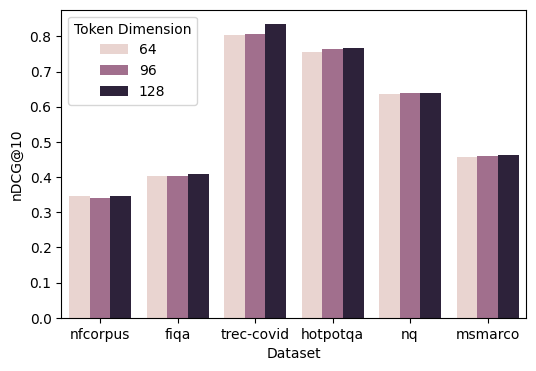

# Jina-ColBERT-v2：论文精炼研读

> 把多语骨干、两阶段训练与教师蒸馏结合到 ColBERT，并联合训练多种低维投影头控制 token 索引成本。
>
> [原论文](https://arxiv.org/abs/2408.16672v4) · [模型](https://huggingface.co/jinaai/jina-colbert-v2) · [补充解读](Jina-ColBERT-v2解读.md)

## 摘要

原版 ColBERT 主要以英语监督训练，多语言迁移和多向量成本限制了通用使用。Jina-ColBERT-v2 改用支持 RoPE 的 Jina-XLM-RoBERTa，先学习大规模多语言配对，再用多语 cross-encoder 蒸馏检索排序，同时联合训练多个 token 投影头。

模型在 BEIR、LoTTE、MIRACL 和 mMARCO 上显示多语 late interaction 的有效性，也展示 64 维投影的空间折中。论文的指令、分数归一化与 MASK 注意力消融尤其有价值：看似相近的表示细节并不总带来一致收益；其英语分数也未超过所有专用模型。

## 引言

单向量通用嵌入已经积累了大规模弱监督句对、难负例蒸馏与多语数据的成熟配方。本文把这些方法迁移到 token 级多向量检索：先学通用语义，再学 MaxSim 排序；同时允许推理时选择不同维数的投影头，降低索引成本。

## 相关工作

### 单向量检索

E5、Jina Embeddings 等工作采用大批次句对预训练与小批次三元组微调，利用批内负例和教师分数改善通用表示。

### 多向量检索

迟交互（late interaction）把「编码」和「匹配」拆开：

1. 编码器分别把查询、文档映射为 token 嵌入序列 $\mathbf{q}_1,\ldots,\mathbf{q}_{|q|}$ 与 $\mathbf{d}_1,\ldots,\mathbf{d}_{|d|}$（维数远小于单向量模型的隐维，经典设定约 $768\to 128$）。
2. 相关分用 **MaxSim**：每个查询 token 在文档侧找最大点积，再对查询 token **求和**：

$$
S(q,d)=\sum_{i=1}^{|q|}\max_{j=1}^{|d|}\mathbf{q}_i\cdot\mathbf{d}_j
$$

直觉：每个查询词项各自「在文档里找最贴的一处」，再累加证据。这近似 cross-encoder 的细粒度交互，但文档向量可缓存，推理成本更接近双编码器稠密检索。ColBERTv2 等工作再叠加 CE 蒸馏、多负例、难负例挖掘；**Jina-ColBERT-v2 沿用该打分，并不改写 MaxSim 公式本身**。

查询侧还有 **query augmentation**：把查询用 `[MASK]` pad 到固定长度，让 MLM 能力产出额外「软词项」嵌入，同样参与 MaxSim（见后文消融：是否允许真实 token attend 到这些 MASK）。

### 多语言检索

mBERT、XLM-R 提供多语预训练基础；MIRACL 是人工构建的多语检索集，mMARCO 则把 MS MARCO 翻译为多语并继承相关性标注。ColBERT-XM 引入共享与每语参数，ColBERT-X 使用翻译监督，BGE-M3 联合多种检索表示。本文用单个共享骨干和多源自然、翻译及合成数据覆盖不同语言。

## 训练总览

训练依次为骨干改造与继续预训练、弱监督成对训练、有监督三元组蒸馏。成对阶段采用单向量目标，三元组阶段再学习多向量排序，不能把两个阶段理解为只改变样本格式。

## 架构

### Jina-XLM-RoBERTa

| 项 | 论文陈述 |
| --- | --- |
| 起点 | XLM-RoBERTa（多语下游表现强，多篇多语检索工作同选） |
| 注意力 | 加入 **Flash Attention** |
| 位置 | 绝对位置 → **RoPE**（经验更好；可支持远超 512 的上下文，本文不专攻长文） |
| 续训 | RefinedWeb 上 MLM **160,000** 步；最大长 **8,192**；rotary base **10,000**；整词掩码 **30%** |

### 多个线性头与 MRL

ColBERT 用线性头把 token 隐状态投到低维以控索引体积（$768\to 128$）。本文用 **Matryoshka Representation Loss（非权值共享变体）联合训练六个头**：

$$
d\in\{64,96,128,256,512,768\}
$$

推理时选一个头即可换空间–精度权衡。作者报告 MRL-E（同一向量截断上算损失）在此设定下保分差，猜测因 ColBERT 投影维已经很低。

**图在讲什么。** 同一模型、三种投影维在多个 BEIR 数据集上的 nDCG@10 柱状对比。正文结论是：减半到 64 维时平均只掉 **约 0.01（作者报告约 1.59% 相对变化）**，说明联合训练的低维头保留了大部分检索性能。上图中文说明对应论文 Figure 1。

## 成对训练

### 数据构成

- **动机**：单向量嵌入常用「大批成对 + 批内负例，再小规模三元组」；先前 ColBERT 多直接从 PLM 上 32-/64-way 三元组开训。
- **规模**：**4.5 亿** 弱监督相关句对 / QA / query–doc；**50.0%** 英文；非英含 **29** 种主要语言，**3.0%** 代码，**4.3%** 跨语。
- **优化**：与 Günther et al. (2023) 相同的单向量成对对比损失；文本对常对称 → **双向**算损失；$\tau=0.02$；峰值 LR $5\times 10^{-5}$；warmup 1,000；Adam；**100,000** 步；全局 batch **16,384**。

### 对比损失

对归一化句向量 u、v，两个方向分别用匹配对为正、同批其他文本为负的 softmax 交叉熵，然后取平均。温度为 0.02；这一阶段沿用 Jina-v2 的单向量目标，不直接对所有 token 矩阵运行 MaxSim。

## 三元组训练

### 数据构成与监督

数据三块：（1）MSMARCO、DuReader、MIRACL 等人工标注 + 多样负例；（2）MSMARCO、NQ 等译到中/法/德/日/俄/西；（3）合成数据（否定失败模式、法律 IR 等）。覆盖 **14** 语；英 **45.9%**，高资源非英合计约 **52.1%**，低资源约 **2.0%**。每例仅 **7** 个负例（对比 ColBERTv2 的 32/64）。

老师：**jina-reranker-v2-base-multilingual**（多语 cross-encoder）。学生用 **KL** 拟合老师软标签（沿 ColBERTv2）。**100,000** 步；batch **32**；余弦衰减 + **5%** warmup，峰值 LR $1\times 10^{-5}$；BFLOAT-16；幅度梯度裁剪阈值 **1**。

教师和学生分别对同一组正例、难负例产生分数，以 softmax 得到候选概率，再最小化教师分布到学生分布的 KL 散度。这里的正例加七个负例构成八项候选。

## 结果

评测：BEIR（与 ColBERTv2 文相同的 14 任务子集，测集，nDCG@10）；LoTTE search 测集（Success@5）；MIRACL / mMARCO 开发集（nDCG@10 / MRR@10）。MIRACL、mMARCO 默认最大 query/文档长 **32/300**。

### BEIR（表 1，nDCG@10）

| BEIR | avg | nf | fi | tc | ar | qu | sd | sf | to | db | fe | cf | hp | nq |
| --- | ---: | ---: | ---: | ---: | ---: | ---: | ---: | ---: | ---: | ---: | ---: | ---: | ---: | ---: |
| BM25 | 44.0 | 32.5 | 23.6 | 65.6 | 31.5 | 78.9 | 15.8 | 66.5 | 36.7 | 31.3 | 75.3 | 21.3 | 60.3 | 32.9 |
| ColBERTv2 | 49.6 | 33.7 | 35.4 | 72.6 | 46.5 | 85.5 | 15.4 | 68.9 | 26.0 | 45.2 | 78.5 | 17.6 | 67.5 | 52.4 |
| answerai-v1 | 55.7 | 37.3 | 41.2 | 84.6 | 50.1 | 87.7 | 18.4 | 74.8 | 25.7 | 45.6 | 91.0 | 33.1 | 76.1 | 59.1 |
| Ours | 53.1 | 34.6 | 40.8 | 83.4 | 36.6 | 88.7 | 18.6 | 67.8 | 27.4 | 47.1 | 80.5 | 23.9 | 76.6 | 64.0 |

相对 ColBERTv2 整体更强，仍落后单语 answerai-colbert-small-v1。**ArguAna** 明显偏弱（36.6 vs ColBERTv2 46.5）：作者怀疑反论检索与检索向三元组分布冲突，或 query 增强在很长（约 300 token）查询上的副作用。

### LoTTE（表 2，Success@5）

| LoTTE | avg | Life. | Rec. | Wri. | Sci. | Tech. |
| --- | ---: | ---: | ---: | ---: | ---: | ---: |
| BM25 | 67.8 | 80.2 | 68.5 | 74.7 | 53.6 | 61.9 |
| ColBERTv2 | 72.0 | 84.7 | 72.3 | 80.1 | 56.7 | 66.1 |
| Ours | 76.4 | 87.0 | 77.6 | 83.8 | 60.5 | 73.0 |

### MIRACL（表 3，nDCG@10）

| MIRACL | avg | ar | bn | de | es | en | fa | fi | fr | hi | id | ja | ko | ru | sw | te | th | yo | zh |
| --- | ---: | ---: | ---: | ---: | ---: | ---: | ---: | ---: | ---: | ---: | ---: | ---: | ---: | ---: | ---: | ---: | ---: | ---: | ---: |
| BM25 | 38.5 | 48.1 | 50.8 | 22.6 | 31.9 | 35.1 | 33.3 | 55.1 | 18.3 | 45.8 | 44.9 | 36.9 | 41.9 | 33.4 | 38.3 | 49.4 | 48.4 | 40.6 | 18.0 |
| mDPR-ZS | 41.8 | 49.9 | 44.3 | 49.0 | 47.8 | 39.4 | 48.0 | 47.2 | 43.5 | 38.3 | 27.2 | 43.9 | 41.9 | 40.7 | 29.9 | 35.6 | 35.8 | 39.6 | 51.2 |
| mDPR-FT | 62.7 | 72.5 | 68.4 | - | 48.8 | 56.5 | 59.3 | 71.4 | 58.9 | 51.6 | 49.6 | 64.2 | 59.0 | 59.7 | 68.5 | 80.4 | 69.5 | - | 65.0 |
| Ours | 62.3 | 75.3 | 75.0 | 50.4 | 53.8 | 57.0 | 56.3 | 74.0 | 54.1 | 60.0 | 54.7 | 63.2 | 67.1 | 64.3 | 49.9 | 74.2 | 77.2 | 62.3 | 52.3 |

超过 BM25 与零样本 mDPR；avg 略低于 **按语微调** 的 mDPR-FT（62.3 vs 62.7）。多语同训可能吃「多语诅咒」。

### mMARCO（表 4，MRR@10）

| mMARCO | avg | ar | de | nl | es | fr | hi | id | it | ja | pt | ru | vi | zh |
| --- | ---: | ---: | ---: | ---: | ---: | ---: | ---: | ---: | ---: | ---: | ---: | ---: | ---: | ---: |
| BM-25 | 13.9 | 11.1 | 13.6 | 14.0 | 15.8 | 15.5 | 13.4 | 14.9 | 15.3 | 14.1 | 15.2 | 12.4 | 13.6 | 11.6 |
| ColBERT-XM | 25.4 | 19.5 | 27.0 | 27.5 | 28.5 | 26.9 | 23.8 | 26.3 | 26.5 | 24.1 | 27.6 | 25.1 | 22.6 | 24.6 |
| Ours | 31.3 | 27.2 | 33.1 | 33.0 | 34.1 | 33.5 | 30.9 | 31.9 | 33.7 | 27.6 | 33.7 | 29.8 | 28.7 | 30.2 |

相对 ColBERT-XM 全面更高；正文称对训练中未出现其 mMARCO 集的语言亦有提升。

## 消融研究

### 高效评估

消融多用 **BM25 top-250 ∪ 已判定段落** 的采样语料（HotpotQA、NQ、MS MARCO、MIRACL 若干语），以省建索引成本；最终模型仍跑全量。

### 任务指令

为 RET / QA / STS 加自然语言指令，多数 BEIR 上不如默认的 query/document **标记 token**。假设：迟交互在 token 相似度级聚合，指令条件化作用变弱，且占固定 token 预算。

|  | nf | tc | sf | to | db | fe | cf | ms\* | fq | hp\* | nq\* | ar | qu | sd |
| --- | ---: | ---: | ---: | ---: | ---: | ---: | ---: | ---: | ---: | ---: | ---: | ---: | ---: | ---: |
| Mark. | 32.4 | 59.3 | 67.9 | 19.3 | 35.3 | 67.1 | 18.3 | 34.4 | 37.5 | 25.9 | 40.8 | 37.5 | 86.1 | 18.4 |
| Inst. | 32.9 | 63.2 | 67.5 | 18.8 | 33.9 | 64.4 | 16.7 | 34.0 | 37.1 | 24.9 | 42.9 | 34.2 | 86.0 | 17.9 |

（\* 为采样语料。）

### 分数归一化

在 KL 前对学生与老师分做 **min-max**（对齐 ColBERT与查询 token 数相关的求和尺度与 CE 模型相关分位）。对本模型收益 **不确定**（有升有降），与 Clavié (2024) 很小效应一致。

|  | tc | hp | nq | ms | de | es | fr | ja | zh |
| --- | ---: | ---: | ---: | ---: | ---: | ---: | ---: | ---: | ---: |
| Baseline | 78.7 | 36.6 | 58.0 | 45.4 | 57.3 | 40.6 | 50.7 | 63.4 | 63.2 |
| + Score Norm. | 80.1 | 36.4 | 56.6 | 45.1 | 57.7 | 39.3 | 51.3 | 61.8 | 62.5 |

（除 tc 外为采样语料。）

### 查询增强的注意力

先前 ColBERT 用 [MASK] pad 查询，但 **不**让查询 token attend 到这些 MASK。本受控实验打开该注意力后，多任务上升，MIRACL 非英尤明显；故训练与推理均打开。下表为 **全量** 分。

|  | tc | hp | nq | ms | de | es | fr | ja | zh |
| --- | ---: | ---: | ---: | ---: | ---: | ---: | ---: | ---: | ---: |
| Baseline | 77.2 | 70.4 | 54.6 | 37.6 | 33.3 | 40.3 | 35.9 | 54.9 | 34.4 |
| + [MASK] attn. | 80.2 | 71.5 | 58.8 | 44.3 | 45.6 | 49.8 | 44.8 | 58.8 | 52.9 |

## 结论

大规模多语成对训练与小批量蒸馏，使 Jina-ColBERT-v2 在英语和多语检索上取得较强结果。64 维头提供较小索引，但并非无损；自然语言指令及分数归一化没有稳定收益，而允许查询关注增强 MASK 的改动更有效。模型仍有长查询、部分语言和多向量成本方面的限制。
