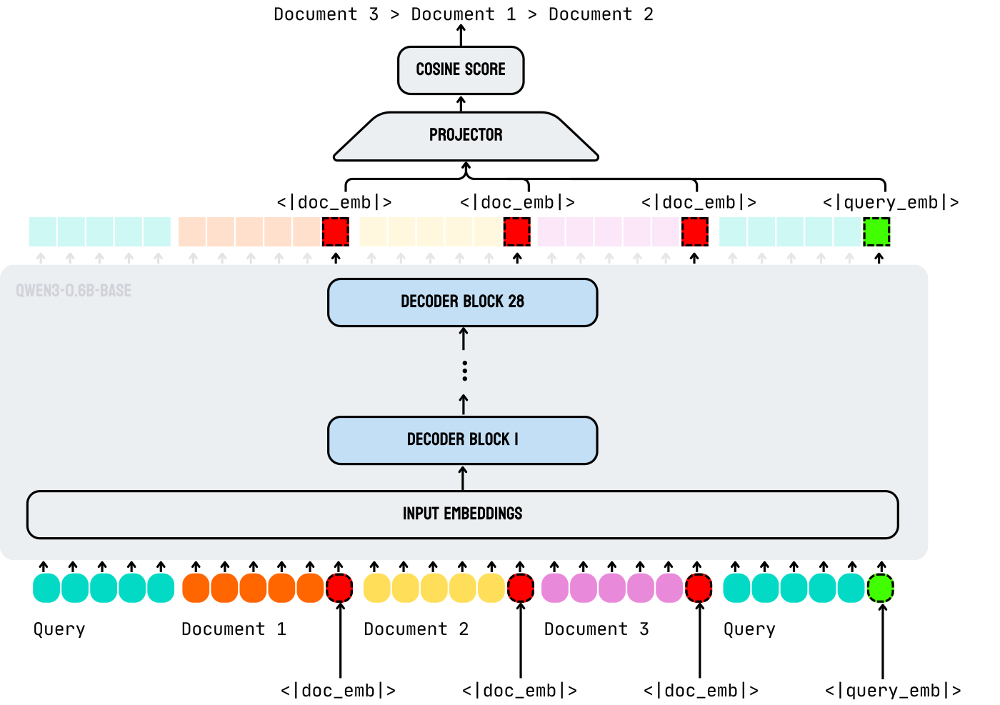

# Jina-reranker-v3：论文精炼研读

> 把查询与候选列表放入共享因果上下文，在特殊 token 处读出向量后打分，让文档间信息参与重排。
>
> [原论文](https://arxiv.org/abs/2509.25085v4) · [补充解读](jina-reranker-v3解读.md)

## 摘要

独立编码的 late interaction 可以缓存文档，却无法在编码过程中根据当前候选列表进行比较。Jina-reranker-v3 采用 Qwen3-0.6B，将查询、候选与末尾查询读出点串成同一因果序列；共享前向后使用特殊位置向量和投影器计算相关性，再通过多目标训练与模型合并适配多个领域。

在同一阶段召回的 top-100 上，论文报告 BEIR nDCG@10 为 61.85、MIRACL 为 66.83，但多语专用基线在 MIRACL 更高，代码任务还可能低于初始排序。它提供了小模型列表精排的路径，同时受到候选长度、输入顺序和因果可见方向的约束。

## 引言

逐对 cross-encoder 能看到查询和单篇文档，却无法在同一次编码中比较候选文档。生成式列表排序可以利用上下文，但逐 token 输出名次增加推理开销。本文改用共享因果前向，在候选与查询的特殊位置读取向量，用连续分数直接排序，称为 Last but Not Late（LBNL）。

## 相关工作

稠密双编码器与 ColBERT 可以离线索引文档；cross-encoder 在候选阶段进行更充分的查询条件化；RankGPT 等生成式列表排序把候选作为同一上下文并输出排名。本文结合列表上下文和非生成式向量打分，选择 Qwen3-0.6B 作为较小的解码器骨干。

## 模型架构

### 架构与读出

精排常见两条对照轴：

| 路线 | 交互何时发生 | 文档之间能否在注意力里互看 |
| --- | --- | --- |
| **迟交互 / ColBERT** | 查询与文档**分别**编码成多向量，检索时再 MaxSim | 不能；编码阶段彼此不可见 |
| **LBNL（本文）** | 查询与**全部候选**进同一因果序列，交互在共享前向中发生 | 仅能看见位于自身前面的文档，不能双向互看 |

ColBERT（Khattab and Zaharia, 2020）用「先各自编码、后 token 级 MaxSim」换可预计算文档表示；代价是编码期没有查询条件，也没有跨文档对照。LBNL 反过来：交互**不迟**——发生在因果自注意力里；读出**在最后**——在指定特殊 token 的末层隐状态上取向量。

形式：

$$
\tilde{\mathbf{q}}=\mathbf{H}_{t_{q}},\quad
\tilde{\mathbf{d}}_{i}=\mathbf{H}_{t_{i}},\quad
\mathbf{q}=P_{\phi}(\tilde{\mathbf{q}}),\quad
\mathbf{d}_{i}=P_{\phi}(\tilde{\mathbf{d}}_{i}),\quad
s_{i}=\cos(\mathbf{q},\mathbf{d}_{i})
$$

$\mathbf{H}$ 是末层隐状态；$t_q$、$t_i$ 是特殊 token 位置。

投影器按附录 Table 5 为 1024→512→512，两层间使用 ReLU。正文另有 256 维的表述，复现时需结合模型实现核对。



图 1：jina-reranker-v3 的列表编码。查询与多篇文档进入同一个因果上下文，每篇文档末尾的 `<|doc_emb|>` 与序列末尾的 `<|query_emb|>` 取最后一层隐藏状态，经投影后做余弦。

**图在讲什么。** 多篇文档与查询排进同一条因果序列：文档块在前、末尾再放一遍查询。每篇文档后的 `<|doc_emb|>` 与末尾 `<|query_emb|>` 是读出点；因果 mask 下，末尾查询 token 能看见前面所有文档。读出后经两层 MLP，用余弦得到列表分数——不是逐对 cross-encoder 的分类头，也不是 ColBERT 的离线多向量 MaxSim。

### 提示模板

提示沿用 Qwen3 的 system / user 角色。要点：

1. **查询出现两次**：一次在 user 指令里（「Rank … to query: [QUERY]」），一次在全部 `<passage>` 之后的 `<query>…</query>` 块末尾。
2. **每篇文档末**接 `<|doc_emb|>`；**末尾查询后**接 `<|query_emb|>`。
3. 因果注意力下，末尾查询读出点可以看见夹在中间的全部文档；开头指令侧的查询提供任务表述。

模板骨架（与论文 Table 1 一致）：

```
<|im_start|>system
You are a search relevance expert who can determine
a ranking of passages based on their relevance to the query.
<|im_end|>
<|im_start|>user
I will provide you with k passages, each indicated by a numerical identifier.
Rank the passages based on their relevance to query: [QUERY]
<passage id="1">
[DOCUMENT_1] <|doc_emb|>
</passage>
...
<passage id="k">
[DOCUMENT_k] <|doc_emb|>
</passage>
<query>
[QUERY] <|query_emb|>
</query>
<|im_end|>
```

训练时还有一条脚注：在序列**开头**那次查询的末尾也插入 `<|query_emb|>`，供双匹配损失从「早查询」位置取向量（见下节）。

## 训练

### 损失函数

总目标（式 1）：

$$
\ell=\ell_{\mathrm{rank}}+0.45\cdot\ell_{\mathrm{disperse}}+0.85\cdot\ell_{\mathrm{dual}}+0.85\cdot\ell_{\mathrm{similar}}
$$

**InfoNCE（$\ell_{\mathrm{rank}}$）。** 对比学习：把正文档相对该查询的余弦相似度（除以温度 $\tau$）抬高，相对 $K$ 个负文档压低；batch 内对 $N$ 条查询取平均。这是主排序信号。

**分散损失（$\ell_{\mathrm{disperse}}$，系数 0.45）。** 增大文档嵌入之间的成对距离，缓解表示坍缩。

**双匹配（$\ell_{\mathrm{dual}}$，系数 0.85）。** 与 InfoNCE 同形，但查询向量取自序列**开头**查询末尾的 `<|query_emb|>`（训练时插入），逼近「查询→文档」与「文档→查询」双向一致。

**相似度（$\ell_{\mathrm{similar}}$，系数 0.85）。** 对文档做增强得到副本，原–增强为正对、其余为负，拉近语义等价、表面不同的文档表示。

温度 $\tau$ 与负例规模随训练阶段变化（见 Table 6 与下节）。

### 多阶段训练

| 阶段 | 做什么 | 论文给出的关键数字 |
| --- | --- | --- |
| **1 基础特化** | 预训练 Qwen3-0.6B 上 LoRA；骨干冻结 | LoRA $r$=16，$\alpha$=32；每查询 **16 文档**（1 正 + **15** 负）；文档 **768** token；最大序列 **12,288**；数据含 BGE-M3（15 语）、Cornstack、生物医学、指令跟随等 |
| **2 上下文与难负例** | 加长文档 + 加难负 + 跨系统挖负 | 单篇可达 **8,192**（如 MLDR）；正文写负例 **15→45**；附录 Table 6 的实际配置范围是 **9–25** 个负例；正文另有 45 个的描述，范围存在版本内差异 |
| **3 线性合并** | 多域特化模型加权合并 | 合并权重 **0.25–0.65** |

LoRA 的 $r$（秩）与 $\alpha$（缩放）控制低秩适配器容量与更新幅度；此处 $r$=16、$\alpha$=32，作用于全部注意力与 FFN，骨干在 Stage 1 冻结。

正文还给出跨阶段的量级：Stage 1 学习率 5e-5、15 负；上下文扩展时 per-device batch 可由 60 降至 6、学习率可至 6e-6；分散 / 双匹配 / 相似度权重随域在 Table 6 的区间内浮动。完整超参见附录 Table 6（跨 47 个配置的范围）。

**Table 5（架构）摘要**

| Parameter | Value |
| --- | --- |
| Total / Non-Embedding | 0.6B / 0.44B |
| Hidden / Layers | 1,024 / 28 |
| Attention Heads (Q/KV) | 16/8 (GQA) |
| Context Length | 131,072 |
| Effective Sequence Length | 8,192 |
| Projector | 1024 → 512 → 512，ReLU |

GQA（Grouped-Query Attention）把查询头与较少的 KV 头分组共享，降低 KV cache；此处 Q/KV = 16/8。

**Table 6（训练超参范围）摘要**

| Hyperparameter | Stage 1 | Stage 2 | Stage 3 |
| --- | --- | --- | --- |
| Learning Rate | 5e-5 | [5e-5, 6e-6] | - |
| Batch Size (per device) | 60 | [6, 60] | - |
| Max Sequence Length | [768, 2048] | [2048, 8192] | - |
| Number of Negatives | 15 | [9, 25] | - |
| Temperature | 0.25 | [0.05, 0.25] | - |
| Training Mode | LoRA | LoRA/Full | Linear Merging |
| LoRA Rank | 16 | 16 | - |
| Backbone | Frozen | Frozen/Tuned | - |
| Dispersive / Dual / Similar $\alpha$ | 0.45 / 0.85 / 0.85 | [0.25,0.45] / [0.65,0.85] / [0.75,0.85] | - |

## 评估

### 实验设置

**协议。** 四个基准：BEIR（英语 13 任务）、MIRACL（18 语）、MKQA（跨语）、CoIR（代码）。一阶段稠密检索为 **jina-embeddings-v3**，全体精排吃其 **top-100**；代码检索一阶段为 **jina-code-embeddings-0.5b**（Table 2）。指标：**除 MKQA 用 Recall@10 外，其余为 nDCG@10**。nDCG@10 对前 10 名位置加权累积增益并相对理想排序归一化。

### 跨基准整体表现

| Models | # Param | BEIR | MIRACL | MKQA | CoIR |
| --- | --- | ---: | ---: | ---: | ---: |
| **First-stage Retriever** | | | | | |
| jina-embeddings-v3 | 0.5B | 55.81 | 58.90 | 65.63 | - |
| jina-code-embeddings-0.5b | - | - | - | - | 73.94 |
| **Second-stage Reranker** | | | | | |
| jina-reranker-v3 | 0.6B | **61.85** | 66.83 | 67.92 | 70.64 |
| jina-reranker-v2 | 0.3B | 57.06 | 63.65 | 67.90 | 58.35 |
| jina-reranker-m0 | 2.4B | 58.95 | 66.75 | 68.19 | 66.89 |
| bge-reranker-v2-m3 | 0.6B | 56.51 | **69.32** | 67.88 | 36.28 |
| mxbai-rerank-base-v2 | 0.5B | 58.40 | 55.32 | 64.24 | 65.71 |
| mxbai-rerank-large-v2 | 1.5B | 61.44 | 57.94 | 67.06 | 70.87 |
| Qwen3-Reranker-0.6B | 0.6B | 56.28 | 57.70 | 65.34 | 65.18 |
| Qwen3-Reranker-4B | 4.0B | 61.16 | 67.52 | **69.25** | **73.91** |

论文自述：相对 jina-reranker-v2（BEIR 57.06）提升 **4.79 个百分点**；相对同参 bge-reranker-v2-m3（56.51）提升 **5.34 个百分点**；相对 1.5B mxbai-rerank-large-v2（61.44）以约 **$2.5\times$** 更少参数取得 61.85；MIRACL 比 bge-reranker-v2-m3 低 **2.49** 分（69.32−66.83）。

#### 候选顺序的影响

列表级输入对文档顺序敏感。三种排列：按一阶段分 **降序 (D)、升序 (A)、随机 (R)**。

| 变体 | BEIR Avg. |
| --- | ---: |
| (D) Descending | 61.85 |
| (A) Ascending | 61.45 |
| (R) Random | **62.24** |

差异不大；默认报告用 (D)。单任务上 (D) 突出点包括 HotpotQA **78.58**、FEVER **94.01**、NQ **74.28**、ArguAna **73.43**。

### BEIR 英语检索

| Models | Size | Avg. | TC | NFC | NQ | HQA | FQA | AA | TCH | DBP | SD | FVR | CFV | SF | QRA |
| --- | --- | ---: | ---: | ---: | ---: | ---: | ---: | ---: | ---: | ---: | ---: | ---: | ---: | ---: | ---: |
| jina-embeddings-v3 | 0.5B | 55.81 | 77.81 | 36.65 | 64.31 | 64.63 | 47.47 | 54.31 | 26.55 | 41.07 | 19.91 | 89.00 | 42.33 | 72.4 | 89.06 |
| jina-reranker-v3 (D) | 0.6B | 61.85 | 84.75 | 37.66 | 74.28 | 78.58 | 49.16 | 73.43 | 32.24 | 47.98 | 23.23 | 94.01 | 41.63 | 76.51 | 90.63 |
| jina-reranker-v3 (A) | 0.6B | 61.45 | 85.90 | 39.14 | 72.34 | 77.48 | 50.99 | 69.36 | 29.73 | 48.30 | 23.90 | 93.46 | 41.72 | 76.75 | 89.73 |
| jina-reranker-v3 (R) | 0.6B | 62.24 | 86.59 | 38.92 | 72.90 | 78.03 | 51.81 | 74.12 | 30.12 | 48.37 | 24.26 | 93.84 | 43.05 | 76.84 | 90.24 |
| jina-reranker-m0 | 2.4B | 58.95 | 84.17 | 41.03 | 72.25 | 76.99 | 51.62 | 40.69 | 31.79 | 49.34 | 22.91 | 91.14 | 36.42 | 79.94 | 88.01 |
| jina-colbert-v2 | 0.6B | 54.49 | 81.94 | 35.88 | 66.01 | 74.36 | 43.62 | 35.46 | 29.11 | 47.14 | 19.40 | 87.92 | 29.20 | 70.13 | 88.25 |
| jina-reranker-v2 | 0.3B | 57.06 | 80.53 | 37.17 | 67.39 | 76.17 | 46.48 | 39.28 | 32.35 | 47.81 | 20.03 | 93.02 | 37.17 | 76.50 | 87.83 |
| bge-reranker-v2-m3 | 0.6B | 56.51 | 82.19 | 34.33 | 69.52 | 77.89 | 45.45 | 36.21 | 33.12 | 46.72 | 17.79 | 91.03 | 38.69 | 72.64 | 89.10 |
| mxbai-rerank-base-v2 | 0.5B | 58.40 | 82.75 | 37.57 | 67.74 | 77.35 | 47.33 | 47.33 | 30.71 | 48.00 | 18.09 | 93.30 | 42.93 | 77.76 | 88.33 |
| mxbai-rerank-large-v2 | 1.5B | 61.44 | 81.51 | 37.76 | 72.46 | 78.10 | 52.75 | 74.55 | 29.81 | 49.07 | 18.58 | 93.94 | 42.03 | 78.86 | 89.36 |
| Qwen3-Reranker-0.6B | 0.6B | 56.28 | 87.08 | 38.37 | 56.54 | 74.41 | 43.45 | 56.53 | 27.26 | 43.54 | 20.98 | 86.19 | 44.11 | 74.89 | 78.32 |
| Qwen3-Reranker-4B | 4.0B | 61.16 | 87.08 | 41.56 | 69.06 | 77.03 | 52.29 | 58.82 | 33.73 | 50.81 | 26.01 | 87.80 | 47.59 | 78.41 | 84.83 |

### MIRACL 多语言检索

| Models | Avg. | AR | BN | EN | ES | FA | FI | FR | HI | ID | JA | KO | RU | SW | TE | TH | ZH | DE | YO |
| --- | --- | ---: | ---: | ---: | ---: | ---: | ---: | ---: | ---: | ---: | ---: | ---: | ---: | ---: | ---: | ---: | ---: | ---: | ---: |
| jina-embeddings-v3 | 58.90 | 71.53 | 69.86 | 48.37 | 46.91 | 54.13 | 71.15 | 50.90 | 55.05 | 47.83 | 56.46 | 64.76 | 55.63 | 54.07 | 70.48 | 73.56 | 55.29 | 49.18 | 65.01 |
| jina-reranker-v3 | 66.83 | 78.85 | 79.47 | 59.45 | 54.57 | 57.70 | 76.03 | 55.74 | 61.52 | 57.43 | 65.94 | 73.60 | 65.50 | 64.54 | 74.53 | 81.57 | 65.60 | 56.74 | 74.07 |
| jina-reranker-m0 | 66.75 | 79.78 | 78.01 | 59.21 | 53.55 | 58.90 | 70.00 | 56.66 | 62.83 | 54.92 | 66.51 | 72.86 | 67.37 | 59.04 | 70.19 | 80.37 | 64.51 | 58.50 | 80.44 |
| jina-reranker-v2 | 63.65 | 72.50 | 79.42 | 46.66 | 51.54 | 57.81 | 73.05 | 50.90 | 60.94 | 56.66 | 59.15 | 72.60 | 53.43 | 66.47 | 74.62 | 77.75 | 62.49 | 53.06 | 76.69 |
| bge-reranker-v2-m3 | 69.32 | 80.51 | 81.85 | 57.67 | 57.64 | 61.92 | 80.38 | 59.60 | 67.66 | 58.86 | 67.37 | 75.14 | 67.61 | 68.92 | 76.69 | 82.29 | 64.46 | 58.32 | 80.85 |
| mxbai-rerank-base-v2 | 55.32 | 71.08 | 58.21 | 56.61 | 48.89 | 46.59 | 64.92 | 50.47 | 44.75 | 49.48 | 57.99 | 64.88 | 54.16 | 48.40 | 55.15 | 72.71 | 58.44 | 20.33 | 72.66 |
| mxbai-rerank-large-v2 | 57.94 | 71.38 | 63.48 | 57.55 | 49.14 | 48.38 | 66.70 | 51.61 | 45.12 | 49.05 | 56.61 | 64.98 | 54.80 | 51.79 | 62.41 | 74.51 | 62.29 | 38.66 | 74.42 |
| Qwen3-Reranker-0.6B | 56.16 | 67.44 | 66.67 | 50.91 | 45.77 | 52.07 | 65.50 | 43.28 | 60.36 | 49.66 | 51.56 | 61.03 | 48.88 | 46.72 | 69.86 | 72.95 | 45.14 | 43.00 | 70.04 |
| Qwen3-Reranker-4B | 67.52 | 78.32 | 81.51 | 59.37 | 53.07 | 61.63 | 78.70 | 55.02 | 68.71 | 54.90 | 65.32 | 71.80 | 64.66 | 66.50 | 75.60 | 82.00 | 59.35 | 57.56 | 81.39 |

表内 jina-reranker-v3 较强语言包括 TH **81.57**、BN **79.47**、AR **78.85**、FI **76.03**、YO **74.07**。§5.4 正文另写平均 66.50、AR 78.69、TH 81.06、KO 73.83、RU 65.20 及相对 bge 的 2.82 分差——与 Table 4 / Table 2 单元格不完全一致；读表以表格为准，正文与表格存在版本内差异。

## 结论

LBNL 将候选间交互放在共享因果编码中，最后以向量相似度直接产生排名，避免生成完整排名序列。它在论文的英语、多语、跨语和代码评测中表现具有竞争力，但并非每项胜出：MIRACL 低于多语专用基线，CoIR 还低于初始代码检索器。候选顺序、上下文长度、切批及提示注入稳健性仍需考虑。

## 附录：模型配置与长度口径

训练样本的候选数、上下文溢出后的推理分批大小，以及评测候选池分别定义如下：

| 概念 | 论文说法 | 典型量级 |
| --- | --- | --- |
| **训练列表长度** | 每条训练样本里「查询 + 若干文档」的构成 | Stage 1：**16** 文档/query（1 正 + 15 负）；Stage 2 正文写负例可至 **45**，Table 6 写 negatives **[9, 25]**；单篇训练长度从 768 扩到最长 8,192（配置相关） |
| **推理溢出时的分批上限** | 集合超过 **131K** token 时，**每次前向最多 64 篇**文档，跨批保持查询嵌入一致 | **64 docs / forward**；这是上下文装不下时的切批规则，**不是**训练 list size |
| **评测候选池** | 一阶段召回后的短名单 | **top-100**；精排吃这 100 条。**不等于**「100 条一定一次前向打完」——若总 token 超 131K，仍按上面的 64 篇分批规则切 |

结论：训练 list size 随阶段变；64 是推理溢出时的 forward 上限；top-100 是评测协议里的候选池大小。三者不可互相替换表述。
