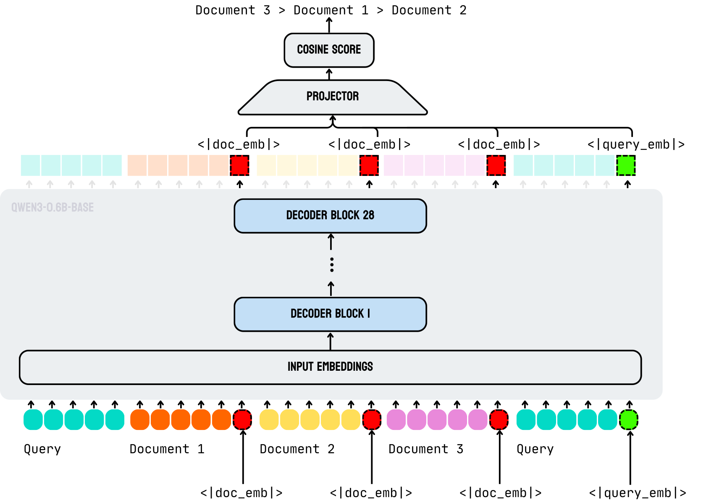

# jina-reranker-v3: Last but Not Late Interaction for Listwise Document Reranking / 全文中英对照

> 来源：[arXiv:2509.25085v4](https://arxiv.org/abs/2509.25085v4)。英文段落后紧接中文，覆盖所取 HTML 版本的主文、附录、图表、脚注与参考文献；公式、数字表和书目信息共用。中文以机器初译为底稿，进行了术语整理与结构核对，尚未逐句人工审定；遇到歧义请以紧邻英文和原论文为准。 原作版权归所列作者，许可见 [原作许可](http://creativecommons.org/licenses/by-nc-sa/4.0/)；中文译文与版式改写在该许可条件下提供（涉及 SA 时沿用相同许可，涉及 NC 时仅限非商业使用）。

## Authors and affiliations / 作者与机构

Feng Wang Affiliation: Jina AI GmbH Email: research@jina.ai Yuqing Li Affiliation: Jina AI GmbH Affiliation: University of PittsburghPrinzessinnenstraße 19, 10969, Berlin, Germany Han Xiao Affiliation: Jina AI GmbH

**EN.** \workshoptitle

**中.** \研讨会标题

**EN.** DL4CODE

**中.** DL4代码

## Abstract / 摘要

**EN.** [jina-reranker-v3](https://huggingface.co/jinaai/jina-reranker-v3) is a 0.6B-parameter multilingual listwise reranker that introduces a novel last but not late interaction. Unlike late interaction models like ColBERT that encode documents separately before multi-vector matching, our approach applies causal attention between the query and all candidate documents in the same context window, enabling rich interactions before extracting contextual embeddings from each document’s final token. The new model achieves state-of-the-art BEIR performance with 61.85 nDCG@10 while being significantly smaller than other models with comparable performance.

**中.** [jina-reranker-v3](https://huggingface.co/jinaai/jina-reranker-v3) 是一个 0.6B 参数的多语言列表重排序器，引入了新颖的最后但不是后期的交互。与 ColBERT 等在多向量匹配之前单独编码文档的后期交互模型不同，我们的方法在同一上下文窗口中的查询和所有候选文档之间应用因果注意力，从而在从每个文档的最终标记中提取上下文嵌入之前实现丰富的交互。新模型实现了最先进的 BEIR 性能（61.85 nDCG@10），同时比具有类似性能的其他模型小得多。

## Introduction / 简介

**EN.** Neural document retrieval faces a fundamental efficiency-effectiveness tradeoff. Cross-encoders achieve strong performance through joint query-document processing but require separate forward passes for each pair, while embedding models enable efficient similarity computation but lose fine-grained interaction signals. Recent models have attempted to bridge this gap through different interaction approaches. Late interaction models like ColBERT ( Khattab and Zaharia, 2020 ) and their variants ( Liu et al., 2024 ; Jha et al., 2024 ) separately encode queries and documents into multi-vector representations, then perform interaction through token-level similarity operations.

**中.** 神经文档检索面临着根本的效率与效果的权衡。交叉编码器通过联合查询-文档处理实现了强大的性能，但需要对每一对进行单独的前向传递，而嵌入模型可以实现高效的相似性计算，但会丢失细粒度的交互信号。最近的模型试图通过不同的交互方法来弥合这一差距。 ColBERT（Khattab 和 Zaharia，2020）及其变体（Liu et al.，2024；Jha et al.，2024）等后期交互模型将查询和文档分别编码为多向量表示，然后通过令牌级相似性操作执行交互。

**EN.** We introduce [jina-reranker-v3](https://huggingface.co/jinaai/jina-reranker-v3) , which features a novel last but not late interaction (LBNL) that takes a fundamentally different approach from existing methods. While late interaction models delay attention until after encoding documents separately, our method applies causal attention between the query and all documents within the context window, enabling cross-document interactions before extracting contextual embeddings from each document’s last token. Unlike late interaction models that interact after encoding, we enable interactions during encoding—making our approach not late . This “listwise” processing is not possible with separate encoding or bi-encoder approaches and represents our core innovation.

**中.** 我们引入了 [jina-reranker-v3](https://huggingface.co/jinaai/jina-reranker-v3) ，它具有新颖的最后但不是后期交互 (LBNL)，它采用了与现有方法完全不同的方法。虽然后期交互模型将注意力延迟到单独编码文档之后，但我们的方法在查询和上下文窗口内的所有文档之间应用因果注意力，从而在从每个文档的最后一个标记中提取上下文嵌入之前启用跨文档交互。与编码后进行交互的后期交互模型不同，我们在编码期间启用交互，从而使我们的方法不会延迟。这种“列表式”处理不可能通过单独的编码或双编码器方法实现，并且代表了我们的核心创新。

**EN.** Evaluation shows [jina-reranker-v3](https://huggingface.co/jinaai/jina-reranker-v3) achieves 61.85 nDCG@10 on BEIR ( Thakur et al., 2021 ) , representing the highest score among all evaluated rerankers and a 4.79% improvement over our previous jina-reranker-v2 . The model excels particularly in multi-hop retrieval with HotpotQA reaching 78.58, fact verification achieving 94.01 on FEVER, competitive multilingual performance across 18 languages at 66.83 on MIRACL ( Zhang et al., 2023a ) and crosslingual retrieval with 67.92 Recall@10 on MKQA ( Longpre et al., 2020 ) across 26 languages, and code retrieval reaching 70.64 on CoIR ( Li et al., 2024 ) .

**中.** 评估显示 [jina-reranker-v3](https://huggingface.co/jinaai/jina-reranker-v3) 在 BEIR 上达到了 61.85 nDCG@10 (Thakur et al., 2021)，代表了所有评估的 reranker 中的最高分，比我们之前的 jina-reranker-v2 提高了 4.79%。该模型尤其擅长多跳检索，HotpotQA 达到 78.58，事实验证在 FEVER 上达到 94.01，MIRACL 上 18 种语言的竞争性多语言性能为 66.83（Zhang 等人，2023a），跨语言检索在 MKQA 上跨语言检索为 67.92 Recall@10（Longpre 等人，2020），代码检索达到CoIR 为 70.64（Li 等人，2024）。

## Related Work / 相关工作

**EN.** Document reranking approaches can be categorized by their interactions and learning objectives. Traditional learning-to-rank methods ( Bruch et al., 2023 ) include pointwise approaches that predict relevance scores independently, pairwise methods like RankNet ( Burges et al., 2005 ) that compare document pairs, and listwise techniques that optimize global ranking objectives. Cross-encoders like BERT-based rerankers ( Nogueira and Cho, 2019 ) achieve strong performance through full query-document interaction but require separate forward passes for each pair, creating computational bottlenecks for large-scale retrieval. Recent comparative studies ( Déjean et al., 2024 ) demonstrate that while LLM-based rerankers show impressive zero-shot capabilities, traditional cross-encoders remain highly competitive across diverse retrieval scenarios.

**中.** 文档重新排序方法可以根据其交互和学习目标进行分类。传统的学习排序方法 (Bruch et al., 2023) 包括独立预测相关性分数的逐点方法、比较文档对的 RankNet 等成对方法 (Burges et al., 2005) 以及优化全局排名目标的列表技术。像基于 BERT 的重排序器（Nogueira 和 Cho，2019）这样的交叉编码器通过完整的查询-文档交互实现了强大的性能，但需要为每对单独的前向传递，从而为大规模检索创造了计算瓶颈。最近的比较研究（Déjean 等人，2024）表明，虽然基于 LLM 的重新排序器显示出令人印象深刻的零样本能力，但传统的交叉编码器在不同的检索场景中仍然具有高度竞争力。

**EN.** Late interaction models represent a significant approach that balances efficiency with expressiveness. ColBERT ( Khattab and Zaharia, 2020 ) exemplifies this approach by independently encoding queries and documents into multi-vector representations, then computing similarity through MaxSim operations over token-level embeddings. This design enables pre-computation of document representations while preserving fine-grained matching signals. Recent developments have expanded this approach: analysis of matching mechanisms and token pruning strategies ( Liu et al., 2024 ) provides theoretical foundations, LITE ( Ji et al., 2024 ) introduces learnable late interactions, and Jina-ColBERT-v2 ( Jha et al., 2024 ) extends the approach to multilingual settings. PyLate ( Chaffin and Sourty, 2025 ) provides flexible frameworks for training and deployment of such models. The late chunking method ( Günther et al., 2024 ) processes complete documents through transformers before applying chunking boundaries, extracting chunk-level embeddings that preserve contextual relationships. This approach demonstrates how leveraging broader document context can improve embedding quality, though it focuses primarily on retrieval rather than reranking applications.

**中.** 后期交互模型代表了一种平衡效率与表现力的重要方法。 ColBERT（Khattab 和 Zaharia，2020）通过将查询和文档独立编码为多向量表示，然后通过令牌级嵌入的 MaxSim 操作计算相似性来举例说明这种方法。这种设计可以预先计算文档表示，同时保留细粒度的匹配信号。最近的发展扩展了这种方法：匹配机制和令牌修剪策略的分析（Liu et al., 2024）提供了理论基础，LITE（Ji et al., 2024）引入了可学习的后期交互，Jina-ColBERT-v2（Jha et al., 2024）将该方法扩展到多语言设置。 PyLate（Chaffin 和 Sourty，2025）为此类模型的训练和部署提供了灵活的框架。后期分块方法（Günther et al., 2024）在应用分块边界之前通过转换器处理完整的文档，提取保留上下文关系的块级嵌入。这种方法演示了如何利用更广泛的文档上下文来提高嵌入质量，尽管它主要侧重于检索而不是对应用程序重新排名。

**EN.** LLM-powered reranker has emerged as a powerful family with diverse implementations. These approaches can be categorized into discriminative and generative methods. Generative approaches like RankGPT ( Qin et al., 2023 ) prompt LLMs to generate ranked lists, leveraging their reasoning capabilities for relevance assessment, but typically require large models for competitive performance. Fine-tuning methods like RankVicuna ( Pradeep et al., 2023 ) adapt existing models for relevance scoring tasks. Efficiency-focused innovations include FIRST ( Reddy et al., 2024 ) , which accelerates inference through single-token decoding, and PE-Rank ( Qin et al., 2024 ) , which leverages passage embeddings to reduce computational latency by $4.5\times$ . Recent advances in training methodology include ERank ( Cai et al., 2025 ) , which combines supervised fine-tuning with reinforcement learning for improved ranking quality, and the Qwen3 Embedding series ( Zhang et al., 2025 ) , which demonstrates sophisticated multi-stage training pipelines. DeAR ( Abdallah et al., 2025 ) introduces dual-stage reasoning with LLM distillation for enhanced cross-document analysis.

**中.** 由 LLM 驱动的重新排名器已成为一个具有多种实施方式的强大家族。这些方法可以分为判别性方法和生成方法。 RankGPT（Qin 等人，2023）等生成方法促使法学硕士生成排名列表，利用其推理能力进行相关性评估，但通常需要大型模型才能获得竞争表现。像 RankVicuna（Pradeep 等人，2023）这样的微调方法可以调整现有模型以执行相关性评分任务。以效率为中心的创新包括 FIRST（Reddy 等人，2024）和 PE-Rank（Qin 等人，2024），前者通过单令牌解码加速推理，后者利用段落嵌入来减少 $4.5\times$ 的计算延迟。训练方法的最新进展包括 ERank（Cai 等人，2025），它将监督微调与强化学习相结合，以提高排名质量；以及 Qwen3 Embedding 系列（Zhang 等人，2025），它展示了复杂的多阶段训练流程。 DeAR（Abdallah 等人，2025）引入了双阶段推理和 LLM 蒸馏，以增强跨文档分析。

## Model Architecture / 模型架构

**EN.** [jina-reranker-v3](https://huggingface.co/jinaai/jina-reranker-v3) implements a new interaction that fundamentally differs from existing approaches. Built upon Qwen3-0.6B ( Yang et al., 2025 ) with 28 transformer layers, 1024 hidden dimensions, 16 attention heads, and 131K token context capacity, our approach processes queries and multiple documents simultaneously within shared context windows. We add a lightweight MLP projector (1024 $\rightarrow$ 512 $\rightarrow$ 512 dimensions) to transform contextual representations into ranking-optimized embeddings. Table 5 provides complete architectural specifications.

**中.** [jina-reranker-v3](https://huggingface.co/jinaai/jina-reranker-v3) 实现了一种与现有方法根本不同的新交互。我们的方法基于 Qwen3-0.6B（Yang 等人，2025）构建，具有 28 个转换器层、1024 个隐藏维度、16 个注意力头和 131K 令牌上下文容量，可以在共享上下文窗口中同时处理查询和多个文档。我们添加了一个轻量级 MLP 投影仪（1024 $\rightarrow$ 512 $\rightarrow$ 512 维度），将上下文表示转换为排名优化的嵌入。表 5 提供了完整的架构规范。

### Architecture / 建筑

**EN.** Figure 1 : Architecture of [jina-reranker-v3](https://huggingface.co/jinaai/jina-reranker-v3) showing the transformer backbone with special token positions for embedding extraction. The model processes multiple documents and query in one context window, extracting contextual embeddings at designated token positions for similarity computation.

**中.** 图 1：[jina-reranker-v3](https://huggingface.co/jinaai/jina-reranker-v3) 的架构显示了具有用于嵌入提取的特殊令牌位置的Transformer主干。该模型在一个上下文窗口中处理多个文档和查询，在指定标记位置提取上下文嵌入以进行相似性计算。

**EN.** Figure 1 illustrates our architecture that addresses fundamental limitations in existing interactions. ColBERT ( Khattab and Zaharia, 2020 ) achieves efficiency through separate encoding followed by multi-vector interaction, but cannot capture early query-document interactions during encoding or enable cross-document interactions within the attention mechanism.

**中.** 图 1 说明了我们的架构，该架构解决了现有交互中的基本限制。 ColBERT（Khattab 和 Zaharia，2020）通过单独编码和多向量交互来实现效率，但无法在编码过程中捕获早期查询文档交互或在注意力机制内实现跨文档交互。

**EN.** Our LBNL approach enables causal self-attention interaction within the transformer architecture: instead of delaying interaction until after separate encoding as in late interaction models, we process all documents and the query simultaneously within shared context windows. This allows each document to attend to other documents and observe their content, enabling contextual embeddings that capture not just query-document relevance but also inter-document relationships and comparative context. Such cross-document interactions are impossible in separate encoding approaches and represent a fundamental advancement in [jina-reranker-v3](https://huggingface.co/jinaai/jina-reranker-v3) architecture.

**中.** 我们的 LBNL 方法在 Transformer 架构中实现了因果自注意力交互：我们不是像后期交互模型那样将交互延迟到单独编码之后，而是在共享上下文窗口中同时处理所有文档和查询。这允许每个文档关注其他文档并观察其内容，从而实现上下文嵌入，不仅捕获查询文档相关性，还捕获文档间关系和比较上下文。这种跨文档交互在单独的编码方法中是不可能的，并且代表了 [jina-reranker-v3](https://huggingface.co/jinaai/jina-reranker-v3) 架构的根本进步。

**EN.** We extract contextual embeddings at designated special token positions: $\tilde{\mathbf{q}}=\mathbf{H}_{t_{q}}$ and $\tilde{\mathbf{d}}_{i}=\mathbf{H}_{t_{i}}$ where $t_{q}$ and $t_{i}$ are positions of the special tokens and $\mathbf{H}$ represents the transformer’s final layer hidden states after causal self-attention. These embeddings capture both local document semantics and global cross-document context through the shared attention mechanism, enabling rich inter-document interactions unavailable in separate encoding approaches.

**中.** 我们在指定的特殊标记位置提取上下文嵌入：$\tilde{\mathbf{q}}=\mathbf{H}_{t_{q}}$和$\tilde{\mathbf{d}}_{i}=\mathbf{H}_{t_{i}}$，其中$t_{q}$和$t_{i}$是特殊标记的位置，$\mathbf{H}$表示Transformer在因果自注意力之后的最终层隐藏状态。这些嵌入通过共享注意力机制捕获本地文档语义和全局跨文档上下文，从而实现单独编码方法中无法实现的丰富的文档间交互。

**EN.** A two-layer projection network with ReLU activation maps the 1024-dimensional hidden states to 256-dimensional embedding space: $\mathbf{q}=P_{\phi}(\tilde{\mathbf{q}})$ and $\mathbf{d}_{i}=P_{\phi}(\tilde{\mathbf{d}}_{i})$ . Relevance scores are computed via cosine similarity: $s_{i}=\cos(\mathbf{q},\mathbf{d}_{i})$ . This architecture combines the expressiveness of joint encoding with efficient similarity computation.

**中.** 具有 ReLU 激活的两层投影网络将 1024 维隐藏状态映射到 256 维嵌入空间： $\mathbf{q}=P_{\phi}(\tilde{\mathbf{q}})$ 和 $\mathbf{d}_{i}=P_{\phi}(\tilde{\mathbf{d}}_{i})$ 。相关性分数通过余弦相似度计算： $s_{i}=\cos(\mathbf{q},\mathbf{d}_{i})$ 。该架构将联合编码的表现力与高效的相似性计算相结合。

**EN.** For document collections exceeding the 131K token context limit, we process documents in batches of up to 64 documents per forward pass, with query embeddings maintained consistently across batches to ensure ranking coherence.

**中.** 对于超过 131K 令牌上下文限制的文档集合，我们以每次前向传递最多 64 个文档的批次处理文档，并在批次之间保持一致的查询嵌入，以确保排名的一致性。

### Prompt Template / 提示模板

**EN.** [jina-reranker-v3](https://huggingface.co/jinaai/jina-reranker-v3) processes structured prompts following Qwen3’s instruction format with system / user / assistant roles to leverage existing instruction-following capabilities. As shown in Table 1 , the system prompt establishes a search relevance expert persona, while the user prompt provides clear ranking instructions with dual query placement.

**中.** [jina-reranker-v3](https://huggingface.co/jinaai/jina-reranker-v3) 按照 Qwen3 的指令格式，通过系统/用户/助理角色处理结构化提示，以利用现有的指令跟踪功能。如表1所示，系统提示建立了搜索相关性专家角色，而用户提示提供了具有双重查询放置的清晰的排名指令。

| Prompt Template 提示模板 |
| --- |
| <\|im_start\|>system <\|im_start\|>系统 |
| You are a search relevance expert who can determine 您是搜索相关性专家，可以确定 |
| a ranking of passages based on their relevance to the query. 根据段落与查询的相关性对段落进行排名。 |
| <\|im_end\|> |
| <\|im_start\|>user <\|im_start\|>用户 |
| I will provide you with k passages, each indicated by a numerical identifier. 我将为您提供 k 个段落，每个段落都用数字标识符表示。 |
| Rank the passages based on their relevance to query: [QUERY] 根据与查询的相关性对段落进行排名：[QUERY] |
| <passage id="1"> <通道id="1"> |
| [DOCUMENT_1] <\|doc_emb\|> |
| </passage> </段落> |
| <passage id="2"> <通道id="2"> |
| [DOCUMENT_2] <\|doc_emb\|> |
| </passage> </段落> |
| ... |
| <passage id="k"> <段落id="k"> |
| [DOCUMENT_k] <\|doc_emb\|> |
| </passage> </段落> |
| <query> <查询> |
| [QUERY] <\|query_emb\|> [查询] <\|query_emb\|> |
| </query> </查询> |
| <\|im_end\|> |

**EN.** Table 1: Complete prompt template structure used by [jina-reranker-v3](https://huggingface.co/jinaai/jina-reranker-v3) . Special tokens <|doc_emb|> and <|query_emb|> mark positions for embedding extraction from transformer hidden states.

**中.** 表 1： [jina-reranker-v3](https://huggingface.co/jinaai/jina-reranker-v3) 使用的完整提示模板结构。特殊标记 <|doc_emb|> 和 <|query_emb|> 标记用于从Transformer隐藏状态中提取嵌入的位置。

**EN.** The template strategically places the query both at the beginning for instructions and at the end for final attention, sandwiching all documents in between. This design enables the final query position to attend to all preceding documents through causal attention while maintaining clear task instructions. Special tokens <|doc_emb|> after each document and <|query_emb|> after the final query mark specific positions for embedding extraction from transformer hidden states.

**中.** 该模板战略性地将查询放置在开头以获取说明，并将查询置于结尾以引起最终关注，并将所有文档夹在中间。这种设计使得最终的查询位置能够通过因果注意来关注所有先前的文档，同时保持清晰的任务指令。每个文档之后的特殊标记 <|doc_emb|> 和最终查询之后的 <|query_emb|> 标记用于从 Transformer 隐藏状态中嵌入提取的特定位置。

## Training / 培训

### Loss Functions / 损失函数

**EN.** [jina-reranker-v3](https://huggingface.co/jinaai/jina-reranker-v3) employs a comprehensive multi-objective training approach combining InfoNCE loss with specialized auxiliary losses to optimize ranking performance across diverse domains.

**中.** [jina-reranker-v3](https://huggingface.co/jinaai/jina-reranker-v3) 采用全面的多目标训练方法，将 InfoNCE 损失与专门的辅助损失相结合，以优化不同领域的排名性能。

**EN.** The core training objective integrates multiple loss components, each addressing distinct aspects of the ranking problem:

**中.** 核心训练目标集成了多个损失组件，每个组件都解决排名问题的不同方面：

$$
\ell=\ell_{\mathrm{rank}}+0.45\cdot\ell_{\mathrm{disperse}}+0.85\cdot\ell_{\mathrm{dual}}+0.85\cdot\ell_{\mathrm{similar}}\tag{1}
$$

**EN.** The primary component is the InfoNCE loss $\ell_{\mathrm{rank}}$ ( van den Oord et al., 2019 ) , which generates the core ranking signal through contrastive learning with hard negatives:

**中.** 主要组成部分是 InfoNCE 损失 $\ell_{\mathrm{rank}}$（van den Oord 等人，2019），它通过与难负例的对比学习生成核心排名信号：

$$
\ell_{\mathrm{rank}}=-\frac{1}{N}\sum_{i=1}^{N}\log\frac{e^{s(\mathbf{q}_{i},\mathbf{d}_{i}^{+})/\tau}}{Z_{i}}\quad\text{where}\quad Z_{i}=e^{s(\mathbf{q}_{i},\mathbf{d}_{i}^{+})/\tau}+\sum_{k=1}^{K}e^{s(\mathbf{q}_{i},\mathbf{d}_{i,k}^{-})/\tau}\tag{2}
$$

**EN.** Here, $\mathbf{q}_{i}$ denotes the query embedding, $\mathbf{d}_{i}^{+}$ represents the positive document embedding, $\mathbf{d}_{i,k}^{-}$ denotes one of $K$ negative document embeddings, $s(\cdot,\cdot)$ is the cosine similarity function, $\tau$ is the temperature parameter, and $N$ is the batch size.

**中.** 这里，$\mathbf{q}_{i}$表示查询嵌入，$\mathbf{d}_{i}^{+}$表示正文档嵌入，$\mathbf{d}_{i,k}^{-}$表示$K$负文档嵌入之一，$s(\cdot,\cdot)$是余弦相似度函数，$\tau$是温度参数，并且$N$ 是批量大小。

**EN.** To prevent representation collapse, we incorporate the dispersive loss $\ell_{\mathrm{disperse}}$ ( Wang et al., 2024 ) , which enhances embedding diversity by maximizing the average pairwise cosine distance between document embeddings:

**中.** 为了防止表示崩溃，我们引入了色散损失 $\ell_{\mathrm{disperse}}$（Wang et al., 2024），它通过最大化文档嵌入之间的平均成对余弦距离来增强嵌入多样性：

$$
\ell_{\mathrm{disperse}}=\frac{1}{N}\sum_{i=1}^{N}\log\frac{1}{K}\sum_{k=1}^{K}\left(e^{s(\mathbf{d}_{i}^{+},\mathbf{d}_{i,k}^{-})/\tau}+\sum_{k^{\prime}=k}^{K-1}e^{s(\mathbf{d}_{i,k}^{-},\mathbf{d}_{i,k^{\prime}+1}^{-})/\tau}\right)\tag{3}
$$

**EN.** The dual matching loss $\ell_{\mathrm{dual}}$ [^footnote1] follows the same formulation as Eq. 2 but computes the query embedding from the query tokens at the sequence start. This enforces bidirectional consistency between query-to-document and document-to-query similarity scores, enhancing ranking robustness.

**中.** 双匹配损耗 $\ell_{\mathrm{dual}}$ [^footnote1] 遵循与等式 1 相同的公式。 2 但从序列开始处的查询标记计算查询嵌入。这强制了查询到文档和文档到查询相似性分数之间的双向一致性，从而增强了排名的稳健性。

**EN.** Finally, the similarity loss $\ell_{\mathrm{similar}}$ ( Huang et al., 2024 ) maintains semantic coherence at the document level. For each document in the input set, we create an augmented duplicate $\mathbf{d}_{i}^{*}$ through text augmentation techniques. The loss then treats the original document and its augmented version as a positive pair, while other documents serve as negatives. This encourages consistent embedding representations for semantically equivalent documents, even when their surface forms differ due to augmentation.

**中.** 最后，相似性损失 $\ell_{\mathrm{similar}}$（Huang et al., 2024）保持了文档级别的语义一致性。对于输入集中的每个文档，我们通过文本增强技术创建增强副本 $\mathbf{d}_{i}^{*}$。然后，损失将原始文档及其增强版本视为正对，而其他文档则作为负对。这鼓励语义等效文档的一致嵌入表示，即使它们的表面形式由于增强而不同。

### Multi-Stage Training / 多阶段训练

**EN.** The training methodology follows a progressive three-stage approach designed for systematic complexity scaling:

**中.** 培训方法遵循为系统复杂性扩展而设计的渐进式三阶段方法：

**EN.** Stage 1: Foundation Specialization. Starting from pretrained Qwen3-0.6B , we simultaneously train domain-specific configurations using LoRA fine-tuning with $r$ =16 and $\alpha$ =32 targeting all attention and FFN layers while freezing the backbone. The model processes training sequences containing 16 documents per query (one positive and 15 negative examples), with each document truncated or padded to 768 tokens, yielding a maximal total sequence length of 12,288 tokens. Training data is drawn from diverse datasets including BGE-M3 ( Chen et al., 2024 ) for multilingual coverage across 15 languages, Cornstack ( Suresh et al., 2025 ) for code retrieval, as well as specialized datasets for biomedical ( Xu et al., 2024 ) and instruction following ( Weller et al., 2024 ) configurations.

**中.** 第一阶段：基础专业化。从预训练的 Qwen3-0.6B 开始，我们使用 LoRA 微调同时训练特定于域的配置，其中 $r$ =16 和 $\alpha$ =32 针对所有注意力层和 FFN 层，同时冻结骨干网。该模型处理每个查询包含 16 个文档（1 个正例和 15 个负例）的训练序列，每个文档被截断或填充为 768 个标记，产生最大总序列长度为 12,288 个标记。训练数据来自不同的数据集，包括用于 15 种语言的多语言覆盖的 BGE-M3（Chen 等人，2024）、用于代码检索的 Cornstack（Suresh 等人，2025）以及用于生物医学（Xu 等人，2024）和指令遵循（Weller 等人，2024）配置的专用数据集。

**EN.** Stage 2: Context and Hard Negative Mining. This stage combines context extension and comprehensive robustness optimization. Context extension is implemented in two ways: (1) extending individual document length to 8,192 tokens through datasets like MLDR ( Chen et al., 2024 ) for long-document understanding, and (2) increasing the number of negative documents from 15 to 45 per query while maintaining the total sequence length under 131K tokens. Simultaneously, cross-system hard negative mining ensures robustness through specialized optimizations including jina-en-v2 for English performance, miracl-v2 for multilingual retrieval, cornstack-v2 for code understanding, and context-chunk-v3 for long-document processing. Training systematically mines hard negatives across multiple retrieval systems including BGE, Jina, GTE, and E5-Large with up to 25 negatives per query and very low temperature of 0.05, using key datasets including MS-MARCO Campos et al. (2016) , mMARCO Bonifacio et al. (2021) , and domain-specific synthetic question-answer pairs.

**中.** 第二阶段：背景和硬负面挖掘。该阶段结合了上下文扩展和全面的鲁棒性优化。上下文扩展通过两种方式实现：(1) 通过 MLDR（Chen 等人，2024）等数据集将单个文档长度扩展到 8,192 个标记，以实现长文档理解；(2) 将每个查询的负面文档数量从 15 个增加到 45 个，同时将总序列长度保持在 131K 个标记以下。同时，跨系统硬负挖掘通过专门的优化确保了鲁棒性，包括用于英语性能的 jina-en-v2、用于多语言检索的 miracl-v2、用于代码理解的 cornstack-v2 和用于长文档处理的 context-chunk-v3。训练使用包括 MS-MARCO Campos 等人在内的关键数据集，系统地跨多个检索系统（包括 BGE、Jina、GTE 和 E5-Large）挖掘难负例，每个查询最多 25 个负例，温度非常低，为 0.05。 (2016)，mMARCO Bonifacio 等人。 (2021) ，以及特定领域的合成问答对。

**EN.** Stage 3: Model Ensemble and Optimization. The final stage combines multiple specialized models trained in previous stages through linear model merging. Each domain-specific model contributes weighted expertise, with merge weights ranging from 0.25 to 0.65 based on domain importance and performance. This approach enables the final model to leverage diverse domain knowledge while maintaining architectural efficiency.

**中.** 第三阶段：模型集成和优化。最后阶段通过线性模型合并将前一阶段训练的多个专业模型结合起来。每个特定于领域的模型都会贡献加权专业知识，根据领域重要性和性能，合并权重范围为 0.25 到 0.65。这种方法使最终模型能够利用不同的领域知识，同时保持架构效率。

**EN.** Detailed hyperparameter evolution across stages demonstrates multi-objective optimization with stage-tailored configurations (see Appendix 6 ). Foundation stages use aggressive learning rates of 5e-5 with substantial negative sampling of 15 negatives. Context scaling stages reduce batch sizes dramatically from 60 to 6 to accommodate 8K sequences while employing conservative learning rates of 6e-6. Loss weight adaptation varies across different domain specializations, with dispersive loss typically set to 0.45, dual-matching loss ranging from 0.65 to 0.85, and similarity loss stabilizing around 0.75 to 0.85 depending on the specific domain requirements.

**中.** 跨阶段的详细超参数演化演示了具有阶段定制配置的多目标优化（参见附录 6）。基础阶段使用 5e-5 的激进学习率和 15 个负样本的大量负样本。上下文缩放阶段将批量大小从 60 大幅减少到 6，以适应 8K 序列，同时采用 6e-6 的保守学习率。不同领域专业的损失权重适应有所不同，分散损失通常设置为 0.45，双匹配损失范围为 0.65 到 0.85，相似性损失根据具体领域要求稳定在 0.75 到 0.85 左右。

## Evaluation / 评价

### Experimental Setup / 实验装置

**EN.** Our evaluation spans four challenging benchmarks that test different aspects of ranking capability. BEIR Thakur et al. (2021) represents the gold standard for English retrieval evaluation, encompassing 13 heterogeneous tasks from question answering on Natural Questions to fact verification on FEVER, testing the model’s ability to generalize across domains without task-specific optimization. MIRACL Zhang et al. (2023b) pushes multilingual boundaries with 18 languages spanning diverse linguistic families, from Arabic and Chinese to Finnish and Thai, requiring deep cross-lingual understanding. MKQA Longpre et al. (2021) specifically challenges cross-lingual question answering capabilities, while CoIR Li et al. (2025) focuses on the specialized domain of code retrieval, where semantic understanding of programming constructs becomes crucial.

**中.** 我们的评估涵盖四个具有挑战性的基准，测试排名能力的不同方面。贝尔·塔库尔等人。 (2021) 代表了英语检索评估的黄金标准，涵盖了从 Natural Questions 的问答到 FEVER 的事实验证等 13 项异构任务，测试了模型在无需针对特定任务进行优化的情况下跨领域泛化的能力。米拉克·张等人。 (2023b) 突破了多语言界限，涵盖了从阿拉伯语、汉语到芬兰语和泰语等不同语系的 18 种语言，需要深入的跨语言理解。 MKQA 朗普雷等人。 (2021) 特别挑战跨语言问答能力，而 CoIR Li 等人。 （2025）专注于代码检索的专业领域，其中编程结构的语义理解变得至关重要。

**EN.** The first-stage dense retriever is jina-embeddings-v3 , providing the foundation top-100 candidates that all rerankers process. Second-stage rerankers encompass our previous jina-reranker-v2 , the multilingual bge-reranker-v2-m3 , the mxbai-rerank variants at different scales, and Qwen3-Reranker-0.6B and Qwen3-Reranker-4B models.

**中.** 第一阶段稠密检索器是 jina-embeddings-v3 ，提供所有重新排序器处理的基础前 100 个候选者。第二阶段重新排序器包括我们之前的 jina-reranker-v2 、多语言 bge-reranker-v2-m3 、不同规模的 mxbai-rerank 变体以及 Qwen3-Reranker-0.6B 和 Qwen3-Reranker-4B 模型。

### Overall Performance Across Benchmarks / 跨基准的整体表现

**EN.** Table 2 demonstrates [jina-reranker-v3](https://huggingface.co/jinaai/jina-reranker-v3) ’s exceptional performance density across diverse evaluation scenarios. On BEIR, our model achieves the highest score among all rerankers at 61.85, establishing new state-of-the-art performance for English retrieval. This represents a 4.79% improvement over our previous jina-reranker-v2 at 57.06, directly attributable to LBNL interaction mechanism where query and document embeddings are extracted from shared forward passes rather than separate encoding pipelines.

**中.** 表 2 展示了 [jina-reranker-v3](https://huggingface.co/jinaai/jina-reranker-v3) 在不同评估场景中的卓越性能密度。在 BEIR 上，我们的模型在所有重新排序器中获得了最高分 61.85，为英语检索建立了新的最先进的性能。这比我们之前的 jina-reranker-v2 的 57.06 提高了 4.79%，这直接归因于 LBNL 交互机制，其中查询和文档嵌入是从共享前向传递而不是单独的编码管道中提取的。

**EN.** Parameter efficiency analysis reveals striking advantages compared to larger alternatives. Against the 1.5B parameter mxbai-rerank-large-v2 , [jina-reranker-v3](https://huggingface.co/jinaai/jina-reranker-v3) achieves superior BEIR performance with 61.85 versus 61.44 using $2.5\times$ fewer parameters, while providing specialized domain coverage unavailable in competing models reaching 70.64 on CoIR. This efficiency derives from architectural innovations: Qwen3’s optimized transformer backbone combined with our specialized 512-dimensional projector network that concentrates ranking signals without requiring massive parameter scaling.

**中.** 参数效率分析揭示了与更大的替代方案相比的显着优势。相对于 1.5B 参数 mxbai-rerank-large-v2 ，[jina-reranker-v3](https://huggingface.co/jinaai/jina-reranker-v3) 实现了卓越的 BEIR 性能，使用 $2.5\times$ 较少的参数，BEIR 性能为 61.85，而使用 $2.5\times$ 的参数为 61.44，同时提供了竞争模型中无法提供的专门域覆盖率，在 CoIR 上达到 70.64。这种效率源自架构创新：Qwen3 优化的Transformer骨干与我们专业的 512 维投影仪网络相结合，无需大量参数缩放即可集中排名信号。

**EN.** Multilingual evaluation reveals strong cross-lingual capabilities despite the model’s compact architecture. The 66.83 score on MIRACL, while 2.49 points below the multilingual-specialized bge-reranker-v2-m3 at 69.32, demonstrates effective knowledge transfer from our progressive training methodology. The 67.92 MKQA performance closely approaches jina-reranker-m0 ’s 68.19, indicating that architectural sophistication can partially offset parameter differences in multilingual scenarios.

**中.** 尽管模型架构紧凑，但多语言评估显示出强大的跨语言能力。 MIRACL 的得分为 66.83，比多语言专业 bge-reranker-v2-m3 的 69.32 分低 2.49 分，这表明我们的渐进式培训方法可以有效地进行知识迁移。 67.92 MKQA 性能非常接近 jina-reranker-m0 的 68.19，这表明架构的复杂性可以部分抵消多语言场景中的参数差异。

| Models 型号 | # Param # 参数 | BEIR 贝尔 | MIRACL 米拉克 | MKQA | CoIR 红外光谱 |
| --- | --- | --- | --- | --- | --- |
| First-stage Retriever 第一阶段寻回犬 | First-stage Retriever 第一阶段寻回犬 | First-stage Retriever 第一阶段寻回犬 | First-stage Retriever 第一阶段寻回犬 | First-stage Retriever 第一阶段寻回犬 | First-stage Retriever 第一阶段寻回犬 |
| jina-embeddings-v3 jina-嵌入-v3 | 0.5B | 55.81 | 58.90 | 65.63 | - |
| jina-code-embeddings-0.5b jina-代码嵌入-0.5b | - | - | - | - | 73.94 |
| Second-stage Reranker 第二阶段重排模型 | Second-stage Reranker 第二阶段重排模型 | Second-stage Reranker 第二阶段重排模型 | Second-stage Reranker 第二阶段重排模型 | Second-stage Reranker 第二阶段重排模型 | Second-stage Reranker 第二阶段重排模型 |
| [jina-reranker-v3](https://huggingface.co/jinaai/jina-reranker-v3) | 0.6B | 61.85 | 66.83 | 67.92 | 70.64 |
| jina-reranker-v2 | 0.3B | 57.06 | 63.65 | 67.90 | 58.35 |
| jina-reranker-m0 | 2.4B | 58.95 | 66.75 | 68.19 | 66.89 |
| bge-reranker-v2-m3 | 0.6B | 56.51 | 69.32 | 67.88 | 36.28 |
| mxbai-rerank-base-v2 | 0.5B | 58.40 | 55.32 | 64.24 | 65.71 |
| mxbai-rerank-large-v2 mxbai-rerank-大-v2 | 1.5B | 61.44 | 57.94 | 67.06 | 70.87 |
| Qwen3-Reranker-0.6B | 0.6B | 56.28 | 57.70 | 65.34 | 65.18 |
| Qwen3-Reranker-4B | 4.0B | 61.16 | 67.52 | 69.25 | 73.91 |

**EN.** Table 2 : Evaluation results for all rerankers. All scores are from our runs based on the top-100 retrieval results from the first row. For MKQA, we used Recall@10; for all other benchmarks, we used NDCG@10.

**中.** 表 2：所有重新排名者的评估结果。所有分数均来自我们基于第一行前 100 个检索结果的运行。对于 MKQA，我们使用 Recall@10；对于所有其他基准，我们使用 NDCG@10。

### English Retrieval Performance on BEIR / BEIR 上的英语检索性能

**EN.** Table 3 provides granular analysis across BEIR’s heterogeneous tasks, revealing specific architectural advantages. The model achieves consistent excellence across diverse reasoning tasks, with particularly strong performance on complex multi-hop reasoning reaching 78.58 on HotpotQA and fact verification achieving 94.01 on FEVER. These results highlight how LBNL interaction enables sophisticated query-document self-attention during encoding, capturing evidence relationships that separate encoding approaches miss.

**中.** 表 3 提供了跨 BEIR 异构任务的精细分析，揭示了特定的架构优势。该模型在不同的推理任务中都取得了一致的卓越表现，尤其是在复杂多跳推理上的表现尤其出色，在 HotpotQA 上达到了 78.58 分，事实验证在 FEVER 上达到了 94.01 分。这些结果强调了 LBNL 交互如何在编码过程中实现复杂的查询文档自注意力，捕获单独编码方法遗漏的证据关系。

**EN.** Within the same scale category, [jina-reranker-v3](https://huggingface.co/jinaai/jina-reranker-v3) reveals significant advantages. Against bge-reranker-v2-m3 with the same 0.6B parameters, [jina-reranker-v3](https://huggingface.co/jinaai/jina-reranker-v3) delivers a substantial 5.34% improvement from 56.51 to 61.85, demonstrating architectural innovation over simple parameter scaling. The specialized 512-dimensional projector network effectively concentrates ranking signals while preserving contextual representations from the Qwen3 backbone. Remarkably, our model surpasses mxbai-rerank-large-v2 ’s 61.44 performance while using $2.5\times$ fewer parameters, establishing that sophisticated architecture can surpass brute-force scaling approaches.

**中.** 在相同规模类别中，[jina-reranker-v3](https://huggingface.co/jinaai/jina-reranker-v3) 展现出显着的优势。与具有相同 0.6B 参数的 bge-reranker-v2-m3 相比，[jina-reranker-v3](https://huggingface.co/jinaai/jina-reranker-v3) 从 56.51 到 61.85 实现了 5.34% 的大幅提升，展示了相对于简单参数缩放的架构创新。专门的 512 维投影仪网络有效地集中排名信号，同时保留来自 Qwen3 主干的上下文表示。值得注意的是，我们的模型超越了 mxbai-rerank-large-v2 的 61.44 性能，同时使用了更少的 $2.5\times$ 参数，证明复杂的架构可以超越强力扩展方法。

**EN.** Since [jina-reranker-v3](https://huggingface.co/jinaai/jina-reranker-v3) processes all documents simultaneously in a listwise manner within shared context windows, we investigate the sensitivity to document ordering. We evaluate three variants: documents ordered by descending relevance scores (D), ascending scores (A), and random permutation (R). The results show modest variations across orderings, with random ordering (R) achieving the highest average of 62.24, followed by descending (D) at 61.85 and ascending (A) at 61.45. While the differences are not conclusive, this analysis reveals that the LBNL interaction maintains relatively stable performance across different input orderings, suggesting robust self-attention mechanisms that can effectively process documents regardless of their initial arrangement.

**中.** 由于 [jina-reranker-v3](https://huggingface.co/jinaai/jina-reranker-v3) 在共享上下文窗口中以列表方式同时处理所有文档，因此我们研究了对文档排序的敏感性。我们评估三种变体：按相关性得分降序排列的文档 (D)、得分升序排列 (A) 和随机排列 (R)。结果显示排序之间存在适度差异，随机排序 (R) 达到最高平均值 62.24，其次是降序 (D)，为 61.85，升序 (A) 为 61.45。虽然差异不是决定性的，但该分析表明 LBNL 交互在不同的输入顺序中保持相对稳定的性能，这表明强大的自注意力机制可以有效地处理文档，无论其初始排列如何。

**EN.** The model’s dominance extends particularly to question-answering scenarios, where Natural Questions achieves 74.28 and argumentative retrieval on ArguAna reaches 73.43, showcasing the benefit of contextual embeddings. These tasks require understanding complex query intent and matching it against nuanced document semantics, precisely the scenario where our dual embedding extraction approach provides maximum advantage over traditional cross-encoder scoring.

**中.** 该模型的主导地位尤其延伸到问答场景，其中 Natural Questions 达到 74.28，ArguAna 上的论证检索达到 73.43，展示了上下文嵌入的好处。这些任务需要理解复杂的查询意图并将其与微妙的文档语义进行匹配，正是在这种情况下，我们的双嵌入提取方法比传统的交叉编码器评分提供了最大的优势。

| Models 型号 | Size 尺寸 | Avg. 平均。 | TC | NFC 近场通信 | NQ 网Q | HQA 总部品质保证 | FQA 常见问题解答 | AA | TCH | DBP 舒张压 | SD 标清 | FVR | CFV | SF 顺丰 | QRA |
| --- | --- | --- | --- | --- | --- | --- | --- | --- | --- | --- | --- | --- | --- | --- | --- |
| First-stage Retriever 第一阶段寻回犬 | First-stage Retriever 第一阶段寻回犬 | First-stage Retriever 第一阶段寻回犬 | First-stage Retriever 第一阶段寻回犬 | First-stage Retriever 第一阶段寻回犬 | First-stage Retriever 第一阶段寻回犬 | First-stage Retriever 第一阶段寻回犬 | First-stage Retriever 第一阶段寻回犬 | First-stage Retriever 第一阶段寻回犬 | First-stage Retriever 第一阶段寻回犬 | First-stage Retriever 第一阶段寻回犬 | First-stage Retriever 第一阶段寻回犬 | First-stage Retriever 第一阶段寻回犬 | First-stage Retriever 第一阶段寻回犬 | First-stage Retriever 第一阶段寻回犬 | First-stage Retriever 第一阶段寻回犬 |
| jina-embeddings-v3 jina-嵌入-v3 | 0.5B | 55.81 | 77.81 | 36.65 | 64.31 | 64.63 | 47.47 | 54.31 | 26.55 | 41.07 | 19.91 | 89.00 | 42.33 | 72.4 | 89.06 |
| Second-stage Reranker 第二阶段重排模型 | Second-stage Reranker 第二阶段重排模型 | Second-stage Reranker 第二阶段重排模型 | Second-stage Reranker 第二阶段重排模型 | Second-stage Reranker 第二阶段重排模型 | Second-stage Reranker 第二阶段重排模型 | Second-stage Reranker 第二阶段重排模型 | Second-stage Reranker 第二阶段重排模型 | Second-stage Reranker 第二阶段重排模型 | Second-stage Reranker 第二阶段重排模型 | Second-stage Reranker 第二阶段重排模型 | Second-stage Reranker 第二阶段重排模型 | Second-stage Reranker 第二阶段重排模型 | Second-stage Reranker 第二阶段重排模型 | Second-stage Reranker 第二阶段重排模型 | Second-stage Reranker 第二阶段重排模型 |
| [jina-reranker-v3](https://huggingface.co/jinaai/jina-reranker-v3) (D) | 0.6B | 61.85 | 84.75 | 37.66 | 74.28 | 78.58 | 49.16 | 73.43 | 32.24 | 47.98 | 23.23 | 94.01 | 41.63 | 76.51 | 90.63 |
| [jina-reranker-v3](https://huggingface.co/jinaai/jina-reranker-v3) (A) | 0.6B | 61.45 | 85.90 | 39.14 | 72.34 | 77.48 | 50.99 | 69.36 | 29.73 | 48.30 | 23.90 | 93.46 | 41.72 | 76.75 | 89.73 |
| [jina-reranker-v3](https://huggingface.co/jinaai/jina-reranker-v3) (R) | 0.6B | 62.24 | 86.59 | 38.92 | 72.90 | 78.03 | 51.81 | 74.12 | 30.12 | 48.37 | 24.26 | 93.84 | 43.05 | 76.84 | 90.24 |
| jina-reranker-m0 | 2.4B | 58.95 | 84.17 | 41.03 | 72.25 | 76.99 | 51.62 | 40.69 | 31.79 | 49.34 | 22.91 | 91.14 | 36.42 | 79.94 | 88.01 |
| jina-colbert-v2 吉娜-科尔伯特-v2 | 0.6B | 54.49 | 81.94 | 35.88 | 66.01 | 74.36 | 43.62 | 35.46 | 29.11 | 47.14 | 19.40 | 87.92 | 29.20 | 70.13 | 88.25 |
| jina-reranker-v2 | 0.3B | 57.06 | 80.53 | 37.17 | 67.39 | 76.17 | 46.48 | 39.28 | 32.35 | 47.81 | 20.03 | 93.02 | 37.17 | 76.50 | 87.83 |
| bge-reranker-v2-m3 | 0.6B | 56.51 | 82.19 | 34.33 | 69.52 | 77.89 | 45.45 | 36.21 | 33.12 | 46.72 | 17.79 | 91.03 | 38.69 | 72.64 | 89.10 |
| mxbai-rerank-base-v2 | 0.5B | 58.40 | 82.75 | 37.57 | 67.74 | 77.35 | 47.33 | 47.33 | 30.71 | 48.00 | 18.09 | 93.30 | 42.93 | 77.76 | 88.33 |
| mxbai-rerank-large-v2 mxbai-rerank-大-v2 | 1.5B | 61.44 | 81.51 | 37.76 | 72.46 | 78.10 | 52.75 | 74.55 | 29.81 | 49.07 | 18.58 | 93.94 | 42.03 | 78.86 | 89.36 |
| Qwen3-Reranker-0.6B | 0.6B | 56.28 | 87.08 | 38.37 | 56.54 | 74.41 | 43.45 | 56.53 | 27.26 | 43.54 | 20.98 | 86.19 | 44.11 | 74.89 | 78.32 |
| Qwen3-Reranker-4B | 4.0B | 61.16 | 87.08 | 41.56 | 69.06 | 77.03 | 52.29 | 58.82 | 33.73 | 50.81 | 26.01 | 87.80 | 47.59 | 78.41 | 84.83 |

**EN.** Table 3 : Performances of different rerankers (nDCG@10 in %) on BEIR. Top-100 retrieval results from jina-embeddings-v3 are passed as input. The best results are marked in bold. Avg. represents the averaged result of the 13 BEIR datasets. For [jina-reranker-v3](https://huggingface.co/jinaai/jina-reranker-v3) , (D)/(A)/(R) denote document ordering variants: Descending, Ascending, and Random relevance score ordering, respectively.

**中.** 表 3：不同重排序器（nDCG@10，以 % 表示）在 BEIR 上的性能。 jina-embeddings-v3 的前 100 个检索结果作为输入传递。最佳结果以粗体标记。平均。表示 13 个 BEIR 数据集的平均结果。对于 [jina-reranker-v3](https://huggingface.co/jinaai/jina-reranker-v3) ， (D)/(A)/(R) 分别表示文档排序变体：降序、升序和随机相关性得分排序。

### Multilingual Performance on MIRACL / MIRACL 上的多语言表演

**EN.** MIRACL evaluation across 18 diverse languages demonstrates [jina-reranker-v3](https://huggingface.co/jinaai/jina-reranker-v3) ’s cross-lingual consistency despite its compact architecture. The 66.50 average performance reveals sophisticated multilingual understanding, with particularly strong results in morphologically complex languages like Arabic achieving 78.69 and challenging contexts like Thai reaching 81.06. These results reflect the effectiveness of our progressive multilingual training strategy, where architectural advantages help compensate for reduced multilingual specialization.

**中.** 跨 18 种不同语言的 MIRACL 评估证明了 [jina-reranker-v3](https://huggingface.co/jinaai/jina-reranker-v3) 尽管架构紧凑，但仍具有跨语言一致性。 66.50 的平均成绩揭示了复杂的多语言理解能力，在形态复杂的语言（如阿拉伯语）中取得了特别好的成绩，达到了 78.69 分，在具有挑战性的语境（如泰语）中取得了 81.06 分。这些结果反映了我们渐进式多语言培训策略的有效性，其中架构优势有助于弥补多语言专业化程度的下降。

**EN.** Perhaps most significantly, [jina-reranker-v3](https://huggingface.co/jinaai/jina-reranker-v3) exhibits minimal performance degradation across linguistic families, from Indo-European languages like Russian at 65.20 to Sino-Tibetan languages like Thai at 81.06. This consistency stems from our progressive multilingual training strategy that incorporates diverse datasets including MIRACL, mMARCO, and domain-specific multilingual corpora during the three-stage training progression. The architectural advantage becomes particularly evident in Korean achieving 73.83, where the model’s LBNL interaction enables effective handling of complex agglutinative morphology that traditional cross-encoders struggle to process efficiently.

**中.** 也许最重要的是，[jina-reranker-v3](https://huggingface.co/jinaai/jina-reranker-v3) 在各个语言家族中表现出最小的性能下降，从印欧语言（如俄语）的 65.20 到汉藏语言（如泰语）的 81.06。这种一致性源于我们的渐进式多语言训练策略，该策略在三阶段训练过程中融合了不同的数据集，包括 MIRACL、mMARCO 和特定领域的多语言语料库。在韩国达到 73.83 的成绩中，架构优势变得尤为明显，其中模型的 LBNL 交互能够有效处理传统交叉编码器难以有效处理的复杂凝集形态。

**EN.** Compared to bge-reranker-v2-m3 ’s dedicated multilingual optimization averaging 69.32, [jina-reranker-v3](https://huggingface.co/jinaai/jina-reranker-v3) accepts a 2.82-point gap while achieving superior English performance and maintaining architectural efficiency. This trade-off reflects our design philosophy: contextual embedding extraction provides competitive multilingual capabilities without massive multilingual scaling, creating an optimal balance for applications requiring both English excellence and cross-lingual competency.

**中.** 与 bge-reranker-v2-m3 的专用多语言优化平均 69.32 相比，[jina-reranker-v3](https://huggingface.co/jinaai/jina-reranker-v3) 接受了 2.82 分的差距，同时实现了卓越的英语性能并保持了架构效率。这种权衡反映了我们的设计理念：上下文嵌入提取提供了有竞争力的多语言能力，而无需大规模的多语言扩展，为需要英语卓越性和跨语言能力的应用程序创造了最佳平衡。

| Models 型号 | Avg. 平均。 | AR 增强现实 | BN | EN CN | ES | FA | FI | FR | HI 嗨 | ID 身份证号 | JA 日本航空协会 | KO | RU 鲁 | SW | TE | TH | ZH | DE 德 | YO 哟 |
| --- | --- | --- | --- | --- | --- | --- | --- | --- | --- | --- | --- | --- | --- | --- | --- | --- | --- | --- | --- |
| First-stage Retriever 第一阶段寻回犬 | First-stage Retriever 第一阶段寻回犬 | First-stage Retriever 第一阶段寻回犬 | First-stage Retriever 第一阶段寻回犬 | First-stage Retriever 第一阶段寻回犬 | First-stage Retriever 第一阶段寻回犬 | First-stage Retriever 第一阶段寻回犬 | First-stage Retriever 第一阶段寻回犬 | First-stage Retriever 第一阶段寻回犬 | First-stage Retriever 第一阶段寻回犬 | First-stage Retriever 第一阶段寻回犬 | First-stage Retriever 第一阶段寻回犬 | First-stage Retriever 第一阶段寻回犬 | First-stage Retriever 第一阶段寻回犬 | First-stage Retriever 第一阶段寻回犬 | First-stage Retriever 第一阶段寻回犬 | First-stage Retriever 第一阶段寻回犬 | First-stage Retriever 第一阶段寻回犬 | First-stage Retriever 第一阶段寻回犬 | First-stage Retriever 第一阶段寻回犬 |
| jina-embeddings-v3 jina-嵌入-v3 | 58.90 | 71.53 | 69.86 | 48.37 | 46.91 | 54.13 | 71.15 | 50.90 | 55.05 | 47.83 | 56.46 | 64.76 | 55.63 | 54.07 | 70.48 | 73.56 | 55.29 | 49.18 | 65.01 |
| Second-stage Reranker 第二阶段重排模型 | Second-stage Reranker 第二阶段重排模型 | Second-stage Reranker 第二阶段重排模型 | Second-stage Reranker 第二阶段重排模型 | Second-stage Reranker 第二阶段重排模型 | Second-stage Reranker 第二阶段重排模型 | Second-stage Reranker 第二阶段重排模型 | Second-stage Reranker 第二阶段重排模型 | Second-stage Reranker 第二阶段重排模型 | Second-stage Reranker 第二阶段重排模型 | Second-stage Reranker 第二阶段重排模型 | Second-stage Reranker 第二阶段重排模型 | Second-stage Reranker 第二阶段重排模型 | Second-stage Reranker 第二阶段重排模型 | Second-stage Reranker 第二阶段重排模型 | Second-stage Reranker 第二阶段重排模型 | Second-stage Reranker 第二阶段重排模型 | Second-stage Reranker 第二阶段重排模型 | Second-stage Reranker 第二阶段重排模型 | Second-stage Reranker 第二阶段重排模型 |
| [jina-reranker-v3](https://huggingface.co/jinaai/jina-reranker-v3) | 66.83 | 78.85 | 79.47 | 59.45 | 54.57 | 57.70 | 76.03 | 55.74 | 61.52 | 57.43 | 65.94 | 73.60 | 65.50 | 64.54 | 74.53 | 81.57 | 65.60 | 56.74 | 74.07 |
| jina-reranker-m0 | 66.75 | 79.78 | 78.01 | 59.21 | 53.55 | 58.90 | 70.00 | 56.66 | 62.83 | 54.92 | 66.51 | 72.86 | 67.37 | 59.04 | 70.19 | 80.37 | 64.51 | 58.50 | 80.44 |
| jina-reranker-v2 | 63.65 | 72.50 | 79.42 | 46.66 | 51.54 | 57.81 | 73.05 | 50.90 | 60.94 | 56.66 | 59.15 | 72.60 | 53.43 | 66.47 | 74.62 | 77.75 | 62.49 | 53.06 | 76.69 |
| bge-reranker-v2-m3 | 69.32 | 80.51 | 81.85 | 57.67 | 57.64 | 61.92 | 80.38 | 59.60 | 67.66 | 58.86 | 67.37 | 75.14 | 67.61 | 68.92 | 76.69 | 82.29 | 64.46 | 58.32 | 80.85 |
| mxbai-rerank-base-v2 | 55.32 | 71.08 | 58.21 | 56.61 | 48.89 | 46.59 | 64.92 | 50.47 | 44.75 | 49.48 | 57.99 | 64.88 | 54.16 | 48.40 | 55.15 | 72.71 | 58.44 | 20.33 | 72.66 |
| mxbai-rerank-large-v2 mxbai-rerank-大-v2 | 57.94 | 71.38 | 63.48 | 57.55 | 49.14 | 48.38 | 66.70 | 51.61 | 45.12 | 49.05 | 56.61 | 64.98 | 54.80 | 51.79 | 62.41 | 74.51 | 62.29 | 38.66 | 74.42 |
| Qwen3-Reranker-0.6B | 56.16 | 67.44 | 66.67 | 50.91 | 45.77 | 52.07 | 65.50 | 43.28 | 60.36 | 49.66 | 51.56 | 61.03 | 48.88 | 46.72 | 69.86 | 72.95 | 45.14 | 43.00 | 70.04 |
| Qwen3-Reranker-4B | 67.52 | 78.32 | 81.51 | 59.37 | 53.07 | 61.63 | 78.70 | 55.02 | 68.71 | 54.90 | 65.32 | 71.80 | 64.66 | 66.50 | 75.60 | 82.00 | 59.35 | 57.56 | 81.39 |

**EN.** Table 4 : Multilingual retrieval performance on the MIRACL (measured by nDCG@10).

**中.** 表 4：MIRACL 上的多语言检索性能（通过 nDCG@10 测量）。

## Conclusion / 结论

**EN.** We present [jina-reranker-v3](https://huggingface.co/jinaai/jina-reranker-v3) , a 0.6B-parameter multilingual listwise reranker that introduces last but not late interaction for efficient document reranking. Our approach enables cross-document interactions during encoding by processing queries and multiple documents simultaneously within shared context windows, then extracting contextual embeddings from designated special token positions. By adapting long-context generative LLMs into a discriminative model, [jina-reranker-v3](https://huggingface.co/jinaai/jina-reranker-v3) bridges the efficiency-effectiveness gap while maintaining significant computational advantages over generative rerankers. Future work includes studying the robustness of ranking against prompt injections and deduplication within the context window using submodularity optimization.

**中.** 我们提出了 [jina-reranker-v3](https://huggingface.co/jinaai/jina-reranker-v3) ，一个 0.6B 参数的多语言列表重排序器，它引入了最后但不是后期的交互，以实现高效的文档重排序。我们的方法通过在共享上下文窗口中同时处理查询和多个文档，然后从指定的特殊标记位置提取上下文嵌入，从而在编码期间实现跨文档交互。通过将长上下文生成法学硕士纳入判别模型，[jina-reranker-v3](https://huggingface.co/jinaai/jina-reranker-v3) 弥合了效率与效果之间的差距，同时保持了相对于生成重排序器的显着计算优势。未来的工作包括使用子模块优化来研究上下文窗口内针对提示注入和重复数据删除的排名的稳健性。

## References / 参考文献

- Abdallah et al. [2025] Abdelrahman Abdallah, Jamshid Mozafari, Bhawna Piryani, and Adam Jatowt. DeAR: Dual-Stage Document Reranking with Reasoning Agents via LLM Distillation. arXiv preprint arXiv:2508.16998 , 2025. URL [https://arxiv.org/abs/2508.16998](https://arxiv.org/abs/2508.16998) . Accepted at EMNLP Findings 2025.

- Bonifacio et al. [2021] L. Bonifacio, Israel Campiotti, R. Lotufo, and Rodrigo Nogueira. mmarco: A multilingual version of the ms marco passage ranking dataset. arXiv preprint arXiv:2108.13897 , 2021. URL [https://arxiv.org/abs/2108.13897](https://arxiv.org/abs/2108.13897) .

- Bruch et al. [2023] Sebastian Bruch, C. Lucchese, and F. M. Nardini. Efficient and effective tree-based and neural learning to rank. Foundations and Trends in Information Retrieval , 2023. doi: 10.1561/1500000071 .

- Burges et al. [2005] Chris Burges, Tal Shaked, Erin Renshaw, Ari Lazier, Matt Deeds, Nicole Hamilton, and Gregory N. Hullender. Learning to Rank Using Gradient Descent. In Proceedings of the 22nd International Conference on Machine Learning , pages 89–96, 2005. doi: 10.1145/1102351.1102363 . URL [https://doi.org/10.1145/1102351.1102363](https://doi.org/10.1145/1102351.1102363) .

- Cai et al. [2025] Yuzheng Cai, Yanzhao Zhang, Dingkun Long, Mingxin Li, Pengjun Xie, and Weiguo Zheng. ERank: Fusing Supervised Fine-Tuning and Reinforcement Learning for Effective and Efficient Text Reranking. arXiv preprint arXiv:2509.00520 , 2025. URL [https://arxiv.org/abs/2509.00520](https://arxiv.org/abs/2509.00520) .

- Campos et al. [2016] Daniel Fernando Campos, Tri Nguyen, Mir Rosenberg, Xia Song, Jianfeng Gao, Saurabh Tiwary, Rangan Majumder, L. Deng, and Bhaskar Mitra. Ms marco: A human generated machine reading comprehension dataset. In CoCo@NIPS , 2016.

- Chaffin and Sourty [2025] Antoine Chaffin and Raphael Sourty. Pylate: Flexible training and retrieval for late interaction models. arXiv.org , 2025. doi: 10.48550/arXiv.2508.03555 .

- Chen et al. [2024] Jianlv Chen, Shitao Xiao, Peitian Zhang, Kun Luo, Defu Lian, and Zheng Liu. Bge m3-embedding: Multi-lingual, multi-functionality, multi-granularity text embeddings through self-knowledge distillation, 2024.

- Déjean et al. [2024] Hervé Déjean, Stéphane Clinchant, and Thibault Formal. A Thorough Comparison of Cross-Encoders and LLMs for Reranking SPLADE. arXiv preprint arXiv:2403.10407 , 2024. URL [https://doi.org/10.48550/arXiv.2403.10407](https://doi.org/10.48550/arXiv.2403.10407) .

- Günther et al. [2024] Michael Günther, Isabelle Mohr, Bo Wang, and Han Xiao. Late Chunking: Contextual Chunk Embeddings Using Long-Context Embedding Models. arXiv preprint arXiv:2409.04701 , 2024. URL [https://arxiv.org/abs/2409.04701](https://arxiv.org/abs/2409.04701) . Submitted to ICLR 2025.

- Huang et al. [2024] Xiang Huang, Hao Peng, Dongcheng Zou, Zhiwei Liu, Jianxin Li, Kay Liu, Jia Wu, Jianlin Su, and Philip S. Yu. Cosent: Consistent sentence embedding via similarity ranking. IEEE/ACM Transactions on Audio Speech and Language Processing , 2024. doi: 10.1109/TASLP.2024.3402087 .

- Jha et al. [2024] Rohan Jha, Bo Wang, Michael Günther, Georgios Mastrapas, Saba Sturua, Isabelle Mohr, Andreas Koukounas, Mohammad Kalim Akram, Nan Wang, and Han Xiao. Jina-colbert-v2: A general-purpose multilingual late interaction retriever. arXiv preprint arXiv:2408.16672 , 2024.

- Ji et al. [2024] Ziwei Ji, Himanshu Jain, Andreas Veit, Sashank J. Reddi, Sadeep Jayasumana, Ankit Singh Rawat, Aditya Krishna Menon, Felix X. Yu, and Sanjiv Kumar. Efficient Document Ranking with Learnable Late Interactions. arXiv preprint arXiv:2406.17968 , 2024. URL [https://arxiv.org/abs/2406.17968](https://arxiv.org/abs/2406.17968) .

- Khattab and Zaharia [2020] Omar Khattab and Matei Zaharia. ColBERT: Efficient and Effective Passage Search via Contextualized Late Interaction over BERT. In Proceedings of the 43rd International ACM SIGIR Conference on Research and Development in Information Retrieval , pages 39–48, 2020. doi: 10.1145/3397271.3401075 . URL [https://arxiv.org/abs/2004.12832](https://arxiv.org/abs/2004.12832) .

- Li et al. [2024] Xiangyang Li, Kuicai Dong, Yi Quan Lee, Wei Xia, Yichun Yin, Hao Zhang, Yong Liu, Yasheng Wang, and Ruiming Tang. Coir: A comprehensive benchmark for code information retrieval models, 2024. URL [https://arxiv.org/abs/2407.02883](https://arxiv.org/abs/2407.02883) .

- Li et al. [2025] Xiangyang Li, Kuicai Dong, Yi Quan Lee, Wei Xia, Hao Zhang, Xinyi Dai, Yasheng Wang, and Ruiming Tang. Coir: A comprehensive benchmark for code information retrieval models. In ACL , pages 22074–22091, 2025. URL [https://aclanthology.org/2025.acl-long.1072/](https://aclanthology.org/2025.acl-long.1072/) .

- Liu et al. [2024] Qi Liu, Gang Guo, Jiaxin Mao, Zhicheng Dou, Ji-Rong Wen, Hao Jiang, Xinyu Zhang, and Zhao Cao. An analysis on matching mechanisms and token pruning for late-interaction models. ACM Trans. Inf. Syst. , 2024. doi: 10.1145/3639818 .

- Longpre et al. [2020] Shayne Longpre, Yi Lu, and Joachim Daiber. Mkqa: A linguistically diverse benchmark for multilingual open domain question answering, 2020. URL [https://arxiv.org/pdf/2007.15207.pdf](https://arxiv.org/pdf/2007.15207.pdf) .

- Longpre et al. [2021] Shayne Longpre, Yi Lu, and Joachim Daiber. Mkqa: A linguistically diverse benchmark for multilingual open domain question answering. Transactions of the Association for Computational Linguistics , 9:1389–1406, 2021. doi: 10.1162/TACL_A_00433 . URL [https://arxiv.org/abs/2007.15207](https://arxiv.org/abs/2007.15207) .

- Nogueira and Cho [2019] Rodrigo Nogueira and Kyunghyun Cho. Passage Re-ranking with BERT. arXiv preprint arXiv:1901.04085 , 2019. URL [https://arxiv.org/abs/1901.04085](https://arxiv.org/abs/1901.04085) .

- Pradeep et al. [2023] Ronak Pradeep, Sahel Sharifymoghaddam, and Jimmy Lin. RankVicuna: Zero-Shot Listwise Document Reranking with Open-Source Large Language Models. arXiv preprint arXiv:2309.15088 , 2023. URL [https://arxiv.org/abs/2309.15088](https://arxiv.org/abs/2309.15088) .

- Qin et al. [2023] Zhen Qin, Rolf Jagerman, Kai Hui, Honglei Zhuang, Junru Wu, Jiaming Shen, Tianqi Liu, Jialu Liu, Donald Metzler, Xuanhui Wang, and Michael Bendersky. Large Language Models are Effective Text Rankers with Pairwise Ranking Prompting. In Proceedings of the 2024 Conference of the North American Chapter of the Association for Computational Linguistics: Human Language Technologies , pages 13053–13074, 2023. URL [https://arxiv.org/abs/2306.17563](https://arxiv.org/abs/2306.17563) .

- Qin et al. [2024] Zhen Qin, Honglei Zhuang, Rolf Jagerman, Xinyu Zhang, Jianmo Ni, Xuanhui Wang, and Michael Bendersky. Leveraging Passage Embeddings for Efficient Listwise Reranking with Large Language Models. arXiv preprint arXiv:2406.14848 , 2024. URL [https://arxiv.org/abs/2406.14848](https://arxiv.org/abs/2406.14848) .

- Reddy et al. [2024] Revanth Gangi Reddy, JaeHyeok Doo, Yifei Xu, Md. Arafat Sultan, Deevya Swain, Avirup Sil, and Heng Ji. FIRST: Faster Improved Listwise Reranking with Single Token Decoding. In Proceedings of the 2024 Conference on Empirical Methods in Natural Language Processing , pages 8642–8652, 2024. doi: 10.18653/v1/2024.emnlp-main.491 . URL [https://arxiv.org/abs/2406.15657](https://arxiv.org/abs/2406.15657) .

- Suresh et al. [2025] Tarun Suresh, Revanth Gangi Reddy, Yifei Xu, Zach Nussbaum, Andriy Mulyar, Brandon Duderstadt, and Heng Ji. Cornstack: High-quality contrastive data for better code retrieval and reranking, 2025.

- Thakur et al. [2021] Nandan Thakur, Nils Reimers, Andreas Rücklé, Abhishek Srivastava, and Iryna Gurevych. Beir: A heterogeneous benchmark for zero-shot evaluation of information retrieval models. In NeurIPS Datasets and Benchmarks , 2021. URL [https://arxiv.org/abs/2104.08663](https://arxiv.org/abs/2104.08663) .

- van den Oord et al. [2019] Aaron van den Oord, Yazhe Li, and Oriol Vinyals. Representation Learning with Contrastive Predictive Coding. arXiv preprint arXiv:1807.03748 , 2019. URL [https://arxiv.org/abs/1807.03748](https://arxiv.org/abs/1807.03748) .

- Wang et al. [2024] Lu Wang, Chao Du, Pu Zhao, Chuan Luo, Zhangchi Zhu, Bo Qiao, Wei Zhang, Qingwei Lin, S. Rajmohan, Dongmei Zhang, and Qi Zhang. Contrastive learning with negative sampling correction. arXiv preprint arXiv:2401.08690 , 2024. doi: 10.48550/arXiv.2401.08690 . URL [https://arxiv.org/abs/2401.08690](https://arxiv.org/abs/2401.08690) .

- Weller et al. [2024] Orion Weller, Benjamin Chang, Sean MacAvaney, Kyle Lo, Arman Cohan, Benjamin Van Durme, Dawn Lawrie, and Luca Soldaini. Followir: Evaluating and teaching information retrieval models to follow instructions, 2024.

- Xu et al. [2024] Ran Xu, Wenqi Shi, Yue Yu, Yuchen Zhuang, Yanqiao Zhu, May D. Wang, Joyce C. Ho, Chao Zhang, and Carl Yang. Bmretriever: Tuning large language models as better biomedical text retrievers. In Proceedings of the 2024 Conference on Empirical Methods in Natural Language Processing , 2024.

- Yang et al. [2025] An Yang, Anfeng Li, Baosong Yang, et al. Qwen3 Technical Report. arXiv preprint arXiv:2505.09388 , 2025. URL [https://arxiv.org/abs/2505.09388](https://arxiv.org/abs/2505.09388) .

- Zhang et al. [2023a] Xinyu Zhang, Nandan Thakur, Odunayo Ogundepo, Ehsan Kamalloo, David Alfonso-Hermelo, Xiaoguang Li, Qun Liu, Mehdi Rezagholizadeh, and Jimmy Lin. MIRACL: A Multilingual Retrieval Dataset Covering 18 Diverse Languages. Transactions of the Association for Computational Linguistics , 11:1114–1131, 09 2023a. ISSN 2307-387X. doi: 10.1162/tacl_a_00595 . URL [https://doi.org/10.1162/tacl_a_00595](https://doi.org/10.1162/tacl_a_00595) .

- Zhang et al. [2023b] Xinyu Crystina Zhang, Nandan Thakur, Odunayo Ogundepo, Ehsan Kamalloo, David Alfonso-Hermelo, Xiaoguang Li, Qun Liu, Mehdi Rezagholizadeh, and Jimmy J. Lin. Miracl: A multilingual retrieval dataset covering 18 diverse languages. Transactions of the Association for Computational Linguistics , 2023b. doi: 10.1162/tacl_a_00595 .

- Zhang et al. [2025] Yanzhao Zhang, Mingxin Li, Dingkun Long, Guangwei Xu, and Pengjun Xie. Qwen3 Embedding: Advancing Text Embedding and Reranking Through Foundation Models. arXiv preprint arXiv:2506.05176 , 2025. URL [https://arxiv.org/abs/2506.05176](https://arxiv.org/abs/2506.05176) .

## Model Configuration and Training Details / 模型配置和训练细节

| Parameter 参数 | Value 价值 |
| --- | --- |
| Total Parameters 总参数 | 0.6B |
| Non-Embedding Parameters 非嵌入参数 | 0.44B |
| Hidden Size 隐藏尺寸 | 1,024 |
| Number of Layers 层数 | 28 |
| Attention Heads (Q/KV) 注意头 (Q/KV) | 16/8 (GQA) 16/8（GQA） |
| Context Length 上下文长度 | 131,072 |
| Effective Sequence Length 有效序列长度 | 8,192 |
| Projector Architecture 投影仪架构 | 1024 $\rightarrow$ 512 $\rightarrow$ 512 |
| Projector Activation 投影仪激活 | ReLU |

**EN.** Table 5: Model architecture configuration for [jina-reranker-v3](https://huggingface.co/jinaai/jina-reranker-v3) .

**中.** 表 5：[jina-reranker-v3](https://huggingface.co/jinaai/jina-reranker-v3) 的模型架构配置。

| Hyperparameter 超参数 | Stage 1 第一阶段 | Stage 2 第二阶段 | Stage 3 第三阶段 |
| --- | --- | --- | --- |
|  | Foundation 基金会 | Context & Hard Mining 上下文与硬挖掘 | Model Ensemble 模特合奏团 |
| Learning Rate 学习率 | 5e-5 | [5e-5, 6e-6] | - |
| Batch Size (per device) 批量大小（每台设备） | 60 | [6, 60] | - |
| Max Sequence Length 最大序列长度 | [768, 2048] | [2048, 8192] | - |
| Max Query Length 最大查询长度 | - | [256, 512] | - |
| Max Doc Length 最大文档长度 | - | [512, 2048] | - |
| Number of Negatives 底片数量 | 15 | [9, 25] | - |
| In-batch Negatives 批次内阴性 | 3 | [0, 3] | - |
| Temperature 温度 | 0.25 | [0.05, 0.25] | - |
| Training Mode 训练模式 | LoRA 洛拉 | LoRA/Full LoRA/完整 | Linear Merging 线性合并 |
| LoRA Rank LoRA排名 | 16 | 16 | - |
| Word Embeddings 词嵌入 | Tuned 已调优 | Frozen/Tuned 冻结/调整 | - |
| Backbone 骨干网 | Frozen 冷冻 | Frozen/Tuned 冻结/调整 | - |
| Dispersive Loss $\alpha$ 色散损耗 $\alpha$ | 0.45 | [0.25, 0.45] | - |
| Dual Matching $\alpha$ 双配$\alpha$ | 0.85 | [0.65, 0.85] | - |
| Similarity Loss $\alpha$ 相似性损失 $\alpha$ | 0.85 | [0.75, 0.85] | - |

**EN.** Table 6: Multi-stage supervised fine-tuning hyperparameters showing ranges across 47 training configurations.

**中.** 表 6：多阶段监督微调超参数，显示 47 种训练配置的范围。

## Footnotes / 脚注

[^footnote1]: **EN.** During training, the special token <|query_emb|> is inserted at the end of the query at the beginning of the input sequence. **中.** 在训练期间，特殊标记 <|query_emb|> 被插入到输入序列开头的查询末尾。
