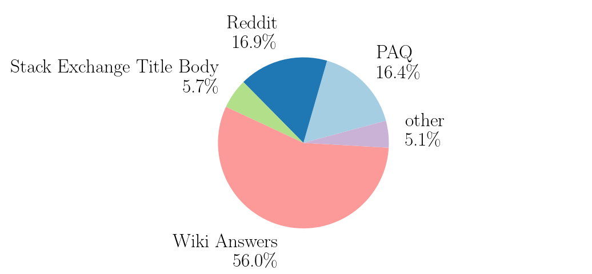
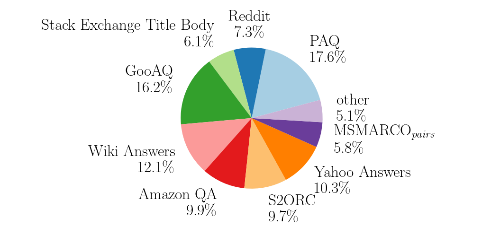
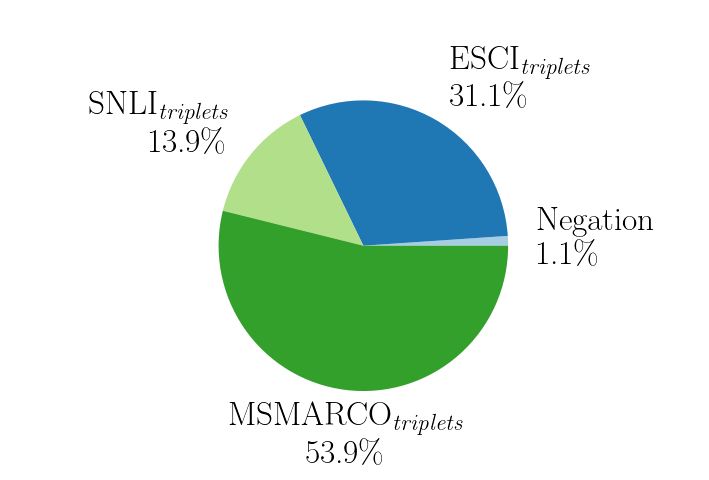

# Jina Embeddings v1：从数据清洗到否定关系的句向量训练

> 在 T5 编码器上先做大规模文本对比训练，再以过滤后的三元组和否定样本微调，重点研究数据质量如何影响句向量。
>
> [Jina Embeddings: A Novel Set of High-Performance Sentence Embedding Models](https://arxiv.org/abs/2307.11224v3) · 2023 · [官方模型](https://huggingface.co/jinaai/jina-embedding-b-en-v1) · [补充解读](Jina-embeddings-v1解读.md)

## 摘要

通用句向量需要兼顾检索、语义相似度和重排，而网上容易收集的大量文本对经常包含重复、语言混杂和弱相关样本。Jina Embeddings v1 没有另造复杂交互结构，而是围绕 T5 编码器系统整理数据、采样和两阶段训练：先用文本对学习语义空间，再用有明确负例的三元组提高区分能力，并专门加入否定句。

论文发布 35M、110M 和 330M 三个英语模型，在 MTEB 的检索、重排和 STS 上与同规模 T5 系模型竞争。清洗消融和否定评测是最值得保留的部分：语义一致性过滤比单纯语言过滤更有效，否定监督明显改善词面相近却意义相反的句子。但提升并非覆盖每个任务，训练教师的偏好也会进入学生。

## 引言

例如“二人一起走路”和“二人没有一起走路”共享几乎全部词汇。只学主题相似性的表示可能把后者放得更近，无法表达任务要求中的语义差异。论文由此将否定构造为专门的训练及评测问题。

论文研究数据预处理、损失设计和参数规模对句向量的影响，以 T5 编码器为基础发布 small/base/large 三档英语模型。

## 数据准备

本文将问答、网页检索、电商、重复检测和分类等来源统一为两种格式：没有显式负例的数据写成 $(q,p)$；有非相关标注的数据写成 $(q,p,n)$。问答集以问题为查询、答案为目标，检索集则使用查询及相关／非相关文档。训练先使用大规模文本对，再使用三元组。

### 文本对准备

清洗按三步进行。首先归一化空白与大小写后哈希去重，删除空样本与两端相同的文本对；其次用 fastText 识别语言，只保留英语；最后以 all-MiniLM-L6-v2 做一致性过滤：从约 100 万对采样目标构成参照池，要求原配目标在查询的余弦相似度排名中进入前二。

这一流程从 32 个来源约 16 亿对中保留 **3.85 亿对**。一致性过滤判断的是已有配对是否足够可靠，使弱监督噪声在正式训练前得到控制。

### 三元组准备

三元组来源已经较干净，因此没有重复执行语言与去重过滤。作者使用交叉编码器 `ms-marco-MiniLM-L-6-v2` 检查正负关系，只保留 $r(q,p)-r(q,n)>0.2$ 的三元组，将约 113 万条降为 **92.7 万条**。这里比较的是教师相关性分差。

### 否定数据准备

论文用三句话说明问题：“一对情侣手牵手走在街上”“一对情侣一起走路”“一对情侣没有一起走路”。某些句向量会因词面高度接近，将后两句的相似度打得高于前两句。

作者以 SNLI 蕴含关系构造 $(anchor,entailment)$ 正对，再让 GPT-3.5 生成与 entailment 句法接近、但与前两句矛盾的 negative，得到专项三元组，纳入第二阶段训练。测试集分别衡量模型能否克服主题重叠及更强的词面相似性。

### 数据组成

图 1a 统计 3.85 亿清洗后数据，图 1b 则统计按训练采样率调整后的组成；实际本轮使用约 **1.8 亿对**。数据池规模与实际训练曝光量因此分开记录。

图 2 的三元组数据远小于文本对数据，但包含明确的非相关关系与否定样本，用于第二阶段提高区分能力。

## 训练

### 文本对训练

仅使用 T5 的 **encoder**，在 token 输出上 mean pooling 得到定长向量；decoder 不参与检索编码。论文比较的三个已发布规格为：

| 模型 | 编码器参数 | 输出维数 |
|---|---:|---:|
| small | 35M | 512 |
| base | 110M | 768 |
| large | 330M | 1024 |

设 $s(q,p)$ 为余弦相似度，batch 大小为 $B$，单向 InfoNCE 为：

$$
\mathcal L_{q\to p}=-\frac1B\sum_i\log\frac{\exp(s(q_i,p_i)/\tau)}{\sum_j\exp(s(q_i,p_j)/\tau)},\qquad \tau=0.05.
$$

再加入 $p\to q$ 的反向项，学习双向配对。其他样本的目标作为批内负例。

### 文本对训练的数据采样

**每个 batch 只取一个数据集**，避免跨任务的简单差异成为主要负例信号；数据集选择概率为

$$
P(D_i)=\frac{|D_i|a_i}{\sum_j|D_j|a_j},
$$

其中 $a_i$ 是人为调整的采样权重。它同时控制大数据源覆盖与高质量小数据源的重复利用，不等同于对所有样本均匀采样。

高采样率的小数据集耗尽后会重新打乱并循环使用，较大数据源则通过权重限制占比。这样在多任务间交替训练，同时使每个 batch 的负例仍来自同一任务。

### 三元组训练

三元组目标组合三项：扩展 InfoNCE、反向 InfoNCE 和 margin loss。扩展项在查询的分母中同时加入批内所有正目标和显式负目标；反向项仍比较正目标与其他查询。margin 项写为：

$$
\mathcal L_{margin}=\frac1B\sum_i\max\{0,\ s(q_i,n_i)-s(q_i,p_i)+0.05\}.
$$

前两项控制批内相对排序，第三项要求本条三元组的正负至少隔开一个余弦间隔。它们都通过共享编码器更新表示，并不在推理时增加交互模块。

## 评测

### 与其他句向量模型比较

MTEB 包含多类句向量任务；本文重点展示检索、重排和语义相似度。检索用 nDCG@10，重排按论文的 mAP@10，STS 用 Spearman。三者不能横向比较高低。

| 模型 | 重排平均 | 检索平均 | STS 平均 |
|---|---:|---:|---:|
| Jina small v1 | 53.07 | 38.91 | 78.06 |
| Jina base v1 | 55.84 | 44.03 | 79.93 |
| Jina large v1 | 56.42 | 44.81 | 80.96 |
| GTR-T5-large | 55.36 | 47.42 | 78.19 |
| all-mpnet-base-v2 | 59.36 | 43.81 | 80.28 |

扩大模型改善了 Jina 系列的平均成绩，但 large 在检索上仍低于 GTR-T5-large，在重排上低于 all-mpnet-base-v2。论文的结论是有效的数据与训练配方能得到有竞争力的表示，不能概括为所有任务的新纪录。

### 过滤步骤的影响

在 Reddit 数据消融中，加入一致性过滤后，Quora 的检索分数从 0.734 到 0.805，SciFact 从 0.218 到 0.381，TREC-COVID 从 0.242 到 0.297；单纯语言过滤的作用小得多。该实验固定了特定数据源与训练设置，说明清洗有实际收益，但并未证明同一教师和阈值适用于全部领域。

论文还报告语言过滤仅去掉 Reddit 的 17.4%，一致性过滤去掉约 84.3%；后者主要清除弱相关回复。组合过滤在多数评测中最好，但影响随数据来源变化。

### 否定数据的效果

设 $a,e,n$ 分别为 anchor、entailment 和生成的否定句。EasyNegation 判断 $s(a,e)>s(a,n)$；HardNegation 判断 $s(a,e)>s(e,n)$，后者要求语义一致的改写胜过词面更接近的否定对。模型在 pairwise 阶段与三元组阶段之后分别测试。

| 模型 | Easy：文本对训练后 | Easy：三元组后 | Hard：文本对训练后 | Hard：三元组后 |
|---|---:|---:|---:|---:|
| Jina base v1 | 93.0 | 97.8 | 13.8 | 54.6 |
| Jina large v1 | 94.6 | 98.2 | 16.6 | 65.4 |

原文表 4，单位为准确率百分数。三元组阶段显著改善 hard 指标，但同时也加入了其他三元组监督，因此这张阶段对照没有单独隔离否定数据的净贡献。all-mpnet-base-v2 的 hard 为 67.6，仍略高于 Jina large。

## 相关工作

Sentence-BERT、Sentence-T5 和 GTR 已证明，独立编码文本并在向量空间打分，可以把昂贵的逐对交互替换为可缓存表示。本文沿用这一范式，关注三个更具体的问题：海量弱监督对如何变成有效训练集；文本对与显式负例如何衔接；模型是否能区分语法否定。

Sentence-T5 和 GTR 分别偏向相似度与检索，Jina 通过多来源数据希望兼顾两类任务；MTEB 的逐类结果用于检验这种多任务取舍。

## 训练细节

训练附录给出 512 token 上限、8 个设备、float32、学习率 $5\times10^{-5}$ 和 500 步 warmup；small/base/large 的文本对 batch 分别为 4096/2048/1024。模型越大 batch 越小，因此规模对照同时含训练配置差异。

## 结论

本文把“收集更多数据”细化成过滤、采样、三元组去噪和关系监督的组合。结果支持高质量数据与难负例的价值，也说明通用 embedding 对否定并不天然可靠。研究局限包括英语与短文本设定、依赖教师清洗、生成否定样本的覆盖不足，以及检索、重排、STS 之间不一致的收益。
