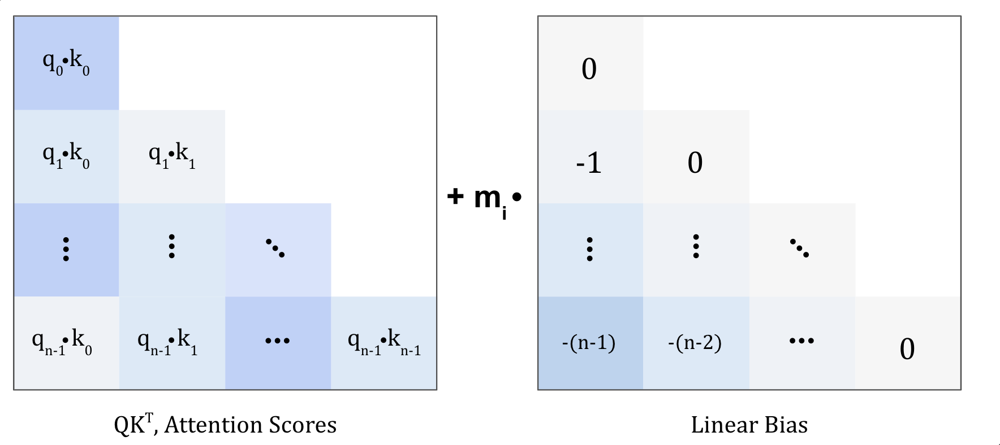
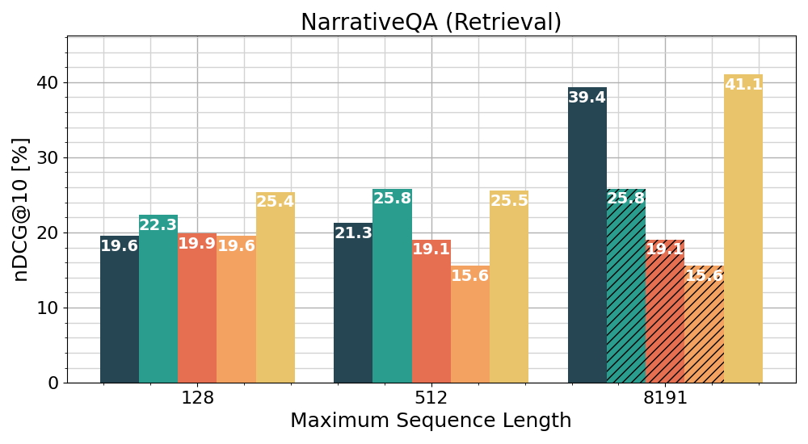
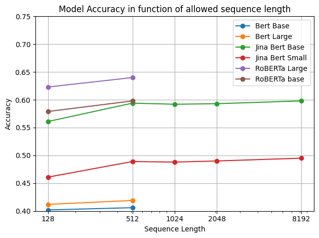

# Jina-v2：论文精炼研读

> 将双向 ALiBi 加入 BERT，在短序列上预训练并进行文本对、难负例训练，让单向量编码支持最长 8192 token。
>
> [原论文](https://arxiv.org/abs/2310.19923v4)

## 论文简介

多数 BERT 句向量只接受 512 token，直接截断会漏掉文档后部证据，切块则改变检索单元并增加索引记录。Jina embeddings v2 从头训练采用双向 ALiBi 与 GLU 的 JinaBERT，再进行文本对和难负例两阶段嵌入训练，以检验短序列训练能否支持更长输入。

base 模型在 MTEB 平均得分约 60.37，接近当时 ada-002，并在 NarrativeQA、LoCo 等长文实验中显示更多上下文的收益。论文也观察到 WikiCities 等任务可能因加入噪声而退步：8K 是输入能力，不能等同于每类长文信息都能压进一个可靠向量。

## 问题背景与 v1 谱系

### 为何要做长文档嵌入

实践中 BERT 系开源嵌入大多卡在 **512 tokens**。常见 workaround 是切段落分别编码：

- 语义被拆碎，全局主题难进单一向量；
- 库内向量数爆炸 → 内存、索引、检索延迟同步上升；
- DB 侧索引结构往往按向量条数计费，切块成本被放大。

Press et al.（ALiBi）证明：去掉绝对位置嵌入、在 attention logits 上加 **线性距离偏置**，语言模型可「训短测长」。当时 ALiBi 多用于 **因果 LM**；v2 把 **对称编码器版 ALiBi** 嵌进 BERT，专门服务双向编码与句向量。

### 与 v1 的继承关系

v1（arXiv:2307.11224）已固定 Jina 嵌入训练范式的骨架：

1. **大规模高质量文本对**（去重、语言过滤、一致性过滤）；
2. **双向 InfoNCE** 对训练；
3. **难负例三元组** 再精调；
4. 否定敏感数据等专项补丁。

v2 **换底座、加长上下文**，嵌入阶段损失与数据哲学与 v1 / E5 / GTE 同属 **多阶段对比学习** 一族，但 backbone 从 T5 encoder 换成 **自研 Jina BERT + ALiBi**。

### 三阶段总览

```text
Stage I    从零预训练 Modified BERT（MLM，C4，序列≤512）
Stage II   文本对微调（双向 InfoNCE，~40 数据源）
Stage III  难负例微调（每样本 1 正 + 15 负，$\mathcal{L}_{NCE+}$）
```

Stage II/III 都是嵌入任务；论文强调 **III 对检索与分类** 尤为关键。

## 模型架构：Jina BERT + 双向 ALiBi

### 规格

| 模型 | Layers | Hidden | Params | Head dim |
| --- | --- | --- | --- | --- |
| Jina BERT Small | 4 | 512 | 33M | 64 |
| Jina BERT Base | 12 | 768 | 137M | 64 |
| Jina BERT Large | 24 | 1024 | 455M | 64 |

注意力头数按 **每头 64 维** 选取。嵌入模型在预训练 BERT 上加 **mean pooling**（无额外可训池化参数），输出单向量。

### 双向 ALiBi



原论文图 1：编码器使用双向对称距离偏置，不同头的斜率赋予不同距离偏好。


标准绝对位置嵌入在外推到训练长度之外时失效。ALiBi **不训练位置嵌入**，而是在 softmax 前对 attention score 加与距离成正比的负偏置。因果版只偏置「看左侧」；编码器需要 **双向互看**，故采用 **镜像对称** 的 encoder ALiBi：每个 head 有独立斜率 $m_i$。

以第 $h$ 个头为例，注意力 logits 可以写成：

$$
A^{(h)}_{ij}=\frac{q_i^\top k_j}{\sqrt{d_h}}-m_h|i-j|,\qquad m_h>0.
$$

$m_h$ 为各头按预设规则确定的固定斜率。距离偏置左右对称，近位置受罚更小；多个头覆盖不同距离偏好。它使训练长度之外的位置仍有定义，但外推质量仍需实验检验。

### GLU FFN 与 LayerNorm

- FFN 侧采用 **Gated Linear Units**（Dauphin et al.；Shazeer GLU 变体）：
  - Small / Base：**GEGLU**（GELU 门控）；
  - Large：**ReGLU**（ReLU）——作者观察到 Large + GEGLU 虽早期 MLM 好看，但训练不稳。
- LayerNorm：采用 Transformer 经典 **post-LN**；试过 pre-LN（Megatron / Nguyen–Salazar）未见稳定或效果收益，故未采用。

### 与 RoBERTa / BERT 的差异小结

| 设计点 | 经典 BERT/RoBERTa | Jina BERT v2 |
| --- | --- | --- |
| 位置 | 绝对位置嵌入 | **双向 ALiBi** |
| FFN | 标准 FFN | **GLU** |
| NSP | BERT 有 / RoBERTa 无 | **无 NSP**（跟 RoBERTa） |
| 序列打包 | 常多文档打包 | **单文档前 512，不跨文档打包** |

## Stage I：预训练

### 数据

英文 **C4**（Colossal Cleaned Common Crawl）：约 **3.65 亿** 文档、约 **1700 亿** tokens；仅保留英文，过滤不当内容。留 **1%** 作 validation（MLM loss / accuracy）。→ 官方开源 v2-en 为 **单语英文**（后续有双语变体系列，不在本篇论文主文）。

### MLM 目标

掩码 **30%** tokens，**whole-word masking**：

- 80% → `[MASK]`；
- 10% → 随机词；
- 10% → 保持原词。

MLM 输出层对被掩码位置预测词表概率。采用最小化损失的记号，目标为

$$
\mathcal L_{MLM}=-\sum_{k\in\mathcal M}\log p(w_k\mid x_{masked}).
$$

原文式 (2) 将对数概率相加但称作 loss；这里明确负号与优化方向。不做 next-sentence prediction。

### 序列与批策略

- 全局 batch **4096**；序列上限 **512**；
- 每文档只取 **前 512 tokens**，不采样多段、不跨文档拼装；
- 因序列长度变化，每 batch 掩码 token 数不固定。

ALiBi 让训练长度之外的位置仍可参与计算。作者在 C4 val 上扫序列长度做 MLM accuracy：Jina BERT **外推到 8192 时 MLM 不崩**；标准 BERT/RoBERTa 因绝对位置表无法算 >512。

### 优化

- AdamW：$\beta_1=0.9,\ \beta_2=0.98,\ \epsilon=10^{-6}$，weight decay $0.01$，dropout / attn dropout $0.1$；
- 线性 warmup 10k steps 到峰值 $\eta$，再线性降到 0（至 100k steps）；
- $\eta$：Small $10^{-3}$ / Base $6\times10^{-4}$ / Large $4\times10^{-4}$；
- **FP16** 动态混合精度 + DeepSpeed；试 BF16 在 MLM 与下游 GLUE 上不佳。

### Backbone GLUE 速览

微调后提交 GLUE test：Jina BERT Base 平均约 **80.7**，Large **81.6**——低于 RoBERTa Large 峰值，但对「嵌入底座」够用；重点证据是 **长序列 MLM 外推曲线平坦**。

## Stage II–III：嵌入微调

### Mean pooling

对最后一层 token 隐状态做均值，得到固定维句向量。无额外池化参数，与 Sentence-BERT 系一致。

### Stage II：文本对 + 双向 InfoNCE

**数据**：约 **40** 个异构源（延续 v1 配比与采样）；**标题–摘要** 对显著利于聚类。用一致性过滤（Dai et al.；Wang et al. / E5）抬高质量。每个新 batch **先随机选一个数据源**，再抽满 batch；按质量/体量设不同采样率。

对 batch $B\subset D_{\mathrm{pairs}}$，余弦相似度 $s(\cdot,\cdot)$，温度 $\tau$，单向 InfoNCE（论文 Eq.3）：

$$
\mathcal{L}_{\mathrm{NCE}}^{\mathrm{pairs}}(B)
:=
\mathbb{E}_{(q,p)\sim B}
\left[
-\ln
\frac{e^{s(q,p)/\tau}}
{\sum_{i=1}^{k} e^{s(q,p_i)/\tau}}
\right].
\tag{3}
$$

对称性要求 **双向**（Eq.4）：

$$
\mathcal{L}^{\mathrm{pairs}}(B)
:=
\mathcal{L}_{\mathrm{NCE}}^{\mathrm{pairs}}(B)
+
\mathcal{L}_{\overline{\mathrm{NCE}}}^{\mathrm{pairs}}(B),
$$

其中 $\mathcal{L}_{\overline{\mathrm{NCE}}}$ 把 $(q,p)$ 对调，用 $p$ 去对齐所有 $q_i$。经验上 $\tau=0.05$。

这与 v1 的 $\mathcal{L}^{\mathrm{pairs}}$ 同构：in-batch 负例越多，对比信号越强 → **大 batch 扩大批内负例池，但效果也受负例质量影响**。

### Stage III：难负例 + $\mathcal{L}_{\mathrm{NCE}+}$

**数据**：MS MARCO、Natural Questions 等检索集 + NLI 等非检索集。每个样本形如 $(q,p,n_1,\ldots,n_{15})$：**1 正 + 15 负**。

- 检索集：用检索模型挖 **hard negatives**，再用 **cross-encoder** 校验「负例相关性确实低于正例」；
- 非检索集：**随机负例**——硬负例在「相似/不相似」非二元场景下常伤质量，但仍需混入以保住 STS 等非检索能力。

扩展 InfoNCE（论文 Eq.5，双向）：

$$
\mathcal{L}_{\mathrm{NCE}+}(B)
:=
\mathbb{E}_{r\sim B}
\Bigg[
-\ln
\frac{e^{s(q,p)/\tau}}
{\sum_{i=1}^{k}\Big(
e^{s(q,p_i)/\tau}
+\sum_{j=1}^{15} e^{s(q,n_{j,i})/\tau}
\Big)}
\Bigg]
+
\mathbb{E}_{r\sim B}
\Bigg[
-\ln
\frac{e^{s(p,q)/\tau}}
{\sum_{i=1}^{k} e^{s(p,q_i)/\tau}}
\Bigg],
\tag{5}
$$

其中 $r=(q,p,n_1,\ldots,n_{15})$。相对 Stage II：分母显式加入 **同 batch 其它正例 + 显式 hard negatives**，逼模型区分「相关」与「仅语义相近」。

### 显存工程

InfoNCE 的有效负例数随 batch 线性增。作者用：

- 混合精度；
- DeepSpeed；
- **Activation checkpointing**（每个 BERT layer 后插入）。

以换更大 global batch，避免「小 batch 对比面太窄」。

## 评测

### MTEB（短文为主）

MTEB：7 类任务、58 个数据集。论文 Table 3（节选）：

| Model | Params | CF | CL | PC | RR | RT | STS | SM | Avg |
| --- | --- | --- | --- | --- | --- | --- | --- | --- | --- |
| text-embedding-ada-002 | — | 70.93 | 45.90 | 84.89 | 56.32 | 49.25 | 80.97 | 30.80 | **60.99** |
| e5-base-v2 | 110M | 73.84 | 43.80 | 85.73 | 55.91 | 50.29 | 81.05 | 30.28 | **61.50** |
| jina-small-v2 | 33M | 68.82 | 40.08 | 84.44 | 55.09 | 45.64 | 80.00 | 30.56 | **58.12** |
| jina-base-v2 | 137M | **73.45** | 41.74 | 85.38 | 56.99 | **48.45** | 80.70 | 31.60 | **60.37** |

解读：

- **base** 分类很强，检索接近 ada-002；
- **small** 在检索上仍有竞争力，体现「Stage III 难负例」对检索的杠杆；
- 相对未做二阶段精调的 `all-MiniLM` / `all-mpnet`，检索优势符合预期。

### 长文任务：为何要自造集



原论文图 3 的长文评测面板：放宽截断长度的收益取决于信息位置及任务目标。


MTEB 文本普遍偏短，测不出 8K。作者补充：

1. **PatentClustering**（BigPatent）：专利按类别聚类，均长约 **6376** tokens；
2. **WikiCitiesClustering**：城市条目按国家聚类，均长约 **2031**；
3. **NarrativeQA** 检索：文学/剧本，均长约 **7.5 万** tokens（极长）；
4. 另评 **LoCo**（Stanford M2-BERT 文配套长文检索套件）。

扫 `max_length` 截断曲线（Figure 3）：

- **NarrativeQA**：加长上下文收益极大——答案常不在文首，只取 512 token 容易遗漏证据；
- **BigPatent** 聚类：长上下文通常更好；
- **WikiCities**：更长有时略伤——国家信息多在首段，后文噪声干扰 mean pooling。

结论：**「更长」不是单调增益**，取决于任务信息落点；但 NarrativeQA 类「全文理解」任务提供了更长上下文有用的实验证据。

### LoCo（论文 Table 11）

`jina-base-v2`（137M, 8192）avg nDCG@10 **85.4**；`jina-small-v2` **83.4**。对比：M2-BERT-32768 微调后可更高，但 jina-base-v2 在 **未专门为 LoCo 微调** 的设定下已接近一众 512 模型的微调版，并远好于当时部分闭源长上下文 API 在该榜的表现（表内 ada / voyage 等分数需注意评测设定差异）。

### Backbone 长序列 MLM



原论文图 2：在 C4 验证集上随输入长度变化的 MLM 准确率，检验位置外推是否破坏语言建模。


Figure 2：训练长度 512，推理到 8192，Jina BERT MLM accuracy 基本不掉——支撑「嵌入微调虽多在 ≤512 文本上，推理仍可喂长文」的工程叙事。

## 局限与使用注意

1. **预训练与微调长度仍短**：8K 能力主要靠 ALiBi 外推，而非大规模 8K 对比训练；极端长依赖任务仍可能弱于「真·长上下文对比训」模型。
2. **英文主模型**：主文 C4 英；多语/双语是后续产品线，勿把本篇论文当成多语 SOTA 声明。
3. **Mean pooling + 超长文**：后半噪声可能稀释信号（WikiCities 现象）；生产上仍可能要「智能切块 + 多向量」折中。
4. **Large 训练不稳**：GEGLU→ReGLU 的经验选择，暗示 GLU 变体与模型规模耦合。
5. **与 E5-base**：MTEB 平均略逊 e5-base-v2；卖点是 **上下文长度与开源可复现**，不是全面碾压同尺寸短上下文模型。
6. **评测缺口**：标准 MTEB 不能充分反映 8K；应用方应用 NarrativeQA / LoCo / 自有长 PDF 做回归。

## 小结

Jina Embeddings v2 = **双向 ALiBi BERT（训短测长）** + **v1 系两阶段对比微调**。它不是参数量最大的嵌入模型，但在 2023 开源生态里清晰回答了：「长文档能否进 **一个** 向量、且下游不崩？」——答案是可以，且 NarrativeQA / LoCo 显示 **上下文预算本身就是特征**。后续 v3 用 RoPE + Task LoRA 把多语与任务特化做深；v2 则是长上下文开源嵌入的关键里程碑。
