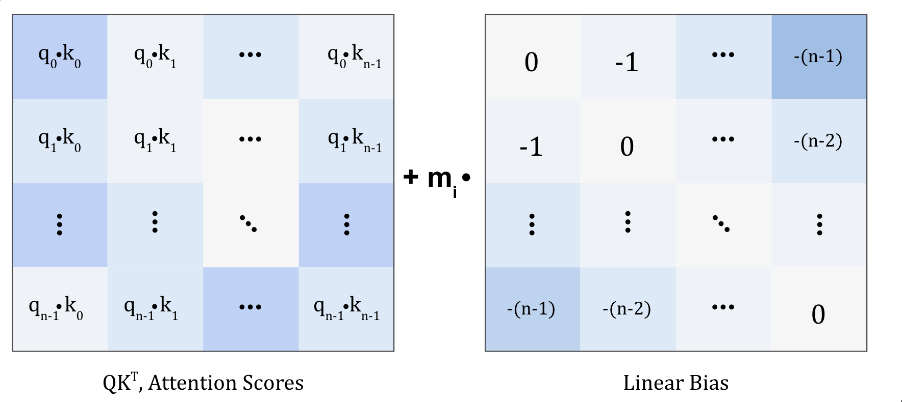
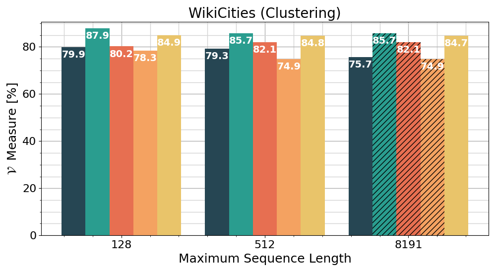
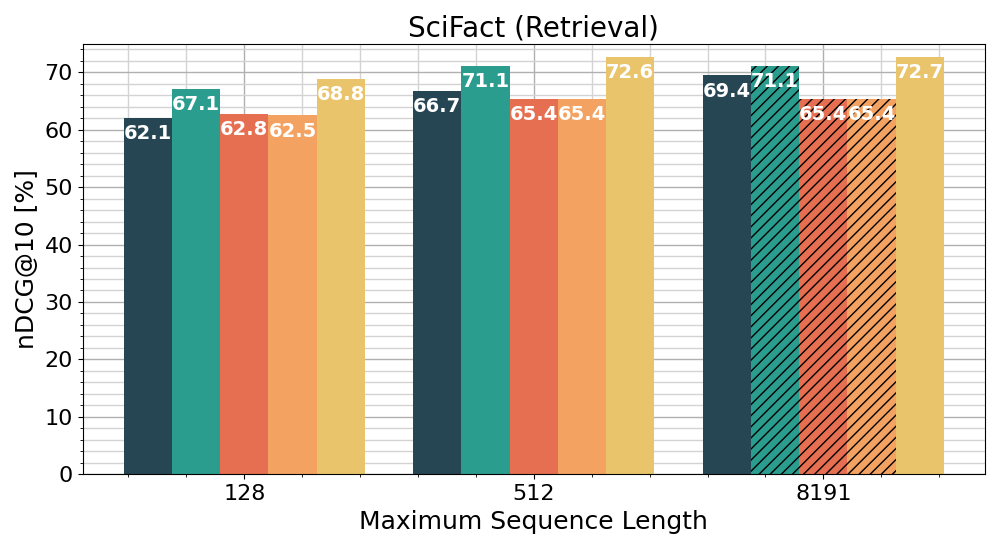
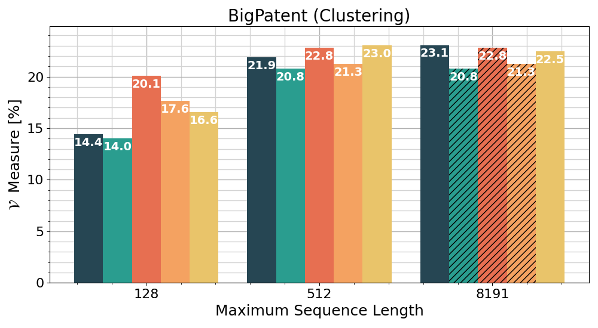

# Jina Embeddings 2: 8192-Token General-Purpose Text Embeddings for Long Documents / 全文中英对照

> 来源：[arXiv:2310.19923v4](https://arxiv.org/abs/2310.19923v4)。英文段落后紧接中文，覆盖所取 HTML 版本的主文、附录、图表、脚注与参考文献；公式、数字表和书目信息共用。中文以机器初译为底稿，进行了术语整理与结构核对，尚未逐句人工审定；遇到歧义请以紧邻英文和原论文为准。 原作版权归所列作者，许可见 [原作许可](http://creativecommons.org/licenses/by/4.0/)；中文译文与版式改写在该许可条件下提供（涉及 SA 时沿用相同许可，涉及 NC 时仅限非商业使用）。

## Authors and affiliations / 作者与机构

Michael Günther Jackmin Ong Isabelle Mohr Alaeddine Abdessalem Tanguy Abel Affiliation: Mohammad Kalim Akram , Susana Guzman , Georgios Mastrapas , Saba Sturua , Affiliation: Bo Wang , Maximilian Werk , Nan Wang Han Xiao Affiliation: Jina AI GmbH, Ohlauer Str. 43, 10999 Berlin, Germany Affiliation: {michael.guenther, jackmin.ong, isabelle.mohr alaeddine.abdessalem, Affiliation: tanguy.abel, kalim.akram, susana.guzman, georgios.mastrapas, saba.sturua, Affiliation: bo.wang, maximilian.werk, nan.wang, han.xiao}@jina.ai

**EN.** 2023/10/31

**中.** 2023/10/31

## Abstract / 摘要

**EN.** Text embedding models have emerged as powerful tools for transforming sentences into fixed-sized feature vectors that encapsulate semantic information. While these models are essential for tasks like information retrieval, semantic clustering, and text re-ranking, most existing open-source models, especially those built on architectures like BERT, struggle to represent lengthy documents and often resort to truncation. One common approach to mitigate this challenge involves splitting documents into smaller paragraphs for embedding. However, this strategy results in a much larger set of vectors, consequently leading to increased memory consumption and computationally intensive vector searches with elevated latency.

**中.** 文本嵌入模型已成为将句子转换为封装语义信息的固定大小特征向量的强大工具。虽然这些模型对于信息检索、语义聚类和文本重新排序等任务至关重要，但大多数现有的开源模型，尤其是基于 BERT 等架构构建的模型，很难表示冗长的文档，并且经常诉诸于截断。缓解这一挑战的一种常见方法是将文档分割成更小的段落进行嵌入。然而，这种策略会产生更大的向量集，从而导致内存消耗增加、计算密集型向量搜索和延迟增加。

**EN.** To address these challenges, we introduce Jina Embeddings v2 , an open-source text embedding model [^footnote1] capable of accommodating up to $8192$ tokens. This model is designed to transcend the conventional $512$ -token limit and adeptly process long documents. Jina Embeddings v2 not only achieves state-of-the-art performance on a range of embedding-related tasks in the MTEB benchmark but also matches the performance of OpenAI’s proprietary text-embedding-ada-002 model. Additionally, our experiments indicate that an extended context can enhance performance in tasks such as NarrativeQA.

**中.** 为了应对这些挑战，我们引入了 Jina Embeddings v2，这是一种开源文本嵌入模型 [^footnote1]，最多能够容纳 $8192$ 代币。该模型旨在超越传统的 $512$ 令牌限制并熟练处理长文档。 Jina Embeddings v2 不仅在 MTEB 基准测试中的一系列嵌入相关任务上实现了最先进的性能，而且还与 OpenAI 专有的 text-embedding-ada-002 模型的性能相匹配。此外，我们的实验表明，扩展的上下文可以提高 NarrativeQA 等任务的性能。

## Introduction / 简介

**EN.** Using neural networks to encode text and images into embedding representations has become a standard practice for analyzing and processing vast amounts of unstructured data. In natural language processing, sentence embedding models Reimers and Gurevych (2019) transform the semantics of phrases, sentences, and paragraphs into points within a continuous vector space. These transformed data points can subsequently be used for a myriad of downstream applications, such as information retrieval, as well as clustering and classification tasks.

**中.** 使用神经网络将文本和图像编码为嵌入表示已成为分析和处理大量非结构化数据的标准做法。在自然语言处理中，句子嵌入模型 Reimers 和 Gurevych (2019) 将短语、句子和段落的语义转换为连续向量空间内的点。这些转换后的数据点随后可用于多种下游应用程序，例如信息检索以及聚类和分类任务。

**EN.** Despite the numerous applications of embedding models, a prevailing challenge faced by many models is the limitation on the maximum sequence lengths of text that can be encoded into a single embedding. To circumvent this, practitioners often segment documents into smaller chunks prior to encoding. This tactic, unfortunately, results in fragmented semantic meanings, causing the embeddings to misrepresent the entirety of paragraphs. Furthermore, this method yields a plethora of vectors, culminating in heightened memory usage, increased computational demands during vector searches, and extended latencies. The dilemma is exacerbated when embedding vectors are stored in database systems that construct memory-intensive index structures.

**中.** 尽管嵌入模型有许多应用，但许多模型面临的一个普遍挑战是可以编码到单个嵌入中的文本最大序列长度的限制。为了避免这种情况，从业者通常在编码之前将文档分割成更小的块。不幸的是，这种策略会导致语义碎片化，导致嵌入歪曲整个段落。此外，这种方法会产生过多的向量，最终导致内存使用量增加、向量搜索期间的计算需求增加以及延迟延长。当嵌入向量存储在构建内存密集型索引结构的数据库系统中时，这种困境会加剧。

**EN.** The root of these text length restrictions can be traced back to the BERT architecture, which underpins most of the current open-source models. The authors of Press et al. (2022) demonstrated that these models struggle to accurately represent long documents. They introduced an alternative positional embedding method named ALiBi, enabling efficient training of models to encode long text sequences. Regrettably, up until this point, the approach was exclusively employed for generative language models, neglecting its potential for open-source encoder language models aimed at crafting document embeddings. This research bridges that gap by incorporating ALiBi bidirectionally into the BERT framework, rendering it apt for encoding tasks. As a result, it empowers users to utilize it for downstream operations on texts spanning up to $8192$ tokens. Moreover, we fine-tuned this enhanced BERT model, harnessing hundreds of millions of text samples to encode texts into singular embedding representations. Our model’s resultant embeddings outshine those of the Jina Embeddings v1 model suite Günther et al. (2023) in the MTEB benchmark and rival the prowess of state-of-the-art models like E5 Wang et al. (2022) . We also found that large context lengths can amplify the efficacy of numerous downstream tasks tied to embeddings. Given that the majority of available embedding evaluation datasets comprise mainly brief text passages, we have curated datasets encompassing long text values to better evaluate embeddings. These datasets, alongside our models, are made accessible via our Hugging Face repository [^footnote2] .

**中.** 这些文本长度限制的根源可以追溯到 BERT 架构，它是当前大多数开源模型的基础。 Press 等人的作者。 （2022）证明这些模型很难准确地表示长文档。他们引入了一种名为 ALiBi 的替代位置嵌入方法，能够有效训练模型来编码长文本序列。遗憾的是，到目前为止，该方法仅用于生成语言模型，而忽略了其在旨在制作文档嵌入的开源编码器语言模型方面的潜力。这项研究通过将 ALiBi 双向整合到 BERT 框架中来弥补这一差距，使其适合编码任务。因此，它使用户能够利用它对跨度高达 $8192$ 代币的文本进行下游操作。此外，我们对这个增强的 BERT 模型进行了微调，利用数亿个文本样本将文本编码为奇异的嵌入表示。我们模型的最终嵌入优于 Jina Embeddings v1 模型套件 Günther 等人的嵌入。 (2023) 在 MTEB 基准测试中，可与 E5 Wang 等人等最先进模型的能力相媲美。 （2022）。我们还发现，大的上下文长度可以增强与嵌入相关的众多下游任务的效率。鉴于大多数可用的嵌入评估数据集主要包含简短的文本段落，我们整理了包含长文本值的数据集，以更好地评估嵌入。这些数据集以及我们的模型可以通过我们的 Hugging Face 存储库 [^footnote2] 进行访问。

**EN.** This paper is structured as follows: We begin with an overview of related work in Section 2 . This is followed by an outline of the training paradigm in Section 3 , a description of the backbone model and its pre-training in Section 4 , and a detailed walkthrough of the fine-tuning process for embeddings generation in Section 5 . We culminate with an exhaustive evaluation in Section 6 and conclusions in Section 7 .

**中.** 本文的结构如下：我们首先概述第 2 节中的相关工作。接下来是第 3 节中的训练范式概述，第 4 节中对骨干模型及其预训练的描述，以及第 5 节中嵌入生成的微调过程的详细演练。我们在第 6 节中进行了详尽的评估，并在第 7 节中得出了结论。

## Related Work / 相关工作

**EN.** Embedding training has undergone significant evolution, transitioning from foundational techniques such as Latent Semantic Indexing (LSA) Deerwester et al. (1990) and Latent Dirichlet Allocation (LDA) Blei et al. (2001) to the sophisticated prowess of pre-trained models like Sentence-BERT Reimers and Gurevych (2019) . A notable shift in recent advancements is the emphasis on unsupervised contrastive learning, as showcased by works like Gao et al. (2022) ; Wang et al. (2022) . Pioneering models like Condenser Gao and Callan (2021) and RetroMAE Xiao et al. (2022) have brought forth specialized architectures and pre-training methods explicitly designed for dense encoding and retrieval.

**中.** 嵌入训练经历了重大演变，从潜在语义索引 (LSA) Deerwester 等基础技术转变而来。 (1990) 和潜在狄利克雷分配 (LDA) Blei 等人。 (2001) 以及 Sentence-BERT Reimers 和 Gurevych (2019) 等预训练模型的复杂能力。最近进展的一个显着转变是强调无监督对比学习，正如 Gau 等人的作品所展示的那样。 (2022);王等人。 （2022）。 Condenser Gau 和 Callan (2021) 以及 RetroMAE Xiao 等人的开创性模型。 （2022）提出了专门为密集编码和检索而设计的专门架构和预训练方法。

**EN.** The E5 Wang et al. (2022) , Jina Embeddings v1 Günther et al. (2023) , and GTE Li et al. (2023) collections of embedding models represent another leap forward. These models propose a holistic framework tailored for effective training across a myriad of tasks. This framework adopts a multi-stage contrastive training approach. An initial phase focuses on training using a vast collection of weak pairs sourced from public data, enhancing the model’s domain generalization. Following this, a supervised fine-tuning stage employs a curated set of annotated text triples, representing diverse tasks. Together, these sequential stages yield state-of-the-art outcomes on the MTEB benchmark.

**中.** E5王等人。 (2022)，Jina Embeddings v1 Günther 等人。 (2023) 和 GTE Li 等人。 (2023) 嵌入模型的集合代表了又一次飞跃。这些模型提出了一个针对各种任务的有效培训量身定制的整体框架。该框架采用多阶段对比训练方法。初始阶段的重点是使用来自公共数据的大量弱对集合进行训练，从而增强模型的领域泛化能力。接下来，有监督的微调阶段采用一组精选的带注释的文本三元组，代表不同的任务。这些连续阶段共同产生了 MTEB 基准的最先进结果。

**EN.** Yet, despite such advancements, a glaring limitation persists: the $512$ -token constraint on input sequences, stemming from foundational models like BERT. This cap is insufficient for encoding lengthy documents, often exceeding a page. ALiBi Press et al. (2022) emerges as a promising solution, presenting a technique that sidesteps conventional positional embeddings and facilitates training on sequences exceeding $2048$ tokens. Notably, its typical application is centered around generative models, which inherently adopt a unidirectional bias, rendering it less suitable for embedding tasks.

**中.** 然而，尽管取得了这些进步，但一个明显的限制仍然存在：来自 BERT 等基础模型的对输入序列的 $512$ 令牌约束。此上限不足以编码通常超过一页的长文档。 ALiBi 出版社等。 （2022）作为一种有前途的解决方案出现，提出了一种绕过传统位置嵌入并促进对超过 $2048$ 令牌的序列进行训练的技术。值得注意的是，其典型应用以生成模型为中心，生成模型本质上采用单向偏差，使其不太适合嵌入任务。

**EN.** Effective evaluation remains paramount for embedding models, ensuring they meet the diverse demands of real-world applications. The BEIR benchmark Thakur et al. (2021) stands out, offering evaluations across a set of retrieval tasks and settings. Similarly, the MTEB benchmark Muennighoff et al. (2023) highlights the extensive applicability of text embeddings, spanning a variety of tasks and languages. However, a notable gap in both benchmarks is their limited focus on encoding long documents — a critical aspect for comprehensive embedding evaluation.

**中.** 有效的评估对于嵌入模型仍然至关重要，以确保它们满足实际应用的多样化需求。 BEIR 基准 Thakur 等人。 （2021）脱颖而出，提供了对一组检索任务和设置的评估。同样，MTEB 基准 Muennighoff 等人。 (2023) 强调了文本嵌入的广泛适用性，涵盖各种任务和语言。然而，这两个基准的一个显着差距是它们对长文档编码的关注有限——这是全面嵌入评估的一个关键方面。

## Training Paradigm Overview / 培训范式概述

**EN.** The training paradigm for Jina Embeddings v2 is divided into three stages:

**中.** Jina Embeddings v2 的训练范式分为三个阶段：

**EN.** I

**中.** I

**EN.** Pre-training a Modified BERT: For the backbone language model, we propose a modified BERT model capable of encoding documents with up to $8192$ tokens. This model is trained from scratch on a full-text corpus using a masked language modeling objective.

**中.** 预训练修改后的 BERT：对于主干语言模型，我们提出了一种修改后的 BERT 模型，能够使用最多 $8192$ 令牌对文档进行编码。该模型是使用掩码语言建模目标在全文语料库上从头开始训练的。

**EN.** II

**中.** 二

**EN.** Fine-tuning with Text Pairs: To encode a text passage into a single vector representation, the model is fine-tuned on text pairs.

**中.** 使用文本对进行微调：为了将文本段落编码为单个向量表示，模型在文本对上进行微调。

**EN.** III

**中.** 三、

**EN.** Fine-tuning with Hard Negatives: The model is further fine-tuned using text pairs complemented with hard negatives. This stage is crucial for enabling the model to better distinguish between relevant passages and related, but irrelevant text passages.

**中.** 使用 Hard Negatives 进行微调：使用由 Hard Negatives 补充的文本对进一步微调该模型。此阶段对于使模型能够更好地区分相关段落和相关但不相关的文本段落至关重要。

**EN.** While both stages II and III are geared towards training the models for embedding tasks, the latter is especially critical for improving the model’s performance in retrieval and classification tasks (refer to Section 6.2 ).

**中.** 虽然第二阶段和第三阶段都旨在训练嵌入任务的模型，但后者对于提高模型在检索和分类任务中的性能尤其重要（请参阅第 6.2 节）。

## Pre-training a Modified BERT / 预训练修改后的 BERT

**EN.** For the backbone language model, we introduce a novel transformer based on BERT Devlin et al. (2019) with several modifications to enhance its ability to encode extended text sequences and to generally bolster its language modeling capabilities. For the training process, we largely adopt the approach described in Liu et al. (2019a) , incorporating additional performance optimizations.

**中.** 对于主干语言模型，我们引入了一种基于 BERT Devlin 等人的新型转换器。 （2019）进行了一些修改，以增强其编码扩展文本序列的能力并普遍增强其语言建模能力。对于训练过程，我们主要采用 Liu 等人中描述的方法。 (2019a)，纳入额外的性能优化。

### Model Architecture / 模型架构

| Model 型号 | Layers 层数 | Hidden 隐藏 | Params 参数 |
| --- | --- | --- | --- |
| Jina BERT Small 吉娜·伯特·小 | 4 | 512 | 33M |
| Jina BERT Base 吉娜 BERT 基地 | 12 | 768 | 137M |
| Jina BERT Large 吉娜·伯特·大号 | 24 | 1024 | 455M |

**EN.** Table 1: Architecture specifications for the Jina BERT models of varying sizes. The number of attention heads is selected to ensure a consistent head dimension of $64$ .

**中.** 表 1：不同规模的 Jina BERT 模型的架构规范。选择关注头的数量以保证$64$的头尺寸一致。

#### Attention with Linear Biases: / 注意线性偏差：

**EN.** Figure 1: With ALiBi attention, a linear bias is incorporated into each attention score preceding the softmax operation. Each attention head employs a distinct constant scalar, $m$ , which diversifies its computation. Our model adopts the encoder variant where all tokens mutually attend during calculation, contrasting the causal variant originally designed for language modeling. In the latter, a causal mask confines tokens to attend solely to preceding tokens in the sequence.

**中.** 图 1：通过 ALiBi 注意力，线性偏差被纳入到 softmax 操作之前的每个注意力分数中。每个注意力头都采用不同的常量标量 $m$ ，这使其计算多样化。我们的模型采用编码器变体，其中所有标记在计算过程中相互参与，这与最初为语言建模设计的因果变体形成鲜明对比。在后者中，因果掩码将令牌限制为仅关注序列中前面的令牌。

**EN.** For the self-attention mechanism within the attention blocks, we adopt the Attention with Linear Biases (ALiBi) approach Press et al. (2022) . ALiBi forgoes the use of positional embeddings. Instead, it encodes positional information directly within the self-attention layer by introducing a constant bias term to the attention score matrix of each layer, ensuring that proximate tokens demonstrate stronger mutual attention. While the original implementation was designed for causal language modeling and featured biases solely in the causal direction, such an approach is not compatible with the bidirectional self-attention inherent in our encoder model. For our purposes, we employ the symmetric encoder variant where attention biases are mirrored to ensure consistency in both directions [^footnote3] . Figure 1 depicts the computation of attention scores within the multi-head attention heads. Each head’s scaling value, $m_{i}$ , out of the total $n$ heads, is derived using Equation ( 1 ).

**中.** 对于注意力块内的自注意力机制，我们采用线性偏差注意力（ALiBi）方法 Press 等人。 （2022）。 ALiBi 放弃使用位置嵌入。相反，它通过向每层的注意力分数矩阵引入恒定偏差项，直接在自注意力层内编码位置信息，确保邻近的标记表现出更强的相互注意力。虽然最初的实现是为因果语言建模而设计的，并且仅在因果方向上存在偏差，但这种方法与我们的编码器模型中固有的双向自注意力不兼容。出于我们的目的，我们采用对称编码器变体，其中注意力偏差被镜像，以确保两个方向的一致性 [^footnote3] 。图 1 描述了多头注意力头中注意力分数的计算。总 $n$ 头中的每个头的缩放值 $m_{i}$ 是使用公式 (1) 导出的。

$$
\begin{aligned}\displaystyle m_{i}=\begin{cases}b^{2i}&i<a\\
b^{1+2(i-a)}&i\geq a\\
\end{cases} \\ \displaystyle a=2^{\left\lfloor\log_{2}n\right\rfloor}\;\;b=2^{\frac{-8}{2^{\lceil\log_{2}n\rceil}}}\end{aligned}\tag{1}
$$

#### Gated Linear Units: / 门控线性单元：

**EN.** For the feedforward sublayers within the attention blocks, we adopt Gated Linear Units (GLU), originally introduced in Dauphin et al. (2016) . They’ve demonstrated performance enhancements when incorporated into transformers Shazeer (2020) . For the small and base models, we employ the GEGLU variant, which leverages the GELU activation function for the GLU. Conversely, for the large model, we utilize the ReGLU variant with the ReLU activation function. This choice was driven by our observation that training the large model with GEGLU, despite its promising initial MLM accuracy, was unstable.

**中.** 对于注意块内的前馈子层，我们采用门控线性单元（GLU），最初在 Dauphin 等人中引入。 （2016）。他们展示了将其合并到 Transformer Shazeer (2020) 中时的性能增强。对于小型模型和基本模型，我们采用 GEGLU 变体，它利用 GLU 的 GELU 激活函数。相反，对于大型模型，我们使用带有 ReLU 激活函数的 ReGLU 变体。这一选择是由我们的观察决定的，即使用 GEGLU 训练大型模型，尽管其最初的 MLM 准确性很有希望，但却不稳定。

#### Layer Normalization: / 层标准化：

**EN.** Regarding Layer Normalization ba2016layer , we align with the post-layer normalization approach from Vaswani et al. (2017) in our attention blocks. Preliminary tests with pre-layer normalization, as mentioned in Shoeybi et al. (2019) and Nguyen and Salazar (2019) , didn’t enhance training stability or performance. Consequently, we opted not to integrate it into our model.

**中.** 关于层归一化 ba2016layer ，我们与 Vaswani 等人的层后归一化方法保持一致。 （2017）在我们的注意力集中。如 Shoeybi 等人中提到的，使用预层归一化进行初步测试。 (2019) 以及 Nguyen 和 Salazar (2019) 并没有提高训练稳定性或表现。因此，我们选择不将其集成到我们的模型中。

### Training Data / 训练数据

**EN.** For the pre-training phase, we leverage the English ‘‘Colossal, Cleaned, Common Crawl (C4)’’ dataset [^footnote4] , encompassing approximately 365 million text documents harvested from the web, summing to around 170 billion tokens. As delineated in Raffel et al. (2020) , the C4 dataset is a refined iteration of Common Crawl, utilizing heuristics for cleanup and language recognition, retaining solely English content. As a result, our models are monolingual and tailored exclusively for English texts. The purification process also encompasses the removal of webpages hosting inappropriate content. We reserve $1\%$ of the dataset for evaluating validation loss and the accuracy of the masked language modeling (MLM) task.

**中.** 在预训练阶段，我们利用英文“Colossal, Cleaned, Common Crawl (C4)”数据集 [^footnote4]，包含从网络上收集的约 3.65 亿个文本文档，总计约 1700 亿个令牌。正如拉斐尔等人所描述的。 (2020)，C4 数据集是 Common Crawl 的精细迭代，利用启发式进行清理和语言识别，仅保留英语内容。因此，我们的模型是单语的，并且专门针对英语文本量身定制。净化过程还包括删除包含不当内容的网页。我们保留数据集的 $1\%$ 用于评估验证损失和掩码语言建模（MLM）任务的准确性。

### Training Algorithm / 训练算法

**EN.** Our model’s pre-training revolves around the masked language modeling objective, excluding the next sentence prediction (NSP) task due to its perceived limited contribution to downstream task performance Liu et al. (2019a) . We mask $30\%$ of the input tokens randomly, employing whole word masking Devlin et al. (2019) , and condition the models to infer these masked tokens. Of these masked tokens, 80% are substituted with the [MASK] token, $10\%$ with a random token, and the remaining $10\%$ stay unaltered.

**中.** 我们模型的预训练围绕掩码语言建模目标，排除下一句预测（NSP）任务，因为它对下游任务性能的贡献有限。 （2019a）。我们使用全字屏蔽 Devlin 等人随机屏蔽输入标记的 $30\%$。 (2019) ，并调整模型以推断这些屏蔽标记。在这些屏蔽令牌中，80% 被 [MASK] 令牌替换，$10\%$ 被随机令牌替换，其余 $10\%$ 保持不变。

**EN.** The masked tokens are predicted by a decoder $f:\mathbb{R}^{d}\to\mathbb{R}^{|V|}$ , which takes the output token embedding $\bm{e_{i}}\in\mathbb{R}^{d}$ of a masked token and predicts a probability for each token in the vocabulary. The loss $L_{\mathrm{MLM}}$ is computed by evaluating the cross entropy between the predicted probabilities and the actual masked tokens, as described in Equation ( 2 ). Here, $I:\{1,\ldots,n\}\to|V|$ denotes the function that maps each of the $n$ masked tokens to its respective index in the vocabulary:

**中.** 屏蔽标记由解码器 $f:\mathbb{R}^{d}\to\mathbb{R}^{|V|}$ 进行预测，该解码器采用屏蔽标记的输出标记嵌入 $\bm{e_{i}}\in\mathbb{R}^{d}$ 并预测词汇表中每个标记的概率。损失 $L_{\mathrm{MLM}}$ 是通过评估预测概率和实际屏蔽标记之间的交叉熵来计算的，如等式（2）中所述。这里，$I:\{1,\ldots,n\}\to|V|$ 表示将每个 $n$ 掩码标记映射到词汇表中其各自索引的函数：

$$
\displaystyle\mathcal{L}_{\mathrm{MLM}}(t) \displaystyle:=\sum\limits_{k=1}^{n}\ln f(\bm{e_{i}})_{I(k)}\tag{2}
$$

**EN.** Given our model’s reliance on ALiBi attention Press et al. (2022) , training position embeddings becomes unnecessary. This allows us to pre-train more efficiently on shorter sequences and adapt to longer sequences in subsequent tasks. Throughout our pre-training, we operate on sequences capped at $512$ tokens in length. Diverging from the methods in Devlin et al. (2019) and Liu et al. (2019a) , our sequences originate from individual documents without any multi-document packing. Furthermore, we refrain from sampling multiple sequences from a singular document. For each document, we exclusively consider its initial 512 tokens, truncating any excess. Given our consistent global batch size of 4096, each batch, due to its varying sequence length, contains a unique number of masked tokens when calculating loss.

**中.** 鉴于我们的模型对 ALiBi 注意力的依赖，Press 等人。 (2022)，训练位置嵌入变得不必要。这使我们能够更有效地对较短的序列进行预训练，并在后续任务中适应较长的序列。在我们的预训练过程中，我们对长度上限为 $512$ 令牌的序列进行操作。与 Devlin 等人的方法不同。 （2019）和刘等人。 (2019a)，我们的序列源自单个文档，没有任何多文档打包。此外，我们避免从单个文档中采样多个序列。对于每个文档，我们只考虑其最初的 512 个标记，截断任何多余的标记。鉴于我们一致的全局批次大小为 4096，每个批次由于其不同的序列长度，在计算损失时包含唯一数量的屏蔽标记。

#### Optimizer: / 优化器：

**EN.** Mirroring the optimization strategy of RoBERTa Liu et al. (2019a) , we employ the AdamW algorithm Loshchilov and Hutter (2017) , characterized by parameters $\beta_{1}=0.9$ , $\beta_{2}=0.98$ , $\epsilon=1\mathrm{e}{-6}$ , a weight decay of $0.01$ , dropout set at $0.1$ , and attention dropout also at $0.1$ . Our learning rate schedule is linear, starting at $0$ and peaking at a rate of $\eta$ post $10,000$ steps. Here, the values of $\eta$ are designated as $1\mathrm{e}{-3}$ , $6\mathrm{e}{-4}$ , and $4\mathrm{e}{-4}$ for the small, base, and large models respectively. A linear decay to zero ensues after reaching the $100,000$ steps threshold.

**中.** 模仿 RoBERTa Liu 等人的优化策略。 (2019a)，我们采用 AdamW 算法 Loshchilov 和 Hutter (2017)，其特征为参数 $\beta_{1}=0.9$ 、 $\beta_{2}=0.98$ 、 $\epsilon=1\mathrm{e}{-6}$ ，权重衰减为 $0.01$ ，dropout 设置为 $0.1$ ，注意力 dropout 也为 $0.1$ 。我们的学习率计划是线性的，从 $0$ 开始，在 $10,000$ 步骤后以 $\eta$ 的速率达到峰值。此处，对于小型、基本和大型模型， $\eta$ 的值分别指定为 $1\mathrm{e}{-3}$ 、 $6\mathrm{e}{-4}$ 和 $4\mathrm{e}{-4}$ 。达到 $100,000$ 步长阈值后，会线性衰减到零。

#### Mixed precision training: / 混合精准训练：

**EN.** We resort to FP16 dynamic mixed precision Micikevicius et al. (2018) for pre-training our models, facilitated by the DeepSpeed software package Rasley et al. (2020) . Our preliminary tests using BF16 revealed unsatisfactory performance metrics, both in MLM accuracy and the downstream GLUE tasks.

**中.** 我们采用 FP16 动态混合精度 Micikevicius 等人。 (2018) 用于预训练我们的模型，由 DeepSpeed 软件包 Rasley 等人协助。 （2020）。我们使用 BF16 进行的初步测试显示，MLM 准确性和下游 GLUE 任务的性能指标均不令人满意。

## Fine-Tuning for Embeddings / 嵌入的微调

**EN.** After pre-training the Jina BERT models, we further fine-tune each of the models to encode a text sequence into a single vector representation. The core idea behind our embedding approach is inspired by the Sentence-BERT Reimers and Gurevych (2019) . To enable a model to perform a text operation, we augment it with a mean pooling layer. This mean pooling step averages the token embeddings to merge their information into a single representation, without introducing additional trainable parameters. The training process for this enhanced model consists of an unsupervised phase followed by a supervised one.

**中.** 在预训练 Jina BERT 模型后，我们进一步微调每个模型，将文本序列编码为单个向量表示。我们嵌入方法背后的核心思想受到 Sentence-BERT Reimers 和 Gurevych (2019) 的启发。为了使模型能够执行文本操作，我们用平均池层对其进行了增强。此均值池步骤对标记嵌入进行平均，将其信息合并为单个表示，而无需引入额外的可训练参数。该增强模型的训练过程包括无监督阶段和监督阶段。

### Fine-tuning with Text Pairs / 使用文本对进行微调

**EN.** During the first fine-tuning stage, we train the models on a corpus of text pairs $(q,p)\in\mathbb{D}^{\mathrm{pairs}}$ , comprising a query string $q$ and a target string $p$ .

**中.** 在第一个微调阶段，我们在文本对 $(q,p)\in\mathbb{D}^{\mathrm{pairs}}$ 的语料库上训练模型，其中包括查询字符串 $q$ 和目标字符串 $p$ 。

#### Training Data / 训练数据

**EN.** We utilize roughly 40 diverse data sources, akin to the data preparation outlined in the report we previously published about our inaugural embedding model suite Günther et al. (2023) . We observed that the inclusion of title-abstract pairs from documents significantly enhances performance on clustering tasks. As detailed in Günther et al. (2023) , we implement consistency filtering ( Dai et al., 2023 ; Wang et al., 2022 ) to elevate the quality of the text pair corpus. For batch creation, we adhere to our earlier strategy: for every new batch, we randomly choose a data source and extract as many pairs as needed to fill that batch. All pairs within the data sources are pre-shuffled. Depending on the quality and quantity of the data sources, we assign different sampling rates for the pairs.

**中.** 我们利用大约 40 个不同的数据源，类似于我们之前发布的关于我们的首个嵌入模型套件 Günther 等人的报告中概述的数据准备。 （2023）。我们观察到，包含文档中的标题-摘要对可以显着提高聚类任务的性能。正如 Günther 等人所详述的。 (2023)，我们实施一致性过滤(Dai et al., 2023; Wang et al., 2022)来提高文本对语料库的质量。对于批次创建，我们遵循之前的策略：对于每个新批次，我们随机选择一个数据源并根据需要提取尽可能多的对来填充该批次。数据源中的所有对都已预先打乱。根据数据源的质量和数量，我们为数据对分配不同的采样率。

#### Loss Function: / 损失函数：

**EN.** The goal of this fine-tuning stage is to encode text values that constitute a pair into analogous embedding representations, while encoding texts that aren’t paired into distinct embeddings. To achieve this contrastive goal, we employ the InfoNCE ( van den Oord et al., 2018 ) loss function, similar to our earlier embedding models Günther et al. (2023) . This loss function calculates the loss value for a pair $(q,p)\sim\mathbf{B}$ within a batch $\mathbf{B}\subset\mathbb{D}^{\mathrm{pairs}}$ as follows:

**中.** 此微调阶段的目标是将构成一对的文本值编码为类似的嵌入表示，同时将未配对的文本编码为不同的嵌入。为了实现这一对比目标，我们采用 InfoNCE（van den Oord 等人，2018）损失函数，类似于我们早期的嵌入模型 Günther 等人。 （2023）。此损失函数计算批次 $\mathbf{B}\subset\mathbb{D}^{\mathrm{pairs}}$ 中一对 $(q,p)\sim\mathbf{B}$ 的损失值，如下所示：

$$
\displaystyle\mathcal{L}_{\mathrm{NCE}}^{\mathrm{pairs}}(\mathbf{B}):=\mathbb{E}_{(q,p)\sim\mathbf{B}}\left[-\ln\frac{e^{s(q,p)/\tau}}{\sum\limits_{i=1}^{k}e^{s(q,p_{i})/\tau}}\right]\tag{3}
$$

**EN.** The function evaluates the cosine similarity $s(p,q)$ between a given query $q$ and its corresponding target $p$ , relative to the similarity of all other targets in the batch. Given the typically symmetric nature of similarity measures, we compute the loss in both directions:

**中.** 该函数评估给定查询 $q$ 与其相应目标 $p$ 之间相对于批次中所有其他目标的相似度的余弦相似度 $s(p,q)$ 。考虑到相似性度量的典型对称性，我们计算两个方向的损失：

$$
\begin{aligned}\displaystyle\mathcal{L}^{\mathrm{pairs}}(\mathbf{B}) \displaystyle:=\mathcal{L}^{\mathrm{pairs}}_{\mathrm{NCE}}(\mathbf{B})+\mathcal{L}^{\mathrm{pairs}}_{\overline{\mathrm{NCE}}}(\mathbf{B}),\text{ with} \\ \displaystyle\mathcal{L}_{\overline{\mathrm{NCE}}}^{\mathrm{pairs}}(\mathbf{B}) \displaystyle:=\mathbb{E}_{(q,p)\sim\mathbf{B}}\left[-\ln\frac{e^{s(p,q)/\tau}}{\sum\limits_{i=1}^{k}e^{s(p,q_{i})/\tau}}\right]\end{aligned}\tag{4}
$$

**EN.** The constant temperature parameter $\tau$ influences how the loss function weighs minor differences in the similarity scores Wang and Liu (2021) . Empirical testing suggests that $\tau=0.05$ is effective.

**中.** 恒温参数 $\tau$ 影响损失函数如何权衡相似度分数中的微小差异 Wang 和 Liu (2021)。实证测试表明$\tau=0.05$是有效的。

### Fine-tuning with Hard Negatives / 使用难负例进行微调

**EN.** The goal of the supervised fine-tuning stage is to improve the models’ ranking capabilities. This improvement is achieved by training with datasets that include additional negative examples.

**中.** 监督微调阶段的目标是提高模型的排名能力。这种改进是通过使用包含额外负面示例的数据集进行训练来实现的。

#### Training Data / 训练数据

**EN.** We have prepared retrieval datasets, such as MSMarco Bajaj et al. (2016) and Natural Questions (NQ) Kwiatkowski et al. (2019) , in addition to multiple non-retrieval datasets like the Natural Language Inference (NLI) dataset Bowman et al. (2015) . These datasets encompass a collection of queries with annotated relevant passages and several negative examples, consistent with earlier work Wang et al. (2022) . Each training batch $B$ , structured as $(q,p,n_{1},\ldots,n_{15})$ , includes one positive and 15 negative instances. For retrieval datasets, hard negatives are discerned by identifying passages deemed similar by retrieval models. This approach instructs the model to prioritize relevant documents over those that are merely semantically related. For non-retrieval datasets, negatives are selected randomly, since drawing a clear line between positives and hard negatives isn’t feasible. This is because, unlike relevancy, it’s challenging to make a binary determination regarding the similarity or dissimilarity of two textual values. Consequently, opting for hard negatives in such datasets seemed to diminish the models’ quality. Nonetheless, it remains crucial to integrate these datasets into the stage III training to ensure continued performance on non-retrieval tasks. To ensure that hard negative passages are indeed less relevant than the annotated relevant ones, we employ a cross-encoder model to validate that their relevance score is indeed lower.

**中.** 我们准备了检索数据集，例如 MSMarco Bajaj 等人。 (2016) 和自然问题 (NQ) Kwiatkowski 等人。 (2019)，除了多个非检索数据集，如自然语言推理 (NLI) 数据集 Bowman 等人。 （2015）。这些数据集包含带有注释的相关段落和几个反例的查询集合，与 Wang 等人的早期工作一致。 （2022）。每个训练批次 $B$ 的结构为 $(q,p,n_{1},\ldots,n_{15})$ ，包括 1 个正实例和 15 个负实例。对于检索数据集，通过识别检索模型认为相似的段落来辨别硬阴性。这种方法指示模型将相关文档优先于那些仅在语义上相关的文档。对于非检索数据集，负数是随机选择的，因为在正数和硬负数之间划清界限是不可行的。这是因为，与相关性不同，对两个文本值的相似性或不相似性进行二元确定是具有挑战性的。因此，在此类数据集中选择难负例似乎会降低模型的质量。尽管如此，将这些数据集整合到第三阶段训练中以确保非检索任务的持续性能仍然至关重要。为了确保硬否定段落的相关性确实低于带注释的相关段落，我们采用交叉编码器模型来验证它们的相关性得分确实较低。

#### Loss Function: / 损失函数：

**EN.** Our training employs a modified variant of the InfoNCE loss function, denoted as $\mathcal{L}_{\mathrm{NCE}^{+}}$ and described by Equation ( 5 ). Similar to the preceding loss function, this one is bidirectional and incorporates the additional negatives when pairing queries with passages:

**中.** 我们的训练采用了 InfoNCE 损失函数的修改变体，表示为 $\mathcal{L}_{\mathrm{NCE}^{+}}$ 并由方程（5）描述。与前面的损失函数类似，这个损失函数是双向的，并且在将查询与段落配对时包含额外的否定：

$$
\begin{aligned}\displaystyle\mathcal{L}_{\mathrm{NCE}^{+}}(B):= \\ \displaystyle\;\;\;\;\;\mathbb{E}_{r\sim B}\Bigg[-\ln\frac{e^{s(q,p)/\tau}}{\sum\limits_{i=1}^{k}\Big[e^{s(q,p_{i})/\tau}+\sum\limits_{j=1}^{15}e^{s(q,n_{j,i})/\tau}\Big]}\Bigg] \\ \displaystyle\,+\mathbb{E}_{r\sim B}\Bigg[-\ln\frac{e^{s(p,q)/\tau}}{\sum\limits_{i=1}^{k}e^{s(p,q_{i})/\tau}}\Bigg] \\ \displaystyle\text{with}\;r=(q,p,n_{1},\ldots,n_{15}).\end{aligned}\tag{5}
$$

### Memory Optimizations / 内存优化

**EN.** When training embedding models, having a large batch size is crucial. This is because the InfoNCE loss functions $\mathcal{L}^{\mathrm{pairs}}$ and ${L}_{\mathrm{NCE}^{+}}$ compute the loss values based on the entirety of the batch. The batch size determines the number of text values each individual text value is compared against. As a result, the computed loss value might not be as expressive with smaller batches. Li et al. (2023) provided an in-depth analysis, highlighting the positive impact of larger batch sizes on the performance of the resultant embedding model. To accommodate larger batch sizes, it becomes essential to minimize the memory overhead during training. We achieved this by training our models in mixed precision Micikevicius et al. (2018) and leveraging the deepspeed Rasley et al. (2020) framework for further optimization. Activation checkpointing Chen et al. (2016) was also employed to curtail memory usage. Specifically, we inserted a checkpoint after each BERT layer within our model.

**中.** 训练嵌入模型时，大批量至关重要。这是因为 InfoNCE 损失函数 $\mathcal{L}^{\mathrm{pairs}}$ 和 ${L}_{\mathrm{NCE}^{+}}$ 根据整个批次计算损失值。批量大小决定了每个单独的文本值进行比较的文本值的数量。因此，对于较小的批次，计算出的损失值可能不那么具有表现力。李等人。 (2023) 提供了深入的分析，强调了较大批量大小对所得嵌入模型性能的积极影响。为了适应更大的批量大小，必须最大限度地减少训练期间的内存开销。我们通过混合精度 Micikevicius 等人训练我们的模型来实现这一目标。 (2018) 并利用 deepspeed Rasley 等人。 （2020）框架进一步优化。激活检查点 Chen 等人(2016) 也被用来减少内存使用。具体来说，我们在模型中的每个 BERT 层之后插入了一个检查点。

## Evaluation / 评价

**EN.** To evaluate the efficacy of our approach, we initiate with a comprehensive analysis of our pre-trained backbone models, as outlined in Section 6.1 . This is followed by an in-depth assessment of our embedding models in Section 6.2 . Furthermore, we have conducted experiments to delve into the effects of encoding extended sequence lengths on the performance of the embeddings, presented in Section 6.2.2 .

**中.** 为了评估我们方法的有效性，我们首先对我们的预训练骨干模型进行全面分析，如第 6.1 节所述。接下来是第 6.2 节中对我们的嵌入模型的深入评估。此外，我们还进行了实验来深入研究编码扩展序列长度对嵌入性能的影响，如第 6.2.2 节所示。

### Evaluation of Jina BERT / 对Jina BERT的评价

| Model 型号 | Params 参数 | MNLI | QQP | QNLI | SST-2 | CoLa 可乐 | STS-B | MRPC 物料循环过程控制 | RTE 即时通讯 | WNLI | Average 平均 |
| --- | --- | --- | --- | --- | --- | --- | --- | --- | --- | --- | --- |
| BERT Base BERT 基础 | 110M | 84.6/83.4 | 71.2 | 90.5 | 93.5 | 52.1 | 85.8 | 88.9 | 66.4 | - | - |
| BERT Large BERT 大号 | 340M | 86.7/85.9 | 72.1 | 92.7 | 94.9 | 60.5 | 86.5 | 89.3 | 70.1 | - | - |
| RoBERTa 罗伯塔 | 355M | 90.8/90.2 | 90.2 | 98.9 | 96.7 | 67.8 | 92.2 | 92.3 | 88.2 | 89.0 | 88.5 |
| Jina BERT Small 吉娜·伯特·小 | 33M | 80.1/78.9 | 78.9 | 86.0 | 89.6 | 28.8 | 84.8 | 84.1 | 68.8 | 55.5 | 72.9 |
| Jina BERT Base 吉娜 BERT 基地 | 137M | 85.7/85.4 | 80.7 | 92.2 | 94.5 | 51.4 | 89.5 | 88.4 | 78.7 | 65.1 | 80.7 |
| Jina BERT Large 吉娜·伯特·大号 | 435M | 86.6/85.9 | 80.9 | 92.5 | 95.0 | 59.6 | 88.2 | 88.5 | 78.5 | 65.1 | 81.6 |

**EN.** Table 2: Evaluation of the Jina BERT models on the GLUE benchmark

**中.** 表 2：Jina BERT 模型在 GLUE 基准上的评估

**EN.** Figure 2: Variation of model MLM accuracy w.r.t. the sequence length

**中.** 图 2：模型 MLM 精度随时间的变化序列长度

**EN.** Following previous work Liu et al. (2019b) , we evaluate our pretrained models on the GLUE benchmark Wang et al. (2018) . General Language Understanding Evaluation (GLUE) is a collection of nine datasets for evaluating natural language understanding systems. Six tasks are framed as either single-sentence classification or sentence-pair classification tasks. The GLUE organizers provide training, development, and test data splits, as well as a submission server and leaderboard. [^footnote5] The test split does not contain labels, and the submission server allows participants to evaluate and compare their systems against the private labels of the test split.

**中.** 继刘等人之前的工作之后。 (2019b)，我们在 GLUE 基准上评估了我们的预训练模型 Wang 等人。 （2018）。通用语言理解评估 (GLUE) 是用于评估自然语言理解系统的九个数据集的集合。六个任务被定义为单句子分类或句子对分类任务。 GLUE 组织者提供培训、开发和测试数据拆分，以及提交服务器和排行榜。 [^footnote5] 测试拆分不包含标签，提交服务器允许参与者根据测试拆分的私有标签评估和比较他们的系统。

**EN.** For the Jina BERT training described in Section 4 , we fine-tune the pre-trained models on the corresponding single-task training data using several hyperparameter settings and, for each task, pick the best fine-tuning hyperparameters on the development set.

**中.** 对于第 4 节中描述的 Jina BERT 训练，我们使用多个超参数设置对相应的单任务训练数据上的预训练模型进行微调，并且对于每个任务，在开发集上选择最佳的微调超参数。

**EN.** Following the methodology of Phang et al. (2018) , for RTE, STS, and MRPC, we fine-tune starting from the MNLI single-task model, rather than the baseline pretrained Jina BERT models. As in the BERT paper Devlin et al. (2019) , our fine-tuning procedure relies on representing the input sequence and using the final hidden vector $C\in\mathbb{R}^{H}$ corresponding to the first input token ( [CLS] ) as the aggregate representation.

**中.** 遵循 Phang 等人的方法。 (2018)，对于 RTE、STS 和 MRPC，我们从 MNLI 单任务模型开始进行微调，而不是从基线预训练的 Jina BERT 模型开始。正如 Devlin 等人的 BERT 论文所示。 (2019) 中，我们的微调过程依赖于表示输入序列并使用与第一个输入标记 ( [CLS] ) 对应的最终隐藏向量 $C\in\mathbb{R}^{H}$ 作为聚合表示。

**EN.** We train for 10 epochs with batch sizes $\{16,32\}$ and learning rates $\{1\mathrm{e}{-5},2\mathrm{e}{-5},3\mathrm{e}{-5}\}$ . For each task, the best fine-tuned model on the development set is used for the test set.

**中.** 我们训练 10 个时期，批量大小为 $\{16,32\}$ ，学习率为 $\{1\mathrm{e}{-5},2\mathrm{e}{-5},3\mathrm{e}{-5}\}$ 。对于每个任务，开发集上的最佳微调模型将用于测试集。

**EN.** In Table 2 , we report the results of the best-performing models on the test sets after submission to the GLUE benchmark server.

**中.** 在表 2 中，我们报告了提交到 GLUE 基准服务器后测试集上表现最佳的模型的结果。

**EN.** Furthermore, we evaluate Jina BERT models on documents of long text sequences by computing the accuracy of the MLM task with varying sequence lengths. The accuracy of masked language modeling is computed on $50,000$ samples from the C4 validation set where, for each chosen sequence length, each sample document is tokenized and truncated to fit the sequence length. We compare Jina BERT to RoBERTa and BERT models in Figure 2 . It essentially shows that, even though Jina BERT models were trained on a $512$ sequence length, the MLM accuracy does not drop when we extrapolate to an $8192$ sequence length. For other BERT and RoBERTa models, since they use absolute positional embeddings that are trained on a $512$ sequence length, it’s not possible to compute the MLM accuracy beyond $512$ . The figure demonstrates ALiBi’s effectiveness in maintaining MLM performance during inference for long documents.

**中.** 此外，我们通过计算具有不同序列长度的 MLM 任务的准确性来评估长文本序列文档上的 Jina BERT 模型。掩码语言建模的准确性是在 C4 验证集中的 $50,000$ 样本上计算的，其中，对于每个选定的序列长度，每个样本文档都被标记化并截断以适合序列长度。我们将 Jina BERT 与 RoBERTa 和 BERT 模型进行比较，如图 2 所示。它本质上表明，即使 Jina BERT 模型是在 $512$ 序列长度上进行训练的，当我们外推到 $8192$ 序列长度时，MLM 准确度也不会下降。对于其他 BERT 和 RoBERTa 模型，由于它们使用在 $512$ 序列长度上训练的绝对位置嵌入，因此无法计算超出 $512$ 的 MLM 精度。该图展示了 ALiBi 在长文档推理过程中保持 MLM 性能的有效性。

### Evaluation of Jina Embeddings v2 / Jina Embeddings v2 的评估

**EN.** To comprehensively evaluate our embedding models, we employ the Massive Text Embedding Benchmark (MTEB) Muennighoff et al. (2023) . Our choice of MTEB is motivated by its unparalleled breadth, distinguishing it among embedding benchmarks. Rather than focusing on a single task and dataset, MTEB covers an expansive set of 8 tasks, encompassing a rich collection of 58 datasets across 112 languages. This expansive benchmark allows us to scrutinize our model’s adaptability across diverse applications and languages and benchmark it against other top-performing models.

**中.** 为了全面评估我们的嵌入模型，我们采用了大规模文本嵌入基准 (MTEB) Muennighoff 等人。 （2023）。我们选择 MTEB 的原因是其无与伦比的广度，使其在嵌入基准测试中脱颖而出。 MTEB 不是专注于单一任务和数据集，而是涵盖了 8 项任务的广泛集合，涵盖了 112 种语言的 58 个数据集的丰富集合。这个广泛的基准使我们能够仔细检查我们的模型在不同应用程序和语言中的适应性，并将其与其他表现最好的模型进行基准测试。

**EN.** However, a limitation of the MTEB benchmark is its omission of very long texts, which are essential for evaluating our model’s prowess in handling $8192$ sequence lengths. Consequently, we introduce new retrieval and clustering tasks featuring extended documents, and we detail the performance of our model against its peers in Section 6.2.2 .

**中.** 然而，MTEB 基准的一个限制是它遗漏了非常长的文本，这对于评估我们的模型处理 $8192$ 序列长度的能力至关重要。因此，我们引入了具有扩展文档的新检索和聚类任务，并在第 6.2.2 节中详细介绍了我们的模型相对于同行的性能。

**EN.** Clustering : The goal here is to aptly group a collection of sentences or paragraphs. Within the MTEB benchmark suite, a mini-batch $k$ -means model is employed, operating with a batch size of 32. Here, $k$ represents the number of unique labels in the dataset. Model performance is evaluated using the $\mathcal{V}$ measure, a metric insensitive to cluster label permutations, guaranteeing that assessments are independent of label configurations.

**中.** 聚类：这里的目标是适当地对句子或段落的集合进行分组。在 MTEB 基准套件中，采用小批量 $k$ 模型，以 32 的批量大小运行。这里，$k$ 表示数据集中唯一标签的数量。使用 $\mathcal{V}$ 度量来评估模型性能，这是一种对集群标签排列不敏感的度量，保证评估独立于标签配置。

**EN.** We incorporate two new clustering tasks featuring extended documents within the MTEB clustering task subset. The inaugural task, named PatentClustering, draws from the BigPatent [^footnote6] dataset Sharma et al. (2019) , challenging the k-means model to organize patents by their respective categories. Patent documents average $6,376$ tokens, spanning a range from a brief $569$ tokens to an extensive $218,434$ tokens. Our second task, titled WikiCitiesClustering, sources from the English subset of the refined Wikipedia dump Foundation (2022) , available as a dataset on Hugging Face [^footnote7] . For this task, we curate a roster of nations from [Wikidata](https://www.wikidata.org/wiki/Wikidata:Main_Page) and extract Wikipedia articles of their cities from the refined dataset. The objective is to group cities by their parent country. On average, articles consist of $2,031$ tokens, with the length varying between a succinct 21 tokens to a comprehensive $20,179$ tokens.

**中.** 我们在 MTEB 聚类任务子集中合并了两个新的聚类任务，其中包含扩展文档。名为PatentClustering的首个任务取自Sharma等人的BigPatent [^footnote6]数据集。 (2019)，挑战 k-means 模型按各自类别组织专利。专利文件平均 $6,376$ 代币，涵盖从简短的 $569$ 代币到广泛的 $218,434$ 代币的范围。我们的第二个任务名为 WikiCitiesClustering，来源于精炼的维基百科转储基金会 (2022) 的英文子集，可作为 Hugging Face [^footnote7] 上的数据集使用。对于此任务，我们从[维基数据](https://www.wikidata.org/wiki/Wikidata:Main_Page) 中整理了一份国家名册，并从精炼的数据集中提取了其城市的维基百科文章。目标是按母国对城市进行分组。平均而言，文章由 $2,031$ 代币组成，长度从简洁的 21 个代币到全面的 $20,179$ 代币不等。

**EN.** Retrieval : This task entails a dataset comprising a corpus, a set of queries, and associated mappings connecting each query to pertinent corpus documents. The mission is to discern relevant documents for a specific query. Both queries and corpus documents undergo encoding, after which their similarity scores are derived using cosine similarity. Subsequently, metrics like nDCG $@10$ (which serves as the primary metric), MRR $@k$ , MAP $@k$ , precision $@k$ , and recall $@k$ are computed for diverse $k$ values. This task is inspired by datasets and evaluation methods presented by BEIR Thakur et al. (2021) .

**中.** 检索：此任务需要一个数据集，其中包含语料库、一组查询以及将每个查询连接到相关语料库文档的关联映射。任务是识别特定查询的相关文档。查询和语料库文档都经过编码，然后使用余弦相似度导出它们的相似度分数。随后，针对不同的 $k$ 值计算 nDCG $@10$ （作为主要指标）、MRR $@k$ 、MAP $@k$ 、精度 $@k$ 和召回率 $@k$ 等指标。这项任务的灵感来自 BEIR Thakur 等人提出的数据集和评估方法。 （2021）。

**EN.** To expand the scope of the MTEB, we introduce a new retrieval task named NarrativeQA, derived from the narrativeqa [^footnote8] dataset. This dataset boasts realistic QA instances, curated from literature (encompassing both fiction and non-fiction) and film scripts. The corpus averages $74,843$ tokens per document, with the lengthiest document tallying up to $454,746$ tokens, and the most concise one comprising $4,550$ tokens.

**中.** 为了扩展 MTEB 的范围，我们引入了一个名为 NarrativeQA 的新检索任务，该任务源自narrativeqa[^footnote8]数据集。该数据集拥有真实的 QA 实例，由文学（包括小说和非小说）和电影剧本整理而成。语料库平均$74,843$每个文档的标记数，最长的文档总计为$454,746$令牌，最简洁的一个包括$4,550$代币。

**EN.** We further evaluated Jina Embeddings v2 using a novel benchmark, referred to as LoCo [^footnote9] . The LoCo dataset consists of five retrieval tasks derived from publicly available datasets. The selection process for these tasks was guided by several criteria, notably the length of the documents, with a preference towards longer texts, in addition to a manual review to verify that the tasks require a thorough understanding of the entire document. The results of our models on the LoCo dataset are provided in Table 11 .

**中.** 我们使用称为 LoCo [^footnote9] 的新颖基准进一步评估了 Jina Embeddings v2。 LoCo 数据集由源自公开数据集的五个检索任务组成。这些任务的选择过程遵循几个标准，特别是文档的长度，优先考虑较长的文本，此外还进行手动审查以验证任务是否需要透彻理解整个文档。我们的模型在 LoCo 数据集上的结果如表 11 所示。

#### Results on MTEB / MTEB 的结果

| Model 型号 | Params 参数 | CF | CL 化学发光 | PC 电脑 | RR | RT | STS 超导系统 | SM | Average 平均 |
| --- | --- | --- | --- | --- | --- | --- | --- | --- | --- |
| text-embedding-ada-002 文本嵌入-ada-002 | unknown 未知 | 70.93 | 45.90 | 84.89 | 56.32 | 49.25 | 80.97 | 30.80 | 60.99 |
| e5-base-v2 | 110M | 73.84 | 43.80 | 85.73 | 55.91 | 50.29 | 81.05 | 30.28 | 61.50 |
| all-MiniLM-L6-v2 全MiniLM-L6-v2 | 23M | 63.05 | 42.35 | 82.37 | 58.04 | 41.95 | 78.90 | 30.81 | 56.26 |
| all-mpnet-base-v2 全 mpnet 基础 v2 | 110M | 65.07 | 43.69 | 83.04 | 59.36 | 43.81 | 80.28 | 27.49 | 57.78 |
| [jina-small-v2](https://huggingface.co/jinaai/jina-embedding-s-en-v2) [jina-小-v2](https://huggingface.co/jinaai/jina-embedding-s-en-v2) | 33M | 68.82 | 40.08 | 84.44 | 55.09 | 45.64 | 80.00 | 30.56 | 58.12 |
| [jina-base-v2](https://huggingface.co/jinaai/jina-embedding-b-en-v2) | 137M | 73.45 | 41.74 | 85.38 | 56.99 | 48.45 | 80.70 | 31.60 | 60.37 |

**EN.** Table 3: Evaluation of the Jina Embeddings v2 models on the MTEB benchmark

**中.** 表 3：Jina Embeddings v2 模型在 MTEB 基准上的评估

**EN.** Figure 3: Evaluation w.r.t. maximum sequence length. For e5-base-v2 , we abstained from employing specific prefixes like query: , which might result in varied evaluation outcomes. Note, text-embedding-ada-002 caps its context length at $8191$ tokens, not $8192$ .

**中.** 图 3：评估 w.r.t.最大序列长度。对于 e5-base-v2 ，我们避免使用特定的前缀，例如 query: ，这可能会导致不同的评估结果。请注意，text-embedding-ada-002 将其上下文长度限制为 $8191$ 标记，而不是 $8192$ 。

**EN.** The evaluation of embedding models within the MTEB benchmark, as illustrated in Table 3 , reveals significant contrasts between Jina’s text embedding models, namely [jina-small-v2](https://huggingface.co/jinaai/jina-embedding-s-en-v2) and [jina-base-v2](https://huggingface.co/jinaai/jina-embedding-b-en-v2) , and other contemporary models. These differences are especially pronounced in tasks showing marked performance disparities, such as Classification (CF) and Retrieval (RT).

**中.** 如表 3 所示，MTEB 基准中嵌入模型的评估揭示了 Jina 的文本嵌入模型，即 [jina-small-v2](https://huggingface.co/jinaai/jina-embedding-s-en-v2) 和 [jina-base-v2](https://huggingface.co/jinaai/jina-embedding-b-en-v2) 与其他当代模型之间的显着对比。这些差异在表现出明显性能差异的任务中尤其明显，例如分类（CF）和检索（RT）。

**EN.** In Classification (CF), the [jina-base-v2](https://huggingface.co/jinaai/jina-embedding-b-en-v2) model, equipped with 137 million parameters, emerges as a leading performer. It records superior scores, outpacing most competing models, underscoring its efficacy in text classification. Conversely, the [jina-small-v2](https://huggingface.co/jinaai/jina-embedding-s-en-v2) model, equipped with a modest 33 million parameters, trails behind some other models in this task. This underscores the pivotal role model size plays in certain downstream tasks, with more extensive architectures yielding potential benefits.

**中.** 在分类（CF）中，配备 1.37 亿个参数的 [jina-base-v2](https://huggingface.co/jinaai/jina-embedding-b-en-v2) 模型表现出色。它取得了优异的成绩，超过了大多数竞争模型，突显了其在文本分类方面的功效。相反，配备了 3300 万个参数的 [jina-small-v2](https://huggingface.co/jinaai/jina-embedding-s-en-v2) 模型在此任务中落后于其他一些模型。这强调了模型大小在某些下游任务中发挥的关键作用，更广泛的架构会带来潜在的好处。

**EN.** For the Retrieval (RT) task, [jina-small-v2](https://huggingface.co/jinaai/jina-embedding-s-en-v2) showcases formidable performance, signaling its adeptness for information retrieval. It ranks amidst top-tier models, indicating its prowess in retrieval-centric tasks. Similarly, [jina-base-v2](https://huggingface.co/jinaai/jina-embedding-b-en-v2) excels, registering a slightly superior score, reaffirming its formidable retrieval aptitude. Both models underscore their credibility in tasks necessitating adept information retrieval. Given that models all-MiniLM-L6-v2 and all-mpnet-base-v2 omit the second-stage finetuning which [jina-small-v2](https://huggingface.co/jinaai/jina-embedding-s-en-v2) and [jina-base-v2](https://huggingface.co/jinaai/jina-embedding-b-en-v2) undergo, it’s foreseeable that our models would excel in these tasks.

**中.** 对于检索 (RT) 任务，[jina-small-v2](https://huggingface.co/jinaai/jina-embedding-s-en-v2) 展示了强大的性能，表明其在信息检索方面的能力。它跻身顶级模型之列，表明其在以检索为中心的任务中的强大能力。同样，[jina-base-v2](https://huggingface.co/jinaai/jina-embedding-b-en-v2) 也表现出色，得分略高，再次证实了其强大的检索能力。这两种模型都强调了它们在需要熟练的信息检索的任务中的可信度。鉴于模型 all-MiniLM-L6-v2 和 all-mpnet-base-v2 省略了 [jina-small-v2](https://huggingface.co/jinaai/jina-embedding-s-en-v2) 和 [jina-base-v2](https://huggingface.co/jinaai/jina-embedding-b-en-v2) 所经历的第二阶段微调，可以预见，我们的模型将在这些任务中表现出色。

**EN.** In conclusion, both the base and small text embedding models display commendable performance within the MTEB benchmark. Their standout performance, relative to other models in tasks like Classification and Retrieval, suggests model size’s influential role in specific text processing endeavors. Both models reaffirm their potency in retrieval, marking them as pivotal tools for a plethora of natural language processing tasks.

**中.** 总之，基本文本嵌入模型和小文本嵌入模型在 MTEB 基准测试中都表现出了值得称赞的性能。相对于分类和检索等任务中的其他模型，它们的出色表现表明模型大小在特定文本处理工作中的影响作用。这两种模型都重申了它们在检索方面的潜力，使它们成为大量自然语言处理任务的关键工具。

#### Impact of Maximum Sequence Length / 最大序列长度的影响

**EN.** As delineated in Section 6.1 , the pre-training generalizes across extended sequence lengths. Consequently, the MLM accuracy for long sequences, spanning up to $8192$ tokens, mirrors that of shorter sequences, despite the exclusive training on abbreviated text sequences. During finetuning, our models train solely on texts not exceeding $512$ tokens, yet they cater to texts reaching $8192$ tokens for the MTEB evaluation detailed in Section 6.2 .

**中.** 如第 6.1 节所述，预训练概括了扩展序列长度。因此，尽管对缩写文本序列进行了专门的训练，但跨度高达 $8192$ 令牌的长序列的 MLM 准确性反映了较短序列的准确性。在微调期间，我们的模型仅在不超过 $512$ 令牌的文本上进行训练，但它们迎合了达到 $8192$ 令牌的文本，以进行第 6.2 节中详述的 MTEB 评估。

**EN.** To discern how sequence length impacts the accuracy of downstream tasks, we executed long document clustering and retrieval tasks, modulating the tokenizer’s maximum sequence length. This allows us to gauge the models’ performance on variable sequence lengths through truncation. Since a majority of the extant tasks in the MTEB feature documents under $512$ tokens, we resort to our three novel datasets elucidated in Section 6.2 , accessible on Hugging Face. Furthermore, we employ the SciFact dataset Wadden et al. (2020) , given its substantial count of texts exceeding $512$ tokens.

**中.** 为了了解序列长度如何影响下游任务的准确性，我们执行了长文档聚类和检索任务，调整标记器的最大序列长度。这使我们能够通过截断来衡量模型在可变序列长度上的性能。由于 MTEB 中的大多数现有任务都以 $512$ 代币进行记录，因此我们求助于第 6.2 节中阐述的三个新颖的数据集，可在 Hugging Face 上访问。此外，我们采用了 SciFact 数据集 Wadden 等人。 (2020)，鉴于其大量文本数量超过了 $512$ 代币。

**EN.** Figure 3 depicts the nDCG $@10$ retrieval and the $\mathcal{V}$ measure scores for the [jina-base-v2](https://huggingface.co/jinaai/jina-embedding-b-en-v2) alongside four other renowned embedding models. Given that only [jina-base-v2](https://huggingface.co/jinaai/jina-embedding-b-en-v2) and OpenAI’s text-embedding-ada-002 support an 8K sequence length, results reported for an 8191 sequence length for other models are truncated to their intrinsic maximum, typically $512$ . Generally, Figure 3 suggests that elongated sequence lengths contribute to enhanced outcomes. This assertion is particularly true for the NarrativeQA task, where extending the sequence length substantially bolsters performance. Due to the inherent nature of the dataset, models limited to the text’s commencement frequently underperform.

**中.** 图 3 描述了 [jina-base-v2](https://huggingface.co/jinaai/jina-embedding-b-en-v2) 的 nDCG $@10$ 检索和 $\mathcal{V}$ 测量分数以及其他四个著名的嵌入模型。鉴于只有 [jina-base-v2](https://huggingface.co/jinaai/jina-embedding-b-en-v2) 和 OpenAI 的 text-embedding-ada-002 支持 8K 序列长度，其他模型报告的 8191 序列长度的结果将被截断为其固有最大值，通常为 $512$ 。一般来说，图 3 表明延长的序列长度有助于增强结果。对于 NarrativeQA 任务来说，这一说法尤其正确，在该任务中，延长序列长度可以显着提高性能。由于数据集的固有性质，仅限于文本开头的模型经常表现不佳。

**EN.** On the BigPatent clustering task, larger sequence lengths also result in better performance. However, on the WikiCities clustering task, longer sequence lengths seem to slightly diminish the models’ performance in most instances. This suggests that an increase in sequence length doesn’t always yield better outcomes. One explanation for this observation is that the initial paragraph of a Wikipedia article about a city typically mentions the country the city is in. Information towards the middle and end of the articles is often less pertinent for identifying the country and might alter the attributes that influence the clustering of the city embeddings.

**中.** 在 BigPatent 聚类任务中，较大的序列长度也会带来更好的性能。然而，在 WikiCities 聚类任务中，在大多数情况下，较长的序列长度似乎会略微降低模型的性能。这表明序列长度的增加并不总是能产生更好的结果。对这一观察结果的一种解释是，关于城市的维基百科文章的第一段通常会提到该城市所在的国家/地区。文章中间和结尾的信息通常与识别国家/地区不太相关，并且可能会改变影响城市嵌入聚类的属性。

## Conclusion / 结论

**EN.** We have introduced Jina Embeddings v2 , a novel embedding model based on a modified BERT architecture. This model eschews positional embeddings and instead employs bi-directional ALiBi slopes to capture positional information. By training a series of embedding models with this innovative architecture on the Web document corpus C4 and subsequently fine-tuning them, we have enabled the encoding of the semantics of both short and long textual values into meaningful vector representations. This effort has produced a new suite of open-source embedding models capable of encoding texts containing up to $8192$ tokens. These embeddings signify a 16x increase in the maximum sequence length compared to leading open-source embedding models. Additionally, our model suite exhibits competitive performance on the MTEB benchmark. We also demonstrate how utilizing extended sequence lengths can offer our models an advantage over those without such capabilities.

**中.** 我们推出了 Jina Embeddings v2，这是一种基于改进的 BERT 架构的新型嵌入模型。该模型避开了位置嵌入，而是采用双向 ALiBi 斜率来捕获位置信息。通过在 Web 文档语料库 C4 上使用这种创新架构训练一系列嵌入模型并随后对其进行微调，我们已经能够将短文本值和长文本值的语义编码为有意义的向量表示。这项工作产生了一套新的开源嵌入模型，能够对最多包含 $8192$ 令牌的文本进行编码。与领先的开源嵌入模型相比，这些嵌入意味着最大序列长度增加了 16 倍。此外，我们的模型套件在 MTEB 基准测试中表现出具有竞争力的性能。我们还演示了如何利用扩展的序列长度为我们的模型提供比不具备此类功能的模型的优势。

## References / 参考文献

- Reimers and Gurevych [2019] Nils Reimers and Iryna Gurevych. Sentence-bert: Sentence embeddings using siamese bert-networks. In Proceedings of the 2019 Conference on Empirical Methods in Natural Language Processing and the 9th International Joint Conference on Natural Language Processing (EMNLP-IJCNLP) , pages 3982–3992, 2019.

- Press et al. [2022] Ofir Press, Noah A. Smith, and Mike Lewis. Train short, test long: Attention with linear biases enables input length extrapolation, 2022.

- Günther et al. [2023] Michael Günther, Louis Milliken, Jonathan Geuter, Georgios Mastrapas, Bo Wang, and Han Xiao. Jina embeddings: A novel set of high-performance sentence embedding models. arXiv preprint arXiv:2307.11224 , 2023.

- Wang et al. [2022] Liang Wang, Nan Yang, Xiaolong Huang, Binxing Jiao, Linjun Yang, Daxin Jiang, Rangan Majumder, and Furu Wei. Text embeddings by weakly-supervised contrastive pre-training. arXiv preprint arXiv:2212.03533 , 2022.

- Deerwester et al. [1990] Scott Deerwester, Susan T. Dumais, George W. Furnas, Thomas K. Landauer, and Richard Harshman. Indexing by latent semantic analysis. Journal of the American Society for Information Science , 41(6):391–407, 1990.

- Blei et al. [2001] David Blei, Andrew Ng, and Michael Jordan. Latent dirichlet allocation. In T. Dietterich, S. Becker, and Z. Ghahramani, editors, Advances in Neural Information Processing Systems , volume 14. MIT Press, 2001. URL [https://proceedings.neurips.cc/paper_files/paper/2001/file/296472c9542ad4d4788d543508116cbc-Paper.pdf](https://proceedings.neurips.cc/paper_files/paper/2001/file/296472c9542ad4d4788d543508116cbc-Paper.pdf) .

- Gao et al. [2022] Tianyu Gao, Xingcheng Yao, and Danqi Chen. Simcse: Simple contrastive learning of sentence embeddings, 2022.

- Gao and Callan [2021] Luyu Gao and Jamie Callan. Condenser: a pre-training architecture for dense retrieval, 2021.

- Xiao et al. [2022] Shitao Xiao, Zheng Liu, Yingxia Shao, and Zhao Cao. Retromae: Pre-training retrieval-oriented language models via masked auto-encoder, 2022.

- Li et al. [2023] Zehan Li, Xin Zhang, Yanzhao Zhang, Dingkun Long, Pengjun Xie, and Meishan Zhang. Towards general text embeddings with multi-stage contrastive learning, 2023.

- Thakur et al. [2021] Nandan Thakur, Nils Reimers, Andreas Rücklé, Abhishek Srivastava, and Iryna Gurevych. Beir: A heterogenous benchmark for zero-shot evaluation of information retrieval models, 2021.

- Muennighoff et al. [2023] Niklas Muennighoff, Nouamane Tazi, Loïc Magne, and Nils Reimers. Mteb: Massive text embedding benchmark, 2023.

- Devlin et al. [2019] Jacob Devlin, Ming-Wei Chang, Kenton Lee, and Kristina Toutanova. Bert: Pre-training of deep bidirectional transformers for language understanding, 2019.

- Liu et al. [2019a] Yinhan Liu, Myle Ott, Naman Goyal, Jingfei Du, Mandar Joshi, Danqi Chen, Omer Levy, Mike Lewis, Luke Zettlemoyer, and Veselin Stoyanov. Roberta: A robustly optimized bert pretraining approach, 2019a.

- Dauphin et al. [2016] Yann N. Dauphin, Angela Fan, Michael Auli, and David Grangier. Language modeling with gated convolutional networks. CoRR , abs/1612.08083, 2016. URL [http://arxiv.org/abs/1612.08083](http://arxiv.org/abs/1612.08083) .

- Shazeer [2020] Noam Shazeer. GLU variants improve transformer. CoRR , abs/2002.05202, 2020. URL [https://arxiv.org/abs/2002.05202](https://arxiv.org/abs/2002.05202) .

- Vaswani et al. [2017] Ashish Vaswani, Noam Shazeer, Niki Parmar, Jakob Uszkoreit, Llion Jones, Aidan N. Gomez, Lukasz Kaiser, and Illia Polosukhin. Attention is all you need. CoRR , abs/1706.03762, 2017. URL [http://arxiv.org/abs/1706.03762](http://arxiv.org/abs/1706.03762) .

- Shoeybi et al. [2019] Mohammad Shoeybi, Mostofa Patwary, Raul Puri, Patrick LeGresley, Jared Casper, and Bryan Catanzaro. Megatron-lm: Training multi-billion parameter language models using model parallelism. CoRR , abs/1909.08053, 2019. URL [http://arxiv.org/abs/1909.08053](http://arxiv.org/abs/1909.08053) .

- Nguyen and Salazar [2019] Toan Q. Nguyen and Julian Salazar. Transformers without tears: Improving the normalization of self-attention. CoRR , abs/1910.05895, 2019. URL [http://arxiv.org/abs/1910.05895](http://arxiv.org/abs/1910.05895) .

- Raffel et al. [2020] Colin Raffel, Noam Shazeer, Adam Roberts, Katherine Lee, Sharan Narang, Michael Matena, Yanqi Zhou, Wei Li, and Peter J Liu. Exploring the limits of transfer learning with a unified text-to-text transformer. The Journal of Machine Learning Research , 21(1):5485–5551, 2020.

- Loshchilov and Hutter [2017] Ilya Loshchilov and Frank Hutter. Fixing weight decay regularization in adam. CoRR , abs/1711.05101, 2017. URL [http://arxiv.org/abs/1711.05101](http://arxiv.org/abs/1711.05101) .

- Micikevicius et al. [2018] Paulius Micikevicius, Sharan Narang, Jonah Alben, Gregory Diamos, Erich Elsen, David Garcia, Boris Ginsburg, Michael Houston, Oleksii Kuchaiev, Ganesh Venkatesh, et al. Mixed precision training. In International Conference on Learning Representations , 2018.

- Rasley et al. [2020] Jeff Rasley, Samyam Rajbhandari, Olatunji Ruwase, and Yuxiong He. Deepspeed: System optimizations enable training deep learning models with over 100 billion parameters. In Proceedings of the 26th ACM SIGKDD International Conference on Knowledge Discovery & Data Mining , pages 3505–3506, 2020.

- Dai et al. [2023] Zhuyun Dai, Vincent Y Zhao, Ji Ma, Yi Luan, Jianmo Ni, Jing Lu, Anton Bakalov, Kelvin Guu, Keith Hall, and Ming-Wei Chang. Promptagator: Few-shot dense retrieval from 8 examples. In The Eleventh International Conference on Learning Representations , 2023. URL [https://openreview.net/forum?id=gmL46YMpu2J](https://openreview.net/forum?id=gmL46YMpu2J) .

- van den Oord et al. [2018] Aäron van den Oord, Yazhe Li, and Oriol Vinyals. Representation learning with contrastive predictive coding. CoRR , abs/1807.03748, 2018. URL [http://arxiv.org/abs/1807.03748](http://arxiv.org/abs/1807.03748) .

- Wang and Liu [2021] Feng Wang and Huaping Liu. Understanding the behaviour of contrastive loss. In 2021 IEEE/CVF Conference on Computer Vision and Pattern Recognition (CVPR) , pages 2495–2504. IEEE, 2021.

- Bajaj et al. [2016] Payal Bajaj, Daniel Campos, Nick Craswell, Li Deng, Jianfeng Gao, Xiaodong Liu, Rangan Majumder, Andrew McNamara, Bhaskar Mitra, Tri Nguyen, et al. Ms marco: A human generated machine reading comprehension dataset. arXiv preprint arXiv:1611.09268 , 2016.

- Kwiatkowski et al. [2019] Tom Kwiatkowski, Jennimaria Palomaki, Olivia Redfield, Michael Collins, Ankur Parikh, Chris Alberti, Danielle Epstein, Illia Polosukhin, Matthew Kelcey, Jacob Devlin, Kenton Lee, Kristina N. Toutanova, Llion Jones, Ming-Wei Chang, Andrew Dai, Jakob Uszkoreit, Quoc Le, and Slav Petrov. Natural questions: a benchmark for question answering research. Transactions of the Association of Computational Linguistics , 2019.

- Bowman et al. [2015] Samuel Bowman, Gabor Angeli, Christopher Potts, and Christopher D Manning. A large annotated corpus for learning natural language inference. In Proceedings of the 2015 Conference on Empirical Methods in Natural Language Processing , pages 632–642, 2015.

- Chen et al. [2016] Tianqi Chen, Bing Xu, Chiyuan Zhang, and Carlos Guestrin. Training deep nets with sublinear memory cost. arXiv preprint arXiv:1604.06174 , 2016.

- Liu et al. [2019b] Yinhan Liu, Myle Ott, Naman Goyal, Jingfei Du, Mandar Joshi, Danqi Chen, Omer Levy, Mike Lewis, Luke Zettlemoyer, and Veselin Stoyanov. Roberta: A robustly optimized BERT pretraining approach. CoRR , abs/1907.11692, 2019b. URL [http://arxiv.org/abs/1907.11692](http://arxiv.org/abs/1907.11692) .

- Wang et al. [2018] Alex Wang, Amanpreet Singh, Julian Michael, Felix Hill, Omer Levy, and Samuel R. Bowman. GLUE: A multi-task benchmark and analysis platform for natural language understanding. CoRR , abs/1804.07461, 2018. URL [http://arxiv.org/abs/1804.07461](http://arxiv.org/abs/1804.07461) .

- Phang et al. [2018] Jason Phang, Thibault Févry, and Samuel R. Bowman. Sentence encoders on stilts: Supplementary training on intermediate labeled-data tasks. CoRR , abs/1811.01088, 2018. URL [http://arxiv.org/abs/1811.01088](http://arxiv.org/abs/1811.01088) .

- Sharma et al. [2019] Eva Sharma, Chen Li, and Lu Wang. BIGPATENT: A large-scale dataset for abstractive and coherent summarization. CoRR , abs/1906.03741, 2019. URL [http://arxiv.org/abs/1906.03741](http://arxiv.org/abs/1906.03741) .

- Foundation [2022] Wikimedia Foundation. Wikimedia downloads, 2022. URL [https://dumps.wikimedia.org](https://dumps.wikimedia.org) .

- Wadden et al. [2020] David Wadden, Shanchuan Lin, Kyle Lo, Lucy Lu Wang, Madeleine van Zuylen, Arman Cohan, and Hannaneh Hajishirzi. Fact or fiction: Verifying scientific claims. In Proceedings of the 2020 Conference on Empirical Methods in Natural Language Processing (EMNLP) , pages 7534–7550, 2020.

## Appendix: MTEB and LoCo Becnharmk / 附录：MTEB 和 LoCo Becnharmk

|  | Accuracy [%] 准确度[%] | Accuracy [%] 准确度[%] |
| --- | --- | --- |
| Task 任务 | [jina-small-v2](https://huggingface.co/jinaai/jina-embedding-s-en-v2) [jina-小-v2](https://huggingface.co/jinaai/jina-embedding-s-en-v2) | [jina-base-v2](https://huggingface.co/jinaai/jina-embedding-b-en-v2) |
| AmazonCounterfactualClassification 亚马逊反事实分类 | 71.36 | 74.73 |
| AmazonPolarityClassification 亚马逊极性分类 | 82.90 | 88.54 |
| AmazonReviewsClassification 亚马逊评论分类 | 40.89 | 45.26 |
| Banking77Classification 银行77分类 | 78.25 | 84.01 |
| EmotionClassification 情绪分类 | 44.01 | 48.77 |
| ImdbClassification Imdb 分类 | 73.64 | 79.44 |
| MassiveIntentClassification 大规模意图分类 | 67.61 | 71.93 |
| MassiveScenarioClassification 海量场景分类 | 69.75 | 74.49 |
| MTOPDomainClassification MTOP域分类 | 93.96 | 95.68 |
| MTOPIntentClassification MTOP意图分类 | 72.50 | 83.15 |
| ToxicConversationsClassification 有毒对话分类 | 71.54 | 73.35 |
| TweetSentimentExtractionClassification 推文情感提取分类 | 59.40 | 62.06 |
| Avg 平均 | 68.82 | 73.45 |

**EN.** Table 4: Detailed Performance on the MTEB Classification Tasks

**中.** 表 4：MTEB 分类任务的详细表现

|  | $\mathcal{V}$ measure $\mathcal{V}$测量 | $\mathcal{V}$ measure $\mathcal{V}$测量 |
| --- | --- | --- |
| Task 任务 | [jina-small-v2](https://huggingface.co/jinaai/jina-embedding-s-en-v2) [jina-小-v2](https://huggingface.co/jinaai/jina-embedding-s-en-v2) | [jina-base-v2](https://huggingface.co/jinaai/jina-embedding-b-en-v2) |
| ArxivClusteringP2P Arxiv集群P2P | 44.02 | 45.39 |
| ArxivClusteringS2S Arxiv集群S2S | 35.16 | 36.68 |
| BiorxivClusteringP2P Biorxiv聚类P2P | 35.57 | 37.05 |
| BiorxivClusteringS2S Biorxiv聚类S2S | 29.07 | 30.16 |
| MedrxivClusteringP2P Medrxiv集群P2P | 31.86 | 32.41 |
| MedrxivClusteringS2S Medrxiv集群S2S | 27.51 | 28.09 |
| RedditClustering Reddit集群 | 49.28 | 53.05 |
| RedditClusteringP2P Reddit集群P2P | 57.09 | 60.31 |
| StackExchangeClustering StackExchange集群 | 55.35 | 58.52 |
| StackExchangeClusteringP2P StackExchange集群P2P | 34.42 | 34.96 |
| TwentyNewsgroupsClustering 二十新闻组集群 | 41.57 | 42.47 |
| Avg 平均 | 40.08 | 41.73 |

**EN.** Table 5: Detailed Performance on the MTEB Clustering Tasks

**中.** 表 5：MTEB 聚类任务的详细性能

|  | Spearman correlation based on $\cos$ similarity 基于$\cos$相似度的Spearman相关 | Spearman correlation based on $\cos$ similarity 基于$\cos$相似度的Spearman相关 |
| --- | --- | --- |
| Task 任务 | [jina-small-v2](https://huggingface.co/jinaai/jina-embedding-s-en-v2) [jina-小-v2](https://huggingface.co/jinaai/jina-embedding-s-en-v2) | [jina-base-v2](https://huggingface.co/jinaai/jina-embedding-b-en-v2) |
| SummEval 总结评估 | 30.56 | 31.60 |

**EN.** Table 6: Detailed Performance on the MTEB Summarization Tasks

**中.** 表 6：MTEB 汇总任务的详细性能

|  | $\cos$ -sim-ap $\cos$-sim-ap | $\cos$ -sim-ap $\cos$-sim-ap |
| --- | --- | --- |
| Task 任务 | [jina-small-v2](https://huggingface.co/jinaai/jina-embedding-s-en-v2) [jina-小-v2](https://huggingface.co/jinaai/jina-embedding-s-en-v2) | [jina-base-v2](https://huggingface.co/jinaai/jina-embedding-b-en-v2) |
| SprintDuplicateQuestions Sprint重复问题 | 95.12 | 95.30 |
| TwitterSemEval2015 | 72.15 | 74.74 |
| TwitterURLCorpus TwitterURL语料库 | 86.05 | 86.09 |
| Avg 平均 | 84.44 | 85.38 |

**EN.** Table 7: Detailed Performance on the MTEB Pair Classification Tasks

**中.** 表 7：MTEB 对分类任务的详细性能

|  | mAP@10 地图@10 | mAP@10 地图@10 |
| --- | --- | --- |
| Task 任务 | [jina-small-v2](https://huggingface.co/jinaai/jina-embedding-s-en-v2) [jina-小-v2](https://huggingface.co/jinaai/jina-embedding-s-en-v2) | [jina-base-v2](https://huggingface.co/jinaai/jina-embedding-b-en-v2) |
| AskUbuntuDupQuestions 询问UbuntuDup问题 | 59.62 | 62.25 |
| MindSmallReranking MindSmall重新排名 | 30.99 | 30.54 |
| SciDocsRR 科学文档RR | 79.76 | 83.10 |
| StackOverflowDupQuestions StackOverflowDup问题 | 49.99 | 52.05 |
| Avg 平均 | 55.09 | 56.98 |

**EN.** Table 8: Detailed Performance on the MTEB ReRanking Tasks

**中.** 表 8：MTEB 重新排名任务的详细性能

|  | nDCG@10 | nDCG@10 |
| --- | --- | --- |
| Task 任务 | [jina-small-v2](https://huggingface.co/jinaai/jina-embedding-s-en-v2) [jina-小-v2](https://huggingface.co/jinaai/jina-embedding-s-en-v2) | [jina-base-v2](https://huggingface.co/jinaai/jina-embedding-b-en-v2) |
| ArguAna 阿尔古阿纳 | 46.73 | 44.18 |
| ClimateFEVER 气候狂热 | 20.05 | 23.53 |
| CQADupstackRetrieval CQADupstack检索 | 38.03 | 39.34 |
| DBPedia 数据库百科 | 32.65 | 35.05 |
| FEVER 发烧 | 68.02 | 72.33 |
| FiQA2018 | 33.43 | 41.58 |
| HotpotQA 火锅QA | 56.48 | 61.38 |
| MSMARCO 玛莎可 | 37.28 | 40.92 |
| NFCorpus NFC语料库 | 30.40 | 32.45 |
| NQ 网Q | 51.59 | 60.44 |
| QuoraRetrieval Quora检索 | 87.19 | 88.20 |
| SCIDOCS | 18.61 | 19.86 |
| SciFact 科学事实 | 63.89 | 66.68 |
| Touche2020 触摸2020 | 23.52 | 26.24 |
| TRECCOVID 特雷克新冠病毒 | 65.18 | 65.91 |
| Avg 平均 | 45.14 | 47.87 |

**EN.** Table 9: Detailed Performance on the MTEB Retrieval Tasks

**中.** 表 9：MTEB 检索任务的详细性能

|  | Spearman correlation based on cosine similarity 基于余弦相似度的Spearman相关 | Spearman correlation based on cosine similarity 基于余弦相似度的Spearman相关 |
| --- | --- | --- |
| Task 任务 | [jina-small-v2](https://huggingface.co/jinaai/jina-embedding-s-en-v2) [jina-小-v2](https://huggingface.co/jinaai/jina-embedding-s-en-v2) | [jina-base-v2](https://huggingface.co/jinaai/jina-embedding-b-en-v2) |
| BIOSSES | 80.52 | 81.23 |
| SICK-R | 76.72 | 79.65 |
| STS12 | 73.66 | 74.27 |
| STS13 | 83.30 | 84.18 |
| STS14 | 79.17 | 78.81 |
| STS15 | 87.30 | 87.55 |
| STS16 | 83.61 | 85.35 |
| STS17(en-en) | 88.23 | 88.88 |
| STS22(en) | 63.46 | 62.20 |
| STSBenchmark STS基准测试 | 84.04 | 84.84 |
| Avg 平均 | 80.00 | 80.70 |

**EN.** Table 10: Detailed Performance on the MTEB STS Tasks

**中.** 表 10：MTEB STS 任务的详细性能

| Model 型号 | Fine-tuned on LoCo 在 LoCo 上进行微调 | Parameters 参数 | Context Length 上下文长度 | avg. nDCG@10 平均。 nDCG@10 |
| --- | --- | --- | --- | --- |
| M2-BERT-32768 | ✓ | 80M | 32,768 | 92.5 |
| e5-mistral-7b-instruct e5-米斯特拉尔-7b-指令 |  | 7.3B | 4,096 | 88.5 |
| M2-BERT-32768 | ✓ | 80M | 8,192 | 85.9 |
| [jina-base-v2](https://huggingface.co/jinaai/jina-embedding-b-en-v2) |  | 137M | 8192 | 85.4 |
| bge-large-en-v1.5 | ✓ | 335M | 512 | 85.0 |
| M2-BERT-2048 | ✓ | 80M | 2,048 | 83.6 |
| [jina-small-v2](https://huggingface.co/jinaai/jina-embedding-s-en-v2) [jina-小-v2](https://huggingface.co/jinaai/jina-embedding-s-en-v2) |  | 33M | 8,192 | 83.4 |
| bge-base-en-v1.5 | ✓ | 109M | 512 | 83.0 |
| bge-small-en-v1.5 bge-小-en-v1.5 | ✓ | 33M | 512 | 81.2 |
| bge-large-en-v1.5 |  | 335M | 512 | 77.2 |
| bge-base-en-v1.5 |  | 109M | 512 | 73.4 |
| bge-small-en-v1.5 bge-小-en-v1.5 |  | 33M | 512 | 70.6 |
| cohere-embed-v3 cohere-嵌入-v3 |  | NA 不适用 | 512 | 66.6 |
| ada-embeddings-002 ada-嵌入-002 |  | NA 不适用 | 8,191 | 52.7 |
| voyage-v1 航程-v1 |  | NA 不适用 | 4,096 | 25.4 |

**EN.** Table 11: Performance on the new LoCo Dataset

**中.** 表 11：新 LoCo 数据集上的性能

## Footnotes / 脚注

[^footnote1]: **EN.** Base model (0.27G): [https://huggingface.co/jinaai/jina-embeddings-v2-base-en](https://huggingface.co/jinaai/jina-embeddings-v2-base-en) Small model (0.07G): [https://huggingface.co/jinaai/jina-embeddings-v2-small-en](https://huggingface.co/jinaai/jina-embeddings-v2-small-en) API: [https://jina.ai/embeddings](https://jina.ai/embeddings) **中.** 基本型号 (0.27G): [https://huggingface.co/jinaai/jina-embeddings-v2-base-en](https://huggingface.co/jinaai/jina-embeddings-v2-base-en) 小型号 (0.07G): [https://huggingface.co/jinaai/jina-embeddings-v2-small-en](https://huggingface.co/jinaai/jina-embeddings-v2-small-en) API: [https://jina.ai/embeddings](https://jina.ai/embeddings)

[^footnote2]: **EN.** [https://huggingface.co/jinaai](https://huggingface.co/jinaai) **中.** [https://huggingface.co/jinaai](https://huggingface.co/jinaai)

[^footnote3]: **EN.** [https://github.com/ofirpress/attention_with_linear_biases/issues/5](https://github.com/ofirpress/attention_with_linear_biases/issues/5) **中.** [https://github.com/ofirpress/attention_with_linear_biases/issues/5](https://github.com/ofirpress/attention_with_linear_biases/issues/5)

[^footnote4]: **EN.** [https://huggingface.co/datasets/c4](https://huggingface.co/datasets/c4) **中.** [https://huggingface.co/datasets/c4](https://huggingface.co/datasets/c4)

[^footnote5]: **EN.** [https://gluebenchmark.com](https://gluebenchmark.com) **中.** [https://gluebenchmark.com](https://gluebenchmark.com)

[^footnote6]: **EN.** [https://huggingface.co/datasets/big_patent](https://huggingface.co/datasets/big_patent) **中.** [https://huggingface.co/datasets/big_patent](https://huggingface.co/datasets/big_patent)

[^footnote7]: **EN.** [https://huggingface.co/datasets/wikipedia](https://huggingface.co/datasets/wikipedia) **中.** [https://huggingface.co/datasets/wikipedia](https://huggingface.co/datasets/wikipedia)

[^footnote8]: **EN.** [https://huggingface.co/datasets/narrativeqa](https://huggingface.co/datasets/narrativeqa) **中.** [https://huggingface.co/datasets/narrativeqa](https://huggingface.co/datasets/narrativeqa)

[^footnote9]: **EN.** [https://hazyresearch.stanford.edu/blog/2024-01-11-m2-bert-retrieval](https://hazyresearch.stanford.edu/blog/2024-01-11-m2-bert-retrieval) **中.** [https://hazyresearch.stanford.edu/blog/2024-01-11-m2-bert-retrieval](https://hazyresearch.stanford.edu/blog/2024-01-11-m2-bert-retrieval)
