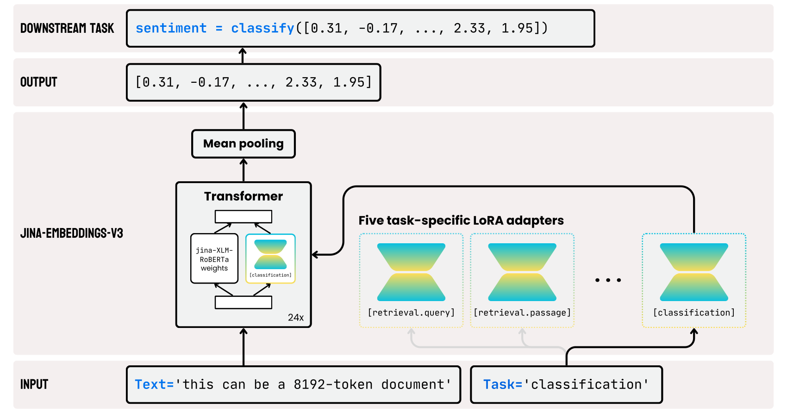
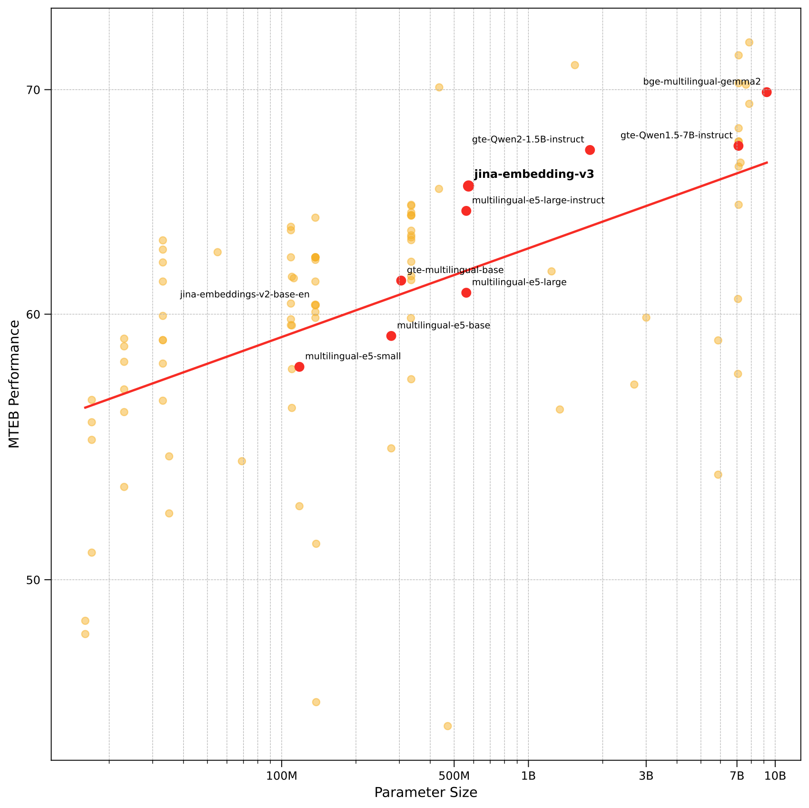

# jina-embeddings-v3: Multilingual Embeddings With Task LoRA / 全文中英对照

> 来源：[arXiv:2409.10173v3](https://arxiv.org/abs/2409.10173v3)。英文段落后紧接中文，覆盖所取 HTML 版本的主文、附录、图表、脚注与参考文献；公式、数字表和书目信息共用。中文以机器初译为底稿，进行了术语整理与结构核对，尚未逐句人工审定；遇到歧义请以紧邻英文和原论文为准。 原作版权归所列作者，许可见 [原作许可](http://creativecommons.org/licenses/by-nc-sa/4.0/)；中文译文与版式改写在该许可条件下提供（涉及 SA 时沿用相同许可，涉及 NC 时仅限非商业使用）。

## Authors and affiliations / 作者与机构

Saba Sturua * Isabelle Mohr * Mohammad Kalim Akram * Affiliation: Michael Günther * , Bo Wang * , Markus Krimmel , Feng Wang Affiliation: Georgios Mastrapas , Andreas Koukounas , Nan Wang Han Xiao Affiliation: Jina AI GmbH, Prinzessinnenstraße 19–20, 10969 Berlin, Germany Email: research@jina.ai

## Abstract / 摘要

**EN.** We introduce [jina-embeddings-v3](https://huggingface.co/jinaai/jina-embeddings-v3) , a novel text embedding model with 570 million parameters, achieves state-of-the-art performance on multilingual data and long-context retrieval tasks, supporting context lengths of up to 8192 tokens. The model includes a set of task-specific Low-Rank Adaptation (LoRA) adapters to generate high-quality embeddings for query-document retrieval, clustering, classification, and text matching. Evaluation on the MTEB benchmark shows that [jina-embeddings-v3](https://huggingface.co/jinaai/jina-embeddings-v3) outperforms the latest proprietary embeddings from OpenAI and Cohere on English tasks, while achieving superior performance compared to multilingual-e5-large-instruct across all multilingual tasks. With a default output dimension of 1024, users can flexibly reduce the embedding dimensions to as low as 32 without compromising performance, enabled by Matryoshka Representation Learning.

**中.** 我们引入了 [jina-embeddings-v3](https://huggingface.co/jinaai/jina-embeddings-v3)，这是一种具有 5.7 亿个参数的新型文本嵌入模型，在多语言数据和长上下文检索任务上实现了最先进的性能，支持高达 8192 个标记的上下文长度。该模型包括一组特定于任务的低秩适配 (LoRA) 适配器，用于生成用于查询文档检索、聚类、分类和文本匹配的高质量嵌入。对 MTEB 基准的评估表明，[jina-embeddings-v3](https://huggingface.co/jinaai/jina-embeddings-v3) 在英语任务上优于 OpenAI 和 Cohere 的最新专有嵌入，同时在所有多语言任务中与 multilingual-e5-large instruct 相比实现了卓越的性能。通过 Matryoshka 表示学习，默认输出维度为 1024，用户可以灵活地将嵌入维度减少至 32，而不会影响性能。

## Introduction / 简介

**EN.** Text embedding models represent documents as high-dimensional vectors, converting semantic relationships between documents into spatial relationships between vectors. These models are fundamental to neural information retrieval and have been widely adopted across various domains of NLP and IR research and applications. Text embeddings are utilized in diverse downstream tasks such as classification, retrieval, and clustering. Notably, they have gained significant traction in building Retrieval-Augmented Generation (RAG) systems, where they serve as the primary technique in the retrieval step.

**中.** 文本嵌入模型将文档表示为高维向量，将文档之间的语义关系转换为向量之间的空间关系。这些模型是神经信息检索的基础，并已在 NLP 和 IR 研究和应用的各个领域广泛采用。文本嵌入用于各种下游任务，例如分类、检索和聚类。值得注意的是，它们在构建检索增强生成（RAG）系统方面获得了显着的吸引力，在该系统中它们是检索步骤中的主要技术。

**EN.** A major limitation of traditional embedding models is that, despite being named as general-purpose, they often require fine-tuning for specific tasks Jiao et al. (2020) and frequently struggle with common failure cases Gao et al. (2021) . To address this, recent research has increasingly focused on leveraging large language models (LLMs) as the backbone for general-purpose embedding generation, capitalizing on their ability to efficiently handle multiple languages and tasks Jiang et al. (2024) . However, with model sizes typically reaching 7 billion parameters, deploying these models in real-world applications poses significant challenges. Furthermore, the marginal improvements in evaluation metrics offered by LLM-based embeddings, compared to encoder-only embedding models, render them a less practical choice for many use cases.

**中.** 传统嵌入模型的一个主要限制是，尽管被称为通用模型，但它们通常需要针对特定任务进行微调。 (2020) 并经常与常见的失败案例作斗争。 （2021）。为了解决这个问题，最近的研究越来越关注利用大型语言模型（LLM）作为通用嵌入生成的支柱，利用它们有效处理多种语言和任务的能力。 （2024）。然而，由于模型大小通常达到 70 亿个参数，在实际应用中部署这些模型面临着巨大的挑战。此外，与仅编码器的嵌入模型相比，基于 LLM 的嵌入提供的评估指标略有改进，这使得它们对于许多用例而言不太实用。

**EN.** This paper introduces [jina-embeddings-v3](https://huggingface.co/jinaai/jina-embeddings-v3) , a novel text embedding model with 570 million parameters, optimized for multilingual data, long-context retrieval, and high performance across multiple tasks. Evaluation on the MTEB benchmark demonstrates that [jina-embeddings-v3](https://huggingface.co/jinaai/jina-embeddings-v3) not only significantly improves upon its predecessor, jina-embeddings-v2 Günther et al. (2023) and its bilingual variants Mohr et al. (2024) , but also outperforms the latest proprietary embeddings from OpenAI and Cohere on English tasks, while surpassing multilingual-e5-large-instruct across all multilingual tasks. Additionally, compared to LLM-based embeddings such as e5-mistral-7b-instruct , which has a parameter size of 7.1 billion (12x larger) and an output dimension of 4096 (4x larger) but offers only a 1% improvement on MTEB English tasks, [jina-embeddings-v3](https://huggingface.co/jinaai/jina-embeddings-v3) is a far more cost-efficient solution, making it more suitable for production and on-edge computing. The key contributions of this paper are:

**中.** 本文介绍了 [jina-embeddings-v3](https://huggingface.co/jinaai/jina-embeddings-v3)，这是一种新颖的文本嵌入模型，具有 5.7 亿个参数，针对多语言数据、长上下文检索和跨多个任务的高性能进行了优化。对 MTEB 基准的评估表明，[jina-embeddings-v3](https://huggingface.co/jinaai/jina-embeddings-v3) 不仅显着改进了其前身 jina-embeddings-v2 Günther 等人。 (2023) 及其双语变体 Mohr 等人。 (2024)，而且在英语任务上也优于 OpenAI 和 Cohere 的最新专有嵌入，同时在所有多语言任务上超过了 multilingual-e5-large-instruct。此外，与基于 LLM 的嵌入（例如 e5-mistral-7b-instruct ）相比，其参数大小为 71 亿（大 12 倍），输出维度为 4096（大 4 倍），但对 MTEB 英语任务仅提供 1% 的改进，[jina-embeddings-v3](https://huggingface.co/jinaai/jina-embeddings-v3) 是一种更具成本效益的解决方案，使其更适合生产和边缘计算。本文的主要贡献是：

**EN.** Task-specific optimization with LoRA: We demonstrate that LoRA adapters Hu et al. (2021) effectively generate task-specific embeddings, outperforming prior instruction-based approaches.

**中.** LoRA 的特定任务优化：我们证明了 LoRA 适配器 Hu 等人。 （2021）有效地生成特定于任务的嵌入，优于先前基于指令的方法。

**EN.** Patching retrieval failures with synthetic data: A qualitative analysis identified four common types of retrieval failures. We mitigated these issues by incorporating synthetic training data, thereby improving model robustness on edge cases.

**中.** 使用合成数据修补检索失败：定性分析确定了四种常见的检索失败类型。我们通过合并合成训练数据来缓解这些问题，从而提高模型在边缘情况下的稳健性。

**EN.** Integration of latest techniques: Our model incorporates several key advancements, including Matryoshka Representation Learning Kusupati et al. (2022) , instruction tuning Wei et al. (2022) ; Su et al. (2023) , and long-context retrieval Günther et al. (2023) .

**中.** 集成最新技术：我们的模型融合了多项关键进步，包括 Matryoshka 表示学习 Kusupati 等人。 (2022)，指令调优 Wei 等人。 (2022);苏等人。 (2023) 和长上下文检索 Günther 等人。 （2023）。

**EN.** Section 2 provides an overview of prior research relevant to the objectives of this paper. Section 3 presents the architecture of [jina-embeddings-v3](https://huggingface.co/jinaai/jina-embeddings-v3) in detail. The training procedure is described in Section 4 . In Section 5 , we conduct a thorough multilingual evaluation, including ablation studies that offer insights into the impact of our architectural and training decisions.

**中.** 第 2 节概述了与本文目标相关的先前研究。第 3 节详细介绍了 [jina-embeddings-v3](https://huggingface.co/jinaai/jina-embeddings-v3) 的架构。训练过程在第 4 节中描述。在第 5 节中，我们进行了彻底的多语言评估，包括消融研究，这些研究可以深入了解我们的架构和培训决策的影响。

## Related Work / 相关工作

### General Text Embeddings / 通用文本嵌入

**EN.** In recent years, significant progress has been made in the field of text embeddings, largely driven by the emergence of transformer-based pre-trained language models that capture the underlying semantics of language effectively Devlin et al. (2019) . However, these models are predominantly trained with a masked language modeling (MLM) objective, which is not optimal for generating high-quality text embeddings. To overcome this limitation, recent approaches have focused on fine-tuning and extending these models specifically for embedding tasks Reimers and Gurevych (2019) .

**中.** 近年来，文本嵌入领域取得了重大进展，这主要是由于基于 Transformer 的预训练语言模型的出现所推动的，这些模型可以有效地捕获语言的底层语义。 （2019）。然而，这些模型主要是用掩码语言建模（MLM）目标进行训练的，这对于生成高质量的文本嵌入来说并不是最佳的。为了克服这一限制，最近的方法侧重于微调和扩展这些模型，专门用于嵌入任务 Reimers 和 Gurevych (2019)。

**EN.** A key advancement in this area is the development of multi-stage and multi-task fine-tuning strategies that incorporate weakly-supervised contrastive training Wang et al. (2022) ; Günther et al. (2023) ; Mohr et al. (2024) . These methods improve the versatility of embeddings, enabling models to perform well across a diverse range of applications and tasks, as opposed to models trained solely on semantic textual similarity datasets.

**中.** 该领域的一个关键进展是开发了多阶段和多任务微调策略，其中结合了弱监督对比训练 Wang 等人。 (2022);冈瑟等人。 (2023);莫尔等人。 （2024）。这些方法提高了嵌入的多功能性，使模型能够在各种应用程序和任务中表现良好，而不是仅在语义文本相似性数据集上训练的模型。

**EN.** Furthermore, techniques such as AliBi Press et al. (2022) and RoPE Su et al. (2024) have enabled models like jina-embeddings-v2 Günther et al. (2023) to handle longer sequences, up to 8192 tokens, by replacing absolute positional encoding with relative encoding methods. To make embeddings more compact, Matryoshka Representational Learning (MRL) Kusupati et al. (2022) enables the truncation of embeddings without compromising performance on downstream tasks by modifying the loss function used during training.

**中.** 此外，AliBi Press 等技术。 (2022) 和 RoPE Su 等人。 (2024) 启用了 jina-embeddings-v2 Günther 等模型。 (2023) 通过用相对编码方法替换绝对位置编码来处理更长的序列，最多 8192 个标记。为了使嵌入更加紧凑，Matryoshka 表征学习（MRL）Kusupati 等人。 (2022) 通过修改训练期间使用的损失函数，可以在不影响下游任务性能的情况下截断嵌入。

### Multilingual Embedding Models / 多语言嵌入模型

**EN.** One of the earliest multilingual transformer models is Multilingual BERT (mBERT) Devlin et al. (2019) , trained on 104 languages. This was followed by XLM Conneau and Lample (2019) and XLM-RoBERTa (XLM-R) Conneau et al. (2020) , which utilized parallel data during training. Wang et al. (2024) extends this work by fine-tuning XLM-R on high-quality multilingual labeled datasets and applying knowledge distillation from a cross-encoder to further improve embedding quality. Similarly, Chen et al. (2024a) introduced BGE M3, another XLM-R-based model that supports longer sequences. The authors extended XLM-R’s maximum sequence length to 8192 tokens, continued pre-training with the RetroMAE method Xiao et al. (2022) , and fine-tuned it contrastively using a novel multi-CLS pooling strategy. mGTE Zhang et al. (2024) also builds on XLM-R, incorporating RoPE positional embeddings Su et al. (2024) .

**中.** 最早的多语言 Transformer 模型之一是 Multilingual BERT (mBERT) Devlin 等人。 (2019)，接受了 104 种语言的培训。随后是 XLM Conneau 和 Lample (2019) 以及 XLM-RoBERTa (XLM-R) Conneau 等人。 (2020)，在训练期间使用并行数据。王等人。 (2024) 通过在高质量多语言标记数据集上微调 XLM-R 并应用交叉编码器的知识蒸馏来进一步提高嵌入质量，扩展了这项工作。同样，陈等人。 (2024a) 引入了 BGE M3，这是另一种基于 XLM-R 的模型，支持更长的序列。作者将XLM-R的最大序列长度扩展至8192个token，继续使用RetroMAE方法Xiao等人进行预训练。 (2022)，并使用一种新颖的多 CLS 池化策略对其进行对比微调。 mGTE 张等人。 (2024) 也建立在 XLM-R 的基础上，结合了 RoPE 位置嵌入 Su 等人。 （2024）。

**EN.** Another approach leverages LLMs for multilingual embeddings Zhang et al. (2023) ; Wang et al. (2023) , benefiting from their extensive language support and diverse training data. However, LLMs are computationally inefficient due to their larger size, making them less practical for many applications. To address this, Lee et al. (2024a) generate and relabel training data to distill knowledge from LLMs into a compact encoder model, avoiding the need for direct fine-tuning of the larger LLMs.

**中.** 另一种方法利用法学硕士进行多语言嵌入Zhang 等人。 (2023);王等人。 (2023)，受益于其广泛的语言支持和多样化的培训数据。然而，法学硕士由于其规模较大，计算效率低下，这使得它们在许多应用中不太实用。为了解决这个问题，Lee 等人。 (2024a) 生成并重新标记训练数据，以将 LLM 中的知识提取到紧凑的编码器模型中，从而避免对较大的 LLM 进行直接微调的需要。

### Task-Specific Embedding Models / 特定任务的嵌入模型

**EN.** Previous research has highlighted limitations in training models to produce generic embedding vectors that perform well across various use cases and domains. For example, Wang et al. (2022) observed that in asymmetric retrieval tasks, such as question answering and typical information retrieval, models perform better by appending distinct prefixes to queries and documents before encoding. While the E5 models from this work employ a single prefix for all queries and another for all documents, Su et al. (2023) introduced more complex instructions to encode additional information about relevance in retrieval tasks and the domain of the data.

**中.** 先前的研究强调了训练模型产生在各种用例和领域中表现良好的通用嵌入向量的局限性。例如，王等人。 （2022）观察到，在非对称检索任务中，例如问答和典型的信息检索，通过在编码之前向查询和文档附加不同的前缀，模型可以表现得更好。虽然这项工作中的 E5 模型对所有查询使用一个前缀，对所有文档使用另一个前缀，但 Su 等人。 （2023）引入了更复杂的指令来编码有关检索任务和数据域的相关性的附加信息。

**EN.** Hu et al. (2021) propose a technique that uses lightweight LoRA layers to fine-tune LLMs. By freezing the original model weights, this approach significantly improves training efficiency. More importantly, deploying multiple fine-tuned instances becomes feasible, as the LoRA typically require less than 1% of the memory needed for the original model weights. However, to the best of our knowledge, this technique has not yet been explored as an alternative to instruction-based methods in embedding training.

**中.** 胡等人。 (2021) 提出了一种使用轻量级 LoRA 层来微调 LLM 的技术。通过冻结原始模型权重，该方法显着提高了训练效率。更重要的是，部署多个微调实例变得可行，因为 LoRA 通常需要不到原始模型权重所需内存的 1%。然而，据我们所知，这种技术尚未被探索作为嵌入训练中基于指令的方法的替代方法。

## Model Architecture / 模型架构

**EN.** Figure 1: The architecture of [jina-embeddings-v3](https://huggingface.co/jinaai/jina-embeddings-v3) is based on the XLM-RoBERTa model, with several key modifications. FlashAttention 2 is integrated for enhanced computational efficiency, while RoPE extends support for sequences up to 8192 tokens. Task-specific LoRA adapters are introduced to optimize embeddings for various tasks. The model’s input consists of two parts: the text, which is the long document to be embedded, and the task type. [jina-embeddings-v3](https://huggingface.co/jinaai/jina-embeddings-v3) supports four tasks and implements five adapters to choose from: retrieval.query and retrieval.passage for query and passage embeddings in asymmetric retrieval tasks, separation for clustering and reranking tasks, classification for classification tasks, and text-matching for tasks involving semantic similarity, such as STS or symmetric retrieval.

**中.** 图 1：[jina-embeddings-v3](https://huggingface.co/jinaai/jina-embeddings-v3) 的架构基于 XLM-RoBERTa 模型，并进行了多项关键修改。集成了 FlashAttention 2 以提高计算效率，而 RoPE 将对序列的支持扩展到最多 8192 个令牌。引入特定于任务的 LoRA 适配器来优化各种任务的嵌入。模型的输入由两部分组成：文本（即要嵌入的长文档）和任务类型。 [jina-embeddings-v3](https://huggingface.co/jinaai/jina-embeddings-v3) 支持四个任务并实现五个适配器可供选择：retrieval.query 和retrieval.passage（用于非对称检索任务中的查询和段落嵌入）、用于聚类和重新排序任务的分离、用于分类任务的分类以及用于涉及语义相似性的任务（例如 STS 或对称检索）的文本匹配。

**EN.** The architecture of [jina-embeddings-v3](https://huggingface.co/jinaai/jina-embeddings-v3) is depicted in Figure 1 . To implement the backbone architecture, we adapt the XLM-RoBERTa model with modifications that (1) enable effective encoding of long text sequences, (2) allow task-specific encoding of embeddings, and (3) increase model efficiency. [jina-embeddings-v3](https://huggingface.co/jinaai/jina-embeddings-v3) retains the original XLM-RoBERTa tokenizer.

**中.** [jina-embeddings-v3](https://huggingface.co/jinaai/jina-embeddings-v3) 的架构如图 1 所示。为了实现骨干架构，我们对 XLM-RoBERTa 模型进行了修改，(1) 实现长文本序列的有效编码，(2) 允许特定于任务的嵌入编码，以及 (3) 提高模型效率。 [jina-embeddings-v3](https://huggingface.co/jinaai/jina-embeddings-v3) 保留了原始的 XLM-RoBERTa 分词器。

**EN.** As outlined in Table 1 , [jina-embeddings-v3](https://huggingface.co/jinaai/jina-embeddings-v3) is larger than jina-embeddings-v2 , but significantly smaller than embedding models fine-tuned from LLMs Lee et al. (2024b) ; Wei et al. (2022) . Importantly, the LoRA adapters account for less than 3% of the total parameters, adding minimal overhead. To further enhance performance and reduce memory consumption, we utilize FlashAttention 2 Dao () , support activation checkpointing, and employ the DeepSpeed framework Rasley et al. (2020) for efficient distributed training.

**中.** 如表 1 所示， [jina-embeddings-v3](https://huggingface.co/jinaai/jina-embeddings-v3) 大于 jina-embeddings-v2 ，但明显小于 LLM Lee 等人微调的嵌入模型。 (2024b);魏等人。 （2022）。重要的是，LoRA 适配器占总参数的比例不到 3%，增加的开销最小。为了进一步增强性能并减少内存消耗，我们利用 FlashAttention 2 Dao () ，支持激活检查点，并采用 Rasley 等人的 DeepSpeed 框架。 （2020）高效的分布式训练。

| Parameters 参数 | Parameters 参数 | Max input tokens 最大输入令牌数 | Max output dim. 最大输出调光。 | Layers 层数 | Vocabulary 词汇 | Attention Impl. 注意实施。 | Pooling 池化 |
| --- | --- | --- | --- | --- | --- | --- | --- |
| Base 基地 | w/ adapters 带适配器 |  |  |  |  |  |  |
| 559M | 572M | 8192 | 1024 ∗ | 24 | 250K | FlashAttention2 闪光注意2 | Mean 平均值 |

**EN.** Table 1: Model specification of [jina-embeddings-v3](https://huggingface.co/jinaai/jina-embeddings-v3) . The maximum output dimension is 1024, but with Matryoshka Representation Learning (MRL), users can choose any dimension lower than 1024, such as 16 or 32, allowing for a trade-off between space efficiency and performance. This trade-off is studied in Table 7 .

**中.** 表1：[jina-embeddings-v3](https://huggingface.co/jinaai/jina-embeddings-v3)的模型规格。最大输出维度为 1024，但通过俄罗斯套娃表示学习 (MRL)，用户可以选择低于 1024 的任何维度，例如 16 或 32，从而在空间效率和性能之间进行权衡。表 7 研究了这种权衡。

**EN.** To handle long text sequences, we replace absolute positional embeddings with Rotary Position Embeddings (RoPE) Su et al. (2024) , which use a rotation matrix to encode absolute positions while embedding relative positional dependencies directly within the self-attention mechanism. We also experimented with extending positional encodings [^footnote1] as done in the BGE M3 model Chen et al. (2024b) , but observed poor performance on tasks involving long texts. This could be attributed to differences in training data and pooling strategies, as we trained primarily on short texts and used mean pooling instead of multi-CLS pooling.

**中.** 为了处理长文本序列，我们用旋转位置嵌入（RoPE）代替绝对位置嵌入 Su 等人。 (2024)，它使用旋转矩阵来编码绝对位置，同时将相对位置依赖性直接嵌入到自注意力机制中。我们还尝试了扩展位置编码 [^footnote1]，如 BGE M3 模型 Chen 等人所做的那样。 (2024b)，但观察到在涉及长文本的任务上表现不佳。这可能归因于训练数据和池化策略的差异，因为我们主要在短文本上进行训练并使用均值池化而不是多 CLS 池化。

**EN.** Xiong et al. (2024) demonstrated that increasing the base frequency parameter of rotary positional embeddings enhances performance on long-text tasks, while Zhang et al. (2024) adjusted the rotary base frequency during training on short sequences to generalize better on longer sequences. We found that setting a rotary base frequency of 10,000 during training and adjusting it to 20,000 during inference improves performance on long-text tasks without degrading performance on short-text tasks.

**中.** 熊等人。 （2024）证明，增加旋转位置嵌入的基频参数可以增强长文本任务的性能，而Zhang等人。 (2024) 在短序列训练期间调整了旋转基频，以更好地概括较长序列。我们发现，在训练期间将旋转基频设置为 10,000，并在推理期间将其调整为 20,000，可以提高长文本任务的性能，而不会降低短文本任务的性能。

**EN.** Embeddings can be used for various downstream tasks, including clustering, retrieval, and classification, each requiring different interpretations of the representation space resulting in different similarity metrics. Asymmetric retrieval tasks, for instance, benefit from encoding queries and documents differently. Wang et al. (2022) suggest that using distinct instructions for queries and documents improves the effectiveness of embedding models in such tasks.

**中.** 嵌入可用于各种下游任务，包括聚类、检索和分类，每个任务都需要对表示空间进行不同的解释，从而产生不同的相似性度量。例如，非对称检索任务受益于对查询和文档进行不同的编码。王等人。 （2022）建议对查询和文档使用不同的指令可以提高在此类任务中嵌入模型的有效性。

**EN.** However, writing effective task-specific instructions is non-trivial. As an alternative, we employ task-specific LoRA adapters. The embedding and linear layers within the multi-head attention mechanism are equipped with low-rank decomposition matrices of rank 4. These task-specific LoRA adapters are loaded alongside the model weights and are dynamically selected based on the input task type. Each text input in the batch is associated with a task descriptor, represented as an integer corresponding to the LoRA adapter’s ID.

**中.** 然而，编写有效的特定任务指令并非易事。作为替代方案，我们采用特定于任务的 LoRA 适配器。多头注意力机制中的嵌入层和线性层配备了 4 阶低阶分解矩阵。这些特定于任务的 LoRA 适配器与模型权重一起加载，并根据输入任务类型动态选择。批处理中的每个文本输入都与一个任务描述符相关联，表示为与 LoRA 适配器 ID 相对应的整数。

## Training Method / 训练方法

**EN.** We initialize the model using the weights of the original XLM-RoBERTa model. However, the model’s original MLM objective is not fully aligned with our training objectives due to the changes in positional embedding methods. Despite this, we observe that initializing with pre-trained weights leads to faster convergence during pre-training compared to random initialization.

**中.** 我们使用原始 XLM-RoBERTa 模型的权重来初始化模型。然而，由于位置嵌入方法的变化，模型最初的 MLM 目标与我们的训练目标并不完全一致。尽管如此，我们观察到，与随机初始化相比，使用预训练权重进行初始化会导致预训练期间收敛速度更快。

**EN.** Our training paradigm consists of three stages, as is common for training text embedding models:

**中.** 我们的训练范例由三个阶段组成，这对于训练文本嵌入模型来说很常见：

**EN.** I

**中.** I

**EN.** Pre-Training: We perform standard MLM training using large multilingual text corpora. The model is initialized with XLM-RoBERTa weights to expedite pre-training and avoid training from scratch.

**中.** 预训练：我们使用大型多语言文本语料库进行标准传销训练。该模型使用 XLM-RoBERTa 权重进行初始化，以加快预训练并避免从头开始训练。

**EN.** II

**中.** 二

**EN.** Fine-Tuning for Embedding Tasks: To learn how to encode a text passage into a single vector representation, we follow the approach outlined in Günther et al. (2023) . This method incorporates a pooling layer into the transformer model to aggregate token representations into a single embedding vector and fine-tunes the model on pairs of semantically related texts.

**中.** 嵌入任务的微调：为了学习如何将文本段落编码为单个向量表示，我们遵循 Günther 等人中概述的方法。 （2023）。该方法将池化层合并到转换器模型中，以将标记表示聚合到单个嵌入向量中，并在语义相关文本对上微调模型。

**EN.** III

**中.** 三、

**EN.** Training Task-Specific Adapters: We train five LoRA adapters for four different tasks using dedicated datasets and task-specific loss functions to optimize performance for each use case.

**中.** 训练特定于任务的适配器：我们使用专用数据集和特定于任务的损失函数为四个不同的任务训练五个 LoRA 适配器，以优化每个用例的性能。

### Pre-Training / 预训练

**EN.** After initialization, the model is trained using the MLM objective with whole word masking Devlin et al. (2019) . At this stage, we only train the transformer model, excluding the LoRA adapters and pooling layer.

**中.** 初始化后，使用带有全字掩码的 MLM 目标来训练模型 Devlin 等人。 （2019）。在这个阶段，我们只训练 Transformer 模型，不包括 LoRA 适配器和池化层。

**EN.** To support multilingual tasks, the training data is drawn from the CulturaX corpus Nguyen et al. (2023) , which includes data from 89 languages, with English comprising approximately 20% of the dataset. During training, each batch contains data for only a single language, but we rotate the language between batches.

**中.** 为了支持多语言任务，训练数据取自 Nguyen 等人的 CulturaX 语料库。 (2023)，其中包括来自 89 种语言的数据，其中英语约占数据集的 20%。在训练期间，每个批次仅包含一种语言的数据，但我们在批次之间轮换语言。

**EN.** For long-context support, we first train for $100,000$ steps on text sequences that are truncated to 512 tokens, followed by an additional $60,000$ steps using on text sequences truncated to 8192 tokens and a reduced batch size. The details are provided in Appendix A1 .

**中.** 对于长上下文支持，我们首先在截断为 512 个标记的文本序列上训练 $100,000$ 步骤，然后在截断为 8192 个标记的文本序列上训练额外的 $60,000$ 步骤并减少批量大小。详情请参阅附录 A1。

**EN.** To enhance the model’s ability to represent long text documents, we train with a low rotary base value, increasing it during inference as described in Section 1 . However, we observed that the model’s ability to encode long documents still lagged behind models such as jina-embeddings-v2 . To address this, we extended the training on long-text data, which resulted in improved performance on long-text retrieval tasks such as NarrativeQA. See Section 5.3 for further details.

**中.** 为了增强模型表示长文本文档的能力，我们使用较低的旋转基值进行训练，并在推理过程中增加它，如第 1 节所述。然而，我们观察到该模型对长文档进行编码的能力仍然落后于 jina-embeddings-v2 等模型。为了解决这个问题，我们扩展了长文本数据的训练，从而提高了 NarrativeQA 等长文本检索任务的性能。详细信息请参见第 5.3 节。

### Fine-Tuning for the Embedding Task / 嵌入任务的微调

**EN.** After pre-training, we fine-tune the model to encode a text sequence into a single vector representation. Following the Sentence-BERT approach Reimers and Gurevych (2019) , we augment the model with a mean pooling layer to aggregate the semantics from all output token vectors into a single vector representation. The fine-tuning procedure follows Mohr et al. (2024) , where the model is trained on text pairs using a bi-directional InfoNCE ( van den Oord et al., 2018 ) loss, $\mathcal{L}_{\mathrm{pairs}}$ :

**中.** 预训练后，我们对模型进行微调，将文本序列编码为单个向量表示。遵循 Sentence-BERT 方法 Reimers 和 Gurevych (2019)，我们用平均池层增强模型，将所有输出标记向量的语义聚合成单个向量表示。微调程序遵循 Mohr 等人的方法。 (2024) ，其中模型使用双向 InfoNCE（van den Oord 等人，2018）损失 $\mathcal{L}_{\mathrm{pairs}}$ 对文本对进行训练：

$$
\mathcal{L}_{\mathrm{pairs}}(B):=\mathcal{L}_{\mathrm{NCE}}(B)+\mathcal{L}_{\mathrm{NCE}}(B^{\dagger})\tag{1}
$$

**EN.** defined on a batch $B=((p_{1},q_{1}),\ldots,(p_{k},q_{k}))$ of $k$ pairs, and $B^{\dagger}=((q_{1},p_{1}),\ldots,(q_{k},p_{k}))$ (obtained from $B$ by swapping the order of pairs). $\mathcal{L}_{\mathrm{NCE}}$ denotes the following loss function:

**中.** 在 $k$ 对的批次 $B=((p_{1},q_{1}),\ldots,(p_{k},q_{k}))$ 和 $B^{\dagger}=((q_{1},p_{1}),\ldots,(q_{k},p_{k}))$ 上定义（通过交换对的顺序从 $B$ 获得）。 $\mathcal{L}_{\mathrm{NCE}}$表示以下损失函数：

$$
\mathcal{L}_{\mathrm{NCE}}(B):=-\sum_{(x_{i},y_{i})\in B}\ln\frac{e^{s(x_{i},y_{i})/\tau}}{\sum\limits_{i^{\prime}=1}^{k}e^{s(x_{i},y_{i^{\prime}})/\tau}}\tag{2}
$$

**EN.** The training data consists of over one billion text pairs, drawn from more than 300 distinct sub-datasets, each representing specific domains in various languages. During training, the data loader constructs each batch by sampling a specific sub-dataset, ensuring that only text pairs from that dataset and language are included.

**中.** 训练数据由超过 10 亿个文本对组成，这些文本对取自 300 多个不同的子数据集，每个子数据集代表各种语言的特定领域。在训练期间，数据加载器通过对特定子数据集进行采样来构建每个批次，确保仅包含来自该数据集和语言的文本对。

**EN.** For data preparation, we follow the same methodology as our previous work Mohr et al. (2024) , with an additional filtering step. This filter removes pairs where at least 80% of the words (minimum of four) in the shorter text are sub-strings of the longer text. This filtering step increases the difficulty of the training and encourages the model to focus less on syntactic overlap.

**中.** 对于数据准备，我们遵循与 Mohr 等人之前的工作相同的方法。 (2024)，带有额外的过滤步骤。此过滤器会删除较短文本中至少 80% 的单词（至少四个）是较长文本的子字符串的对。此过滤步骤增加了训练的难度，并鼓励模型减少对句法重叠的关注。

**EN.** As in the pre-training phase, we begin training on short text pairs, followed by further training on longer texts using a larger sequence length but a reduced batch size. In this phase, we use only a subset of the datasets containing sufficiently long texts.

**中.** 与预训练阶段一样，我们开始对短文本对进行训练，然后使用较大的序列长度但较小的批量大小对较长的文本进行进一步训练。在此阶段，我们仅使用包含足够长文本的数据集的子集。

### Training Task-Specific Adapters / 训练特定任务的适配器

**EN.** Related work on embedding training Wang et al. (2022) ; Xiao et al. (2023) introduces an additional generic training phase following the pair-wise training phase. This phase incorporates high-quality data from various task types to optimize model performance across a range of downstream use cases. In this stage, recent approaches use task-specific instructions to help the model distinguish between different tasks and domains, as discussed in Section 2.3 .

**中.** 嵌入训练的相关工作 Wang 等人。 (2022);肖等人。 (2023) 在成对训练阶段之后引入了一个额外的通用训练阶段。此阶段整合了来自各种任务类型的高质量数据，以优化一系列下游用例的模型性能。在这个阶段，最近的方法使用特定于任务的指令来帮助模型区分不同的任务和领域，如第 2.3 节中所讨论的。

**EN.** However, this approach complicates the usage, as users must learn task-specific instructions (i.e., prompts) that align with the model’s behavior or "vibe." While this offers flexibility, it also makes the model’s behavior harder to predict. In contrast, we train five distinct LoRA adapters for four well-defined task types as defined in Table 2 . These tasks are trained independently, with the base model’s weights kept frozen. For query-document retrieval, two adapters are trained jointly : one for queries and one for passages. During inference, users can select the appropriate adapter based on their downstream task and input role, ensuring optimal embeddings for their specific use case.

**中.** 然而，这种方法使使用变得复杂，因为用户必须学习与模型的行为或“氛围”一致的特定于任务的指令（即提示）。虽然这提供了灵活性，但也使模型的行为更难以预测。相比之下，我们为表 2 中定义的四种明确定义的任务类型训练了 5 个不同的 LoRA 适配器。这些任务是独立训练的，基本模型的权重保持冻结。对于查询文档检索，联合训练两个适配器：一个用于查询，一个用于段落。在推理过程中，用户可以根据下游任务和输入角色选择适当的适配器，确保为其特定用例提供最佳嵌入。

| task value 任务价值 | Task Description 任务描述 |
| --- | --- |
| retrieval.passage 检索段落 | Embedding documents in a query-document retrieval task 在查询文档检索任务中嵌入文档 |
| retrieval.query 检索.查询 | Embedding queries in a query-document retrieval task 将查询嵌入查询文档检索任务中 |
| separation 分离 | Clustering documents, visualizing a corpus 聚类文档，可视化语料库 |
| classification 分类 | Text classification 文本分类 |
| text-matching 文本匹配 | Semantic text similarity, general symmetric retrieval, recommendation, finding similar items, deduplication 语义文本相似度、一般对称检索、推荐、查找相似项、去重 |

**EN.** Table 2: Supported tasks of [jina-embeddings-v3](https://huggingface.co/jinaai/jina-embeddings-v3) , each corresponding to a LoRA adapter and trained independently, except for retrieval.passage and retrieval.query , which are trained jointly.

**中.** 表2：[jina-embeddings-v3](https://huggingface.co/jinaai/jina-embeddings-v3)支持的任务，每个任务对应一个LoRA适配器并独立训练，除了retrieve.passage和retrieval.query，它们是联合训练的。

#### Classification Adapter / 分类适配器

**EN.** The classification adapter generates embeddings that are effective for training downstream classification models, particularly logistic regression classifiers. To train the adapter, we employ the classification training method proposed for the Gecko embedding model Lee et al. (2024a) . Specifically, we select datasets covering a range of common classification tasks, including sentiment analysis, intent classification, and article categorization.

**中.** 分类适配器生成的嵌入可有效训练下游分类模型，特别是逻辑回归分类器。为了训练适配器，我们采用了 Lee 等人为 Gecko 嵌入模型提出的分类训练方法。 （2024a）。具体来说，我们选择涵盖一系列常见分类任务的数据集，包括情感分析、意图分类和文章分类。

**EN.** From each dataset, we construct tuples consisting of two text values from the same class $(q,p)$ and seven text values from different classes $(n_{1},\dots,n_{7})$ , resulting in a tuple of nine text values $(q,p,n_{1},\dots,n_{7})$ . The model is trained to assign a high cosine similarity to the embeddings of $q$ and $p$ , while enforcing low cosine similarity between $q$ and all $n_{i}$ . Each batch is composed of tuples sampled from a single dataset.

**中.** 从每个数据集中，我们构造由来自同一类 $(q,p)$ 的两个文本值和来自不同类 $(n_{1},\dots,n_{7})$ 的七个文本值组成的元组，从而产生由九个文本值 $(q,p,n_{1},\dots,n_{7})$ 组成的元组。该模型经过训练，为 $q$ 和 $p$ 的嵌入分配高余弦相似度，同时强制 $q$ 和所有 $n_{i}$ 之间的低余弦相似度。每个批次由从单个数据集中采样的元组组成。

**EN.** We employ an extended version of the InfoNCE loss $\mathcal{L}_{\text{triplet}}$ described in our previous work Günther et al. (2023) to take into account these additional negative samples.

**中.** 我们采用了 Günther 等人之前的工作中描述的 InfoNCE 损失 $\mathcal{L}_{\text{triplet}}$ 的扩展版本。 （2023）考虑这些额外的负样本。

$$
\begin{aligned}\displaystyle\mathcal{L}_{\text{triplet}}(B):= \\ \displaystyle\;\;\;\;\;\mathbb{E}_{r\sim B}\Bigg[-\ln\frac{e^{s(q,p)/\tau}}{\sum\limits_{i=1}^{k}\Big[e^{s(q,p_{i})/\tau}+\sum\limits_{j=1}^{m}e^{s(q,n_{j,i})/\tau}\Big]}\Bigg] \\ \displaystyle\,+\mathbb{E}_{r\sim B}\Bigg[-\ln\frac{e^{s(p,q)/\tau}}{\sum\limits_{i=1}^{k}e^{s(p,q_{i})/\tau}}\Bigg] \\ \displaystyle\text{with}\;r=(q,p,n_{1},\ldots,n_{m}).\end{aligned}\tag{3}
$$

**EN.** When using this loss function, texts from the same class as text $q_{i}$ that occur in the same batch as negatives for a different text $q_{j}$ $(i\neq j)$ are also treated as negatives. This introduces the problem of false negatives.

**中.** 使用此损失函数时，与文本 $q_{i}$ 属于同一类别且与不同文本 $q_{j}$ $(i\neq j)$ 的负数出现在同一批次中的文本也被视为负数。这就引入了假阴性的问题。

**EN.** To address this, Lee et al. (2024a) propose appending a unique ID specific to each tuple $r$ to its corresponding text values. This allows the model to easily differentiate between text values from different tuples, enabling it to focus on separating text values within the same tuple in a batch.

**中.** 为了解决这个问题，Lee 等人。 (2024a) 建议将特定于每个元组 $r$ 的唯一 ID 附加到其相应的文本值。这使得模型能够轻松区分来自不同元组的文本值，从而能够专注于批量分离同一元组中的文本值。

#### Text Matching Adapter / 文本匹配适配器

**EN.** This adapter is trained to produce embeddings that quantify the similarity between two text values. It is applicable for tasks such as semantic textual similarity (STS) and retrieval tasks where there is no clear distinction between query and target text values. An example of such a retrieval task is duplicate detection, where text values from a corpus are compared against each other. In these cases, the “query” and “corpus” texts are treated symmetrically.

**中.** 该适配器经过训练可以生成量化两个文本值之间相似性的嵌入。它适用于诸如语义文本相似性（STS）和检索任务等查询和目标文本值之间没有明显区别的任务。此类检索任务的一个示例是重复检测，其中将语料库中的文本值相互比较。在这些情况下，“查询”和“语料库”文本被对称处理。

**EN.** To train this adapter, we use the CoSent loss function: $\mathcal{L}_{\mathrm{co}}$ [^footnote2] , as previously employed by Li and Li (2024) :

**中.** 为了训练这个适配器，我们使用 CoSent 损失函数： $\mathcal{L}_{\mathrm{co}}$ [^footnote2] ，如 Li 和 Li (2024) 之前使用的那样：

$$
\begin{aligned}\displaystyle\mathcal{L}_{\mathrm{co}}(B):=\ln\Big[1+\sum\limits_{\begin{subarray}{c}(q_{1},p_{1}),\\
(q_{2},p_{2})\in B\end{subarray}}\frac{e^{s(q_{2},p_{2})}-e^{s(q_{1},p_{1})}}{\tau}\Big] \\ \displaystyle\text{where}\;\zeta(q_{1},p_{1})>\zeta(q_{2},p_{2})\end{aligned}\tag{4}
$$

**EN.** The CoSent loss operates on two pairs of text values, $(q_{1},p_{1})$ and $(q_{2},p_{2})$ , which are constructed from the batch by selecting combinations of four text values where the ground truth similarity $\zeta$ is provided in the training dataset, and $\zeta(q_{1},p_{1})$ is greater than $\zeta(q_{2},p_{2})$ .

**中.** CoSent 损失对两对文本值（ $(q_{1},p_{1})$ 和 $(q_{2},p_{2})$ ）进行操作，这些文本值是通过选择四个文本值的组合从批次构建的，其中训练数据集中提供了真实相似度 $\zeta$ ，并且 $\zeta(q_{1},p_{1})$ 大于 $\zeta(q_{2},p_{2})$ 。

**EN.** To train the model with this objective, we use data from semantic textual similarity (STS) training datasets such as STS12 Agirre et al. (2012) and SICK Marelli et al. (2014) . These datasets consist of triplets $(q_{i},p_{i},t_{i})\in D$ , where $(q_{i},p_{i})$ are text pairs and $t_{i}$ is the corresponding relevance score. A batch $B$ is constructed by selecting text values from a given number of triplets, with the ground truth similarity defined as $\zeta(q_{i},p_{i})=t_{i}$ .

**中.** 为了训练具有此目标的模型，我们使用来自语义文本相似性 (STS) 训练数据集的数据，例如 STS12 Agirre 等人。 (2012) 和 SICK Marelli 等人。 （2014）。这些数据集由三元组 $(q_{i},p_{i},t_{i})\in D$ 组成，其中 $(q_{i},p_{i})$ 是文本对，$t_{i}$ 是相应的相关性得分。通过从给定数量的三元组中选择文本值来构造批次 $B$ ，并将基本事实相似度定义为 $\zeta(q_{i},p_{i})=t_{i}$ 。

**EN.** To enhance the model’s performance across languages, we translate the STS12 and SICK datasets into multiple languages using machine translation models, i.e. WMT19 Ng et al. (2019) and MADLAD-3B Kudugunta et al. (2023) . While training on STS datasets is highly effective, obtaining large volumes of this data is challenging due to the human annotation required. As a result, we have incorporated various natural language inference (NLI) datasets into the training process.

**中.** 为了增强模型跨语言的性能，我们使用机器翻译模型（即 WMT19 Ng 等人）将 STS12 和 SICK 数据集翻译成多种语言。 (2019) 和 MADLAD-3B Kudugunta 等人。 （2023）。虽然 STS 数据集的训练非常有效，但由于需要人工注释，获取大量此类数据具有挑战性。因此，我们将各种自然语言推理（NLI）数据集纳入训练过程。

**EN.** During each training step, either an STS or NLI dataset is selected, and the batch is constructed solely from the chosen dataset, using the appropriate loss function. In other words, each batch contains text values from only one specific dataset.

**中.** 在每个训练步骤中，选择 STS 或 NLI 数据集，并且使用适当的损失函数仅根据所选数据集构建批次。换句话说，每个批次仅包含来自一个特定数据集的文本值。

**EN.** For the relevant hyperparameters, see Appendix A1 .

**中.** 相关超参数参见附录A1。

#### Asymmetric Retrieval Adapters / 非对称检索适配器

**EN.** As discussed in Section 2.3 , asymmetric retrieval tasks, such as question answering and traditional information retrieval, perform better with separate encoding mechanisms for queries and documents. In this work, we follow the method proposed by Wang et al. (2022) , using two distinct prefixes, but further separate the encoding processes by employing two specialized adapters, which are trained jointly. A detailed ablation study demonstrating the effectiveness of this approach is presented in Section 5.5.2 .

**中.** 正如第 2.3 节中所讨论的，非对称检索任务（例如问答和传统信息检索）通过查询和文档的单独编码机制可以更好地执行。在这项工作中，我们遵循 Wang 等人提出的方法。 (2022)，使用两个不同的前缀，但通过使用两个联合训练的专用适配器进一步分离编码过程。第 5.5.2 节介绍了证明该方法有效性的详细消融研究。

**EN.** Similar to previous works Wang et al. (2022) ; Li et al. (2023) ; Günther et al. (2023) , we use datasets containing hard negatives, such as MS-MARCO Bajaj et al. (2016) and Natural Questions (NQ) Kwiatkowski et al. (2019) , to train the model to focus on subtle distinctions and to differentiate between relevant and similar but irrelevant documents. For retrieval training datasets without annotated negatives, we apply hard negative mining as outlined in ( Ren et al., 2021 ; Wang et al., 2022 ) , leveraging embedding models like BGE-large Xiao et al. (2023) and BM25 Robertson et al. (2009) .

**中.** 与王等人之前的作品类似。 (2022);李等人。 (2023);冈瑟等人。 (2023)，我们使用包含难负例的数据集，例如 MS-MARCO Bajaj 等人。 (2016) 和自然问题 (NQ) Kwiatkowski 等人。 (2019)，训练模型关注细微差别，并区分相关和相似但不相关的文档。对于没有带注释的负例的检索训练数据集，我们应用难负例挖掘（Ren 等人，2021；Wang 等人，2022），利用 BGE-large Xiao 等人等嵌入模型。 (2023) 和 BM25 Robertson 等人。 （2009）。

**EN.** To incorporate the mined negatives into the training process, we apply the $\mathcal{L}_{\text{triplet}}$ loss function as seen in Equation ( 3 ).

**中.** 为了将挖掘的负样本纳入训练过程中，我们应用了 $\mathcal{L}_{\text{triplet}}$ 损失函数，如等式 (3) 所示。

#### Failure Analysis for Asymmetric Retrieval / 非对称检索的故障分析

**EN.** Since our jina-embeddings-v2 models were trained on similar data to [jina-embeddings-v3](https://huggingface.co/jinaai/jina-embeddings-v3) , we conducted a failure analysis to identify issues common to models trained on these datasets. From this analysis, we identified the following points affecting retrieval tasks:

**中.** 由于我们的 jina-embeddings-v2 模型是使用与 [jina-embeddings-v3](https://huggingface.co/jinaai/jina-embeddings-v3) 类似的数据进行训练的，因此我们进行了故障分析，以识别在这些数据集上训练的模型常见的问题。通过分析，我们确定了影响检索任务的以下几点：

**EN.** F1.

**中.** F1.

**EN.** Misleading Syntactic Similarities: Documents with high syntactic similarity to the query are often favored over gold/relevant documents with lower syntactic overlap.

**中.** 误导性的语法相似性：与查询具有较高语法相似性的文档通常比具有较低语法重叠的黄金/相关文档更受青睐。

**EN.** F2.

**中.** F2.

**EN.** Misinterpretation of Named Entities: Named entities are frequently not recognized as such, leading to documents being marked as relevant based on partial matches (e.g., "Sofia Albert" vs. "Albert Stone"). This occurs especially with proper nouns that have alternative, more common meanings (e.g., the novel title "The Company" vs. "the company").

**中.** 命名实体的误解：命名实体通常不被识别，导致文档根据部分匹配被标记为相关（例如，“Sofia Albert”与“Albert Stone”）。这种情况尤其发生在具有替代的、更常见含义的专有名词上（例如，小说标题“公司”与“公司”）。

**EN.** F3.

**中.** F3.

**EN.** No Understanding of Polar Questions: Complex yes-no (polar) questions are not handled effectively. As a result, the model retrieves documents with related content that do not necessarily answer the query.

**中.** 无法理解极性问题：无法有效处理复杂的是非（极性）问题。因此，模型检索的文档具有相关内容，但不一定回答查询。

**EN.** F4.

**中.** F4.

**EN.** Preference for Low-Quality Documents: jina-embeddings-v2 and many other embedding models do not account for document quality, focusing solely on similarity and relevance. Consequently, low-quality documents (short, repetitive, or uninformative) that mention query terms are often retrieved but do not provide satisfactory answers.

**中.** 对低质量文档的偏好：jina-embeddings-v2 和许多其他嵌入模型不考虑文档质量，仅关注相似性和相关性。因此，经常会检索到提及查询术语的低质量文档（简短、重复或无信息），但不能提供令人满意的答案。

**EN.** To mitigate F1–F3, we crafted prompts to generate synthetic text examples targeting these specific failure cases. Each example consists of a query text, a preferred answer, and seven negative examples modeling the failure case.

**中.** 为了缓解 F1-F3 的影响，我们精心设计了提示来生成针对这些特定故障案例的合成文本示例。每个示例都包含一个查询文本、一个首选答案和七个对失败案例进行建模的负面示例。

**EN.** For F4, we leveraged two preference learning datasets: oasst1 [^footnote3] and oasst2 [^footnote4] from the Open Assistant project Köpf et al. (2024) . These datasets contain questions and answers generated by LLMs with quality scores (0-1) based on human judgments.

**中.** 对于 F4，我们利用了两个偏好学习数据集：来自 Open Assistant 项目 Köpf 等人的 oasst1 [^footnote3] 和 oasst2 [^footnote4]。 （2024）。这些数据集包含法学硕士生成的问题和答案，其质量分数基于人类判断（0-1）。

**EN.** We converted these datasets into hard negative training data by selecting queries with at least two answers. The highest-quality answer was treated as a positive match, while answers with at least a 0.3-point lower quality score were treated as negatives. If fewer than seven negatives were identified, additional negatives were randomly selected from other queries.

**中.** 我们通过选择至少有两个答案的查询将这些数据集转换为硬负训练数据。最高质量的答案被视为肯定匹配，而质量得分至少低 0.3 分的答案则被视为否定匹配。如果识别出的否定项少于七个，则从其他查询中随机选择其他否定项。

**EN.** The effectiveness of training the retrieval adapter on this data is evaluated in Section 5.4 .

**中.** 第 5.4 节评估了根据该数据训练检索适配器的有效性。

#### Separation Adapter / 分离适配器

**EN.** The separation adapter is designed to perform well on clustering and reranking tasks. It is trained to distinguish between text values belonging to the same group and those from different groups. For reranking tasks, the adapter separates relevant from irrelevant documents based on a query’s information need. In clustering tasks, groups of texts are provided, and after calculating the embeddings and applying a clustering algorithm (e.g., k-means), the resulting clusters should reflect the correct groupings.

**中.** 分离适配器设计用于在聚类和重新排序任务上表现良好。它被训练来区分属于同一组和不同组的文本值。对于重新排序任务，适配器根据查询的信息需求将相关文档与不相关文档分开。在聚类任务中，提供文本组，在计算嵌入并应用聚类算法（例如 k-means）后，生成的聚类应反映正确的分组。

**EN.** To train the adapter for this objective, we employ a variant of the CoSent loss $\mathcal{L}_{\mathrm{co}}$ , introduced in Equation ( 4 ). The training data consists of batches $B^{\prime}$ made up of tuples $(x,l)\in B^{\prime}$ , where $x$ is a text value and $l$ is its label. To form a batch of text pairs compatible with $\mathcal{L}_{\mathrm{co}}$ , we generate all pairwise combinations of text values that share the same label $l_{i}$ in the batch. The separation loss is then defined as follows:

**中.** 为了为此目标训练适配器，我们采用了等式（4）中引入的 CoSent 损失 $\mathcal{L}_{\mathrm{co}}$ 的变体。训练数据由由元组 $(x,l)\in B^{\prime}$ 组成的批次 $B^{\prime}$ 组成，其中 $x$ 是文本值，$l$ 是其标签。为了形成一批与 $\mathcal{L}_{\mathrm{co}}$ 兼容的文本对，我们生成该批次中共享相同标签 $l_{i}$ 的文本值的所有成对组合。分离损失定义如下：

$$
\begin{aligned}\displaystyle\mathcal{L}_{\mathrm{sep}}(B^{\prime}):=\mathcal{L}_{\mathrm{co}}(B) \\ \displaystyle B=\{(x_{i},x_{j})|\exists l:(x_{i},l),(x_{j},l)\in B^{\prime}\}\end{aligned}\tag{5}
$$

**EN.** Since we have a limited amount of training data in this format, we observed that incorporating additional data from the pair training stage (Section 4.2 ) into the training mix improves performance. We follow the same schema as used for the text matching adapter (Section 4.3.2 ), where a specific dataset is sampled at each training step, and the corresponding loss function is applied.

**中.** 由于我们这种格式的训练数据量有限，我们观察到将结对训练阶段（第 4.2 节）的附加数据合并到训练组合中可以提高性能。我们遵循与文本匹配适配器（第 4.3.2 节）相同的模式，其中在每个训练步骤中对特定数据集进行采样，并应用相应的损失函数。

**EN.** Further details on the training data and hyperparameters are provided in Appendix A1 .

**中.** 附录 A1 提供了有关训练数据和超参数的更多详细信息。

## Evaluation / 评价

**EN.** In this section, we evaluate the performance of our model at various stages and conduct ablation studies on key architectural modifications. We begin by assessing the multilingual backbone model on a small subset of MTEB tasks in Section 5.1 .

**中.** 在本节中，我们评估模型在各个阶段的性能，并对关键架构修改进行消融研究。我们首先在第 5.1 节中评估一小部分 MTEB 任务的多语言骨干模型。

**EN.** Next, we present a comprehensive evaluation of embedding tasks in Section 5.2 , where our model is tested on a variety of MTEB tasks, both monolingual (English) and multilingual. Section 5.3 reports the model’s performance on the LongEmbed MTEB evaluation, followed by an analysis of previously identified retrieval failure cases in Section 5.4 . Lastly, Section 5.5 presents the ablation studies conducted on MRL and the retrieval adapter.

**中.** 接下来，我们在第 5.2 节中对嵌入任务进行了全面评估，其中我们的模型在各种 MTEB 任务上进行了测试，包括单语言（英语）和多语言。第 5.3 节报告了模型在 LongEmbed MTEB 评估中的表现，随后在第 5.4 节中分析了先前识别的检索失败案例。最后，第 5.5 节介绍了对 MRL 和检索适配器进行的消融研究。

| Tasks 任务 | Jina-XLM-R 吉纳-XLM-R | XLM-R | mBERT |
| --- | --- | --- | --- |
| Multi-/Cross-lingual Tasks* 多语言/跨语言任务* | Multi-/Cross-lingual Tasks* 多语言/跨语言任务* | Multi-/Cross-lingual Tasks* 多语言/跨语言任务* | Multi-/Cross-lingual Tasks* 多语言/跨语言任务* |
| STS22 STS | 64.52 | 64.80 | 60.59 |
| STS17 STS | 77.09 | 75.13 | 69.90 |
| PawsX PC 爪子X电脑 | 59.75 | 59.93 | 56.65 |
| Average 平均 | 67.12 | 66.62 | 62.38 |
| EN Tasks CN 任务 | EN Tasks CN 任务 | EN Tasks CN 任务 | EN Tasks CN 任务 |
| QuoraRetrieval RT Quora检索RT | 84.88 | 83.49 | 77.81 |
| STS12 STS | 71.29 | 70.26 | 70.44 |
| STS13 STS | 81.55 | 80.89 | 75.69 |
| STS14 STS | 73.29 | 71.90 | 69.94 |
| STS15 STS | 83.17 | 81.03 | 77.99 |
| STS16 STS | 79.54 | 77.96 | 76.27 |
| STS17 STS | 84.48 | 84.00 | 80.35 |
| STS22 STS | 65.98 | 66.93 | 64.83 |
| TRECCOVID RT | 60.28 | 42.96 | 35.31 |
| Average 平均 | 76.05 | 73.38 | 69.18 |

**EN.** Table 3: Evaluation of multilingual pre-trained models after short embedding training on pair-wise data.

**中.** 表 3：对成对数据进行短期嵌入训练后多语言预训练模型的评估。

| Model 型号 | Average 平均 | CF | CL 化学发光 | PC 电脑 | RR | RT | STS 超导系统 | SM |  |
| --- | --- | --- | --- | --- | --- | --- | --- | --- | --- |
| jina-embeddings-v2-base-en | 60.38 | 73.45 | 41.73 | 85.38 | 56.98 | 47.87 | 80.70 | 31.60 | English 英语 |
| jina-embeddings-v3 jina-嵌入-v3 | 65.52 | 82.58 | 45.27 | 84.01 | 58.13 | 53.87 | 85.80 | 29.71 | English 英语 |
| text-embedding-3-large 文本嵌入 3-large | 64.60 # | 75.45 | 49.01 | - | 59.16 | 55.44 | - | - | English 英语 |
| multilingual-e5-large-instruct 多语言-e5-大指令 | 64.41 | 77.56 | 47.10 | 86.19 | 58.58 | 52.47 | 84.78 | 30.39 | English 英语 |
| Cohere-embed-multilingual-v3.0 | 64.01 | 76.01 | 46.60 | 86.15 | 57.86 | 53.84 | 83.15 | 30.99 | English 英语 |
| jina-embeddings-v2-base-(zh/es/de)* | 60.54 | 65.69 | 39.36 | 82.95 | 66.57 | 58.24 | 66.60 | - | Multi-L 多L |
| jina-embeddings-v3 jina-嵌入-v3 | 64.44 | 71.46 | 46.71 | 76.91 | 63.98 | 57.98 | 69.83 | - | Multi-L 多L |
| multilingual-e5-large 多语言-e5-大 | 59.58 | 65.22 | 42.12 | 76.95 | 63.40 | 52.37 | 64.65 | - | Multi-L 多L |
| multilingual-e5-large-instruct 多语言-e5-大指令 | 64.25 | 67.45 | 52.12 | 77.79 | 69.02 | 58.38 | 68.77 | - |  |

**EN.** Table 4: Performance of multilingual text embedding models on MTEB tasks as averages.

**中.** 表 4：多语言文本嵌入模型在 MTEB 任务上的平均性能。

### Performance of Jina-XLM-RoBERTa / Jina-XLM-RoBERTa 的性能

**EN.** We evaluate the Jina-XLM-RoBERTa model on a subset of English and multi-/cross-lingual MTEB tasks, conducting a comparative analysis against established multilingual models, specifically mBERT Devlin et al. (2019) and XLM-RoBERTa Conneau et al. (2020) , which are widely used as backbones for multilingual embedding models.

**中.** 我们在英语和多语言/跨语言 MTEB 任务的子集上评估 Jina-XLM-RoBERTa 模型，与已建立的多语言模型（特别是 mBERT Devlin 等人）进行比较分析。 (2019) 和 XLM-RoBERTa Conneau 等人。 (2020) ，被广泛用作多语言嵌入模型的骨干。

**EN.** For this experiment, we follow the same training setup described in Section 4.2 , but limit training to 1000 steps on a single GPU node, processing approximately 2 million pairs. Adapter tuning is excluded from this phase. As shown in Table 3 , our model outperforms both XLM-R and mBERT across all tasks, achieving an average of 76.05% on monolingual English tasks and 67.12% on multi-/cross-lingual tasks. These results reinforce our decision to continue training XLM-R for multilingual applications.

**中.** 对于此实验，我们遵循第 4.2 节中描述的相同训练设置，但将单个 GPU 节点上的训练限制为 1000 个步骤，处理大约 200 万对。此阶段不包括适配器调整。如表 3 所示，我们的模型在所有任务上都优于 XLM-R 和 mBERT，在单语英语任务上平均达到 76.05%，在多语言/跨语言任务上平均达到 67.12%。这些结果坚定了我们继续针对多语言应用程序训练 XLM-R 的决定。

### Performance on MTEB / MTEB 上的性能

**EN.** Table 4 summarizes the performance of various multilingual text embedding models across different MTEB tasks, divided into English and multilingual sections. [jina-embeddings-v3](https://huggingface.co/jinaai/jina-embeddings-v3) performs competitively, particularly in monolingual English tasks, where it achieves the highest Classification Accuracy (CF) score of 82.58 and the top Sentence Similarity (STS) score of 85.80 , demonstrating its robustness across both languages and tasks. Full evaluation results per task can be found in Appendix A3 . When averaging across all tasks, [jina-embeddings-v3](https://huggingface.co/jinaai/jina-embeddings-v3) scores 65.52, outperforming models such as text-embedding-3-large , multilingual-e5-large-instruct , and Cohere-embed-multilingual-v3.0 . This indicates that [jina-embeddings-v3](https://huggingface.co/jinaai/jina-embeddings-v3) maintains strong monolingual English performance while being trained on a wide variety of languages.

**中.** 表 4 总结了各种多语言文本嵌入模型在不同 MTEB 任务中的性能，分为英语部分和多语言部分。 [jina-embeddings-v3](https://huggingface.co/jinaai/jina-embeddings-v3) 表现出竞争力，特别是在单语英语任务中，它获得了最高的分类准确度 (CF) 分数 82.58 和最高的句子相似度 (STS) 分数 85.80 ，证明了它在语言和任务上的稳健性。每个任务的完整评估结果可在附录 A3 中找到。对所有任务进行平均时， [jina-embeddings-v3](https://huggingface.co/jinaai/jina-embeddings-v3) 得分 65.52，优于 text-embedding-3-large 、 multilingual-e5-large-instruct 和 Cohere-embed-multilingual-v3.0 等模型。这表明 [jina-embeddings-v3](https://huggingface.co/jinaai/jina-embeddings-v3) 在接受多种语言训练的同时保持了强大的单语英语表现。

**EN.** Consulting the English MTEB leaderboard, we plotted the performance of the top 100 embedding models against their parameter sizes in Figure 7 . Notably, embedding models built on large language models (LLMs) perform only marginally better than [jina-embeddings-v3](https://huggingface.co/jinaai/jina-embeddings-v3) but entail significantly higher complexity and computational costs in real-world applications. For example, e5-mistral-7b-instruct achieves an average score of 66.63 across all 56 English MTEB tasks (approximately 1.03% higher than [jina-embeddings-v3](https://huggingface.co/jinaai/jina-embeddings-v3) ), but produces embeddings with a dimension of 4096 and has a parameter size of 7.1 billion. In contrast, [jina-embeddings-v3](https://huggingface.co/jinaai/jina-embeddings-v3) offers a more practical solution, with an embedding dimension of 1024 (or lower, using MRL with a manageable performance trade-off, as discussed in Section 5.5.1 ) and only 570 million parameters.

**中.** 参考英国 MTEB 排行榜，我们绘制了前 100 个嵌入模型的性能与其参数大小的关系图，如图 7 所示。值得注意的是，基于大型语言模型 (LLM) 构建的嵌入模型的性能仅比 [jina-embeddings-v3](https://huggingface.co/jinaai/jina-embeddings-v3) 稍好一些，但在实际应用中会带来显着更高的复杂性和计算成本。例如，e5-mistral-7b-instruct 在所有 56 个英语 MTEB 任务中获得了 66.63 的平均分数（比 [jina-embeddings-v3](https://huggingface.co/jinaai/jina-embeddings-v3) 高出约 1.03%），但生成的嵌入维度为 4096，参数大小为 71 亿。相比之下，[jina-embeddings-v3](https://huggingface.co/jinaai/jina-embeddings-v3) 提供了更实用的解决方案，嵌入维度为 1024（或更低，使用 MRL 并进行可管理的性能权衡，如第 5.5.1 节中所述），并且只有 5.7 亿个参数。

**EN.** For multilingual performance, Table 4 presents weighted averages across a wide selection of multilingual and cross-lingual MTEB tasks. The specific tasks, along with an explanation of which adapter was used for each task, are detailed in Appendix A7 , A6 , A8 , A5 , A9 , and A4 . Note that jina-embeddings-v2 refers to our bilingual model suite ( jina-embeddings-v2-base-zh , jina-embeddings-v2-base-es , jina-embeddings-v2-base-de ), which are evaluated only on Chinese, Spanish, and German monolingual and cross-lingual tasks, excluding all other tasks. Thus, the average score for jina-embeddings-v2* on the pair-classification tasks reflects performance on Chinese tasks alone. A complete report on pair-classification can be found in Appendix A6 . We do not report scores for text-embedding-3-large and Cohere-embed-multilingual-v3.0 as these models were not evaluated on the full range of multilingual and cross-lingual MTEB tasks. However, our model outperforms multilingual-e5-large in all multilingual tasks except reranking and approaches the performance of multilingual-e5-large-instruct .

**中.** 对于多语言性能，表 4 列出了多种多语言和跨语言 MTEB 任务的加权平均值。附录 A7、A6、A8、A5、A9 和 A4 详细介绍了具体任务以及每个任务使用的适配器的说明。请注意， jina-embeddings-v2 指的是我们的双语模型套件（ jina-embeddings-v2-base-zh 、 jina-embeddings-v2-base-es 、 jina-embeddings-v2-base-de ），仅在中文、西班牙语和德语单语和跨语言任务上进行评估，不包括所有其他任务。因此，jina-embeddings-v2* 在配对分类任务上的平均得分反映了仅在中文任务上的表现。关于配对分类的完整报告可以在附录 A6 中找到。我们不报告 text-embedding-3-large 和 Cohere-embed-multilingual-v3.0 的分数，因为这些模型没有在全方位的多语言和跨语言 MTEB 任务上进行评估。然而，我们的模型在除重新排序之外的所有多语言任务中都优于 multilingual-e5-large ，并且接近 multilingual-e5-large-instruct 的性能。

**EN.** For [jina-embeddings-v3](https://huggingface.co/jinaai/jina-embeddings-v3) , all classification and pair-classification tasks are evaluated using the classification adapter, all STS tasks and three retrieval tasks (ArguAna, CQADupstackRetrieval, and QuoraRetrieval) are evaluated using the text matching adapter, all other retrieval tasks are evaluated using the retrieval adapter, and all clustering and reranking tasks are evaluated using the separation adapter.

**中.** 对于 [jina-embeddings-v3](https://huggingface.co/jinaai/jina-embeddings-v3) ，使用分类适配器评估所有分类和配对分类任务，使用文本匹配适配器评估所有 STS 任务和三个检索任务（ArguAna、CQADupstackRetrieval 和 QuoraRetrieval），使用检索适配器评估所有其他检索任务，使用分离适配器评估所有聚类和重新排序任务。

### Performance on LongEmbed MTEB / LongEmbed MTEB 上的性能

**EN.** We have evaluated our model against text-embedding-3-large , bge-m3 , and our previously released model suite jina-embeddings-v2 on six long document retrieval tasks from the MTEB leaderboard. The results, presented in Table 5 , demonstrate that [jina-embeddings-v3](https://huggingface.co/jinaai/jina-embeddings-v3) with the text-matching adapter achieves the highest average performance. These findings underscore the effectiveness of the RoPE-based positional embeddings, outperforming both the fixed positional embeddings used by bge-m3 and the ALiBi-based approach employed in jina-embeddings-v2 .

**中.** 我们针对 text-embedding-3-large 、 bge-m3 和我们之前发布的模型套件 jina-embeddings-v2 在 MTEB 排行榜上的六个长文档检索任务上评估了我们的模型。表 5 中显示的结果表明，带有文本匹配适配器的 [jina-embeddings-v3](https://huggingface.co/jinaai/jina-embeddings-v3) 实现了最高的平均性能。这些发现强调了基于 RoPE 的位置嵌入的有效性，其性能优于 bge-m3 使用的固定位置嵌入和 jina-embeddings-v2 中使用的基于 ALiBi 的方法。

| Model 型号 | Average 平均 | NarrativeQA 叙事质量保证 | Needle 针 | Passkey 万能钥匙 | QMSum 质量总和 | SummScreen 汇总筛选 | WikiQA 维基问答 |
| --- | --- | --- | --- | --- | --- | --- | --- |
| jina-embeddings-v3* jina-嵌入-v3* | 70.39 | 33.32 | 84.00 | 100.00 | 39.75 | 92.78 | 72.46 |
| jina-embeddings-v2-base-en | 58.12 | 37.89 | 54.25 | 50.25 | 38.87 | 93.48 | 73.99 |
| text-embedding-3-large 文本嵌入 3-large | 51.30 | 44.09 | 29.25 | 63.00 | 32.49 | 84.80 | 54.16 |
| baai-bge-m3 巴艾-BGE-M3 | 56.56 | 45.76 | 40.25 | 46.00 | 35.54 | 94.09 | 77.73 |
| *: text-matching adapter *：文本匹配适配器 |  |  |  |  |  |  |  |

**EN.** Table 5: Evaluation of nDCG@10 [%] on MTEB LongEmbed Tasks.

**中.** 表 5：nDCG@10 [%] 在 MTEB LongEmbed 任务上的评估。

### Retrieval Failures / 检索失败

| Hand-Selected Failure Examples [mAP in %] 手动选择的故障示例 [mAP（%）] | Hand-Selected Failure Examples [mAP in %] 手动选择的故障示例 [mAP（%）] | Hand-Selected Failure Examples [mAP in %] 手动选择的故障示例 [mAP（%）] | Hand-Selected Failure Examples [mAP in %] 手动选择的故障示例 [mAP（%）] | Hand-Selected Failure Examples [mAP in %] 手动选择的故障示例 [mAP（%）] |
| --- | --- | --- | --- | --- |
| Model 型号 | F1 | F2 | F3 | F4 |
| jina-embeddings-v2-base-en | 16.67 | 9.09 | 9.09 | 45.45 |
| multilingual-e5-large 多语言-e5-大 | 46.97 | 45.45 | 27.27 | 81.82 |
| jina-embeddings-v3* jina-嵌入-v3* | 46.97 | 45.45 | 27.27 | 9.09 |
| jina-embeddings-v3** jina-嵌入-v3** | 62.12 | 45.45 | 45.45 | 81.82 |
| Synthetic Failure Examples [nDCG@10 in %] 综合失效示例 [nDCG@10 in %] | Synthetic Failure Examples [nDCG@10 in %] 综合失效示例 [nDCG@10 in %] | Synthetic Failure Examples [nDCG@10 in %] 综合失效示例 [nDCG@10 in %] | Synthetic Failure Examples [nDCG@10 in %] 综合失效示例 [nDCG@10 in %] | Synthetic Failure Examples [nDCG@10 in %] 综合失效示例 [nDCG@10 in %] |
| Model 型号 | F1 | F2 | F3 | F4 |
| jina-embeddings-v2-base-en | 37.83 | 93.84 | 46.14 | – |
| multilingual-e5-large 多语言-e5-大 | 38.47 | 95.17 | 46.57 | – |
| jina-embeddings-v3* jina-嵌入-v3* | 37.63 | 93.04 | 45.91 | – |
| jina-embeddings-v3** jina-嵌入-v3** | 45.78 | 98.78 | 47.62 | – |

**EN.** Table 6: Evaluation of Failure Cases

**中.** 表 6：失败案例评估

**EN.** We conducted an analysis of retrieval failures typically observed when applying embedding models to retrieval tasks. This led to the identification of the four failure cases described in Section 4.3.3 . To assess whether training our retrieval adapter using synthetic and preference learning datasets mitigates these failures, we performed two quantitative evaluations.

**中.** 我们对将嵌入模型应用于检索任务时通常观察到的检索失败进行了分析。这导致了第 4.3.3 节中描述的四种失败案例的识别。为了评估使用合成和偏好学习数据集训练我们的检索适配器是否可以减轻这些失败，我们进行了两项定量评估。

**EN.** The first experiment evaluated whether failure cases in existing retrieval benchmarks, such as HotpotQA Yang et al. (2018) and NaturalQuestions Kwiatkowski et al. (2019) , were resolved. These examples [^footnote5] consist of a query, a relevant document, and a less relevant document that is often assigned a higher retrieval score. Table 6 presents the mean average precision (mAP) scores, showing that our model, after training with the retrieval adapters, handles these failure cases better or at least as effectively as our previously published jina-embeddings-v2 models and the multilingual-e5 model.

**中.** 第一个实验评估了现有检索基准中的失败案例，例如 HotpotQA Yang 等人。 (2018) 和 NaturalQuestions Kwiatkowski 等人。 （2019），已解决。这些示例 [^footnote5] 由查询、相关文档和通常被分配较高检索分数的不太相关的文档组成。表 6 显示了平均精度 (mAP) 分数，表明我们的模型在使用检索适配器进行训练后，可以更好地处理这些失败案例，或者至少与我们之前发布的 jina-embeddings-v2 模型和 multilingual-e5 模型一样有效。

**EN.** However, training on synthetic data does not seem to improve the model’s handling of failure case F2 (named entities), and failure cases F2 and F4 (low-quality documents) are handled equally well by the multilingual-e5 model. Given the small size of the evaluation sets (fewer than 10 examples for most failure cases), we conducted a second analysis using a larger, synthetically generated set of challenging examples representing typical failures. In this case, failure case F4 was excluded, as LLMs are not suited to generating low-quality content due to their training on high-quality data.

**中.** 然而，对合成数据的训练似乎并没有改善模型对失败案例 F2（命名实体）的处理，并且多语言 e5 模型对失败案例 F2 和 F4（低质量文档）的处理效果同样好。鉴于评估集规模较小（大多数故障案例的示例少于 10 个），我们使用更大的综合生成的代表典型故障的挑战性示例集进行了第二次分析。在这种情况下，失败案例 F4 被排除在外，因为法学硕士由于接受高质量数据的训练，不适合生成低质量的内容。

**EN.** In this second experiment, our model outperforms the other three models across all tasks, as shown in the lower part of Table 6 . One limitation of this evaluation approach is that the synthetic examples may be too closely aligned with the training data, potentially making these failure cases easier for the model to resolve.

**中.** 在第二个实验中，我们的模型在所有任务上都优于其他三个模型，如表 6 的下半部分所示。这种评估方法的一个局限性是，合成示例可能与训练数据过于接近，可能使模型更容易解决这些失败案例。

### Ablation Studies / 消融研究

#### Matryoshka Representation Learning / 俄罗斯套娃表征学习

**EN.** Table 7 presents the impact of MRL on the performance of our model. MRL is designed to improve the scalability and efficiency of text embeddings by enabling strong performance across a range of embedding dimensions (from 32 to 1024 in this case). The table is divided into two task categories: Retrieval and Semantic Textual Similarity (STS). A full evaluation can be found in Appendix A2 .

**中.** 表 7 显示了 MRL 对我们模型性能的影响。 MRL 旨在通过在一系列嵌入维度（本例中为 32 到 1024）上实现强大的性能来提高文本嵌入的可扩展性和效率。该表分为两个任务类别：检索和语义文本相似性（STS）。完整的评估可以在附录 A2 中找到。

**EN.** In the Retrieval tasks reported in Appendix A2 , our model consistently demonstrates strong performance across languages and datasets while using MRL, achieving competitive results even at lower-dimensional embeddings. For instance, in the XPQA Retrieval (French) task, the model reaches its highest score of 77.75 with a 1024-dimensional embedding, but also performs well with lower-dimensional embeddings, scoring 74.29 at 64 dimensions, representing only a 3.46% decrease. This highlights the robustness of MRL in maintaining high performance without requiring the largest embedding size.

**中.** 在附录 A2 中报告的检索任务中，我们的模型在使用 MRL 时始终表现出跨语言和数据集的强大性能，即使在较低维度的嵌入中也能取得有竞争力的结果。例如，在 XPQA 检索（法语）任务中，该模型在 1024 维嵌入时达到了最高分 77.75，但在较低维嵌入时也表现良好，在 64 维嵌入时得分为 74.29，仅下降了 3.46%。这凸显了 MRL 在无需最大嵌入尺寸的情况下保持高性能的稳健性。

| MRL Dimension 最大残留限量尺寸 | Retrieval 检索 | STS 超导系统 |
| --- | --- | --- |
| 32 | 52.54 | 76.35 |
| 64 | 58.54 | 77.03 |
| 128 | 61.64 | 77.43 |
| 256 | 62.72 | 77.56 |
| 512 | 63.16 | 77.59 |
| 768 | 63.30 | 77.59 |
| 1024 | 63.35 | 77.58 |

**EN.** Table 7: MRL ablation study on varying embedding sizes. Retrieval scores are nDCG@10 [%], STS scores are spearman correlation coefficients [%]. Full task list in Appendix A2 .

**中.** 表 7：不同嵌入尺寸的 MRL 消融研究。检索分数为 nDCG@10 [%]，STS 分数为 Spearman 相关系数 [%]。完整的任务列表见附录 A2。

#### Encoding Asymmetry for Retrieval / 编码不对称性以供检索

| Task 任务 | w/ Instr. 带仪器。 | w/ Instr. 带仪器。 | w/o Instr. 不含仪器。 | w/o Instr. 不含仪器。 |
| --- | --- | --- | --- | --- |
| Task 任务 | 1 Ad. 1 广告。 | 2 Ad. 2 广告。 | 1 Ad. 1 广告。 | 2 Ad. 2 广告。 |
| SciFact 科学事实 | 69.66 | 70.18 | 71.23 | 70.58 |
| FiQA2018 | 46.70 | 47.21 | 47.41 | 47.49 |
| TRECCOVID 特雷克新冠病毒 | 73.70 | 75.05 | 60.51 | 70.52 |
| NFCorpus NFC语料库 | 34.95 | 35.34 | 34.57 | 34.76 |
| SCIDOCS | 19.27 | 19.15 | 20.23 | 19.03 |
| Touche2020 触摸2020 | 25.33 | 27.58 | 24.24 | 29.00 |
| NarrativeQA 叙事质量保证 | 37.07 | 35.53 | 37.43 | 35.33 |
| NQ 网Q | 59.99 | 62.84 | 62.02 | 63.12 |
| DBPedia 数据库百科 | 40.12 | 40.92 | 37.64 | 40.71 |
| Average 平均 | 45.20 | 45.98 | 43.92 | 45.62 |

**EN.** Table 8: Evaluation of Input Type Encoding for Asymmetric Retrieval Tasks [nDCG@10 %]

**中.** 表 8：非对称检索任务的输入类型编码评估 [nDCG@10 %]

**EN.** Table 8 provides key insights into the impact of using one versus two adapters, as well as the influence of instructions. For most tasks, the combination of two adapters with instructions resulted in the highest performance, demonstrating the advantages of increased model capacity and explicit guidance. For instance, the highest scores for TRECCOVID and NFCorpus were achieved with two adapters and instructions, scoring 75.05 and 35.34, respectively. In contrast, the absence of instructions generally led to reduced performance, particularly when using a single adapter. This trend underscores the importance of instructions in enhancing retrieval effectiveness.

**中.** 表 8 提供了有关使用一对适配器和两个适配器的影响以及指令影响的重要见解。对于大多数任务，两个适配器与指令的组合可以产生最高的性能，展示了增加模型容量和明确指导的优势。例如，TRECCOVID 和 NFCorpus 的最高分是通过两个适配器和指令获得的，分别得分 75.05 和 35.34。相反，缺乏指令通常会导致性能下降，特别是在使用单个适配器时。这一趋势强调了指令在提高检索效率方面的重要性。

**EN.** On average, the use of two adapters consistently outperformed single adapters across both instruction settings, with average scores of 45.98 and 45.62, respectively, compared to 45.20 and 43.92 for single adapters. While instructions positively contributed to performance, the increased model capacity from using two adapters had a more significant impact. These findings suggest that for optimal performance in retrieval tasks, utilizing more adapters in conjunction with instructions is generally beneficial, though task-specific factors may influence the effectiveness of these configurations.

**中.** 平均而言，在两种指令设置中，使用两个适配器的性能始终优于单个适配器，平均得分分别为 45.98 和 45.62，而单个适配器的平均得分为 45.20 和 43.92。虽然指令对性能有积极贡献，但使用两个适配器增加的模型容量具有更显着的影响。这些发现表明，为了在检索任务中获得最佳性能，使用更多适配器与指令结合通常是有益的，尽管特定于任务的因素可能会影响这些配置的有效性。

## Conclusion / 结论

**EN.** This paper introduces [jina-embeddings-v3](https://huggingface.co/jinaai/jina-embeddings-v3) , our latest text embedding model. By leveraging task-specific adapter tuning and failure-aware synthetic data augmentation on top of a robust backbone, [jina-embeddings-v3](https://huggingface.co/jinaai/jina-embeddings-v3) demonstrates competitive performance across a wide range of tasks. Extensive evaluations on both English and multilingual datasets highlight the model’s strong performance while maintaining a reasonable parameter size.

**中.** 本文介绍了我们最新的文本嵌入模型 [jina-embeddings-v3](https://huggingface.co/jinaai/jina-embeddings-v3)。通过在强大的主干基础上利用特定于任务的适配器调整和故障感知合成数据增强，[jina-embeddings-v3](https://huggingface.co/jinaai/jina-embeddings-v3) 在各种任务中展示了具有竞争力的性能。对英语和多语言数据集的广泛评估凸显了该模型在保持合理参数大小的同时具有强大的性能。

**EN.** We are particularly interested in evaluating and improving the model’s performance on low-resource language and further analyzing systematic failures caused by low data availability. We plan to focus on this area going forward, further strengthening its capabilities in multilingual tasks where data availability is limited.

**中.** 我们特别感兴趣的是评估和改进模型在低资源语言上的性能，并进一步分析由数据可用性低引起的系统故障。我们计划未来重点关注这一领域，进一步加强其在数据可用性有限的多语言任务中的能力。

## References / 参考文献

- Jiao et al. [2020] Xiaoqi Jiao, Yichun Yin, Lifeng Shang, Xin Jiang, Xiao Chen, Linlin Li, Fang Wang, and Qun Liu. Tinybert: Distilling BERT for natural language understanding. In Findings of the Association for Computational Linguistics: EMNLP 2020 , pages 4163–4174. Association for Computational Linguistics, 2020.

- Gao et al. [2021] Tianyu Gao, Xingcheng Yao, and Danqi Chen. Simcse: Simple contrastive learning of sentence embeddings. In Proceedings of the 2021 Conference on Empirical Methods in Natural Language Processing (EMNLP) , pages 6894–6910. Association for Computational Linguistics, 2021.

- Jiang et al. [2024] Ting Jiang, Shaohan Huang, Zhongzhi Luan, deqing wang, and Fuzhen Zhuang. Scaling sentence embeddings with large language models, 2024. URL [https://openreview.net/forum?id=V0CUOBWUHa](https://openreview.net/forum?id=V0CUOBWUHa) .

- Günther et al. [2023] Michael Günther, Jackmin Ong, Isabelle Mohr, Alaeddine Abdessalem, Tanguy Abel, Mohammad Kalim Akram, Susana Guzman, Georgios Mastrapas, Saba Sturua, Bo Wang, et al. Jina embeddings 2: 8192-token general-purpose text embeddings for long documents. arXiv preprint arXiv:2310.19923 , 2023.

- Mohr et al. [2024] Isabelle Mohr, Markus Krimmel, Saba Sturua, Mohammad Kalim Akram, Andreas Koukounas, Michael Günther, Georgios Mastrapas, Vinit Ravishankar, Joan Fontanals Martínez, Feng Wang, et al. Multi-task contrastive learning for 8192-token bilingual text embeddings. arXiv preprint arXiv:2402.17016 , 2024.

- Hu et al. [2021] Edward J. Hu, Yelong Shen, Phillip Wallis, Zeyuan Allen-Zhu, Yuanzhi Li, Shean Wang, Lu Wang, and Weizhu Chen. Lora: Low-rank adaptation of large language models. 2021. URL [https://arxiv.org/abs/2106.09685](https://arxiv.org/abs/2106.09685) .

- Kusupati et al. [2022] Aditya Kusupati, Gantavya Bhatt, Aniket Rege, Matthew Wallingford, Aditya Sinha, Vivek Ramanujan, William Howard-Snyder, Kaifeng Chen, Sham Kakade, Prateek Jain, et al. Matryoshka representation learning. Advances in Neural Information Processing Systems , 35:30233–30249, 2022.

- Wei et al. [2022] Jason Wei, Maarten Bosma, Vincent Y. Zhao, Kelvin Guu, Adams Wei Yu, Brian Lester, Nan Du, Andrew M. Dai, and Quoc V. Le. Finetuned language models are zero-shot learners, 2022. URL [https://arxiv.org/abs/2109.01652](https://arxiv.org/abs/2109.01652) .

- Su et al. [2023] Hongjin Su, Weijia Shi, Jungo Kasai, Yizhong Wang, Yushi Hu, Mari Ostendorf, Wen-tau Yih, Noah A Smith, Luke Zettlemoyer, and Tao Yu. One embedder, any task: Instruction-finetuned text embeddings. In Findings of the Association for Computational Linguistics: ACL 2023 , pages 1102–1121, 2023.

- Devlin et al. [2019] Jacob Devlin, Ming-Wei Chang, Kenton Lee, and Kristina Toutanova. Bert: Pre-training of deep bidirectional transformers for language understanding, 2019.

- Reimers and Gurevych [2019] Nils Reimers and Iryna Gurevych. Sentence-bert: Sentence embeddings using siamese bert-networks. In Proceedings of the 2019 Conference on Empirical Methods in Natural Language Processing and the 9th International Joint Conference on Natural Language Processing (EMNLP-IJCNLP) , pages 3982–3992, 2019.

- Wang et al. [2022] Liang Wang, Nan Yang, Xiaolong Huang, Binxing Jiao, Linjun Yang, Daxin Jiang, Rangan Majumder, and Furu Wei. Text embeddings by weakly-supervised contrastive pre-training. arXiv preprint arXiv:2212.03533 , 2022.

- Press et al. [2022] Ofir Press, Noah A. Smith, and Mike Lewis. Train short, test long: Attention with linear biases enables input length extrapolation, 2022.

- Su et al. [2024] Jianlin Su, Murtadha Ahmed, Yu Lu, Shengfeng Pan, Wen Bo, and Yunfeng Liu. Roformer: Enhanced transformer with rotary position embedding. Neurocomputing , 568:127063, 2024.

- Conneau and Lample [2019] Alexis Conneau and Guillaume Lample. Cross-lingual language model pretraining. In Hanna M. Wallach, Hugo Larochelle, Alina Beygelzimer, Florence d’Alché-Buc, Emily B. Fox, and Roman Garnett, editors, Advances in Neural Information Processing Systems 32: Annual Conference on Neural Information Processing Systems 2019, NeurIPS 2019, December 8-14, 2019, Vancouver, BC, Canada , pages 7057–7067, 2019. URL [https://proceedings.neurips.cc/paper/2019/hash/c04c19c2c2474dbf5f7ac4372c5b9af1-Abstract.html](https://proceedings.neurips.cc/paper/2019/hash/c04c19c2c2474dbf5f7ac4372c5b9af1-Abstract.html) .

- Conneau et al. [2020] Alexis Conneau, Kartikay Khandelwal, Naman Goyal, Vishrav Chaudhary, Guillaume Wenzek, Francisco Guzmán, Edouard Grave, Myle Ott, Luke Zettlemoyer, and Veselin Stoyanov. Unsupervised cross-lingual representation learning at scale. In Dan Jurafsky, Joyce Chai, Natalie Schluter, and Joel R. Tetreault, editors, Proceedings of the 58th Annual Meeting of the Association for Computational Linguistics, ACL 2020, Online, July 5-10, 2020 , pages 8440–8451. Association for Computational Linguistics, 2020. doi: [10.18653/V1/2020.ACL-MAIN.747](https://doi.org/10.18653/V1/2020.ACL-MAIN.747) . URL [https://doi.org/10.18653/v1/2020.acl-main.747](https://doi.org/10.18653/v1/2020.acl-main.747) .

- Wang et al. [2024] Liang Wang, Nan Yang, Xiaolong Huang, Linjun Yang, Rangan Majumder, and Furu Wei. Multilingual e5 text embeddings: A technical report. arXiv preprint arXiv:2402.05672 , 2024.

- Chen et al. [2024a] Jianlv Chen, Shitao Xiao, Peitian Zhang, Kun Luo, Defu Lian, and Zheng Liu. Bge m3-embedding: Multi-lingual, multi-functionality, multi-granularity text embeddings through self-knowledge distillation. arXiv preprint arXiv:2402.03216 , 2024a.

- Xiao et al. [2022] Shitao Xiao, Zheng Liu, Yingxia Shao, and Zhao Cao. Retromae: Pre-training retrieval-oriented language models via masked auto-encoder. arXiv preprint arXiv:2205.12035 , 2022.

- Zhang et al. [2024] Xin Zhang, Yanzhao Zhang, Dingkun Long, Wen Xie, Ziqi Dai, Jialong Tang, Huan Lin, Baosong Yang, Pengjun Xie, Fei Huang, et al. mgte: Generalized long-context text representation and reranking models for multilingual text retrieval. arXiv preprint arXiv:2407.19669 , 2024.

- Zhang et al. [2023] Xin Zhang, Zehan Li, Yanzhao Zhang, Dingkun Long, Pengjun Xie, Meishan Zhang, and Min Zhang. Language models are universal embedders. arXiv preprint arXiv:2310.08232 , 2023.

- Wang et al. [2023] Liang Wang, Nan Yang, Xiaolong Huang, Linjun Yang, Rangan Majumder, and Furu Wei. Improving text embeddings with large language models. arXiv preprint arXiv:2401.00368 , 2023.

- Lee et al. [2024a] Jinhyuk Lee, Zhuyun Dai, Xiaoqi Ren, Blair Chen, Daniel Cer, Jeremy R Cole, Kai Hui, Michael Boratko, Rajvi Kapadia, Wen Ding, et al. Gecko: Versatile text embeddings distilled from large language models. arXiv preprint arXiv:2403.20327 , 2024a.

- Lee et al. [2024b] Chankyu Lee, Rajarshi Roy, Mengyao Xu, Jonathan Raiman, Mohammad Shoeybi, Bryan Catanzaro, and Wei Ping. Nv-embed: Improved techniques for training llms as generalist embedding models. arXiv preprint arXiv:2405.17428 , 2024b.

- [25] Tri Dao. Flashattention-2: Faster attention with better parallelism and work partitioning. In The Twelfth International Conference on Learning Representations .

- Rasley et al. [2020] Jeff Rasley, Samyam Rajbhandari, Olatunji Ruwase, and Yuxiong He. Deepspeed: System optimizations enable training deep learning models with over 100 billion parameters. In Proceedings of the 26th ACM SIGKDD International Conference on Knowledge Discovery & Data Mining , pages 3505–3506, 2020.

- Chen et al. [2024b] Jianlv Chen, Shitao Xiao, Peitian Zhang, Kun Luo, Defu Lian, and Zheng Liu. Bge m3-embedding: Multi-lingual, multi-functionality, multi-granularity text embeddings through self-knowledge distillation, 2024b.

- Xiong et al. [2024] Wenhan Xiong, Jingyu Liu, Igor Molybog, Hejia Zhang, Prajjwal Bhargava, Rui Hou, Louis Martin, Rashi Rungta, Karthik Abinav Sankararaman, Barlas Oguz, et al. Effective long-context scaling of foundation models. In Proceedings of the 2024 Conference of the North American Chapter of the Association for Computational Linguistics: Human Language Technologies (Volume 1: Long Papers) , pages 4643–4663, 2024.

- Nguyen et al. [2023] Thuat Nguyen, Chien Van Nguyen, Viet Dac Lai, Hieu Man, Nghia Trung Ngo, Franck Dernoncourt, Ryan A. Rossi, and Thien Huu Nguyen. Culturax: A cleaned, enormous, and multilingual dataset for large language models in 167 languages, 2023.

- van den Oord et al. [2018] Aäron van den Oord, Yazhe Li, and Oriol Vinyals. Representation learning with contrastive predictive coding. CoRR , abs/1807.03748, 2018. URL [http://arxiv.org/abs/1807.03748](http://arxiv.org/abs/1807.03748) .

- Xiao et al. [2023] Shitao Xiao, Zheng Liu, Peitian Zhang, and Niklas Muennighof. C-pack: Packaged resources to advance general chinese embedding. arXiv preprint arXiv:2309.07597 , 2023.

- Li and Li [2024] Xianming Li and Jing Li. Aoe: Angle-optimized embeddings for semantic textual similarity. In Proceedings of the 62nd Annual Meeting of the Association for Computational Linguistics (Volume 1: Long Papers) , pages 1825–1839, 2024.

- Agirre et al. [2012] Eneko Agirre, Daniel Cer, Mona Diab, and Aitor Gonzalez-Agirre. Semeval-2012 task 6: A pilot on semantic textual similarity. In * SEM 2012: The First Joint Conference on Lexical and Computational Semantics–Volume 1: Proceedings of the main conference and the shared task, and Volume 2: Proceedings of the Sixth International Workshop on Semantic Evaluation (SemEval 2012) , pages 385–393, 2012.

- Marelli et al. [2014] Marco Marelli, Stefano Menini, Marco Baroni, Luisa Bentivogli, Raffaella Bernardi, and Roberto Zamparelli. A SICK cure for the evaluation of compositional distributional semantic models. In Nicoletta Calzolari, Khalid Choukri, Thierry Declerck, Hrafn Loftsson, Bente Maegaard, Joseph Mariani, Asuncion Moreno, Jan Odijk, and Stelios Piperidis, editors, Proceedings of the Ninth International Conference on Language Resources and Evaluation (LREC’14) , pages 216–223, Reykjavik, Iceland, May 2014. European Language Resources Association (ELRA). URL [http://www.lrec-conf.org/proceedings/lrec2014/pdf/363_Paper.pdf](http://www.lrec-conf.org/proceedings/lrec2014/pdf/363_Paper.pdf) .

- Ng et al. [2019] Nathan Ng, Kyra Yee, Alexei Baevski, Myle Ott, Michael Auli, and Sergey Edunov. Facebook fair’s WMT19 news translation task submission. In Ondrej Bojar, Rajen Chatterjee, Christian Federmann, Mark Fishel, Yvette Graham, Barry Haddow, Matthias Huck, Antonio Jimeno-Yepes, Philipp Koehn, André Martins, Christof Monz, Matteo Negri, Aurélie Névéol, Mariana L. Neves, Matt Post, Marco Turchi, and Karin Verspoor, editors, Proceedings of the Fourth Conference on Machine Translation, WMT 2019, Florence, Italy, August 1-2, 2019 - Volume 2: Shared Task Papers, Day 1 , pages 314–319. Association for Computational Linguistics, 2019. doi: [10.18653/V1/W19-5333](https://doi.org/10.18653/V1/W19-5333) . URL [https://doi.org/10.18653/v1/w19-5333](https://doi.org/10.18653/v1/w19-5333) .

- Kudugunta et al. [2023] Sneha Kudugunta, Isaac Caswell, Biao Zhang, Xavier Garcia, Christopher A. Choquette-Choo, Katherine Lee, Derrick Xin, Aditya Kusupati, Romi Stella, Ankur Bapna, and Orhan Firat. MADLAD-400: A multilingual and document-level large audited dataset. CoRR , abs/2309.04662, 2023. doi: [10.48550/ARXIV.2309.04662](https://doi.org/10.48550/ARXIV.2309.04662) . URL [https://doi.org/10.48550/arXiv.2309.04662](https://doi.org/10.48550/arXiv.2309.04662) .

- Li et al. [2023] Zehan Li, Xin Zhang, Yanzhao Zhang, Dingkun Long, Pengjun Xie, and Meishan Zhang. Towards general text embeddings with multi-stage contrastive learning, 2023.

- Bajaj et al. [2016] Payal Bajaj, Daniel Campos, Nick Craswell, Li Deng, Jianfeng Gao, Xiaodong Liu, Rangan Majumder, Andrew McNamara, Bhaskar Mitra, Tri Nguyen, et al. Ms marco: A human generated machine reading comprehension dataset. arXiv preprint arXiv:1611.09268 , 2016.

- Kwiatkowski et al. [2019] Tom Kwiatkowski, Jennimaria Palomaki, Olivia Redfield, Michael Collins, Ankur Parikh, Chris Alberti, Danielle Epstein, Illia Polosukhin, Matthew Kelcey, Jacob Devlin, Kenton Lee, Kristina N. Toutanova, Llion Jones, Ming-Wei Chang, Andrew Dai, Jakob Uszkoreit, Quoc Le, and Slav Petrov. Natural questions: a benchmark for question answering research. Transactions of the Association of Computational Linguistics , 2019.

- Ren et al. [2021] Ruiyang Ren, Yingqi Qu, Jing Liu, Wayne Xin Zhao, Qiaoqiao She, Hua Wu, Haifeng Wang, and Ji-Rong Wen. Rocketqav2: A joint training method for dense passage retrieval and passage re-ranking. In Proceedings of the 2021 Conference on Empirical Methods in Natural Language Processing , pages 2825–2835, 2021.

- Robertson et al. [2009] Stephen Robertson, Hugo Zaragoza, et al. The probabilistic relevance framework: Bm25 and beyond. Foundations and Trends® in Information Retrieval , 3(4):333–389, 2009.

- Köpf et al. [2024] Andreas Köpf, Yannic Kilcher, Dimitri von Rütte, Sotiris Anagnostidis, Zhi Rui Tam, Keith Stevens, Abdullah Barhoum, Duc Nguyen, Oliver Stanley, Richárd Nagyfi, et al. Openassistant conversations-democratizing large language model alignment. Advances in Neural Information Processing Systems , 36, 2024.

- Yang et al. [2018] Zhilin Yang, Peng Qi, Saizheng Zhang, Yoshua Bengio, William Cohen, Ruslan Salakhutdinov, and Christopher D Manning. Hotpotqa: A dataset for diverse, explainable multi-hop question answering. In Proceedings of the 2018 Conference on Empirical Methods in Natural Language Processing , pages 2369–2380, 2018.

## Appendix / 附录

**EN.** Figure 2: Scaling law of embedding models. Each dot represents an embedding model. [jina-embeddings-v3](https://huggingface.co/jinaai/jina-embeddings-v3) demonstrates superior performance compared to models of similar size, showing a superlinear improvement over its predecessor, jina-embeddings-v2 . This graph was created by selecting 100 embedding models from the MTEB leaderboard [^footnote7] , excluding those without size information, typically closed-source or proprietary models. Submissions identified as outliers or trolling were also filtered out. The average MTEB performance on English tasks is plotted against the number of model parameters. The trendline, representing all models, is highlighted, with multilingual models emphasized in orange.

**中.** 图 2：嵌入模型的缩放定律。每个点代表一个嵌入模型。 [jina-embeddings-v3](https://huggingface.co/jinaai/jina-embeddings-v3) 与类似大小的模型相比表现出卓越的性能，比其前身 jina-embeddings-v2 表现出超线性改进。该图是通过从 MTEB 排行榜 [^footnote7] 中选择 100 个嵌入模型来创建的，不包括那些没有尺寸信息的模型，通常是闭源或专有模型。被确定为异常值或恶意攻击的提交内容也被过滤掉。英语任务的平均 MTEB 性能根据模型参数的数量绘制。代表所有型号的趋势线突出显示，其中多语言型号以橙色强调。

| Pre-Training 预训练 | Number of Devices 设备数量 | Steps 步骤 | Batch Size 批量大小 | Seq. Length 序列。长度 | LR* |  |
| --- | --- | --- | --- | --- | --- | --- |
| Pre-Training (Short Text) 预训练（短文） | $8$ | $100,000$ | $128\times 8$ | 512 | $1\times{}10^{-4}$ |  |
| Pre-Training (Long Text) 预训练（长文本） | $8$ | $60,000$ | $8\times 8$ | $8192$ | $5\times{}10^{-5}$ |  |
| Pair Training 结对训练 | Number of Devices 设备数量 | Steps 步骤 | Batch Size 批量大小 | Seq. Length 序列。长度 | LR* | $\tau$ |
| Pair Training (Short Text) 结对训练（短文） | 8 | 60,000 | $8\times 2048$ | 192 | $3\times 10^{-5}$ | $0.05$ |
| Pair Training (Long Text) 结对训练（长文本） | 2 | 50,000 | $2\times 512$ | 1024 | $2\times 10^{-5}$ | $0.02$ |
| Adapter Training 适配器培训 | Number of Devices 设备数量 | Steps 步骤 | Batch Size 批量大小 | Seq. Length 序列。长度 | LR* | $\tau$ |
| Retrieval Adapters 检索适配器 | 1 | 20,000 | 128 | 512 | $5\times 10^{-4}$ | 0.05 |
| Text Matching Adapter 文本匹配适配器 | 1 | 15,000 | 256 | 192 | $1\times 10^{-4}$ | 0.05 |
| Classification Adapter 分类适配器 | 1 | 11,500 | 256 | 192 | $5\times 10^{-4}$ | 0.02 |
| Separation Adapter 分离适配器 | 1 | 12,500 | 512 | 192 | $5\times 10^{-5}$ | 0.02 |

**EN.** Table A1: Hyperparameters

**中.** 表 A1：超参数

| Task 任务 | 32 | 64 | 128 | 256 | 512 | 768 | 1024 |
| --- | --- | --- | --- | --- | --- | --- | --- |
| Retrieval 检索 | Retrieval 检索 | Retrieval 检索 | Retrieval 检索 | Retrieval 检索 | Retrieval 检索 | Retrieval 检索 | Retrieval 检索 |
| ArguAna (en) 阿尔古阿纳 (zh) | 45.09 | 50.94 | 52.05 | 53.45 | 54.24 | 54.13 | 54.33 |
| QuoraRetrieval (en) Quora 检索 (en) | 86.21 | 87.95 | 88.63 | 88.92 | 88.99 | 89.03 | 89.09 |
| SciFact (en) 科学事实（英文） | 55.07 | 64.94 | 69.95 | 71.52 | 72.47 | 72.05 | 72.31 |
| SCIDOCS (en) SCIDOCS（英文） | 14.10 | 16.94 | 18.50 | 19.30 | 19.84 | 19.87 | 19.81 |
| TRECCOVID (en) TRECCOVID（zh） | 65.74 | 73.02 | 76.92 | 77.07 | 76.04 | 77.36 | 77.72 |
| FiQA2018 (en) FiQA2018（英文） | 35.31 | 41.02 | 44.51 | 44.64 | 47.29 | 47.36 | 47.35 |
| NFCorpus (en) NFC 语料库 (en) | 25.92 | 31.62 | 34.7 | 35.79 | 36.21 | 36.55 | 36.62 |
| AlloprofRetrieval (fr) AlloprofRetrieval（fr） | 40.19 | 46.91 | 51.22 | 53.35 | 53.98 | 54.39 | 54.28 |
| BSARDRetrieval (fr) BSARD检索（fr） | 15.79 | 19.85 | 23.55 | 24.48 | 24.92 | 25.15 | 24.76 |
| XPQARetrieval (fr) XPQA检索（fr） | 67.81 | 74.29 | 75.87 | 77.36 | 77.46 | 77.31 | 77.59 |
| CmedqaRetrieval (zh) Cmedqa检索 (zh) | 28.67 | 32.20 | 34.16 | 35.32 | 35.85 | 35.82 | 35.93 |
| DuRetrieval (zh) 杜检索 (zh) | 73.65 | 79.36 | 81.66 | 82.83 | 83.11 | 83.15 | 83.13 |
| EcomRetrieval (zh) 经济检索 (zh) | 38.40 | 49.65 | 57.59 | 59.75 | 60.86 | 60.73 | 60.89 |
| MedicalRetrieval (zh) 医学检索 (zh) | 44.24 | 51.76 | 54.74 | 56.27 | 56.36 | 56.57 | 56.64 |
| GermanDPR (de) 德国DPR (de) | 75.61 | 79.59 | 81.82 | 82.23 | 82.45 | 82.34 | 82.42 |
| GermanQuAD-Retrieval (de) GermanQuAD-检索 (de) | 90.00 | 93.13 | 94.78 | 95.29 | 95.47 | 95.48 | 95.46 |
| MLQARetrieval (es) MLQA检索（es） | 51.95 | 59.66 | 64.66 | 67.49 | 68.32 | 68.61 | 68.63 |
| SpanishPassageRetrievalS2S (es) | 62.18 | 66.71 | 70.57 | 70.14 | 69.40 | 70.05 | 69.83 |
| XPQARetrieval (es) XPQA检索（es） | 61.47 | 68.25 | 70.26 | 71.33 | 71.71 | 71.91 | 72.01 |
| RiaNewsRetrieval (ru) Ria新闻检索（俄） | 62.84 | 72.26 | 76.66 | 78.58 | 78.99 | 79.11 | 79.21 |
| RuBQRetrieval (ru) RuBQ检索 (ru) | 63.05 | 69.28 | 71.55 | 72.11 | 72.49 | 72.39 | 72.31 |
| STS 超导系统 | STS 超导系统 | STS 超导系统 | STS 超导系统 | STS 超导系统 | STS 超导系统 | STS 超导系统 | STS 超导系统 |
| BIOSSES (en) BIOSSES（英文） | 87.75 | 88.00 | 88.04 | 88.04 | 88.45 | 88.66 | 88.69 |
| SICK-R (en) SICK-R（英文） | 88.77 | 89.47 | 89.65 | 89.70 | 89.69 | 89.66 | 89.62 |
| STS12 (en) STS12（英文） | 79.41 | 81.32 | 82.23 | 82.41 | 82.40 | 82.43 | 82.44 |
| STS15 (en) STS15（英文） | 85.84 | 87.94 | 89.12 | 89.24 | 89.22 | 89.28 | 89.31 |
| STS22 (en) STS22（英文） | 67.52 | 67.29 | 67.51 | 67.37 | 67.44 | 67.51 | 67.28 |
| STSBenchmarkMultilingualSTS (de) STSBenchmark多语言STS (de) | 85.37 | 86.76 | 87.62 | 87.83 | 87.83 | 87.82 | 87.80 |
| STS22 (de) STS22（德） | 61.43 | 61.01 | 61.45 | 61.54 | 61.66 | 61.74 | 61.61 |
| STSBenchmarkMultilingualSTS (es) STSBenchmark多语言STS (es) | 85.71 | 87.09 | 87.78 | 87.92 | 88.02 | 88.00 | 87.96 |
| STS22 (es) STS22（西班牙文） | 69.59 | 71.22 | 72.00 | 72.04 | 72.00 | 72.17 | 72.21 |
| STSBenchmarkMultilingualSTS (fr) STSBenchmark多语言STS (fr) | 85.80 | 87.00 | 87.35 | 87.41 | 87.42 | 87.43 | 87.44 |
| STS22 (fr) STS22（法语） | 83.84 | 83.29 | 82.78 | 83.40 | 83.50 | 83.16 | 83.29 |
| SICKFr (fr) SICKFr (法语) | 83.19 | 83.83 | 83.83 | 83.94 | 83.95 | 83.92 | 83.95 |
| STSBenchmarkMultilingualSTS (zh) STSBenchmark多语言STS (zh) | 84.73 | 85.33 | 85.66 | 85.69 | 85.72 | 85.69 | 85.64 |
| STS22 (zh) STS22（中文） | 66.18 | 66.15 | 66.26 | 66.22 | 66.15 | 66.19 | 66.23 |
| AFQMC (zh) | 42.09 | 42.93 | 43.77 | 43.76 | 43.54 | 43.48 | 43.47 |
| STSBenchmarkMultilingualSTS (ru) STSBenchmark多语言STS (ru) | 84.81 | 85.69 | 86.01 | 86.30 | 86.34 | 86.30 | 86.30 |
| STS22 (ru) STS22（俄） | 66.36 | 65.20 | 65.11 | 65.22 | 65.08 | 65.12 | 65.09 |
| STSBenchmarkMultilingualSTS (pl) STSBenchmark多语言STS (pl) | 82.55 | 83.99 | 85.18 | 85.52 | 85.58 | 85.50 | 85.48 |
| STS22 (pl) STS22（复） | 45.04 | 45.30 | 45.01 | 45.14 | 45.17 | 45.10 | 45.14 |
| CDSC-R (pl) | 91.03 | 91.87 | 92.33 | 92.48 | 92.59 | 92.62 | 92.63 |

**EN.** Table A2: MLR ablation study on retrieval and STS tasks

**中.** 表 A2：检索和 STS 任务的 MLR 消融研究

|  | jina-embeddings-v3 jina-嵌入-v3 | text-embedding-3 文本嵌入-3 | multilingual-e5 多语言-e5 | cohere-embed 连贯嵌入 |
| --- | --- | --- | --- | --- |
|  |  | -large -大 | -large-instruct -大指令 | -multilingual-v3 -多语言-v3 |
| Retrieval Average [nDCG@10 %] 检索平均值 [nDCG@10 %] | 53.87 | 55.44 | 52.47 | 53.84 |
| ArguAna (en) 阿尔古阿纳 (zh) | 54.33 | 58.05 $\star$ | 58.38 | 55.11 |
| CQADupstackRetrieval (en) CQADupstackRetrieval（en） | 42.36 | 47.54 $\star$ | 42.71 | 40.64 |
| ClimateFEVER (en) ClimateFEVER (zh) | 42.36 | 30.27 | 29.86 | 29.96 |
| DBPedia (en) DBP 百科（英文） | 41.00 | 44.76 | 38.36 | 41.00 |
| FEVER (en) 发烧 (zh) | 89.06 | 87.94 | 77.99 | 88.53 |
| FiQA2018 (en) FiQA2018（英文） | 47.35 | 55.00 | 47.71 | 44.10 |
| HotpotQA (en) 火锅QA（英文） | 64.67 | 71.58 | 69.32 | 70.61 |
| MSMARCO (en) MSMARCO（zh） | 40.82 | 40.24 | 40.43 | 43.45 |
| NFCorpus (en) NFC 语料库 (en) | 36.62 | 42.07 | 35.53 | 36.42 |
| NQ (en) NQ（英文） | 64.23 | 61.27 | 57.75 | 63.41 |
| QuoraRetrieval (en) Quora 检索 (en) | 89.09 | 89.05 $\star$ | 89.15 | 88.92 |
| SCIDOCS (en) SCIDOCS（英文） | 19.81 | 23.11 | 18.72 | 19.34 |
| SciFact (en) 科学事实（英文） | 72.31 | 77.77 | 71.85 | 70.05 |
| Touche2020 (en) Touche2020（英文） | 26.30 | 23.35 | 27.25 | 32.70 |
| TRECCOVID (en) TRECCOVID（zh） | 77.72 | 79.56 | 82.00 | 83.37 |
| Clustering Average [v–measure] 聚类平均值 [v-measure] | 45.27 | 49.00 | 47.10 | 46.60 |
| ArxivClusteringP2P (en) | 46.66 | 49.01 | 46.40 | 48.16 |
| ArxivClusteringS2S (en) ArxivClusteringS2S（en） | 39.27 | 44.45 | 40.49 | 40.79 |
| BiorxivClusteringP2P (en) | 38.91 | 38.03 | 40.94 | 40.50 |
| BiorxivClusteringS2S (en) | 34.42 | 36.53 | 36.28 | 36.91 |
| MedrxivClusteringP2P (en) | 34.80 | 32.70 | 36.93 | 36.18 |
| MedrxivClusteringS2S (en) | 32.42 | 31.27 | 35.54 | 33.44 |
| RedditClustering (en) Reddit 集群 (en) | 55.40 | 67.84 | 56.60 | 58.11 |
| RedditClusteringP2P (en) RedditClusteringP2P（en） | 62.87 | 67.96 | 64.27 | 65.02 |
| StackExchangeClustering (en) StackExchange集群 (en) | 65.66 | 76.26 | 66.85 | 68.12 |
| StackExchangeClusteringP2P (en) | 35.08 | 36.88 | 42.46 | 35.22 |
| TwentyNewsgroupsClustering (en) 二十新闻组聚类 (en) | 52.49 | 58.14 | 51.33 | 50.14 |
| Reranking Average [map] 平均重新排名[地图] | 58.13 | 59.16 | 58.58 | 57.86 |
| AskUbuntuDupQuestions 询问UbuntuDup问题 | 65.04 | 65.03 | 63.89 | 62.13 |
| MindSmallReranking MindSmall重新排名 | 30.83 | 29.86 | 33.09 | 32.59 |
| SciDocsRR 科学文档RR | 84.88 | 86.66 | 85.87 | 84.31 |
| StackOverflowDupQuestions StackOverflowDup问题 | 51.77 | 55.08 | 51.45 | 52.40 |
| Classification Average [acc.] 分类平均值 [acc.] | 82.58 | 75.45 | 77.56 | 76.01 |
| AmazonCounterfactualClassification 亚马逊反事实分类 | 89.49 | 78.83 | 76.24 | 77.85 |
| AmazonPolarityClassification 亚马逊极性分类 | 95.38 | 92.85 | 96.29 | 95.60 |
| AmazonReviewsClassification 亚马逊评论分类 | 49.77 | 48.70 | 56.72 | 49.79 |
| Banking77Classification (en) 银行77分类（en） | 84.08 | 85.69 | 85.73 | 86.09 |
| EmotionClassification (en) 情绪分类 (zh) | 73.30 | 51.58 | 51.51 | 48.15 |
| ImdbClassification (en) Imdb 分类（英文） | 91.90 | 87.67 | 94.60 | 93.97 |
| MTOPDomainClassification (en) | 97.49 | 95.36 | 93.93 | 94.92 |
| MTOPIntentClassification (en) MTOP意图分类 (en) | 84.53 | 75.05 | 82.46 | 78.89 |
| MassiveIntentClassification (en) 大规模意图分类 (en) | 77.60 | 74.64 | 77.06 | 74.51 |
| MassiveScenarioClassification (en) 海量场景分类 (zh) | 84.71 | 79.79 | 80.47 | 79.00 |
| ToxicConversationsClassification (en) 有毒对话分类 (en) | 91.28 | 72.92 | 71.06 | 71.20 |
| TweetSentimentExtractionClassification (en) | 71.39 | 62.22 | 64.62 | 62.18 |
| Pair–Classification Average [AveP] 配对分类平均值 [AveP] | 84.01 | – | 86.19 | 86.15 |
| SprintDuplicateQuestions (en) Sprint重复问题 (en) | 96.98 | – | 91.18 | 96.79 |
| TwitterSemEval2015 (en) TwitterSemEval2015（en） | 70.91 | – | 80.27 | 75.16 |
| TwitterURLCorpus (en) TwitterURLCorpus（en） | 84.13 | – | 87.12 | 86.49 |
| STS Average [Spearman] STS平均[斯皮尔曼] | 85.80 | – | 84.78 | 83.15 |
| BIOSSES | 88.69 | – | 86.96 | 85.01 |
| SICK–R SICK-R | 89.62 | – | 81.73 | 82.18 |
| STS12 | 82.44 | – | 82.57 | 77.62 |
| STS13 | 89.49 | – | 87.15 | 85.16 |
| STS14 | 84.94 | – | 84.97 | 80.02 |
| STS15 | 89.31 | – | 91.05 | 88.92 |
| STS16 | 86.84 | – | 87.31 | 86.92 |
| STS17 (en–en) STS17（en-en） | 89.97 | – | 90.03 | 90.09 |
| STS22 (en) STS22（英文） | 67.27 | – | 67.63 | 66.81 |
| STSBenchmark STS基准测试 | 89.44 | – | 88.38 | 88.79 |
| Summarization Average [Spearman] 总结平均值 [Spearman] | 29.7 | – | 30.39 | 30.99 |
| SummEval 总结评估 | 29.70 | – | 30.39 | 30.99 |

**EN.** Table A3: Performance of embedding models on English MTEB tasks.

**中.** 表 A3：嵌入模型在英语 MTEB 任务上的性能。

|  | je-v2* | je-v3 | m-e5-large m-e5-大号 | te-3-large te-3-大 | Cohere-embed 相干嵌入 | m-e5-instr m-e5-指令 |
| --- | --- | --- | --- | --- | --- | --- |
| Retrieval Average [nDCG@10] 检索平均值 [nDCG@10] | 58.24 | 57.98 | 52.37 |  |  | 58.38 |
| MIRACL (all) 奇迹(全部) | – | 61.9 | 66.5 | 54.9 | 52.8 | 65.7 |
| Chinese Average 中国平均水平 | 69.40 | 68.60 | 63.66 | – | – | 64.94 |
| CmedqaRetrieval Cmedqa检索 | 39.15 | 35.93 | 28.67 | – | – | 34.11 |
| CovidRetrieval Covid检索 | 81.22 | 78.92 | 75.51 | – | – | 75.76 |
| DuRetrieval 杜检索 | 84.57 | 83.13 | 85.32 | – | – | 85.14 |
| EcomRetrieval 经济检索 | 63.95 | 60.89 | 54.75 | – | – | 53.94 |
| MedicalRetrieval 医学检索 | 57.12 | 56.64 | 51.44 | – | – | 56.56 |
| MMarcoRetrieval MMarco检索 | 77.96 | 79.69 | 79.2 | – | – | 78.82 |
| T2Retrieval T2检索 | 80.59 | 83.16 | 76.11 | – | – | 82.92 |
| VideoRetrieval 视频检索 | 70.62 | 70.43 | 58.25 | – | – | 52.28 |
| German Average 德国平均水平 | 38.73 | 42.32 | 35.63 | – | – | 38.19 |
| GerDaLIR 格尔达·利尔 | 17.20 | 16.23 | 6.53 | – | – | 9.33 |
| GermanDPR 德国民主共和国 | 79.50 | 82.42 | 82.89 | – | – | 80.87 |
| XMarket X市场 | 19.50 | 28.32 | 17.46 | – | – | 24.37 |
| Spanish Average 西班牙平均水平 | 52.12 | 47.75 | 44.55 | – | – | 47.86 |
| MintakaRetrieval 明塔卡检索 | 28.30 | 26.91 | 33.23 | – | – | 34.50 |
| XMarket X市场 | 19.70 | 26.59 | 13.48 | – | – | 25.00 |
| SpanishPassageRetrievalS2S 西班牙语段落检索S2S | 81.07 | 69.83 | 72.32 | – | – | 71.49 |
| SpanishPassageRetrievalS2P 西班牙语段落检索S2P | 66.15 | 43.4 | 41.96 | – | – | 43.17 |
| XPQARetrieval XPQA检索 | 65.40 | 72.00 | 61.77 | – | – | 65.12 |
| French Average 法国平均水平 | – | 53.48 | 42.17 | – | 40.42 | 62.46 |
| AlloprofRetrieval Alloprof检索 | – | 54.28 | 38.15 | – | 38.36 | 52.07 |
| BSARDRetrieval BSARD检索 | – | 24.76 | 0.27 | – | 0.14 | 66.21 |
| MintakaRetrieval (fr) Mintaka检索（fr） | – | 26.91 | 25.20 | – | 25.44 | 33.49 |
| SyntecRetrieval 新代检索 | – | 83.85 | 81.07 | – | 79.27 | 87.78 |
| XPQARetrieval (fr) XPQA检索（fr） | – | 77.58 | 66.15 | – | 58.87 | 72.73 |
| Russian Average 俄罗斯平均水平 | – | 75.76 | 77.39 | – | – | 78.57 |
| RiaNewsRetrieval (rus–Cyrl) RiaNewsRetrieval (rus-Cyrl) | – | 79.21 | 80.67 | – | – | 83.25 |
| RuBQRetrieval (rus–Cyrl) RuBQ 检索 (rus-Cyrl) | – | 72.30 | 74.11 | – | – | 73.88 |

**EN.** Table A4: Performance of bi-/multilingual models on multilingual retrieval tasks.

**中.** 表 A4：双/多语言模型在多语言检索任务上的性能。

|  | je-v2* | je-v3 | m-e5-large m-e5-大号 | m-e5-instr m-e5-指令 |
| --- | --- | --- | --- | --- |
| STS Average [Spearman %] STS 平均值 [斯皮尔曼 %] | 66.60 | 69.83 | 64.65 | 68.77 |
| Chinese Average 中国平均水平 | 59.38 | 54.18 | 48.29 | 53.63 |
| AFQMC | 50.59 | 43.47 | 33.02 | 37.54 |
| ATEC | 51.28 | 49.06 | 39.81 | 43.26 |
| BQ 贝奇 | 66.07 | 63.2 | 46.44 | 48.80 |
| LCQMC | 75.74 | 75.95 | 75.95 | 76.05 |
| PAWSX 帕瓦斯X | 41.48 | 15.56 | 14.63 | 15.02 |
| QBQTC | 38.11 | 36.43 | 29.77 | – |
| STS22 | 69.25 | 66.23 | 65.64 | 73.10 |
| STSB | 82.55 | 83.54 | 81.08 | 81.67 |
| German Average 德国平均水平 | 78.47 | 78.97 | 74.83 | 77.22 |
| STSBenchmarkMultilingualSTS STSBenchmark多语言STS | 88.45 | 87.8 | 84.27 | 85.37 |
| GermanSTSBenchmark 德国STS基准 | 88.32 | 87.5 | 83.64 | 84.84 |
| STS22 | 58.63 | 61.61 | 56.59 | 61.45 |
| Spanish Average 西班牙平均水平 | 77.72 | 80.09 | 74.21 | 79.93 |
| STSBenchmarkMultilingualSTS STSBenchmark多语言STS | 86.38 | 87.96 | 83.81 | 86.15 |
| STS22 | 69.06 | 72.21 | 64.60 | 73.70 |
| French Average 法国平均水平 | – | 84.89 | 79.37 | 82.62 |
| STSBenchmarkMultilingualSTS STSBenchmark多语言STS | – | 87.44 | 76.79 | 84.93 |
| STS22 | – | 83.29 | 82.53 | 82.73 |
| SICKFr 病患 | – | 83.95 | 78.78 | 80.20 |
| Polish Average 波兰平均水平 | – | 72.76 | 70.45 | 72.15 |
| CDSC–R CDSC-R | – | 92.63 | 91.00 | 92.35 |
| SICK–R–PL SICK-R-PL | – | 80.53 | 75.08 | 77.61 |
| STS22 | – | 45.14 | 34.66 | 46.49 |
| Russian Average 俄罗斯平均水平 | – | 81.5 | 74.48 | 79.67 |
| RUParaPhraserSTS | – | 76.77 | 71.82 | 75.37 |
| RuSTSBenchmarkSTS | – | 86.22 | 83.15 | 83.97 |

**EN.** Table A5: Performance of bi-/multilingual models on STS tasks.

**中.** 表 A5：双/多语言模型在 STS 任务上的性能。

|  | je-v2* | je-v3 | m-e5-large m-e5-大号 | m-e5-instr m-e5-指令 |
| --- | --- | --- | --- | --- |
| Pair Classification Average [AveP] 对分类平均值 [AveP] | 82.95 | 76.91 | 76.95 | 77.79 |
| Chinese Average 中国平均水平 | 82.95 | 72.76 | 69.89 | 66.54 |
| Cmnli 西姆利 | 85.27 | 79.10 | 78.18 | 71.41 |
| Ocnli 奥恩利 | 80.62 | 66.42 | 61.6 | 61.67 |
| French Average 法国平均水平 | – | 76.57 | 76.19 | 77.23 |
| OpusparcusPC 欧普斯帕库斯PC | – | 93.74 | 93.89 | 94.72 |
| PawsXPairClassification 爪子X对分类 | – | 59.4 | 58.5 | 59.73 |
| Polish Average 波兰平均水平 | – | 83.70 | 85.5 | 87.16 |
| CDSC–E CDSC-E | – | 73.02 | 74.47 | 76.18 |
| PpcPC 聚氯乙烯 | – | 91.43 | 92.18 | 93.45 |
| PSC | – | 99.19 | 99.39 | 99.31 |
| SICK–E–PL SICK-E-PL | – | 71.15 | 75.96 | 79.68 |
| Russian Average 俄罗斯平均水平 | – | 58.77 | 58.4 | 63.92 |
| TERRa 泰拉 | – | 58.77 | 58.4 | 63.92 |

**EN.** Table A6: Performance of bi-/multilingual models on pair-classification tasks.

**中.** 表 A6：双/多语言模型在配对分类任务上的性能。

|  | je-v2* | je-v3 | m-e5-large m-e5-大号 | m-e5-instr m-e5-指令 |
| --- | --- | --- | --- | --- |
| Classification Average [acc.] 分类平均值 [acc.] | 65.69 | 71.46 | 65.22 | 67.45 |
| Chinese Average 中国平均水平 | 64.94 | 69.07 | 67.34 | 67.85 |
| AmazonReviews 亚马逊评论 | 34.94 | 44.77 | 38.83 | 45.11 |
| IFlyTek 科大讯飞 | 47.36 | 41.68 | 45.47 | 44.06 |
| JDReview 京东评论 | 79.57 | 83.51 | 80.99 | 80.21 |
| MassiveIntent 巨大的意图 | 68.2 | 73.22 | 71.12 | 67.85 |
| MassiveScenario 海量场景 | 71.93 | 80.82 | 76.83 | 72.43 |
| MultilingualSentiment 多语言情感 | 63.29 | 73.21 | 68.58 | 72.44 |
| OnlineShopping 网上购物 | 87.00 | 91.88 | 90.81 | 91.83 |
| TNews 电视新闻 | 47.65 | 45.97 | 48.38 | 49.84 |
| Waimai 外麦 | 84.54 | 86.59 | 85.02 | 86.85 |
| German Average 德国平均水平 | 65.66 | 79.03 | 67.77 | 69.55 |
| AmazonCounterfactual 亚马逊反事实 | 68.92 | 89.61 | 68.66 | 65.63 |
| AmazonReviews 亚马逊评论 | 37.72 | 48.07 | 46.50 | 54.54 |
| MassiveIntent 巨大的意图 | 63.89 | 74.84 | 63.82 | 65.90 |
| MassiveScenario 海量场景 | 71.25 | 83.97 | 71.25 | 72.69 |
| MTOPDomain MTOP域 | 88.37 | 96.89 | 90.44 | 90.00 |
| MTOPIntent MTOP意图 | 63.83 | 80.79 | 65.97 | 68.55 |
| Spanish Average 西班牙平均水平 | 67.10 | 77.59 | 65.33 | 66.89 |
| AmazonReviews 亚马逊评论 | 38.68 | 48.10 | 44.35 | 49.88 |
| MassiveIntent 巨大的意图 | 66.93 | 75.32 | 64.01 | 65.57 |
| MassiveScenario 海量场景 | 71.23 | 82.58 | 69.07 | 70.01 |
| MTOPDomain MTOP域 | 89.89 | 97.17 | 88.34 | 89.12 |
| MTOPIntent MTOP意图 | 68.76 | 84.77 | 61.90 | 69.86 |
| French Average 法国平均水平 | – | 76.70 | 68.39 | 69.32 |
| AmazonReviews 亚马逊评论 | – | 47.3 | 41.91 | 49.78 |
| MasakhaNEWS 马萨哈新闻 | – | 74.99 | 79.38 | 78.93 |
| MassiveIntent 巨大的意图 | – | 76.33 | 69.34 | 66.88 |
| MassiveScenario 海量场景 | – | 83.09 | 73.87 | 71.16 |
| MTOPDomain MTOP域 | – | 96.30 | 86.41 | 85.89 |
| MTOPIntent MTOP意图 | – | 82.21 | 59.43 | 63.29 |
| Polish Average 波兰平均水平 | – | 70.81 | 63.82 | 65.99 |
| AllegroReviews Allegro 评论 | – | 49.51 | 41.14 | 45.32 |
| CBD | – | 69.99 | 69.90 | 74.25 |
| MassiveIntent 巨大的意图 | – | 75.37 | 65.07 | 67.45 |
| MassiveScenario 海量场景 | – | 82.1 | 69.82 | 71.44 |
| PAC | – | 68.4 | 70.37 | 65.69 |
| PolEmo2.0–IN | – | 83.75 | 77.06 | 80.99 |
| PolEmo2.0–OUT PolEmo2.0–输出 | – | 66.53 | 53.38 | 56.84 |
| Russian Average 俄罗斯平均水平 | – | 59.84 | 58.92 | 65.38 |
| eoreviewClassification 审查分类 | – | 48.01 | 49.69 | 55.92 |
| HeadlineClassification 标题分类 | – | 75.08 | 77.19 | 86.18 |
| Inappropriateness 不当行为 | – | 61.05 | 61.60 | 65.61 |
| RuSciBenchGRNTI | – | 59.19 | 58.20 | 65.08 |
| RuSciBenchOECD RuSciBench经济合作与发展组织 | – | 45.56 | 43.91 | 50.18 |
| Kinopoisk 动力学 | – | 62.39 | 56.59 | 66.12 |
| RuReviews Ru评论 | – | 67.58 | 65.28 | 68.54 |

**EN.** Table A7: Performance of bi-/multilingual models on classification tasks.

**中.** 表 A7：双/多语言模型在分类任务上的性能。

|  | je-v2* | je-v3 | m-e5-large m-e5-大号 | te-3-large te-3-大 | m-e5-instr m-e5-指令 |
| --- | --- | --- | --- | --- | --- |
| Clustering Average [v–measure] 聚类平均值 [v-measure] | 39.36 | 46.71 | 42.12 | 46.65 | 52.12 |
| Chinese Average 中国平均水平 | 46.47 | 50.22 | 48.23 | 48.75 | 52.72 |
| CLSClusteringS2S CLS集群S2S | 38.4 | 38.79 | 38.59 | 38.82 | 40.65 |
| CLSClusteringP2P CLS集群P2P | 39.97 | 39.96 | 40.68 | 39.64 | 42.28 |
| ThuNewsClusteringS2S 周四新闻集群S2S | 53.42 | 58.98 | 55.59 | 55.40 | 60.81 |
| ThuNewsClusteringP2P ThuNews集群P2P | 54.08 | 63.13 | 58.05 | 61.15 | 67.12 |
| German Average 德国平均水平 | 29.91 | 36.54 | 34.60 | 37.26 | 39.73 |
| TenKGnadClusteringS2S | 25.01 | 39.76 | 33.9 | 37.25 | 41.42 |
| TenKGnadClusteringP2P TenKGnad集群P2P | 43.07 | 43.76 | 45.8 | 45.03 | 52.76 |
| BlurbsClusteringS2S Blurbs集群S2S | 16.67 | 21.00 | 16.51 | 21.98 | 20.99 |
| BlurbsClusteringP2P Blurbs集群P2P | 34.89 | 41.63 | 42.19 | 44.78 | 43.78 |
| Spanish Average 西班牙平均水平 | 44.05 | 45.09 | 41.52 | 48.59 | 46.50 |
| SpanishNewsClusteringP2P 西班牙新闻集群P2P | 48.31 | 45.04 | 41.66 | 52.96 | 45.98 |
| FloresClusteringS2S Flores集群S2S | 39.79 | 45.13 | 41.38 | 44.21 | 47.01 |
| French Average 法国平均水平 | – | 44.95 | 38.63 | 45.79 | 55.80 |
| HALClusteringS2S HAL集群S2S | – | 27.48 | 22.44 | 27.87 | 28.25 |
| AlloProfClusteringS2S AlloProf集群S2S | – | 46.86 | 32.26 | 53.56 | 60.03 |
| AlloProfClusteringP2P AlloProf集群P2P | – | 63.88 | 62.99 | 62.72 | 68.77 |
| MLSUMClusteringP2P MLSUM集群P2P | – | 44.69 | 44.04 | 45.01 | 47.25 |
| MLSUMClusteringS2S MLSUM集群S2S | – | 44.88 | 37.65 | 38.41 | 46.18 |
| MasakhaNEWSClusteringP2P MasakhaNEWS集群P2P | – | 42.36 | 40.49 | 53.23 | 70.48 |
| MasakhaNEWSClusteringS2S MasakhaNEWS集群S2S | – | 44.48 | 30.56 | 39.71 | 69.65 |
| Russian Average 俄罗斯平均水平 | – | 60.80 | 52.55 | 57.10 | 63.04 |
| GeoreviewClusteringP2P 地理审查聚类P2P | – | 73.62 | 60.51 | 71.59 | 74.29 |
| RuSciBenchGRNTIClusteringP2P RuSciBenchGRNTICClusteringP2P | – | 57.99 | 52.03 | 53.69 | 61.74 |
| RuSciBenchOECDClusteringP2P RuSciBenchOECD聚类P2P | – | 50.79 | 45.11 | 46.01 | 53.09 |

**EN.** Table A8: Performance of bi-/multilingual models on clustering tasks.

**中.** 表 A8：双/多语言模型在聚类任务上的性能。

|  | je-v2* | je-v3 | m-e5-large m-e5-大号 | m-e5-instr m-e5-指令 |
| --- | --- | --- | --- | --- |
| Reranking Average 重新排名平均值 | 66.57 | 63.98 | 63.40 | 69.02 |
| Chinese Average 中国平均水平 | 66.57 | 60.64 | 56.00 | 60.68 |
| CMedQAv1 | 83.64 | 77.96 | 68.25 | 75.94 |
| CMedQAv2 | 83.74 | 78.22 | 68.56 | 76.10 |
| MMarcoReranking MMarco重新排名 | 31.54 | 21.05 | 21.34 | 23.59 |
| T2Reranking T2重新排名 | 67.37 | 65.31 | 65.83 | 67.10 |
| French Average 法国平均水平 | – | 69.86 | 72.14 | 82.30 |
| AlloprofReranking Alloprof重新排名 | – | 66.39 | 57.37 | 74.65 |
| SyntecReranking Syntec重新排名 | – | 73.32 | 86.9 | 89.95 |
| Russian Average 俄罗斯平均水平 | – | 65.57 | 75.58 | 75.85 |
| RuBQReranking RuBQ重新排名 | – | 65.57 | 75.58 | 75.85 |

**EN.** Table A9: Performance of bi-/multilingual models on reranking tasks.

**中.** 表 A9：双/多语言模型在重新排序任务上的性能。

## Footnotes / 脚注

[^footnotex1]: **EN.** Equal contribution. **中.** 同等贡献。

[^footnote1]: **EN.** [https://spaces.ac.cn/archives/7947](https://spaces.ac.cn/archives/7947) (Accessed 08-27-2024) **中.** [https://spaces.ac.cn/archives/7947](https://spaces.ac.cn/archives/7947)（访问日期：2024 年 8 月 27 日）

[^footnote2]: **EN.** [https://github.com/bojone/CoSENT](https://github.com/bojone/CoSENT) (Accessed: 08-28-2024) **中.** [https://github.com/bojone/CoSENT](https://github.com/bojone/CoSENT)（访问日期：2024 年 8 月 28 日）

[^footnote3]: **EN.** [https://huggingface.co/datasets/OpenAssistant/oasst1](https://huggingface.co/datasets/OpenAssistant/oasst1) (Accessed: 30-08-24) **中.** [https://huggingface.co/datasets/OpenAssistant/oasst1](https://huggingface.co/datasets/OpenAssistant/oasst1)（访问时间：24 年 8 月 30 日）

[^footnote4]: **EN.** [https://huggingface.co/datasets/OpenAssistant/oasst2](https://huggingface.co/datasets/OpenAssistant/oasst2) (Accessed: 30-08-24) **中.** [https://huggingface.co/datasets/OpenAssistant/oasst2](https://huggingface.co/datasets/OpenAssistant/oasst2)（访问时间：24 年 8 月 30 日）

[^footnote5]: **EN.** [https://huggingface.co/datasets/jinaai/retrieval-failure-examples](https://huggingface.co/datasets/jinaai/retrieval-failure-examples) **中.** [https://huggingface.co/datasets/jinaai/retrieval-failure-examples](https://huggingface.co/datasets/jinaai/retrieval-failure-examples)

[^footnote7]: **EN.** [https://huggingface.co/spaces/mteb/leaderboard](https://huggingface.co/spaces/mteb/leaderboard) **中.** [https://huggingface.co/spaces/mteb/leaderboard](https://huggingface.co/spaces/mteb/leaderboard)
