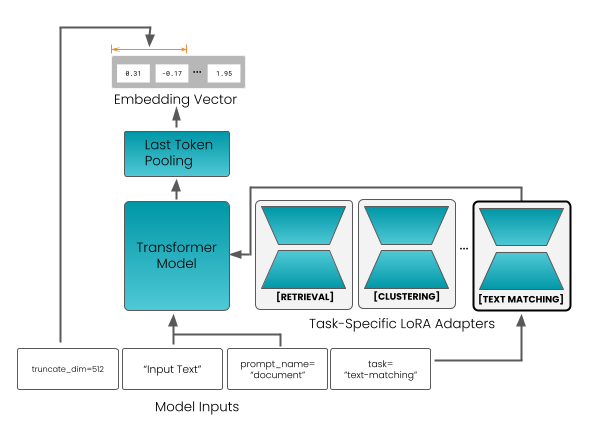
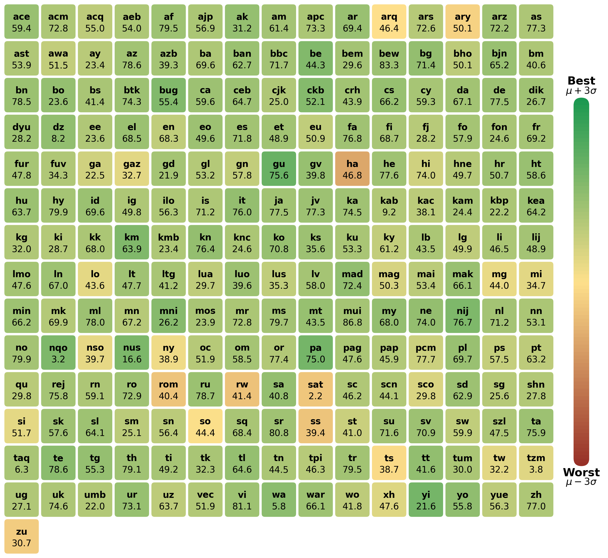
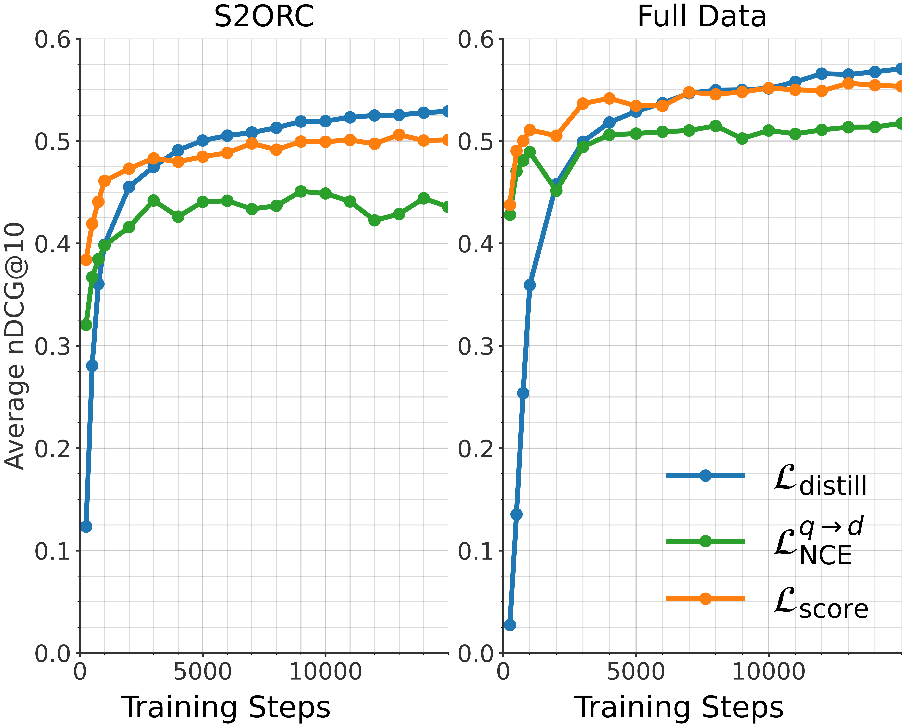
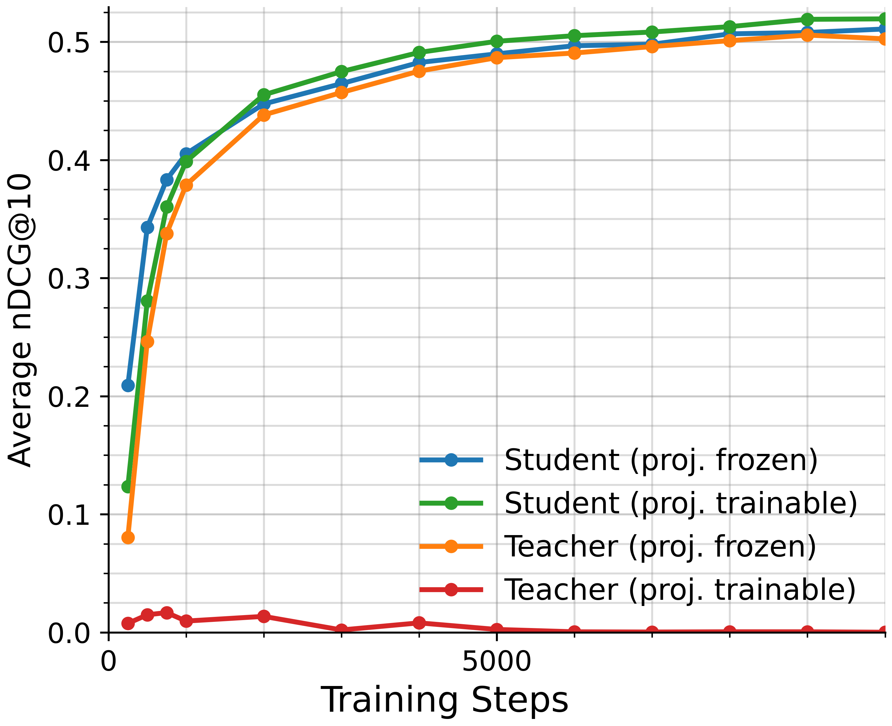
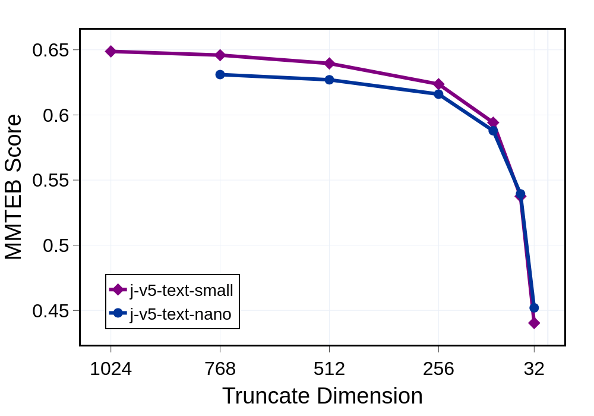

# Jina-embeddings-v5-text：任务定向的文本嵌入蒸馏

> 简述：先把 Qwen3-Embedding-4B 的向量空间蒸馏到小骨干，再冻结骨干、用四类任务 LoRA 分别优化检索、相似度、聚类和分类。
> paper：[jina-embeddings-v5-text: Task-Targeted Embedding Distillation](https://arxiv.org/abs/2602.15547v2)
> code / project：[官方模型集合](https://huggingface.co/collections/jinaai/jina-embeddings-v5-text)
> 作者：Mohammad Kalim Akram 等，Jina by Elastic；date：2026-02，本文依据 2026-04 的 arXiv v2
> backbone：nano 为 EuroBERT-210M，small 为 Qwen3-0.6B-Base；modality：文本
> languages：多语，nano 骨干重点覆盖 15 种主要语言，small 骨干覆盖 119 种语言
> refs：[Qwen3-Embedding](https://arxiv.org/abs/2506.05176)、[MRL](https://arxiv.org/abs/2205.13192)、[GOR](https://arxiv.org/abs/1708.06320)

## 论文简介

小型文本向量模型既要继承大模型的语义能力，又要兼顾检索、相似度、聚类等目标之间的冲突。Jina v5-text 先通过可学习投影，把小模型的向量对齐到 4B 教师空间；再冻结骨干，分别训练四类任务 LoRA，并为检索加入 InfoNCE、持续蒸馏和 GOR 几何正则。MRL 与长文续训进一步支持截维和长输入。论文中 small 的 MMTEB / 英文 MTEB 任务均分为 67.0 / 71.7，nano 为 65.5 / 71.0，体现了较好的参数效率；但小模型仍落后于教师，英文长文检索也并非全面领先，二值量化仍有可见损失。

## 背景与方法定位

文本 embedding 把查询和文档映射为向量，让检索变成最近邻搜索。同一套表示也常用于相似度、聚类和分类，但这些任务并不完全一致：检索要区分“相关”与“只是主题相近”，聚类却希望同主题内容聚在一起。

已有路线各有侧重：纯对比训练直接拉近正例、推远负例；蒸馏让学生模仿强教师的空间或相似度分布；指令模型通过文字描述切换任务。本文把这些思路拆为两个阶段：**先学通用语义几何，再学任务定向的变化**。用户不需要给学生设计细粒度 instruction，而是显式选择 adapter，并使用固定输入前缀。

这里研究的是 **v5-text**。v5-omni 是后续扩展多模态的另一篇工作；本文的检索与压缩结果均来自文本模型。

## 模型：小骨干、末词元池化与四个 Adapter

**图 1：** 输入包括文本、任务名、query/document 角色以及可选截断维数。模型加载相应任务 LoRA，从最后一个 token 的隐藏状态得到单个向量，再按需要截取前缀维度。图中的 adapter 是任务分工，同一次推理选择其中一个。

**表 1：依据原文 Table 1 的模型规格。**

| 项目 | v5-text-nano | v5-text-small |
| --- | --- | --- |
| 骨干 | EuroBERT-210M | Qwen3-0.6B-Base |
| 骨干参数（论文统计） | 212M | 596M |
| 四个 LoRA 的参数 | 4 × 6.7M | 4 × 20.2M |
| 论文总参数口径 | 239M | 677M |
| 输出维数 | 768 | 1024 |
| 最大上下文 | 8K | 32K |
| 推理 RoPE θ | 1M | 3.5M |
| 池化 | last-token | last-token |
| 非对称检索前缀 | `Query:` / `Document:` | `Query:` / `Document:` |

总参数口径包含四个 adapter，与每次只启用一个 adapter 的活跃参数量不同。两者也不能一概称为同一种 decoder-only 骨干：nano 源自 EuroBERT，small 源自 Qwen3；共同采用末词元池化和任务 LoRA。

## 第一阶段：把学生向量对齐到教师空间

### 数据与输入

教师为 **Qwen3-Embedding-4B**。训练样本来自 **300 多个数据集、30 多种语言**，包括标题—摘要、问题—答案等文本对。论文没有给出可据此还原全部训练语料的完整配比。

教师使用通用检索指令：

> Given a web search query, retrieve relevant passages that answer the query

学生只区分 `Query:` 和 `Document:`。这样保留输入角色，又减少教师 instruction 选择的歧义。

### 学生到教师的投影

学生维数 $n$ 为 768 或 1024，教师维数 $m$ 为 2560，不能直接逐坐标对齐。作者引入可学习仿射投影：

$$
\psi(z)=Wz+b,\qquad \psi:\mathbb{R}^{n}\rightarrow\mathbb{R}^{m}.
$$

对 batch 中每一对查询和文档，同时约束两侧向量：

$$
\mathcal L_{distill}=\sum_{i=1}^{B}\sum_{z\in\{x,y\}}
\left[1-\cos\left(\psi(z_i^S),z_i^T\right)\right].
$$

**直觉：** 学生不仅要学会“正例比分数高”，还要让不同文本在空间中的位置接近教师。投影负责匹配不同维度；部署时输出仍是学生自己的低维向量，不能把蒸馏头的 2560 维误作最终索引维数。

### 短文本蒸馏与长文续训

| 阶段 | nano | small |
| --- | --- | --- |
| 通用蒸馏 | 50,000 步；8 × 1024 batch；512 tokens | 50,000 步；8 × 512 batch；512 tokens |
| 通用蒸馏学习率 | $10^{-4}$ | $10^{-4}$ |
| 通用蒸馏 RoPE θ | 250K | 1M |
| 额外长文续训 | 未采用同样的独立续训阶段 | 6500 步；2 × 64 batch；4096 tokens；θ=500K |
| 推理 RoPE θ | 1M | 3.5M |

这是附录 Table A1 与 Table 1 的配置。训练时较小的 RoPE θ、推理时较大的 θ 用于改善长度外推；small 还加入 1000–4096 token 的多语长文，包括噪声长文中的内容检索、书籍章节与 LLM 查询配对。**长上下文窗口与长文检索质量需要分别看待**，32K 上限不等于所有 32K 内容都能被等质量地压入一个向量。

## 第二阶段：冻结骨干，按任务训练 LoRA

四类 adapter 独立训练，复用第一阶段的投影层。骨干被冻结，因此不同任务的优化不必在同一套可训练参数上相互折中。

| 任务 | 输入与监督 | 优化思路 |
| --- | --- | --- |
| 检索 | Query/Document 前缀；正例与难负例 | InfoNCE＋持续蒸馏＋GOR |
| 文本匹配 / STS | 两边都用 Document 前缀；相似度等级或无分数配对 | 有分数用 CoSENT，无分数用 InfoNCE＋蒸馏 |
| 聚类 | 新闻标题—描述等同主题文本 | 用“识别主题”指令下的教师重新蒸馏 |
| 分类 | anchor、同标签正例、不同标签负例 | 双向 InfoNCE＋关系蒸馏 |

### 检索：排名、语义保持与几何分散同时优化

InfoNCE 的负例包括非匹配的 batch 内文档和挖掘的难负例。设余弦相似度为 $c(x,y)$：

$$
\mathcal L_{NCE}=-\frac1B\sum_i\log
\frac{e^{c(x_i,y_i^+)/\tau}}
{e^{c(x_i,y_i^+)/\tau}+\sum_{n\in\mathcal N_i}e^{c(x_i,n)/\tau}}.
$$

温度可学习，附录初始化为 0.02。持续蒸馏避免 adapter 过度改变通用语义；GOR 则对 batch 内不同查询、不同正例文档的内积平方施加惩罚：

$$
\mathcal L_{GOR}=\frac{1}{B(B-1)}\sum_{i\ne j}(x_i^Tx_j)^2
+\frac{1}{B(B-1)}\sum_{i\ne j}(y_i^{+T}y_j^+)^2.
$$

最终目标为：

$$
\mathcal L_{retrieval}=\lambda_{NCE}\mathcal L_{NCE}
+\lambda_D\mathcal L_{distill}+\lambda_S\mathcal L_{GOR}.
$$

默认权重为 **1:2:1**。GOR 鼓励归一化向量在球面上更分散，减少少数方向承载过多信息；它没有显式模拟量化，也不通过 STE 训练量化器，因此与 Qwen3-VL 使用的向量 QAT 是不同机制。最后还平均末次与较早 checkpoint 的 LoRA 权重。

### STS：保留相似度的相对次序

STS 的目标是让“更相似的一对文本”获得更高分，而非简单地把所有非匹配文本当负例。对标签 $r_i>r_j$ 的两个文本对，标准 CoSENT 可写为：

$$
\mathcal L_{CoSENT}=\log\left(1+\sum_{r_i>r_j}
\exp\left(\frac{c_j-c_i}{\tau'}\right)\right).
$$

当预测把高标签对的相似度 $c_i$ 排得过低时，惩罚增大。原文式 (5) 写成指数值之差，其形式可能使对数内部出现非正值；这里采用标准 CoSENT 表达解释排序约束，不把原式视为可直接照抄的实现。

有分数数据包括 STS12、SICK 等语义相似度集及多语翻译版本；平行句、释义对等没有等级分的数据，则使用 **InfoNCE＋蒸馏（权重 1:2）**。有分数与无分数 batch 采用不同目标。

### 聚类与分类：同样本关系也有任务差异

**聚类**重新给教师使用 “Identify the topic or theme of the given document:” 指令，并用同主题文本对蒸馏。这样学的是主题接近，而非网页问答式相关性。

**分类**把标签数据重组为 1 个 anchor、1 个同标签正例、7 个异标签负例，使用双向 InfoNCE。此外加入关系蒸馏，教师是**未加 adapter 的已蒸馏基座**：

$$
\mathcal L_r=\frac1{M^2}\sum_{i,j}
\left(\frac{1-\cos(s_i,s_j)}{\mu_S}
-\frac{1-\cos(t_i,t_j)}{\mu_T}\right)^2.
$$

$M$ 为参与的全部向量数，$\mu$ 为距离矩阵均值。它保持样本间的相对距离结构，避免分类微调造成表示坍塌；附录给出的 NCE 与关系正则权重为 **1:20**。

## 实验：小模型获得了什么能力

### 评测覆盖

**MMTEB / MTEB Multilingual v2** 覆盖多语检索、STS、分类、聚类等任务；**MTEB English v2** 检验英文通用能力。检索专项还包括：**BEIR** 的跨领域英文检索与大语料，**RTEB public** 的企业场景检索，以及 **LongEmbed** 的长文检索。

以下统一使用论文 v2 表格数值，均为作者报告结果。当前模型卡可能另有更新分数，不与本文实验表混用。Avg Tasks 是按任务聚合的均分，不能直接当作任务类型均分。

### 多语与英文主结果

**表 2：原文 Table 2、3 的主要模型与任务列摘录。**

| 模型 | 总参数 | 多语 Avg Tasks | 多语检索 | 多语 STS | 多语分类 | 英文 Avg Tasks | 英文检索 | 英文 STS |
| --- | --- | --- | --- | --- | --- | --- | --- | --- |
| Qwen3-Embedding-4B（教师） | 4B | 69.5 | 69.6 | 80.9 | 72.3 | 74.6 | 68.5 | 88.7 |
| Qwen3-Embedding-0.6B（任务指令） | 596M | 64.3 | 64.7 | 76.2 | 66.8 | 70.5 | 61.8 | 86.6 |
| Qwen3-Embedding-0.6B（通用指令） | 596M | 61.1 | 64.2 | 76.2 | 58.4† | 67.0 | 59.8† | 86.6 |
| jina-v3 | 572M | 58.4 | 55.8 | 77.1 | 58.8 | 65.7 | 54.3 | 85.8 |
| multilingual-e5-large-instruct | 560M | 63.2 | 57.1 | 76.8 | 64.9 | 65.5 | 53.5 | 84.7 |
| KaLM-mini-v2.5 | 494M | 60.1 | 57.9† | 71.9† | 61.2† | 71.3 | 58.5 | 84.8 |
| voyage-4-nano | 340M | 58.9 | 63.6† | 73.0† | 58.6† | 63.3 | 52.3† | 81.6† |
| embeddinggemma-300m | 308M | 61.1 | 62.5 | 74.7 | 60.9 | 69.7 | 55.7 | 83.6 |
| **v5-text-small** | **677M** | **67.0** | **64.9** | **78.9** | **71.3** | **71.7** | **60.1** | **88.1** |
| **v5-text-nano** | **239M** | **65.5** | **63.3** | **78.2** | **69.2** | **71.0** | **58.8** | **88.3** |

† 沿用论文原表标记。

**解读：** small 相对同量级 Qwen3-0.6B 的通用任务均分有优势，但英文检索 **60.1 < 61.8**；nano 的英文 STS 略高于 small，也说明容量并不决定每项任务的排名。4B 教师仍明显更强，本文的主要价值在于参数效率和任务可控性。

**图 2：** 按语言展示 small 与对照模型的表现，补充总体均分隐藏的语种差异。nano 与 small 的骨干语言分布不同，支持输入某种语言，也不等于该语言已经达到同等检索质量。

### 检索专项：均分优势与长文短板

**表 3：原文 Table 4，保留五组 benchmark 和任务级总均分。**

| 模型 | Avg Tasks | MTEB-M | MTEB-E | RTEB | BEIR | LongEmbed |
| --- | --- | --- | --- | --- | --- | --- |
| Qwen3-4B | 67.95 | 69.60 | 68.46 | 70.77† | 61.58 | 78.82† |
| jina-v4 | 63.62 | 66.43 | 56.15 | 66.52 | 53.97† | 69.88 |
| Qwen3-0.6B | 61.87 | 64.65 | 61.83 | 64.21† | 55.52 | 72.20† |
| jina-v3 | 56.11 | 55.76 | 54.29 | 54.58† | 53.17 | 55.67 |
| snowflake-l-v2 | 57.59 | 58.36 | 58.56 | 53.95 | 55.22 | 63.74 |
| multilingual-e5-large-instruct | 54.22 | 57.12 | 53.47 | 54.78 | 52.74 | 41.76 |
| **v5-text-small** | **63.28** | **64.88** | **60.07** | **66.84** | **56.67** | **66.39** |
| KaLM-mini-v2.5 | 56.58 | 57.90 | 58.45 | 56.51† | 55.00† | 43.35† |
| voyage-4-nano | 61.48 | 63.58† | 52.30† | 70.36† | 49.93† | 74.93† |
| embeddinggemma-300m | 59.66 | 62.49 | 55.69 | 63.75† | 53.69† | 55.29† |
| **v5-text-nano** | **61.43** | **63.26** | **58.80** | **64.08** | **56.06** | **63.65** |

small 在多语检索、RTEB、BEIR 上优于 Qwen3-0.6B，但英文 MTEB 与 LongEmbed 更弱。nano 比 voyage-4-nano 更小、输出维数更低，BEIR 更强；后者在 RTEB、LongEmbed 及该表任务均分略占优。应按自己的任务选择，不能用一个均分替代所有场景结论。

## 消融：为什么要分阶段、分任务

### 蒸馏向量与蒸馏分数有何差别

**图 3：** 在学术文本对 S2ORC 和完整混合数据上，比较 InfoNCE、分数蒸馏与向量蒸馏。分数蒸馏对齐 batch 内 softmax 相似度矩阵，以 MSE 约束分布；向量蒸馏直接对齐每条输入的表示。

InfoNCE 和分数蒸馏起步更快，却较早进入平台；向量蒸馏前期较慢，后期持续提高，在这组实验中取得最高最终检索效果。因此只看早期验证分数，可能错过向量蒸馏的长期收益。

### 投影放在哪一侧

**图 4：** 比较学生→教师、教师→学生的投影，以及投影头冻结或可训练的配置。可训练的教师投影效果失败，作者推测可能发生退化解；学生投影被冻结时收敛较快，允许学习时最终效果最好。本文因此采用可学习的学生投影。

### 检索的三项损失是否都需要

**表 4：原文 Table 5，small 骨干的消融。**

| 配置 | MTEB v2 Retrieval | RTEB public |
| --- | --- | --- |
| NCE＋蒸馏＋GOR | **64.50** | **66.45** |
| NCE＋蒸馏 | 64.21 | 66.16 |
| NCE＋GOR | 64.11 | 66.11 |
| 蒸馏＋GOR | 63.49 | 65.05 |
| 仅 NCE | 63.38 | 65.14 |
| 仅蒸馏 | 63.16 | 64.37 |

第一阶段中向量蒸馏的强表现，不意味着第二阶段也只需蒸馏。任务适配时，三项结合最好；完整配方相对仅蒸馏分别提高 **1.34、2.08 个百分点**。

### GOR 对二值量化的实际作用

**表 5：原文 Table 6。**

| 配置 | MTEB BF16 | MTEB Binary | RTEB BF16 | RTEB Binary |
| --- | --- | --- | --- | --- |
| 有 GOR | 64.50 | 62.60（−1.90） | 66.45 | 63.94（−2.51） |
| 无 GOR | 64.21 | 61.13（−3.08） | 66.16 | 62.24（−3.92） |

GOR 的全精度收益只有约 0.29 点，但能把二值化的损失幅度分别减少 **1.18、1.41 点**。这是改善压缩鲁棒性，仍不能称作“二值化几乎无损”，也不是把最终索引掉点精确减半。

## MRL：同一个模型如何支持低维索引

MRL 在训练时同时优化同一向量的多个前缀维度，使前若干维也能独立表达语义。部署时先截取目标维度，再归一化并比较相似度；query 和 document 必须采用相同任务与维数。

**图 5：** 多语任务表现随维数下降的趋势。较温和的截维仍能保留较多质量，低于约 256 维后退化更明显。可先用 512/256 维建立质量—存储曲线，再决定是否继续压缩。

## 应用方式与局限

**检索索引**使用 retrieval adapter，分别选择 query/document 前缀；**重复检测、释义或文本相似度**使用 text-matching，双方统一 document 前缀；主题分组与标签分类分别选择 clustering、classification。改变任务 adapter 会改变表示空间，已有文档向量需与查询侧保持相容，不能任意混用。

nano 更适合模型体积受限、8K 上下文已足够的部署；small 提供更大的表示容量与 32K 窗口，但长文任务仍应独立评测。任务分工降低了训练冲突，也增加了索引与任务配置管理的要求。

论文展示了强教师蒸馏与任务目标的互补性，但完整数据混合没有完全公开，无法仅凭论文还原所有训练细节；基准均分也不能证明目标业务上的尾部延迟、资源成本或语言覆盖。压缩时需同时测量维数、数值精度与实际相关性质量。

## 参考

- [论文 arXiv v2](https://arxiv.org/abs/2602.15547v2)；模型与用法：[官方模型集合](https://huggingface.co/collections/jinaai/jina-embeddings-v5-text)。
- [small 模型卡](https://huggingface.co/jinaai/jina-embeddings-v5-text-small)、[nano 模型卡](https://huggingface.co/jinaai/jina-embeddings-v5-text-nano)。
- 图 1–5 与实验表来自原论文，保留作者署名；本文为中文阅读笔记，数值为作者报告值。
