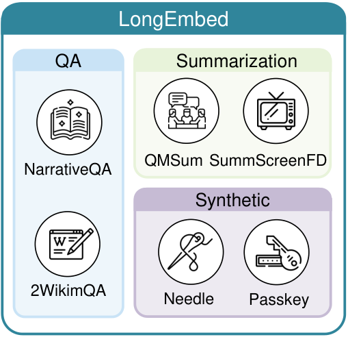
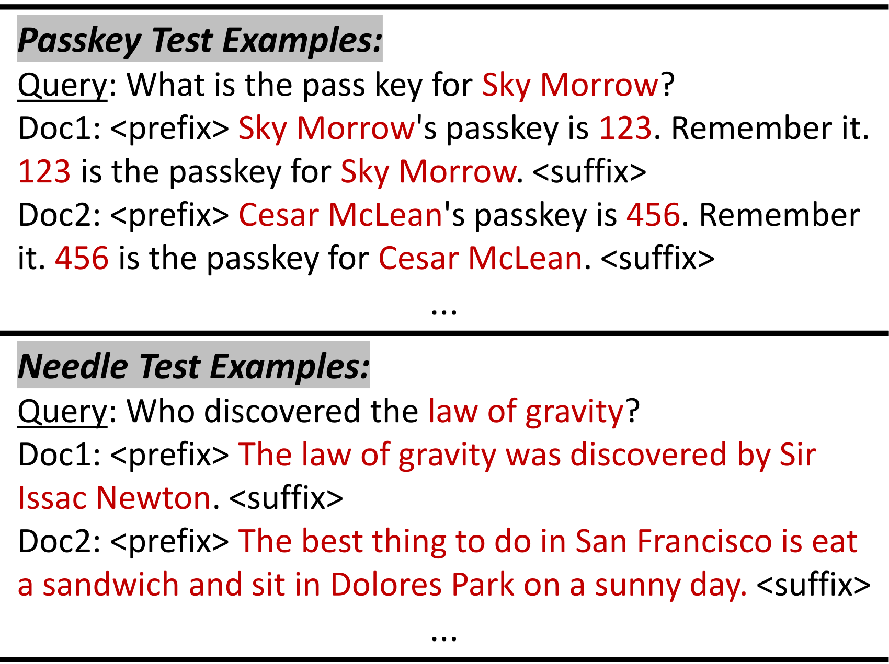
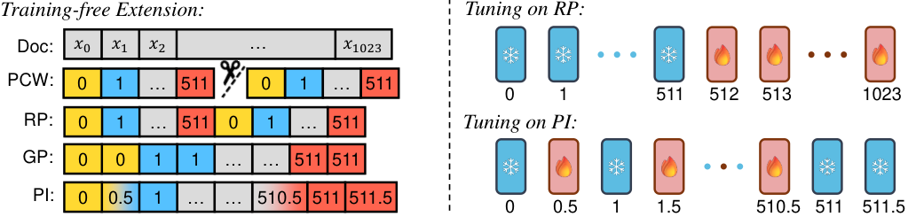
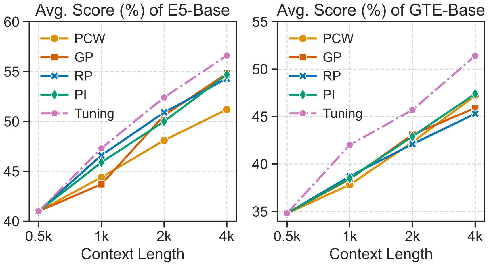

# LongEmbed：测量并扩展嵌入模型的有效上下文

> 构建目标信息分散在长文档各处的检索基准，并比较分块、位置复用、位置插值及 RoPE 扩窗方法对 embedding 的影响。
>
> [LongEmbed: Extending Embedding Models for Long Context Retrieval](https://arxiv.org/abs/2404.12096v3) · 2024 · [代码与数据](https://github.com/dwzhu-pku/LongEmbed) · [补充解读](LongEmbed解读.md)

## 摘要

一个模型能接收 8k token，并不意味着它能把文档末尾的重要信息保留在最终向量里。传统 BEIR 文档偏短，部分长文基准又允许模型仅看开头就取得高分。LongEmbed 结合可控的 Passkey/Needle 合成任务与长篇问答、会议及剧本摘要任务，区分“支持的长度”和“实际可检索的信息范围”。

作者进一步将多种长上下文方法用于 embedding，比较绝对位置嵌入与 RoPE。扩窗通常有帮助，E5-Mistral 从 4k 扩到 32k 后平均分从 64.4 提升到 75.3；但现有模型仍有显著缺口，附录中的 BM25 达到 90.4。基准候选库较小，结果主要衡量长文表示能力，不等于大规模搜索部署结论。

## 引言

长文本 embedding 同时需要更大的输入窗口与能保留远处信息的向量。直接重新训练长窗口模型成本高；本文先构建更有区分度的基准，再研究已有模型的即插即用扩窗和少量位置微调。

## 相关工作

已有长文本模型通常先获得长上下文骨干，再训练句向量。LLM 扩窗则包括分治处理、位置重组、位置插值三条路线，例如 PCW、SelfExtend、PI、NTK 和 YaRN。本文系统比较这些思路在 embedding 上的效果，并借鉴短样本位置偏移训练降低微调成本。

## LongEmbed 基准

### 检查现有基准

BEIR 的平均文档长度多在 300 词以内，难以检验数千到数万 token 的表示。作者检查 LoCo 的公开任务，发现 E5-base 仅看 512 token 就能在其中三个任务获得超过 85 的 nDCG，说明关键内容位置可能提供捷径。

LongEmbed 的两个设计原则是：文档足够长，目标信息尽可能分散；同时避免仅用合成文本代表全部真实场景。

基准包含两类合成检索与四类真实任务。这里的“检索”是选择含有相关信息的文档，不要求模型生成口令或答案。

| 任务 | 查询形式与文档 | 查询数 | 文档数 | 平均文档词数 |
|---|---|---:|---:|---:|
| NarrativeQA | 问题 → 长故事／电影文本 | 10,449 | 355 | 50,474 |
| QMSum | 摘要 → 会议记录 | 1,527 | 197 | 10,058 |
| SummScreenFD | 摘要 → 剧本 | 336 | 336 | 5,582 |
| 2WikiMultihopQA | 多跳问题 → 组合证据文本 | 300 | 300 | 6,132 |
| Passkey | 人名与口令所在文档 | 400 | 800（分八组） | 按长度控制 |
| Needle | 事实问题 → 含对应事实的长文 | 400 | 800（分八组） | 按长度控制 |

### 合成任务

合成任务覆盖约 256、512、1k、2k、4k、8k、16k、32k token，各长度 50 查询、100 候选；为适配不同 tokenizer，词数按约 0.75 word/token 控制。Passkey 在重复背景中插入目标，Needle 把 GPT-4 生成的事实放入长文章，位置可变。前者与后者并非同一种难度。

图中目标事实位于前后背景之间，评测可改变插入位置与文档长度，避免模型只记开头。合成任务使用 Acc@1，真实任务使用 nDCG@10；论文平均值混合了这两类指标。

### 真实任务

真实任务来自已有 QA 和摘要数据，候选数刻意限制在 1,000 以内以控制长文编码成本。附录说明 NarrativeQA/2Wiki 使用测试集，QMSum/SummScreenFD 使用 SCROLLS 处理版本；QMSum 因验证文档过少，还加入训练部分扩充候选。因此应按这个构造解释结果，而不把它等同原任务官方测试分数。

## 方法

### APE 与 RoPE

**APE**把位置查表向量加到 token 表示上，原始位置表有长度上限。**RoPE**在各层 query/key 上施加旋转，注意力中的位置项依赖相对距离；原频率常写作 $\theta_j=10000^{-2j/d}$。

### 扩展 APE 模型

设原窗口为 $L_o$，目标窗口为 $L_t$，缩放因子 $s=\lceil L_t/L_o\rceil$。论文比较：

| 方法 | 处理方式 | 主要代价／限制 |
|---|---|---|
| PCW | 分成短块，编码后平均块向量 | 块之间无注意力交互 |
| GP | 位置 $p\mapsto\lfloor p/s\rfloor$ | 多个相邻 token 共享位置 |
| RP | 位置 $p\mapsto p\bmod L_o$ | 位置周期性复用 |
| PI | 将位置压到 $p/s$，APE 对邻近位置向量插值 | 压缩细粒度位置差异 |
| SelfExtend | 近邻保留精细相对位置，远处使用分组位置 | 依赖 RoPE 与窗口／分组参数 |
| NTK-aware | 改变 RoPE 基数，低频缩放更强 | 参数依模型与扩展倍率选择 |

论文的 NTK 形式为 $\theta'_j=(10000\lambda)^{-2j/d}$，$\lambda$ 通常略大于目标倍率 $s$。它并非 YaRN 的全部方法；不能把 YaRN 的分频段插值和温度缩放直接归入这篇实现。

在 RP/PI 扩展位置表之后，冻结原模型和原位置向量，只训练新增的位置向量。用短训练段落加随机 position-id 偏移覆盖长位置范围，避免必须准备同等长度的训练文档。

三幅子图说明哪些位置复用原向量，哪些位置新建并训练。PI 中固定向量交错出现，作者推测其可作为锚点帮助优化；这属于对结果的解释。对短输入切回相应原始位置映射，才有保留原短上下文行为的前提。

### 扩展 RoPE 模型

SelfExtend 在近邻保持精细相对位置，远处使用分组位置；NTK 则通过调整 RoPE 基数，使高频较少缩放、低频更多缩放。两者利用 RoPE 在每层 attention 中显式处理相对位置的特点。本文对 RoPE 主要探索免训练扩展，系统训练扩展留作后续。

## 实验

### 设置

评测涵盖 E5、GTE、BGE、Contriever、GTR、E5-Mistral、Jina-v2、Nomic-v1、BGE-M3 和 Ada-002。超出模型支持长度的输入被截断；M2 因训练数据与测试有重叠未纳入。

作者另训练 **E5-RoPE-base**，以 E5 相同数据和流程对照 APE/RoPE：CCPairs 对比预训练后，在 MS MARCO、NQ、NLI 上微调。但附录明确两者并非完全单变量：RoPE 替换后预训练长度由 128 增至 512，batch 从 32k 降到 16k。其 BEIR 平均为 48.61，对照 E5-base 为 50.23；这种控制已较接近，但仍不能说除了位置编码一切完全相同。

### 主要结果

| 模型 | 窗口 | Passkey | Needle | NarrativeQA | QMSum | SummScreen | 2Wiki | 平均 |
|---|---:|---:|---:|---:|---:|---:|---:|---:|
| E5-base | 512 | 38.0 | 28.5 | 25.3 | 23.8 | 74.7 | 55.8 | 41.0 |
| E5-RoPE-base | 512 | 38.5 | 31.5 | 24.6 | 23.2 | 66.6 | 58.8 | 40.5 |
| E5-Mistral | 4096 | 71.0 | 48.3 | 44.6 | 43.6 | 96.8 | 82.0 | 64.4 |
| Jina v2 | 8192 | 50.3 | 54.5 | 37.9 | 38.9 | 93.5 | 74.0 | 58.2 |
| BGE-M3 | 8192 | 59.3 | 40.5 | 45.8 | 35.5 | 94.0 | 78.0 | 58.9 |
| E5-base + 位置微调 | 4096 | 67.3 | 41.5 | 30.4 | 35.7 | 95.2 | 69.2 | 56.6 |
| E5-RoPE + SelfExtend | 4096 | 73.5 | 53.5 | 32.3 | 39.1 | 91.9 | 74.6 | 60.8 |
| E5-Mistral + NTK | 32768 | 93.8 | 66.8 | 49.8 | 49.2 | 97.1 | 95.2 | 75.3 |

原文表 2 的主要模型。合成列为 Acc@1，真实列为 nDCG@10，均以百分数显示。三种扩展模型相对原模型的均分分别提高 15.6、20.3、10.9 点；真实长文任务仍有明显提升空间。

### 扩窗方法比较

E5-Mistral 扩到 32k 后，PCW 平均 68.7、GP 64.7、PI 59.4、SelfExtend 72.4、NTK 75.3。简单 PI 甚至低于原 4k 模型 64.4，说明“读得更长”可能损伤原有表示。E5-RoPE-base 上则 SelfExtend 60.8 优于 NTK 56.1，不能给所有模型指定同一个最优方法。

进一步训练新增位置向量通常优于纯即插即用的 APE 扩窗；PI 后微调总体优于 RP 后微调。附录还给出各倍率下 SelfExtend 的局部窗口与组大小，以及 NTK 基数参数，表明这些是有具体配置的实验。

## 结论

LongEmbed 用可控合成任务和真实长文任务检验有效上下文，显示支持较大窗口仍不足以保证可靠检索。位置扩展可以显著改善已有模型；APE 的位置微调和 RoPE 的 SelfExtend／NTK 具有不同适用性。

## 局限与附录对照

附录 BM25 的六项平均 **90.4**，高于最强扩展 E5-Mistral 的 75.3；其中 Passkey 100、Needle 95.3。这与任务里的稀有词／实体匹配、候选规模及文本构造有关，不能据此断言所有长文检索都该放弃 embedding，但确实说明稠密长文表示仍会漏掉细节。

论文主要探索免训练扩窗，RoPE 的系统性训练扩展仍留待后续；真实任务候选较少，合成任务也有明显分布特点。其贡献是提供更难的有效长度测试，以及证明位置处理能改变 embedding 的长文检索能力，而不是给所有真实 RAG 系统提供无需验证的 32k 配置。
