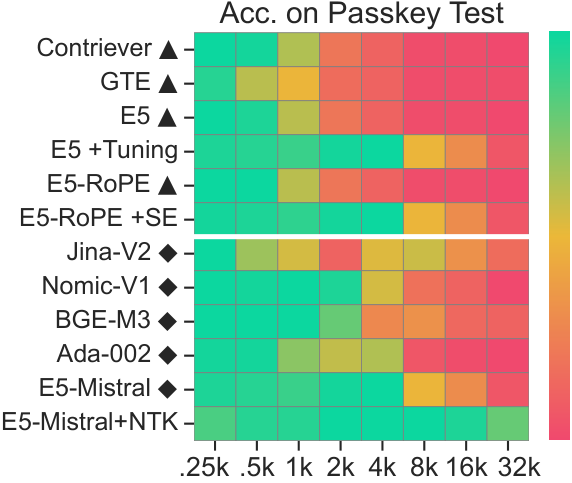
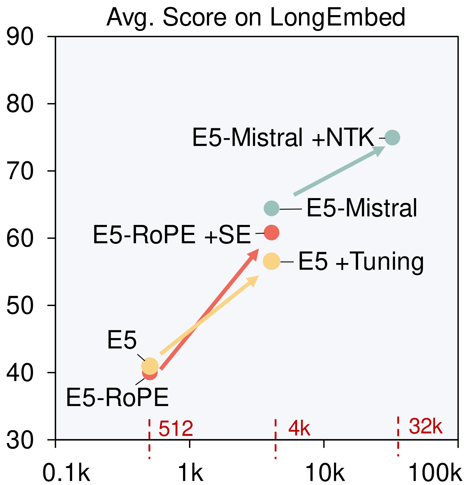
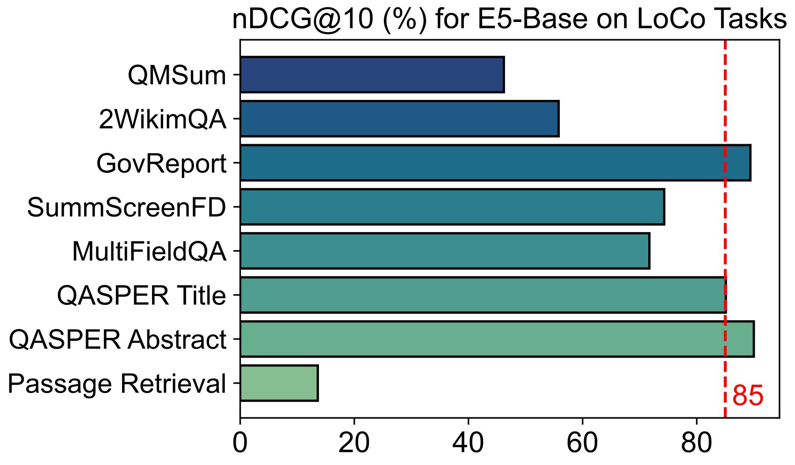
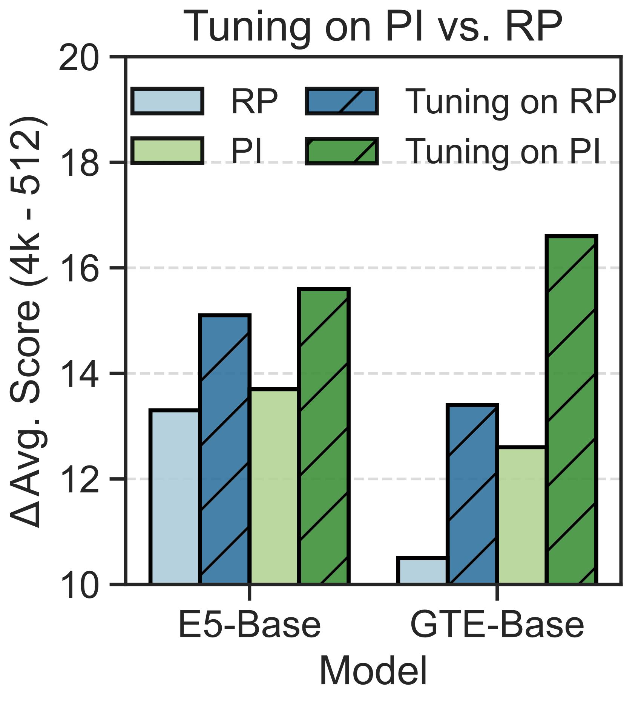
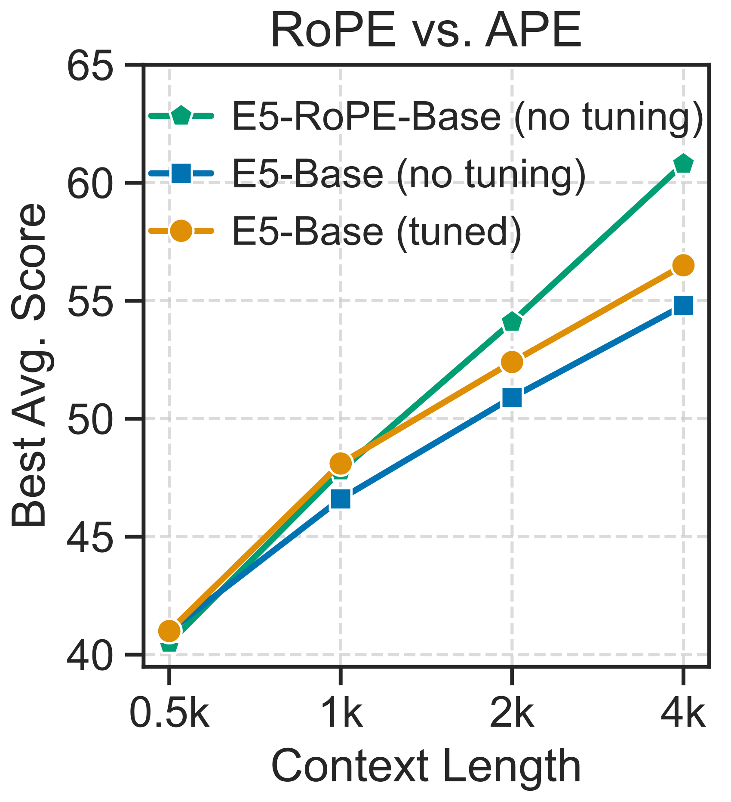
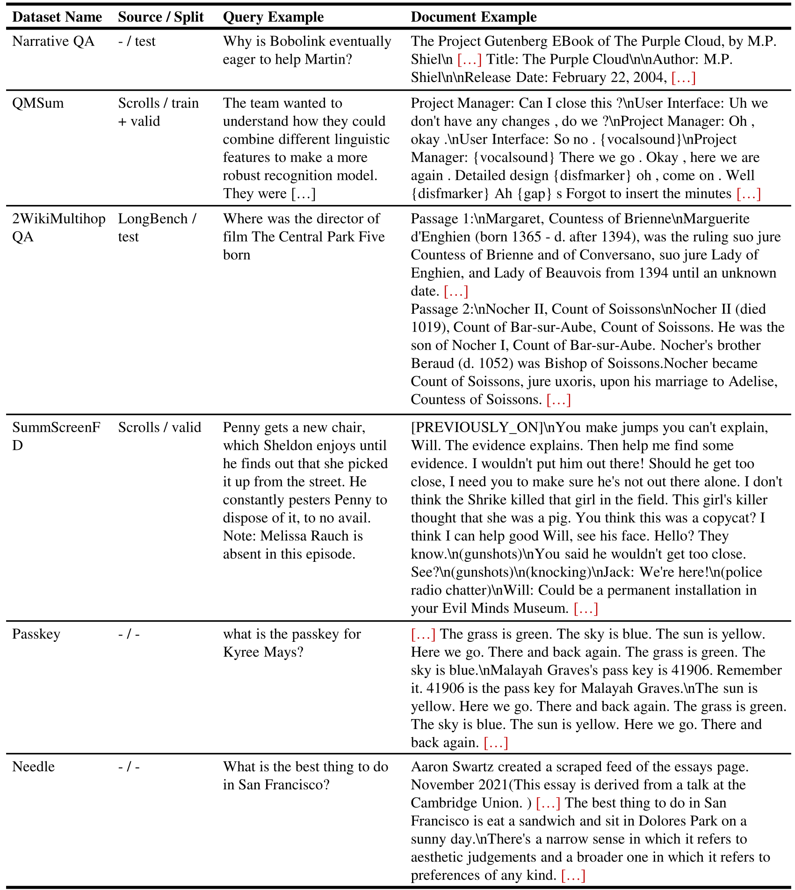

# LongEmbed: Extending Embedding Models for Long Context Retrieval / 全文中英对照

> 来源：[arXiv:2404.12096v3](https://arxiv.org/abs/2404.12096v3)。英文段落后紧接中文，覆盖所取 HTML 版本的主文、附录、图表、脚注与参考文献；公式、数字表和书目信息共用。中文以机器初译为底稿，进行了术语整理与结构核对，尚未逐句人工审定；遇到歧义请以紧邻英文和原论文为准。 原作版权归所列作者，许可见 [原作许可](http://creativecommons.org/licenses/by/4.0/)；中文译文与版式改写在该许可条件下提供（涉及 SA 时沿用相同许可，涉及 NC 时仅限非商业使用）。

## Authors and affiliations / 作者与机构

Dawei Zhu [^id2] Email: dwzhu@pku.edu.cn Liang Wang Affiliation: Microsoft Corporation Email: lisujian@pku.edu.cn Nan Yang Affiliation: Microsoft Corporation Email: wangliang@microsoft.comhttps://github.com/dwzhu-pku/LongEmbed Yifan Song Wenhao Wu Furu Wei Sujian Li Affiliation: Microsoft Corporation Affiliation: School of Computer Science, Peking University Affiliation: National Key Laboratory for Multimedia Information Processing, Peking University Affiliation: Jiangsu Collaborative Innovation Center for Language Ability, Jiangsu Normal University

## Abstract / 摘要

**EN.** Embedding models play a pivotal role in modern NLP applications such as document retrieval. However, existing embedding models are limited to encoding short documents of typically 512 tokens, restrained from application scenarios requiring long inputs. This paper explores context window extension of existing embedding models, pushing their input length to a maximum of 32,768. We begin by evaluating the performance of existing embedding models using our newly constructed LongEmbed benchmark, which includes two synthetic and four real-world tasks, featuring documents of varying lengths and dispersed target information. The benchmarking results highlight huge opportunities for enhancement in current models. Via comprehensive experiments, we demonstrate that training-free context window extension strategies can effectively increase the input length of these models by several folds. Moreover, comparison of models using Absolute Position Encoding (APE) and Rotary Position Encoding (RoPE) reveals the superiority of RoPE-based embedding models in context window extension, offering empirical guidance for future models. Our benchmark, code and trained models will be released to advance the research in long context embedding models.

**中.** 嵌入模型在文档检索等现代 NLP 应用中发挥着关键作用。然而，现有的嵌入模型仅限于编码通常为 512 个令牌的短文档，限制了需要长输入的应用场景。本文探讨了现有嵌入模型的上下文窗口扩展，将其输入长度推至最大 32,768。我们首先使用新构建的 LongEmbed 基准评估现有嵌入模型的性能，其中包括两个合成任务和四个现实世界任务，具有不同长度的文档和分散的目标信息。基准测试结果凸显了当前模型增强的巨大机会。通过综合实验，我们证明了免训练上下文窗口扩展策略可以有效地将这些模型的输入长度增加几倍。此外，使用绝对位置编码（APE）和旋转位置编码（RoPE）的模型的比较揭示了基于RoPE的嵌入模型在上下文窗口扩展方面的优越性，为未来模型提供了经验指导。我们将发布基准、代码和训练模型，以推进长上下文嵌入模型的研究。

## Introduction / 简介

**EN.** Text embeddings are vector representations of natural language that encode its semantic information. They play a pivotal role in various natural language processing (NLP) tasks, including information retrieval (IR) and retrieval-augmented generation (RAG). However, embedding models for producing these vector representations still operates within a very narrow context window, many supporting only 512 input tokens ( Wang et al., 2022 ; Xiao et al., 2023 ; Ni et al., 2022 ) . This narrow context window has greatly hindered their application in scenarios requiring long inputs, such as long Wikipedia articles and meeting scripts ( Saad-Falcon et al., 2024 ) .

**中.** 文本嵌入是自然语言的向量表示，对其语义信息进行编码。它们在各种自然语言处理（NLP）任务中发挥着关键作用，包括信息检索（IR）和检索增强生成（RAG）。然而，用于生成这些向量表示的嵌入模型仍然在非常窄的上下文窗口内运行，许多模型仅支持 512 个输入标记（Wang 等人，2022；Xiao 等人，2023；Ni 等人，2022）。这种狭窄的上下文窗口极大地阻碍了它们在需要长输入的场景中的应用，例如长维基百科文章和会议脚本（Saad-Falcon et al., 2024）。

**EN.** Previous efforts that train a long context embedding model from scratch suffer significant computational overhead, due to the combined demand for large batch sizes and long sequences. For example, Chen et al. (2024) utilized 96 A100 GPUs to train BGE-M3 which supports 8k context. Meanwhile, there have been many successes in extending context window of existing LLMs in a plug-and-play way or via efficient fine-tuning, pushing their context from 4k to 128k ( Xiong et al., 2023 ) and even 2 million tokens ( Ding et al., 2024 ) . Motivated by this, instead of training long context embedding models from scratch, this paper explores context window extension of existing embedding models.

**中.** 由于对大批量大小和长序列的综合需求，以前从头开始训练长上下文嵌入模型的努力会遭受巨大的计算开销。例如，陈等人。 (2024) 使用 96 个 A100 GPU 来训练支持 8k 上下文的 BGE-M3。与此同时，以即插即用的方式或通过高效的微调来扩​​展现有LLM的上下文窗口方面已经取得了许多成功，将其上下文从4k推到128k（Xiong等人，2023）甚至200万个令牌（Ding等人，2024）。受此启发，本文不是从头开始训练长上下文嵌入模型，而是探索现有嵌入模型的上下文窗口扩展。

**EN.** First, we examine the capability of existing embedding models in processing long context. Retrieval is selected as the proxy task, as it closely mirrors real-world application scenarios. While there have been some retrieval benchmarks such as BEIR ( Thakur et al., 2021 ) and LoCo ( Saad-Falcon et al., 2024 ) , we identify two major limitations with these existing benchmarks: 1) limited document length, 2) biased distribution of target information. To overcome this, we introduce the LongEmbed benchmark that integrates two synthetic tasks to enable flexible control over document length, and four real tasks featuring dispersed target information. Results on LongEmbed indicates huge room for improvement in current embedding models.

**中.** 首先，我们检查现有嵌入模型处理长上下文的能力。选择检索作为代理任务，因为它密切反映了现实世界的应用场景。虽然存在一些检索基准，例如 BEIR（Thakur 等人，2021）和 LoCo（Saad-Falcon 等人，2024），但我们发现这些现有基准存在两个主要局限性：1）文档长度有限，2）目标信息的分布有偏差。为了克服这个问题，我们引入了 LongEmbed 基准测试，它集成了两个合成任务以实现对文档长度的灵活控制，以及四个具有分散目标信息的真实任务。 LongEmbed 的结果表明当前嵌入模型还有巨大的改进空间。

**EN.** Figure 1: (a) Overview of the LongEmbed benchmark. (b) Performance of current embedding models on passkey retrieval, with evaluation length ranging from 256 to 32,768 [^footnote2] . $\blacktriangle$ / $\blacklozenge$ denotes embedding models with 512 / $\geq$ 4k context. The greener a cell is, the higher retrieval accuracy this model achieves on the corresponding evaluation length. (c) Effects of context window extension methods on E5, E5-RoPE, E5-Mistral, measured by improvements of Avg. Scores on LongEmbed . SE / NTK is short for SelfExtend / NTK-Aware Interpolation.

**中.** 图 1：(a) LongEmbed 基准概述。 (b) 当前嵌入模型在密钥检索方面的性能，评估长度范围从 256 到 32,768 [^footnote2] 。 $\blacktriangle$ / $\blacklozenge$ 表示具有 512 / $\geq$ 4k 上下文的嵌入模型。单元格越绿，该模型在相应评估长度上获得的检索精度就越高。 (c) 上下文窗口扩展方法对 E5、E5-RoPE、E5-Mistral 的影响，通过平均改进来衡量。 LongEmbed 上的分数。 SE / NTK 是 SelfExtend / NTK-Aware Interpolation 的缩写。

**EN.** Based on this, we explore plug-and-play strategies to extend embedding models, including parallel context windows, reorganizing position ids, and position interpolation. Comprehensive experiments show that these strategies can effectively extend the context window of existing embedding models by several folds, regardless of their original context being 512 or beyond 4k. Furthermore, for models employing absolute position encoding (APE), we show the possibility of harvesting further improvements via fine-tuning while strictly preserving original behavior within the short context. In this way, we have extended E5 Base ( Wang et al., 2022 ) from 512 to 4k (See Figure 1(c) ).

**中.** 在此基础上，我们探索了扩展嵌入模型的即插即用策略，包括并行上下文窗口、重新组织位置 ID 和位置插值。综合实验表明，这些策略可以有效地将现有嵌入模型的上下文窗口扩展数倍，无论其原始上下文是 512 还是超过 4k。此外，对于采用绝对位置编码（APE）的模型，我们展示了通过微调获得进一步改进的可能性，同时严格保留短上下文中的原始行为。这样，我们将E5 Base（Wang et al., 2022）从512扩展到4k（见图1(c)）。

**EN.** For models utilizing RoPE ( Su et al., 2021 ) , substantial enhancements on LongEmbed are observed when employing methods that fully leverage RoPE’s advantages, such as NTK ( Peng and Quesnelle, 2023 ) and SelfExtend ( Jin et al., 2024 ) . As illustrated in Figure 1(b) and 1(c) , leveraging NTK extends the context window of E5-Mistral to 32k, achieving close-to-perfect accuracy on passkey retrieval and state-of-the-art performance on LongEmbed . Further, for fair comparison of APE / RoPE-based embedding models, we pre-train E5-RoPE following the training procedure and data of E5. Thorough comparison of E5 and E5-RoPE reveals the superiority of RoPE-based embedding models in context window extension. To sum up, our contributions are as follows:

**中.** 对于使用 RoPE 的模型（Su 等人，2021），当采用充分利用 RoPE 优势的方法时，可以观察到 LongEmbed 的显着增强，例如 NTK（Peng 和 Quesnelle，2023）和 SelfExtend（Jin 等人，2024）。如图 1(b) 和 1(c) 所示，利用 NTK 将 E5-Mistral 的上下文窗口扩展至 32k，在密钥检索方面实现近乎完美的准确性，并在 LongEmbed 上实现最先进的性能。此外，为了公平比较基于 APE / RoPE 的嵌入模型，我们按照 E5 的训练程序和数据预训练 E5-RoPE。 E5和E5-RoPE的彻底比较揭示了基于RoPE的嵌入模型在上下文窗口扩展方面的优越性。总而言之，我们的贡献如下：

**EN.** We construct LongEmbed to benchmark long context retrieval, which includes two synthetic and four real-world tasks, featuring documents of varying lengths and dispersed target information.

**中.** 我们构建了 LongEmbed 来对长上下文检索进行基准测试，其中包括两个合成任务和四个现实世界任务，具有不同长度的文档和分散的目标信息。

**EN.** We have conducted comprehensive experiments on training-free context window extension, extending the input length of existing embedding models by several folds.

**中.** 我们对免训练上下文窗口扩展进行了全面的实验，将现有嵌入模型的输入长度扩展了几倍。

**EN.** We reveal the superiority of RoPE-based embedding models in context window extension via thorough comparison of models adopting APE and RoPE, offering empirical guidance for future embedding models.

**中.** 通过对APE和RoPE模型的深入比较，我们揭示了基于RoPE的嵌入模型在上下文窗口扩展方面的优越性，为未来的嵌入模型提供了经验指导。

**EN.** Our benchmark and trained models (E5 Base -4k, E5-RoPE Base ) will be released to advance the research in long context embedding models.

**中.** 我们的基准和训练模型（E5 Base -4k、E5-RoPE Base）将发布，以推进长上下文嵌入模型的研究。

## Related Work / 相关工作

**EN.** Text Embedding Models. Text embeddings encode semantic information of text as low-dimensional vectors, enabling numerous NLP applications. Early attempts on embeddings models include latent semantic indexing ( Deerwester et al., 1990 ) and weighted average of word embeddings ( Mikolov et al., 2013 ) . Modern embedding models ( Wang et al., 2022 ; Xiao et al., 2023 ; Neelakantan et al., 2022 ) exploit supervision from labeled query-document pairs, adopting a multi-stage training paradigm that pre-trained on large-scale raw text pairs using contrastive loss, then fine-tuned on small scale but high-quality datasets.

**中.** 文本嵌入模型。文本嵌入将文本的语义信息编码为低维向量，从而支持众多 NLP 应用。嵌入模型的早期尝试包括潜在语义索引（Deerwester et al., 1990）和词嵌入的加权平均（Mikolov et al., 2013）。现代嵌入模型（Wang et al., 2022；Xiao et al., 2023；Neelakantan et al., 2022）利用标记查询文档对的监督，采用多阶段训练范例，使用对比损失对大规模原始文本对进行预训练，然后在小规模但高质量的数据集上进行微调。

**EN.** Existing efforts in developing long-context embedding models typically involve first obtaining a long-context backbone model, either by pre-training with long inputs from scratch ( Günther et al., 2023 ; Nussbaum et al., 2024 ; Chen et al., 2024 ) or using existing ones ( Wang et al., 2023b ) , followed by training the backbone model to produce embeddings. Instead, this paper endows existing embedding models with the ability to handle long context through context window extension.

**中.** 开发长上下文嵌入模型的现有工作通常涉及首先通过从头开始使用长输入进行预训练（Günther et al., 2023；Nussbaum et al., 2024；Chen et al., 2024）或使用现有模型（Wang et al., 2023b）来获得长上下文骨干模型，然后训练骨干模型以产生嵌入。相反，本文赋予现有的嵌入模型通过上下文窗口扩展处理长上下文的能力。

**EN.** Context Window Extension for LLMs. Due to the high cost of pre-training an LLM from scratch, there have been many efforts towards extending the context window of existing LLMs in a plug-and-play manner. We categorize these efforts as follows: 1) Divide-and-conquer , which involves segmenting long inputs into short chunks, processing each chunk with the model, and aggregating the results, as demonstrated by PCW ( Ratner et al., 2023 ) ; 2) Position reorganization , which reorganizes position ids to accommodate longer inputs, as exemplified by SelfExtend ( Jin et al., 2024 ) , DCA ( An et al., 2024 ) . 3) Position interpolation , which introduces new position embeddings by interpolating existing ones, includes PI ( Chen et al., 2023 ) , NTK ( Peng and Quesnelle, 2023 ) , YaRN ( Peng et al., 2023 ) , and Resonance RoPE ( Wang et al., 2024a ) . Our paper thoroughly investigates these three lines of methods on embedding models. We also acknowledge other efforts in context extension, such as token compression ( Jiang et al., 2023 ; Ge et al., 2023 ; Zhang et al., 2024a ) and memory-based transformers ( Wang et al., 2024b ; Xiao et al., 2024 ) . However, the former is not applicable for bidirectional attention, and the latter requires complex mechanisms for accessing encoded content, hence we do not experiment with these two categories.

**中.** 法学硕士的上下文窗口扩展。由于从头开始预训练法学硕士的成本很高，因此人们在以即插即用的方式扩展现有法学硕士的背景窗口方面做出了许多努力。我们将这些工作分类如下：1）分而治之，涉及将长输入分割成短块，用模型处理每个块，然后聚合结果，如 PCW 所示（Ratner 等人，2023）； 2）位置重组，重新组织位置ID以适应更长的输入，例如SelfExtend（Jin等人，2024），DCA（An等人，2024）。 3）位置插值，通过插值现有位置嵌入来引入新的位置嵌入，包括PI（Chen et al., 2023）、NTK（Peng and Quesnelle, 2023）、YaRN（Peng et al., 2023）和Resonance RoPE（Wang et al., 2024a）。我们的论文彻底研究了嵌入模型的这三种方法。我们还承认上下文扩展方面的其他努力，例如令牌压缩（Jiang 等人，2023；Ge 等人，2023；Zhang 等人，2024a）和基于内存的转换器（Wang 等人，2024b；Xiao 等人，2024）。然而，前者不适用于双向注意力，后者需要复杂的机制来访问编码内容，因此我们不对这两个类别进行实验。

**EN.** In addition to their plug-and-play usability, further fine-tuning on top of these methods with long training samples has been proven to yield better performance ( Xiong et al., 2023 ; Fu et al., 2024 ; Zhang et al., 2024b ; Yen et al., 2024 ) . Addressing the overhead of training on long inputs and the scarcity of extremely long training data, a line of research investigates simulating long inputs within short context, including Randomized Positions ( Ruoss et al., 2023 ) , Positional Skip-wise (PoSE) training ( Zhu et al., 2023 ) , and SkipAlign Wu et al. (2024) . This paper also leverage these efforts to synthesize long training samples from the original training data, facilitating further fine-tuning on top of plug-and-play methods.

**中.** 除了即插即用的可用性之外，在这些方法之上使用长训练样本进行进一步微调已被证明可以产生更好的性能（Xiong 等人，2023；Fu 等人，2024；Zhang 等人，2024b；Yen 等人，2024）。为了解决长输入训练的开销和极长训练数据的稀缺性，一系列研究调查了在短上下文中模拟长输入，包括随机位置（Ruoss 等人，2023）、位置跳过明智（PoSE）训练（Zhu 等人，2023）和 SkipAlign Wu 等人。 （2024）。本文还利用这些努力从原始训练数据中合成长训练样本，从而促进在即插即用方法之上进行进一步的微调。

## The LongEmbed benchmark / LongEmbed 基准测试

| Dataset 数据集 | Domain 域名 | # Queries # 查询 | # Docs # 文档 | Avg. Query 平均。查询 | Avg. Doc 平均。医生 |
| --- | --- | --- | --- | --- | --- |
| Dataset 数据集 | Domain 域名 | # Queries # 查询 | # Docs # 文档 | Words 话 | Words 话 |
| Real Tasks 真实任务 | Real Tasks 真实任务 | Real Tasks 真实任务 | Real Tasks 真实任务 | Real Tasks 真实任务 | Real Tasks 真实任务 |
| NarrativeQA 叙事质量保证 | Literature, Film 文学、电影 | 10,449 | 355 | 9 | 50,474 |
| QMSum 质量总和 | Meeting 会议 | 1,527 | 197 | 71 | 10,058 |
| 2WikiMultihopQA 2Wiki多跳QA | Wikipedia 维基百科 | 300 | 300 | 12 | 6,132 |
| SummScreenFD 总屏幕FD | ScreenWriting 剧本创作 | 336 | 336 | 102 | 5,582 |
| Synthetic Tasks 综合任务 | Synthetic Tasks 综合任务 | Synthetic Tasks 综合任务 | Synthetic Tasks 综合任务 | Synthetic Tasks 综合任务 | Synthetic Tasks 综合任务 |
| Passkey 万能钥匙 | Synthetic 合成的 | 400 | 800 | 11 | † |
| Needle 针 | Synthetic 合成的 | 400 | 800 | 7 | † |

**EN.** Table 1: Overview of the LongEmbed benchmark. Average word number is rounded to the nearest integer. † For needle and passkey test, we have 8 groups of queries and candidate documents, with the documents averaging $\{0.25,0.5,1,2,4,8,16,32\}\times 0.75k$ words, respectively.

**中.** 表 1：LongEmbed 基准概述。平均字数四舍五入到最接近的整数。 † 对于针式和万能钥匙测试，我们有 8 组查询和候选文档，文档的平均字数分别为 $\{0.25,0.5,1,2,4,8,16,32\}\times 0.75k$。

**EN.** In this section, we first identify two limitations of existing retrieval benchmarks for evaluating long-context capabilities (§ 3.1 ). Then, we introduce the retrieval tasks adopted in our LongEmbed , including both synthetic ones (§ 3.2 ) and real ones (§ 3.3 ).

**中.** 在本节中，我们首先确定评估长上下文能力的现有检索基准的两个局限性（第 3.1 节）。然后，我们介绍了 LongEmbed 中采用的检索任务，包括合成任务（第 3.2 节）和真实任务（第 3.3 节）。

### Examing Existing Retrieval Benchmarks / 检查现有的检索基准

**EN.** There are two main desiderata for curating a long context retrieval benchmark. First, the candidate documents should be long enough. Second, the target information to answer user query should be as uniformly distributed across the document as possible. This prevents embedding models from solely focusing on specific parts, such as the beginning ( Coelho et al., 2024 ) , to achieve unreasonably high scores. Based on these criteria, we examine existing retrieval benchmarks as follows:

**中.** 策划长上下文检索基准有两个主要需求。首先，候选人文件应该足够长。其次，回答用户查询的目标信息应尽可能均匀地分布在整个文档中。这可以防止嵌入模型仅关注特定部分，例如开头（Coelho et al., 2024），从而获得不合理的高分。基于这些标准，我们检查现有的检索基准如下：

**EN.** Figure 2: Results of E5 Base on 8 LoCo tasks that are publicly available.

**中.** 图 2：E5 Base 基于 8 个公开的 LoCo 任务的结果。

**EN.** BEIR Benchmark ( Thakur et al., 2021 ) is a collection of 18 information retrieval datasets, ranging across ad-hoc web search, question answering, fact verification, etc. However, documents in this benchmark contains fewer than 300 words on average (See Table 5 in Appendix), making it unsuitable for measuring long context retrieval that usually involves documents of thousands or tens of thousands of words.

**中.** BEIR Benchmark（Thakur et al., 2021）是 18 个信息检索数据集的集合，涵盖临时网络搜索、问答、事实验证等。然而，该基准中的文档平均包含不到 300 个单词（参见附录中的表 5），使其不适合测量通常涉及数千或数万单词文档的长上下文检索。

**EN.** LoCo Benchmark ( Saad-Falcon et al., 2024 ) consists 12 retrieval tasks that requires long context reasoning, spanning diverse domains such as law and finance. However, it still suffers from biased distribution of key information, as demonstrated in Figure 2 . With only 512 context length, E5 Base achieves >85% nDCG scores on 3 out of 8 publicly-available LoCo tasks. This severely biased distribution of target information undermines its ability to reflect model performance as context increases.

**中.** LoCo Benchmark（Saad-Falcon 等人，2024）包含 12 项检索任务，需要长时间的上下文推理，涵盖法律和金融等不同领域。然而，它仍然受到关键信息分布偏差的影响，如图 2 所示。仅 512 个上下文长度，E5 Base 在 8 个公开可用的 LoCo 任务中的 3 个上取得了 >85% nDCG 分数。随着上下文的增加，目标信息的这种严重偏差分布削弱了其反映模型性能的能力。

### Synthetic Tasks in LongEmbed / LongEmbed 中的综合任务

**EN.** First, we introduce the passkey and needle retrieval task for embedding models as follows:

**中.** 首先，我们介绍嵌入模型的密钥和针检索任务，如下：

**EN.** Personalized Passkey Retrieval. Passkey retrieval ( Mohtashami and Jaggi, 2023 ) requires LLMs to recover a random passkey hidden within a long document comprising garbage information. For embedding models, we adopt the personalized passkey retrieval ( Wang et al., 2023b ) , where each document contains a unique person name and his/her passkey at random position. The goal is to retrieve the document containing the given person’s passkey from all candidates documents.

**中.** 个性化密钥检索。密钥检索（Mohtashami 和 Jaggi，2023）要求法学硕士恢复隐藏在包含垃圾信息的长文档中的随机密钥。对于嵌入模型，我们采用个性化密钥检索（Wang et al., 2023b），其中每个文档在随机位置包含唯一的人名和他/她的密钥。目标是从所有候选人文档中检索包含给定人员密钥的文档。

**EN.** Figure 3: Example for the passkey and needle test. For the passkey test, the <prefix / suffix> are repeats of "The grass is green. The sky is blue. The sun is yellow. Here we go. There and back again." For the needle test, the <prefix> and <suffix> form a long essay.

**中.** 图 3：密钥和针测试示例。对于密钥测试，<前缀/后缀> 是“草是绿色的。天空是蓝色的。太阳是黄色的。我们走。那里，然后再回来。”的重复。对于针测试，<prefix>和<suffix>形成一篇长文。

**EN.** Needle-in-a-haystack Retrieval. While passkey retrieval surrounds key information with garbage sentences, needle-in-a-haystack retrieval ( Kamradt, 2023 ; Liu et al., 2024 ) randomly inserts key information into an arbitrary position of a long essay, making the task more challenging. To tailor this task for embedding models, we instruct GPT-4 to generate 100 facts covering a variety of domains including physics, history, geometry, art, etc, and 100 queries correspondingly. The facts are subsequently treated as needles and randomly inserted into the PaulGrahamEssay to form 100 candidate documents. Our task is to correctly retrieve the document that contains corresponding needle given the query.

**中.** 大海捞针检索。万能钥匙检索用垃圾句子包围关键信息，而大海捞针检索（Kamradt，2023；Liu et al.，2024）将关键信息随机插入长论文的任意位置，使任务更具挑战性。为了针对嵌入模型定制此任务，我们指示 GPT-4 生成 100 个涵盖物理、历史、几何、艺术等多个领域的事实，以及相应的 100 个查询。这些事实随后被视为针，随机插入到PaulGrahamEssay中，形成100份候选文档。我们的任务是正确检索包含给定查询的相应针的文档。

**EN.** The advantage of synthetic data is that we can flexibly control context length and distribution of target information. For both tasks, we evaluate a broad context range of $\{0.25,0.5,1,2,4,8,16,32\}\times 1,024$ tokens [^footnote3] . For each context length, we include 50 test samples, each comprising 1 query and 100 candidate documents. [^footnote4] In this way, we can measure the effective context size of embedding models for up to 32k tokens. Examples for both tasks are in Figure 3 .

**中.** 合成数据的优点是我们可以灵活控制上下文长度和目标信息的分布。对于这两项任务，我们评估了 $\{0.25,0.5,1,2,4,8,16,32\}\times 1,024$ 代币 [^footnote3] 的广泛上下文范围。对于每个上下文长度，我们包含 50 个测试样本，每个测试样本包含 1 个查询和 100 个候选文档。 [^footnote4] 通过这种方式，我们可以测量最多 32k 个 token 的嵌入模型的有效上下文大小。这两项任务的示例如图 3 所示。

### Real Tasks in LongEmbed / LongEmbed 中的实际任务

**EN.** While synthetic tasks offer flexibility in manipulating context length and distributing target information, they still differ from real-world scenarios. To conduct a comprehensive evaluation, we have tailored following long-form QA and summarization tasks for long context retrieval. For QA datasets, we use the questions as queries, the set of all input documents as candidate documents. For summarization datasets, we use the summaries as queries, and the set of all input documents as candidate documents.

**中.** 虽然合成任务在操纵上下文长度和分发目标信息方面提供了灵活性，但它们仍然与现实世界的场景不同。为了进行全面的评估，我们为长上下文检索定制了以下长形式的质量保证和摘要任务。对于 QA 数据集，我们使用问题作为查询，将所有输入文档的集合作为候选文档。对于摘要数据集，我们使用摘要作为查询，并将所有输入文档的集合作为候选文档。

**EN.** NarrativeQA ( Kočiský et al., 2018 ) is a QA dataset comprising long stories and corresponding questions about specific content such as characters, events. As these details are dispersed throughout the story, models must process the entire long context to get the correct answers.

**中.** NarrativeQA（Kočiský et al., 2018）是一个 QA 数据集，包含长篇故事和有关特定内容（例如人物、事件）的相应问题。由于这些细节分散在整个故事中，模型必须处理整个长上下文才能获得正确的答案。

**EN.** 2WikiMultihopQA ( Ho et al., 2020 ) is a multi-hop QA dataset featuring questions with up to 5 hops, synthesized through manually designed templates to prevent shortcut solutions. This necessitates the ability to process and reason over long context, ensuring that answers cannot be obtained by merely focusing on a short span within the document.

**中.** 2WikiMultihopQA（Ho et al., 2020）是一个多跳 QA 数据集，包含最多 5 跳的问题，通过手动设计的模板合成，以防止出现捷径解决方案。这就需要具备对长上下文进行处理和推理的能力，确保不能仅通过关注文档中的一小段内容来获得答案。

**EN.** QMSum ( Zhong et al., 2021 ) is a query-based meeting summarization dataset that requires selecting and summarizing relevant segments of meetings in response to queries. Due to the involvement of multiple participants and topics in the meeting, summarization regarding specific queries naturally requires aggregating information dispersed throughout the entire text.

**中.** QMSum（Zhong et al., 2021）是一个基于查询的会议摘要数据集，需要选择和摘要会议的相关部分以响应查询。由于会议涉及多个参与者和主题，针对特定查询的总结自然需要聚合分散在整个文本中的信息。

**EN.** SummScreenFD ( Chen et al., 2022 ) is a screenplay summarization dataset comprising pairs of TV series transcripts and human-written summaries. Similar to QMSum, its plot details are scattered throughout the transcript and must be integrated to form succinct descriptions in the summary.

**中.** SummScreenFD（Chen et al., 2022）是一个剧本摘要数据集，包含成对的电视剧脚本和人工撰写的摘要。与 QMSum 类似，其情节细节分散在整个记录中，必须整合以在摘要中形成简洁的描述。

**EN.** Table 1 presents the overall statistics of LongEmbed . Considering the computational complexity that increases quadratically with input length, we intentionally restrict the number of candidate documents in each task to to not exceed $10^{3}$ . In this way, we can efficiently evaluate the basic long context capabilities of embedding models. For further elaboration on the source and examples for each dataset, please refer to Appendix C .

**中.** 表1展示了LongEmbed的总体统计数据。考虑到计算复杂度随输入长度呈二次方增加，我们有意限制每个任务中候选文档的数量不超过 $10^{3}$ 。通过这种方式，我们可以有效地评估嵌入模型的基本长上下文能力。有关每个数据集的来源和示例的进一步说明，请参阅附录 C。

## Methodology / 方法论

### Preliminary: APE & RoPE / 初步：APE 和 RoPE

**EN.** Absolute Position Embedding (APE) stands as the predominant positional encoding strategy for embedding models, as majority of them follows the BERT architecture ( Devlin et al., 2019 ) . APE-based models first embed absolute position ids into position vectors and add token embeddings to their corresponding position vectors, before feeding them to a stack of transformer layers.

**中.** 绝对位置嵌入（APE）是嵌入模型的主要位置编码策略，因为它们大多数遵循 BERT 架构（Devlin 等人，2019）。基于 APE 的模型首先将绝对位置 id 嵌入到位置向量中，并将标记嵌入添加到其相应的位置向量中，然后将它们馈送到Transformer层堆栈中。

**EN.** Rotary Position Embedding (RoPE) is the most pervasive position embedding strategy in the era of LLMs, including LLaMA ( Touvron et al., 2023 ) , QWen ( Bai et al., 2023a ) , etc. It encodes position information of tokens with a rotation matrix that naturally incorporates explicit relative position dependency. To elucidate, given a hidden vector ${\bm{h}}=[h_{0},h_{1},...,h_{d-1}]$ of dimension $d$ , and a position index $m$ , RoPE operates as follows:

**中.** 旋转位置嵌入（RoPE）是LLM时代最普遍的位置嵌入策略，包括LLaMA（Touvron et al., 2023）、QWen（Bai et al., 2023a）等。它用自然地包含显式相对位置依赖性的旋转矩阵对token的位置信息进行编码。为了说明这一点，给定维度为 $d$ 的隐藏向量 ${\bm{h}}=[h_{0},h_{1},...,h_{d-1}]$ 和位置索引 $m$ ，RoPE 的操作如下：

$$
\displaystyle f({\bm{h}},m) \displaystyle=[(h_{0}+\mathrm{i}h_{1})e^{\mathrm{i}m\theta_{0}},(h_{2}+\mathrm{i}h_{3})e^{\mathrm{i}m\theta_{1}},...,
$$

$$
\displaystyle(h_{d-2}+\mathrm{i}h_{d-1})e^{\mathrm{i}m\theta_{d/2-1}}]
$$

**EN.** where $\theta_{j}=10000^{-2j/d},j\in\{0,1,...,d/2-1\}$ , $\mathrm{i}=\sqrt{-1}$ is the imaginary unit. Unlike APE that is directly applied to the input vector ${\bm{x}}$ , RoPE is employed on the query and key vectors at each layer. The attention score $a({\bm{q}},{\bm{k}})$ between a query ${\bm{q}}$ at position $m$ and a key ${\bm{k}}$ at position $n$ is:

**中.** 其中 $\theta_{j}=10000^{-2j/d},j\in\{0,1,...,d/2-1\}$ 、 $\mathrm{i}=\sqrt{-1}$ 是虚数单位。与直接应用于输入向量 ${\bm{x}}$ 的 APE 不同，RoPE 应用于每一层的查询向量和键向量。位置 $m$ 处的查询 ${\bm{q}}$ 和位置 $n$ 处的键 ${\bm{k}}$ 之间的注意力分数 $a({\bm{q}},{\bm{k}})$ 为：

$$
\begin{aligned} a&({\bm{q}},{\bm{k}})=\mathrm{Re}\langle f({\bm{q}},m),f({\bm{k}},n)\rangle\\
&=\mathrm{Re}\left[\sum_{j=0}^{d/2-1}(q_{2j}+\mathrm{i}q_{2j+1})(k_{2}j-\mathrm{i}k_{2j+1})e^{\mathrm{i}(m-n)\theta_{j}}\right]\\
&:=g({\bm{q}},{\bm{k}},(m-n){\bm{\theta}})\end{aligned}\tag{1}
$$

**EN.** where g(·) is an abstract mapping function exclusively dependent on ${\bm{q}},{\bm{k}}$ and $(m-n){\bm{\theta}}$ .

**中.** 其中 g(·) 是完全依赖于 ${\bm{q}},{\bm{k}}$ 和 $(m-n){\bm{\theta}}$ 的抽象映射函数。

### Extending APE-based Models / 扩展基于 APE 的模型

**EN.** As delineated in Section 2 , training-free context extension strategies applicable to embedding models can be classified into 3 categories: 1) Divide-and-conquer; 2) Position reorganization; 3) Position interpolation. In this section, we introduce methods from each of these categories to assess their applicability to embedding models. Further fine-tuning on top of these methods is also included. Let $L_{o}$ represent the original context length, $\mathcal{D}=\{x_{1},x_{2},...,x_{L_{t}}\}$ denote a long document of target context length $L_{t}$ , and $s=\lceil L_{t}/L_{o}\rceil$ indicate the context scaling factor. The context extension methods we investigated are described below:

**中.** 如第 2 节所述，适用于嵌入模型的免训练上下文扩展策略可以分为 3 类：1）分而治之； 2）职位重组； 3）位置插补。在本节中，我们将介绍每个类别的方法，以评估它们对嵌入模型的适用性。还包括对这些方法的进一步微调。令 $L_{o}$ 表示原始上下文长度， $\mathcal{D}=\{x_{1},x_{2},...,x_{L_{t}}\}$ 表示目标上下文长度 $L_{t}$ 的长文档， $s=\lceil L_{t}/L_{o}\rceil$ 表示上下文缩放因子。我们研究的上下文扩展方法描述如下：

**EN.** Figure 4: (Left) Arrangement of pids for extending APE-based models from 512 to 1,024. (Right) Illustration of learnable ( ) and frozen ( ) position vectors when further tuning on RP / PI.

**中.** 图 4：（左）将基于 APE 的模型从 512 扩展到 1,024 的 pid 排列。 （右）进一步调整 RP / PI 时可学习 ( ) 和冻结 ( ) 位置向量的图示。

**EN.** Parallel Context Windows (PCW). To process a long document with a short-context model, PCW divides the long document into multiple short chunks, processes each chunk in parallel, and aggregates their results ( Ratner et al., 2023 ; Yen et al., 2024 ) . In practice, we first segment $\mathcal{D}$ into chunks of $L_{o}$ tokens, then average over each chunk’s embeddings to represent $\mathcal{D}$ . For simplicity, we set the overlap between adjacent chunks to 0, except for the last chunk, to ensure it contains $L_{o}$ tokens.

**中.** 并行上下文窗口 (PCW)。为了使用短上下文模型处理长文档，PCW 将长文档划分为多个短块，并行处理每个块，并聚合它们的结果（Ratner 等人，2023；Yen 等人，2024）。在实践中，我们首先将 $\mathcal{D}$ 分割成 $L_{o}$ 令牌块，然后对每个块的嵌入进行平均以表示 $\mathcal{D}$ 。为了简单起见，我们将除了最后一个块之外的相邻块之间的重叠设置为 0，以确保它包含 $L_{o}$ 令牌。

**EN.** Grouped & Recurrent Positions (GP & RP). Dividing inputs into chunks and processing them separately sacrifices their interaction in between. By contrast, position reorganization accommodates longer context by reusing the original position ids. To be specific, we experiment with two simple strategies: Grouped Positions and Recurrent Positions . The former groups the original position ids as such: $f_{gp}(pid)\rightarrow\lfloor pid/s\rfloor$ , while the latter assigns the position ids recurrently, formulated as: $f_{rp}(pid)\rightarrow pid\bmod L_{o}$ .

**中.** 分组和经常性职位（GP 和 RP）。将输入分成块并分别处理它们会牺牲它们之间的交互。相比之下，位置重组通过重用原始位置 ID 来适应更长的上下文。具体来说，我们尝试了两种简单的策略：分组仓位和循环仓位。前者将原始位置 id 分组为： $f_{gp}(pid)\rightarrow\lfloor pid/s\rfloor$ ，而后者循环分配位置 id，公式为： $f_{rp}(pid)\rightarrow pid\bmod L_{o}$ 。

**EN.** Linear Position Interpolation (PI). Instead of reusing position ids, Chen et al. (2023) introduces new position embeddings via linear interpolation of existing ones. To apply PI on APE-based models, we map the positions ids as such: $f_{pi}(pid)\rightarrow pid/s$ , and assign embeddings for non-integers as linear interpolation of that of neighboring integers. In practice, we first extend the original position embedding matrix ${E}_{o}\in{\mathbb{R}}^{L_{o}\times d}$ into ${E}_{t}\in{\mathbb{R}}^{L_{t}\times d}$ , where $d$ stands for hidden size. Next, we assign ${E}_{t}[i\cdot s]={E}_{o}[i],i\in\{0,1,...,L_{o}-1\}$ . For non-integer position id $j$ between $i$ and $i+1$ , we determine their embeddings as follows: ${E}_{t}[s\cdot j]=((i+1-j){E}_{t}[i\cdot s]+(j-i){E}_{t}[(i+1)\cdot s])$ .

**中.** 线性位置插值 (PI)。 Chen 等人没有重复使用职位 ID。 （2023）通过现有位置嵌入的线性插值引入新的位置嵌入。为了在基于 APE 的模型上应用 PI，我们将位置 id 映射为： $f_{pi}(pid)\rightarrow pid/s$ ，并将非整数的嵌入分配为相邻整数的线性插值。在实践中，我们首先将原始位置嵌入矩阵 ${E}_{o}\in{\mathbb{R}}^{L_{o}\times d}$ 扩展为 ${E}_{t}\in{\mathbb{R}}^{L_{t}\times d}$ ，其中 $d$ 代表隐藏大小。接下来，我们分配 ${E}_{t}[i\cdot s]={E}_{o}[i],i\in\{0,1,...,L_{o}-1\}$ 。对于 $i$ 和 $i+1$ 之间的非整数位置 id $j$ ，我们确定它们的嵌入如下： ${E}_{t}[s\cdot j]=((i+1-j){E}_{t}[i\cdot s]+(j-i){E}_{t}[(i+1)\cdot s])$ 。

**EN.** Further Tuning. Except for PCW, which divides long texts into smaller blocks and processes separately, GP, RP, and PI can all be seen as extending the position embedding matrix. Since APE-based models assign an independent vector to each position, we can freeze the original model parameters while updating only the newly added position embeddings. In this way, we can strictly maintain model ability within 512 context, while harvesting further performance gains in handling long context as free lunch. Specifically, further fine-tuning on top of RP and PI is explored in this paper, as illustrated in Figure 4 (Right). Since the traditional training data for embedding models are short queries and passages not exceeding 512 tokens, we manipulate position ids to simulate long training samples, as proposed in Zhu et al. (2023) . See Appendix B for details of further fine-tuning.

**中.** 进一步调整。除了PCW将长文本分成更小的块单独处理之外，GP、RP和PI都可以看作是位置嵌入矩阵的扩展。由于基于 APE 的模型为每个位置分配一个独立的向量，因此我们可以冻结原始模型参数，同时仅更新新添加的位置嵌入。通过这种方式，我们可以在 512 上下文中严格保持模型能力，同时在处理长上下文作为免费午餐时获得进一步的性能提升。具体来说，本文探讨了在 RP 和 PI 之上的进一步微调，如图 4（右）所示。由于嵌入模型的传统训练数据是短查询和不超过 512 个标记的段落，因此我们操纵位置 id 来模拟长训练样本，如 Zhu 等人提出的。 （2023）。有关进一步微调的详细信息，请参阅附录 B。

### Extending RoPE-based Models / 扩展基于 RoPE 的模型

**EN.** For RoPE-based models, we further explore Self Extend and NTK, which respectively advances over GP and PI, harnessing the inherent advantages of RoPE. Since there is no simple strategy for further training while exactly maintaining original performance like APE, we leave comprehensive exploration of training-based context window extension for RoPE-based models for future work.

**中.** 对于基于 RoPE 的模型，我们进一步探索 Self Extend 和 NTK，它们分别比 GP 和 PI 先进，利用 RoPE 的固有优势。由于没有简单的策略可以像 APE 那样在保持原始性能的同时进行进一步训练，因此我们将基于 RoPE 模型的基于训练的上下文窗口扩展的全面探索留给未来的工作。

**EN.** Self Extend (SE). Compared with APE, RoPE operates on the query and key vectors at each layer to encode relative positions, offering enhanced flexibility for position reorganization. For each token, instead of assigning grouped relative positions to all other tokens, SelfExtend ( Jin et al., 2024 ) re-introduces normal relative positions within the nearest neighbor window $w$ , achieving improved performance. For example, consider a document of 10 tokens $\{x_{0},x_{1},...,x_{9}\}$ with a neighbor window size $w=4$ and a group size $g=2$ . The relative positions to $x_{0}$ are $\{0,1,2,3,4,4,5,5,6,6\}$ . For $x_{4}$ , the relative positions of the other tokens are $\{-4,-3,-2,-1,0,1,2,3,4,4\}$ .

**中.** 自扩展 (SE)。与APE相比，RoPE对每一层的查询向量和键向量进行操作以编码相对位置，从而为位置重组提供了增强的灵活性。对于每个标记，SelfExtend（Jin 等人，2024）没有将分组的相对位置分配给所有其他标记，而是在最近邻居窗口 $w$ 内重新引入正常的相对位置，从而提高了性能。例如，考虑一个包含 10 个标记 $\{x_{0},x_{1},...,x_{9}\}$ 的文档，其邻居窗口大小为 $w=4$ ，组大小为 $g=2$ 。与 $x_{0}$ 的相对位置是 $\{0,1,2,3,4,4,5,5,6,6\}$ 。对于 $x_{4}$ ，其他代币的相对位置是 $\{-4,-3,-2,-1,0,1,2,3,4,4\}$ 。

| Model 型号 | Param. 参数。 | CTX Len. CTX 长度。 | Synthetic (Acc@1) 合成 (Acc@1) | Synthetic (Acc@1) 合成 (Acc@1) | Real (nDCG@10) 真实 (nDCG@10) | Real (nDCG@10) 真实 (nDCG@10) | Real (nDCG@10) 真实 (nDCG@10) | Real (nDCG@10) 真实 (nDCG@10) | Avg. 平均。 |
| --- | --- | --- | --- | --- | --- | --- | --- | --- | --- |
| Model 型号 | Param. 参数。 | CTX Len. CTX 长度。 | Passkey 万能钥匙 | Needle 针 | NQA 国家质量保证局 | QMS 质量管理体系 | SFD | WQA 质量保证 | Avg. 平均。 |
| 512 Context Models 512 情境模型 | 512 Context Models 512 情境模型 | 512 Context Models 512 情境模型 | 512 Context Models 512 情境模型 | 512 Context Models 512 情境模型 | 512 Context Models 512 情境模型 | 512 Context Models 512 情境模型 | 512 Context Models 512 情境模型 | 512 Context Models 512 情境模型 | 512 Context Models 512 情境模型 |
| E5 Base ( Wang et al., 2022 ) E5 基地（Wang 等人，2022） | 110M | 512 | 38.0 | 28.5 | 25.3 | 23.8 | 74.7 | 55.8 | 41.0 |
| E5-RoPE Base E5-RoPE底座 | 110M | 512 | 38.5 | 31.5 | 24.6 | 23.2 | 66.6 | 58.8 | 40.5 |
| GTE Base ( Li et al., 2023 ) GTE 基地（Li 等人，2023） | 110M | 512 | 31.0 | 24.5 | 28.6 | 21.8 | 55.8 | 47.3 | 34.8 |
| BGE Base ( Xiao et al., 2023 ) BGE 基地（Xiao 等人，2023） | 110M | 512 | 18.0 | 25.3 | 25.6 | 22.4 | 60.3 | 51.7 | 33.9 |
| Contriever ( Izacard et al., 2021 ) 发明者（Izacard 等人，2021） | 110M | 512 | 38.5 | 29.0 | 26.7 | 25.5 | 73.5 | 47.3 | 40.1 |
| GTR Base ( Ni et al., 2022 ) GTR 基地（Ni 等人，2022） | 110M | 512 | 38.5 | 26.3 | 26.5 | 18.3 | 63.7 | 52.2 | 36.5 |
| $\geq$ 4k Context Models $\geq$ 4k 上下文模型 | $\geq$ 4k Context Models $\geq$ 4k 上下文模型 | $\geq$ 4k Context Models $\geq$ 4k 上下文模型 | $\geq$ 4k Context Models $\geq$ 4k 上下文模型 | $\geq$ 4k Context Models $\geq$ 4k 上下文模型 | $\geq$ 4k Context Models $\geq$ 4k 上下文模型 | $\geq$ 4k Context Models $\geq$ 4k 上下文模型 | $\geq$ 4k Context Models $\geq$ 4k 上下文模型 | $\geq$ 4k Context Models $\geq$ 4k 上下文模型 | $\geq$ 4k Context Models $\geq$ 4k 上下文模型 |
| E5-Mistral ( Wang et al., 2023b ) E5-米斯特拉尔（Wang et al., 2023b） | 7B | 4,096 | 71.0 | 48.3 | 44.6 | 43.6 | 96.8 | 82.0 | 64.4 |
| Jina-V2 ( Günther et al., 2023 ) Jina-V2（Günther 等人，2023） | 137M | 8,192 | 50.3 | 54.5 | 37.9 | 38.9 | 93.5 | 74.0 | 58.2 |
| Nomic-V1 ( Nussbaum et al., 2024 ) Nomic-V1（Nussbaum 等人，2024） | 137M | 8,192 | 60.7 | 39.5 | 41.2 | 36.7 | 93.0 | 73.8 | 57.5 |
| BGE-M3 ( Chen et al., 2024 ) BGE-M3（Chen 等人，2024） | 568M | 8,192 | 59.3 | 40.5 | 45.8 | 35.5 | 94.0 | 78.0 | 58.9 |
| OpenAI-Ada-002 | - | - | 50.8 | 36.8 | 41.1 | 40.0 | 91.8 | 80.1 | 56.8 |
| Our Extended Models 我们的扩展型号 | Our Extended Models 我们的扩展型号 | Our Extended Models 我们的扩展型号 | Our Extended Models 我们的扩展型号 | Our Extended Models 我们的扩展型号 | Our Extended Models 我们的扩展型号 | Our Extended Models 我们的扩展型号 | Our Extended Models 我们的扩展型号 | Our Extended Models 我们的扩展型号 | Our Extended Models 我们的扩展型号 |
| E5 Base + Tuning (4k) E5 基础 + 调音 (4k) | 110M | 4,096 | 67.3 | 41.5 | 30.4 | 35.7 | 95.2 | 69.2 | 56.6 |
| E5-RoPE Base + SelfExtend (4k) E5-RoPE 底座 + 自延伸 (4k) | 110M | 4,096 | 73.5 | 53.5 | 32.3 | 39.1 | 91.9 | 74.6 | 60.8 |
| E5-Mistral + NTK (32k) E5-米斯特拉尔 + NTK (32k) | 7B | 32,768 | 93.8 | 66.8 | 49.8 | 49.2 | 97.1 | 95.2 | 75.3 |

**EN.** Table 2: Results (%) of existing and extended embedding models on LongEmbed . NQA , QMS , SFD , WQA is short for NarrativeQA , QMSum , SummScreenFD , 2WikiMultihopQA , respectively. We show that context window extension can effectively improve existing embedding models in processing long context.

**中.** 表 2：LongEmbed 上现有和扩展嵌入模型的结果 (%)。 NQA 、 QMS 、 SFD 、 WQA 分别是 NarrativeQA 、 QMSum 、 SummScreenFD 、 2WikiMultihopQA 的缩写。我们表明，上下文窗口扩展可以有效地改进现有的嵌入模型在处理长上下文时的性能。

**EN.** NTK-Aware Interpolation (NTK). Given a scaling factor $s$ , PI proportionally down-scales position index $m$ to $m/s$ . In this way, the attention score $a({\bm{q}},{\bm{k}})$ defined in Equation 1 becomes $g({\bm{q}},{\bm{k}},(m-n){\bm{\theta}}/s)$ . This is also equivalent to reducing the frequencies ${\bm{\theta}}$ uniformly, which may prevent the model from learning high-frequency features, as shown by the Neural Tangent Kernel (NTK) theory ( Jacot et al., 2018 ) . To remedy this, NTK-Aware interpolation ( Peng and Quesnelle, 2023 ) scales high frequencies less and low frequencies more to spread out the interpolation pressure across multiple dimensions. This is achieved by directly altering the original $\theta_{j}=10000^{-2j/d}$ into $\theta^{\prime}_{j}=(10000\lambda)^{-2j/d}$ , where $\lambda$ is conventionally chosen to be slightly greater than $s$ .

**中.** NTK 感知插值 (NTK)。给定比例因子 $s$ ， PI 按比例将位置索引 $m$ 缩小到 $m/s$ 。这样，等式1中定义的注意力分数 $a({\bm{q}},{\bm{k}})$ 就变成了 $g({\bm{q}},{\bm{k}},(m-n){\bm{\theta}}/s)$ 。这也相当于统一降低频率${\bm{\theta}}$，这可能会阻止模型学习高频特征，如神经正切核（NTK）理论所示（Jacot et al., 2018）。为了解决这个问题，NTK-Aware 插值（Peng 和 Quesnelle，2023）会减少高频，增加低频，以在多个维度上分散插值压力。这是通过直接将原来的$\theta_{j}=10000^{-2j/d}$改为$\theta^{\prime}_{j}=(10000\lambda)^{-2j/d}$来实现的，其中$\lambda$按照惯例选择为略大于$s$。

## Experiments / 实验

### Experimental Setup / 实验装置

**EN.** Benchmarked Models. We evaluate both open-sourced and proprietary models on LongEmbed , including E5, GTE, BGE, Contriever, GTR, E5-Mistral, Jina-V2, Nomic-V1, BGE-M3, OpenAI-ada-002. M2 ( Saad-Falcon et al., 2024 ) is not included in our evaluation, given its training data partly overlaps with test samples in LongEmbed .

**中.** 基准模型。我们在 LongEmbed 上评估开源和专有模型，包括 E5、GTE、BGE、Contriever、GTR、E5-Mistral、Jina-V2、Nomic-V1、BGE-M3、OpenAI-ada-002。 M2（Saad-Falcon 等人，2024）未包含在我们的评估中，因为其训练数据与 LongEmbed 中的测试样本部分重叠。

**EN.** Candidate Models for Extension. From each of the APE-based and RoPE-based category, we select 2 candidate models for comprehensive study. The former includes E5 Base and GTE Base . The latter includes the 4,096-context E5-Mistral, and a newly trained E5-RoPE Base , which supports 512 context (See Appendix A for its training details and BEIR results). Note that E5-RoPE Base employs the same training procedure and training data as E5 Base , only with APE substituted with RoPE. This facilitates fair comparison of APE / RoPE-based models in context window extension, as presented in Section 5.4 . For implementation details of each context window extension strategies on each model, please refer to Appendix B .

**中.** 扩展的候选模型。从基于 APE 和 RoPE 的每个类别中，我们选择 2 个候选模型进行综合研究。前者包括E5 Base和GTE Base。后者包括 4,096 个上下文的 E5-Mistral 和一个新训练的 E5-RoPE Base，支持 512 个上下文（有关其训练详细信息和 BEIR 结果，请参阅附录 A）。请注意，E5-RoPE Base 采用与 E5 Base 相同的训练过程和训练数据，只是将 APE 替换为 RoPE。这有助于在上下文窗口扩展中公平比较基于 APE / RoPE 的模型，如第 5.4 节所示。各个上下文窗口扩展策略在各个模型上的实现细节请参考附录B。

### Main Results / 主要结果

**EN.** Table 2 demonstrates the performance of existing embedding models on our LongEmbed benchmark. Among the 512-context models, E5 Base achieves the highest average score of 41.0 points, closely followed by E5-RoPE Base and Contriever. As the supported context length increases beyond 4k, exemplified by E5-Mistral and Jina-V2, a discernible increase in scores is observed. This verifies both the efficacy of these long-context models and the validity of LongEmbed to assess long-context retrieval. Note that even the best performing model attains only 64.4 pts on average, indicating huge room for improvement in current models.

**中.** 表 2 显示了现有嵌入模型在我们的 LongEmbed 基准上的性能。在 512 个上下文模型中，E5 Base 的平均得分最高，为 41.0 分，紧随其后的是 E5-RoPE Base 和 Contriever。随着支持的上下文长度增加到超过 4k（以 E5-Mistral 和 Jina-V2 为例），可以观察到分数明显增加。这验证了这些长上下文模型的有效性以及 LongEmbed 评估长上下文检索的有效性。请注意，即使是表现最好的模型，平均得分也仅为 64.4 分，这表明当前模型还有巨大的改进空间。

**EN.** In the last row block of Table 2, we further include the best results achieved by E5 Base , E5-RoPE Base and E5-Mistral after context window extension. For E5 Base and E5-RoPE Base , we extend their contexts from 512 to 4,096. For E5-Mistral, we extend its context from 4,096 to 32,768. Compared to the original versions, the extended models achieve an average score increase of +15.6 / +20.3 / +10.9 points. This indicates the efficacy of these context extension strategies on embedding models, enabling them to handle inputs of several folds longer. Detailed performance comparison of different extension strategies on APE & RoPE-based embedding models is presented in Section 5.3 .

**中.** 在表2的最后一行块中，我们进一步包括了E5 Base、E5-RoPE Base和E5-Mistral在上下文窗口扩展后取得的最佳结果。对于 E5 Base 和 E5-RoPE Base ，我们将其上下文从 512 扩展到 4,096。对于 E5-Mistral，我们将其上下文从 4,096 扩展到 32,768。与原始版本相比，扩展模型的平均得分提高了 +15.6 / +20.3 / +10.9 分。这表明了这些上下文扩展策略对嵌入模型的有效性，使它们能够处理更长数倍的输入。第 5.3 节介绍了基于 APE 和 RoPE 的嵌入模型的不同扩展策略的详细性能比较。

### Comparison of Extension Methods / 扩展方法比较

**EN.** Figure 5: Effects of different context window extension methods on E5 Base and GTE Base . We show that further tuning yields the best results.

**中.** 图 5：不同上下文窗口扩展方法对 E5 Base 和 GTE Base 的影响。我们表明，进一步调整会产生最佳结果。

**EN.** APE-based Models. Figure 5 illustrates the impact of various context extension strategies on E5 Base and GTE Base across different target context lengths. We observe that plug-and-play methods including GP, RP, PI and PCW strategies yield comparable results with no significant disparities. On the other hand, further tuning consistently yields additional performance gains for both models, across all target context lengths. Particularly noteworthy is GTE Base , which showcases a substantial average score increase of approximately 5 points after further tuning. This suggests that freezing the original model weights and fine-tuning exclusively the added position embeddings can effectively extend the model’s context window while strictly maintaining model’s original ability.

**中.** 基于 APE 的模型。图 5 说明了各种上下文扩展策略对不同目标上下文长度的 E5 Base 和 GTE Base 的影响。我们观察到，包括 GP、RP、PI 和 PCW 策略在内的即插即用方法产生的结果相当，没有显着差异。另一方面，在所有目标上下文长度上，进一步调整一致地为两个模型带来额外的性能增益。特别值得注意的是 GTE Base，进一步调优后平均得分大幅提升约 5 分。这表明冻结原始模型权重并专门微调添加的位置嵌入可以有效扩展模型的上下文窗口，同时严格保持模型的原始能力。

**EN.** Figure 6: (a) Performance gain after tuning on PI / RP, compared with the original model. (b) Best results achieved by extended versions of E5 Base / E5-RoPE Base .

**中.** 图 6：(a) 与原始模型相比，调整 PI / RP 后的性能增益。 (b) E5 Base / E5-RoPE Base 的扩展版本取得的最佳结果。

| Model 型号 | Synthetic 合成的 | Synthetic 合成的 | Real 真实 | Real 真实 | Real 真实 | Real 真实 | Avg. 平均。 |
| --- | --- | --- | --- | --- | --- | --- | --- |
| Model 型号 | P | N | NQA 国家质量保证局 | QMS 质量管理体系 | SFD | WQA 质量保证 | Avg. 平均。 |
| E5-RoPE Base E5-RoPE底座 | 38.5 | 31.5 | 24.6 | 23.2 | 66.6 | 58.8 | 40.5 |
| +PCW (4k) | 42.5 | 50.8 | 25.1 | 34.9 | 94.9 | 69.3 | 52.9 |
| +GP (4k) | 68.0 | 38.8 | 25.9 | 30.9 | 85.8 | 65.8 | 52.5 |
| +PI (4k) | 68.3 | 36.0 | 25.9 | 30.8 | 84.9 | 65.3 | 51.9 |
| +SE (4k) | 73.5 | 53.5 | 32.3 | 39.1 | 91.9 | 74.6 | 60.8 |
| +NTK (4k) | 66.3 | 46.5 | 25.5 | 35.8 | 90.8 | 71.7 | 56.1 |
| E5-Mistral E5-米斯特拉尔 | 71.0 | 48.3 | 44.6 | 43.6 | 96.8 | 82.0 | 64.4 |
| +PCW (32k) | 63.5 | 49.5 | 59.3 | 51.3 | 97.3 | 91.2 | 68.7 |
| +GP (32k) | 81.0 | 48.8 | 37.0 | 42.9 | 90.6 | 88.1 | 64.7 |
| +PI (32k) | 89.8 | 48.5 | 37.8 | 40.4 | 76.8 | 63.0 | 59.4 |
| +SE (32k) | 90.8 | 52 | 49.3 | 48.7 | 97.2 | 96.4 | 72.4 |
| +NTK (32k) | 93.8 | 66.8 | 49.8 | 49.2 | 97.1 | 95.2 | 75.3 |

**EN.** Table 3: Results (%) of context window extension methods on E5-RoPE Base and E5-Mistral. For datasets, P , N , NQA , QMS , SFD , WQA is short for Passkey , Needle , NarrativeQA , QMSum , SummScreenFD , 2WikiMultihopQA . For extension methods, PCW , GP , PI , SE , NTK are short for Parallel Context Windows , Grouped Positions , Linear Position Interpolation , SelfExtend , and NTK-Aware Interpolation , respectively.

**中.** 表 3：E5-RoPE Base 和 E5-Mistral 上上下文窗口扩展方法的结果 (%)。对于数据集， P 、 N 、 NQA 、 QMS 、 SFD 、 WQA 是 Passkey 、 Needle 、 NarrativeQA 、 QMSum 、 SummScreenFD 、 2WikiMultihopQA 的缩写。对于扩展方法， PCW 、 GP 、 PI 、 SE 、 NTK 分别是 Parallel Context Windows 、 Grouped Positions 、 Linear Position Interpolation 、 SelfExtend 和 NTK-Aware Interpolation 的缩写。

**EN.** RoPE-based Models. Table 3 depicts the outcomes of E5-RoPE Base and E5-Mistral on each dataset of LongEmbed after context window extension via PCW, GP, PI, SE and NTK. It is observed that RoPE-specific methods including NTK and SE yield significant improvements for both models across all datasets, surpassing PCW, PI and GP by a large margin.

**中.** 基于 RoPE 的模型。表 3 描述了通过 PCW、GP、PI、SE 和 NTK 进行上下文窗口扩展后，E5-RoPE Base 和 E5-Mistral 在 LongEmbed 每个数据集上的结果。据观察，RoPE 特定方法（包括 NTK 和 SE）对所有数据集上的两种模型都产生了显着的改进，大大超过了 PCW、PI 和 GP。

### Analysis / 分析

**EN.** Tuning on PI vs. RP. Figure 6(a) compares further tuning on top of RP vs. PI. In the former approach, the initial 512 position embeddings are frozen while the remaining embeddings are tuned, whereas for the latter, the frozen / learnable embedding vectors are arranged in an interleaved manner. We observe that tuning on PI consistently produces superior results on both GTE Base and E5 Base . A possible explanation is that fixed vectors in PI serve intrinsically as anchors, preventing the learnable vectors from converging to suboptimal values.

**中.** 调整 PI 与 RP。图 6(a) 比较了 RP 与 PI 之上的进一步调整。在前一种方法中，初始的 512 个位置嵌入被冻结，而其余嵌入被调整，而对于后者，冻结/可学习的嵌入向量以交错方式排列。我们观察到，对 PI 的调整在 GTE Base 和 E5 Base 上始终能产生优异的结果。一种可能的解释是，PI 中的固定向量本质上充当锚点，防止可学习向量收敛到次优值。

**EN.** RoPE vs. APE. We further discuss the potential of APE / RoPE-based models for context window extension. E5 Base and E5-RoPE Base are selected as the comparison subjects thanks to their shared training process, training data, and comparable performance on BEIR and LongEmbed benchmarks. At each target context length ( $\{1k,2k,4k\}$ ), we report the best scores achieved by each model on LongEmbed , as illustrated in Figure 6(b) . Without requiring further training, E5-RoPE Base consistently demonstrates superior performance compared to E5 Base across all target lengths. Furthermore, as the target window length increases, this superiority becomes more pronounced, even surpassing the fine-tuned version of E5 Base by a large margin. This suggests that RoPE-based models can better extrapolate to to longer context. Consequently, we advocate for the use of RoPE in future embedding models.

**中.** RoPE 与 APE。我们进一步讨论了基于 APE / RoPE 的上下文窗口扩展模型的潜力。 E5 Base 和 E5-RoPE Base 被选为比较对象，因为它们共享训练过程、训练数据以及在 BEIR 和 LongEmbed 基准上的可比性能。在每个目标上下文长度 ($\{1k,2k,4k\}$) 下，我们报告每个模型在 LongEmbed 上取得的最佳分数，如图 6(b) 所示。无需进一步培训，E5-RoPE Base 在所有目标长度上始终表现出优于 E5 Base 的性能。而且，随着目标窗口长度的增加，这种优势变得更加明显，甚至大幅超越了E5 Base的微调版本。这表明基于 RoPE 的模型可以更好地推断到更长的上下文。因此，我们提倡在未来的嵌入模型中使用 RoPE。

## Conclusion / 结论

**EN.** This paper explores context window extension of existing embedding models. Through extensive experiments on our LongEmbed benchmark, we show that training-free context window extension strategies can effectively increase the input length of these models by several folds. Further, our analysis reveals the superiority of RoPE-based embedding models over APE-based ones in context window extension. Hence, we advocate for the use of RoPE for future embedding models.

**中.** 本文探讨了现有嵌入模型的上下文窗口扩展。通过对 LongEmbed 基准进行大量实验，我们表明免训练上下文窗口扩展策略可以有效地将这些模型的输入长度增加几倍。此外，我们的分析揭示了基于 RoPE 的嵌入模型在上下文窗口扩展方面优于基于 APE 的嵌入模型。因此，我们主张在未来的嵌入模型中使用 RoPE。

## Limitations / 局限性

**EN.** As a pioneering work in applying context window extension on embedding models, this paper is still limited in several aspects, particularly in that most of the context extension strategies explored in this paper are training-free. As evidenced by previous findings ( Xiong et al., 2023 ; Fu et al., 2024 ; Zhang et al., 2024b ; Yen et al., 2024 ) , and the additional performance gain achieved via tuning on E5 Base and GTE Base , we believe further fine-tuning on top of plug-and-play methods can bring even better extension results. In the future, we will make comprehensive exploration of training-based context window extension for embedding models, especially for RoPE-based ones.

**中.** 作为将上下文窗口扩展应用于嵌入模型的开创性工作，本文仍然在几个方面受到限制，特别是本文探讨的大多数上下文扩展策略都是免训练的。正如之前的研究结果所证明的那样（Xiong et al., 2023；Fu et al., 2024；Zhang et al., 2024b；Yen et al., 2024），以及通过对 E5 Base 和 GTE Base 进行调优获得的额外性能增益，我们相信在即插即用方法之上进一步微调可以带来更好的扩展结果。未来，我们将全面探索基于训练的嵌入模型上下文窗口扩展，特别是基于 RoPE 的嵌入模型。

## Ethics Statement / 道德声明

**EN.** This work fully complies with the ACL Ethics Policy. We declare that there are no ethical issues in this paper, to the best of our knowledge.

**中.** 这项工作完全符合 ACL 道德政策。我们声明，据我们所知，本文不存在道德问题。

## Acknowledgement / 致谢

**EN.** We thank the anonymous reviewers for their helpful comments on this paper. We thank Xueguang Ma, Niklas Muennighoff, and Kenneth Enevoldsen for their thoughtful discussion and assistance in integrating LongEmbed into MTEB. This work was partially supported by National Natural Science Foundation of China (No. 62476010).

**中.** 我们感谢匿名审稿人对本文提出的有益评论。我们感谢马学光、Niklas Muennighoff 和 Kenneth Enevoldsen 在将 LongEmbed 集成到 MTEB 过程中提供的深思熟虑的讨论和帮助。该工作得到了国家自然科学基金项目（No. 62476010）的部分资助。

## References / 参考文献

- An et al. (2024) Chenxin An, Fei Huang, Jun Zhang, Shansan Gong, Xipeng Qiu, Chang Zhou, and Lingpeng Kong. 2024. Training-free long-context scaling of large language models. arXiv preprint arXiv:2402.17463 .

- Bai et al. (2023a) Jinze Bai, Shuai Bai, Yunfei Chu, Zeyu Cui, Kai Dang, Xiaodong Deng, Yang Fan, Wenbin Ge, Yu Han, Fei Huang, et al. 2023a. Qwen technical report. arXiv preprint arXiv:2309.16609 .

- Bai et al. (2023b) Yushi Bai, Xin Lv, Jiajie Zhang, Hongchang Lyu, Jiankai Tang, Zhidian Huang, Zhengxiao Du, Xiao Liu, Aohan Zeng, Lei Hou, et al. 2023b. Longbench: A bilingual, multitask benchmark for long context understanding. arXiv preprint arXiv:2308.14508 .

- Chen et al. (2024) Jianlv Chen, Shitao Xiao, Peitian Zhang, Kun Luo, Defu Lian, and Zheng Liu. 2024. Bge m3-embedding: Multi-lingual, multi-functionality, multi-granularity text embeddings through self-knowledge distillation. arXiv preprint arXiv:2402.03216 .

- Chen et al. (2022) Mingda Chen, Zewei Chu, Sam Wiseman, and Kevin Gimpel. 2022. Summscreen: A dataset for abstractive screenplay summarization. In Proceedings of the 60th Annual Meeting of the Association for Computational Linguistics (Volume 1: Long Papers) , pages 8602–8615.

- Chen et al. (2023) Shouyuan Chen, Sherman Wong, Liangjian Chen, and Yuandong Tian. 2023. Extending context window of large language models via positional interpolation. arXiv preprint arXiv:2306.15595 .

- Chiang and Cholak (2022) David Chiang and Peter Cholak. 2022. [Overcoming a theoretical limitation of self-attention](https://doi.org/10.18653/v1/2022.acl-long.527) . In Proceedings of the 60th Annual Meeting of the Association for Computational Linguistics (Volume 1: Long Papers) , pages 7654–7664, Dublin, Ireland. Association for Computational Linguistics.

- Coelho et al. (2024) João Coelho, Bruno Martins, João Magalhães, Jamie Callan, and Chenyan Xiong. 2024. Dwell in the beginning: How language models embed long documents for dense retrieval. arXiv preprint arXiv:2404.04163 .

- Deerwester et al. (1990) Scott Deerwester, Susan T Dumais, George W Furnas, Thomas K Landauer, and Richard Harshman. 1990. Indexing by latent semantic analysis. Journal of the American society for information science , 41(6):391–407.

- Devlin et al. (2019) Jacob Devlin, Ming-Wei Chang, Kenton Lee, and Kristina Toutanova. 2019. [BERT: Pre-training of deep bidirectional transformers for language understanding](https://doi.org/10.18653/v1/N19-1423) . In Proceedings of the 2019 Conference of the North American Chapter of the Association for Computational Linguistics: Human Language Technologies, Volume 1 (Long and Short Papers) , pages 4171–4186, Minneapolis, Minnesota. Association for Computational Linguistics.

- Ding et al. (2024) Yiran Ding, Li Lyna Zhang, Chengruidong Zhang, Yuanyuan Xu, Ning Shang, Jiahang Xu, Fan Yang, and Mao Yang. 2024. Longrope: Extending llm context window beyond 2 million tokens. arXiv preprint arXiv:2402.13753 .

- Fu et al. (2024) Yao Fu, Rameswar Panda, Xinyao Niu, Xiang Yue, Hannaneh Hajishirzi, Yoon Kim, and Hao Peng. 2024. Data engineering for scaling language models to 128k context. arXiv preprint arXiv:2402.10171 .

- Gao et al. (2021) Tianyu Gao, Xingcheng Yao, and Danqi Chen. 2021. Simcse: Simple contrastive learning of sentence embeddings. In Proceedings of the 2021 Conference on Empirical Methods in Natural Language Processing , pages 6894–6910.

- Ge et al. (2023) Tao Ge, Jing Hu, Xun Wang, Si-Qing Chen, and Furu Wei. 2023. In-context autoencoder for context compression in a large language model. arXiv preprint arXiv:2307.06945 .

- Günther et al. (2023) Michael Günther, Jackmin Ong, Isabelle Mohr, Alaeddine Abdessalem, Tanguy Abel, Mohammad Kalim Akram, Susana Guzman, Georgios Mastrapas, Saba Sturua, Bo Wang, et al. 2023. Jina embeddings 2: 8192-token general-purpose text embeddings for long documents. arXiv preprint arXiv:2310.19923 .

- Ho et al. (2020) Xanh Ho, Anh-Khoa Duong Nguyen, Saku Sugawara, and Akiko Aizawa. 2020. [Constructing a multi-hop QA dataset for comprehensive evaluation of reasoning steps](https://www.aclweb.org/anthology/2020.coling-main.580) . In Proceedings of the 28th International Conference on Computational Linguistics , pages 6609–6625, Barcelona, Spain (Online). International Committee on Computational Linguistics.

- Izacard et al. (2021) Gautier Izacard, Mathilde Caron, Lucas Hosseini, Sebastian Riedel, Piotr Bojanowski, Armand Joulin, and Edouard Grave. 2021. Towards unsupervised dense information retrieval with contrastive learning. arXiv preprint arXiv:2112.09118 , 2(3).

- Jacot et al. (2018) Arthur Jacot, Franck Gabriel, and Clément Hongler. 2018. Neural tangent kernel: Convergence and generalization in neural networks. Advances in neural information processing systems , 31.

- Jiang et al. (2023) Huiqiang Jiang, Qianhui Wu, Chin-Yew Lin, Yuqing Yang, and Lili Qiu. 2023. Llmlingua: Compressing prompts for accelerated inference of large language models. In Proceedings of the 2023 Conference on Empirical Methods in Natural Language Processing , pages 13358–13376.

- Jin et al. (2024) Hongye Jin, Xiaotian Han, Jingfeng Yang, Zhimeng Jiang, Zirui Liu, Chia-Yuan Chang, Huiyuan Chen, and Xia Hu. 2024. Llm maybe longlm: Self-extend llm context window without tuning. arXiv preprint arXiv:2401.01325 .

- Kamradt (2023) Greg Kamradt. 2023. Needle in a haystack - pressure testing llms. [https://github.com/gkamradt/LLMTest_NeedleInAHaystack](https://github.com/gkamradt/LLMTest_NeedleInAHaystack) .

- Karpukhin et al. (2020) Vladimir Karpukhin, Barlas Oguz, Sewon Min, Patrick Lewis, Ledell Wu, Sergey Edunov, Danqi Chen, and Wen-tau Yih. 2020. Dense passage retrieval for open-domain question answering. In Proceedings of the 2020 Conference on Empirical Methods in Natural Language Processing (EMNLP) , pages 6769–6781.

- Kočiský et al. (2018) Tomáš Kočiský, Jonathan Schwarz, Phil Blunsom, Chris Dyer, Karl Moritz Hermann, Gábor Melis, and Edward Grefenstette. 2018. [The NarrativeQA reading comprehension challenge](https://doi.org/10.1162/tacl_a_00023) . Transactions of the Association for Computational Linguistics , 6:317–328.

- Kwiatkowski et al. (2019) Tom Kwiatkowski, Jennimaria Palomaki, Olivia Redfield, Michael Collins, Ankur Parikh, Chris Alberti, Danielle Epstein, Illia Polosukhin, Jacob Devlin, Kenton Lee, et al. 2019. Natural questions: A benchmark for question answering research. Transactions of the Association for Computational Linguistics , 7:452–466.

- Lefaudeux et al. (2022) Benjamin Lefaudeux, Francisco Massa, Diana Liskovich, Wenhan Xiong, Vittorio Caggiano, Sean Naren, Min Xu, Jieru Hu, Marta Tintore, Susan Zhang, Patrick Labatut, Daniel Haziza, Luca Wehrstedt, Jeremy Reizenstein, and Grigory Sizov. 2022. xformers: A modular and hackable transformer modelling library. [https://github.com/facebookresearch/xformers](https://github.com/facebookresearch/xformers) .

- Li et al. (2023) Zehan Li, Xin Zhang, Yanzhao Zhang, Dingkun Long, Pengjun Xie, and Meishan Zhang. 2023. Towards general text embeddings with multi-stage contrastive learning. arXiv preprint arXiv:2308.03281 .

- Liu et al. (2024) Nelson F Liu, Kevin Lin, John Hewitt, Ashwin Paranjape, Michele Bevilacqua, Fabio Petroni, and Percy Liang. 2024. Lost in the middle: How language models use long contexts. Transactions of the Association for Computational Linguistics , 12:157–173.

- Mikolov et al. (2013) Tomas Mikolov, Kai Chen, Greg Corrado, and Jeffrey Dean. 2013. Efficient estimation of word representations in vector space. arXiv preprint arXiv:1301.3781 .

- Mohtashami and Jaggi (2023) Amirkeivan Mohtashami and Martin Jaggi. 2023. Landmark attention: Random-access infinite context length for transformers. arXiv preprint arXiv:2305.16300 .

- Neelakantan et al. (2022) Arvind Neelakantan, Tao Xu, Raul Puri, Alec Radford, Jesse Michael Han, Jerry Tworek, Qiming Yuan, Nikolas Tezak, Jong Wook Kim, Chris Hallacy, et al. 2022. Text and code embeddings by contrastive pre-training. arXiv preprint arXiv:2201.10005 .

- Nguyen et al. (2016) Tri Nguyen, Mir Rosenberg, Xia Song, Jianfeng Gao, Saurabh Tiwary, Rangan Majumder, and Li Deng. 2016. Ms marco: A human-generated machine reading comprehension dataset.

- Ni et al. (2022) Jianmo Ni, Chen Qu, Jing Lu, Zhuyun Dai, Gustavo Hernandez Abrego, Ji Ma, Vincent Zhao, Yi Luan, Keith Hall, Ming-Wei Chang, et al. 2022. Large dual encoders are generalizable retrievers. In Proceedings of the 2022 Conference on Empirical Methods in Natural Language Processing , pages 9844–9855.

- Nussbaum et al. (2024) Zach Nussbaum, John X Morris, Brandon Duderstadt, and Andriy Mulyar. 2024. Nomic embed: Training a reproducible long context text embedder. arXiv preprint arXiv:2402.01613 .

- Peng and Quesnelle (2023) Bowen Peng and Jeffrey Quesnelle. 2023. Ntk-aware scaled rope allows llama models to have extended (8k+) context size without any fine-tuning and minimal perplexity degradation. [https://www.reddit.com/r/LocalLLaMA/comments/14lz7j5/ntkaware_scaled_rope_allows_llama_models_to_have](https://www.reddit.com/r/LocalLLaMA/comments/14lz7j5/ntkaware_scaled_rope_allows_llama_models_to_have) .

- Peng et al. (2023) Bowen Peng, Jeffrey Quesnelle, Honglu Fan, and Enrico Shippole. 2023. Yarn: Efficient context window extension of large language models. arXiv preprint arXiv:2309.00071 .

- Ratner et al. (2023) Nir Ratner, Yoav Levine, Yonatan Belinkov, Ori Ram, Inbal Magar, Omri Abend, Ehud Karpas, Amnon Shashua, Kevin Leyton-Brown, and Yoav Shoham. 2023. Parallel context windows for large language models. In Proceedings of the 61st Annual Meeting of the Association for Computational Linguistics (Volume 1: Long Papers) , pages 6383–6402.

- Ruoss et al. (2023) Anian Ruoss, Grégoire Delétang, Tim Genewein, Jordi Grau-Moya, Róbert Csordás, Mehdi Bennani, Shane Legg, and Joel Veness. 2023. Randomized positional encodings boost length generalization of transformers. In Proceedings of the 61st Annual Meeting of the Association for Computational Linguistics (Volume 2: Short Papers) , pages 1889–1903.

- Saad-Falcon et al. (2024) Jon Saad-Falcon, Daniel Y Fu, Simran Arora, Neel Guha, and Christopher Ré. 2024. Benchmarking and building long-context retrieval models with loco and m2-bert. arXiv preprint arXiv:2402.07440 .

- Shaham et al. (2022) Uri Shaham, Elad Segal, Maor Ivgi, Avia Efrat, Ori Yoran, Adi Haviv, Ankit Gupta, Wenhan Xiong, Mor Geva, Jonathan Berant, and Omer Levy. 2022. [SCROLLS: Standardized CompaRison over long language sequences](https://doi.org/10.18653/v1/2022.emnlp-main.823) . In Proceedings of the 2022 Conference on Empirical Methods in Natural Language Processing , pages 12007–12021, Abu Dhabi, United Arab Emirates. Association for Computational Linguistics.

- Su (2021) Jianlin Su. 2021. Understanding attention scaling from the perspective of entropy invariance. [https://spaces.ac.cn/archives/8823](https://spaces.ac.cn/archives/8823) .

- Su et al. (2021) Jianlin Su, Yu Lu, Shengfeng Pan, Ahmed Murtadha, Bo Wen, and Yunfeng Liu. 2021. Roformer: Enhanced transformer with rotary position embedding. arXiv preprint arXiv:2104.09864 .

- Thakur et al. (2021) Nandan Thakur, Nils Reimers, Andreas Rücklé, Abhishek Srivastava, and Iryna Gurevych. 2021. [BEIR: A heterogeneous benchmark for zero-shot evaluation of information retrieval models](https://openreview.net/forum?id=wCu6T5xFjeJ) . In Thirty-fifth Conference on Neural Information Processing Systems Datasets and Benchmarks Track (Round 2) .

- Touvron et al. (2023) Hugo Touvron, Thibaut Lavril, Gautier Izacard, Xavier Martinet, Marie-Anne Lachaux, Timothée Lacroix, Baptiste Rozière, Naman Goyal, Eric Hambro, Faisal Azhar, et al. 2023. Llama: Open and efficient foundation language models. arXiv preprint arXiv:2302.13971 .

- Wang et al. (2022) Liang Wang, Nan Yang, Xiaolong Huang, Binxing Jiao, Linjun Yang, Daxin Jiang, Rangan Majumder, and Furu Wei. 2022. Text embeddings by weakly-supervised contrastive pre-training. arXiv preprint arXiv:2212.03533 .

- Wang et al. (2023a) Liang Wang, Nan Yang, Xiaolong Huang, Binxing Jiao, Linjun Yang, Daxin Jiang, Rangan Majumder, and Furu Wei. 2023a. Simlm: Pre-training with representation bottleneck for dense passage retrieval. In Proceedings of the 61st Annual Meeting of the Association for Computational Linguistics (Volume 1: Long Papers) , pages 2244–2258.

- Wang et al. (2023b) Liang Wang, Nan Yang, Xiaolong Huang, Linjun Yang, Rangan Majumder, and Furu Wei. 2023b. Improving text embeddings with large language models. arXiv preprint arXiv:2401.00368 .

- Wang et al. (2024a) Suyuchen Wang, Ivan Kobyzev, Peng Lu, Mehdi Rezagholizadeh, and Bang Liu. 2024a. Resonance rope: Improving context length generalization of large language models. arXiv preprint arXiv:2403.00071 .

- Wang et al. (2024b) Weizhi Wang, Li Dong, Hao Cheng, Xiaodong Liu, Xifeng Yan, Jianfeng Gao, and Furu Wei. 2024b. Augmenting language models with long-term memory. Advances in Neural Information Processing Systems , 36.

- Wu et al. (2024) Wenhao Wu, Yizhong Wang, Yao Fu, Xiang Yue, Dawei Zhu, and Sujian Li. 2024. Long context alignment with short instructions and synthesized positions. arXiv preprint arXiv:2405.03939 .

- Xiao et al. (2024) Chaojun Xiao, Pengle Zhang, Xu Han, Guangxuan Xiao, Yankai Lin, Zhengyan Zhang, Zhiyuan Liu, Song Han, and Maosong Sun. 2024. Infllm: Unveiling the intrinsic capacity of llms for understanding extremely long sequences with training-free memory. arXiv preprint arXiv:2402.04617 .

- Xiao et al. (2023) Shitao Xiao, Zheng Liu, Peitian Zhang, and Niklas Muennighof. 2023. C-pack: Packaged resources to advance general chinese embedding. arXiv preprint arXiv:2309.07597 .

- Xiong et al. (2023) Wenhan Xiong, Jingyu Liu, Igor Molybog, Hejia Zhang, Prajjwal Bhargava, Rui Hou, Louis Martin, Rashi Rungta, Karthik Abinav Sankararaman, Barlas Oguz, et al. 2023. Effective long-context scaling of foundation models. arXiv preprint arXiv:2309.16039 .

- Yen et al. (2024) Howard Yen, Tianyu Gao, and Danqi Chen. 2024. [Long-context language modeling with parallel context encoding](https://arxiv.org/abs/2402.16617) . Preprint , arXiv:2402.16617.

- Zhang et al. (2024a) Peitian Zhang, Zheng Liu, Shitao Xiao, Ninglu Shao, Qiwei Ye, and Zhicheng Dou. 2024a. Soaring from 4k to 400k: Extending llm’s context with activation beacon. arXiv preprint arXiv:2401.03462 .

- Zhang et al. (2024b) Yikai Zhang, Junlong Li, and Pengfei Liu. 2024b. Extending llms’ context window with 100 samples. arXiv preprint arXiv:2401.07004 .

- Zhong et al. (2021) Ming Zhong, Da Yin, Tao Yu, Ahmad Zaidi, Mutethia Mutuma, Rahul Jha, Ahmed Hassan Awadallah, Asli Celikyilmaz, Yang Liu, Xipeng Qiu, and Dragomir Radev. 2021. QMSum: A New Benchmark for Query-based Multi-domain Meeting Summarization. In North American Association for Computational Linguistics (NAACL) .

- Zhu et al. (2023) Dawei Zhu, Nan Yang, Liang Wang, Yifan Song, Wenhao Wu, Furu Wei, and Sujian Li. 2023. Pose: Efficient context window extension of llms via positional skip-wise training. In The Twelfth International Conference on Learning Representations .

## Training Details for E5-RoPE Base / E5-RoPE 基地的培训详细信息

| Params 参数 | Pre-training 预训练 | Pre-training 预训练 | Fine-tuning 微调 | Fine-tuning 微调 |
| --- | --- | --- | --- | --- |
| Params 参数 | E5 Base E5底座 | E5-RoPE Base E5-RoPE底座 | E5 Base E5底座 | E5-RoPE Base E5-RoPE底座 |
| learning rate 学习率 | 2 $\times 10^{-4}$ | 2 $\times 10^{-4}$ | 2 $\times 10^{-5}$ | 2 $\times 10^{-5}$ |
| GPUs (V100) GPU (V100) | 32 | 32 | 8 | 8 |
| warmup steps 热身步骤 | 1000 | 1000 | 400 | 400 |
| max length 最大长度 | 128 | 512 | 192 | 192 |
| batch size 批量大小 | 32k | 16k | 256 | 256 |
| max steps 最大步数 | 20k | 20k | n.a. | n.a. |
| epochs 纪元 | n.a. | n.a. | 3 | 3 |
| $\tau$ | 0.01 | 0.01 | 0.01 | 0.01 |
| $\alpha$ | n.a. | n.a. | 0.2 | 0.2 |
| weight decay 重量衰减 | 0.01 | 0.01 | 0.01 | 0.01 |
| hard negatives 难负例 | 0 | 0 | 7 | 7 |
| pos embedding 后置嵌入 | APE 急性肺损伤 | RoPE 罗普 | APE 急性肺损伤 | RoPE 罗普 |

**EN.** Table 4: Hyperparameters for contrastive pre-training and fine-tuning of E5 Base and E5-RoPE Base .

**中.** 表 4：E5 Base 和 E5-RoPE Base 对比预训练和微调的超参数。

**EN.** In this section, we describe the training details of E5-RoPE Base . Our training procedure and data exactly follows that of E5 ( Wang et al., 2022 ) , where we first perform contrastive pre-training on their collected CCPairs, then perform fine-tuning on the concatenation of 3 datasets: MS-MARCO passage ranking ( Nguyen et al., 2016 ) , NQ ( Karpukhin et al., 2020 ; Kwiatkowski et al., 2019 ) , and NLI ( Gao et al., 2021 ) . Each example is paired with 7 hard negatives. We leverage the mined hard negatives and re-ranker scores from SimLM ( Wang et al., 2023a ) for the first two datasets. As the NLI dataset only provides 1 hard negative per example, we randomly sample 6 sentences from the entire corpus. xFormers ( Lefaudeux et al., 2022 ) is used for memory efficient training. As presented in Table 4 , training hyperparameters for E5 Base and E5-RoPE Base are identical, except in two aspects:

**中.** 在本节中，我们描述 E5-RoPE Base 的训练细节。我们的训练过程和数据完全遵循 E5 (Wang et al., 2022) 的训练过程和数据，我们首先对收集的 CCPair 进行对比预训练，然后对 3 个数据集的串联进行微调：MS-MARCO 通道排序 (Nguyen et al., 2016)、NQ (Karpukhin et al., 2020)；Kwiatkowski et al., 2019）和 NLI（Gao 等人，2021）。每个示例都与 7 个硬否定配对。我们利用 SimLM（Wang 等人，2023a）中挖掘的难负例和重新排序分数来处理前两个数据集。由于 NLI 数据集每个示例仅提供 1 个硬否定，因此我们从整个语料库中随机抽取 6 个句子。 xFormers（Lefaudeux 等人，2022）用于内存高效训练。如表 4 所示，E5 Base 和 E5-RoPE Base 的训练超参数是相同的，除了以下两个方面：

**EN.** Initialization. Before contrastive pre-training, E5 Base is initialized on BERT Base ( Devlin et al., 2019 ) , which employs absolute position embeddings (APE). For the initialization of E5-RoPE Base , we simply replace the APE part of BERT Base with RoPE. It’s worth noting that the BERT Base model after this replacement cannot function properly. We count on the subsequent pre-training phase to adapt the model to RoPE.

**中.** 初始化。在对比预训练之前，E5 Base 在 BERT Base 上进行初始化（Devlin et al., 2019），它采用绝对位置嵌入（APE）。对于E5-RoPE Base的初始化，我们只需将BERT Base的APE部分替换为RoPE即可。值得注意的是，此次替换后的BERT Base模型无法正常运行。我们依靠后续的预训练阶段来使模型适应 RoPE。

**EN.** Pre-training length and batch size. E5 Base does not update its position embedding matrix during the training phase, i.e., it utilizes the same position embedding matrix as BERT Base . This allows it to generalize to input sequences of up to 512 tokens, while being trained with a max training length of 192. As for E5-RoPE, replacing APE with RoPE during initialization prevents us from directly inheriting the original model’s capability in handling 512 tokens. Consequently, in the pre-training phase of E5-RoPE, we set the maximum training length to 512, and reduce the batch size to 16k according to memory constraints.

**中.** 预训练长度和批量大小。 E5 Base 在训练阶段不会更新其位置嵌入矩阵，即它使用与 BERT Base 相同的位置嵌入矩阵。这使得它能够泛化到最多 512 个 token 的输入序列，同时以最大训练长度 192 进行训练。对于 E5-RoPE，在初始化期间用 RoPE 替换 APE 会阻止我们直接继承原始模型处理 512 个 token 的能力。因此，在E5-RoPE的预训练阶段，我们将最大训练长度设置为512，并根据内存限制将batch size减小到16k。

| Tasks 任务 | # W/Q. | # W/D. | E5 Base E5底座 | E5-RoPE Base E5-RoPE底座 |
| --- | --- | --- | --- | --- |
| MS MARCO 马可女士 | 6.0 | 56.0 | 41.8 | 42.4 |
| Trec-Covid 特雷克-科维德 | 10.6 | 160.8 | 69.6 | 73.3 |
| NFCorpus NFC语料库 | 3.3 | 232.3 | 35.4 | 34.9 |
| NQ 网Q | 9.2 | 78.9 | 58.2 | 60.1 |
| HotpotQA 火锅QA | 17.6 | 46.3 | 69.1 | 61.0 |
| FiQA 质量保证协会 | 10.8 | 132.3 | 39.8 | 36.4 |
| ArguAna 阿尔古阿纳 | 193.0 | 166.8 | 44.6 | 54.2 |
| Touche-2020 | 6.6 | 292.4 | 26.4 | 26.6 |
| CQADupStack | 8.6 | 129.1 | 37.4 | 36.5 |
| Quora 知乎 | 9.5 | 11.4 | 86.6 | 87.7 |
| DBPedia 数据库百科 | 5.4 | 49.7 | 42.2 | 40.0 |
| Scidocs 科学文档 | 9.4 | 176.2 | 18.7 | 18.1 |
| Fever 发烧 | 8.1 | 84.8 | 85.0 | 68.0 |
| Climate-Fever 气候热 | 20.1 | 84.8 | 26.6 | 19.0 |
| Scifact 科学事实 | 12.4 | 213.6 | 72.0 | 71.0 |
| Average 平均 | < 200 | < 300 | 50.23 | 48.61 |

**EN.** Table 5: Statistics and performance comparison of E5 Base and E5-RoPE Base on 15 publicly available BEIR tasks. # W/Q. and # W/D. stands for word number per query and per document, respectively.

**中.** 表 5：E5 Base 和 E5-RoPE Base 在 15 个公开的 BEIR 任务上的统计和性能比较。 #W/Q。和#W/D。分别代表每个查询和每个文档的字数。

**EN.** Table 5 demonstrates results of E5 Base and E5-RoPE Base on 15 publicly available BEIR tasks. We observe comparable overall scores between both models. This comparable performance, along with their shared training process and training data, facilitates fair comparison of APE and RoPE-based models’s capabilities in length extrapolation. Note that the slight performance loss of E5-RoPE Base could possibly be attributed to the replacement of position embedding in the initialization phase, or the reduced batch size in the pre-training phase, as mentioned before.

**中.** 表 5 显示了 E5 Base 和 E5-RoPE Base 在 15 个公开可用的 BEIR 任务上的结果。我们观察到两个模型之间的总体得分相当。这种可比较的性能，加上它们共享的训练过程和训练数据，有助于公平比较 APE 和基于 RoPE 的模型在长度外推方面的能力。请注意，E5-RoPE Base 的轻微性能损失可能归因于初始化阶段中位置嵌入的替换，或预训练阶段中减少的批量大小，如前所述。

| Extension 扩展 | PCW & GP & RP & PI | NTK | SE 东南欧 |
| --- | --- | --- | --- |
| GTE Base & E5 Base GTE 底座 & E5 底座 | GTE Base & E5 Base GTE 底座 & E5 底座 | GTE Base & E5 Base GTE 底座 & E5 底座 | GTE Base & E5 Base GTE 底座 & E5 底座 |
| 512 -> 1,024 | $L_{o}=512,L_{t}=1,024,s=2$ | - | - |
| 512 -> 2,048 | $L_{o}=512,L_{t}=2,048,s=4$ | - | - |
| 512 -> 4,096 | $L_{o}=512,L_{t}=4,096,s=8$ | - | - |
| E5-RoPE Base E5-RoPE底座 | E5-RoPE Base E5-RoPE底座 | E5-RoPE Base E5-RoPE底座 | E5-RoPE Base E5-RoPE底座 |
| 512 -> 1,024 | $L_{o}=512,L_{t}=1,024,s=2$ | $\lambda=3$ (10,000 -> 30,000) | $g=3,w=256$ |
| 512 -> 2,048 | $L_{o}=512,L_{t}=2,048,s=4$ | $\lambda=5$ (10,000 -> 50,000) | $g=5,w=128$ |
| 512 -> 4,096 | $L_{o}=512,L_{t}=4,096,s=8$ | $\lambda=10$ (10,000 -> 100,000) | $g=9,w=64$ |
| E5-Mistral E5-米斯特拉尔 | E5-Mistral E5-米斯特拉尔 | E5-Mistral E5-米斯特拉尔 | E5-Mistral E5-米斯特拉尔 |
| 4,096 -> 8,192 | $L_{o}=4,096,L_{t}=8,192,s=2$ | $\lambda=3$ (10,000 -> 30,000) | $g=3,w=2,048$ |
| 4,096 -> 16,384 | $L_{o}=4,096,L_{t}=16,384,s=4$ | $\lambda=5$ (10,000 -> 50,000) | $g=5,w=1,024$ |
| 4,096 -> 32,768 | $L_{o}=4,096,L_{t}=32,768,s=8$ | $\lambda=10$ (10,000 -> 100,000) | $g=9,w=512$ |

**EN.** Table 6: Hyperparameters for plug-and-play context extension strategies.

**中.** 表 6：即插即用上下文扩展策略的超参数。

## Implementation Details for Context Extension Strategies / 上下文扩展策略的实现细节

**EN.** This section describes implementation details for the explored context extension stratgies. For plug-and-play methods including PCW, RP, GP, PI, NTK and SE, Table 6 summarizes their hyperparameters under each condition.

**中.** 本节描述了所探索的上下文扩展策略的实现细节。对于包括 PCW、RP、GP、PI、NTK 和 SE 在内的即插即用方法，表 6 总结了它们在每种条件下的超参数。

**EN.** Further Tuning. On top of PI and RP, we perform further tuning on both E5 Base and GTE Base , utilizing the fine-tuning dataset mentioned in Appendix A . Following the practice of PoSE ( Zhu et al., 2023 ) , we manipulate position ids to simulate long training samples. Concretely, given an input document $\mathcal{D}=\{x_{0},x_{1},...,x_{L_{o}-1}\}$ of original context length $L_{o}$ , we introduce a skipping bias term $u$ at the beginning of $\mathcal{D}$ , transferring the original position ids $\mathcal{D}$ into $\{0,1,...,L_{o}-1\}$ into $\{u,u+1,...,u+L_{o}-1\}$ . [^footnote5] For every piece of training data, $u$ is re-sampled from the discrete uniform distribution $\mathcal{U}(\{0,1,...,L_{t}-L_{o}\})$ . In this way, we ensure comprehensive coverage of target context window. The training procedure spans 3 epochs on 2 A100 GPUs, with a learning rate of $5e^{-4}$ , a batch size of 512, and 100 steps for warmup. Other hyperparameters are same as Table 4 .

**中.** 进一步调整。在 PI 和 RP 之上，我们利用附录 A 中提到的微调数据集对 E5 Base 和 GTE Base 进行进一步调整。遵循 PoSE 的实践（Zhu et al., 2023），我们操纵位置 id 来模拟长训练样本。具体来说，给定一个输入文档$\mathcal{D}=\{x_{0},x_{1},...,x_{L_{o}-1}\}$原始上下文长度$L_{o}$，我们引入一个跳跃偏差项$u$开始时$\mathcal{D}$，传输原始位置id$\mathcal{D}$进入$\{0,1,...,L_{o}-1\}$进入$\{u,u+1,...,u+L_{o}-1\}$。[^footnote5]对于每一条训练数据，$u$从离散均匀分布中重新采样$\mathcal{U}(\{0,1,...,L_{t}-L_{o}\})$。这样，我们保证了目标上下文窗口的全面覆盖。训练过程在 2 个 A100 GPU 上跨越 3 个 epoch，学习率为$5e^{-4}$，批量大小为 512，预热步骤为 100。其他超参数同表4。

**EN.** Inference. In inference time, attention scaling ( Su, 2021 ; Chiang and Cholak, 2022 ) is used by default for all tested models for better length extrapolation ability. Especially for GTE Base and E5 Base tuned on PI, we use the original position ids when input length not exceeds 512. This is achived by mapping the position ids $\{0,1,...,l\}$ into $\{0,s,...,l\times s\}$ , where $s$ is the scaling factor, $l<512$ .

**中.** 推论。在推理时，所有测试模型默认使用注意力缩放（Su，2021；Chiang 和 Cholak，2022），以获得更好的长度外推能力。特别是对于在 PI 上调整的 GTE Base 和 E5 Base，当输入长度不超过 512 时，我们使用原始位置 ID。这是通过将位置 ID $\{0,1,...,l\}$ 映射到 $\{0,s,...,l\times s\}$ 来实现的，其中 $s$ 是缩放因子 $l<512$ 。

## Further details on LongEmbed / 有关 LongEmbed 的更多详细信息

**EN.** Figure 7: Source and examples for each dataset in LongEmbed .

**中.** 图 7：LongEmbed 中每个数据集的来源和示例。

**EN.** Figure 7 presents source and examples for each dataset included in LongEmbed . For QA datasets including NarrativeQA and 2WikiMultihopQA, we adopt their test splits. Note that for 2WikiMultihopQA, we adopt the length-uniformly sampled version from Bai et al. (2023b) to better assess the model’s capabilities across various context lengths. For summarization datasets including QMSum and SummScreenFD, we adopt the version processed by SCROLLS ( Shaham et al., 2022 ) . Since SCROLLS does not include ground truth summarization in its test sets, we switch to validation set for these two datasets. Particularly for QMSum, as its validation set only have 60 documents, which is too small for document retrieval, we included the train set as well.

**中.** 图 7 显示了 LongEmbed 中包含的每个数据集的源和示例。对于包括 NarrativeQA 和 2WikiMultihopQA 在内的 QA 数据集，我们采用它们的测试分割。请注意，对于 2WikiMultihopQA，我们采用 Bai 等人的长度均匀采样版本。 （2023b）更好地评估模型在不同上下文长度下的能力。对于包括 QMSum 和 SummScreenFD 在内的汇总数据集，我们采用 SCROLLS 处理的版本（Shaham et al., 2022）。由于 SCROLLS 的测试集中不包含真实情况摘要，因此我们切换到这两个数据集的验证集。特别是对于 QMSum，由于其验证集只有 60 个文档，这对于文档检索来说太小，因此我们也包含了训练集。

## BM25 Results on LongEmbed / LongEmbed 上的 BM25 结果

| Method 方法 | Synthetic 合成的 | Synthetic 合成的 | Real 真实 | Real 真实 | Real 真实 | Real 真实 | Avg. 平均。 |
| --- | --- | --- | --- | --- | --- | --- | --- |
| Method 方法 | P | N | NQA 国家质量保证局 | QMS 质量管理体系 | SFD | WQA 质量保证 | Avg. 平均。 |
| BM25 | 100 | 95.3 | 71.5 | 81.3 | 97.6 | 96.5 | 90.4 |
| E5-Mistral E5-米斯特拉尔 | 71.0 | 48.3 | 44.6 | 43.6 | 96.8 | 82.0 | 64.4 |
| +NTK (32k) | 93.8 | 66.8 | 49.8 | 49.2 | 97.1 | 95.2 | 75.3 |

**EN.** Table 7: BM25 Results on LongEmbed . P , N , NQA , QMS , SFD , WQA is short for Passkey , Needle , NarrativeQA , QMSum , SummScreenFD , 2WikiMultihopQA .

**中.** 表 7：LongEmbed 上的 BM25 结果。 P、N、NQA、QMS、SFD、WQA 是 Passkey、Needle、NarrativeQA、QMSum、SummScreenFD、2WikiMultihopQA 的缩写。

**EN.** Table 7 shows the scores of BM25 on LongEmbed , along with those of the best-performing long context embedding model, E5-Mistral. The significant gap between BM25 and E5-Mistral highlights substantial room for improvement in current long context embedding models.

**中.** 表 7 显示了 BM25 在 LongEmbed 上的得分，以及性能最佳的长上下文嵌入模型 E5-Mistral 的得分。 BM25 和 E5-Mistral 之间的显着差距凸显了当前长上下文嵌入模型的巨大改进空间。

## Footnotes / 脚注

[^id2]: **EN.** ˜Contribution during Dawei’s internship at MSR Asia. Sujian Li is the corresponding author. **中.** ～大伟在MSR Asia实习期间的贡献。李素健为通讯作者。

[^footnote2]: **EN.** For simplicity, we report results from the base versions of the included models by default. The supported context length of each model is presented in Table 2 . Inputs exceeding the supported context length are truncated. **中.** 为简单起见，我们默认报告所包含模型的基本版本的结果。表2列出了每个模型支持的上下文长度。超过支持的上下文长度的输入将被截断。

[^footnote3]: **EN.** Since token numbers vary w.r.t. tokenizers, we use a rough estimation that 1 token = 0.75 word, and constraint the word numbers to not exceed $\{0.25,0.5,1,2,4,8,16,32\}\times 1,024\times 0.75$ . **中.** 由于代币数量随时间而变化。 tokenizers，我们粗略估计 1 token = 0.75 word，并限制单词数量不超过 $\{0.25,0.5,1,2,4,8,16,32\}\times 1,024\times 0.75$ 。

[^footnote4]: **EN.** The original version of personalized passkey retrieval uses different candidate documents for each query, resulting in 50 queries and 5,000 documents to encode for each context length. To speed up evaluation, we share the candidate documents for different queries within each context length. **中.** 个性化万能钥匙检索的原始版本对每个查询使用不同的候选文档，从而为每个上下文长度编码 50 个查询和 5,000 个文档。为了加快评估速度，我们在每个上下文长度内共享不同查询的候选文档。

[^footnote5]: **EN.** The original practice of PoSE focuses on relative position, hence introduces bias terms at the middle of document $\mathcal{D}$ . For APE-based models, we simply skips from the beginning. **中.** PoSE 最初的实践侧重于相对位置，因此在文档 $\mathcal{D}$ 的中间引入了偏差项。对于基于 APE 的模型，我们只是从头开始跳过。
