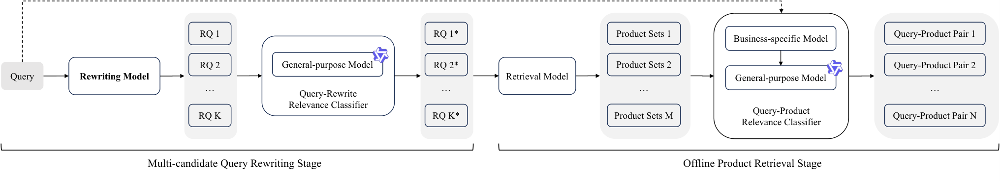
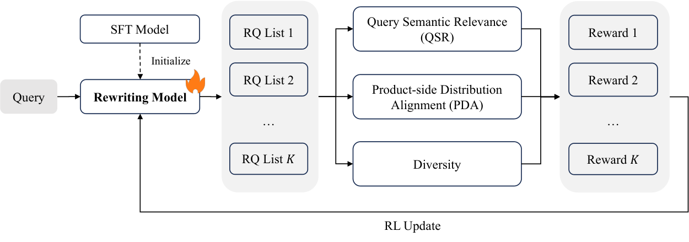

> 原文: [arXiv:2602.23620](https://arxiv.org/abs/2602.23620)（v2，2026-04-27；SIGIR ’26）
> 说明: 中英对照供阅读。英文为论文原文（PDF 转写，公式按论文整理）；中文为对应翻译。图表编号与原文一致。caption 保留英文并附中译。数值原样，未改动。

**预印本：** arXiv:2602.23620v2 [cs.IR]，2026 年 4 月 27 日。

**会议：** SIGIR ’26，2026 年 7 月 20–24 日，澳大利亚墨尔本。ACM DOI: https://doi.org/10.1145/3805712.3808409

---

# Synthetic Data Powers Product Retrieval for Long-tail Knowledge-Intensive Queries in E-commerce Search

# 合成数据赋能电商搜索中长尾知识密集型查询的商品检索

**Authors / 作者：** Gui Ling, Weiyuan Li, Yue Jiang, Wenjun Peng, Xingxian Liu, Dongshuai Li, Fuyu Lv∗, Dan Ou, Haihong Tang

∗ Corresponding author. / 通讯作者。

**Affiliation / 单位：** Taobao & Tmall Group of Alibaba，杭州

**Email / 邮箱：** linggui.lg@alibaba-inc.com；liweiyuan.lwy@alibaba-inc.com；jy270069@alibaba-inc.com；pengwj@mail.ustc.edu.cn；liuxingxian@bupt.edu.cn；lidongshuai.lds@alibaba-inc.com；fuyu.lfy@alibaba-inc.com；oudan.od@alibaba-inc.com；piaoxue@taobao.com

**Keywords / 关键词：** Data Synthesis, Product Retrieval, Query Rewriting, Large Language Model / 数据合成、商品检索、查询改写、大语言模型

**CCS Concepts：** Information systems → Information retrieval. / 信息系统 → 信息检索。

**ACM Reference：** Gui Ling, Weiyuan Li, Yue Jiang, Wenjun Peng, Xingxian Liu, Dongshuai Li, Fuyu Lv, Dan Ou, and Haihong Tang. 2026. Synthetic Data Powers Product Retrieval for Long-tail Knowledge-Intensive Queries in E-commerce Search. In Proceedings of the 49th International ACM SIGIR Conference on Research and Development in Information Retrieval (SIGIR ’26), July 20–24, 2026, Melbourne, VIC, Australia. ACM, New York, NY, USA, 5 pages. https://doi.org/10.1145/3805712.3808409

许可：Creative Commons Attribution 4.0 International License。ACM ISBN 979-8-4007-2599-9/2026/07。

---

## Abstract / 摘要

**EN.** Product retrieval is the backbone of e-commerce search: for each user query, it identifies a high-recall candidate set from billions of items, laying the foundation for high-quality ranking and user experience. Despite extensive optimization for mainstream queries, existing systems still struggle with long-tail queries, especially knowledge-intensive ones. These queries exhibit diverse linguistic patterns, often lack explicit purchase intent, and require domain-specific knowledge reasoning for accurate interpretation. They also suffer from a shortage of reliable behavioral logs, which makes such queries a persistent challenge for retrieval optimization.

**中.** 商品检索是电商搜索的骨干：对每条用户查询，它从数十亿商品中找出高召回候选集，为高质量排序和用户体验打底。尽管主流查询已被充分优化，现有系统仍难以处理长尾查询，尤其是知识密集型长尾查询。这类查询语言模式多样，常常缺少明确购买意图，准确理解需要领域知识推理。它们还缺少可靠的行为日志，因此一直是检索优化里的老大难。

**EN.** To address these issues, we propose an efficient data synthesis framework tailored to retrieval involving long-tail, knowledge-intensive queries. The key idea is to implicitly distill the capabilities of a powerful offline query-rewriting model into an efficient online retrieval system. Leveraging the strong language understanding of LLMs, we train a multi-candidate query rewriting model with multiple reward signals and capture its rewriting capability in well-curated query–product pairs through a powerful offline retrieval pipeline. This design mitigates distributional shift in rewritten queries, which might otherwise limit incremental recall or introduce irrelevant products. Experiments demonstrate that without any additional tricks, simply incorporating this synthetic data into retrieval model training leads to significant improvements. Online Side-By-Side (SBS) human evaluation results indicate a notable enhancement in user search experience.

**中.** 为此，本文提出一套面向长尾、知识密集型查询检索的高效数据合成框架。核心想法是：把一个强的离线查询改写模型的能力，隐式蒸馏进高效的在线检索系统。借助 LLM 的语言理解，用多种奖励信号训练一个多候选查询改写模型，再经强离线检索流水线，把改写能力固化成精心筛选的查询–商品对。这一设计缓解改写查询的分布偏移——否则可能限制增量召回，或引入无关商品。实验表明：不必另加花招，只要把这份合成数据放进检索模型训练，就能带来显著提升。在线并排（Side-By-Side, SBS）人工评估也显示用户搜索体验明显改善。

---

## 1 Introduction / 引言

**EN.** Large-scale e-commerce product retrieval systems such as Taobao and Amazon are essential for helping users efficiently discover relevant items from vast and dynamic inventories. Over the years, retrieval models have evolved from traditional inverted index and BM25-based methods [12] to more sophisticated semantic matching learning approaches [4, 10, 15]. Recently, the integration of large language models (LLM) has significantly advanced the field, such as LLM-powered dense retrieval [11, 16] and LLM-based generative retrieval [5]. These approaches leverage the rich world knowledge and strong generalization capabilities of LLMs, offering promising improvements in recall performance across diverse query types.

**中.** 淘宝、亚马逊这类大规模电商商品检索系统，帮助用户从庞大且不断变化的库存里高效找到相关商品。这些年，检索模型从传统倒排索引和基于 BM25 的方法 [12]，演进到更精细的语义匹配学习 [4, 10, 15]。近来，大语言模型（LLM）显著推进了这一领域，例如 LLM 驱动的稠密检索 [11, 16] 和基于 LLM 的生成式检索 [5]。这些方法利用 LLM 丰富的世界知识和强泛化能力，在多种查询类型上带来有希望的召回提升。

**EN.** Despite these advancements, we find that retrieval quality remains unsatisfactory for long-tail, knowledge-intensive queries. These queries often express complex user needs involving specific functional requirements or product descriptions, or require domain-specific knowledge or multi-hop reasoning capabilities, such as "What are the ingredients of ’Ants Climbing a Tree’ (a Chinese dish)?". Their low frequency in user logs results in little labeled training data, and manual annotation is both time-consuming and costly. As a result, even state-of-the-art retrieval models struggle to understand and match such queries to the correct products. A common way to improve long-tail retrieval is query rewriting [1, 2, 7–9], which maps rare queries to more standard, frequent forms that existing models can better handle. However, relying solely on rewriting is insufficient to address the core challenge. The fundamental limitation lies not only in query understanding but also in the lack of corresponding query-product pairs needed to train the retrieval model effectively. Even if a rewriting model produces a semantically equivalent query, the downstream retriever may still fail to return the correct item if it has never been exposed to similar product associations during training. Moreover, rewrites can inadvertently omit critical constraints or introduce intent biases, especially when the original query involves subtle specifications or rare terminology. Without high-quality labeled data that connects rewritten queries to ground-truth items, improvements in query rewriting do not translate into better retrieval results.

**中.** 即便如此，长尾、知识密集型查询的检索质量仍然不理想。这类查询常常表达复杂需求，涉及具体功能要求或商品描述，或者需要领域知识与多跳推理，例如「蚂蚁上树（一道中国菜）的配料是什么？」。它们在用户日志里出现频率低，标注训练数据很少，人工标注又费时费钱。结果是，即便当前最好的检索模型也难以理解这类查询并匹配到正确商品。改善长尾检索的常见做法是查询改写 [1, 2, 7–9]：把稀有查询映射成现有模型更能处理的、更标准、更高频的形式。但只靠改写解决不了核心问题。根本限制不只在查询理解，还在于缺少用来有效训练检索模型的对应查询–商品对。即便改写模型写出了一条语义等价的查询，下游检索器若在训练中从未见过类似的商品关联，仍可能召不回正确商品。改写还可能无意漏掉关键约束，或引入意图偏差，尤其当原查询含细微规格或罕见术语时。没有把改写查询和真实商品连起来的高质量标注，改写质量的提升不会变成更好的检索结果。

**EN.** Motivated by this observation, we propose an efficient data synthesis framework that distills offline query-rewriting capability into an efficient online retrieval system, by generating high-quality and semantically faithful training examples for retrieval tasks involving long-tail, knowledge-intensive queries. Our approach centers on optimizing a strong offline multi-candidate query rewriting model, which is expected to (i) preserve semantic consistency to avoid meaning drift, and (ii) align with the retriever’s data distribution to improve efficiency. To this end, we design a multi-reward optimization framework: Query Semantic Relevance (QSR), Product-side Distribution Alignment (PDA), and Diversity across multiple candidates. Even with these optimizations, unavoidable failure cases remain, making it difficult to deploy the rewriting model directly for recall items expansion in production. We therefore replicate the online retrieval stack to build an offline retrieval pipeline composed of stronger LLM-enhanced models. In this pipeline, the retrieval module uses rewritten queries to retrieve products and generate large-scale query–product pairs, while the relevance module scores each pair and retains those deemed highly relevant. Online Side-By-Side (SBS) human evaluations show that data augment with the synthetic data improves the Query Goodrate by up to 8.62pt.

**中.** 基于这一观察，本文提出一套高效数据合成框架：为涉及长尾、知识密集型查询的检索任务生成高质量、语义忠实的训练样本，从而把离线查询改写能力蒸馏进高效的在线检索系统。做法的中心是优化一个强的离线多候选查询改写模型，期望它 (i) 保持语义一致，避免意义漂移；(ii) 与检索器的数据分布对齐，以提高效率。为此设计多奖励优化框架：查询语义相关性（Query Semantic Relevance, QSR）、商品侧分布对齐（Product-side Distribution Alignment, PDA），以及多候选之间的多样性（Diversity）。即便做了这些优化，失败案例仍不可避免，很难把改写模型直接部署到生产里做召回商品扩展。因此复制在线检索栈，搭一条由更强、经 LLM 增强的模型组成的离线检索流水线。流水线里，检索模块用改写查询召回商品并生成大规模查询–商品对；相关性模块给每一对打分，只保留判定为高度相关的对。在线 SBS 人工评估显示：用合成数据做增强后，Query Goodrate 最高提升 8.62 个百分点。

**Caption EN.** Figure 1: Our proposed data synthesis framework targeting long-tail knowledge-intensive queries. The framework comprises two stages: (1) Multi-Candidate Query Rewriting and (2) Offline Product Retrieval. Query rewriting is the core component of the framework. The retrieval model and the business-specific query-product relevance model are optimized production models aligned with online serving system, while the query–rewrite relevance model and the general-purpose query-product relevance model are open-source LLMs without domain-specific fine-tuning.

**Caption 中.** 图 1：面向长尾知识密集型查询的数据合成框架。框架分两段：(1) 多候选查询改写；(2) 离线商品检索。查询改写是框架核心。检索模型与业务专用查询–商品相关性模型，是与在线服务对齐的、已优化的生产模型；查询–改写相关性模型与通用查询–商品相关性模型，是未经领域微调的开源 LLM。

---

## 2 Methods / 方法

**EN.** The architecture of our data synthesis framework is illustrated in Figure 1, which consists of a Multi-candidate Query Rewriting stage and an Offline Product Retrieval stage.

**中.** 数据合成框架的结构见图 1，包含多候选查询改写阶段和离线商品检索阶段。

### Rewriting Model Optimization / 改写模型优化

**EN.** In general e-commerce scenarios, the rewriting alternative expressions are used together with the original query in a candidate expansion phase to improve recall coverage. Rewriting behavior is designed to be conservative to avoid generating irrelevant variants that could lead to excessive noise in downstream. For long-tail, knowledge-intensive queries, such as "What are the ingredients of ’Ants Climbing a Tree’?", simple expansion is insufficient because retrieving relevant items requires reasoning or external knowledge. In such cases, the purpose of rewriting shifts from expanding the original query to replacing it with a set of candidate rewrites, each capturing a plausible sub-intent or interpretation. We refer to this approach as multi-candidate rewriting. The goal is to generate a diverse yet faithful set of rewrites that collectively cover the full intent space of the original query.

**中.** 一般电商场景里，改写出的备选说法会和原查询一起用于候选扩展，以提高召回覆盖。改写行为被设计得偏保守，以免生成无关变体、给下游带来过多噪声。对长尾知识密集型查询，例如「蚂蚁上树的配料是什么？」，简单扩展不够，因为召回相关商品需要推理或外部知识。此时改写的目的从「扩展原查询」转为「用一组候选改写替换它」，每条改写抓住一种说得通的子意图或解释。作者把这称为多候选改写（multi-candidate rewriting）。目标是生成一组既多样又忠实的改写，合在一起覆盖原查询的完整意图空间。

**EN.** The model follows a two-stage training paradigm: Supervised Fine-Tuning (SFT) followed by Reinforcement Learning (RL). We begin by using open-source Qwen3-30B-A3B [13] to generate a small set of rewrite pairs from real user queries. These synthetic samples are manually reviewed and cleaned according to business rules. This curated dataset is then used to train the baseline rewriting model via SFT, giving it fundamental capabilities in producing semantically consistent rewrites. We introduce a multi-reward scheme during RL training as illustrated in Figure 2. The reward function consists of three complementary components:

**中.** 模型采用两阶段训练：先监督微调（Supervised Fine-Tuning, SFT），再强化学习（Reinforcement Learning, RL）。先用开源 Qwen3-30B-A3B [13] 从真实用户查询生成一小批改写对。这些合成样本按业务规则人工审核并清洗。再用这份策展数据通过 SFT 训练基线改写模型，让它具备写出语义一致改写的基本能力。RL 训练中引入多奖励方案，如图 2。奖励函数由三个互补分量组成：

**Caption EN.** Figure 2: A multi-reward design for rewriting model optimization. In each iteration, multiple responses (each containing a rewrite list) are sampled and scored on relevance, alignment, and diversity. The three rewards are then weighted and summed to form the final reward for model updates.

**Caption 中.** 图 2：改写模型优化的多奖励设计。每一轮采样多个响应（每个响应含一条改写列表），并在相关性、对齐和多样性上打分。三路奖励加权求和，作为更新模型的最终奖励。

- **EN.** Query Semantic Relevance (QSR). This measures how well the rewritten query preserves the intent of the original. To avoid reliance on costly human annotation, we reuse the human-labeled \<query, rewrite\> pairs (positive vs. negative) from the rewriting model’s SFT data to train an LLM-based binary classifier. During RL training, the confidence derived from the model’s output logits \(z\) is used as the reward signal as Equation 1,

$$
R_{\mathrm{QSR}} = p_{\mathrm{yes}} = \frac{\exp(z_{\mathrm{yes}})}{\exp(z_{\mathrm{yes}}) + \exp(z_{\mathrm{no}})} \tag{1}
$$

  **中.** 查询语义相关性（QSR）。衡量改写在多大程度上保住了原查询的意图。为避免依赖昂贵的人工标注，复用改写模型 SFT 数据里已有人工标注的 \<query, rewrite\> 正/负对，训练一个基于 LLM 的二分类器。RL 训练时，用模型输出 logits \(z\) 得到的置信度作为奖励信号，即式 (1)。

- **EN.** Product-side Distribution Alignment (PDA). To encourage rewrites to align with actual product-side language (e.g., titles, tags), we perform continued pre-training (CPT) on a LLM using product-domain corpora to obtain a model of product expression distribution. For each rewritten query, we compute its perplexity (PPL) under this model; lower PPL indicates better alignment with real product language. In RL, we compute the alignment score using PPL as Equation 2,

$$
R_{\mathrm{PDA}} = \frac{1}{\mathrm{PPL}} = \exp\left(\frac{1}{T}\sum_{t=1}^{T}\log p(x_t \mid x_{<t})\right) \tag{2}
$$

  **中.** 商品侧分布对齐（PDA）。为鼓励改写贴近真实商品侧语言（如标题、标签），在商品领域语料上对一个 LLM 做持续预训练（continued pre-training, CPT），得到商品表达分布模型。对每条改写查询，计算它在该模型下的困惑度（perplexity, PPL）；PPL 越低，越贴近真实商品语言。RL 中用 PPL 计算对齐分数，即式 (2)。

- **EN.** Diversity Reward. Since we generate multiple rewrites per query, we promote diversity among them to capture different aspects of the original intent. We compute pairwise dissimilarity across the generated rewrites using n-gram overlap and derive a diversity score as Equation 3,

$$
R_{\mathrm{Diversity}} = \frac{1}{\binom{k}{2}} \sum_{i<j}\left(1 - \frac{|n_i \cap n_j|}{|n_i \cup n_j|}\right) \tag{3}
$$

  where \(n_i\) denotes the set of character \(n\)-grams in rewrite \(r_i\) with \(n = 2\), and \(k = 5\) denotes the number of rewrites considered.

  **中.** 多样性奖励（Diversity）。因为每条查询生成多条改写，要促进它们彼此不同，以覆盖原意图的不同侧面。用 n-gram 重叠计算生成改写之间的成对不相似度，多样性分数如式 (3)。其中 \(n_i\) 是改写 \(r_i\) 的字符 \(n\)-gram 集合，\(n = 2\)；\(k = 5\) 是参与计算的改写条数。

**EN.** Note that we employ a standard format reward commonly used in RL, and the multi-reward signal is activated only when the format is correct. Considering that all the three rewards are continuous rather than discrete, we optimize the model using the REINFORCE++ algorithm [3], a policy gradient method in reinforcement learning. The overall training objective is defined as Equation 4,

$$
\mathcal{L}_{\mathrm{RL}} = -\mathbb{E}\big[ R_{\mathrm{total}} \cdot \log p(\mathrm{rewrites}\mid\mathrm{query}) \big] \tag{4}
$$

where

$$
R_{\mathrm{total}} = \alpha R_{\mathrm{QSR}} + \beta R_{\mathrm{PDA}} + \gamma R_{\mathrm{Diversity}} \tag{5}
$$

and \(\alpha\), \(\beta\) and \(\gamma\) are hyper-parameters, heuristically set to 1.0, 0.5, and 0.1, respectively.

**中.** 另外使用 RL 里常见的标准格式奖励，只有格式正确时才激活上述多奖励信号。考虑到三路奖励都是连续值而不是离散值，用 REINFORCE++ [3] 优化模型，这是强化学习中的一种策略梯度方法。总训练目标为式 (4)，其中总奖励为式 (5)。\(\alpha\)、\(\beta\)、\(\gamma\) 为超参数，启发式取 1.0、0.5、0.1。

### Query-Rewrite Relevance Classifier / 查询–改写相关性分类器

**EN.** In the subsequent Offline Product Retrieval stage, we observe a pronounced data explosion. To reduce the inference burden on the relevance module, we introduce a rewriting classifier after the rewriting model to filter out semantically irrelevant rewrites. This classifier is initialized from a general-purpose LLM and performs conservative, high-recall filtering. We design a lightweight prompt based on a summary of business rules and ask the model to output one of three labels: relevant, partially relevant, or irrelevant. Any rewrite labeled as irrelevant is removed.

**中.** 随后的离线商品检索阶段会出现明显的数据膨胀。为减轻相关性模块的推理负担，在改写模型之后加一个改写分类器，滤掉语义无关的改写。该分类器从通用 LLM 初始化，做保守的、高召回过滤。按业务规则摘要设计一个轻量提示，让模型输出三档之一：相关、部分相关、无关。标为无关的改写一律去掉。

### Retrieval Model / 检索模型

**EN.** We use the same dense retriever as deployed online, an in-house, optimized 3B LLM-based retrieval model trained on Taobao historical user behavior data [6]. In implementation, each rewritten query is encoded into a dense embedding by the retriever and matched against the item corpus via Approximate Nearest Neighbor (ANN) to retrieve the top-200 most similar items.

**中.** 使用与线上部署相同的稠密检索器：自研、已优化的 3B LLM 检索模型，在淘宝历史用户行为数据上训练 [6]。实现上，每条改写查询由检索器编码成稠密向量，再对商品库做近似最近邻（Approximate Nearest Neighbor, ANN），取最相似的 top-200 商品。

### Query-Product Relevance Classifier / 查询–商品相关性分类器

**EN.** The relevance module is critical to the quality of the synthesized data. We employ an in-house, optimized 42B MoE-based relevance model, trained on large-scale query–product pairs annotated by business rules, which exhibits strong generalization on long-tail, knowledge-intensive queries [14]. In practice, each item retrieved by a rewritten query is paired with the original query to form a \<query, product\> instance, which is then fed into the relevance module to produce a relevance score, where higher scores indicate stronger relevance.

**中.** 相关性模块对合成数据质量至关重要。使用自研、已优化的 42B MoE 相关性模型，在按业务规则标注的大规模查询–商品对上训练，对长尾知识密集型查询泛化较强 [14]。实际做法是：改写查询召回的每一件商品，都与**原始查询**配对，形成 \<query, product\> 样本，再送入相关性模块得到相关分，分数越高表示越相关。

**EN.** Relying solely on a business-specific relevance model is insufficient. Since it is fitted to business-rule annotations and it can produce false positives that are easily distinguishable under general semantic reasoning. We find that it may overemphasize lexical overlap and incorrectly mark pairs as relevant based on term matching. For instance, the query “portable power station for camping” and a product titled “power station maintenance tool” share surface keywords but differ substantially in user intent. To address this issue, we introduce a general semantic relevance model, typically a strong open-source LLM, to perform a semantic assessment and catch false positives induced by business rules. To avoid discarding potentially valid pairs, we prompt the general model with a conservative, high-recall filtering, as in the rewriting classifier.

**中.** 只靠业务专用相关性模型不够。它拟合的是业务规则标注，会产出在一般语义推理下很容易看出来的假正例。作者发现它可能过分强调词面重叠，仅凭词项匹配就把对标成相关。例如查询 “portable power station for camping”（露营便携电源）和标题为 “power station maintenance tool”（电站维修工具）的商品共享表面关键词，用户意图却差很多。为此引入通用语义相关性模型，通常是一个强开源 LLM，做语义判断，抓住业务规则造成的假正例。为避免丢掉可能有效的对，对通用模型的提示同样是保守的、高召回过滤，与改写分类器一致。

---

## 3 Experiments / 实验

### 3.1 Experiment Setup / 实验设置

**EN.** Data Synthesis Pipeline Overview. Our full data synthesis pipeline integrates multiple specialized models: The query rewriting model is initialized from Qwen3-30B-A3B [13] and fine-tuned on domain-specific rewriting tasks. During training, we first fine-tune the model on 5K manually annotated rewriting examples, and then apply multi-reward RL to further optimize it until the rewards largely converge. During inference, the model generates a list of rewrites for each sample, containing at least 5 candidate rewritten queries. The dense retrieval model is derived from and optimized based on our in-house Tbstars-3B architecture. The business-specific relevance model is a high-capacity model built on Tbstars-42B-A3B. Both the rewrite classifier and the general-purpose relevance classifier directly use the open-source Qwen3-30B-A3B model without additional fine-tuning, serving as strong off-the-shelf filters. We collected approximately 20M pairs from 400K queries.

**中.** 数据合成流水线总览。整条流水线集成多个专用模型：查询改写模型从 Qwen3-30B-A3B [13] 初始化，并在领域改写任务上微调。训练时，先在 5K 条人工标注改写样本上微调，再做多奖励 RL，直到奖励大体收敛。推理时，模型对每个样本生成一份改写列表，至少含 5 条候选改写查询。稠密检索模型基于自研 Tbstars-3B 架构派生并优化。业务专用相关性模型是建在 Tbstars-42B-A3B 上的大容量模型。改写分类器和通用相关性分类器都直接使用开源 Qwen3-30B-A3B，不再额外微调，作为现成的强过滤器。从约 40 万条查询收集到约 2000 万对。

**EN.** Evaluation Dataset and Metrics. To facilitate a detailed evaluation of model behavior, we classify the long-tail, knowledge-intensive queries into four types based on their semantic and reasoning characteristics:

- Question-Answering: Queries phrased as questions requiring factual or explanatory responses.
- Affordable Alternative: Queries seeking affordable alternatives to premium products.
- Negative Expressions: Queries that include negative constraints.
- General Knowledge Type: All other knowledge-intensive queries that do not fall into the above three types but still require external knowledge.

**中.** 评测数据与指标。为细看模型行为，按语义与推理特点把长尾知识密集型查询分成四类：

- 问答（Question-Answering）：写成问句、需要事实或解释性回答的查询。
- 平价替代（Affordable Alternative）：寻找高端商品平价替代的查询。
- 否定表达（Negative Expressions）：带否定约束的查询。
- 一般知识类（General Knowledge Type）：不属于以上三类、但仍需要外部知识的其他知识密集型查询。

**EN.** For offline evaluation, we sample 500 queries per query type from Taobao’s online search logs to reflect the real-world query distribution. For each query, we retrieve the top-200 products using the retrieval model and manually annotate query–item relevance. We evaluate retrieval quality using Item Goodrate and Query Goodrate@N. Item Goodrate measures item-level performance by averaging, across queries, the proportion of highly relevant items in the retrieved set. Query Goodrate@N is defined as the fraction of queries for which at least \(N\) relevant items are retrieved within the top-200 results, capturing per-query coverage of relevant content.

**中.** 离线评测从淘宝在线搜索日志里按查询类型各抽 500 条，以反映真实查询分布。对每条查询，用检索模型取 top-200 商品，并人工标注查询–商品相关性。用 Item Goodrate 和 Query Goodrate@N 评检索质量。Item Goodrate 衡量商品级表现：对每条查询算召回集合中高度相关商品的比例，再对查询取平均。Query Goodrate@N 定义为：在 top-200 结果里至少召回 \(N\) 个相关商品的查询所占比例，刻画每条查询对相关内容的覆盖。

**EN.** In online A/B testing, we similarly sample 500 queries per query type and evaluate the relevance of the top-10 results on the Taobao Search Results Page (SRP). We conduct a Side-By-Side (SBS) human evaluation: SRP results from the control and treatment buckets are displayed side by side, and annotators perform blinded evaluations. We evaluate the SRP results using three key metrics: Item Goodrate, Query Goodrate and GSB (Good/Same/Bad). Query Goodrate is a page-level relevance metric measuring the proportion of queries whose SRP results are rated "Good" or "Mid" based on the relevance of displayed items. GSB measures the relative quality of SRP results, with GSB \(+x\%\) indicating that \(x\%\) of the test results are preferred over the baseline, capturing the relative improvement.

**中.** 在线 A/B 同样按查询类型各抽 500 条，评淘宝搜索结果页（Search Results Page, SRP）上 top-10 结果的相关性。做 SBS 人工评估：对照桶与实验桶的 SRP 结果并排展示，标注员盲评。用三项指标评 SRP：Item Goodrate、Query Goodrate 和 GSB（Good/Same/Bad，好/相同/差）。这里的 Query Goodrate 是页面级相关性指标，衡量 SRP 结果按展示商品相关性被评为 “Good” 或 “Mid” 的查询所占比例。GSB 衡量 SRP 结果的相对质量，GSB \(+x\%\) 表示有 \(x\%\) 的测试结果被偏好于基线，用来刻画相对提升。

### 3.2 Offline Evaluation / 离线评测

**EN.** Table 1 reports the retrieval gains from synthetic data augmentation; both settings are trained on the same scale of 200M data using Tbstars-3B. The baseline does not include any synthetic data tailored to long-tail queries, while the augmented setting incorporates such data. The data augmented version consistently improves Item Goodrate and Query Goodrate@N across all query types. The largest Item Goodrate gains come from Negative and Knowledge queries (+12.95pt and +10.73pt). Negative queries are especially difficult for standard semantic matching; for example, “non-wooden wardrobe” often still retrieves wooden wardrobes. For Knowledge queries, a substantial portion concerns outfit coordination. For example, given the query “what coat pairs with a blue dress?”, the baseline model frequently retrieves “blue coats,” which are only partially relevant and reflect a shallow interpretation of the underlying intent.

**中.** 表 1 报告合成数据增强带来的检索增益；两种设定都用 Tbstars-3B，在同样 2 亿规模的数据上训练。基线不含任何针对长尾查询的合成数据，增强设定则加入这类数据。增强版在全部查询类型上稳定提高 Item Goodrate 和 Query Goodrate@N。Item Goodrate 增益最大的是否定类和知识类（+12.95pt 与 +10.73pt）。否定查询对标准语义匹配尤其难，例如 “non-wooden wardrobe”（非木质衣柜）常常仍召回木质衣柜。知识类查询里有相当一部分是穿搭搭配。例如查询 “what coat pairs with a blue dress?”（什么外套配蓝裙子），基线模型经常召回 “blue coats”（蓝色外套），只是部分相关，反映对底层意图的浅层理解。

**表 1 / Table 1.** The Impact of Synthetic Data Augmentation on Retrieval Performance / 合成数据增强对检索表现的影响。

| Query Type (Case) / 查询类型（例子） | Item Goodrate Baseline | Item Goodrate w/ Synth. | Query Goodrate@10 Baseline | Query Goodrate@10 w/ Synth. | Query Goodrate@100 Baseline | Query Goodrate@100 w/ Synth. |
| --- | ---: | ---: | ---: | ---: | ---: | ---: |
| Q&A（What medicine can turn hair black? / 什么药能让头发变黑） | 81.85% | 87.19% (+5.34pt) | 96.31% | 97.74% (+1.43pt) | 87.73% | 91.36% (+3.63pt) |
| Alternative（Affordable alternatives to Converse shoes / 匡威鞋的平价替代） | 23.45% | 30.08% (+6.63pt) | 53.43% | 60.73% (+7.30pt) | 21.57% | 28.00% (+6.43pt) |
| Negative（Short sleeve shirt that doesn’t attract hair / 不沾头发的短袖衬衫） | 48.58% | 61.53% (+12.95pt) | 83.43% | 88.88% (+5.54pt) | 51.01% | 64.16% (+13.15pt) |
| Knowledge（Best GPU for Black Myth: Wukong / 《黑神话：悟空》的最佳显卡） | 60.58% | 71.31% (+10.73pt) | 84.61% | 89.74% (+5.13pt) | 64.60% | 74.20% (+9.60pt) |

**EN.** Evaluation of Synthetic Data. We randomly sample 1,000 query-product pairs from each query type and conduct human annotation for evaluation. As shown in Table 2, the accuracy exceeds 80% for three of the four types, and the Q&A type achieves an accuracy above 90%. The only exception is the Alternative, which falls below 80% (64.5%), consistent with our earlier results. This is largely because it requires strong domain knowledge and timely information, which the model’s inherent knowledge cannot reliably provide.

**中.** 合成数据评估。从每类查询中随机抽 1,000 对查询–商品，做人工标注。如表 2，四类里有三类准确率超过 80%，问答类超过 90%。唯一例外是平价替代类，低于 80%（64.5%），与前面的结果一致。主要原因是这类需要很强的领域知识和时效信息，模型自带知识无法稳定提供。

**表 2 / Table 2.** Accuracy Assessment of Synthesized Data / 合成数据准确率。

| | Q&A | Alternative | Negative | Knowledge |
| --- | ---: | ---: | ---: | ---: |
| Accuracy | 90.6% | 64.5% | 81.6% | 86.0% |

**EN.** Evaluation of Rewriting Model. The rewriting model’s performance strongly affects data synthesis efficiency. To quantify this effect, we compare the off-the-shelf Qwen3-30B-A3B (baseline) with our task-optimized variant. We conduct human evaluation on rewrites from both models and measure semantic consistency by accuracy. As shown in Table 3, the optimized model substantially improves rewriting accuracy. Rewriting quality is influenced by multiple factors; here we focus on the impact of our proposed PDA. Incorporating PDA markedly reduces perplexity and substantially improves the Goodrate of retrieved products, indicating better alignment with product-side language patterns.

**中.** 改写模型评估。改写模型的表现强烈影响数据合成效率。为量化这一点，把现成的 Qwen3-30B-A3B（基线）与任务优化后的变体比较。对两个模型的改写做人工评估，用准确率衡量语义一致性。如表 3，优化后的模型大幅提高改写准确率。改写质量受多种因素影响；这里只看所提 PDA 的作用。加入 PDA 明显降低困惑度，并大幅提高召回商品的 Goodrate，说明与商品侧语言模式对齐得更好。

**表 3 / Table 3.** Evaluation of Query Rewriting Optimization / 查询改写优化的评估。

| | Accuracy | PDA PPL | Item Goodrate |
| --- | ---: | ---: | ---: |
| Baseline | 39.6% | — | — |
| Opt. w/o PDA | 67.5% | 1407.4 | 54.1% |
| Opt. w/ PDA | 70.9% | 134.5 | 72.8% |

### 3.3 Online Evaluation / 在线评测

**EN.** We developed an LLM-based online retrieval pipeline that uses a query understanding model to route knowledge-intensive queries and improves the search experience with LLM-based retrieval and relevance models. We conducted online A/B testing on the Taobao platform for over four weeks, allocating 10% of long-tail-query traffic. Our optimization objective is query–product relevance, and we improved user experience without hurting order count, with user experience measured via SBS human evaluation. As shown in Table 4, the experimental group, augmented with synthetically generated data, achieves significant improvements across all three evaluation metrics and all four query types. The largest gain in Item Goodrate is observed on the Negative query type (+6.97 pts), while the highest improvement in Query Goodrate occurs on the Alternative type (+8.62 pts). These query categories often follow consistent expression patterns and represent fine-grained user intents, which are challenging for traditional retrieval systems to handle due to their semantic complexity.

**中.** 作者开发了基于 LLM 的在线检索流水线：用查询理解模型把知识密集型查询路由出去，并用基于 LLM 的检索与相关性模型改善搜索体验。在淘宝平台做了超过四周的在线 A/B，分配 10% 的长尾查询流量。优化目标是查询–商品相关性，在不伤害订单量的前提下改善用户体验，体验用 SBS 人工评估衡量。如表 4，加入合成数据的实验组在全部三项指标、全部四类查询上都有显著提升。Item Goodrate 最大增益在否定类（+6.97pt），Query Goodrate 最高增益在平价替代类（+8.62pt）。这些类别常常遵循一致的表达模式，并代表细粒度用户意图，语义复杂，传统检索系统难以处理。

**表 4 / Table 4.** Online SBS Human Evaluations / 在线 SBS 人工评估。

| Query Type | Item Goodrate | Query Goodrate | GSB |
| --- | ---: | ---: | ---: |
| Q&A | +5.12pt | +7.45pt | +19.71% |
| Alternative | +5.00pt | +8.62pt | +27.66% |
| Negative | +6.97pt | +7.65pt | +31.59% |
| Knowledge | +2.58pt | +5.82pt | +15.66% |

---

## 4 Conclusion / 结论

**EN.** We propose an efficient data synthesis framework to mitigate training data scarcity for product retrieval involving long-tail, knowledge-intensive queries. By training the rewriting model with a multi-reward framework and capturing the rewriting model’s capability as high-quality query–product pairs via an offline retrieval pipeline, we substantially improves the retrieval experience for such queries while avoiding the latency cost and rewrite instability associated with direct deployment of the rewriting model.

**中.** 本文提出一套高效数据合成框架，缓解长尾、知识密集型查询商品检索的训练数据稀缺。用多奖励框架训练改写模型，再经离线检索流水线把改写模型的能力固化成高质量查询–商品对，从而实质改善这类查询的检索体验，同时避开直接部署改写模型带来的延迟成本和改写不稳定。

**EN.** Limitations. Our framework is limited to textual knowledge and cannot effectively handle queries that depend on multimodal signals, such as requests for “same-style clothing”. In addition, although our method improves retrieval performance on “alternative” queries, the absolute performance remains suboptimal. For such queries, relying solely on the rewriting model’s parametric knowledge is insufficient.

**中.** 局限。框架限于文本知识，无法有效处理依赖多模态信号的查询，例如「同款衣服」。另外，方法虽提高了「替代」类查询的检索表现，绝对水平仍然不理想。对这类查询，只靠改写模型的参数化知识不够。

---

## References / 参考文献

正文引用编号与论文一致。下列为原文条目；中文是题名对照，不是改写后的引文。

1. Shahla Farzana, Qunzhi Zhou, and Petar Ristoski. 2023. Knowledge graph-enhanced neural query rewriting. In Companion Proceedings of the ACM Web Conference 2023. 911–919.  
   **中.** 知识图谱增强的神经查询改写。
2. Yunling Feng, Gui Ling, Yue Jiang, Jianfeng Huang, Dan Ou, Qingwen Liu, Fuyu Lv, and Yajing Xu. 2025. Complicated Semantic Alignment for Long-Tail Query Rewriting in Taobao Search Based on Large Language Model. In Proceedings of the 31st ACM SIGKDD Conference on Knowledge Discovery and Data Mining V. 2. 4435–4446.  
   **中.** 基于大语言模型的淘宝搜索长尾查询改写中的复杂语义对齐。
3. Jian Hu, Jason Klein Liu, Haotian Xu, and Wei Shen. 2025. Reinforce++: An efficient rlhf algorithm with robustness to both prompt and reward models. arXiv:2501.03262.  
   **中.** REINFORCE++：对提示模型和奖励模型都更稳健的高效 RLHF 算法。
4. Po-Sen Huang, Xiaodong He, Jianfeng Gao, Li Deng, Alex Acero, and Larry Heck. 2013. Learning deep structured semantic models for web search using clickthrough data. In Proceedings of the 22nd ACM international conference on Information & Knowledge Management. 2333–2338.  
   **中.** 用点击数据学习用于网页搜索的深度结构化语义模型。
5. Mingming Li, Huimu Wang, Zuxu Chen, Guangtao Nie, Yiming Qiu, Guoyu Tang, Lin Liu, and Jingwei Zhuo. 2024. Generative retrieval with preference optimization for e-commerce search. arXiv:2407.19829.  
   **中.** 面向电商搜索的偏好优化生成式检索。
6. Xingxian Liu, Dongshuai Li, Tao Wen, Jiahui Wan, Gui Ling, Fuyu Lv, Dan Ou, and Haihong Tang. 2025. Taosearchemb: A multi-objective reinforcement learning framework for dense retrieval in taobao search. arXiv:2511.13885.  
   **中.** Taosearchemb：淘宝搜索稠密检索的多目标强化学习框架。
7. Duy A Nguyen, Rishi Kesav Mohan, Van Yang, Pritom Saha Akash, and Kevin Chen-Chuan Chang. 2025. RL-based Query Rewriting with Distilled LLM for online E-Commerce Systems. arXiv:2501.18056.  
   **中.** 面向在线电商系统、用蒸馏 LLM 做的基于 RL 的查询改写。
8. Wenjun Peng, Guiyang Li, Yue Jiang, Zilong Wang, Dan Ou, Xiaoyi Zeng, Derong Xu, Tong Xu, and Enhong Chen. 2024. Large language model based long-tail query rewriting in taobao search. In Companion Proceedings of the ACM Web Conference 2024. 20–28.  
   **中.** 淘宝搜索中基于大语言模型的长尾查询改写。
9. Yiming Qiu, Kang Zhang, Han Zhang, Songlin Wang, Sulong Xu, Yun Xiao, Bo Long, and Wen-Yun Yang. 2021. Query rewriting via cycle-consistent translation for e-commerce search. In 2021 IEEE 37th International Conference on Data Engineering (ICDE). IEEE, 2435–2446.  
   **中.** 用循环一致翻译做电商搜索的查询改写。
10. Nils Reimers and Iryna Gurevych. 2019. Sentence-bert: Sentence embeddings using siamese bert-networks. arXiv:1908.10084.  
    **中.** Sentence-BERT：用孪生 BERT 网络做句向量。
11. Hongjin Su, Weijia Shi, Jungo Kasai, Yizhong Wang, Yushi Hu, Mari Ostendorf, Wen-tau Yih, Noah A Smith, Luke Zettlemoyer, and Tao Yu. 2022. One embedder, any task: Instruction-finetuned text embeddings. arXiv:2212.09741.  
    **中.** 一个嵌入器、任意任务：指令微调的文本嵌入。
12. Krysta M Svore and Christopher JC Burges. 2009. A machine learning approach for improved BM25 retrieval. In Proceedings of the 18th ACM conference on Information and knowledge management. 1811–1814.  
    **中.** 用机器学习改进 BM25 检索。
13. An Yang et al. 2025. Qwen3 technical report. arXiv:2505.09388.  
    **中.** Qwen3 技术报告。
14. Jianhui Yang, Yiming Jin, Pengkun Jiao, Chenhe Dong, Zerui Huang, Shaowei Yao, Xiaojiang Zhou, Dan Ou, and Haihong Tang. 2025. TaoSR-AGRL: Adaptive Guided Reinforcement Learning Framework for E-commerce Search Relevance. arXiv:2510.08048.  
    **中.** TaoSR-AGRL：电商搜索相关性的自适应引导强化学习框架。
15. Xinyang Yi, Ji Yang, Lichan Hong, Derek Zhiyuan Cheng, Lukasz Heldt, Aditee Kumthekar, Zhe Zhao, Li Wei, and Ed Chi. 2019. Sampling-bias-corrected neural modeling for large corpus item recommendations. In Proceedings of the 13th ACM conference on recommender systems. 269–277.  
    **中.** 面向大规模语料商品推荐、校正采样偏差的神经建模。
16. Yanzhao Zhang et al. 2025. Qwen3 Embedding: Advancing Text Embedding and Reranking Through Foundation Models. arXiv:2506.05176.  
    **中.** Qwen3 Embedding：用基础模型推进文本嵌入与重排。
