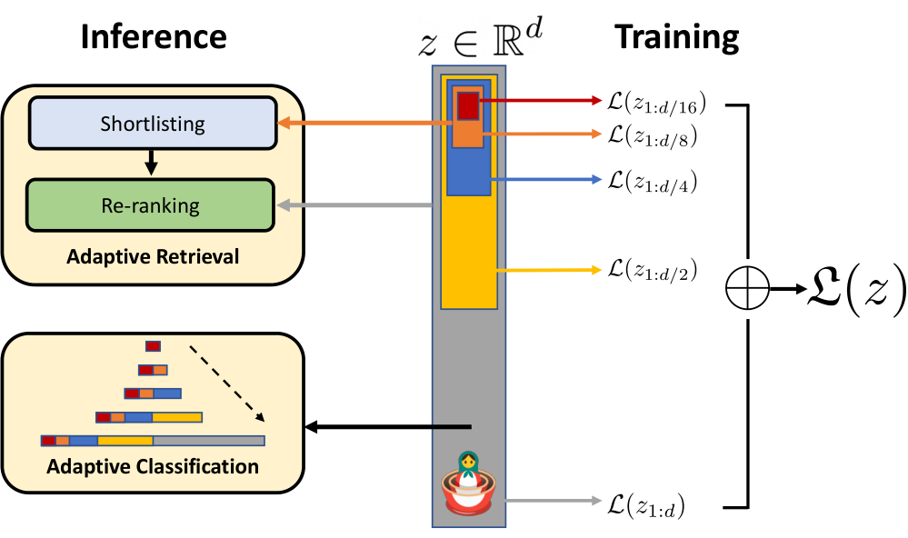

# MRL：Matryoshka Representation Learning

> 在同一个表示的多个前缀维度上同时训练，让一次编码产出的向量按预算截短，并支持由粗到细的分类与检索。
>
> Aditya Kusupati 等 · NeurIPS 2022 · [论文](https://proceedings.neurips.cc/paper_files/paper/2022/hash/c32319f4868da7613d78af9993100e42-Abstract-Conference.html) · [arXiv](https://arxiv.org/abs/2205.13147) · [代码](https://github.com/RAIVNLab/MRL)

## 论文简介

固定维度表示要求训练时预先决定部署预算：向量过大增加存储和检索开销，过小又损失表达能力。MRL 借用套娃的嵌套结构，在同一个完整向量的多个前缀上施加任务损失，使短前缀和长前缀都能独立使用。它不需要为每种维度训练一套编码器，也不依赖推理后额外学习的降维映射。

原论文覆盖 ImageNet/JFT 视觉分类、ALIGN 图文对比学习和 BERT 语言建模，并研究自适应分类、多阶段检索、长尾与稳健性。在具体 ImageNet 配置中，低维召回再高维重排带来约 14 倍实际检索加速；这不表示 Transformer 编码速度提高 14 倍，也不保证任意维度与任务都无损。

## 问题与相关工作

传统固定表示（fixed features，FF）为每个维度独立训练；SVD 等方法则训练后压缩。Slimmable networks 改变网络宽度，模型级级联可能需要多次前向。MRL 的切入点是**输出表示的前缀容量**：一次前向得到完整向量，不同下游任务或不同难度样本选择不同维数。

图中多个任务头读取同一表示的不同长度前缀；部署时短前缀可用于候选筛选，长前缀用于更精细判别。编码器参数共享，前缀包含关系由坐标切片直接保证。

## 训练目标

设编码器输出 $z=F_\theta(x)\in\mathbb R^d$，选择嵌套维度集合 $\mathcal M$。分类场景下，每个长度 $m$ 有自己的线性头 $W^{(m)}$：

$$
\min_{\theta,\{W^{(m)}\}}
\frac1N\sum_{i=1}^{N}\sum_{m\in\mathcal M}
c_m\,\mathcal L\bigl(W^{(m)}z_{i,1:m},y_i\bigr).
$$

论文默认 $c_m=1$，使用按倍数增长的维度集合，如 ResNet50 的 $\{8,16,32,64,128,256,512,1024,2048\}$。前面的坐标同时接受很多尺度的监督，后面的坐标在高维目标中补充信息。但每一维没有预先指定的语义名称，不能把“粗到细”解释成已知概念槽位。

**MRL-E**进一步共享线性头：$W^{(m)}=W_{:,1:m}$。这样减少多个分类头的额外参数，适合大输出词表或需要输入／输出权重绑定的语言模型。它与标准 MRL 的独立头有精度和成本取舍。

对对比学习，在每个 $m$ 上分别计算两侧前缀的对比损失；若使用归一化，应对各个前缀**分别归一化**。只把完整单位向量截断，并不保持其范数为 1。

## 数据、模型与对照

| 场景 | 模型与数据 | 主要评测 |
|---|---|---|
| 监督视觉表示 | ResNet50，ImageNet-1K | 线性分类、1-NN、图像检索 |
| 大规模视觉表示 | ViT-B/16，JFT-300M | 迁移与低维表示质量 |
| 图文对比 | ALIGN 的 ViT/BERT 双编码器 | 图文表示与视觉迁移 |
| 语言建模 | BERT，Wikipedia + BooksCorpus | 不同表示维度的语言任务 |

ResNet50 输出 2048 维，ViT/BERT 的相关实验输出 768 维，后者使用 $\{12,24,48,96,192,384,768\}$。对照包括独立训练的低维模型、SVD、随机选取完整向量特征，以及 slimmable networks。大规模实验代价较高，有些低维对照采用从全维模型取随机特征，不能把它们全部称为逐维最优独立训练模型。

## 分类与自适应分类

ImageNet-1K 上，MRL 在多个前缀维度达到或超过对应 FF 模型；低维 1-NN 最高约提升 2 个百分点。MRL-E 在 16 维以上通常距标准 MRL 较近。SVD 或随机特征在很低维时退化更明显，表明训练时要求前缀有用，与训练后随意切片不同。

自适应分类先运行低维分类头，根据验证集上学习的最大 softmax 概率阈值判断是否升级维数。困难样本使用更长前缀，简单样本提前停止。论文在 ImageNet-1K 上以平均约 37 维达到 76.30% 准确率，与 512 维 FF 参照相当，因此得到约 14 倍的**期望表示维数**节省。完整编码器前向仍然执行，不应把这项比例描述为端到端模型推理加速。

## 图像检索与自适应检索

ImageNet-1K 约 130 万库图、5 万查询；ImageNet-4K 约 420 万库图、20 万查询，相关性按类别定义。向量单位归一化后用 L2 距离，指标包括 mAP@k 和 P@k，另测 exact search 与 HNSW 时间。

两阶段检索先用较短前缀得到 $K=200$ 候选，再用较长前缀重排。ImageNet-1K 中 $D_s=16,D_r=2048$ 接近全维检索质量，理论检索运算减少约 128 倍，同硬件 HNSW 实际加速约 14 倍；更难的 ImageNet-4K 需要 $D_s=64$，对应约 32 倍理论、6 倍实际加速。

这些比例针对搜索部分及其配置，不包括把整个图像编码过程同倍缩短。精排需访问高维向量，若仍保存全维副本，总存储也不会因为第一阶段 16 维就自动降低 128 倍。

**Funnel retrieval**把这一过程扩展为多级：例如候选 $200\to100\to50\to25\to10$，表示从 $16\to32\to64\to128\to256\to2048$。逐步提高表示精度并收缩候选，减少对所有文档都计算完整距离的浪费。

## 分析与消融

论文在 ImageNetV2/R/A/Sketch 等分布偏移集合上检查稳健性，MRL 整体不弱于 FF；在 FLUID 长尾序列学习中，新出现的尾部类最高约有 2 个百分点增益。作者认为不同任务和类别需要不同容量，但并未保证维度越高每个样本都更准。

相反，论文明确发现某些样本在短前缀更准确。若有理想路由选择最佳维度，分类可进一步提高约 4.6 个百分点；这是 oracle 分析，不能当作已实现的部署成绩。Grad-CAM 与超类分析显示，低维更容易保留粗类别，细类别和多物体区分更依赖额外维度。

消融覆盖各尺度损失权重、起始维度、对数或均匀间隔、部分微调、候选数和召回维数。太小的起始维度可能效果很差，更多候选和更长前缀也会出现收益饱和。论文还观察到未显式训练的中间维度可插值使用，但这仍应通过目标任务验证。

## 附录与结论

附录给出标准 MRL/MRL-E 伪代码、各模态训练设置、自适应分类阈值、完整检索指标、实际耗时与索引开销、长尾与稳健性结果，以及多组消融。原论文中心是**通用表示容量的可伸缩性**，不是只为文本 embedding 节省向量数据库空间。

MRL 让表示预算从一次性选择变成可调参数；它与向量量化、ANN 和重排可以组合，但不替代这些技术。压缩过度仍会丢失细粒度信息，第一阶段漏掉的候选无法靠高维重排恢复，实际收益依赖任务难度和系统开销。
