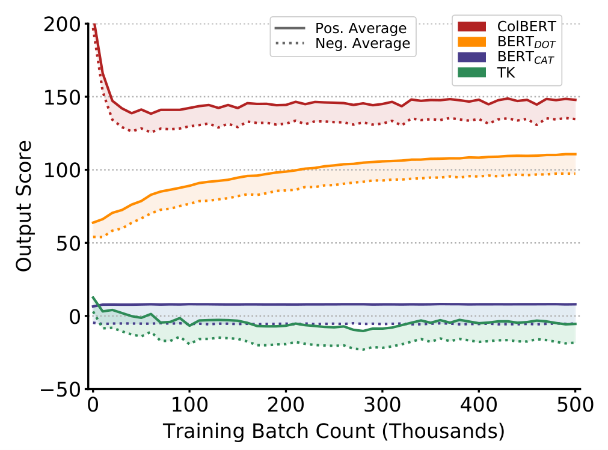
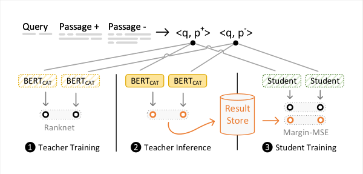
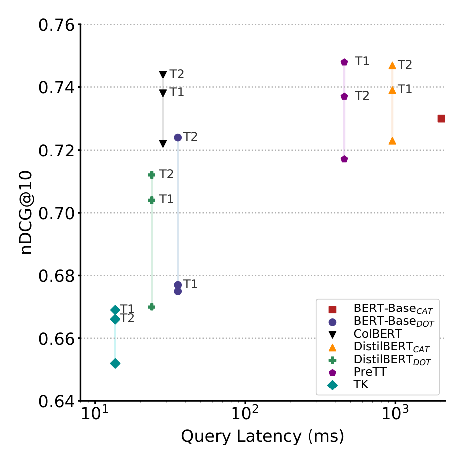
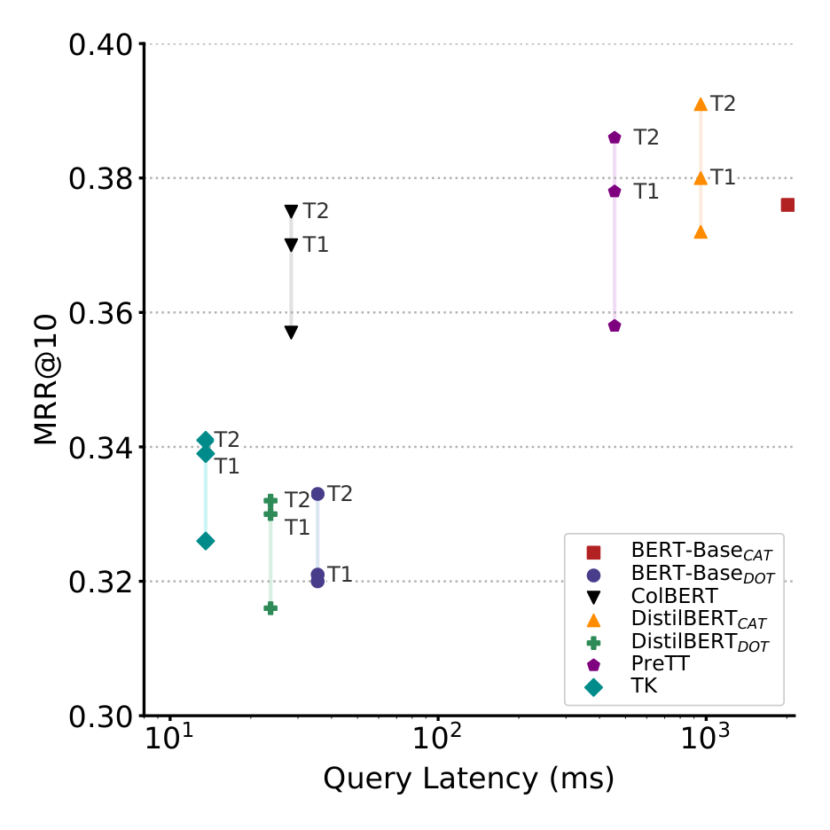
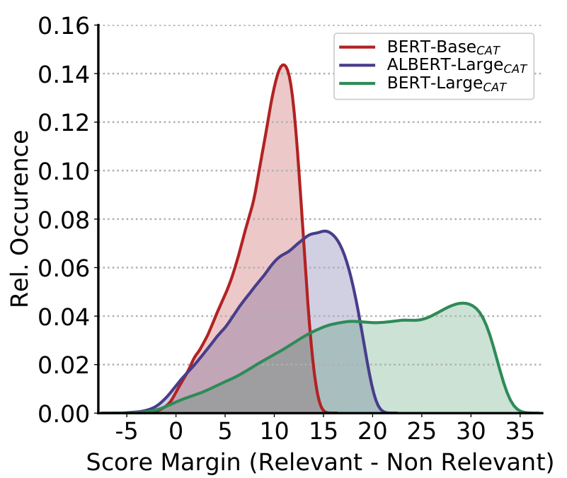
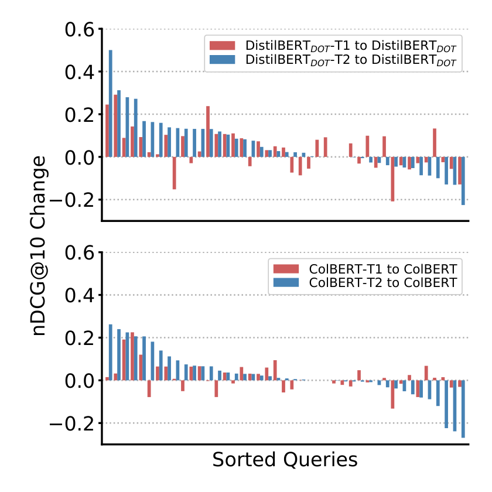

# Margin-MSE 研读笔记：只蒸间隔，不蒸绝对分，于是教师可以换架构

> **paper**：[Improving Efficient Neural Ranking Models with Cross-Architecture Knowledge Distillation](https://arxiv.org/abs/2010.02666)（Hofstätter, Althammer, Schröder, Sertkan, Hanbury；TU Wien；arXiv:2010.02666v2）
> **code / data**：[sebastian-hofstaetter/neural-ranking-kd](https://github.com/sebastian-hofstaetter/neural-ranking-kd)（含可直接复用的教师分数文件）
> **refs**：[ColBERT 2004.12832](https://arxiv.org/abs/2004.12832) · [PreTT 2004.14255](https://arxiv.org/abs/2004.14255) · [DistilBERT 1910.01108](https://arxiv.org/abs/1910.01108) · [Hinton KD 1503.02531](https://arxiv.org/abs/1503.02531)
> **backbone**：教师为 BERT$_\mathrm{CAT}$（BERT-Base / BERT-Large-WWM / ALBERT-Large 三种）；学生为 6 层 DistilBERT 的 BERT$_\mathrm{CAT}$ / BERT$_\mathrm{DOT}$ / ColBERT / PreTT，以及 2 层 300 维的 TK
> **date**：2020-10（v1）→ 2021-01-22（v2），arXiv 预印本
> **modality**：英文文本段落排序；重排与稠密最近邻检索两种用法
> **languages**：英文（MS MARCO-Passage、TREC-DL'19）

**一句话**：排序模型的分数是无界的、各架构量纲不同，所以别让学生去拟合教师的绝对分，只让它拟合「正例分 − 负例分」这个间隔；这样一个 BERT$_\mathrm{CAT}$ 教师可以教任何结构的学生。

全文逐段中英对照见同目录 [zh.md](zh.md)。本文不重复对照译文，只把观察、损失、流程和四张表的口径写清。

这篇是检索蒸馏里被引最多的损失之一。后面 GPL、R-GPL、TCT-ColBERT、一大批 `msmarco-*-margin-mse` 权重都建在它上面，本仓库的 [GPL](../GPL/GPL详解.md)、[R-GPL](../R-GPL/R-GPL详解.md) 两篇都把它当前置依赖。它的贡献不是新架构，而是一个三行就能写完的损失，加上一份「把教师分数算好存盘、别人直接下载」的工程约定。本文数字只取论文表内与正文写出的原值；正文说法与表格对不上的地方，统一在文末「与表格核对后的几处口径」里列出。

---

## 术语与记号

| 术语 | 含义 |
|------|------|
| BERT$_\mathrm{CAT}$ | 查询与段落拼成一条序列送进 BERT，取 CLS 打分。最准，但查询时必须把所有层算完，无法预计算 |
| BERT$_\mathrm{DOT}$ | 双塔：查询、段落各自编码成一个 CLS 向量，点积打分。段落可离线建索引 |
| ColBERT | 迟交互：保留每个词的向量，查询词对段落词取 max 再求和 |
| PreTT | 介于两者之间：前 $b$ 层查询/段落分开算，之后拼起来再算剩余层 |
| TK（Transformer-Kernel） | 非 BERT 路线，浅层 Transformer + 核池化（kernel-pooling），最省算力 |
| 重排（re-ranking） | 先用 BM25 取前 1000，再用神经模型给这 1000 条重新排序 |
| 稠密检索（dense retrieval） | 不做第一阶段，直接在全库向量索引上做最近邻 |
| 间隔（margin） | 同一查询下，正例得分减负例得分 |
| 教师集成（teacher ensemble） | 多个教师对同一对 (query, passage) 的分数取平均 |
| 三元组（triple） | (查询, 相关段落, 不相关段落)，MS MARCO 的标准训练单位 |
| nDCG@10 / MRR@10 / MAP | 前 10 名按位置折扣的归一化增益 / 第一个相关结果位置的倒数 / 平均精度均值 |
| RankNet | 成对排序损失，只管「正例是否排在负例前」，不管差多少 |

---

## 研究背景

### 查询时的算力搬不走，才有了这一堆架构

传统 IR 的省时办法是尽量把计算挪到索引阶段，查询时少干活。BERT$_\mathrm{CAT}$ 做不到：查询和段落拼在一起，任何一层都依赖查询，没法预计算，查询延迟按秒计。社区因此主动用效果换效率，造出 TK、ColBERT、PreTT、BERT$_\mathrm{DOT}$ 这几类低延迟架构，它们都能把段落表示离线算好。

表 1 是这五种模型用 DistilBERT 实例化后的横向对比。Effectiveness 一列是相对基线 nDCG@10 的倍数（MSMARCO-DEV），延迟是 1 条查询对 1000 篇文档、段落表示已缓存时的测量值。

| 模型 | Effectiveness | 查询延迟 | GPU 显存 | 查询-段落交互 | 段落可缓存 | 可建 NN 索引 | 存储需求（× 向量大小） |
|------|---:|---:|---:|---|:--:|:--:|---|
| BERT$_\mathrm{CAT}$ | 1 | 950 ms | 10.4 GB | 全部 TF 层 | – | – | – |
| BERT$_\mathrm{DOT}$ | × 0.87 | 23 ms | 3.6 GB | 单次点积 | ✓ | ✓ | $\lvert P\rvert$ |
| ColBERT | × 0.97 | 28 ms | 3.4 GB | $m \ast n$ 次点积 | ✓ | ✓ | $\lvert T\rvert$ |
| PreTT | × 0.97 | 455 ms | 10.9 GB | 至少 1 个 TF 层（这里 3） | ✓ | – | $\lvert T\rvert$ |
| TK | × 0.89 | 14 ms | 1.8 GB | $m \ast n$ 次点积 + 核池化 | ✓ | – | $\lvert T\rvert$ |

$\lvert P\rvert$ 是段落数，$\lvert T\rvert$ 是全库词次数，$m$、$n$ 是查询与文档长度。读这张表要注意两件事：ColBERT 和 PreTT 的效果已经到教师的 0.97，但 PreTT 的 455 ms 并不便宜；ColBERT 的存储按词次计，所以只适合小库——后面稠密检索实验里，ColBERT 建全库索引会把 2 GB 纯文本撑成 2 TB，作者因此放弃了那组实验。

作者给自己提了四个问题，全文按它们组织：**RQ1** 跨架构怎么蒸；**RQ2** 单教师还是教师集成；**RQ3** 蒸馏对稠密最近邻检索有没有用；**RQ4** 蒸完之后效率-效果的平衡点挪了多少。

### 关键观察：不同架构的分数量纲根本不一样

**图在讲什么。** 横轴是训练批次数（千），纵轴是模型输出的原始分数，每种架构画两条线——正例均分和负例均分，中间阴影就是间隔。四种模型各自飘向完全不同的区间：BERT$_\mathrm{CAT}$ 的正例分在零上方、负例均分在零下方；TK 的两条线都在负区；BERT$_\mathrm{DOT}$ 和 ColBERT 因为用点积打分，分数被推到 150 以上的高位。这张图是全文的立论点：排序分数是无界的，最终排名只取决于同一查询下候选之间的相对次序，所以「学生去逼近教师的绝对分数」这个要求是多余的，甚至是有害的——它等于强迫 ColBERT 把自己的输出从 150 压到 BERT$_\mathrm{CAT}$ 的 0 附近。既然如此，只对齐阴影的高度就够了。

---

## 相关工作中的位置

蒸馏在 IR 里此前基本是**同架构**的：Gao et al.、Chen et al.、Li et al.（PARADE）都是把 BERT$_\mathrm{CAT}$ 蒸成层数/维度更少的 BERT$_\mathrm{CAT}$，TinyBERT 那条线也是。同架构蒸馏的毛病是学生仍然是拼接式的，线上还得全量在线推理，架构性的延迟缺陷一点没解决。

唯一的跨架构先例是 TwinBERT（Lu et al.）：从 BERT$_\mathrm{CAT}$ 蒸到 BERT$_\mathrm{DOT}$，但任务被限制在赞助搜索的关键词列表匹配，不是全文排序。本文把这条路放到通用段落排序上，并且学生不限于双塔。

另一条邻近的线是**改训练流程**而非改损失：ANCE 用近邻挖负例，RocketQA 用交叉编码器去噪并加超大批量，MacAvaney 等人做课程学习。作者明确说本文不与它们竞争，而是正交——结论里把「Margin-MSE 叠加课程学习 / 动态索引采样」列为后续工作。

---

## 方法

### 五种打分函数

教师只有一种：

$$
\mathrm{BERT_{CAT}}(q_{1:m}, p_{1:n}) = \mathrm{BERT}([\mathrm{CLS}; q_{1:m}; \mathrm{SEP}; p_{1:n}])_1 \ast W_s
$$

下标 1 表示取 CLS 位置，$W_s$ 是单层线性打分头。学生这边四种：

BERT$_\mathrm{DOT}$ 两路独立编码后点积，段落向量 $\hat{p}$ 可以全部离线算好：

$$
\hat{q} = \mathrm{BERT}([\mathrm{CLS}; q_{1:m}])_1 \ast W_s,\quad
\hat{p} = \mathrm{BERT}([\mathrm{CLS}; p_{1:n}])_1 \ast W_s,\quad
\mathrm{BERT_{DOT}} = \hat{q} \cdot \hat{p}
$$

ColBERT 保留全部词向量，查询侧把 MASK 重复若干次做增强（本文固定重复 8 次），打分是每个查询词对段落取 max 再求和：

$$
\hat{q}_{1:m} = \mathrm{BERT}([\mathrm{CLS}; q_{1:m}; \mathrm{rep(MASK)}]) \ast W_s,\quad
\hat{p}_{1:n} = \mathrm{BERT}([\mathrm{CLS}; p_{1:n}]) \ast W_s
$$

$$
\mathrm{ColBERT}(q_{1:m}, p_{1:n}) = \sum_{1}^{m} \max_{1..n} \hat{q}^{T}_{1:m} \cdot \hat{p}_{1:n}
$$

PreTT 前 $b$ 层分开算、之后拼起来算到第 $\hat{b}$ 层（本文 6 层里切在第 3 层）：

$$
\hat{q}_{1:m} = \mathrm{BERT}_{1:b}([\mathrm{CLS}; q_{1:m}]),\quad \hat{p}_{1:n} = \mathrm{BERT}_{1:b}([\mathrm{CLS}; p_{1:n}])
$$

$$
\mathrm{PreTT}(q_{1:m}, p_{1:n}) = \mathrm{BERT}_{b:\hat{b}}([\hat{q}_{1:m}; \mathrm{SEP}; \hat{p}_{1:n}])_1 \ast W_s
$$

TK 不走 BERT 预训练，用门控 $\alpha$ 调节浅层 Transformer 的上下文化强度，再做核池化：

$$
\hat{q}_i = q_i \ast \alpha + \mathrm{TF}(q_{1:m})_i \ast (1-\alpha),\quad
\hat{p}_i = p_i \ast \alpha + \mathrm{TF}(p_{1:n})_i \ast (1-\alpha)
$$

$$
K^{k}_{i,j} = \exp\left(-\frac{(\cos(\hat{q}_i, \hat{p}_j) - \mu_k)^2}{2\sigma^2}\right),\quad
\mathrm{TK}(q_{1:m}, p_{1:n}) = \sum_{i=1}^{m} \log\left(\sum_{j=1}^{n} K^{k}_{i,j}\right) \ast W_s
$$

核池化是一个软直方图：每个核 $k$ 盯住以 $\mu_k$ 为中心、宽 $\sigma$ 的一段相似度区间，数「有多少词对的相似度落在这一档」。

### Margin-MSE

这是全文唯一的新东西。批次里是三元组 $(Q, P^{+}, P^{-})$，拿教师 $M_t$ 的间隔当标签去优化学生 $M_s$：

$$
\mathcal{L}(Q, P^{+}, P^{-}) = \mathrm{MSE}\big(M_s(Q,P^{+}) - M_s(Q,P^{-}),\; M_t(Q,P^{+}) - M_t(Q,P^{-})\big)
$$

$$
\mathrm{MSE}(S,T) = \frac{1}{\lvert S\rvert}\sum_{s \in S, t \in T}(s-t)^2
$$

注意三点。第一，**没有前导负号**，就是一个普通的平方差，目标是把它最小化。（GPL 原文转引这条式子时印成了带负号的形式，与「模仿教师间隔」的文字目标矛盾；本仓库 [GPL 详解](../GPL/GPL详解.md) 里标注的那处疑问，以这里的原始式为准。）第二，**原始的 0/1 相关性标签被完全丢掉了**，损失里只剩教师间隔。作者的理由是教师在训练数据上的成对排序准确率超过 98%，再把二值信息加回排序损失是冗余的。第三，**间隔允许为负**：教师认为标注的「正例」其实不如「负例」时，间隔是负数，学生会跟着把次序反过来。作者人工看了几十个这类样本，认为教师多数时候判断正确，于是原样保留，不清洗训练数据。

### 三段式流程：教师分数算一次，存盘复用

**图在讲什么。** 左边是同一批 (Query, Passage+, Passage−) 被拆成 `<q,p+>` 和 `<q,p->` 两个对。➊ 教师训练：BERT$_\mathrm{CAT}$ 用 RankNet 损失在数据集原始标签上训好。➋ 教师推理：训好的教师不再更新权重，把全部训练三元组的分数跑出来，写进 Result Store。➌ 学生训练：任意架构的学生读这份存盘分数，用 Margin-MSE 训练。三步刻意复用同一批三元组，这样第二步的产物就是一个可以分发的文件——作者把它打包发布，别人复现时不必再训教师，这也是这篇论文实际影响力的主要来源。

### 对照的两个蒸馏损失

为了证明「只蒸间隔」是必要的，作者对比了两种写法。逐点 MSE 直接对齐两个绝对分数：

$$
\mathcal{L}(Q, P^{+}, P^{-}) = \mathrm{MSE}\big(M_s(Q,P^{+}), M_t(Q,P^{+})\big) + \mathrm{MSE}\big(M_s(Q,P^{-}), M_t(Q,P^{-})\big)
$$

加权 RankNet 保留成对排序损失，但用教师间隔的绝对值当样本权重：

$$
\mathcal{L}(Q, P^{+}, P^{-}) = \mathrm{RankNet}\big(M_s(Q,P^{+}) - M_s(Q,P^{-})\big) \ast \lVert M_t(Q,P^{+}) - M_t(Q,P^{-})\rVert
$$

三者的差别可以这么理解：逐点 MSE 要求学生连量纲一起学（按图 1，这是在为难它）；加权 RankNet 只用教师决定「这一对值不值得重视」，丢掉了间隔的数值；Margin-MSE 保留数值但放掉量纲。

---

## 实验设置

### 数据集

**MS MARCO-Passage**：从 Bing 真实查询采样而来，880 万段落，官方给出约 4000 万条采样三元组。它的标注是稀疏二值的——每条查询往往不到两个正例，并且**没有显式的负例标注**，负例是从传统检索系统的前 1000 名里随机取的，所以偶尔会误取到真正相关的段落。这恰好是 Margin-MSE 允许负间隔的现实动机。评测用 **MSMARCO-DEV** 的 49,000 条查询（稀疏标注、查询多）。

**TREC-DL'19 Passage**：43 条查询，密集标注、分级相关性。算 MRR 和 MAP 时按相关度 ≥ 2 二值化。查询只有 43 条，单列排名会抖，这也是后面 T2 在 TREC 上偶尔不如 T1 的背景。

两个查询集的性格相反：DEV 查询多、每条标注少；TREC 查询少、每条标注全。作者的结论基本都靠「DEV 上稳定、TREC 上有例外」这个组合说出来。

### 训练配置

PyTorch + HuggingFace Transformers；第一阶段索引与检索用 Anserini，BM25 取 Anserini 文档里的调优参数。Adam，BERT 层学习率 $7\times10^{-6}$（不论训多少层都一样），只有 TK 用更高的 $10^{-5}$。批大小 32。按验证集 nDCG@10 早停。查询截断 30 token，段落截断 200 token。

学生统一从 **6 层 DistilBERT** 起训（作者选它而非 BERT-Base，因为它以一半运行时间给出接近的下界）。ColBERT 的查询 MASK 固定重复 8 次，不随批内 padding 变化；PreTT 在 6 层里的第 3 层拼接；TK 用标准 2 层、300 维词向量配置。

### 教师

三个 BERT$_\mathrm{CAT}$，差别只在底座语言模型：BERT-Base、BERT-Large-WWM（whole word masking）、ALBERT-Large。教师自己用 **RankNet** 损失训练。

- **T1** = BERT-Base$_\mathrm{CAT}$ 单教师，选它是因为它最常见；
- **T2** = 三者的 Top-3 集成，做法是对每个 (query, passage) 对**把三个分数取平均**，不引入更复杂的加权。

---

## 实验结果

### 损失函数消融：Margin-MSE 在三种架构上全胜

表 2，MSMARCO-DEV，统一用单教师 T1，`–` 是不蒸馏的原始训练基线。

| 模型 | KD 损失 | nDCG@10 | MRR@10 | MAP@100 |
|------|---------|---:|---:|---:|
| ColBERT | – | .417 | .357 | .361 |
| ColBERT | Weighted RankNet | .417 | .356 | .360 |
| ColBERT | Pointwise MSE | .428 | .365 | .369 |
| ColBERT | **Margin-MSE** | **.431** | **.370** | **.374** |
| BERT$_\mathrm{DOT}$ | – | .373 | .316 | .321 |
| BERT$_\mathrm{DOT}$ | Weighted RankNet | .384 | .326 | .332 |
| BERT$_\mathrm{DOT}$ | Pointwise MSE | .387 | .328 | .332 |
| BERT$_\mathrm{DOT}$ | **Margin-MSE** | **.388** | **.330** | **.335** |
| TK | – | .384 | .326 | .331 |
| TK | Weighted RankNet | .387 | .328 | .333 |
| TK | Pointwise MSE | .394 | .335 | .340 |
| TK | **Margin-MSE** | **.398** | **.339** | **.344** |

三个架构、三项指标共 9 格，Margin-MSE 全部最高。值得单看的是加权 RankNet 在 ColBERT 上**完全没用**：nDCG@10 与基线同为 .417，MRR 和 MAP 还各掉 0.001。这正好反证了立论——只知道「哪一对更重要」而丢掉间隔数值，信息量不够。而逐点 MSE 虽然在为难学生的量纲，却仍然明显优于基线（ColBERT .428 对 .417），说明教师分数本身携带的细粒度信息很值钱，Margin-MSE 的增量是在此之上再省掉量纲约束。

### 重排：学生能越过单个教师

表 3。每个学生三行：`–` 不蒸馏、T1 单教师、T2 集成。

| 模型 | Teacher | TREC nDCG@10 | TREC MRR@10 | TREC MAP@1000 | DEV nDCG@10 | DEV MRR@10 | DEV MAP@1000 |
|------|---|---:|---:|---:|---:|---:|---:|
| **基线** | | | | | | | |
| BM25 | – | .501 | .689 | .295 | .241 | .194 | .202 |
| TREC Best Re-rank | – | .738 | .882 | .457 | – | – | – |
| BERT$_\mathrm{CAT}$ 6 层蒸馏最佳（Gao et al.） | – | .719 | – | – | – | .356 | – |
| BERT-Base$_\mathrm{DOT}$ ANCE | – | .677 | – | – | – | .330 | – |
| **教师** | | | | | | | |
| $T1$ BERT-Base$_\mathrm{CAT}$ | – | .730 | .866 | .455 | .437 | .376 | .381 |
| BERT-Large-WM$_\mathrm{CAT}$ | – | .742 | .860 | .484 | .442 | .381 | .385 |
| ALBERT-Large$_\mathrm{CAT}$ | – | .738 | .903 | .477 | .446 | .385 | .388 |
| $T2$ Top-3 集成 | – | .743 | .889 | .495 | .460 | .399 | .402 |
| **学生** | | | | | | | |
| DistilBERT$_\mathrm{CAT}$ | – | .723 | .851 | .454 | .431 | .372 | .375 |
| DistilBERT$_\mathrm{CAT}$ | T1 | .739 | .889 | .473 | .440 | .380 | .383 |
| DistilBERT$_\mathrm{CAT}$ | T2 | .747 | .891 | .480 | .451 | .391 | .394 |
| PreTT | – | .717 | .862 | .438 | .418 | .358 | .362 |
| PreTT | T1 | .748 | .890 | .475 | .439 | .378 | .382 |
| PreTT | T2 | .737 | .859 | .472 | .447 | .386 | .389 |
| ColBERT | – | .722 | .874 | .445 | .417 | .357 | .361 |
| ColBERT | T1 | .738 | .862 | .472 | .431 | .370 | .374 |
| ColBERT | T2 | .744 | .878 | .478 | .436 | .375 | .379 |
| BERT-Base$_\mathrm{DOT}$ | – | .675 | .825 | .396 | .376 | .320 | .325 |
| BERT-Base$_\mathrm{DOT}$ | T1 | .677 | .809 | .427 | .378 | .321 | .327 |
| BERT-Base$_\mathrm{DOT}$ | T2 | .724 | .876 | .448 | .390 | .333 | .338 |
| DistilBERT$_\mathrm{DOT}$ | – | .670 | .841 | .406 | .373 | .316 | .321 |
| DistilBERT$_\mathrm{DOT}$ | T1 | .704 | .821 | .441 | .388 | .330 | .335 |
| DistilBERT$_\mathrm{DOT}$ | T2 | .712 | .862 | .453 | .391 | .332 | .337 |
| TK | – | .652 | .751 | .403 | .384 | .326 | .331 |
| TK | T1 | .669 | .813 | .414 | .398 | .339 | .344 |
| TK | T2 | .666 | .797 | .415 | .399 | .341 | .345 |

读这张表有四个结论。

**集成优于单教师，但只在 DEV 上无例外。** DEV nDCG@10 上六个学生从 T1 到 T2 全部上升（.440→.451、.439→.447、.431→.436、.378→.390、.388→.391、.398→.399）。TREC 上 PreTT（.748→.737）和 TK（.669→.666）反而掉——43 条查询的抖动，作者自己也这么解释。

**最大的异常是 BERT-Base$_\mathrm{DOT}$ 配 T1。** TREC nDCG@10 .675→.677、DEV .376→.378，基本原地不动，MRR@10 还从 .825 掉到 .809；换成 T2 才跳到 .724 / .390。双塔的瓶颈最窄，单个教师的信号似乎不足以把它推动。

**蒸馏后的小学生能越过单个大教师。** DistilBERT$_\mathrm{CAT}$-T2 在 DEV 三项上都高于三个教师中的任意一个（.451 / .391 / .394 对最好的 .446 / .385 / .388），而它只有 6 层。PreTT-T1 的 TREC nDCG@10 .748 也高过所有教师，包括 T2 集成的 .743。

**和公开基线比。** 教师（尤其 T2 的 .743）超过了 TREC-DL'19 的最佳重排结果 .738。学生侧，两个 BERT$_\mathrm{DOT}$ 实例经 T2 训练后在重排设定下都好过 ANCE 训练的 BERT$_\mathrm{DOT}$（.724 / .712 对 .677）。

### 稠密检索：不做任何检索专用训练，也能接近专门方法

表 4 换了设定：不再重排 BM25 的结果，而是把全部段落编码进扁平 Faiss 索引（不压缩），直接最近邻。流水线更简单也更高效，代价是假正例更多、更难解释。

| 模型 | 索引大小 | Teacher | TREC nDCG@10 | TREC MRR@10 | TREC Recall@1K | DEV nDCG@10 | DEV MRR@10 | DEV Recall@1K |
|------|---|---|---:|---:|---:|---:|---:|---:|
| BM25 | 2 GB | – | .501 | .689 | .739 | .241 | .194 | .868 |
| BERT-Base$_\mathrm{DOT}$ ANCE | | – | .648 | – | – | – | .330 | .959 |
| TCT-ColBERT | | – | .670 | – | .720 | – | .335 | .964 |
| RocketQA | | – | – | – | – | – | .370 | .979 |
| BERT-Base$_\mathrm{DOT}$ | 12.7 GB | – | .593 | .757 | .664 | .347 | .294 | .913 |
| BERT-Base$_\mathrm{DOT}$ | 12.7 GB | T1 | .631 | .771 | .702 | .358 | .304 | .931 |
| BERT-Base$_\mathrm{DOT}$ | 12.7 GB | T2 | .668 | .826 | .737 | .371 | .315 | .947 |
| DistilBERT$_\mathrm{DOT}$ | 12.7 GB | – | .626 | .836 | .713 | .354 | .299 | .930 |
| DistilBERT$_\mathrm{DOT}$ | 12.7 GB | T1 | .687 | .818 | .749 | .379 | .321 | .954 |
| DistilBERT$_\mathrm{DOT}$ | 12.7 GB | T2 | **.697** | **.868** | **.769** | **.381** | **.323** | **.957** |

**DistilBERT 在这里 18 格全胜 BERT-Base。** 同一个教师设定下逐格对比，6 层学生在三项指标、两个查询集上都高于 12 层学生（我把 3 组 × 6 格全部核对过，无一例外）。作者的解释是：早停是按验证集改善与否来判的，检索任务似乎并不需要更多模型容量——而在 BERT$_\mathrm{CAT}$ 上加容量则是稳赚的。这条观察和「重排设定下 BERT-Base$_\mathrm{DOT}$ 略占优」刚好相反，说明两种用法对容量的需求不同。

**和专门方法比，各有胜负。** TREC nDCG@10 上 .697 高于 ANCE 的 .648 和 TCT-ColBERT 的 .670。DEV MRR@10 上 .323 则低于三个基线（ANCE .330、TCT-ColBERT .335、RocketQA .370）。作者强调的是成本：RocketQA 需要 4000 的批大小和相应算力，这里只要批大小 32、单卡可训。换句话说，这不是「更好」，而是「以远低的成本进入同一档」。

ColBERT 本来也能做稠密检索，但全库索引会从 2 GB 纯文本涨到 **2 TB**，作者因此没做这组实验。

### 效率-效果：几个高效架构越过了教师线

**两张图在讲什么。** 横轴是中位查询延迟（对数刻度），纵轴是效果，同一架构的三个点分别是基线、T1、T2——延迟不随教师改变，因为只换权重不换结构。红方块是 T1 教师 BERT-Base$_\mathrm{CAT}$ 所在的位置，它在最右侧（最慢）。图 3（TREC）里 DistilBERT$_\mathrm{CAT}$、PreTT、ColBERT 蒸馏后不只追平、而是越过了 BERT-Base$_\mathrm{CAT}$ 这条线，而 ColBERT 的延迟只有它的 1/34；BERT$_\mathrm{DOT}$ 和 TK 没追上，但各自在总运行时间（TK）和索引空间（BERT$_\mathrm{DOT}$）上有优势。图 4（DEV）的排布不同：DistilBERT$_\mathrm{CAT}$ 和 PreTT 仍越过 BERT-Base$_\mathrm{CAT}$，但 BERT$_\mathrm{DOT}$ 两个变体整体落后于 TK 和 ColBERT。合起来就是 RQ4 的答案：用 ColBERT 或 PreTT 不再需要在效果上让步，取舍点被整体挪动了。

延迟的测量条件写得很细：段落表示已在内存、只上下文化一条查询、1 查询对 1000 文档一个批次、TITAN RTX 24 GB、PyTorch 推理模式，不计预处理和磁盘时间（这部分太依赖推理库优化）。大显存是为了让 BERT$_\mathrm{CAT}$ 也能用同样的批大小——它在 BERT-Base 情形下要占 16 GB。作者还补了一句推断：TK、ColBERT、BERT$_\mathrm{DOT}$ 这三个最省的模型，只要文档侧已在 GPU 上预计算好，应该能上 CPU 推理。

---

## 分析

### 教师分数分布：集成有意义，是因为三个教师确实不一样

**图在讲什么。** 横轴是间隔（相关分 − 不相关分），纵轴是相对出现频率，三条曲线是 BERT-Base$_\mathrm{CAT}$、ALBERT-Large$_\mathrm{CAT}$、BERT-Large$_\mathrm{CAT}$。同样的 BERT$_\mathrm{CAT}$ 架构，只换底座语言模型，就得到三个明显不同的分布形状——这是作者为 RQ2 给出的依据：教师们「看法不同」，平均起来才有价值。图里还能看到横轴 0 左侧有一小块质量，那就是负间隔，也就是教师把标注正负例判反的那些样本；作者指出这类情况很少，且发生时分差都很小。

### 逐查询影响：集成把好的变更好，也把坏的变更坏

**图在讲什么。** 上下两块分别是 DistilBERT$_\mathrm{DOT}$ 和 ColBERT，横轴是按 T2 变化量排序后的查询，纵轴是 nDCG@10 相对无教师基线的变化，正值表示蒸馏后这条查询变好了。两条线分别是 T1 和 T2（T1 画在 T2 排序后的对应位置上）。总体形状是：约 60% 的查询变好，33% 变差，其余不变。关键细节是 **T2 的两端都更极端**：平均提升从 DistilBERT$_\mathrm{DOT}$ 的 T1 +10% 升到 T2 +13%、ColBERT 从 +6% 升到 +9%；但平均下降也从 DistilBERT$_\mathrm{DOT}$ 的 −6.8% 扩到 −7.2%、ColBERT 从 −4.3% 扩到 −7.8%（ColBERT 几乎翻倍）。聚合指标上 T2 仍赢，但作者把这组更深的回退明确称为本方法的一个小局限——如果业务对尾部查询的回退敏感，集成教师未必是免费的。

---

## 结论与局限

论文的结论是四条：跨架构蒸馏可行，关键是只对齐间隔；Margin-MSE 优于逐点 MSE 与加权 RankNet；多数情况下教师集成优于单教师；高效模型蒸馏后在效率-效果平面上发生了明显位移，并且在稠密检索上以远低成本接近了专门训练方法。作者把教师分数文件公开，让别人不必改动自己的流程就能用。后续计划是把它和课程学习、动态索引采样组合起来。

论文自己承认或在数据里暴露出的边界：

- **教师集成放大尾部回退**（第 6.2 节明说的 small limitation）。
- **TREC-DL'19 只有 43 条查询**，T2 在 TK、PreTT 上掉点属于这种规模下的正常抖动，不能据此否定集成。
- **单教师对双塔可能不够**：BERT-Base$_\mathrm{DOT}$-T1 几乎没动。
- **ColBERT 的稠密检索没做**，因为索引要 2 TB；它的「效果 ×0.97 且延迟 28 ms」只在重排设定下成立。
- **负间隔样本被原样保留**，依据是几十个样本的人工抽查，没有系统性验证。
- **成对训练准确率 >98% 这个前提没有深究**：脚注说作者没在这个指标上看到模型间的相关性或有趣差异，于是没有进一步分析。丢掉二值标签的理由因此是经验性的。
- **延迟数字不含预处理与磁盘访问**，也只在单卡 TITAN RTX 上测过，换推理库或换硬件不保持。

---

## 与表格核对后的几处口径

读这篇时有几处正文说法需要对着表格收一下边界。

**表 1 的 Effectiveness 基准是 DistilBERT$_\mathrm{CAT}$，不是 BERT-Base$_\mathrm{CAT}$。** 表题写的是「using DistilBERT instances」。用表 3 的 DEV nDCG@10 基线列验算：DistilBERT$_\mathrm{CAT}$ .431 当 1，则 .373/.431 = 0.865 → ×0.87（BERT$_\mathrm{DOT}$）、.417/.431 = 0.967 → ×0.97（ColBERT）、.418/.431 = 0.970 → ×0.97（PreTT）、.384/.431 = 0.891 → ×0.89（TK），四格全部吻合。别把这列当成「相对 BERT-Base 教师」的比值。

**「DistilBERT$_\mathrm{CAT}$-T2 在几乎所有指标上超过任何单教师」的例外是 2 个。** 六项里 TREC MRR@10 的 .891 低于 ALBERT-Large 的 .903，TREC MAP@1000 的 .480 低于 BERT-Large-WM 的 .484。DEV 三项与 TREC nDCG@10 这四项成立。论文用的就是 almost，这里把例外点明。

**「重排设定下 BERT-Base$_\mathrm{DOT}$ 配 T2 略占优」是 4/6。** 对 DistilBERT$_\mathrm{DOT}$-T2 逐格比：TREC nDCG@10（.724 > .712）、TREC MRR@10（.876 > .862）、DEV MRR@10（.333 > .332）、DEV MAP@1000（.338 > .337）这四格 BERT-Base 更高；TREC MAP@1000（.448 < .453）、DEV nDCG@10（.390 < .391）这两格反过来。差距在千分位，说「略」是准确的。

**稠密检索里「DistilBERT 全面胜出」是真的全面。** 3 个教师设定 × 6 格 = 18 格，逐格核对无例外，这条可以放心引用。

**式 (11) 没有负号。** 转引时不要照搬 GPL 原文那个带前导负号的版本。

---

## 可迁移的工程判断

**教师分数应该当数据资产，而不是训练流程的一部分。** 三段式里第 ➋ 步的产物是一份 (query, passage, score) 存盘文件，一次算好可以喂给任意架构的学生。这既是这篇论文被广泛复用的原因，也和本仓库 modelforge 侧「流式落盘、支持 `--resume`」的约定是同一个思路：把贵的推理结果固化下来。

**跨架构蒸馏时先看分数量纲。** 如果教师用 logit、学生用点积或余弦，逐点对齐绝对分一定是在给学生添乱。对齐间隔（或更一般地，对齐同一查询下的分数差/排序分布）是更可迁移的做法。余弦相似度有界在 $[-1,1]$，间隔的尺度也被压住，直接搬 Margin-MSE 时要重新调损失权重。

**丢掉二值标签这一步有前提。** 它依赖「教师在训练数据上成对准确率极高」。自研场景里如果教师本身不够强，或者正例标注本身可靠性高于教师判断，就不该无条件照搬——至少要先把教师的成对准确率测出来。

**容量需求随用法变。** 同一个双塔，做重排时 12 层略好，做全库稠密检索时 6 层反而 18 格全胜。选学生尺寸要按最终的检索拓扑来定，不能只看重排验证集。

**集成教师不是纯收益。** 聚合指标会涨，但尾部查询的回退会加深。对回退敏感的线上场景，值得按查询分桶看 T1 与 T2 的差异，而不是只看均值。

相关阅读：[Embedding 蒸馏技术详解](../Embedding蒸馏技术详解.md)（蒸馏信号分类与工程配方）、[GPL 详解](../GPL/GPL详解.md)（把 Margin-MSE 用于无监督域适应）、[R-GPL 详解](../R-GPL/R-GPL详解.md)（在蒸馏中重挖难负例）、[ColBERT 详解](../ColBERT/ColBERT详解.md)、[对比学习与 InfoNCE 精讲](../对比学习与InfoNCE精讲.md)。
