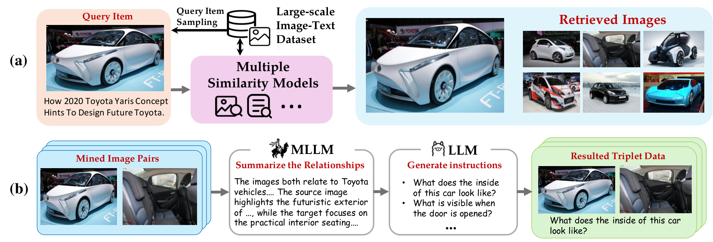
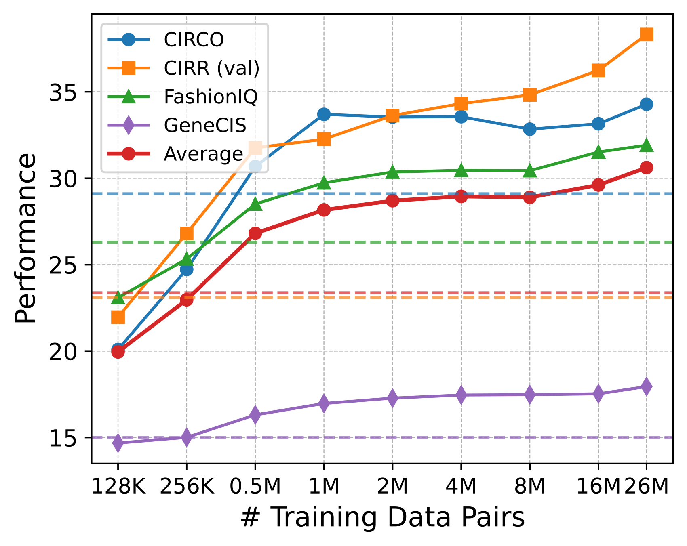
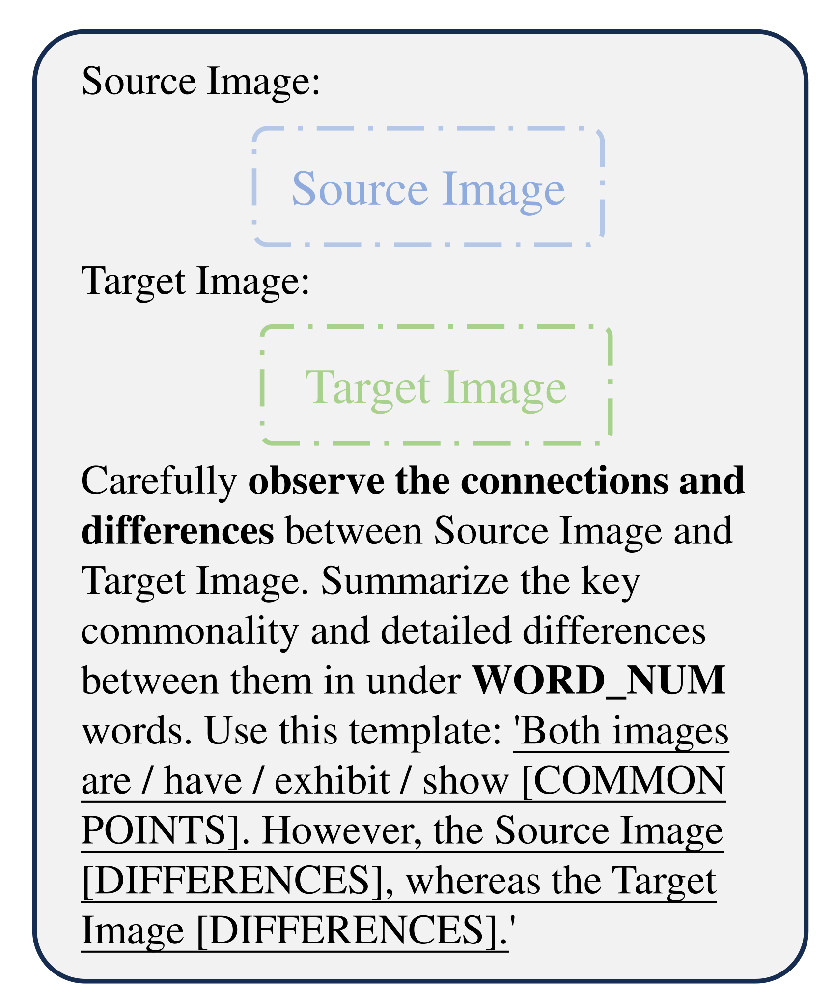
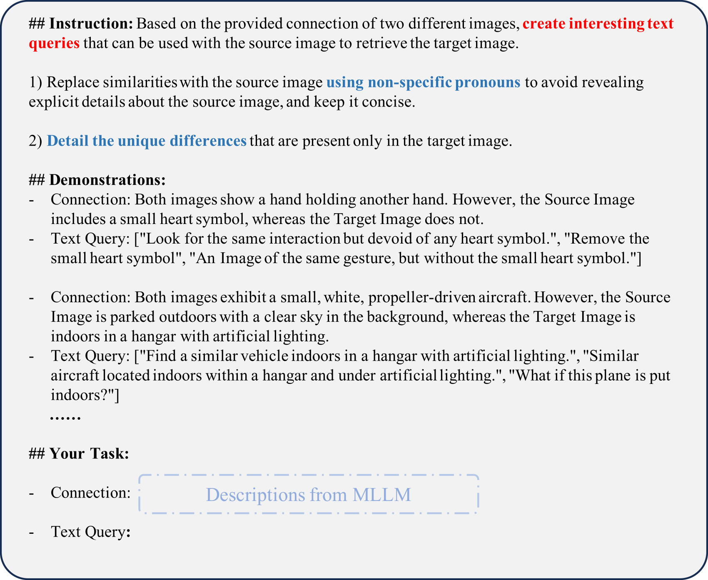
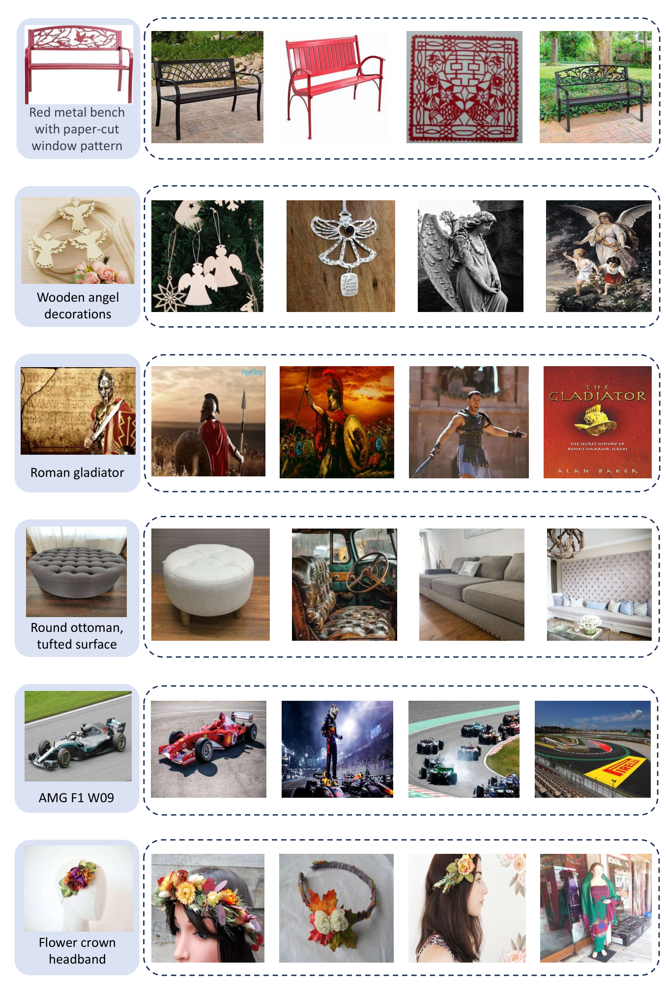
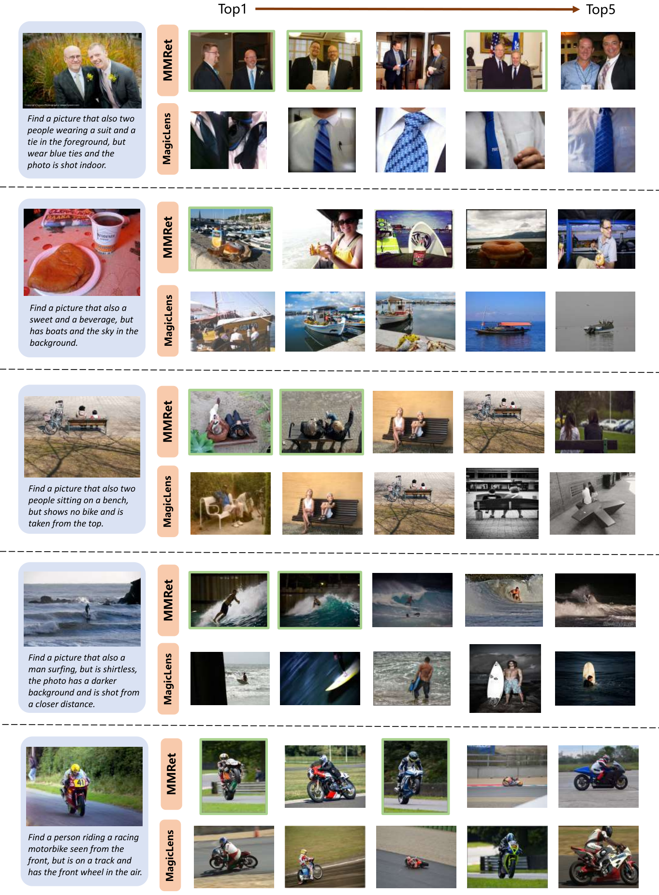

# MegaPairs: Massive Data Synthesis For Universal Multimodal Retrieval / 全文中英对照

> 来源：[arXiv:2412.14475v1](https://arxiv.org/abs/2412.14475v1)。英文段落后紧接中文，覆盖所取 HTML 版本的主文、附录、图表、脚注与参考文献；公式、数字表和书目信息共用。中文以机器初译为底稿，进行了术语整理与结构核对，尚未逐句人工审定；遇到歧义请以紧邻英文和原论文为准。 原作版权归所列作者，许可见 [原作许可](http://creativecommons.org/licenses/by/4.0/)；中文译文与版式改写在该许可条件下提供（涉及 SA 时沿用相同许可，涉及 NC 时仅限非商业使用）。

## Authors and affiliations / 作者与机构

Junjie Zhou Email: zhoujunjie@bupt.edu.cn Zheng Liu [^id2] Affiliation: Beijing University of Posts and Telecommunications, Beijing Academy of Artificial Intelligence Affiliation: The Hong Kong Polytechnic University Email: zhengliu1026@gmail.com Ze Liu Shitao Xiao Affiliation: Beijing University of Posts and Telecommunications, Beijing Academy of Artificial Intelligence Yueze Wang Affiliation: Beijing University of Posts and Telecommunications, Beijing Academy of Artificial Intelligence Bo Zhao Affiliation: Beijing University of Posts and Telecommunications, Beijing Academy of Artificial Intelligence Affiliation: University of Science and Technology of China, Shanghai Jiaotong University Chen Jason Zhang Affiliation: The Hong Kong Polytechnic University Defu Lian Yongping Xiong

## Abstract / 摘要

**EN.** Despite the rapidly growing demand for multimodal retrieval, progress in this field remains severely constrained by a lack of training data. In this paper, we introduce MegaPairs , a novel data synthesis method that leverages vision language models (VLMs) and open-domain images, together with a massive synthetic dataset generated from this method. Our empirical analysis shows that MegaPairs generates high-quality data, enabling the multimodal retriever to significantly outperform the baseline model trained on 70 $\times$ more data from existing datasets. Moreover, since MegaPairs solely relies on general image corpora and open-source VLMs, it can be easily scaled up, enabling continuous improvements in retrieval performance. In this stage, we produced more than 26 million training instances and trained several models of varying sizes using this data. These new models achieve state-of-the-art zero-shot performance across 4 popular composed image retrieval ( CIR ) benchmarks and the highest overall performance on the 36 datasets provided by MMEB . They also demonstrate notable performance improvements with additional downstream fine-tuning. Our produced dataset, well-trained models, and data synthesis pipeline will be made publicly available to facilitate the future development of this field.

**中.** 尽管对多模式检索的需求迅速增长，但该领域的进展仍然因缺乏培训数据而受到严重限制。在本文中，我们介绍了 MegaPairs，这是一种新颖的数据合成方法，该方法利用视觉语言模型（VLM）和开放域图像，以及由此方法生成的大量合成数据集。我们的实证分析表明，MegaPairs 生成高质量的数据，使多模式检索器的性能显着优于在现有数据集中的 70 $\times$ 数据上训练的基线模型。此外，由于MegaPairs仅依赖于通用图像语料库和开源VLM，因此可以轻松扩展，从而能够持续改进检索性能。在此阶段，我们生成了超过 2600 万个训练实例，并使用这些数据训练了多个不同大小的模型。这些新模型在 4 个流行的组合图像检索 (CIR) 基准测试中实现了最先进的零样本性能，并在 MMEB 提供的 36 个数据集上实现了最高的整体性能。他们还通过额外的下游微调展示了显着的性能改进。我们生成的数据集、训练有素的模型和数据合成管道将公开提供，以促进该领域的未来发展。

## Introduction / 简介

**EN.** Multimodal retrieval is a critical research problem for IR and AI communities. It aims to satisfy people’s information needs across different data modalities, especially texts and images. Nowadays, multimodal retrieval has been applied to a wide variety of real-world scenarios, such as image search Chen et al. (2015) ; Wu et al. (2021) ; Zhang et al. (2024) , visual question answering (VQA) Marino et al. (2019) ; Mathew et al. (2021) , and retrieval-augmented generation (RAG) of vision language models Chen et al. (2022) ; Yu et al. (2024) . Given the widespread application scenarios, it’s necessary to develop universal multimodal retrievers which can uniformly support any task requirements and working domains.

**中.** 多模态检索是 IR 和 AI 社区的一个关键研究问题。它旨在满足人们跨不同数据形态的信息需求，特别是文本和图像。如今，多模态检索已应用于各种现实场景，例如图像搜索 Chen 等人。 (2015);吴等人。 (2021);张等人。 (2024)，视觉问答 (VQA) Marino 等人。 (2019);马修等人。 (2021) 和视觉语言模型的检索增强生成 (RAG) Chen 等人。 (2022);于等人。 （2024）。鉴于广泛的应用场景，有必要开发能够统一支持任何任务需求和工作领域的通用多模态检索器。

**EN.** The progress of universal multimodal retrievers have been substantially advanced on top of the pre-trained vision-languages models, like CLIP Radford et al. (2021) , ALIGN Jia et al. (2021) , and SigLIP Zhai et al. (2023) . These models are pre-trained to produce discriminative and unified representations for texts and images, thus creating a solid foundation for multimodal retrieval. However, the existing vision-language encoders are mostly pre-trained from text-image matching tasks. Although these models have achieved an initial capability for text-to-image retrieval Young et al. (2014) ; Chen et al. (2015) , they are insufficient for other common multimodal tasks, such as composed image retrieval Liu et al. (2021) ; Baldrati et al. (2023) ; Zhang et al. (2024) and multimodal document retrieval Chang et al. (2022) ; Liu et al. (2022) .

**中.** 通用多模态检索器的进展在预先训练的视觉语言模型（如 CLIP Radford 等人）的基础上取得了实质性进展。 （2021），ALIGN Jia 等人。 (2021) 和 SigLIP Zhai 等人。 （2023）。这些模型经过预先训练，可以为文本和图像生成有区别且统一的表示，从而为多模态检索奠定坚实的基础。然而，现有的视觉语言编码器大多是根据文本图像匹配任务进行预训练的。尽管这些模型已经实现了文本到图像检索的初步能力 Young 等人。 (2014);陈等人。 (2015)，它们不足以完成其他常见的多模态任务，例如组合图像检索 Liu 等人。 (2021);巴尔德拉蒂等人。 (2023);张等人。 (2024) 和多模式文档检索 Chang 等人。 (2022);刘等人。 （2022）。

**EN.** To enhance the multi-task capacity, fine-tuning pre-trained models with comprehensive instructions, commonly known as instruction-tuning, has gained significant popularity. This approach was first applied in the supervised fine-tuning of large language models (LLMs) Ouyang et al. (2022) ; Wei et al. (2021) ; Chung et al. (2024) , and later introduced for training text embeddings Su et al. (2022) ; Asai et al. (2022) ; Zhang et al. (2023) ; Xiao et al. (2024) . Building on these successes, instruction-tuning has been further extended to multimodal embedding models Wei et al. (2024) ; Sharifymoghaddam et al. (2024) , where pre-trained vision-language encoders are continually fine-tuned using a variety of multimodal retrieval instructions. Given the scarcity of instruction-tuning data for embedding models, researchers have proposed leveraging LLMs to generate synthetic data from Internet resources Wang et al. (2023) . In the field of multimodal retrieval, a notable example is presented by MagicLens Zhang et al. (2024) , which synthesizes open-ended search instructions for co-existing images within the same webpage.

**中.** 为了增强多任务能力，使用综合指令对预训练模型进行微调（通常称为指令调优）已受到广泛欢迎。这种方法首先应用于大型语言模型（LLM）的监督微调中，Ouyang 等人。 (2022);魏等人。 (2021);钟等人。 (2024)，后来引入了用于训练文本嵌入的 Su 等人。 (2022);浅井等人。 (2022);张等人。 (2023);肖等人。 （2024）。在这些成功的基础上，指令调整已进一步扩展到多模态嵌入模型 Wei 等人。 (2024); Sharifymoghaddam 等人。 （2024），其中使用各种多模态检索指令不断微调预先训练的视觉语言编码器。鉴于嵌入模型的指令调整数据的稀缺，研究人员建议利用法学硕士从互联网资源生成合成数据。 （2023）。在多模态检索领域，MagicLens Zhang 等人提出了一个著名的例子。 (2024)，它综合了同一网页内共存图像的开放式搜索指令。

**EN.** Despite recent advancements by MagicLens, current data synthesis methods still face significant limitations in data scalability , quality , diversity , and availability . Specifically, only a small fraction of webpages on the internet contain multiple images (scalability), not to mention that many of these co-existing images are either unrelated or near-duplicates (quality). Besides, the remaining correlated images often exhibit monotonous relationships, such as different angles of the same object (diversity). Finally, large-scale instruction-tuning datasets for multimodal retrieval are typically held privately by individual research labs (availability).

**中.** 尽管 MagicLens 最近取得了进步，但当前的数据合成方法在数据可扩展性、质量、多样性和可用性方面仍然面临着重大限制。具体来说，互联网上只有一小部分网页包含多个图像（可扩展性），更不用说这些共存图像中的许多图像要么不相关，要么接近重复（质量）。此外，剩余的相关图像通常表现出单调的关系，例如同一对象的不同角度（多样性）。最后，用于多模式检索的大规模指令调整数据集通常由各个研究实验室私有（可用性）。

**EN.** In this paper, we introduce a novel data synthesis method called MegaPairs , accompanied by a large-scale instruction dataset generated using this approach. MegaPairs is distinguished by its construction of a heterogeneous KNN triplet for open-domain images . Particularly, it leverages three different similarity models to sample correlated image pairs, including CLIP vision-encoder for visual-semantic correlations Sun et al. (2023) , DINO vision-encoder for visual-pattern correlations Oquab et al. (2024) , and CLIP text-encoder for caption correlations. The sampled image pairs are presented for the VLM and LLM annotators, which generate comprehensive descriptions of the relationships between the two images and create pseudo-retrieval instructions based on the descriptions. This approach enables a huge amount of instructions to be generated for a general dataset, like Datacomp Gadre et al. (2024) , which significantly improves the scalability of data synthesis. It also introduces diverse instructions of guaranteed quality, given its sampling of heterogeneous relationships from open-ended image corpora. Additionally, by utilizing open-source VLM and LLM models (e.g., InternVL2-26B Chen et al. (2024b) , Llama-3-8B Dubey et al. (2024) ), the entire process can operate at a low cost.

**中.** 在本文中，我们介绍了一种称为 MegaPairs 的新颖数据合成方法，并附带使用该方法生成的大规模指令数据集。 MegaPairs 的特点是它为开放域图像构建了异构 KNN 三元组。特别是，它利用三种不同的相似性模型来采样相关图像对，包括用于视觉语义相关性的 CLIP 视觉编码器 Sun 等人。 (2023)，用于视觉模式相关性的 DINO 视觉编码器 Oquab 等人。 (2024) 和用于字幕相关性的 CLIP 文本编码器。采样图像对呈现给 VLM 和 LLM 注释器，它们生成两个图像之间关系的全面描述，并根据描述创建伪检索指令。这种方法可以为通用数据集生成大量指令，例如 Datacomp Gadre 等人。 (2024)，显着提高了数据合成的可扩展性。鉴于它从开放式图像语料库中对异构关系进行采样，它还引入了保证质量的多样化指令。此外，通过利用开源VLM和LLM模型（例如，InternVL2-26B Chen等人（2024b）、Llama-3-8B Dubey等人（2024）），整个过程可以以低成本运行。

**EN.** We’ve produced 26 million data instances in this stage, achieving superior data quality compared to the existing datasets. In our pilot experiment, with just 500K sampled instances from MegaPairs, the same pre-trained model’s fine-tuning performance already surpasses that of the entire 36.7M training instances from MagicLens, i.e., delivering better results with 70 $\times$ less training data. We further trained three multimodal retrievers, MMRet , of varying sizes based on the whole synthetic dataset and perform comprehensive evaluations with a wide range of multimodal retrieval tasks. Remarkably, MMRet achieved state-of-the-art performance on 4 popular composed image retrieval (CIR) benchmarks and the 36 datasets provided by MMEB Jiang et al. (2024b) in the zero-shot setting. Furthermore, the models demonstrated substantial improvements and maintain leading positions after downstream fine-tuning. The entire suite of assets, including the dataset, the well-trained models, and the data production pipeline, will be made publicly available to advance the future progress in this field.

**中.** 我们在此阶段生成了 2600 万个数据实例，与现有数据集相比，实现了卓越的数据质量。在我们的试点实验中，仅使用来自 MegaPairs 的 500K 采样实例，相同的预训练模型的微调性能就已经超过了 MagicLens 的全部 3670 万个训练实例，即在减少 70 $\times$ 的训练数据的情况下提供更好的结果。我们基于整个合成数据集进一步训练了三个不同大小的多模态检索器 MMRet ，并对各种多模态检索任务进行综合评估。值得注意的是，MMRet 在 4 个流行的组合图像检索 (CIR) 基准和 MMEB Jiang 等人提供的 36 个数据集上实现了最先进的性能。 （2024b）在零样本设置中。此外，模型在下游微调后表现出实质性改进并保持领先地位。整套资产，包括数据集、训练有素的模型和数据生产管道，都将公开，以推动该领域的未来进展。

## Related Work / 相关工作

#### Multimodal Retrieval. / 多模式检索。

**EN.** Traditionally, retrieval tasks have focused on scenarios where queries and candidates exist in distinct modalities, such as unimodal retrieval Thakur et al. (2021) and cross-modal retrieval Chen et al. (2015) . However, there is a growing demand for multimodal retrieval tasks, where queries or candidates integrate both image and text modalities. These tasks have wide applications, including image retrieval with instructions Wu et al. (2021) ; Liu et al. (2021) ; Zhang et al. (2024) , multimodal document retrieval Chang et al. (2022) ; Liu et al. (2022) , knowledge retrieval with multimodal queries Luo et al. (2023) , and retrieval-augmented generation Yasunaga et al. (2023) ; Yu et al. (2024) . Most existing methods employ pre-trained vision-language models (VLMs) to address these tasks Radford et al. (2021) ; Li et al. (2023) ; Saito et al. (2023) . However, the common VLMs are purely trained on image-text matching datasets Changpinyo et al. (2021) ; Schuhmann et al. (2022) , which are in lack of ability to jointly encode and comprehend both modalities effectively. As a result, it is necessary to create proper datasets so as to extend VLMs for the diversified multimodal retrieval tasks.

**中.** 传统上，检索任务集中于查询和候选以不同模式存在的场景，例如单模态检索 Thakur 等人。 (2021) 和跨模态检索 Chen 等人。 （2015）。然而，对多模态检索任务的需求不断增长，其中查询或候选项集成了图像和文本模态。这些任务具有广泛的应用，包括使用 Wu 等人的指令进行图像检索。 (2021);刘等人。 (2021);张等人。 (2024)，多模式文档检索 Chang 等人。 (2022);刘等人。 (2022)，多模态查询的知识检索 Luo 等人。 (2023) 和检索增强一代 Yasunaga 等人。 (2023);于等人。 （2024）。大多数现有方法都采用预先训练的视觉语言模型（VLM）来解决这些任务。 (2021);李等人。 (2023);斋藤等人。 （2023）。然而，常见的 VLM 纯粹是在图像文本匹配数据集 Changpinyo 等人上进行训练的。 (2021);舒曼等人。 （2022），缺乏有效联合编码和理解这两种模式的能力。因此，有必要创建合适的数据集，以扩展 VLM 以适应多样化的多模态检索任务。

**EN.** Figure 1: Construction pipeline of multimodal triplets: (a) mining of image pairs, (b) generation of open-ended instructions. Multiple similarity models are used to introduce diversified correlations for the image pairs.

**中.** 图 1：多模态三元组的构建流程：(a) 挖掘图像对，(b) 生成开放式指令。使用多个相似性模型为图像对引入多样化的相关性。

#### Instruction Tuning for Multimodal Retrieval. / 多模式检索的指令调整。

**EN.** Instruction-tuning is a popular strategy to enhance the multi-task capacity for both large language models Ouyang et al. (2022) ; Wei et al. (2021) ; Chung et al. (2024) and embedding models Su et al. (2022) ; Asai et al. (2022) ; Zhang et al. (2023) ; Xiao et al. (2024) ; Chen et al. (2024a) . While there have been a few instruction datasets proposed for multimodal retrieval Liu et al. (2021) ; Liu et al. (2022) ; Chang et al. (2022) ; Wei et al. (2024) ; Zhou et al. (2024) , they are limited in scale and diversity due to their reliance on human annotation. Recently, a notable progress was made by MagicLens Zhang et al. (2024) , where a large-scale open-ended search instruction dataset is created from the co-existed images within webpages. However, given the shortage of multi-image webs, MagicLens is limited by its scalability and data-quality. Moreover, this dataset is still held private and inaccessible to public users. As a result, the creation and release of high-quality instruction-tuning datasets have become imperative for advancing multimodal retrieval research.

**中.** 指令调优是增强大型语言模型的多任务能力的流行策略 Ouyang 等人。 (2022);魏等人。 (2021);钟等人。 (2024) 和嵌入模型 Su 等人。 (2022);浅井等人。 (2022);张等人。 (2023);肖等人。 (2024);陈等人。 （2024a）。虽然已经提出了一些用于多模态检索的指令数据集，但 Liu 等人。 (2021);刘等人。 (2022);张等人。 (2022);魏等人。 (2024);周等人。 (2024)，由于依赖人类注释，它们的规模和多样性受到限制。最近，MagicLens Zhang等人取得了显着进展。 (2024)，其中从网页内共存的图像创建大规模开放式搜索指令数据集。然而，由于多图像网络的短缺，MagicLens 受到其可扩展性和数据质量的限制。此外，该数据集仍然是私有的，公共用户无法访问。因此，创建和发布高质量的指令调整数据集对于推进多模态检索研究至关重要。

## Methodology / 方法论

### MegaPairs Construction / MegaPairs 建设

**EN.** Training on large-scale open-world data significantly enhances the generalization capabilities of foundation models. For instance, CLIP Radford et al. (2021) has achieved remarkable advancements in cross-modal retrieval and various downstream tasks due to its extensive training on text-image pairs. However, the multimodal instruction tuning data, despite its importance to multimodal retrieval Zhang et al. (2024) , is scarce in natural world and expensive to annotate by human effort. In this paper, we propose to construct large-scale multimodal instruction-tuning datasets through data synthesis. Formally, each data instance contains the following triplet: a pair of images $(\mathcal{I}_{q},\mathcal{I}_{t})$ , together with a textual instructions $\mathcal{T}_{q\rightarrow t}$ specifying the transition relationship from query image $\mathcal{I}_{q}$ to target image $\mathcal{I}_{t}$ .

**中.** 大规模开放世界数据的训练显着增强了基础模型的泛化能力。例如，CLIP Radford 等人。 （2021）由于其对文本图像对的广泛训练，在跨模态检索和各种下游任务方面取得了显着的进步。然而，多模态指令调整数据尽管对多模态检索很重要，但Zhang等人。 （2024），在自然界中是稀缺的，并且通过人类努力注释是昂贵的。在本文中，我们建议通过数据合成构建大规模多模式指令调优数据集。形式上，每个数据实例包含以下三元组：一对图像 $(\mathcal{I}_{q},\mathcal{I}_{t})$ ，以及指定从查询图像 $\mathcal{I}_{q}$ 到目标图像 $\mathcal{I}_{t}$ 的转换关系的文本指令 $\mathcal{T}_{q\rightarrow t}$ 。

**EN.** We identify two primary technical challenges in acquiring such triplets: (1) sampling relevant and diversified image pairs at scale , (2) precise annotation of instruction for the sampled image pair . To address these challenges, we propose leveraging the common open-domain image corpora. Intuitively, a large-scale corpus contains abundant correlated images of diverse semantic relationships, which can be mined and annotated for our instruction-tuning data. Our data synthesis pipeline is demonstrated as Figure 1 , which involves two main components: the mining of image pairs and the generation of open-ended instructions.

**中.** 我们确定了获取此类三元组的两个主要技术挑战：（1）大规模采样相关且多样化的图像对，（2）对采样图像对的指令进行精确注释。为了应对这些挑战，我们建议利用通用的开放域图像语料库。直观上，大规模语料库包含丰富的不同语义关系的相关图像，可以为我们的指令调整数据进行挖掘和注释。我们的数据合成流程如图 1 所示，其中涉及两个主要部分：图像对的挖掘和开放式指令的生成。

#### Mining Correlated Image Pairs. / 挖掘相关图像对。

**EN.** As illustrated in Figure 1 (a), we propose sampling correlated image pairs from a large-scale image corpus. For each query image $(\mathcal{I}_{q},\mathcal{C}_{q})$ , we utilize multiple similarity models to search for a diverse set of correlated target images of heterogeneous correlations $\{\mathcal{I}_{t_{1}},\mathcal{I}_{t_{2}},\ldots,\mathcal{I}_{t_{n}}\}$ . In our work, the following types of correlations are used: (1) visual-semantic correlation, which measures the semantic correlation of two images regardless of visual similarity, e.g., two different views of the same cars; (2) visual-pattern correlation, which captures the visual similarity of two images regardless of semantic correlation, e.g., different cars in similar backgrounds; (3) caption correlation, which measures the textual similarity between two images’ captions.

**中.** 如图 1 (a) 所示，我们建议从大规模图像语料库中采样相关图像对。对于每个查询图像 $(\mathcal{I}_{q},\mathcal{C}_{q})$ ，我们利用多个相似性模型来搜索异构相关性 $\{\mathcal{I}_{t_{1}},\mathcal{I}_{t_{2}},\ldots,\mathcal{I}_{t_{n}}\}$ 的一组不同的相关目标图像。在我们的工作中，使用以下类型的相关性：（1）视觉语义相关性，它测量两个图像的语义相关性，而不考虑视觉相似性，例如同一辆车的两个不同视图； （2）视觉模式相关性，它捕获两个图像的视觉相似性，而不考虑语义相关性，例如相似背景中的不同汽车； （3）标题相关性，衡量两个图像标题之间的文本相似度。

**EN.** Recognizing the importance of hard negatives in training retrieval models Xiong et al. (2020) ; Hofstätter et al. (2021) ; Zhang et al. (2022) , for each pair $(\mathcal{I}_{q},\mathcal{I}_{t_{i}})$ , we include additional images $\{\mathcal{I}_{t_{j}}\mid t_{j}\neq t_{i}\}$ from the retrieved set as hard negative samples. This approach is simple but empirically effective. We validate the scalability and quality of our data pairs in Section 4.3 , with additional examples visualized in Appendix F .

**中.** Xiong 等人认识到难负例在训练检索模型中的重要性。 (2020);霍夫斯塔特等人。 (2021);张等人。 (2022) ，对于每一对 $(\mathcal{I}_{q},\mathcal{I}_{t_{i}})$ ，我们将检索到的集合中的附加图像 $\{\mathcal{I}_{t_{j}}\mid t_{j}\neq t_{i}\}$ 包含为硬负样本。这种方法很简单，但在经验上是有效的。我们在第 4.3 节中验证了数据对的可扩展性和质量，并在附录 F 中提供了可视化的其他示例。

#### Generating Open-Ended Instructions. / 生成开放式指令。

**EN.** As shown in Figure 1 (b), we utilize open-source multimodal large language models (MLLM) and large language models (LLM) for the automated annotation of mined image pairs $\mathbf{\mathcal{P}}=\{(\mathcal{I}_{q},\mathcal{I}_{t_{i}})\}$ . Initially, each image pair $(\mathcal{I}_{q},\mathcal{I}_{t_{i}})$ is processed by the MLLM to generate a detailed description $\mathcal{D}_{i}$ of the common concepts and differences between the query image $\mathcal{I}_{q}$ and the target image $\mathcal{I}_{t_{i}}$ . This description $\mathcal{D}_{i}$ is then refined by the LLM to produce textual instructions $\mathcal{T}_{q\rightarrow t_{i}}$ . We prompt the LLM to generate multiple $\mathcal{T}_{q\rightarrow t_{i}}$ for each pair, enhancing the diversity of the textual instructions. Ultimately, we construct a multimodal triplet $(\mathcal{I}_{q},\mathcal{T}_{q\rightarrow t_{i}},\mathcal{I}_{t_{i}})$ , where $(\mathcal{I}_{q},\mathcal{T}_{q\rightarrow t_{i}})$ can be used to retrieve $\mathcal{I}_{t_{i}}$ . This two-step annotation method ensures both accuracy and diversity in the automated annotation process while leveraging open-source models. The detailed prompts can be found in Appendix A .

**中.** 如图 1 (b) 所示，我们利用开源多模态大语言模型 (MLLM) 和大语言模型 (LLM) 对挖掘的图像对 $\mathbf{\mathcal{P}}=\{(\mathcal{I}_{q},\mathcal{I}_{t_{i}})\}$ 进行自动注释。最初，每个图像对 $(\mathcal{I}_{q},\mathcal{I}_{t_{i}})$ 由 MLLM 处理，以生成查询图像 $\mathcal{I}_{q}$ 和目标图像 $\mathcal{I}_{t_{i}}$ 之间的共同概念和差异的详细描述 $\mathcal{D}_{i}$ 。然后，LLM 会对该描述 $\mathcal{D}_{i}$ 进行细化，以生成文本指令 $\mathcal{T}_{q\rightarrow t_{i}}$ 。我们提示LLM为每对生成多个$\mathcal{T}_{q\rightarrow t_{i}}$，增强文本指令的多样性。最终，我们构建了一个多模态三元组 $(\mathcal{I}_{q},\mathcal{T}_{q\rightarrow t_{i}},\mathcal{I}_{t_{i}})$ ，其中 $(\mathcal{I}_{q},\mathcal{T}_{q\rightarrow t_{i}})$ 可用于检索 $\mathcal{I}_{t_{i}}$ 。这种两步注释方法在利用开源模型的同时确保了自动化注释过程的准确性和多样性。详细提示见附录A。

#### Implementations. / 实施。

**EN.** A dataset of 26,235,105 image pairs is created based on the above data synthesis pipeline. We utilize a subset from the Recap-DataComp-1B Li et al. (2024b) as our image corpus, containing 20 million captioned images. For similarity models, we employ EVA-CLIP’s image encoder for visual-semantic correlation Sun et al. (2023) , DINOv2 Oquab et al. (2024) for visual-pattern correlation, and EVA-CLIP’s text encoder for caption similarity. We filter the image pairs whose similarity score is within (0.8, 0.96), thus eliminating weak associations and near duplications. We further leverage InternVL2-26B Chen et al. (2024b) and LLaMA3-8B Dubey et al. (2024) to generate the open-ended instructions. For each image pair, we create at least three different textual instructions and introduce five hard negatives.

**中.** 基于上述数据合成管道创建了包含 26,235,105 个图像对的数据集。我们利用 Recap-DataComp-1B Li 等人的子集。 (2024b) 作为我们的图像语料库，包含 2000 万张带字幕的图像。对于相似性模型，我们采用 EVA-CLIP 的图像编码器来实现视觉语义相关性 Sun 等人。 (2023)，DINOv2 Oquab 等人。 (2024) 用于视觉模式相关性，以及 EVA-CLIP 的文本编码器用于字幕相似性。我们过滤相似度得分在 (0.8, 0.96) 范围内的图像对，从而消除弱关联和接近重复。我们进一步利用 InternVL2-26B Chen 等人。 (2024b) 和 LLaMA3-8B Dubey 等人。 （2024）生成开放式指令。对于每个图像对，我们创建至少三个不同的文本说明并引入五个难负例。

### MMRet Model / MMRet模型

**EN.** We propose MMRet, a series of models designed for universal multimodal retrieval based on pre-trained vision-language models (VLMs). Our MMRet integrates two distinct VLM architectures to achieve a universal multimodal embedding.

**中.** 我们提出了 MMRet，这是一系列基于预训练视觉语言模型（VLM）的通用多模态检索模型。我们的 MMRet 集成了两种不同的 VLM 架构，以实现通用的多模态嵌入。

#### CLIP-based MMRet. / 基于 CLIP 的 MMRet。

**EN.** The original CLIP Radford et al. (2021) model employs a dual encoder architecture that independently encodes image and text data. We denote the image encoder as ${\Phi}_{{I}}$ and the text encoder as ${\Phi}_{{T}}$ . Given an image $I$ or text $T$ , their embeddings are computed as follows:

**中.** 最初的 CLIP Radford 等人。 (2021) 模型采用双编码器架构，独立编码图像和文本数据。我们将图像编码器表示为 ${\Phi}_{{I}}$ ，将文本编码器表示为 ${\Phi}_{{T}}$ 。给定图像 $I$ 或文本 $T$ ，它们的嵌入计算如下：

$$
\displaystyle\mathbf{e}_{i} \displaystyle={\Phi}_{{I}}(I)
$$

$$
\displaystyle\mathbf{e}_{t} \displaystyle={\Phi}_{{T}}(T)
$$

**EN.** To produce the multimodal embedding for a composed image-text sample $(I,T)$ , we employ the score-fusion strategy as used by UniIR Wei et al. (2024) , which directly uses an element-wise addition of the outputs from the dual encoders:

**中.** 为了生成组合图像文本样本 $(I,T)$ 的多模态嵌入，我们采用 UniIR Wei 等人使用的分数融合策略。 (2024) ，它直接使用双编码器输出的逐元素相加：

$$
\mathbf{e}_{it}={\Phi}_{{I}}(I)+{\Phi}_{{T}}(T)\tag{2}
$$

**EN.** In our CLIP-based MMRet, we trained both base and large models.

**中.** 在基于 CLIP 的 MMRet 中，我们训练了基础模型和大型模型。

#### MLLM-based MMRet. / 基于 MLLM 的 MMRet。

**EN.** The multimodal large language models (MLLMs) incorporate a visual encoder, typically based on a vision transformer Dosovitskiy et al. (2021) , into a large language model (LLM). This integration allows image tokens to be directly processed by the LLM. Consequently, MLLMs can effectively handle diverse multimodal inputs by converting any type of input into a sequence of tokens. For instance, composed image-text data is transformed into interleaved sequences of image and text tokens, enabling the model to process them seamlessly.

**中.** 多模态大语言模型 (MLLM) 包含一个视觉编码器，通常基于 Dosovitskiy 等人的视觉转换器。 （2021），进入大型语言模型（LLM）。这种集成允许法学硕士直接处理图像令牌。因此，MLLM 可以通过将任何类型的输入转换为令牌序列来有效地处理不同的多模式输入。例如，组合的图像文本数据被转换为图像和文本标记的交错序列，使模型能够无缝地处理它们。

**EN.** Our MMRet model builds upon the LLaVA-1.6 Liu et al. (2024) . In both training and inference stages, MMRet uses task-specific instructions for query inputs to improve generalization, aligning with standard practices in LLM-based embedding models Wang et al. (2023) ; Li et al. (2024a) . A typical multimodal query input is structured as follows:

**中.** 我们的 MMRet 模型建立在 LLaVA-1.6 Liu 等人的基础上。 （2024）。在训练和推理阶段，MMRet 使用特定于任务的指令进行查询输入来提高泛化性，与基于 LLM 的嵌入模型 Wang 等人的标准实践保持一致。 (2023);李等人。 （2024a）。典型的多模式查询输入的结构如下：

$$
\langle\text{instruct}\rangle~~\text{\lx@text@lbrace task\_inst\lx@text@rbrace}~~\langle\text{query}\rangle~~\{q_{t}\}~~\{q_{i}\}~~\texttt{[EOS]}\tag{3}
$$

**EN.** where {task_inst} represents the task-specific instruction, $\{q_{t}\}$ denotes the input query text, and $\{q_{i}\}$ is the input query image. The normalized last hidden state of the [EOS] token in the MLLM is used as the embedding of any given input sequence.

**中.** 其中{task_inst}表示任务特定指令，$\{q_{t}\}$表示输入查询文本，$\{q_{i}\}$是输入查询图像。 MLLM 中 [EOS] 令牌的归一化最后隐藏状态用作任何给定输入序列的嵌入。

### Multimodal Contrastive Learning / 多模态对比学习

**EN.** We employ multimodal contrastive learning to transform the original CLIP and MLLM into our MMRet model, enabling various multimodal retrieval tasks. We use the standard InfoNCE loss Oord et al. (2018) as our training objective:

**中.** 我们采用多模态对比学习将原始的 CLIP 和 MLLM 转换为我们的 MMRet 模型，从而实现各种多模态检索任务。我们使用 Oord 等人的标准 InfoNCE 损失。 （2018）作为我们的培训目标：

$$
\mathcal{L}=-\frac{1}{|\mathcal{Q}|}\sum_{q_{i}\in\mathcal{Q}}\log\frac{\exp(\mathbf{e}_{q_{i}}\cdot\mathbf{e}_{c_{i}^{+}}/\tau)}{\sum_{c_{j}\in\mathcal{C}}\exp(\mathbf{e}_{q_{i}}\cdot\mathbf{e}_{c_{j}}/\tau)}\tag{4}
$$

**EN.** where the set $\mathcal{Q}$ includes all query samples $q_{i}$ in a batch. The vectors $\mathbf{e}_{q_{i}}$ and $\mathbf{e}_{c_{i}^{+}}$ are the embeddings of the query $q_{i}$ and its positive candidate $c_{i}^{+}$ , respectively. The set $\mathcal{C}$ contains all in-batch candidates. Notably, both $q$ and $c$ can be images, text, or composed image-text data. The parameter $\tau$ modulates the penalties on negative samples and is set to 0.02 unless otherwise specified in this paper.

**中.** 其中集合$\mathcal{Q}$包含批次中的所有查询样本$q_{i}$。向量 $\mathbf{e}_{q_{i}}$ 和 $\mathbf{e}_{c_{i}^{+}}$ 分别是查询 $q_{i}$ 及其正候选 $c_{i}^{+}$ 的嵌入。集合 $\mathcal{C}$ 包含所有批内候选者。值得注意的是，$q$和$c$都可以是图像、文本或组合的图文数据。参数$\tau$调节对负样本的惩罚，除非本文另有说明，否则设置为0.02。

| Methods 方法 | Backbone 骨干网 | # Params # 参数 | CIRCO 中科 | CIRR | CIRR | FashionIQ 时尚智商 | GeneCIS 基因信息系统 |
| --- | --- | --- | --- | --- | --- | --- | --- |
| Methods 方法 | Backbone 骨干网 | # Params # 参数 | mAP@5 地图@5 | R@1 | R s @1 | R@10 | R s @1 |
| SEARLE Baldrati et al. (2023) 塞尔·巴尔德拉蒂等人。 (2023) | CLIP-B 夹子-B | 165M | 9.4 | 24.0 | 54.9 | 22.9 | - |
| CIReVL Karthik et al. (2023) CIReVL Karthik 等人。 (2023) | CLIP-B 夹子-B | 12.3B † | 14.9 | 23.9 | 60.2 | 28.3 | 15.9 |
| LDRE Yang et al. (2024) LDRE杨等人。 (2024) | CLIP-B 夹子-B | 7.9B † | 18.0 | 25.7 | 60.5 | 24.8 | - |
| MagicLens-B Zhang et al. (2024) MagicLens-B 张等人。 (2024) | CLIP-B 夹子-B | 166M | 23.1 | 27.0 | 66.7 | 26.3 | 15.0 |
| MagicLens-B ‡ Zhang et al. (2024) MagicLens-B ‡ 张等人。 (2024) | CoCa-B 辅酶B | 267M | 30.8 | 31.6 | 69.3 | 35.2 | 17.4 ∗ |
| MMRet-Base MMRet-基地 | CLIP-B 夹子-B | 149M | 34.3 | 36.1 | 71.6 | 31.9 | 18.0 |
| Pic2Word Saito et al. (2023) Pic2Word 斋藤等人。 (2023) | CLIP-L 夹子-L | 429M | 8.7 | 23.9 | - | 24.7 | 11.2 |
| PLI Chen and Lai (2023) PLI 陈和赖 (2023) | CLIP-L 夹子-L | 428M | 10.4 | 25.5 | 55.6 | 35.4 | - |
| SEARLE Baldrati et al. (2023) 塞尔·巴尔德拉蒂等人。 (2023) | CLIP-L 夹子-L | 442M | 11.7 | 24.2 | 53.8 | 25.6 | 12.3 |
| CompoDiff Gu et al. (2024a) CompoDiff Gu 等人。 (2024a) | CLIP-L 夹子-L | 568M | 12.6 | 18.2 | 57.4 | 36.0 | 14.9 |
| CIReVL Karthik et al. (2023) CIReVL Karthik 等人。 (2023) | CLIP-L 夹子-L | 12.5B † | 18.6 | 24.6 | 59.5 | 28.6 | 15.9 |
| LDRE Yang et al. (2024) LDRE杨等人。 (2024) | CLIP-L 夹子-L | 8.2B † | 23.4 | 26.5 | 60.4 | 28.5 | - |
| MagicLens-L Zhang et al. (2024) MagicLens-L 张等人。 (2024) | CLIP-L 夹子-L | 465M | 29.6 | 30.1 | 68.1 | 30.7 | 16.3 |
| MagicLens-L ‡ Zhang et al. (2024) MagicLens-L ‡ 张等人。 (2024) | CoCa-L | 613M | 34.1 ∗ | 33.3 ∗ | 70.9 ∗ | 38.0 | 16.7 |
| MMRet-Large | CLIP-L 夹子-L | 428M | 39.2 | 38.0 | 73.2 | 34.6 | 18.1 |
| LDRE Yang et al. (2024) LDRE杨等人。 (2024) | CLIP-G 夹子-G | 10.3B † | 31.1 | 36.2 | 68.8 | 32.5 | - |
| CIReVL Karthik et al. (2023) CIReVL Karthik 等人。 (2023) | CLIP-G 夹子-G | 14.6B † | 26.8 | 34.7 | 68.0 | 32.2 | 17.4 ∗ |
| IP-CIR Li et al. (2024c) IP-CIR Li 等人(2024c) | CLIP-G 夹子-G | 43.8B † | 32.8 | 39.3 | 70.0 | 45.7 ∗ | - |
| E5-V Jiang et al. (2024a) E5-V 江等人。 (2024a) | LLaVA-1.6 | 8.35B | 19.1 | 33.9 | - | 31.8 | - |
| MM-Emded Lin et al. (2024) MM-Emded Lin 等人。 (2024) | LLaVA-1.6 | 7.57B | 32.3 | - | - | - | - |
| MMRet-MLLM | LLaVA-1.6 | 7.57B | 42.2 | 46.7 | 75.4 | 35.6 | 21.1 |

**EN.** Table 1: Zero-shot retrieval performance on various CIR benchmarks. ∗ denotes the previous best performance for each benchmark prior to MMRet. † indicates methods with multiple components (e.g., GPT-3.5, Qwen1.5-32B); we report # parameters of components with known sizes. The CoCa-based MagicLens ‡ models are proprietary. Results in bold and underline denote the best and second-best performances for each model scale, respectively. Our MMRet model achieves state-of-the-art results across different model sizes and benchmarks, surpassing the previous SOTA by 8.1% on the main benchmark CIRCO, significantly advancing zero-shot CIR methods.

**中.** 表 1：各种 CIR 基准上的零样本检索性能。 * 表示 MMRet 之前每个基准测试的最佳性能。 † 表示具有多个组件的方法（例如，GPT-3.5、Qwen1.5-32B）；我们报告已知尺寸的组件的 # 个参数。基于 CoCa 的 MagicLens ‡ 型号是专有的。粗体和下划线的结果分别表示每个模型规模的最佳和第二佳性能。我们的 MMRet 模型在不同模型大小和基准上都取得了最先进的结果，在主要基准 CIRCO 上比之前的 SOTA 提高了 8.1%，显着改进了零样本 CIR 方法。

## Experiments / 实验

**EN.** In this section, we first evaluate the effectiveness of MegaPairs on zero-shot composed image retrieval (CIR) tasks in Section 4.1 . Next, we explore the impact of MegaPairs on broader multimodal retrieval tasks in Section 4.2 . Finally, we conduct detailed analysis on our MegaPairs in Section 4.3 .

**中.** 在本节中，我们首先评估 MegaPairs 在 4.1 节中的零样本合成图像检索（CIR）任务上的有效性。接下来，我们将在 4.2 节中探讨 MegaPairs 对更广泛的多模态检索任务的影响。最后，我们在 4.3 节中对 MegaPairs 进行了详细分析。

### Zero-shot Performance on CIR tasks / CIR 任务的零样本性能

#### Implementation Details / 实施细节

**EN.** We utilize our MegaPairs dataset to perform multimodal contrastive training for our MMRet models. For the CLIP-based MMRet, we initialize the model using both the base [^footnote1] and large [^footnote2] versions of CLIP, referred to as MMRet-Base and MMRet-Large, respectively. For the MLLM-based MMRet, we leverage the LLaVA-1.6 Mistral 7B architecture [^footnote3] and initialize the model parameters accordingly, which we denote as MMRet-MLLM. The training details of MMRet on MegaPairs can be found in Appendix B .

**中.** 我们利用 MegaPairs 数据集对 MMRet 模型进行多模态对比训练。对于基于 CLIP 的 MMRet，我们使用 CLIP 的基本 [^footnote1] 和大型 [^footnote2] 版本（分别称为 MMRet-Base 和 MMRet-Large）来初始化模型。对于基于 MLLM 的 MMRet，我们利用 LLaVA-1.6 Mistral 7B 架构 [^footnote3] 并相应地初始化模型参数，我们将其表示为 MMRet-MLLM。 MMRet 在 MegaPairs 上的训练细节可以在附录 B 中找到。

#### Benchmarks / 基准测试

**EN.** We evaluate our MMRet in a zero-shot setting across four different composed image retrieval benchmarks: CIRCO Baldrati et al. (2023) , CIRR Liu et al. (2021) , FashionIQ Wu et al. (2021) , and GeneCIS Vaze et al. (2023) . Following previous practice Zhang et al. (2024) , CIRCO is considered our main benchmark due to its extensive candidate pool and high-quality annotations. Detailed information and metrics for each benchmark can be found in Appendix C .

**中.** 我们在四个不同的组合图像检索基准的零样本设置中评估我们的 MMRet：CIRCO Baldrati 等人。 (2023)，CIRR 刘等人。 (2021)，FashionIQ 吴等人。 (2021) 和 GeneCIS Vaze 等人。 （2023）。遵循张等人之前的做法。 (2024)，CIRCO 因其广泛的候选池和高质量的注释而被认为是我们的主要基准。每个基准的详细信息和指标可以在附录 C 中找到。

| Models 型号 | Per Meta-Task Score 每个元任务分数 | Per Meta-Task Score 每个元任务分数 | Per Meta-Task Score 每个元任务分数 | Per Meta-Task Score 每个元任务分数 | Overall 整体 |
| --- | --- | --- | --- | --- | --- |
| Models 型号 | Classification 分类 | VQA 质量保证 | Retrieval 检索 | Grounding 接地 | Overall 整体 |
| number of datasets 数据集数量 | 10 | 10 | 12 | 4 | 36 |
| BLIP2 Li et al. (2023) BLIP2 李等人。 (2023) | 27.0 | 4.2 | 33.9 | 47.0 | 25.2 |
| SigLIP Zhai et al. (2023) SigLIP 斋等人。 (2023) | 40.3 | 8.4 | 31.6 | 59.5 | 34.8 |
| CLIP Radford et al. (2021) CLIP 雷德福等人。 (2021) | 42.8 | 9.1 | 53.0 | 51.8 | 37.8 |
| OpenCLIP Cherti et al. (2023) OpenCLIP Cherti 等人。 (2023) | 47.8 | 10.9 | 52.3 | 53.3 | 39.7 |
| UniIR Wei et al. (2024) UniIR 魏等人。 (2024) | 42.1 | 15.0 | 60.1 † | 62.2 | 42.8 |
| MagicLens Zhang et al. (2024) MagicLens 张等人。 (2024) | 38.8 | 8.3 | 35.4 | 26.0 | 27.8 |
| E5-V (LLaVA-1.6) Jiang et al. (2024a) E5-V (LLaVA-1.6) Jiang 等人。 (2024a) | 21.8 | 4.9 | 11.5 | 19.0 | 13.3 |
| MMRet-MLLM (LLaVA-1.6) | 47.2 | 18.4 | 56.5 | 62.2 | 44.0 |

**EN.** Table 2: Zero-shot performance on the Massive Multimodal Embedding Benchmark (MMEB). † UniIR was trained on M-BEIR Wei et al. (2024) , which includes 10 of the 12 datasets in the MMEB retrieval tasks, it does not strictly adhere to a zero-shot setting. In contrast, our MMRet-MLLM, trained exclusively on the MegaPairs dataset, achieves state-of-the-art zero-shot performance in overall scores and multiple meta-tasks on MMEB.

**中.** 表 2：大规模多模态嵌入基准 (MMEB) 上的零样本性能。 † UniIR 接受了 M-BEIR Wei 等人的培训。 (2024)，其中包括 MMEB 检索任务中 12 个数据集中的 10 个，它并不严格遵守零样本设置。相比之下，我们的 MMRet-MLLM 专门在 MegaPairs 数据集上进行训练，在 MMEB 上的总体分数和多个元任务中实现了最先进的零样本性能。

#### Evaluation Results / 评估结果

**EN.** The main evaluation results of MMRet across four benchmarks are shown in Table 1 , with full results for each benchmark provided in Appendix D . We have identified three key observations:

**中.** MMRet 在四个基准上的主要评估结果如表 1 所示，每个基准的完整结果在附录 D 中提供。我们确定了三个关键观察结果：

**EN.** (1) Our MMRet-MLLM model achieves leading performance across three of the four benchmarks. Specifically, on our main benchmark, CIRCO, MMRet-MLLM surpasses the current SOTA CoCa-based MagicLens-L by achieving 42.2% mAP@5 compared to 34.1% (an increase of 8.1%). On CIRR test set, it exceeds the current SOTA by 7.4% and 4.5% in R@1 and R s @1, respectively. Additionally, on GeneCIS, it leads the current SOTA by 3.7% in R s @1.

**中.** (1) 我们的 MMRet-MLLM 模型在四个基准测试中的三个上实现了领先的性能。具体来说，在我们的主要基准测试 CIRCO 上，MMRet-MLLM 超越了当前基于 SOTA CoCa 的 MagicLens-L，mAP@5 达到 42.2%，而 mAP@5 为 34.1%（增加了 8.1%）。在 CIRR 测试集上，R@1 和 R s @1 分别超出当前 SOTA 7.4% 和 4.5%。此外，在 GeneCIS 上，它以 R s @1 计算领先当前 SOTA 3.7%。

**EN.** (2) MMRet exhibits superior performance across all model scales. For instance, MMRet-Base and MMRet-Large outperform comparable models by 4.5% and 4.7% in R@1 on the CIRR test set, respectively. Additionally, they surpass similar models by 3.5% and 5.1% in mAP@5 on the CIRCO benchmark. In the fashion-domain benchmark FashionIQ, while not achieving the highest scores, our CLIP-based MMRet shows competitive performance against other CLIP-based models.

**中.** (2) MMRet 在所有模型尺度上都表现出卓越的性能。例如，在 CIRR 测试集上，MMRet-Base 和 MMRet-Large 在 R@1 方面的性能分别比同类模型高 4.5% 和 4.7%。此外，它们在 CIRCO 基准上的 mAP@5 中比类似模型高出 3.5% 和 5.1%。在时尚领域基准 FashionIQ 中，虽然没有获得最高分，但我们基于 CLIP 的 MMRet 表现出了与其他基于 CLIP 的模型相比的竞争性能。

**EN.** (3) The MMRet-Base model surpasses most larger models, underscoring the exceptional quality of our MegaPairs dataset. Despite being our smallest model, MMRet-Base outperforms many larger models such as the MagicLens-L. For instance, it achieving the best result on CIRCO with a mAP@5 of 34.3%, excluding our own MMRet-Large and MMRet-MLLM models. It even exceeds the performance of models with dozens of times more parameters (e.g., MM-Embed), emphasizing the effectiveness of our MegaPairs dataset.

**中.** (3) MMRet-Base 模型超越了大多数较大的模型，凸显了我们的 MegaPairs 数据集的卓越质量。尽管是我们最小的模型，MMRet-Base 的性能优于许多较大的模型，例如 MagicLens-L。例如，它在 CIRCO 上取得了最佳结果，mAP@5 为 34.3%，不包括我们自己的 MMRet-Large 和 MMRet-MLLM 模型。它甚至超过了具有数十倍参数的模型（例如 MM-Embed）的性能，强调了我们的 MegaPairs 数据集的有效性。

### Performance on MMEB / MMEB 上的性能

**EN.** To further validate the generalization ability of MegaPairs for broader multimodal embedding tasks, we evaluate MMRet on the Massive Multimodal Embedding Benchmark (MMEB) Jiang et al. (2024b) . MMEB is a comprehensive benchmark that includes 36 datasets across four meta-task categories: Classification , Visual Question Answering , Retrieval , and Visual Grounding . It is designed to evaluate the quality of multimodal embeddings and assesses models across diverse combinations of text and image modalities. We present the performance of MMRet in both zero-shot and supervised fine-tuning scenarios. Following previous works Jiang et al. (2024a) ; Jiang et al. (2024b) , we conduct experiments using our MMRet-MLLM.

**中.** 为了进一步验证 MegaPairs 对于更广泛的多模态嵌入任务的泛化能力，我们在大规模多模态嵌入基准（MMEB）Jiang 等人上评估了 MMRet。 （2024b）。 MMEB 是一个综合基准测试，包括跨四个元任务类别的 36 个数据集：分类、视觉问答、检索和视觉基础。它旨在评估多模态嵌入的质量，并评估文本和图像模态的不同组合的模型。我们展示了 MMRet 在零样本和监督微调场景中的性能。继姜等人之前的作品之后。 (2024a);江等人。 (2024b)，我们使用 MMRet-MLLM 进行实验。

| Models 型号 | Per Meta-Task Score 每个元任务分数 | Per Meta-Task Score 每个元任务分数 | Per Meta-Task Score 每个元任务分数 | Per Meta-Task Score 每个元任务分数 | Average Scor e 平均分 | Average Scor e 平均分 | Average Scor e 平均分 |
| --- | --- | --- | --- | --- | --- | --- | --- |
| Models 型号 | Classification 分类 | VQA 质量保证 | Retrieval 检索 | Grounding 接地 | IND 临床试验 | OOD 面向对象设计 | Overall 整体 |
| number of datasets 数据集数量 | 10 | 10 | 12 | 4 | 20 | 16 | 36 |
| CLIP 剪辑 | 55.2 | 19.7 | 53.2 | 62.2 | 47.6 | 42.8 | 45.4 |
| OpenCLIP 开放式剪辑 | 56.0 | 21.9 | 55.4 | 64.1 | 50.5 | 43.1 | 47.2 |
| VLM2Vec (LLaVA-1.6) | 54.7 | 50.3 | 56.2 | 64.0 | 61.0 | 47.5 | 55.0 |
| VLM2Vec (Phi-3.5-V) | 54.8 | 54.9 | 62.3 | 79.5 | 66.5 | 52.0 | 60.1 |
| MMRet-MLLM | 56.0 | 57.4 | 69.9 | 83.6 | 68.0 | 59.1 | 64.1 |

**EN.** Table 3: Supervised fine-tuning results on the MMEB benchmark. The backbone of our MMRet-MLLM is LLaVA-1.6 Liu et al. (2024) . We compare our results with the following baselines: CLIP Radford et al. (2021) , OpenCLIP Cherti et al. (2023) , and two versions of VLM2Vec Jiang et al. (2024b) that employ the LLaVA-1.6 Liu et al. (2024) and Phi-3.5-V Abdin et al. (2024) backbones. All baseline results are sourced from Jiang et al. (2024b) . IND: in-distribution dataset; OOD: out-of-distribution dataset.

**中.** 表 3：MMEB 基准的监督微调结果。我们的 MMRet-MLLM 的骨干是 LLaVA-1.6 Liu 等人。 （2024）。我们将我们的结果与以下基线进行比较：CLIP Radford 等人。 (2021)，OpenCLIP Cherti 等人。 (2023) 和 VLM2Vec Jiang 等人的两个版本。 (2024b) 采用 LLaVA-1.6 Liu 等人。 (2024) 和 Phi-3.5-V Abdin 等人。 (2024) 骨干。所有基线结果均来自 Jiang 等人。 （2024b）。 IND：分布内数据集； OOD：分布外数据集。

#### Zero-shot Performance / 零样本性能

#### Implementation Details. / 实施细节。

**EN.** In the zero-shot evaluation on MMEB, we directly utilize our MMRet-MLLM from Section 4.1 , maintaining implementation details consistent with Section 4.1.1 .

**中.** 在 MMEB 的零样本评估中，我们直接利用第 4.1 节中的 MMRet-MLLM，保持实现细节与第 4.1.1 节一致。

#### Metrics. / 指标。

**EN.** We evaluate Precision@1 for all tasks, which measures the ratio of positive candidates ranked in the top position for all queries. We report the average scores for the four meta tasks as well as the overall average. Following the MMEB setting, we incorporate the predefined task-specific instructions into queries for all tasks during evaluation.

**中.** 我们对所有任务评估 Precision@1，它衡量所有查询中排名靠前的阳性候选者的比例。我们报告了四个元任务的平均分数以及总体平均值。按照 MMEB 设置，我们在评估期间将预定义的特定于任务的指令合并到所有任务的查询中。

#### Results. / 结果。

**EN.** The zero-shot performance of our MMRet-MLLM on MMEB is presented in Table 2 . MMRet-MLLM achieved state-of-the-art zero-shot performance across various embedding meta-task, recording the highest overall average performance. Compared to the recent E5-V Jiang et al. (2024a) , which uses a similar LLaVA-1.6 Liu et al. (2024) backbone for universal multimodal embedding, MMRet-MLLM trained on our MegaPairs dataset demonstrated superior performance. Notably, the second-best model, UniIR, was trained on M-BEIR Wei et al. (2024) , which encompasses datasets from 10 of the 12 retrieval meta-tasks in MMEB, and thus is not considered zero-shot for this meta-task. Consequently, our MLLM-Ret significantly outperforms the remaining methods in the retrieval meta-task and demonstrates strong generalization capabilities across all tasks.

**中.** 我们的 MMRet-MLLM 在 MMEB 上的零样本性能如表 2 所示。 MMRet-MLLM 在各种嵌入元任务中实现了最先进的零样本性能，记录了最高的总体平均性能。与最近的 E5-V Jiang 等人相比。 (2024a)，它使用类似的 LLaVA-1.6 Liu 等人。 (2024) 通用多模态嵌入的骨干，在我们的 MegaPairs 数据集上训练的 MMRet-MLLM 表现出了卓越的性能。值得注意的是，第二好的模型 UniIR 是在 M-BEIR Wei 等人的基础上进行训练的。 (2024)，它包含 MMEB 中 12 个检索元任务中的 10 个的数据集，因此不被视为该元任务的零样本。因此，我们的 MLLM-Ret 在检索元任务中显着优于其余方法，并在所有任务中表现出强大的泛化能力。

#### Supervised Fine-tuning Performance / 监督微调性能

#### Implementation Details. / 实施细节。

**EN.** We further fine-tune our MMRet-MLLM on MMEB to investigate the impact of MegaPairs on downstream task performance. The MMEB dataset includes 20 in-distribution (IND) datasets for training and 16 out-of-distribution (OOD) datasets for evaluation. We utilize the training sets from the 20 IND datasets, comprising approximately 662K data points. The learning rate is set to $5\times 10^{-6}$ , and we employ LoRA with a rank of 32. The batch size is set to 192, and we train for one epoch. Following the VLM2Vec configuration Jiang et al. (2024b) , we incorporate task-specific instructions into the queries during training.

**中.** 我们进一步微调 MMEB 上的 MMRet-MLLM，以研究 MegaPairs 对下游任务性能的影响。 MMEB 数据集包括 20 个用于训练的分布内 (IND) 数据集和 16 个用于评估的分布外 (OOD) 数据集。我们利用 20 个 IND 数据集的训练集，包含大约 662K 数据点。学习率设置为 $5\times 10^{-6}$ ，我们使用等级为 32 的 LoRA。批量大小设置为 192，我们训练一个 epoch。以下是 Jiang 等人的 VLM2Vec 配置。 (2024b)，我们在训练期间将特定于任务的指令合并到查询中。

#### Metrics. / 指标。

**EN.** We employ the same metrics as outlined in Section 4.2.1 . Additionally, we report the average scores for both the IND and OOD datasets.

**中.** 我们采用第 4.2.1 节中概述的相同指标。此外，我们还报告了 IND 和 OOD 数据集的平均分数。

#### Results. / 结果。

**EN.** Table 3 compares the supervised fine-tuning performance of our MMRet model with various baselines on the MMEB dataset. Our MMRet-MLLM achieves state-of-the-art performance, with an overall average Precision@1 of 64.1%. Compared to VLM2Vec (LLaVA-1.6) Jiang et al. (2024b) , which directly fine-tunes LLaVA-1.6 on MMEB, MMRet-MLLM enhances downstream task performance by 9.1% through multimodal contrastive training on our MegaPairs. Notably, our model shows improvements of 11.6% and 7.1% on out-of-distribution (OOD) datasets compared to the two versions of VLM2Vec, highlighting the superior generalization capability of our MegaPairs for broader downstream multimodal embedding tasks.

**中.** 表 3 将我们的 MMRet 模型的监督微调性能与 MMEB 数据集上的各种基线进行了比较。我们的 MMRet-MLLM 实现了最先进的性能，总体平均 Precision@1 为 64.1%。与 VLM2Vec (LLaVA-1.6) 相比，Jiang 等人。 (2024b)，它直接在 MMEB 上微调 LLaVA-1.6，MMRet-MLLM 通过在我们的 MegaPair 上进行多模态对比训练，将下游任务性能提高了 9.1%。值得注意的是，与 VLM2Vec 的两个版本相比，我们的模型在分布外 (OOD) 数据集上显示出 11.6% 和 7.1% 的改进，突显了我们的 MegaPairs 对于更广泛的下游多模态嵌入任务的卓越泛化能力。

### Detailed Investigation on MegaPairs / MegaPairs 的详细调查

**EN.** We first assess the quality and scalability of our MegaPairs dataset in Section 4.3.1 . Next, we evaluate the effectiveness of the hard negative samples provided by MegaPairs in Section 4.3.2 . Finally, we explore the strategies used for mining image pairs from open-domain image corpora in Section 4.3.3 . Unless otherwise specified, all subsequent experiments are conducted using our MMRet-base model.

**中.** 我们首先在第 4.3.1 节中评估 MegaPairs 数据集的质量和可扩展性。接下来，我们评估第 4.3.2 节中 MegaPairs 提供的硬负样本的有效性。最后，我们在第 4.3.3 节中探讨了从开放域图像语料库中挖掘图像对的策略。除非另有说明，所有后续实验均使用我们的 MMRet 基础模型进行。

#### Data Scalability and Quality / 数据可扩展性和质量

**EN.** Figure 2: Performance scaling of MMRet-base on the MegaPairs as data size increases. The dashed lines indicate the performance of MagicLens-B (CLIP) trained on their dataset of 36.7M data pairs.

**中.** 图 2：随着数据大小的增加，MegaPair 上的 MMRet-base 的性能扩展。虚线表示在 3670 万数据对的数据集上训练的 MagicLens-B (CLIP) 的性能。

**EN.** We first evaluated the performance trend of MMRet by training it on different sizes of subsets from the MegaPairs dataset to verify its scalability. Subsequently, we compared it with existing datasets to highlight the high-quality features of MegaPairs.

**中.** 我们首先通过在 MegaPairs 数据集中不同大小的子集上进行训练来评估 MMRet 的性能趋势，以验证其可扩展性。随后，我们将其与现有数据集进行比较，以突出 MegaPairs 的高质量特征。

**EN.** Performance Scaling. As shown in Figure 2 , the performance of MMRet-base across various benchmarks consistently improves with the increasing size of training data. This upward trend highlights the effectiveness and scalability of MegaPairs.

**中.** 性能扩展。如图 2 所示，随着训练数据量的增加，MMRet-base 在各种基准测试中的性能持续提高。这种上升趋势凸显了 MegaPairs 的有效性和可扩展性。

**EN.** Dataset Quality Comparison with Exsiting Datasets. The dashed lines in Figure 2 represent the performance of the MagicLens-B (CLIP) model, trained on their 36.7M dataset Zhang et al. (2024) . Remarkably, with only 0.5M samples from our MegaPairs dataset, constituting less than 2% of MagicLens, MMRet significantly surpasses MagicLens across all benchmarks using the same CLIP-base backbone. This result underscores the superior quality and efficiency of our MegaPairs dataset.

**中.** 与现有数据集的数据集质量比较。图 2 中的虚线代表 MagicLens-B (CLIP) 模型的性能，该模型在他们的 3670 万数据集上进行了训练。 （2024）。值得注意的是，由于我们的 MegaPairs 数据集中只有 0.5M 样本，占 MagicLens 的不到 2%，MMRet 在使用相同的基于 CLIP 的主干的所有基准测试中都显着超过了 MagicLens。这一结果强调了我们的 MegaPairs 数据集的卓越质量和效率。

#### The Impact of Hard Negatives / 硬负例的影响

**EN.** In MegaPairs, images from the retrieved set that are not the target are marked as hard negatives, providing a diverse and ample set of hard negative target images for each image pair. As shown in Table 4 , compared to not using negatives or only using the query image as a negative, training with our mined hard negatives significantly enhances model performance across all benchmarks.

**中.** 在 MegaPairs 中，检索到的非目标图像被标记为难负例，为每个图像对提供多样化且充足的难负例目标图像集。如表 4 所示，与不使用底片或仅使用查询图像作为底片相比，使用我们挖掘的难负例进行训练可显着提高所有基准测试中的模型性能。

| Negatives 负面影响 | Negatives 负面影响 | CIRCO 中科 | CIRR † | FIQ | CIS |
| --- | --- | --- | --- | --- | --- |
| Qry 奎里 | HN 霍尼韦尔 | mAP@5 地图@5 | R@1 | R@10 | R s @1 |
| ✗ | ✗ | 10.1 | 0.2 | 25.3 | 14.4 |
| ✓ | ✗ | 29.7 | 32.1 | 27.6 | 16.6 |
| ✓ | ✓ | 32.3 | 33.7 | 30.1 | 17.0 |

**EN.** Table 4: Performance comparison of MMRet-base using different negative strategies at a 1M scale. Qry : query image negative; HN : our mined hard negatives. † We report CIRR validation set performance due to their test server submission limits.

**中.** 表 4：MMRet-base 在 1M 规模上使用不同负策略的性能比较。 Qry ：查询图像负片； HN：我们挖掘的难负例。 † 由于测试服务器提交限制，我们报告 CIRR 验证集性能。

#### Data Pair Search Strategy / 数据对搜索策略

**EN.** We explored the impact of various search strategies in constructing heterogeneous triplets. For a fair comparison, we selected 1M data entries for each construction strategy and trained the model for 2000 steps.

**中.** 我们探讨了各种搜索策略在构建异构三元组时的影响。为了公平比较，我们为每个构建策略选择了 100 万个数据条目，并对模型进行了 2000 个步骤的训练。

**EN.** Table 5 presents the results of various data pairing strategies across multiple benchmarks. Initially, when evaluating individual strategies, we observed that triplets based on text similarity achieved the highest zero-shot CIR performance. We hypothesize that text similarity captures more diverse relationships than image similarity. Furthermore, combining any two pairing strategies consistently outperformed using a single strategy. This enhancement is likely due to the increased diversity within the dataset, which is essential for training robust multimodal embedding models. Ultimately, employing all three strategies simultaneously provided the most robust performance across all datasets. As a result, this approach was chosen for constructing the MegaPairs.

**中.** 表 5 显示了跨多个基准的各种数据配对策略的结果。最初，在评估各个策略时，我们观察到基于文本相似性的三元组实现了最高的零样本 CIR 性能。我们假设文本相似性比图像相似性捕获更多不同的关系。此外，组合任意两种配对策略始终优于使用单一策略。这种增强可能是由于数据集中多样性的增加，这对于训练鲁棒的多模态嵌入模型至关重要。最终，同时采用所有三种策略在所有数据集上提供了最强大的性能。因此，选择这种方法来构建 MegaPairs。

| Strategy 策略 | Strategy 策略 | Strategy 策略 | CIRCO 中科 | CIRR † | FIQ | CIS |
| --- | --- | --- | --- | --- | --- | --- |
| D | I | T | mAP@5 地图@5 | R@1 | R@10 | R s @1 |
| ✓ | ✗ | ✗ | 29.0 | 31.5 | 24.7 | 17.2 |
| ✗ | ✓ | ✗ | 30.0 | 30.0 | 29.6 | 15.3 |
| ✗ | ✗ | ✓ | 31.6 | 32.2 | 28.7 | 17.3 |
| ✓ | ✓ | ✗ | 31.0 | 32.1 | 28.5 | 17.1 |
| ✓ | ✗ | ✓ | 32.4 | 33.3 | 28.9 | 17.5 |
| ✗ | ✓ | ✓ | 32.2 | 33.3 | 29.7 | 16.4 |
| ✓ | ✓ | ✓ | 32.3 | 33.7 | 30.1 | 17.0 |

**EN.** Table 5: Performance comparison of MMRet-base using different data pairing strategies at 1M scale. D : DINOv2 Encoder; I : CLIP Image Encoder; T : CLIP Text Encoder. FIQ and CIS represent the FashionIQ and GeneCIS benchmarks, respectively. † We report CIRR validation set performance due to test server submission limits.

**中.** 表 5：MMRet-base 在 1M 规模下使用不同数据配对策略的性能比较。 D：DINOv2 编码器； I：CLIP图像编码器； T：CLIP 文本编码器。 FIQ 和 CIS 分别代表 FashionIQ 和 GeneCIS 基准。 † 由于测试服务器提交限制，我们报告 CIRR 验证集性能。

## Conclusion / 结论

**EN.** In this paper, we introduce MegaPairs, a large-scale multimodal pairing dataset designed for training universal multimodal retrievers. MegaPairs comprises diverse image pairs from the open world, annotated with open-ended textual instructions that capture their visual and semantic relationships. Using MegaPairs, we trained our MMRet models, achieving state-of-the-art zero-shot performance in four composed image retrieval tasks and on the Massive Multimodal Embedding Benchmarks, which consists of 36 different datasets. Extensive experiments further demonstrate the generalization capability and high-quality features of MegaPairs.

**中.** 在本文中，我们介绍了 MegaPairs，这是一个大型多模态配对数据集，旨在训练通用多模态检索器。 MegaPairs 由来自开放世界的不同图像对组成，并用开放式文本指令进行注释，捕捉它们的视觉和语义关系。使用 MegaPairs，我们训练了 MMRet 模型，在四个组合图像检索任务和由 36 个不同数据集组成的大规模多模态嵌入基准中实现了最先进的零样本性能。大量的实验进一步证明了MegaPairs的泛化能力和高质量特征。

## Limitations / 局限性

**EN.** In constructing MegaPairs, we discovered that using diverse retrievers can generate richer image pairs. Our study employed three distinct retrievers, which offered substantial diversity. However, there remains potential to explore additional pairing methods, such as leveraging more advanced text domain retrievers (e.g., BGE Xiao et al. (2024) ) or incorporating varied strategies like image-text retrieval.

**中.** 在构建 MegaPairs 时，我们发现使用不同的检索器可以生成更丰富的图像对。我们的研究使用了三种不同的猎犬，它们具有很大的多样性。然而，探索其他配对方法仍然有潜力，例如利用更高级的文本域检索器（例如，BGE Xiao 等人（2024））或结合图像文本检索等各种策略。

## Ethics Statement / 道德声明

**EN.** All images in our MegaPairs dataset are sourced from the Recap-Datacomp-1B dataset Li et al. (2024b) , and have undergone rigorous screening by the Datacomp team to remove harmful content Gadre et al. (2024) . Despite our best efforts, we acknowledge that these screenings may not be entirely comprehensive or without omissions. Additionally, we strongly discourage the use of MMRet models for encoding and retrieving sensitive content.

**中.** MegaPairs 数据集中的所有图像均来自 Recap-Datacomp-1B 数据集 Li 等人。 (2024b)，并经过 Datacomp 团队的严格筛选，删除 Gadre 等人的有害内容。 （2024）。尽管我们尽了最大努力，但我们承认这些筛查可能并不完全全面或没有遗漏。此外，我们强烈反对使用 MMRet 模型来编码和检索敏感内容。

## References / 参考文献

- Abdin et al. (2024) Marah Abdin, Jyoti Aneja, Hany Awadalla, Ahmed Awadallah, Ammar Ahmad Awan, Nguyen Bach, Amit Bahree, Arash Bakhtiari, Jianmin Bao, Harkirat Behl, et al. 2024. Phi-3 technical report: A highly capable language model locally on your phone. arXiv preprint arXiv:2404.14219 .

- Asai et al. (2022) Akari Asai, Timo Schick, Patrick Lewis, Xilun Chen, Gautier Izacard, Sebastian Riedel, Hannaneh Hajishirzi, and Wen-tau Yih. 2022. Task-aware retrieval with instructions. arXiv preprint arXiv:2211.09260 .

- Baldrati et al. (2023) Alberto Baldrati, Lorenzo Agnolucci, Marco Bertini, and Alberto Del Bimbo. 2023. Zero-shot composed image retrieval with textual inversion. In Proceedings of the IEEE/CVF International Conference on Computer Vision , pages 15338–15347.

- Chang et al. (2022) Yingshan Chang, Mridu Narang, Hisami Suzuki, Guihong Cao, Jianfeng Gao, and Yonatan Bisk. 2022. Webqa: Multihop and multimodal qa. In Proceedings of the IEEE/CVF Conference on Computer Vision and Pattern Recognition , pages 16495–16504.

- Changpinyo et al. (2021) Soravit Changpinyo, Piyush Sharma, Nan Ding, and Radu Soricut. 2021. Conceptual 12m: Pushing web-scale image-text pre-training to recognize long-tail visual concepts. In Proceedings of the IEEE/CVF Conference on Computer Vision and Pattern Recognition , pages 3558–3568.

- Chen et al. (2024a) Jianlv Chen, Shitao Xiao, Peitian Zhang, Kun Luo, Defu Lian, and Zheng Liu. 2024a. Bge m3-embedding: Multi-lingual, multi-functionality, multi-granularity text embeddings through self-knowledge distillation. arXiv preprint arXiv:2402.03216 .

- Chen and Lai (2023) Junyang Chen and Hanjiang Lai. 2023. Pretrain like you inference: Masked tuning improves zero-shot composed image retrieval. arXiv preprint arXiv:2311.07622 .

- Chen et al. (2022) Wenhu Chen, Hexiang Hu, Xi Chen, Pat Verga, and William W. Cohen. 2022. [Murag: Multimodal retrieval-augmented generator for open question answering over images and text](https://doi.org/10.18653/V1/2022.EMNLP-MAIN.375) . In Proceedings of the 2022 Conference on Empirical Methods in Natural Language Processing, EMNLP 2022, Abu Dhabi, United Arab Emirates, December 7-11, 2022 , pages 5558–5570. Association for Computational Linguistics.

- Chen et al. (2015) Xinlei Chen, Hao Fang, Tsung-Yi Lin, Ramakrishna Vedantam, Saurabh Gupta, Piotr Dollár, and C Lawrence Zitnick. 2015. Microsoft coco captions: Data collection and evaluation server. arXiv preprint arXiv:1504.00325 .

- Chen et al. (2024b) Zhe Chen, Weiyun Wang, Hao Tian, Shenglong Ye, Zhangwei Gao, Erfei Cui, Wenwen Tong, Kongzhi Hu, Jiapeng Luo, Zheng Ma, et al. 2024b. How far are we to gpt-4v? closing the gap to commercial multimodal models with open-source suites. arXiv preprint arXiv:2404.16821 .

- Cherti et al. (2023) Mehdi Cherti, Romain Beaumont, Ross Wightman, Mitchell Wortsman, Gabriel Ilharco, Cade Gordon, Christoph Schuhmann, Ludwig Schmidt, and Jenia Jitsev. 2023. [Reproducible scaling laws for contrastive language-image learning](https://doi.org/10.1109/CVPR52729.2023.00276) . In IEEE/CVF Conference on Computer Vision and Pattern Recognition, CVPR 2023, Vancouver, BC, Canada, June 17-24, 2023 , pages 2818–2829. IEEE.

- Chung et al. (2024) Hyung Won Chung, Le Hou, Shayne Longpre, Barret Zoph, Yi Tay, William Fedus, Yunxuan Li, Xuezhi Wang, Mostafa Dehghani, Siddhartha Brahma, et al. 2024. Scaling instruction-finetuned language models. Journal of Machine Learning Research , 25(70):1–53.

- Cohen et al. (2022) Niv Cohen, Rinon Gal, Eli A Meirom, Gal Chechik, and Yuval Atzmon. 2022. “this is my unicorn, fluffy”: Personalizing frozen vision-language representations. In European conference on computer vision , pages 558–577. Springer.

- Dosovitskiy et al. (2021) Alexey Dosovitskiy, Lucas Beyer, Alexander Kolesnikov, Dirk Weissenborn, Xiaohua Zhai, Thomas Unterthiner, Mostafa Dehghani, Matthias Minderer, Georg Heigold, Sylvain Gelly, Jakob Uszkoreit, and Neil Houlsby. 2021. [An image is worth 16x16 words: Transformers for image recognition at scale](https://openreview.net/forum?id=YicbFdNTTy) . In 9th International Conference on Learning Representations, ICLR 2021, Virtual Event, Austria, May 3-7, 2021 . OpenReview.net.

- Dubey et al. (2024) Abhimanyu Dubey, Abhinav Jauhri, Abhinav Pandey, Abhishek Kadian, Ahmad Al-Dahle, Aiesha Letman, Akhil Mathur, Alan Schelten, Amy Yang, Angela Fan, et al. 2024. The llama 3 herd of models. arXiv preprint arXiv:2407.21783 .

- Gadre et al. (2024) Samir Yitzhak Gadre, Gabriel Ilharco, Alex Fang, Jonathan Hayase, Georgios Smyrnis, Thao Nguyen, Ryan Marten, Mitchell Wortsman, Dhruba Ghosh, Jieyu Zhang, et al. 2024. Datacomp: In search of the next generation of multimodal datasets. Advances in Neural Information Processing Systems , 36.

- Gu et al. (2024a) Geonmo Gu, Sanghyuk Chun, Wonjae Kim, HeeJae Jun, Yoohoon Kang, and Sangdoo Yun. 2024a. [Compodiff: Versatile composed image retrieval with latent diffusion](https://openreview.net/forum?id=mKtlzW0bWc) . Trans. Mach. Learn. Res. , 2024.

- Gu et al. (2024b) Geonmo Gu, Sanghyuk Chun, Wonjae Kim, Yoohoon Kang, and Sangdoo Yun. 2024b. [Language-only efficient training of zero-shot composed image retrieval](https://doi.org/10.1109/CVPR52733.2024.01256) . In IEEE/CVF Conference on Computer Vision and Pattern Recognition, CVPR 2024, Seattle, WA, USA, June 16-22, 2024 , pages 13225–13234. IEEE.

- Hofstätter et al. (2021) Sebastian Hofstätter, Sheng-Chieh Lin, Jheng-Hong Yang, Jimmy Lin, and Allan Hanbury. 2021. Efficiently teaching an effective dense retriever with balanced topic aware sampling. In Proceedings of the 44th International ACM SIGIR Conference on Research and Development in Information Retrieval , pages 113–122.

- Hu et al. (2022) Edward J. Hu, Yelong Shen, Phillip Wallis, Zeyuan Allen-Zhu, Yuanzhi Li, Shean Wang, Lu Wang, and Weizhu Chen. 2022. [Lora: Low-rank adaptation of large language models](https://openreview.net/forum?id=nZeVKeeFYf9) . In The Tenth International Conference on Learning Representations, ICLR 2022, Virtual Event, April 25-29, 2022 . OpenReview.net.

- Jia et al. (2021) Chao Jia, Yinfei Yang, Ye Xia, Yi-Ting Chen, Zarana Parekh, Hieu Pham, Quoc Le, Yun-Hsuan Sung, Zhen Li, and Tom Duerig. 2021. Scaling up visual and vision-language representation learning with noisy text supervision. In International conference on machine learning , pages 4904–4916. PMLR.

- Jiang et al. (2024a) Ting Jiang, Minghui Song, Zihan Zhang, Haizhen Huang, Weiwei Deng, Feng Sun, Qi Zhang, Deqing Wang, and Fuzhen Zhuang. 2024a. E5-v: Universal embeddings with multimodal large language models. arXiv preprint arXiv:2407.12580 .

- Jiang et al. (2024b) Ziyan Jiang, Rui Meng, Xinyi Yang, Semih Yavuz, Yingbo Zhou, and Wenhu Chen. 2024b. Vlm2vec: Training vision-language models for massive multimodal embedding tasks. arXiv preprint arXiv:2410.05160 .

- Karthik et al. (2023) Shyamgopal Karthik, Karsten Roth, Massimiliano Mancini, and Zeynep Akata. 2023. Vision-by-language for training-free compositional image retrieval. arXiv preprint arXiv:2310.09291 .

- Li et al. (2024a) Chaofan Li, Zheng Liu, Shitao Xiao, Yingxia Shao, and Defu Lian. 2024a. Llama2vec: Unsupervised adaptation of large language models for dense retrieval. In Proceedings of the 62nd Annual Meeting of the Association for Computational Linguistics (Volume 1: Long Papers) , pages 3490–3500.

- Li et al. (2023) Junnan Li, Dongxu Li, Silvio Savarese, and Steven Hoi. 2023. Blip-2: Bootstrapping language-image pre-training with frozen image encoders and large language models. arXiv preprint arXiv:2301.12597 .

- Li et al. (2024b) Xianhang Li, Haoqin Tu, Mude Hui, Zeyu Wang, Bingchen Zhao, Junfei Xiao, Sucheng Ren, Jieru Mei, Qing Liu, Huangjie Zheng, et al. 2024b. What if we recaption billions of web images with llama-3? arXiv preprint arXiv:2406.08478 .

- Li et al. (2024c) You Li, Fan Ma, and Yi Yang. 2024c. Imagine and seek: Improving composed image retrieval with an imagined proxy. arXiv preprint arXiv:2411.16752 .

- Lin et al. (2024) Sheng-Chieh Lin, Chankyu Lee, Mohammad Shoeybi, Jimmy Lin, Bryan Catanzaro, and Wei Ping. 2024. Mm-embed: Universal multimodal retrieval with multimodal llms. arXiv preprint arXiv:2411.02571 .

- Liu et al. (2024) Haotian Liu, Chunyuan Li, Yuheng Li, Bo Li, Yuanhan Zhang, Sheng Shen, and Yong Jae Lee. 2024. Llava-next: Improved reasoning, ocr, and world knowledge.

- Liu et al. (2022) Zhenghao Liu, Chenyan Xiong, Yuanhuiyi Lv, Zhiyuan Liu, and Ge Yu. 2022. Universal vision-language dense retrieval: Learning a unified representation space for multi-modal retrieval. In The Eleventh International Conference on Learning Representations .

- Liu et al. (2021) Zheyuan Liu, Cristian Rodriguez-Opazo, Damien Teney, and Stephen Gould. 2021. Image retrieval on real-life images with pre-trained vision-and-language models. In Proceedings of the IEEE/CVF International Conference on Computer Vision , pages 2125–2134.

- Luo et al. (2023) Man Luo, Zhiyuan Fang, Tejas Gokhale, Yezhou Yang, and Chitta Baral. 2023. [End-to-end knowledge retrieval with multi-modal queries](https://doi.org/10.18653/V1/2023.ACL-LONG.478) . In Proceedings of the 61st Annual Meeting of the Association for Computational Linguistics (Volume 1: Long Papers), ACL 2023, Toronto, Canada, July 9-14, 2023 , pages 8573–8589. Association for Computational Linguistics.

- Marino et al. (2019) Kenneth Marino, Mohammad Rastegari, Ali Farhadi, and Roozbeh Mottaghi. 2019. Ok-vqa: A visual question answering benchmark requiring external knowledge. In Proceedings of the IEEE/cvf conference on computer vision and pattern recognition , pages 3195–3204.

- Mathew et al. (2021) Minesh Mathew, Dimosthenis Karatzas, and CV Jawahar. 2021. Docvqa: A dataset for vqa on document images. In Proceedings of the IEEE/CVF winter conference on applications of computer vision , pages 2200–2209.

- Oord et al. (2018) Aaron van den Oord, Yazhe Li, and Oriol Vinyals. 2018. Representation learning with contrastive predictive coding. arXiv preprint arXiv:1807.03748 .

- Oquab et al. (2024) Maxime Oquab, Timothée Darcet, Théo Moutakanni, Huy V. Vo, Marc Szafraniec, Vasil Khalidov, Pierre Fernandez, Daniel Haziza, Francisco Massa, Alaaeldin El-Nouby, Mido Assran, Nicolas Ballas, Wojciech Galuba, Russell Howes, Po-Yao Huang, Shang-Wen Li, Ishan Misra, Michael Rabbat, Vasu Sharma, Gabriel Synnaeve, Hu Xu, Hervé Jégou, Julien Mairal, Patrick Labatut, Armand Joulin, and Piotr Bojanowski. 2024. [Dinov2: Learning robust visual features without supervision](https://openreview.net/forum?id=a68SUt6zFt) . Trans. Mach. Learn. Res. , 2024.

- Ouyang et al. (2022) Long Ouyang, Jeffrey Wu, Xu Jiang, Diogo Almeida, Carroll Wainwright, Pamela Mishkin, Chong Zhang, Sandhini Agarwal, Katarina Slama, Alex Ray, et al. 2022. Training language models to follow instructions with human feedback. Advances in neural information processing systems , 35:27730–27744.

- Radford et al. (2021) Alec Radford, Jong Wook Kim, Chris Hallacy, Aditya Ramesh, Gabriel Goh, Sandhini Agarwal, Girish Sastry, Amanda Askell, Pamela Mishkin, Jack Clark, et al. 2021. Learning transferable visual models from natural language supervision. In International conference on machine learning , pages 8748–8763. PMLR.

- Saito et al. (2023) Kuniaki Saito, Kihyuk Sohn, Xiang Zhang, Chun-Liang Li, Chen-Yu Lee, Kate Saenko, and Tomas Pfister. 2023. Pic2word: Mapping pictures to words for zero-shot composed image retrieval. In Proceedings of the IEEE/CVF Conference on Computer Vision and Pattern Recognition , pages 19305–19314.

- Schuhmann et al. (2022) Christoph Schuhmann, Romain Beaumont, Richard Vencu, Cade Gordon, Ross Wightman, Mehdi Cherti, Theo Coombes, Aarush Katta, Clayton Mullis, Mitchell Wortsman, Patrick Schramowski, Srivatsa Kundurthy, Katherine Crowson, Ludwig Schmidt, Robert Kaczmarczyk, and Jenia Jitsev. 2022. [LAION-5B: an open large-scale dataset for training next generation image-text models](http://papers.nips.cc/paper_files/paper/2022/hash/a1859debfb3b59d094f3504d5ebb6c25-Abstract-Datasets_and_Benchmarks.html) . In Advances in Neural Information Processing Systems 35: Annual Conference on Neural Information Processing Systems 2022, NeurIPS 2022, New Orleans, LA, USA, November 28 - December 9, 2022 .

- Sharifymoghaddam et al. (2024) Sahel Sharifymoghaddam, Shivani Upadhyay, Wenhu Chen, and Jimmy Lin. 2024. Unirag: Universal retrieval augmentation for multi-modal large language models. arXiv preprint arXiv:2405.10311 .

- Su et al. (2022) Hongjin Su, Weijia Shi, Jungo Kasai, Yizhong Wang, Yushi Hu, Mari Ostendorf, Wen-tau Yih, Noah A Smith, Luke Zettlemoyer, and Tao Yu. 2022. One embedder, any task: Instruction-finetuned text embeddings. arXiv preprint arXiv:2212.09741 .

- Sun et al. (2023) Quan Sun, Yuxin Fang, Ledell Wu, Xinlong Wang, and Yue Cao. 2023. Eva-clip: Improved training techniques for clip at scale. arXiv preprint arXiv:2303.15389 .

- Thakur et al. (2021) Nandan Thakur, Nils Reimers, Andreas Rücklé, Abhishek Srivastava, and Iryna Gurevych. 2021. Beir: A heterogenous benchmark for zero-shot evaluation of information retrieval models. arXiv preprint arXiv:2104.08663 .

- Vaze et al. (2023) Sagar Vaze, Nicolas Carion, and Ishan Misra. 2023. Genecis: A benchmark for general conditional image similarity. In Proceedings of the IEEE/CVF Conference on Computer Vision and Pattern Recognition , pages 6862–6872.

- Wang et al. (2023) Liang Wang, Nan Yang, Xiaolong Huang, Linjun Yang, Rangan Majumder, and Furu Wei. 2023. Improving text embeddings with large language models. arXiv preprint arXiv:2401.00368 .

- Wei et al. (2024) Cong Wei, Yang Chen, Haonan Chen, Hexiang Hu, Ge Zhang, Jie Fu, Alan Ritter, and Wenhu Chen. 2024. [Uniir: Training and benchmarking universal multimodal information retrievers](https://doi.org/10.1007/978-3-031-73021-4_23) . In Computer Vision - ECCV 2024 - 18th European Conference, Milan, Italy, September 29-October 4, 2024, Proceedings, Part LXXXVII , volume 15145 of Lecture Notes in Computer Science , pages 387–404. Springer.

- Wei et al. (2021) Jason Wei, Maarten Bosma, Vincent Y Zhao, Kelvin Guu, Adams Wei Yu, Brian Lester, Nan Du, Andrew M Dai, and Quoc V Le. 2021. Finetuned language models are zero-shot learners. arXiv preprint arXiv:2109.01652 .

- Wu et al. (2021) Hui Wu, Yupeng Gao, Xiaoxiao Guo, Ziad Al-Halah, Steven Rennie, Kristen Grauman, and Rogerio Feris. 2021. Fashion iq: A new dataset towards retrieving images by natural language feedback. In Proceedings of the IEEE/CVF Conference on computer vision and pattern recognition , pages 11307–11317.

- Xiao et al. (2024) Shitao Xiao, Zheng Liu, Peitian Zhang, Niklas Muennighoff, Defu Lian, and Jian-Yun Nie. 2024. [C-pack: Packed resources for general chinese embeddings](https://doi.org/10.1145/3626772.3657878) . In Proceedings of the 47th International ACM SIGIR Conference on Research and Development in Information Retrieval , SIGIR ’24, page 641–649, New York, NY, USA. Association for Computing Machinery.

- Xiong et al. (2020) Lee Xiong, Chenyan Xiong, Ye Li, Kwok-Fung Tang, Jialin Liu, Paul Bennett, Junaid Ahmed, and Arnold Overwijk. 2020. Approximate nearest neighbor negative contrastive learning for dense text retrieval. arXiv preprint arXiv:2007.00808 .

- Yang et al. (2024) Zhenyu Yang, Dizhan Xue, Shengsheng Qian, Weiming Dong, and Changsheng Xu. 2024. Ldre: Llm-based divergent reasoning and ensemble for zero-shot composed image retrieval. In Proceedings of the 47th International ACM SIGIR Conference on Research and Development in Information Retrieval , pages 80–90.

- Yasunaga et al. (2023) Michihiro Yasunaga, Armen Aghajanyan, Weijia Shi, Richard James, Jure Leskovec, Percy Liang, Mike Lewis, Luke Zettlemoyer, and Wen-Tau Yih. 2023. [Retrieval-augmented multimodal language modeling](https://proceedings.mlr.press/v202/yasunaga23a.html) . In International Conference on Machine Learning, ICML 2023, 23-29 July 2023, Honolulu, Hawaii, USA , volume 202 of Proceedings of Machine Learning Research , pages 39755–39769. PMLR.

- Young et al. (2014) Peter Young, Alice Lai, Micah Hodosh, and Julia Hockenmaier. 2014. From image descriptions to visual denotations: New similarity metrics for semantic inference over event descriptions. Transactions of the Association for Computational Linguistics , 2:67–78.

- Yu et al. (2024) Shi Yu, Chaoyue Tang, Bokai Xu, Junbo Cui, Junhao Ran, Yukun Yan, Zhenghao Liu, Shuo Wang, Xu Han, Zhiyuan Liu, et al. 2024. Visrag: Vision-based retrieval-augmented generation on multi-modality documents. arXiv preprint arXiv:2410.10594 .

- Zhai et al. (2023) Xiaohua Zhai, Basil Mustafa, Alexander Kolesnikov, and Lucas Beyer. 2023. Sigmoid loss for language image pre-training. In Proceedings of the IEEE/CVF International Conference on Computer Vision , pages 11975–11986.

- Zhang et al. (2022) Jianjin Zhang, Zheng Liu, Weihao Han, Shitao Xiao, Ruicheng Zheng, Yingxia Shao, Hao Sun, Hanqing Zhu, Premkumar Srinivasan, Weiwei Deng, et al. 2022. Uni-retriever: Towards learning the unified embedding based retriever in bing sponsored search. In Proceedings of the 28th ACM SIGKDD Conference on Knowledge Discovery and Data Mining , pages 4493–4501.

- Zhang et al. (2024) Kai Zhang, Yi Luan, Hexiang Hu, Kenton Lee, Siyuan Qiao, Wenhu Chen, Yu Su, and Ming-Wei Chang. 2024. [Magiclens: Self-supervised image retrieval with open-ended instructions](https://openreview.net/forum?id=Zc22RDtsvP) . In Forty-first International Conference on Machine Learning, ICML 2024, Vienna, Austria, July 21-27, 2024 . OpenReview.net.

- Zhang et al. (2023) Peitian Zhang, Shitao Xiao, Zheng Liu, Zhicheng Dou, and Jian-Yun Nie. 2023. Retrieve anything to augment large language models. arXiv preprint arXiv:2310.07554 .

- Zhou et al. (2024) Junjie Zhou, Zheng Liu, Shitao Xiao, Bo Zhao, and Yongping Xiong. 2024. [VISTA: Visualized text embedding for universal multi-modal retrieval](https://doi.org/10.18653/v1/2024.acl-long.175) . In Proceedings of the 62nd Annual Meeting of the Association for Computational Linguistics (Volume 1: Long Papers) , pages 3185–3200, Bangkok, Thailand. Association for Computational Linguistics.

## Appendix / 附录

## Detailed Prompt for Annotating Open-Ended Instructions / 注释开放式指令的详细提示

**EN.** To annotate open-ended instructions, we begin by using the MLLM to generate a detailed description of the commonalities and differences between the query image and the target image, where the corresponding prompt is illustrated in Figure 3 . Subsequently, the description is refined by the LLM to produce textual instructions, with the associated prompt provided in Figure 4 .

**中.** 为了注释开放式指令，我们首先使用 MLLM 生成查询图像和目标图像之间的共性和差异的详细描述，其中相应的提示如图 3 所示。随后，法学硕士对描述进行细化，生成文本说明，并提供图 4 中提供的相关提示。

**EN.** Figure 3: The specific prompts for MLLM. The value of WORD_NUM ranges from 60 to 100 in our practical data generation to enhance the diversity of the generated description.

**中.** 图 3：MLLM 的具体提示。在我们实际的数据生成中，WORD_NUM的取值范围为60到100，以增强生成描述的多样性。

**EN.** Figure 4: The specific prompts for LLM. The figure showcases two demonstrations, while in our practical data generation process, five demonstrations are randomly selected from a pool of 50 and fed into the LLM.

**中.** 图4：LLM的具体提示。该图展示了两个演示，而在我们的实际数据生成过程中，从 50 个演示中随机选择五个演示并将其输入 LLM。

## Training Details of MMRet on MegaPairs / MegaPairs 上 MMRet 的训练细节

**EN.** For the CLIP-based MMRet, the training process employs a batch size of 2048, with each query paired with one positive image and four hard negatives. All input images are resized to 224x224 to match the model’s configuration. During training, all CLIP parameters remain unfrozen. MMRet-base is trained for 15,000 steps, while MMRet-large is trained for 25,000 steps on the MegaPairs dataset.

**中.** 对于基于 CLIP 的 MMRet，训练过程采用的批量大小为 2048，每个查询与一张正图像和四张难负例配对。所有输入图像的大小都调整为 224x224 以匹配模型的配置。在训练期间，所有 CLIP 参数均保持未冻结状态。 MMRet-base 在 MegaPairs 数据集上训练了 15,000 步，而 MMRet-large 在 MegaPairs 数据集上训练了 25,000 步。

**EN.** For the MLLM-based MMRet, we use a batch size of 144 during training, with each query associated with one positive image and three hard negatives. We apply LoRA Hu et al. (2022) to both the ViT encoder and the LLM backbone of LLaVA-1.6, setting the LoRA rank to 32. Although the original model supports variable resolution image processing, we use a fixed resolution of 512x512 for all images to manage the token sequence length. MMRet-MLLM is trained for 20,000 steps on the MegaPairs dataset.

**中.** 对于基于 MLLM 的 MMRet，我们在训练期间使用 144 的批量大小，每个查询与一张正图像和三张硬负图像相关联。我们应用 LoRA Hu 等人。 （2022）到 ViT 编码器和 LLaVA-1.6 的 LLM 主干，将 LoRA 等级设置为 32。虽然原始模型支持可变分辨率图像处理，但我们对所有图像使用 512x512 的固定分辨率来管理令牌序列长度。 MMRet-MLLM 在 MegaPairs 数据集上训练了 20,000 个步骤。

**EN.** For both CLIP-based and MLLM-based MMRet models, we set an initial learning rate of $5\times 10^{-6}$ and employ a linear decay strategy.

**中.** 对于基于 CLIP 和基于 MLLM 的 MMRet 模型，我们设置初始学习率为 $5\times 10^{-6}$ 并采用线性衰减策略。

## Detailed Information and Evaluation Metrics of Zero-Shot CIR Benchmarks / 零样本 CIR 基准的详细信息和评估指标

**EN.** The detailed information and metrics of our evaluation in zero-shot composed image retrieval (CIR) tasks for each benchmark are as follows:

**中.** 我们在每个基准的零样本合成图像检索（CIR）任务中评估的详细信息和指标如下：

**EN.** CIRCO Baldrati et al. (2023) is a challenging zero-shot CIR benchmark comprising 123,403 candidate natural images. We evaluete our MMRet models on its test set, which contains 800 composed image-text queries, each annotated with multiple ground-truth images. We use mean Average Precision (mAP) as the evaluation metric. Due to its extensive candidate pool and high-quality annotations, CIRCO serves as a robust and comprehensive benchmark for zero-shot CIR evaluation, and we consider it our main benchmark.

**中.** CIRCO Baldrati 等人。 (2023) 是一个具有挑战性的零样本 CIR 基准，包含 123,403 个候选自然图像。我们在其测试集上评估我们的 MMRet 模型，该测试集包含 800 个组合的图像文本查询，每个查询都用多个真实图像进行注释。我们使用平均精度（mAP）作为评估指标。由于其广泛的候选池和高质量的注释，CIRCO 成为零样本 CIR 评估的强大而全面的基准，我们将其视为我们的主要基准。

**EN.** CIRR Liu et al. (2021) is the first dataset for conducting the CIR task using natural images. We conduct zero-shot evaluations on its test set, which comprises 4,148 queries and a corpus of 2,315 images. Each query in CIRR is annotated with exactly one positive target image, but it suffers from some false negative issues. For each query, CIRR provides a subset retrieval setting that retrieves target images from a small corpus. We assess both standard and subset retrieval performance using recall metrics (R and R s ).

**中.** CIRR 刘等人。 (2021) 是第一个使用自然图像执行 CIR 任务的数据集。我们对其测试集进行了零样本评估，该测试集包含 4,148 个查询和包含 2,315 个图像的语料库。 CIRR 中的每个查询都用一张正目标图像进行注释，但它存在一些假负问题。对于每个查询，CIRR 提供一个子集检索设置，用于从小语料库中检索目标图像。我们使用召回指标（R 和 R s ）评估标准和子集检索性能。

**EN.** FashionIQ Wu et al. (2021) is another CIR task focusing on fashion products. We conduct zero-shot evaluations on its validation set, which includes 6,016 queries and 15,536 images. FashionIQ comprises three sub-tasks: dress, shirt, and toptee. We evaluate each sub-task separately and report their average recall values.

**中.** FashionIQ 吴等人(2021) 是另一项专注于时尚产品的 CIR 任务。我们对其验证集进行了零样本评估，其中包括 6,016 个查询和 15,536 个图像。 FashionIQ 包含三个子任务：连衣裙、衬衫和上衣。我们分别评估每个子任务并报告它们的平均召回值。

**EN.** GeneCIS Vaze et al. (2023) is a benchmark for conditional image similarity measurement, comprising four sub-tasks about changing or focusing the attribute or object in the given image. In each sub-task, models need to retrieve the most similar images from a dedicated small subset for the given query image and the condition keyword. We approach it as a CIR task by combining the query image and the text description of the sub-task derived from the condition keyword as a composed image-text query. Each query’s candidate subset averages $13.8$ images, and the mean R s across all four subsets is reported.

**中.** GeneCIS Vaze 等人。 (2023) 是条件图像相似性测量的基准，包括四个关于改变或聚焦给定图像中的属性或对象的子任务。在每个子任务中，模型需要从给定查询图像和条件关键字的专用小子集中检索最相似的图像。我们通过将查询图像和从条件关键字派生的子任务的文本描述结合起来作为组合的图像文本查询来将其视为 CIR 任务。每个查询的候选子集​​对 $13.8$ 图像进行平均，并报告所有四个子集的平均值 R 。

## Full results on CIR Benchmarks / CIR 基准的完整结果

**EN.** We report the full results on four CIR benchmarks Baldrati et al. (2023) ; Liu et al. (2021) ; Wu et al. (2021) ; Vaze et al. (2023) in Tables 6 , 7 , 8 , and 9 , respectively. Our MMRet model achieves state-of-the-art performance across various model sizes on the CIRCO, CIRR, and GeneCIS benchmarks.

**中.** 我们报告了 Baldrati 等人的四个 CIR 基准的完整结果。 (2023);刘等人。 (2021);吴等人。 (2021);瓦兹等人。 (2023)分别见表6、7、8和9。我们的 MMRet 模型在 CIRCO、CIRR 和 GeneCIS 基准上跨各种模型尺寸实现了最先进的性能。

## Full Results on MMEB Benchmark / MMEB 基准测试的完整结果

**EN.** We list the full results on the MMEB benchmark Jiang et al. (2024b) in Table 10 . The MMEB benchmark consists of 36 datasets spanning four meta-task categories, including 20 in-distribution datasets and 16 out-of-distribution (OOD) datasets. The results on the OOD datasets are highlighted with a gray background in the table. Our MMRet model achieves state-of-the-art performance in both zero-shot and fine-tuning settings. Notably, MMRet surpasses the second-best performance on the OOD datasets, demonstrating its remarkable generalization capability.

**中.** 我们列出了 MMEB 基准测试的完整结果 Jiang 等人。 (2024b)见表10。 MMEB 基准测试由涵盖四个元任务类别的 36 个数据集组成，其中包括 20 个分布内数据集和 16 个分布外 (OOD) 数据集。 OOD 数据集的结果在表中以灰色背景突出显示。我们的 MMRet 模型在零样本和微调设置中均实现了最先进的性能。值得注意的是，MMRet 在 OOD 数据集上超越了第二好的性能，展示了其卓越的泛化能力。

## Visualized Examples of MegaPairs / MegaPairs 的可视化示例

**EN.** We present several examples of MegaPairs in Figure 5 . Each row corresponds to a single example, where the query item, comprising an image and its corresponding alt-text caption, is associated with multiple target images. These target images include both visually similar ones and semantically related ones beyond visual features.

**中.** 我们在图 5 中展示了 MegaPairs 的几个示例。每行对应一个示例，其中包含图像及其相应替代文本标题的查询项与多个目标图像相关联。这些目标图像既包括视觉上相似的图像，也包括视觉特征之外语义相关的图像。

**EN.** For example, in the 4th row, the query image showing an ottoman with the alt-text caption Round ottoman, tufted surface is paired with target items that feature visually similar images (e.g., the 1st target image, which shows an ottoman, and the 3rd target image, which depicts a sofa with a similar style) as well as semantically related images that transcend visual features (e.g., the 2nd and 4th target images, depicting the interior of a car and a living room wall, respectively. These share few visual features with the query image but also exhibit a tufted surface). In the 5th row, the query image showing an F1 car with the alt-text caption AMG F1 W09 is paired with target items featuring visually similar images (e.g., the 1st target image, which shows an F1 car in red, and the 3rd target image, which displays a race scene with multiple F1 cars) as well as semantically related images that transcend visual features (e.g., the 2nd target image, which shows an F1 driver, and the 4th target image, depicting an F1 circuit. These images bear no visual similarity to the query image but share the F1 concept).

**中.** 例如，在第 4 行中，显示带有替代文本说明文字“圆形奥斯曼，簇绒表面”的奥斯曼的查询图像与具有视觉相似图像的目标项目（例如，第一个目标图像，显示奥斯曼，第三个目标图像，描绘风格相似的沙发）以及超越视觉特征的语义相关图像（例如，第二个和第四个目标图像，描绘内部）配对分别是汽车和客厅墙壁的图像（它们与查询图像几乎没有共同的视觉特征，但也呈现出簇状表面）。在第 5 行中，显示带有替代文本标题 AMG F1 W09 的 F1 赛车的查询图像与具有视觉相似图像的目标项目（例如，第 1 个目标图像，显示一辆红色 F1 赛车，第 3 个目标图像，显示多辆 F1 赛车的比赛场景）以及超越视觉特征的语义相关图像（例如，第 2 个目标图像，显示 F1 车手，以及第四个目标图像，描绘了 F1 电路。这些图像与查询图像没有视觉相似性，但共享 F1 概念。

## Qualitative Results of MMRet on Zero-shot CIR Tasks / MMRet 在零样本 CIR 任务上的定性结果

**EN.** We present several top-5 retrieved images of our MMRet and the SOTA MagicLens Zhang et al. (2024) on zero-shot CIR tasks, as shown in Figure 6 . Since only the CLIP-based checkpoint is available for MagicLens, we select the CLIP-L backbone for both methods. 1) For the blue ties query, MMRet accurately interprets the query and identifies both the specific attire and indoor setting, retrieving multiple images that meet the specified requirements. In contrast, MagicLens focuses solely on the individual object, overlooking the broader semantic context. 2) For the sweet, beverage, boats and sky query, MMRet demonstrates a solid understanding of real-world entity concepts, successfully integrating both foreground and background elements to retrieve the most relevant image. 3) The success on the bench top query highlights MMRet’s ability to comprehend specific pose and angle requirements. 4) The success on the darker ground and closer distance query illustrates MMRet’s capacity to recognize lighting conditions and shooting distance. 5) The success on the whell in the air query indicates that MMRet can identify dynamic actions and contextual scene elements.

**中.** 我们展示了 MMRet 和 SOTA MagicLens Zhu 等人的前 5 名检索图像。 (2024) 的零样本 CIR 任务，如图 6 所示。由于仅基于 CLIP 的检查点可用于 MagicLens，因此我们为这两种方法选择 CLIP-L 主干。 1）对于蓝色领带查询，MMRet 准确地解释查询并识别特定服装和室内环境，检索满足指定要求的多张图像。相比之下，MagicLens 仅关注单个对象，忽略了更广泛的语义上下文。 2）对于糖果、饮料、船只和天空查询，MMRet 展示了对现实世界实体概念的扎实理解，成功地集成了前景和背景元素以检索最相关的图像。 3) 台式查询的成功凸显了 MMRet 理解特定姿势和角度要求的能力。 4）在较暗的地面和较近的距离查询上的成功说明了MMRet识别光照条件和拍摄距离的能力。 5）空中查询的成功表明MMRet可以识别动态动作和上下文场景元素。

| Methods 方法 | Backbone 骨干网 | # Params # 参数 | mAP@5 地图@5 | mAP@10 地图@10 | mAP@25 地图@25 | mAP@50 地图@50 |
| --- | --- | --- | --- | --- | --- | --- |
| PALAVRA Cohen et al. (2022) 帕拉夫拉·科恩等人。 (2022) | CLIP-B 夹子-B | 176M | 4.6 | 5.3 | 6.3 | 6.8 |
| PLI Chen and Lai (2023) PLI 陈和赖 (2023) | BLIP-B | 224M | 7.1 | 8.0 | 9.2 | 9.7 |
| SEARLE Baldrati et al. (2023) 塞尔·巴尔德拉蒂等人。 (2023) | CLIP-B 夹子-B | 165M | 9.4 | 9.9 | 11.1 | 11.8 |
| CIReVL Karthik et al. (2023) CIReVL Karthik 等人。 (2023) | CLIP-B 夹子-B | 12.3B † | 14.9 | 15.4 | 17.0 | 17.8 |
| LDRE Yang et al. (2024) LDRE杨等人。 (2024) | CLIP-B 夹子-B | 7.9B † | 18.0 | 18.3 | 20.2 | 21.1 |
| MagicLens-B Zhang et al. (2024) MagicLens-B 张等人。 (2024) | CLIP-B 夹子-B | 166M | 23.1 | 23.8 | 25.8 | 26.7 |
| MagicLens-B ‡ Zhang et al. (2024) MagicLens-B ‡ 张等人。 (2024) | CoCa-B 辅酶B | 267M | 30.8 | 32.0 | 34.5 | 35.6 |
| MMRet-Base MMRet-基地 | CLIP-B 夹子-B | 149M | 34.3 | 35.0 | 37.6 | 38.7 |
| Pic2Word Saito et al. (2023) Pic2Word 斋藤等人。 (2023) | CLIP-L 夹子-L | 429M | 8.7 | 9.5 | 10.6 | 11.3 |
| PLI Chen and Lai (2023) PLI 陈和赖 (2023) | CLIP-L 夹子-L | 428M | 10.4 | 11.6 | 13.0 | 13.7 |
| SEARLE Baldrati et al. (2023) 塞尔·巴尔德拉蒂等人。 (2023) | CLIP-L 夹子-L | 442M | 11.7 | 12.7 | 14.3 | 15.1 |
| CIReVL Karthik et al. (2023) CIReVL Karthik 等人。 (2023) | CLIP-L 夹子-L | 12.5B † | 18.6 | 19.0 | 20.9 | 21.8 |
| LinCIR Gu et al. (2024b) LinCIR Gu 等人。 (2024b) | CLIP-L 夹子-L | 442M | 12.6 | 13.6 | 15.0 | 15.9 |
| CompoDiff Gu et al. (2024a) CompoDiff Gu 等人。 (2024a) | CLIP-L 夹子-L | 568M | 12.6 | 13.4 | 15.8 | 16.4 |
| MagicLens-L Zhang et al. (2024) MagicLens-L 张等人。 (2024) | CLIP-L 夹子-L | 465M | 29.6 | 30.8 | 33.4 | 34.4 |
| MagicLens-L ‡ Zhang et al. (2024) MagicLens-L ‡ 张等人。 (2024) | CoCa-L | 613M | 34.1 | 35.4 | 38.1 | 39.2 |
| MMRet-Large | CLIP-L 夹子-L | 428M | 39.2 | 40.2 | 42.9 | 44.0 |
| Pic2Word Saito et al. (2023) Pic2Word 斋藤等人。 (2023) | CLIP-H 夹子-H | 987M | 11.7 | 12.3 | 13.7 | 14.4 |
| SEARLE Baldrati et al. (2023) 塞尔·巴尔德拉蒂等人。 (2023) | CLIP-H 夹子-H | 1.0B | 16.1 | 16.9 | 18.8 | 19.7 |
| LinCIR Gu et al. (2024b) LinCIR Gu 等人。 (2024b) | CLIP-H 夹子-H | 1.0B | 17.6 | 18.5 | 20.5 | 21.4 |
| Pic2Word Saito et al. (2023) Pic2Word 斋藤等人。 (2023) | CLIP-G 夹子-G | 2.5B | 5.5 | 5.6 | 6.7 | 7.1 |
| SEARLE Baldrati et al. (2023) 塞尔·巴尔德拉蒂等人。 (2023) | CLIP-G 夹子-G | 2.6B | 13.2 | 13.9 | 15.3 | 16.0 |
| CompoDiff Gu et al. (2024a) CompoDiff Gu 等人。 (2024a) | CLIP-G 夹子-G | 2.9B | 15.3 | 17.7 | 19.4 | - |
| CIReVL Karthik et al. (2023) CIReVL Karthik 等人。 (2023) | CLIP-G 夹子-G | 14.6B † | 26.8 | 27.6 | 30.0 | 31.0 |
| LinCIR Gu et al. (2024b) LinCIR Gu 等人。 (2024b) | CLIP-G 夹子-G | 2.6B | 19.7 | 21.0 | 23.1 | 24.2 |
| LDRE Yang et al. (2024) LDRE杨等人。 (2024) | CLIP-G 夹子-G | 10.3B † | 31.1 | 32.2 | 35.0 | 36.0 |
| IP-CIR Li et al. (2024c) IP-CIR Li 等人(2024c) | CLIP-G 夹子-G | 43.8B † | 32.8 | 34.3 | 36.9 | 38.0 |
| E5-V Jiang et al. (2024a) E5-V 江等人。 (2024a) | LLaVA-1.6 | 8.35B | 19.1 | - | - | - |
| MM-Emded Lin et al. (2024) MM-Emded Lin 等人。 (2024) | LLaVA-1.6 | 7.57B | 32.3 | - | - | - |
| MMRet-MLLM | LLaVA-1.6 | 7.57B | 42.2 | 43.4 | 46.5 | 47.6 |

**EN.** Table 6: Full results on the CIRCO benchmark Baldrati et al. (2023) . † indicates methods with multiple components (e.g., GPT-3.5, Qwen1.5-32B); we report # parameters of components with known sizes. The CoCa-based MagicLens ‡ models are proprietary. Results in bold denote the best performances for each model scale.

**中.** 表 6：CIRCO 基准的完整结果 Baldrati 等人。 （2023）。 † 表示具有多个组件的方法（例如，GPT-3.5、Qwen1.5-32B）；我们报告已知尺寸的组件的 # 个参数。基于 CoCa 的 MagicLens ‡ 型号是专有的。粗体结果表示每个模型规模的最佳性能。

| Methods 方法 | Backbone 骨干网 | # Params # 参数 | Index Set 索引集 | Index Set 索引集 | Index Set 索引集 | Index Set 索引集 | Subset Set 子集 | Subset Set 子集 | Subset Set 子集 |
| --- | --- | --- | --- | --- | --- | --- | --- | --- | --- |
| Methods 方法 | Backbone 骨干网 | # Params # 参数 | R@1 | R@5 | R@10 | R@50 | R@1 | R@2 | R@3 |
| PALAVRA Cohen et al. (2022) 帕拉夫拉·科恩等人。 (2022) | CLIP-B 夹子-B | 176M | 16.6 | 43.5 | 58.5 | 84.0 | 41.6 | 65.3 | 80.9 |
| PLI Chen and Lai (2023) PLI 陈和赖 (2023) | BLIP-B | 224M | 27.2 | 58.9 | 71.4 | 91.3 | 55.1 | 77.4 | 89.1 |
| SEARLE Baldrati et al. (2023) 塞尔·巴尔德拉蒂等人。 (2023) | CLIP-B 夹子-B | 165M | 24.0 | 53.4 | 66.8 | 89.8 | 54.9 | 76.6 | 88.2 |
| CIReVL Karthik et al. (2023) CIReVL Karthik 等人。 (2023) | CLIP-B 夹子-B | 12.3B † | 23.9 | 52.5 | 66.0 | 87.0 | 60.2 | 80.1 | 90.2 |
| LDRE Yang et al. (2024) LDRE杨等人。 (2024) | CLIP-B 夹子-B | 7.9B † | 25.7 | 55.1 | 69.0 | 89.9 | 60.5 | 80.7 | 90.7 |
| MagicLens-B Zhang et al. (2024) MagicLens-B 张等人。 (2024) | CLIP-B 夹子-B | 166M | 27.0 | 58.0 | 70.9 | 91.1 | 66.7 | 83.9 | 92.4 |
| MagicLens-B ‡ Zhang et al. (2024) MagicLens-B ‡ 张等人。 (2024) | CoCa-B 辅酶B | 267M | 31.6 | 64.0 | 76.9 | 93.8 | 69.3 | 86.0 | 94.0 |
| MMRet-Base MMRet-基地 | CLIP-B 夹子-B | 149M | 36.1 | 68.1 | 79.5 | 94.7 | 71.6 | 87.2 | 94.0 |
| Pic2Word Saito et al. (2023) Pic2Word 斋藤等人。 (2023) | CLIP-L 夹子-L | 429M | 23.9 | 51.7 | 65.3 | 87.8 | - | - | - |
| PLI Chen and Lai (2023) PLI 陈和赖 (2023) | CLIP-L 夹子-L | 428M | 25.5 | 54.6 | 67.6 | 88.7 | 55.6 | 77.5 | 89.5 |
| SEARLE Baldrati et al. (2023) 塞尔·巴尔德拉蒂等人。 (2023) | CLIP-L 夹子-L | 442M | 24.2 | 52.5 | 66.3 | 88.8 | 53.8 | 75.0 | 88.2 |
| CIReVL Karthik et al. (2023) CIReVL Karthik 等人。 (2023) | CLIP-L 夹子-L | 12.5B † | 24.6 | 52.3 | 64.9 | 86.3 | 59.5 | 79.9 | 89.7 |
| LinCIR Gu et al. (2024b) LinCIR Gu 等人。 (2024b) | CLIP-L 夹子-L | 442M | 25.0 | 53.3 | 66.7 | - | 57.1 | 77.4 | 88.9 |
| CompoDiff Gu et al. (2024a) CompoDiff Gu 等人。 (2024a) | CLIP-L 夹子-L | 568M | 18.2 | 53.1 | 70.8 | 90.3 | 57.4 | 77.1 | 87.9 |
| MagicLens-L Zhang et al. (2024) MagicLens-L 张等人。 (2024) | CLIP-L 夹子-L | 465M | 30.1 | 61.7 | 74.4 | 92.6 | 68.1 | 84.8 | 93.2 |
| MagicLens-L ‡ Zhang et al. (2024) MagicLens-L ‡ 张等人。 (2024) | CoCa-L | 613M | 33.3 | 67.0 | 77.9 | 94.4 | 70.9 | 87.3 | 94.5 |
| MMRet-Large | CLIP-L 夹子-L | 428M | 38.0 | 70.3 | 81.1 | 94.7 | 73.2 | 88.0 | 94.3 |
| Pic2Word Saito et al. (2023) Pic2Word 斋藤等人。 (2023) | CLIP-H 夹子-H | 987M | 32.9 | 63.1 | 73.9 | - | 62.2 | 81.4 | 91.2 |
| SEARLE Baldrati et al. (2023) 塞尔·巴尔德拉蒂等人。 (2023) | CLIP-H 夹子-H | 1.0B | 34.0 | 64.0 | 75.3 | - | 64.6 | 83.2 | 92.8 |
| LinCIR Gu et al. (2024b) LinCIR Gu 等人。 (2024b) | CLIP-H 夹子-H | 1.0B | 33.8 | 63.5 | 73.4 | - | 62.4 | 81.5 | 92.1 |
| Pic2Word Saito et al. (2023) Pic2Word 斋藤等人。 (2023) | CLIP-G 夹子-G | 2.5B | 30.4 | 58.1 | 69.2 | - | 68.9 | 85.5 | 93.0 |
| SEARLE Baldrati et al. (2023) 塞尔·巴尔德拉蒂等人。 (2023) | CLIP-G 夹子-G | 2.6B | 34.8 | 64.1 | 75.1 | - | 68.7 | 84.7 | 93.2 |
| CompoDiff Gu et al. (2024a) CompoDiff Gu 等人。 (2024a) | CLIP-G 夹子-G | 2.9B | 26.7 | 55.1 | 74.5 | 92.0 | 64.5 | 82.4 | 91.8 |
| CIReVL Karthik et al. (2023) CIReVL Karthik 等人。 (2023) | CLIP-G 夹子-G | 14.6B † | 34.7 | 64.3 | 75.1 | 91.7 | 68.0 | 84.9 | 93.2 |
| LinCIR Gu et al. (2024b) LinCIR Gu 等人。 (2024b) | CLIP-G 夹子-G | 2.6B | 35.3 | 64.7 | 76.1 | - | 63.4 | 82.2 | 92.0 |
| LDRE Yang et al. (2024) LDRE杨等人。 (2024) | CLIP-G 夹子-G | 10.3B † | 36.2 | 66.4 | 77.3 | 94.0 | 68.8 | 85.7 | 93.8 |
| IP-CIR Li et al. (2024c) IP-CIR Li 等人(2024c) | CLIP-G 夹子-G | 43.8B † | 39.3 | 70.1 | 80.0 | 94.9 | 70.0 | 86.9 | 94.2 |
| E5-V Jiang et al. (2024a) E5-V 江等人。 (2024a) | LLaVA-1.6 | 8.35B | 33.9 | 64.1 | 75.9 | 93.5 | - | - | - |
| MMRet-MLLM | LLaVA-1.6 | 7.57B | 46.7 | 76.0 | 85.1 | 96.5 | 75.4 | 89.6 | 95.7 |

**EN.** Table 7: Full results on the CIRR benchmark Liu et al. (2021) . † indicates methods with multiple components (e.g., GPT-3.5, Qwen1.5-32B); we report # parameters of components with known sizes. The CoCa-based MagicLens ‡ models are proprietary. Results in bold denote the best performance for each model scale.

**中.** 表 7：CIRR 基准的完整结果 Liu 等人。 （2021）。 † 表示具有多个组件的方法（例如，GPT-3.5、Qwen1.5-32B）；我们报告已知尺寸的组件的 # 个参数。基于 CoCa 的 MagicLens ‡ 型号是专有的。粗体结果表示每个模型规模的最佳性能。

| Methods 方法 | Backbone 骨干网 | # Params # 参数 | Dress 连衣裙 | Dress 连衣裙 | Shirt 衬衫 | Shirt 衬衫 | Toptee 托普蒂 | Toptee 托普蒂 | Overall 整体 | Overall 整体 |
| --- | --- | --- | --- | --- | --- | --- | --- | --- | --- | --- |
| Methods 方法 | Backbone 骨干网 | # Params # 参数 | R@10 | R@50 | R@10 | R@50 | R@10 | R@50 | R@10 | R@50 |
| PALAVRA Cohen et al. (2022) 帕拉夫拉·科恩等人。 (2022) | CLIP-B 夹子-B | 176M | 17.3 | 35.9 | 21.5 | 37.1 | 20.6 | 38.8 | 19.8 | 37.3 |
| PLI Chen and Lai (2023) PLI 陈和赖 (2023) | BLIP-B | 224M | 28.6 | 50.8 | 38.1 | 57.8 | 40.9 | 62.7 | 35.9 | 57.1 |
| SEARLE Baldrati et al. (2023) 塞尔·巴尔德拉蒂等人。 (2023) | CLIP-B 夹子-B | 165M | 18.5 | 39.5 | 24.4 | 41.6 | 25.7 | 46.5 | 22.9 | 42.5 |
| CIReVL Karthik et al. (2023) CIReVL Karthik 等人。 (2023) | CLIP-B 夹子-B | 12.3B † | 25.3 | 46.4 | 28.4 | 47.8 | 31.2 | 53.9 | 28.3 | 49.4 |
| LDRE Yang et al. (2024) LDRE杨等人。 (2024) | CLIP-B 夹子-B | 7.9B † | 27.4 | 46.3 | 20.0 | 41.8 | 27.1 | 48.8 | 24.8 | 45.6 |
| MagicLens-B Zhang et al. (2024) MagicLens-B 张等人。 (2024) | CLIP-B 夹子-B | 166M | 21.5 | 41.3 | 27.3 | 48.8 | 30.2 | 52.3 | 26.3 | 47.4 |
| MagicLens-B ‡ Zhang et al. (2024) MagicLens-B ‡ 张等人。 (2024) | CoCa-B 辅酶B | 267M | 29.0 | 48.9 | 36.5 | 55.5 | 40.2 | 61.9 | 35.2 | 55.4 |
| MMRet-Base MMRet-基地 | CLIP-B 夹子-B | 149M | 26.1 | 49.3 | 33.7 | 53.4 | 36.0 | 57.5 | 31.9 | 53.4 |
| Pic2Word Saito et al. (2023) Pic2Word 斋藤等人。 (2023) | CLIP-L 夹子-L | 429M | 20.0 | 40.2 | 26.2 | 43.6 | 27.9 | 47.4 | 24.7 | 43.7 |
| PLI Chen and Lai (2023) PLI 陈和赖 (2023) | CLIP-L 夹子-L | 428M | 28.1 | 51.1 | 38.6 | 58.5 | 39.4 | 62.7 | 35.4 | 57.4 |
| SEARLE Baldrati et al. (2023) 塞尔·巴尔德拉蒂等人。 (2023) | CLIP-L 夹子-L | 442M | 20.5 | 43.1 | 26.9 | 45.6 | 29.3 | 50.0 | 25.6 | 46.2 |
| CIReVL Karthik et al. (2023) CIReVL Karthik 等人。 (2023) | CLIP-L 夹子-L | 12.5B † | 24.8 | 44.8 | 29.5 | 47.4 | 31.4 | 53.7 | 28.6 | 48.6 |
| LinCIR Gu et al. (2024b) LinCIR Gu 等人。 (2024b) | CLIP-L 夹子-L | 442M | 20.9 | 42.4 | 29.1 | 46.8 | 28.8 | 50.2 | 26.3 | 46.5 |
| CompoDiff Gu et al. (2024a) CompoDiff Gu 等人。 (2024a) | CLIP-L 夹子-L | 568M | 32.2 | 46.3 | 37.7 | 49.1 | 38.1 | 50.6 | 36.0 | 48.6 |
| MagicLens-L Zhang et al. (2024) MagicLens-L 张等人。 (2024) | CLIP-L 夹子-L | 465M | 25.5 | 46.1 | 32.7 | 53.8 | 34.0 | 57.7 | 30.7 | 52.5 |
| MagicLens-L ‡ Zhang et al. (2024) MagicLens-L ‡ 张等人。 (2024) | CoCa-L | 613M | 32.3 | 52.7 | 40.5 | 59.2 | 41.4 | 63.0 | 38.0 | 58.2 |
| MMRet-Large | CLIP-L 夹子-L | 428M | 29.7 | 50.3 | 37.0 | 56.1 | 37.0 | 59.3 | 34.6 | 55.2 |
| Pic2Word Saito et al. (2023) Pic2Word 斋藤等人。 (2023) | CLIP-H 夹子-H | 987M | 28.0 | 51.5 | 36.9 | 56.0 | 40.2 | 62.0 | 35.0 | 56.5 |
| SEARLE Baldrati et al. (2023) 塞尔·巴尔德拉蒂等人。 (2023) | CLIP-H 夹子-H | 1.0B | 28.5 | 51.1 | 36.5 | 55.5 | 38.8 | 60.9 | 34.6 | 55.8 |
| LinCIR Gu et al. (2024b) LinCIR Gu 等人。 (2024b) | CLIP-H 夹子-H | 1.0B | 29.8 | 52.1 | 36.9 | 57.8 | 42.1 | 62.5 | 36.3 | 57.5 |
| Pic2Word Saito et al. (2023) Pic2Word 斋藤等人。 (2023) | CLIP-G 夹子-G | 2.5B | 25.4 | 47.7 | 33.2 | 50.4 | 35.2 | 57.6 | 31.3 | 51.9 |
| SEARLE Baldrati et al. (2023) 塞尔·巴尔德拉蒂等人。 (2023) | CLIP-G 夹子-G | 2.6B | 28.2 | 50.3 | 36.5 | 55.4 | 39.8 | 61.5 | 34.8 | 55.7 |
| CompoDiff Gu et al. (2024a) CompoDiff Gu 等人。 (2024a) | CLIP-G 夹子-G | 2.9B | 37.8 | 49.1 | 41.3 | 55.2 | 44.3 | 56.4 | 39.0 | 51.7 |
| CIReVL Karthik et al. (2023) CIReVL Karthik 等人。 (2023) | CLIP-G 夹子-G | 14.6B † | 27.1 | 49.5 | 33.7 | 51.4 | 35.8 | 56.1 | 32.2 | 52.4 |
| LinCIR Gu et al. (2024b) LinCIR Gu 等人。 (2024b) | CLIP-G 夹子-G | 2.6B | 38.1 | 60.9 | 46.8 | 65.1 | 50.5 | 71.1 | 45.1 | 65.7 |
| LDRE Yang et al. (2024) LDRE杨等人。 (2024) | CLIP-G 夹子-G | 10.3B † | 35.9 | 58.6 | 26.1 | 51.1 | 35.4 | 56.7 | 32.5 | 55.5 |
| IP-CIR Li et al. (2024c) IP-CIR Li 等人(2024c) | CLIP-G 夹子-G | 43.8B † | 48.0 | 66.7 | 39.0 | 61.0 | 50.2 | 71.1 | 45.7 | 66.3 |
| E5-V Jiang et al. (2024a) E5-V 江等人。 (2024a) | LLaVA-1.6 | 8.35B | 36.4 | 56.4 | 23.8 | 47.5 | 35.3 | 57.5 | 31.8 | 53.8 |
| MMRet-MLLM | LLaVA-1.6 | 7.57B | 29.1 | 50.5 | 38.5 | 58.6 | 39.2 | 60.6 | 35.6 | 56.6 |

**EN.** Table 8: Full results on the FashionIQ benchmark Wu et al. (2021) . † indicates methods with multiple components (e.g., GPT-3.5, Qwen1.5-32B); we report # parameters of components with known sizes. The CoCa-based MagicLens ‡ models are proprietary. Results in bold denote the best performance for each model scale.

**中.** 表 8：FashionIQ 基准测试的完整结果 Wu 等人。 （2021）。 † 表示具有多个组件的方法（例如，GPT-3.5、Qwen1.5-32B）；我们报告已知尺寸的组件的 # 个参数。基于 CoCa 的 MagicLens ‡ 型号是专有的。粗体结果表示每个模型规模的最佳性能。

| Methods 方法 | Backbone 骨干网 | # Params # 参数 | Focus Attribute 焦点属性 | Focus Attribute 焦点属性 | Focus Attribute 焦点属性 | Change Attribute 改变属性 | Change Attribute 改变属性 | Change Attribute 改变属性 | Focus Object 聚焦对象 | Focus Object 聚焦对象 | Focus Object 聚焦对象 | Change Object 改变对象 | Change Object 改变对象 | Change Object 改变对象 | Avg 平均 |
| --- | --- | --- | --- | --- | --- | --- | --- | --- | --- | --- | --- | --- | --- | --- | --- |
| Methods 方法 | Backbone 骨干网 | # Params # 参数 | R@1 | R@2 | R@3 | R@1 | R@2 | R@3 | R@1 | R@2 | R@3 | R@1 | R@2 | R@3 | R@1 |
| CIReVL Karthik et al. (2023) CIReVL Karthik 等人。 (2023) | CLIP-B 夹子-B | 12.3B † | 17.9 | 29.4 | 40.4 | 14.8 | 25.8 | 35.8 | 14.6 | 24.3 | 33.3 | 16.1 | 27.8 | 37.6 | 15.9 |
| MagicLens-B Zhang et al. (2024) MagicLens-B 张等人。 (2024) | CLIP-B 夹子-B | 166M | 15.5 | 28.4 | 39.1 | 12.3 | 23.0 | 32.1 | 14.4 | 26.2 | 35.5 | 17.7 | 28.4 | 39.2 | 15.0 |
| MagicLens-B ‡ Zhang et al. (2024) MagicLens-B ‡ 张等人。 (2024) | CoCa-B 辅酶B | 267M | 16.2 | 27.8 | 38.6 | 16.2 | 27.2 | 36.6 | 17.1 | 27.7 | 38.2 | 20.2 | 32.2 | 42.9 | 17.4 |
| MMRet-Base MMRet-基地 | CLIP-B 夹子-B | 149M | 18.3 | 30.9 | 39.6 | 15.2 | 25.6 | 34.8 | 16.6 | 27.3 | 35.8 | 21.7 | 34.9 | 45.0 | 18.0 |
| Pic2Word Saito et al. (2023) Pic2Word 斋藤等人。 (2023) | CLIP-L 夹子-L | 429M | 15.7 | 28.2 | 38.7 | 13.9 | 24.7 | 33.1 | 8.4 | 18.0 | 25.8 | 6.7 | 15.1 | 24.0 | 11.2 |
| SEARLE Baldrati et al. (2023) 塞尔·巴尔德拉蒂等人。 (2023) | CLIP-L 夹子-L | 442M | 17.0 | 29.7 | 40.7 | 16.4 | 25.3 | 34.1 | 8.0 | 16.9 | 25.6 | 7.9 | 16.8 | 24.8 | 12.3 |
| CIReVL Karthik et al. (2023) CIReVL Karthik 等人。 (2023) | CLIP-L 夹子-L | 12.5B † | 19.5 | 31.8 | 42.0 | 14.4 | 26.0 | 35.2 | 12.3 | 21.8 | 30.5 | 17.2 | 28.9 | 37.6 | 15.9 |
| LinCIR Gu et al. (2024b) LinCIR Gu 等人。 (2024b) | CLIP-L 夹子-L | 442M | 16.9 | 30.0 | 41.5 | 16.2 | 28.0 | 36.8 | 8.3 | 17.4 | 26.2 | 7.4 | 15.7 | 25.0 | 12.2 |
| CompoDiff Gu et al. (2024a) CompoDiff Gu 等人。 (2024a) | CLIP-L 夹子-L | 568M | 13.5 | 24.3 | 36.1 | 19.2 | 28.6 | 37.2 | 8.1 | 16.4 | 25.1 | 18.7 | 31.7 | 40.6 | 14.9 |
| MagicLens-L Zhang et al. (2024) MagicLens-L 张等人。 (2024) | CLIP-L 夹子-L | 465M | 16.1 | 28.2 | 39.0 | 15.6 | 27.5 | 36.3 | 16.3 | 26.2 | 35.5 | 17.1 | 29.5 | 39.7 | 16.3 |
| MagicLens-L ‡ Zhang et al. (2024) MagicLens-L ‡ 张等人。 (2024) | CoCa-L | 613M | 16.6 | 28.7 | 39.3 | 16.0 | 27.5 | 36.5 | 15.7 | 27.6 | 37.3 | 18.7 | 31.7 | 40.2 | 16.7 |
| MMRet-Large | CLIP-L 夹子-L | 428M | 18.4 | 30.0 | 38.5 | 15.4 | 27.6 | 35.7 | 17.4 | 26.6 | 36.3 | 21.0 | 34.0 | 42.4 | 18.1 |
| Pic2Word Saito et al. (2023) Pic2Word 斋藤等人。 (2023) | CLIP-H 夹子-H | 987M | 18.6 | 30.7 | 42.1 | 13.2 | 23.9 | 33.1 | 9.2 | 17.6 | 27.1 | 6.6 | 16.5 | 25.4 | 11.9 |
| SEARLE Baldrati et al. (2023) 塞尔·巴尔德拉蒂等人。 (2023) | CLIP-H 夹子-H | 1.0B | 18.8 | 31.5 | 42.3 | 15.5 | 26.9 | 35.9 | 10.6 | 18.7 | 26.5 | 8.5 | 17.9 | 26.2 | 13.3 |
| LinCIR Gu et al. (2024b) LinCIR Gu 等人。 (2024b) | CLIP-H 夹子-H | 1.0B | 19.6 | 31.5 | 41.6 | 16.6 | 27.6 | 37.5 | 9.8 | 18.8 | 27.9 | 9.0 | 17.6 | 25.7 | 13.8 |
| Pic2Word Saito et al. (2023) Pic2Word 斋藤等人。 (2023) | CLIP-G 夹子-G | 2.5B | 12.5 | 23.4 | 33.7 | 11.7 | 21.9 | 30.9 | 9.9 | 19.3 | 27.4 | 8.6 | 18.2 | 26.1 | 10.7 |
| SEARLE Baldrati et al. (2023) 塞尔·巴尔德拉蒂等人。 (2023) | CLIP-G 夹子-G | 2.6B | 16.3 | 29.4 | 40.7 | 16.2 | 27.3 | 35.5 | 10.8 | 18.2 | 27.9 | 8.3 | 15.6 | 25.8 | 12.9 |
| CompoDiff Gu et al. (2024a) CompoDiff Gu 等人。 (2024a) | CLIP-G 夹子-G | 2.9B | 14.3 | 26.7 | 38.4 | 19.7 | 28.8 | 37.4 | 9.2 | 19.1 | 25.8 | 18.7 | 31.7 | 40.2 | 15.5 |
| CIReVL Karthik et al. (2023) CIReVL Karthik 等人。 (2023) | CLIP-G 夹子-G | 14.6B † | 20.5 | 34.0 | 44.5 | 16.1 | 28.6 | 39.4 | 14.7 | 25.2 | 33.0 | 18.1 | 31.2 | 41.0 | 17.4 |
| LinCIR Gu et al. (2024b) LinCIR Gu 等人。 (2024b) | CLIP-G 夹子-G | 2.6B | 19.1 | 33.0 | 42.3 | 17.6 | 30.2 | 38.1 | 10.1 | 19.1 | 28.1 | 7.9 | 16.3 | 25.7 | 13.7 |
| MMRet-MLLM | LLaVA-1.6 | 7.57B | 18.4 | 31.4 | 41.0 | 16.7 | 27.7 | 36.4 | 22.4 | 32.5 | 41.6 | 26.9 | 40.4 | 49.9 | 21.1 |

**EN.** Table 9: Full results on the GeneCIS benchmark Vaze et al. (2023) . † indicates methods with multiple components (e.g., GPT-3.5, Qwen1.5-32B); we report # parameters of components with known sizes. The CoCa-based MagicLens ‡ models are proprietary. Results in bold denote the best performance for each model scale.

**中.** 表 9：GeneCIS 基准 Vaze 等人的完整结果。 （2023）。 † 表示具有多个组件的方法（例如，GPT-3.5、Qwen1.5-32B）；我们报告已知尺寸的组件的 # 个参数。基于 CoCa 的 MagicLens ‡ 型号是专有的。粗体结果表示每个模型规模的最佳性能。

| Task 任务 | Zero-shot 零射击 | Zero-shot 零射击 | Zero-shot 零射击 | Zero-shot 零射击 | Zero-shot 零射击 | Zero-shot 零射击 | Zero-shot 零射击 | Zero-shot 零射击 | Fine-Tune 微调 | Fine-Tune 微调 |
| --- | --- | --- | --- | --- | --- | --- | --- | --- | --- | --- |
| Task 任务 | CLIP 剪辑 | OpenCLIP 开放式剪辑 | SigLIP 西格利普 | BLIP2 | MagicLens 魔镜 | E5-V | UniIR 大学红外 | MMRet | VLM2Vec | MMRet |
| Classification (10 tasks) 分类（10个任务） | Classification (10 tasks) 分类（10个任务） | Classification (10 tasks) 分类（10个任务） | Classification (10 tasks) 分类（10个任务） | Classification (10 tasks) 分类（10个任务） | Classification (10 tasks) 分类（10个任务） | Classification (10 tasks) 分类（10个任务） | Classification (10 tasks) 分类（10个任务） | Classification (10 tasks) 分类（10个任务） | Classification (10 tasks) 分类（10个任务） | Classification (10 tasks) 分类（10个任务） |
| ImageNet-1K | 55.8 | 63.5 | 45.4 | 10.3 | 48.0 | 9.6 | 53.7 | 49.1 | 65.6 | 58.8 |
| N24News N24新闻 | 34.7 | 38.6 | 13.9 | 36.0 | 33.7 | 23.4 | 33.9 | 45.8 | 79.5 | 71.3 |
| HatefulMemes 仇恨模因 | 51.1 | 51.7 | 47.2 | 49.6 | 49.0 | 49.7 | 51.0 | 51.0 | 67.1 | 53.7 |
| VOC2007 | 50.7 | 52.4 | 64.3 | 52.1 | 51.6 | 49.9 | 62.7 | 74.6 | 88.6 | 85.0 |
| SUN397 太阳397 | 43.4 | 68.8 | 39.6 | 34.5 | 57.0 | 33.1 | 61.7 | 60.1 | 72.7 | 70.0 |
| Place365 地点365 | 28.5 | 37.8 | 20.0 | 21.5 | 31.5 | 8.6 | 38.0 | 35.3 | 42.6 | 43.0 |
| ImageNet-A | 25.5 | 14.2 | 42.6 | 3.2 | 8.0 | 2.0 | 12.9 | 31.6 | 19.3 | 36.1 |
| ImageNet-R | 75.6 | 83.0 | 75.0 | 39.7 | 70.9 | 30.8 | 61.6 | 66.2 | 70.2 | 71.6 |
| ObjectNet 对象网 | 43.4 | 51.4 | 40.3 | 20.6 | 31.6 | 7.5 | 37.1 | 49.2 | 29.5 | 55.8 |
| Country-211 国家211 | 19.2 | 16.8 | 14.2 | 2.5 | 6.2 | 3.1 | 8.8 | 9.3 | 13.0 | 14.7 |
| All Classification 所有分类 | 42.8 | 47.8 | 40.3 | 27.0 | 38.8 | 21.8 | 42.1 | 47.2 | 54.8 | 56.0 |
| VQA (10 tasks) VQA（10 项任务） | VQA (10 tasks) VQA（10 项任务） | VQA (10 tasks) VQA（10 项任务） | VQA (10 tasks) VQA（10 项任务） | VQA (10 tasks) VQA（10 项任务） | VQA (10 tasks) VQA（10 项任务） | VQA (10 tasks) VQA（10 项任务） | VQA (10 tasks) VQA（10 项任务） | VQA (10 tasks) VQA（10 项任务） | VQA (10 tasks) VQA（10 项任务） | VQA (10 tasks) VQA（10 项任务） |
| OK-VQA | 7.5 | 11.5 | 2.4 | 8.7 | 12.7 | 8.9 | 24.5 | 28.0 | 63.2 | 73.3 |
| A-OKVQA | 3.8 | 3.3 | 1.5 | 3.2 | 2.9 | 5.9 | 10.6 | 11.6 | 50.2 | 56.7 |
| DocVQA 文档VQA | 4.0 | 5.3 | 4.2 | 2.6 | 3.0 | 1.7 | 5.6 | 12.6 | 78.4 | 78.5 |
| InfographicsVQA 信息图表VQA | 4.6 | 4.6 | 2.7 | 2.0 | 5.9 | 2.3 | 5.0 | 10.6 | 40.8 | 39.3 |
| ChartQA 图表质量保证 | 1.4 | 1.5 | 3.0 | 0.5 | 0.9 | 2.4 | 1.8 | 2.4 | 59.0 | 41.7 |
| Visual7W 视觉7W | 4.0 | 2.6 | 1.2 | 1.3 | 2.5 | 5.8 | 12.3 | 9.0 | 47.7 | 49.5 |
| ScienceQA 科学质量保证 | 9.4 | 10.2 | 7.9 | 6.8 | 5.2 | 3.6 | 11.6 | 23.3 | 43.4 | 45.2 |
| VizWiz 维兹维兹 | 8.2 | 6.6 | 2.3 | 4.0 | 1.7 | 2.6 | 19.2 | 25.9 | 39.2 | 51.7 |
| GQA 质量保证局 | 41.3 | 52.5 | 57.5 | 9.7 | 43.5 | 7.8 | 49.3 | 41.3 | 60.7 | 59.0 |
| TextVQA 文本VQA | 7.0 | 10.9 | 1.0 | 3.3 | 4.6 | 3.2 | 10.6 | 18.9 | 66.1 | 79.0 |
| All VQA 所有VQA | 9.1 | 10.9 | 8.4 | 4.2 | 8.3 | 4.9 | 15.0 | 18.4 | 54.9 | 57.4 |
| Retrieval (12 tasks) 检索（12 个任务） | Retrieval (12 tasks) 检索（12 个任务） | Retrieval (12 tasks) 检索（12 个任务） | Retrieval (12 tasks) 检索（12 个任务） | Retrieval (12 tasks) 检索（12 个任务） | Retrieval (12 tasks) 检索（12 个任务） | Retrieval (12 tasks) 检索（12 个任务） | Retrieval (12 tasks) 检索（12 个任务） | Retrieval (12 tasks) 检索（12 个任务） | Retrieval (12 tasks) 检索（12 个任务） | Retrieval (12 tasks) 检索（12 个任务） |
| VisDial 可视拨号 | 30.7 | 25.4 | 21.5 | 18.0 | 24.8 | 9.2 | 37.6 | 62.6 | 73.3 | 83.0 |
| CIRR | 12.6 | 15.4 | 15.1 | 9.8 | 39.1 | 6.1 | 53.2 | 65.7 | 47.8 | 61.4 |
| VisualNews_t2i 视觉新闻_t2i | 78.9 | 74.0 | 51.0 | 48.1 | 50.7 | 13.5 | 63.6 | 45.7 | 67.2 | 74.2 |
| VisualNews_i2t 视觉新闻_i2t | 79.6 | 78.0 | 52.4 | 13.5 | 21.1 | 8.1 | 68.8 | 53.4 | 70.7 | 78.1 |
| MSCOCO_t2i | 59.5 | 63.6 | 58.3 | 53.7 | 54.1 | 20.7 | 72.0 | 68.7 | 70.6 | 78.6 |
| MSCOCO_i2t | 57.7 | 62.1 | 55.0 | 20.3 | 40.0 | 14.0 | 74.1 | 56.7 | 66.5 | 72.4 |
| NIGHTS 夜晚 | 60.4 | 66.1 | 62.9 | 56.5 | 58.1 | 4.2 | 69.7 | 59.4 | 66.1 | 68.3 |
| WebQA 网络质量保证 | 67.5 | 62.1 | 58.1 | 55.4 | 43.0 | 17.7 | 86.3 | 76.3 | 88.1 | 90.2 |
| FashionIQ 时尚智商 | 11.4 | 13.8 | 20.1 | 9.3 | 11.2 | 2.8 | 39.3 | 31.5 | 12.9 | 54.9 |
| Wiki-SS-NQ 维基-SS-NQ | 55.0 | 44.6 | 55.1 | 28.7 | 18.7 | 8.6 | 11.3 | 25.4 | 56.6 | 24.9 |
| OVEN 烤箱 | 41.1 | 45.0 | 56.0 | 39.5 | 1.6 | 5.9 | 66.6 | 73.0 | 47.3 | 87.5 |
| EDIS 电子数据显示系统 | 81.0 | 77.5 | 23.6 | 54.4 | 62.6 | 26.8 | 78.2 | 59.9 | 79.9 | 65.6 |
| All Retrieval 全部检索 | 53.0 | 52.3 | 31.6 | 33.9 | 35.4 | 11.5 | 60.1 | 56.5 | 62.3 | 69.9 |
| Visual Grounding (4 tasks) 视觉基础（4 项任务） | Visual Grounding (4 tasks) 视觉基础（4 项任务） | Visual Grounding (4 tasks) 视觉基础（4 项任务） | Visual Grounding (4 tasks) 视觉基础（4 项任务） | Visual Grounding (4 tasks) 视觉基础（4 项任务） | Visual Grounding (4 tasks) 视觉基础（4 项任务） | Visual Grounding (4 tasks) 视觉基础（4 项任务） | Visual Grounding (4 tasks) 视觉基础（4 项任务） | Visual Grounding (4 tasks) 视觉基础（4 项任务） | Visual Grounding (4 tasks) 视觉基础（4 项任务） | Visual Grounding (4 tasks) 视觉基础（4 项任务） |
| MSCOCO 莫斯科可可 | 33.8 | 34.5 | 46.4 | 28.9 | 22.1 | 10.8 | 46.6 | 42.7 | 67.3 | 76.8 |
| RefCOCO 参考COCO | 56.9 | 54.2 | 70.8 | 47.4 | 22.8 | 11.9 | 67.8 | 69.3 | 84.7 | 89.8 |
| RefCOCO-matching RefCOCO-匹配 | 61.3 | 68.3 | 50.8 | 59.5 | 35.6 | 38.9 | 62.9 | 63.2 | 79.2 | 90.6 |
| Visual7W-pointing Visual7W-指向 | 55.1 | 56.3 | 70.1 | 52.0 | 23.4 | 14.3 | 71.3 | 73.5 | 86.8 | 77.0 |
| All Visual Grounding 所有视觉接地 | 51.8 | 53.3 | 59.5 | 47.0 | 26.0 | 19.0 | 62.2 | 62.2 | 79.5 | 83.6 |
| Final Score (36 tasks) 最终得分（36 项任务） | Final Score (36 tasks) 最终得分（36 项任务） | Final Score (36 tasks) 最终得分（36 项任务） | Final Score (36 tasks) 最终得分（36 项任务） | Final Score (36 tasks) 最终得分（36 项任务） | Final Score (36 tasks) 最终得分（36 项任务） | Final Score (36 tasks) 最终得分（36 项任务） | Final Score (36 tasks) 最终得分（36 项任务） | Final Score (36 tasks) 最终得分（36 项任务） | Final Score (36 tasks) 最终得分（36 项任务） | Final Score (36 tasks) 最终得分（36 项任务） |
| All 全部 | 37.8 | 39.7 | 34.8 | 25.2 | 27.8 | 13.3 | 42.8 | 44.0 | 60.1 | 64.1 |
| All IND 所有新药申请 | 37.1 | 39.3 | 32.3 | 25.3 | 31.0 | 14.9 | 44.7 | 43.5 | 66.5 | 59.1 |
| All OOD 全部面向对象 | 38.7 | 40.2 | 38.0 | 25.1 | 23.7 | 11.5 | 40.4 | 44.3 | 52.0 | 68.0 |

**EN.** Table 10: The detailed results on the MMEB benchmark Jiang et al. (2024b) . We report the performance of our MMRet under both zero-shot and fine-tuning settings.

**中.** 表 10：MMEB 基准的详细结果 Jiang 等人。 （2024b）。我们报告了 MMRet 在零样本和微调设置下的性能。

**EN.** Figure 5: The visualized examples of MegaPairs. Each row represents a single example, with the query item highlighted in a blue rectangle and the target items enclosed within a dashed box.

**中.** 图 5：MegaPairs 的可视化示例。每行代表一个示例，查询项在蓝色矩形中突出显示，目标项包含在虚线框中。

**EN.** Figure 6: Top-5 retrieved images of MMRet and MagicLens on zero-shot CIR tasks, both using the CLIP-L backbone. Queries are shown with a blue background, and the most correct retrieved images are marked with green outlines.

**中.** 图 6：在零样本 CIR 任务中检索到的 MMRet 和 MagicLens 的 Top-5 图像，均使用 CLIP-L 主干网。查询以蓝色背景显示，最正确的检索图像用绿色轮廓标记。

## Footnotes / 脚注

[^id2]: **EN.** Corresponding author. **中.** 通讯作者.

[^footnote1]: **EN.** https://huggingface.co/openai/clip-vit-base-patch16 **中.** https://huggingface.co/openai/clip-vit-base-patch16

[^footnote2]: **EN.** https://huggingface.co/openai/clip-vit-large-patch14 **中.** https://huggingface.co/openai/clip-vit-large-patch14

[^footnote3]: **EN.** https://huggingface.co/llava-hf/llava-v1.6-mistral-7b-hf **中.** https://huggingface.co/llava-hf/llava-v1.6-mistral-7b-hf
