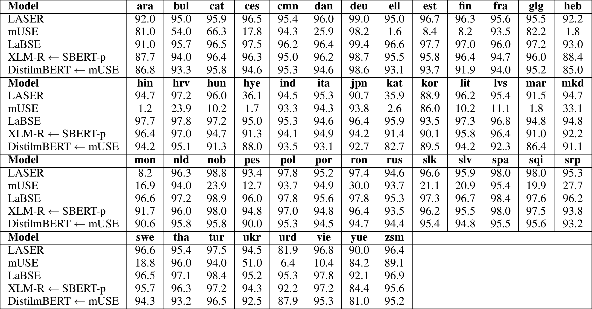
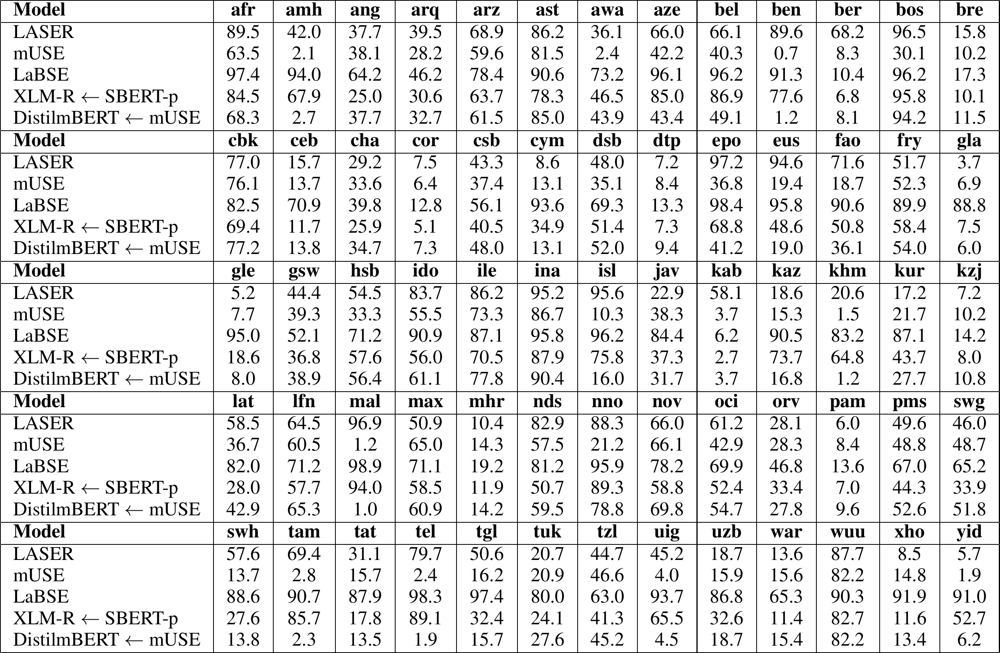

# 多语知识蒸馏研读笔记：用平行语料把单语句向量空间「拷」到别的语言

> **paper**：[Making Monolingual Sentence Embeddings Multilingual using Knowledge Distillation](https://arxiv.org/abs/2004.09813)（Nils Reimers, Iryna Gurevych；UKP-TUDA, TU Darmstadt；arXiv:2004.09813v2）
> **venue**：EMNLP 2020，[2020.emnlp-main.365](https://aclanthology.org/2020.emnlp-main.365/)
> **code**：[UKPLab/sentence-transformers](https://github.com/UKPLab/sentence-transformers)（论文称可扩展到 400+ 语言）
> **refs**：[SBERT（EMNLP 2019）](https://aclanthology.org/D19-1410/) · [XLM-R 1911.02116](https://arxiv.org/abs/1911.02116) · [LASER（TACL 2019）](https://arxiv.org/abs/1812.10464) · [LaBSE 2007.01852](https://arxiv.org/abs/2007.01852)
> **backbone**：教师为英文 SBERT（BERT-base，`nli-stsb` 或 `paraphrases`）；学生为 XLM-R / mBERT / DistilmBERT，主用 XLM-R
> **date**：2020-04（v1）→ 2020-10-05（v2）
> **modality**：文本句向量
> **languages**：主模型用 50 语平行数据训练；评测覆盖 Tatoeba 的 100+ 语

**一句话**：拿一个已经调好的英文句向量模型当教师，用平行句对训一个多语学生，要求它对原句和译句都输出教师给原句的那个向量——于是教师空间的性质被整体搬到了新语言上，且各语言天然对齐。

全文逐段中英对照见同目录 [zh.md](zh.md)。本文不重复对照译文，只把方法、训练数据取舍和八张表的口径写清。

这是 `sentence-transformers` 里 `paraphrase-multilingual-*`、`distiluse-base-multilingual-*` 这一系列权重背后的方法，也是后续多语嵌入工作（[mGTE](../GTE/GTE系列详解.md)、[BGE-M3](../BGE/M3/BGE-M3三功能统一详解报告.md)）反复引用的基线。它的分量不在模型复杂度——损失只有一个 MSE——而在把「造一个多语嵌入模型」这件事从「多任务联合训练」拆成了两个可以独立做的阶段。本文数字只取论文表内与正文写出的原值；正文说法与表格对不上的地方统一列在文末。

---

## 术语与记号

| 术语 | 含义 |
|------|------|
| $M$ / $\hat{M}$ | 教师模型 / 学生模型；论文用 $\hat{M} \leftarrow M$ 表示「$\hat{M}$ 学自 $M$」 |
| 平行句对 $(s_i, t_i)$ | $s_i$ 是源语言句子，$t_i$ 是它的译文；$t_i$ 可以来自不同的目标语言 |
| 向量空间对齐 | 不同语言里意思相同的句子，向量彼此靠近 |
| SBERT | 在 BERT 输出上做均值池化、用孪生结构微调出来的句向量模型 |
| XLM-R | 在 100 语 CommonCrawl 上预训练的模型，用 SentencePiece，词表 25 万 |
| mBERT / DistilmBERT | 多语 BERT（104 语 Wikipedia）及其蒸馏版 |
| LASER | LSTM 编码器-解码器，按翻译任务训练，编码器输出取 max-pooling 当句向量，93 语 |
| mUSE | 双编码器 Transformer，多任务 + 翻译排序任务，16 语 |
| LaBSE | BERT 双编码器，用 60 亿翻译对 + 翻译排序损失训练，109 语 |
| STS | 语义文本相似度：给一对句子打 0（无关）到 5（等义）的分 |
| Bitext retrieval | 从两个不同语言的大语料里找出互为译文的句对 |
| 相似性检索（Tatoeba） | 给定一句，在另一语言的候选池里找最相似的那句，算准确率 |
| 语言偏置（language bias） | 模型偏好某些语言或语言对，例如仅因同语言就把句子拉近 |
| 斯皮尔曼相关 $\rho$ | 预测分与金标分的秩相关，按惯例报 $\rho \times 100$ |

---

## 研究背景

### 好的句向量模型几乎都只有英文

把句子映射到稠密空间、让相似句子靠近，用途很广，但现成模型基本是单语的（多半只有英文），因为其他语言缺可用训练数据。多语/跨语场景里能用的句向量模型很少。

已有的两条多语路线，作者都指出了具体代价。

**LASER** 用编码器-解码器 LSTM 跑翻译任务，编码器输出当句向量。它擅长找精确译文，但**评估「不是精确译文」的两句话有多相似时表现偏弱**。训练成本也高：93 语、16 张 V100、约 5 天。

**mUSE** 在 SNLI 和十亿级问答对上做多任务训练，靠翻译排序任务对齐跨语空间。问题有三：多任务训练本身难调，容易灾难性遗忘，多个任务之间的平衡不直观；翻译排序任务计算开销巨大；而且随机选的候选译文效果平庸，必须用难负例——mUSE 的做法是先用随机负例训一版，再用这版去挖难负例，然后重训一遍。

作者要解决的是同一个目标的工程形态问题：能不能**先把英文模型调到满意，再单独一步把它扩到别的语言**，而不是把所有目标塞进一次联合训练。

---

## 相关工作中的位置

跨语表示的主流历史是在**词**层面：各语言分别训词向量，再用双语词典学一个线性映射到共享空间，甚至可以无平行数据地学。但 Conneau et al. 已经指出，把跨语词向量做成词袋来表示句子，在实际跨语迁移里效果很差。

句子层面就是 LASER / mUSE / LaBSE 这三家，共同点是**从头训一个多语模型**。本文的差别在于把 SBERT 当作可替换的输入：教师是什么性质，学生就继承什么性质。mBERT 和 XLM-R 虽然是多语预训练模型，但没见过任何平行数据，向量空间并未对齐——这正是本文要补的一步。

---

## 方法

### 一个 MSE 就是全部

需要两样东西：一个把源语言 $s$ 映到稠密空间的教师 $M$，以及平行句对 $((s_1,t_1),\ldots,(s_n,t_n))$。训练学生 $\hat{M}$ 使得

$$
\hat{M}(s_i) \approx M(s_i) \quad\text{且}\quad \hat{M}(t_i) \approx M(s_i)
$$

对小批量 $\mathcal{B}$ 最小化均方损失：

$$
\frac{1}{\lvert\mathcal{B}\rvert}\sum_{j\in\mathcal{B}}\Big[\big(M(s_j) - \hat{M}(s_j)\big)^2 + \big(M(s_j) - \hat{M}(t_j)\big)^2\Big]
$$

两项的目标都是教师对**源句**的向量 $M(s_j)$，这是整个方法的要点。第一项让学生在源语言上复刻教师（继承空间性质）；第二项让译句落到同一个位置（跨语对齐）。两件事用一个标签同时完成，不需要负例、不需要排序任务、不需要多任务配比。

**图在讲什么。** 左侧是一对平行数据：英文 `Hello World` 和德文 `Hallo Welt`。英文句同时进教师模型（蓝）和学生模型（绿），德文句只进学生。教师输出一个英文句向量（图中示意为 `0.8 -0.2 0.3`），学生输出两个向量：英文的 `0.7 -0.1 0.3` 和德文的 `0.9 -0.2 0.4`。右侧两个 MSE-Loss 箭头都指向教师那一个向量——学生的英文输出和德文输出各自与教师英文向量算 MSE。图里没有任何负例、没有对比项，这就是「只有一个 MSE」的字面含义。注意教师在这一步是冻结的，只做推理。

学生 $\hat{M}$ 可以和教师同结构同权重，也可以是完全不同的网络。方法本身不限于 Transformer。

### 为什么学生用 XLM-R，而不是直接拿英文 SBERT 初始化

作者明确讨论过这个选择。英文 BERT 的 wordpiece 词表只有 3 万，主要是英文 token。用英文 SBERT 初始化学生会很糟：其他拉丁语系语言的词会被切成很短的字符片段，非拉丁字母的词直接映到 `UNK`。XLM-R 用 SentencePiece，不需要语言相关的预处理，词表 25 万、覆盖 100 语，适合做多语学生的起点。

这条取舍在实验里有直接证据：Tatoeba 附录里，塔加洛语（TL）和塔塔尔语（TT）不在 XLM-R 的 100 个预训练语言内，但只要给了平行数据，仍能训到 86.2 / 54.5 的准确率——词表覆盖比语言模型是否见过该语言更关键。

---

## 实验设置

### 平行语料：来源、筛选与配比

平行数据取自 **OPUS**，论文逐个列出：

- **GlobalVoices**：Global Voices 网站的新闻平行语料。
- **TED2020**：作者自己爬的约 4,000 场 TED 演讲字幕翻译，覆盖 100+ 语，随论文仓库发布。
- **NewsCommentary**：Project Syndicate 的政治经济评论，WMT 提供。
- **WikiMatrix**：从各语言 Wikipedia 挖的平行句，**只用打分高于 1.05 的句对**，低于这个阈值的质量常常很差。
- **Tatoeba**：语言学习用的大型例句与翻译库。
- **Europarl**：欧洲议会网站抽取的平行句。
- **JW300**：《Awake!》与《Watchtower》杂志的平行句，覆盖 300+ 语。
- **OpenSubtitles2018**：opensubtitles.org 的电影字幕翻译。
- **UNPC**：1994–2014 年人工翻译的联合国文件。

低资源语言对连平行句都难找，所以也试了**双语词典**：**MUSE**（110 部大规模真值双语词典）和 **Wikititles**（用 Wikipedia 跨语链接抽出的条目标题对，例如 "United States" ↔ "Vereinigte Staaten"，主题覆盖很广）。

训练时**按数据集平衡采样**：每个小批量从各数据集抽大致相同的条数，小数据集重复使用。

### 训练配置

学生 XLM-R，教师是在英文 AllNLI 和 STS benchmark 训练集上微调过的 SBERT（即 `bert-base-nli-stsb-mean-tokens`）。最多 20 个 epoch，批大小 64，10,000 步 warm-up，学习率 2e-5。开发集用的是**留出平行句上的 MSE 损失**——注意这意味着模型选择完全不依赖下游任务标签。作者之前的工作指出随机种子对小数据集影响很大，这里数据量到了数百万句对，种子间差异只有约 0.3 分。

§4.1 的主模型用 **50 语**平行数据训练成一个单一模型（脚注把语言代码全列了出来）。

### 对比的系统

| 系统 | 性质 |
|------|------|
| SBERT-nli-stsb | 英文教师本身；BERT-base + 均值池化，在 AllNLI 与 STSb 训练集上孪生微调 |
| mBERT / XLM-R mean | 多语预训练模型直接均值池化，**未见过平行数据** |
| mBERT- / XLM-R-nli-stsb | 用英文 AllNLI + STSb 微调多语模型（只有英文监督） |
| LASER | LSTM 编码器-解码器，93 语 |
| mUSE | 双编码器 Transformer，16 语 |
| LaBSE | BERT 双编码器，60 亿翻译对，109 语 |
| mBERT / DistilmBERT / XLM-R ← SBERT-nli-stsb | 本文方法，教师为 nli-stsb |
| XLM-R ← SBERT-paraphrases | 本文方法，教师换成在 5000 万+ 英文改写对上训练的 RoBERTa |

这里 `mBERT/XLM-R-nli-stsb` 是最关键的对照组：它和本文方法用的监督信号来源相同（英文 NLI+STS），差别只在有没有走平行数据蒸馏这一步。

### 评测任务与数据集

**多语 / 跨语 STS（STS 2017）**：原数据集含 EN-EN、AR-AR、ES-ES、EN-AR、EN-ES、EN-TR。作者做了两处扩展：把 EN-EN 每对中的一句**人工翻译**成德语得到 EN-DE；用 Google Translate 生成 EN-FR、EN-IT、EN-NL，并请对应语言的流利者抽样检查。指标是余弦相似度与金标分的斯皮尔曼 $\rho$。

**BUCC（bitext 挖掘）**：目标是从英文语料和另一语言语料里抽出互为译文的句对，涉及德、法、俄、中。每语 15 万–120 万句，其中约 2–3% 是平行的。数据切成训练/测试，训练集只用来定阈值，超过阈值的判为平行，指标是 F1。打分函数沿用 Artetxe & Schwenk 的 margin 形式：

$$
\mathrm{score}(x,y) = \mathrm{margin}\left(\cos(x,y), \sum_{z \in \mathrm{NN}_k(x)}\frac{\cos(x,z)}{2k} + \sum_{z \in \mathrm{NN}_k(y)}\frac{\cos(y,z)}{2k}\right)
$$

其中 $\mathrm{margin}(a,b) = a/b$，近邻用 faiss 取。

**Tatoeba（相似性检索）**：来自 LASER 的测试设定，每语最多 1,000 对英文对齐句，双向各找最相似句算准确率。附录按惯例报两个方向的平均。

---

## 实验结果

### STS：单语有竞争力，跨语是数量级的差距

表 1，STS 2017 单语设定（$\rho \times 100$）：

| 模型 | EN-EN | ES-ES | AR-AR | 平均 |
|------|---:|---:|---:|---:|
| mBERT mean | 54.4 | 56.7 | 50.9 | 54.0 |
| XLM-R mean | 50.7 | 51.8 | 25.7 | 42.7 |
| mBERT-nli-stsb | 80.2 | 83.9 | 65.3 | 76.5 |
| XLM-R-nli-stsb | 78.2 | 83.1 | 64.4 | 75.3 |
| **知识蒸馏** | | | | |
| mBERT ← SBERT-nli-stsb | 82.5 | 83.0 | 78.8 | 81.4 |
| DistilmBERT ← SBERT-nli-stsb | 82.1 | 84.0 | 77.7 | 81.2 |
| XLM-R ← SBERT-nli-stsb | 82.5 | 83.5 | 79.9 | 82.0 |
| XLM-R ← SBERT-paraphrases | **88.8** | 86.3 | 79.6 | **84.6** |
| **其他系统** | | | | |
| LASER | 77.6 | 79.7 | 68.9 | 75.4 |
| mUSE | 86.4 | **86.9** | 76.4 | 83.2 |
| LaBSE | 79.4 | 80.8 | 69.1 | 76.4 |

表 2，跨语设定：

| 模型 | EN-AR | EN-DE | EN-TR | EN-ES | EN-FR | EN-IT | EN-NL | 平均 |
|------|---:|---:|---:|---:|---:|---:|---:|---:|
| mBERT mean | 16.7 | 33.9 | 16.0 | 21.5 | 33.0 | 34.0 | 35.6 | 27.2 |
| XLM-R mean | 17.4 | 21.3 | 9.2 | 10.9 | 16.6 | 22.9 | 26.0 | 17.8 |
| mBERT-nli-stsb | 30.9 | 62.2 | 23.9 | 45.4 | 57.8 | 54.3 | 54.1 | 46.9 |
| XLM-R-nli-stsb | 44.0 | 59.5 | 42.4 | 54.7 | 63.4 | 59.4 | 66.0 | 55.6 |
| **知识蒸馏** | | | | | | | | |
| mBERT ← SBERT-nli-stsb | 77.2 | 78.9 | 73.2 | 79.2 | 78.8 | 78.9 | 77.3 | 77.6 |
| DistilmBERT ← SBERT-nli-stsb | 76.1 | 77.7 | 71.8 | 77.6 | 77.4 | 76.5 | 74.7 | 76.0 |
| XLM-R ← SBERT-nli-stsb | 77.8 | 78.9 | 74.0 | 79.7 | 78.5 | 78.9 | 77.7 | 77.9 |
| XLM-R ← SBERT-paraphrases | **82.3** | **84.0** | **80.9** | **83.1** | **84.9** | **86.3** | **84.5** | **83.7** |
| **其他系统** | | | | | | | | |
| LASER | 66.5 | 64.2 | 72.0 | 57.9 | 69.1 | 70.8 | 68.5 | 67.0 |
| mUSE | 79.3 | 82.1 | 75.5 | 79.6 | 82.6 | 84.5 | 84.1 | 81.1 |
| LaBSE | 74.5 | 73.8 | 72.0 | 65.5 | 77.0 | 76.9 | 75.1 | 73.5 |

三点结论。

**只用英文监督微调多语模型，单语尚可、跨语立刻崩。** XLM-R-nli-stsb 单语平均 75.3，跨语掉到 55.6；mBERT-nli-stsb 从 76.5 掉到 46.9。两个模型都见过多语预训练语料，但没见过平行数据，向量空间没对齐。这组对照是全文最有说服力的部分：加上平行蒸馏后，XLM-R ← SBERT-nli-stsb 的跨语平均从 55.6 跳到 77.9，**同样的英文监督，差 22 个点**。

**教师越好，学生越好，而且这个增益是免费继承的。** 换成 SBERT-paraphrases 教师（5000 万+ 英文改写对，**完全没碰过 STS 数据**），跨语平均再从 77.9 升到 83.7，单语从 82.0 升到表里印的 84.6（按三个单元格重算应为 84.9，见文末口径）。有意思的是它在 EN-EN 上拿到 88.8，超过了在 STSb 训练集上训过的 SBERT-nli-stsb 系（82.5）——在更宽的改写语料（主要来自 Wikipedia）上训练，对各种主题的泛化更好。对工程的含义很直接：**想提升多语效果，优先换教师，不必重做多语训练**。

**与专门的多语系统比。** 跨语平均 83.7 高于 mUSE 的 81.1、LaBSE 的 73.5、LASER 的 67.0。LASER 和 LaBSE 在 STS 上只拿到中游成绩，这和它们的训练目标一致——它们是为「找精确译文」优化的。

**学生骨干之间**：XLM-R 略领先 mBERT 和 DistilmBERT（跨语 77.9 / 77.6 / 76.0）。作者选 XLM-R 继续后面实验的另一个理由是工程性的：mBERT 和 DistilmBERT 依赖语言相关的分词工具，难以直接吃原始文本；XLM-R 的 SentencePiece 可以对所有语言直接用。

### BUCC：输给专做译文检索的方法，而且作者认为数据集本身有问题

表 3，F1：

| 模型 | DE-EN | FR-EN | RU-EN | ZH-EN | 平均 |
|------|---:|---:|---:|---:|---:|
| mBERT mean | 44.1 | 47.2 | 38.0 | 37.4 | 41.7 |
| XLM-R mean | 5.2 | 6.6 | 22.1 | 12.4 | 11.6 |
| mBERT-nli-stsb | 38.9 | 39.5 | 26.4 | 30.2 | 33.7 |
| XLM-R-nli-stsb | 44.0 | 51.0 | 51.5 | 44.0 | 47.6 |
| **知识蒸馏** | | | | | |
| XLM-R ← SBERT-nli-stsb | 86.8 | 84.4 | 86.3 | 85.1 | 85.7 |
| XLM-R ← SBERT-paraphrase | 90.8 | 87.1 | 88.6 | 87.8 | 88.6 |
| **其他系统** | | | | | |
| mUSE | 88.5 | 86.3 | 89.1 | 86.9 | 87.7 |
| LASER | 95.4 | 92.4 | 92.3 | 91.7 | 93.0 |
| LaBSE | **95.9** | **92.5** | **92.4** | **93.0** | **93.5** |

蒸馏把 XLM-R 从 47.6 推到 85.7 / 88.6，但 LASER（93.0）和 LaBSE（93.5）明显更高。作者没有回避，而是给出了解释和一个数据集质量上的保留意见。

**解释**：LASER 和 LaBSE 是专门为识别精确译文设计的；本文方法和 mUSE 构造的是「语义相似则靠近」的空间，而语义相近的两句话不一定互为译文。论文举的 BUCC 反例是一对未被标为平行的句子：德语句说「青年奥运会于 2014 年 8 月 16 至 28 日在南京（中国）举行」，英语句说「中国主办了 2014 年青年奥运会」——语义高度相似，所以本文模型和 mUSE 给了高分，但它不是翻译，细节（确切日期与地点）缺失。

**保留意见**：BUCC 的平行部分来自 News Commentary，非平行部分来自 Wikipedia，但**并不保证 Wikipedia 那部分真的不平行**。作者对 SBERT、mUSE、LASER 各分析了 20 个 DE-EN 假正例（共 60 对），认为其中 **57 对其实是高质量的有效译文**。所以 BUCC 的分数应谨慎解读：无法确定 Wikipedia 部分里有多少平行句，也不知道这对分数的影响有多大。

这一节的真正结论被作者写成一句方法论：**不存在一个普适的句向量空间**。找译文对就用 LASER / LaBSE，找语义相似句就用本文方法或 mUSE。

### Tatoeba：低资源语言上相对 LASER 的提升最大

表 4，准确率（JW300 作训练数据，并把数据量压到与 LASER 相同）：

| 模型 | KA | SW | TL | TT |
|------|---:|---:|---:|---:|
| LASER en → xx | 39.7 | 54.4 | 52.6 | 28.0 |
| LASER xx → en | 32.2 | 60.8 | 48.5 | 34.3 |
| XLM-R ← SBERT-nli-stsb en → xx | **73.1** | **85.4** | **86.2** | **54.5** |
| XLM-R ← SBERT-nli-stsb xx → en | **71.7** | **86.7** | **84.0** | **52.3** |

四种语言的平行句对规模分别是格鲁吉亚语 296k、斯瓦希里语 173k、塔加洛语 36k、塔塔尔语 119k。其中 **TL 和 TT 不在 XLM-R 的 100 个预训练语言里**——没有专门词表、语言模型也没为它们调过。TL 只有 36k 句对，却拿到 86.2 / 84.0，是这张表里最高的一档。摘要里「相比 LASER 最多提升约 40 个准确率点」就来自这里：KA 的 xx → en 方向 71.7 − 32.2 = 39.5。

附录两张表把范围铺到全部语言。**有平行数据的语言**（表 9）普遍在 90 上下，XLM-R ← SBERT-paraphrases 例如德语 98.7、西班牙语 98.0、印地语 96.4，较低的是阿拉伯语 87.7、希伯来语 88.4、粤语 84.4。**没有平行数据的语言**（表 10）方差大且总体偏低——爱尔兰语 18.6、卡比尔语 2.7、柏柏尔语 6.8。最直观的对照是塔加洛语：表 10 里（无平行数据）只有 32.4，表 4 里给了 36k 句 JW300 数据就到 86.2。模型学不会它没见过对齐信号的语言，这一点作者说得很直白。

**表在讲什么。** 论文表 9 的原始排版（自 PDF 裁切）。47 种语言 × 5 个系统，行是模型、列是 ISO 639-3 语言代码。看第四行 `XLM-R ← SBERT-p`：绝大多数格子在 90 以上，和上面两行的 LASER、LaBSE 基本同档，说明**只要给了平行数据，本文方法在各语系上都能把空间对齐**。再看第二行 mUSE：它只覆盖 16 语，所以 ell 1.6、heb 1.8、hin 1.2、mar 1.8 这些格子直接崩到个位数——这正是作者补训 `DistilmBERT ← mUSE`（末行）的理由，补训后同样这些格子回到 85–95。

**表在讲什么。** 论文表 10 的原始排版，结构同上，但这 65 种语言**本文没有给过任何平行数据**。`XLM-R ← SBERT-p` 这一行的数值散布极大：mal 94.0、tel 89.1、tam 85.7 还不错，但 gle 18.6、kab 2.7、ber 6.8、war 11.4 几乎等于随机。对照 LaBSE 那一行（gle 95.0、kab 6.2、ber 10.4）可以看出，LaBSE 在多数这些语言上见过训练数据，所以分数高得多——kab、ber 两列双方都低，是这两种语言本身难。合起来就是方法的硬边界：**蒸馏只能迁移「见过对齐信号」的语言**，没有平行句对时，XLM-R 的多语预训练本身兜不住。塔加洛语 tgl 在这里是 32.4，而表 4 中给 36k 句 JW300 后升到 86.2，是同一结论最干净的一组对照。

附录还有两处值得注意的方法学声明。其一，本文**把 Tatoeba 的训练数据全部排除**，而 LASER 用 Tatoeba 训过，且 Tatoeba 测试集与训练集重叠严重，因此 **LASER 的分数有被抬高的风险**；mUSE 和 LaBSE 是否爬过 Tatoeba 则未知。其二，因为 mUSE 只覆盖 16 语，作者额外训了 `DistilmBERT ← mUSE`，把 mUSE 的空间扩到更多语言——这正好演示了方法与教师无关：教师可以是 SBERT，也可以是 mUSE。

### 训练数据怎么选：领域比规模重要，且与语言对的相似度有关

表 5，分别训 EN-DE 和 EN-AR 双语模型，报 STS 2017 的 $\rho$（学生 XLM-R，教师 SBERT-nli-stsb）：

| 数据集 | #DE | EN-DE | #AR | EN-AR |
|--------|---:|---:|---:|---:|
| XLM-R mean | – | 21.3 | – | 17.4 |
| XLM-R-nli-stsb | – | 59.5 | – | 44.0 |
| MUSE 词典 | 101k | 75.8 | 27k | 68.8 |
| Wikititles 词典 | 545k | 71.4 | 748k | 67.9 |
| MUSE + Wikititles | 646k | 76.0 | 775k | 69.1 |
| GlobalVoices | 37k | 78.1 | 29k | 68.6 |
| TED2020 | 483k | **80.4** | 774k | 78.0 |
| NewsCommentary | 118k | 77.7 | 7k | 57.4 |
| WikiMatrix | 276k | 79.4 | 385k | 75.4 |
| Tatoeba | 303k | 79.5 | 27k | 76.7 |
| Europarl | 736k | 78.7 | – | – |
| JW300 | 1,399k | 80.0 | 382k | 74.0 |
| UNPC | – | – | 8M | 66.1 |
| OpenSubtitles | 21M | 79.8 | 28M | 78.8 |
| 全部数据集 | 25M | **81.4** | 38M | **79.0** |

表 6，只用 TED2020 的前 $k$ 句：

| 数据量 | EN-DE | EN-AR |
|--------|---:|---:|
| XLM-R mean | 21.3 | 17.4 |
| XLM-R-nli-stsb | 59.5 | 44.0 |
| 1k | 71.5 | 48.4 |
| 5k | 74.5 | 59.6 |
| 10k | 77.0 | 69.5 |
| 25k | 80.0 | 70.2 |
| TED2020 全量 | 80.4 | 78.0 |

**英德：数据少也够，领域几乎不重要。** 各数据集之间差异很小（71.4 到 80.4），新闻、字幕、议会辩论、杂志都行。表 6 里**仅 1,000 句**就把 EN-DE 从 59.5 推到 71.5，25k 句到 80.0，已经逼近全量 TED2020 的 80.4。

**英阿：结论不一样，而且「更多数据」会反向。** 最刺眼的一格是 UNPC：**800 万句**平行联合国文件只拿到 66.1，而 **Tatoeba 仅 2.7 万句**就有 76.7。表 6 里 EN-AR 随数据量上升的速度明显慢于 EN-DE（1k 时只有 48.4）。作者的归纳是：对于不相似的语言对，**平行数据的领域比规模更重要**——联合国文件的文体离 STS 的日常句子太远。

**双语模型略好于多语模型。** 多塞语言会稀释容量，Conneau et al. 称之为「多语之咒」。

### 目标语言直训 vs 从英文迁移

表 7，韩语 STS benchmark（KorNLI / KorSTS，由 Ham et al. 把英文 SNLI、MultiNLI、STSb 机翻成韩语，开发集和测试集由专业译者后编辑）：

| 模型 | KO-KO |
|------|---:|
| LASER | 68.44 |
| mUSE | 76.32 |
| **在 KorNLI & KorSTS 上训练** | |
| Korean RoBERTa-base | 80.29 |
| Korean RoBERTa-large | 80.49 |
| XLM-R | 79.19 |
| XLM-R-large | 81.84 |
| **多语知识蒸馏** | |
| XLM-R ← SBERT-nli-stsb | 81.47 |
| XLM-R-large ← SBERT-large-nli-stsb | **83.00** |

同骨干对比：XLM-R 直接在韩语 NLI+STS 上训得 79.19，走蒸馏得 81.47；XLM-R-large 分别是 81.84 和 83.00。蒸馏版还高于两个韩语原生 RoBERTa。

作者点出的意义不只是分数：直接在韩语数据上训，得到的是**只会韩语**的模型；走蒸馏得到的是**英韩向量空间对齐**的模型。换句话说，即使目标语言有现成的任务数据，走蒸馏也没有性能损失，还白拿跨语对齐。

---

## 分析

### 语言偏置：聚合多语句池时才会暴露

前面所有实验的句池都是单语的（源池、目标池各自同一语言），测不出语言偏置。作者把多语 STS 的全部句对**合并成一个池子**再算相关：没有偏置的模型，在合并池上的表现应当接近各子集表现的平均；有偏置的模型会把某些语言组合系统性排高，拉低合并池的秩相关。

表 8（Expected Score 是表 1 与表 2 共 10 个子集的平均，Actual 是合并成一个池后的相关）：

| 模型 | Expected Score | Actual Score | 差值 |
|------|---:|---:|---:|
| LASER | 69.5 | 68.6 | −0.92 |
| mUSE | 81.7 | 81.6 | −0.19 |
| LaBSE | 74.4 | 73.1 | −1.29 |
| XLM-R ← SBERT-paraphrases | 84.0 | 83.9 | **−0.11** |

LASER 和 LaBSE 的差值在 $p<0.001$ 下统计显著，mUSE 和本文方法的差值微小且不显著。我按表 1、表 2 的 10 个格子重算了四行的 Expected Score（LASER 69.52、mUSE 81.74、LaBSE 74.41、本文 84.07），与表内一致，这个口径可以放心引用。

**图在讲什么。** 四个子图分别是 LaBSE、LASER、mUSE、SBERT（本文方法），每张图把 XNLI 的英文前提句（红）和它们的俄语译文（蓝）编码后投到前两个主成分上。LaBSE 那张红蓝几乎被一条竖线劈开——语言本身主导了向量的主要变化方向，这就是「同语言的句子仅因为同语言而靠近」。另外三张红蓝充分混合。需要注意图和表 8 的侧重不同：**LASER 在这张二维投影里看起来是混合的，但表 8 仍测出 −0.92 的显著偏置**。前两个主成分解释不了全部方差，所以这张图只能当作 LaBSE 偏置的直观证据，不能反过来用它为 LASER 背书——论文的图注也只点名了 LaBSE。

---

## 结论与局限

结论是：用多语知识蒸馏可以把单语句向量模型变成多语、且各语言向量空间对齐的模型；源语言空间的性质会被转移到目标语言；多个语言可以在同一次训练里一起加进来。作者强调这种**分步训练**的好处——先在高资源语言上做出一个具备所需性质的模型（比如适合聚类的），再独立地一步扩展语言支持；这比以往的联合训练简单得多，同时把语言偏置压到最小。

论文自己说明或在数据里暴露的边界：

- **没有普适的句向量空间**。找精确译文 LASER / LaBSE 更好（BUCC 93.0 / 93.5 对 88.6），找语义相似句本文方法更好（跨语 STS 83.7 对 67.0 / 73.5）。选型要看任务。
- **多语之咒**：双语模型优于多语模型，容量被语言数摊薄。
- **没有平行数据的语言基本学不动**：附录表 10 里大量语言落在 10–60 区间，塔加洛语在有/无平行数据下是 86.2 对 32.4。
- **领域敏感性随语言对相似度上升**：EN-AR 上 800 万句 UNPC（66.1）不如 2.7 万句 Tatoeba（76.7）。换目标语言时不能照搬英德的数据配方。
- **BUCC 数据集质量存疑**：60 个被判为假正例的 DE-EN 对里，作者认为 57 个其实是有效译文；该基准的绝对分数应谨慎使用。
- **LASER 的 Tatoeba 分数可能偏高**（训练集与测试集重叠），mUSE / LaBSE 是否用过 Tatoeba 数据未知。这意味着表 4 的对比对 LASER 偏有利，本文的实际优势可能更大。
- **STS 2017 的扩展部分含机器翻译**：EN-FR、EN-IT、EN-NL 由 Google Translate 生成（仅抽样人工检查），EN-DE 是人工翻译。
- **教师的能力上限就是学生的上限**：方法只做转移，不会在源语言上创造新能力。

---

## 与表格核对后的几处口径

**「双语模型比多语模型好 2.2（EN-DE）/ 1.2（EN-AR）点」只有后者能和表格严格对上。** EN-AR：表 5「全部数据集」79.0 减去表 2 里 XLM-R ← SBERT-nli-stsb 的 77.8，正好 1.2。EN-DE：表 5 的 81.4 减去表 2 的 78.9 是 **2.5**，不是 2.2。引用这组数时建议直接写两张表的原值。

**「10 个语言」与「50 个语言」。** §5 的正文把 §4.1 的那个模型称作 "the model trained for 10 languages"，而 §4.1 自己写的是 "a single model with parallel data for 50 languages"（脚注列出的语言代码也有 50 多条）。以 §4.1 与脚注为准。

**表 8 的 Expected Score 口径已验算。** 它是表 1 的 3 个单语子集加表 2 的 7 个跨语子集、共 10 个子集的算术平均，四行逐一重算都与表内吻合（见上）。

**「最多 40 个准确率点」的来源是 KA 的 xx → en 方向**（71.7 − 32.2 = 39.5）。表 4 其余七格的提升是 +18.0（TT xx→en）到 +35.5（TL xx→en），中位在 30 出头，不要把 40 当成普遍幅度。

**表 1 里 `XLM-R ← SBERT-paraphrases` 的 Avg 列与它自己的三个单元格不一致。** 三格是 88.8 / 86.3 / 79.6，算术平均 84.9，表里印的是 **84.6**。我把表 1 的全部 11 行、表 2 的全部 11 行都重算了一遍，只有这一格对不上（其余均在四舍五入误差内）。这一点不影响结论方向，但有两处要注意：引用「单语平均」时建议写 84.9 或直接给三个分项；而表 8 的 Expected Score（84.0）是用 **10 个子集的单元格**算的，与这个印错的 84.6 无关，所以表 8 不受影响。

**SBERT-paraphrases 在 EN-EN 上超过 SBERT-nli-stsb 系，不说明 STS 训练无用。** 88.8 对 82.5 的比较里，教师的训练语料规模差了一个量级（5000 万+ 改写对对 AllNLI+STSb），变量不止一个。

**图 2 不能用来判断 LASER 无偏置**，理由见上。

---

## 可迁移的工程判断

**把「做好单语」和「扩语言」解耦。** 这是本文最有复用价值的结论。先在英文（或中文）上把嵌入模型的性质调到位——池化方式、是否适合聚类、维度、指令格式，然后用平行数据做一次蒸馏把语言铺开。想换性质就换教师重蒸一次，不必重做多语数据配方。

**换教师是最便宜的提升手段。** 同一套平行数据、同一套训练配置，仅把教师从 nli-stsb 换成 paraphrases，跨语平均 77.9 → 83.7。这条路径的成本几乎只有一次蒸馏训练。

**学生骨干先看词表覆盖，再看预训练语言列表。** XLM-R 的 SentencePiece + 25 万词表是它被选中的直接原因；而 TL / TT 这两个不在预训练语言里的例子说明，只要词表能把字符切出来、又有平行数据，仍能训到高分。反过来，用英文 SBERT 的 3 万 wordpiece 词表当多语起点是明确的错误选择。

**开发集可以不依赖下游标签。** 本文用留出平行句上的 MSE 做模型选择。目标语言没有 STS / 检索标注时，这是一个可直接照搬的做法。

**低资源语言对要先验证领域，不要堆量。** UNPC 的 800 万句不如 Tatoeba 的 2.7 万句。先用几千到几万句做小规模试验（表 6 显示 1k 句就能看出趋势），确认领域合适再投入规模。

**选基准要跟着目标任务走。** 一个模型在 BUCC 上落后 5 个点、在跨语 STS 上领先 16 个点，并不矛盾——两个基准测的是不同的东西。做译文挖掘/去重就看 BUCC 类指标，做跨语检索/聚类就看 STS 与检索指标。

**上线前测一次语言偏置。** 做法很轻：把各语言的评测对合并成一个池，比较合并后的指标与各子集指标的平均。多语检索如果是在混合语言的候选池里做，这个差值直接对应线上损失。

相关阅读：[Embedding 蒸馏技术详解](../Embedding蒸馏技术详解.md)、[Margin-MSE 研读笔记](../Margin-MSE/Margin-MSE研读笔记.md)（排序侧的跨架构蒸馏，同样是「只对齐该对齐的量」）、[GTE 系列详解](../GTE/GTE系列详解.md)（mGTE 的多语路线）、[BGE-M3 详解](../BGE/M3/BGE-M3三功能统一详解报告.md)、[对比学习与 InfoNCE 精讲](../对比学习与InfoNCE精讲.md)。
